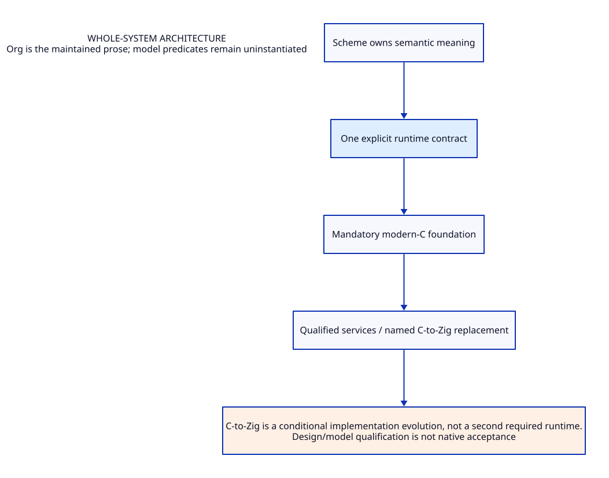

#+TITLE: Whole-system architecture
#+SETUPFILE: ../../modeling/org/setup.org
#+CATEGORY: architecture

* RESEARCH Whole-system architecture :architecture:
:PROPERTIES:
:ID: 58c06987-c2d4-50f6-aaec-e78ceba3e846
:CUSTOM_ID: architecture-contract
:OWNER: Gambit architecture research
:STATUS: design-only
:EVIDENCE_CLASS: source-and-model-design
:END:

Scheme semantic ownership; mandatory modern-C foundation; explicit execution/memory/control/FFI contracts.

C-to-Zig is a conditional implementation evolution, not a second required runtime.

** Contract and ownership
:PROPERTIES:
:CUSTOM_ID: ownership
:END:
One Scheme semantic contract; one selected implementation owner for each mechanism. C-facing capability remains mandatory. Imported alternatives are comparisons, not simultaneous deployment decisions.

** Models and views
:PROPERTIES:
:CUSTOM_ID: models
:END:
- [[file:models/sysml/architecture.sysml][SysML architecture and necessary requirements]]
- [[file:diagrams/overview.d2][Maintained D2 view source]]
- 

#+NAME: architecture-sysml-source
#+INCLUDE: "models/sysml/architecture.sysml" src sysml

#+NAME: architecture-d2-source
#+INCLUDE: "diagrams/overview.d2" src d2

** OPEN Evidence and admission gaps
:PROPERTIES:
:ID: 6cc0c621-15de-5fda-a868-f6be0f91e0ad
:CUSTOM_ID: gaps
:STATUS: unresolved
:END:
Source reading, model validation, checked proof, native semantic acceptance and measured benefit are distinct. No validation result satisfies the runtime gates automatically.

** Study catalogue
:PROPERTIES:
:CUSTOM_ID: studies
:END:
#+NAME: architecture-studies
| Study | Evidence lineage |
|---+---|
| [[file:studies/gambit-centered-backend-redesign.org][gambit-centered-backend-redesign]] | ~ab8249e2e0f8~ |
| [[file:studies/gambit-modernization-direction.org][gambit-modernization-direction]] | ~2e0c503befe5~ |
| [[file:studies/gambit-modernization-foundation-evidence.org][gambit-modernization-foundation-evidence]] | ~7d773cfe1313~ |
| [[file:studies/gambit-modernization-foundation-matrix.org][gambit-modernization-foundation-matrix]] | ~1668bd3707c1~ |
| [[file:studies/gambit-modernization-foundation.org][gambit-modernization-foundation]] | ~b9bf6016d6fa~ |
| [[file:studies/modernization-leverage-matrix.org][modernization-leverage-matrix]] | ~122ee74f034e~ |
| [[file:studies/modernization-quantified-benefit.org][modernization-quantified-benefit]] | ~740514c6c739~ |
| [[file:studies/modernization-system-architecture.org][modernization-system-architecture]] | ~f134b9bffc51~ |
| [[file:studies/modernization-system-evidence.org][modernization-system-evidence]] | ~1ddecf90105c~ |
| [[file:studies/zig-llvm-runtime-modernization.org][zig-llvm-runtime-modernization]] | ~7fca07365916~ |
| [[file:studies/zig-runtime-modernization-evidence.org][zig-runtime-modernization-evidence]] | ~cc3325fd6390~ |

** Cross-cutting references
- [[file:../../index.org][Development architecture]]
- [[file:../../catalog.org][Complete source-to-Org and diagram migration map]]
- [[file:../../research/validation.org][Validation boundary and retained receipts]]

** Column view for local research obligations
#+BEGIN: columnview :id local :format "%ITEM %STATUS %EVIDENCE_CLASS"
#+END:
