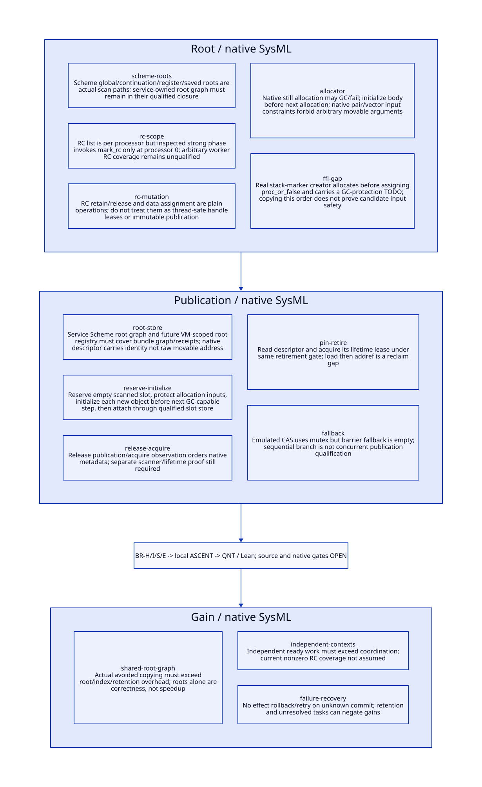

#+TITLE: Registry Bundle Roots, C Visibility and Publication Cuts
#+SETUPFILE: ../../modeling/org/setup.org
#+CATEGORY: toolchain
#+OPTIONS: toc:3 num:t
#+PROPERTY: header-args :eval never

* RESEARCH Architecture decision :gambit:gerbil:modern_c:
:PROPERTIES:
:CUSTOM_ID: bundle-root-publication
:AUTHORITY: BundleRootPublication
:STATUS: conditional-local-models-source-platform-open
:EVIDENCE_CLASS: source-and-local-formal-research
:END:

Gambit remains the semantic compiler/runtime and modern C foundation; Gerbil owns the
incremental service, immutable bundle identities and ordered event delivery. Root
coverage, C visibility and reader lifetime are three distinct contracts. An atomic
native pointer is neither a registered Scheme root nor a safe movable-object address.
The complete registry/event/receipt bundle from the previous study must satisfy all
three contracts at publication and every later dereference.

[[file:models/sysml/bundle-root-publication.sysml][SysML]] owns root/publication families, five refinement routes, benefit rows and seven
open gates. [[file:../../modeling/tools/bundle-root-publication-study.py][Python]] transports native SysML to [[file:../../modeling/ascent/bundle-root-publication.rules.scm][actual ASCENT DSL]], [[file:../../../models/build/bundle_root_parameters.qnt][QNT parameters]],
[[file:bundle-root-publication-matrix.org][Org matrix]] and [[file:diagrams/bundle-root-publication.d2][D2]] / . [[file:../../../models/build/bundle_root_publication.qnt][QNT]], [[file:../../../models/build/BundleRootPublication.lean][Lean]] and [[file:../../../evidence/research/bundle-root-publication/checks.json][receipts]] distinguish local
checks from source/native/platform admission. No runtime/compiler implementation,
native test or performance experiment is performed.

* RESEARCH Root and allocation source evidence :source:gc:
:PROPERTIES:
:CUSTOM_ID: bundle-root-source
:END:

| Actual path | Inspected source fact | Design consequence |
|---+---+---|
| [[file:../../../vendor/gambit/lib/mem.c::277][PSTATE_MEM]], [[file:../../../vendor/gambit/lib/mem.c::306][rc_head]], [[file:../../../vendor/gambit/lib/mem.c::723][register_rc]] | RC chain belongs to processor memory; registration links plain prev/next pointers | RC allocation is not a VM-wide concurrent root registration protocol |
| [[file:../../../vendor/gambit/lib/mem.c::3969][mark_rc]], [[file:../../../vendor/gambit/lib/mem.c::6845][strong phase]] | mark_array scans the address of h->data; inspected strong phase calls mark_rc only for processor 0 | Cannot infer scanning of a nonzero processor's RC chain from successful registration |
| [[file:../../../vendor/gambit/lib/mem.c::760][release_rc / addref_rc]], [[file:../../../vendor/gambit/lib/mem.c::806][data/set_data_rc]] | Plain refcount increments/decrements and Scheme data load/store | Not atomic leases, moving-pointer read protection or publication barriers |
| [[file:../../../vendor/gambit/lib/mem.c::6591][mark_global_variables]], [[file:../../../vendor/gambit/lib/mem.c::6852][strong root work]] | Global cells partitioned among processors; continuation/register/saved roots also scanned | A service-owned Scheme root graph can use these existing root categories, conditional on complete generated root/holder closure |
| [[file:../../../vendor/gambit/lib/mem.c::1487][alloc_scmobj contract]], [[file:../../../vendor/gambit/lib/mem.c::1647][GC slow path]] | Non-NULL processor allocates still objects; body initialized before next allocation; error returned as fixnum; slow path can invoke GC | Protect inputs before allocation; no unchecked object result or uninitialized body across next collection-capable step |
| [[file:../../../vendor/gambit/lib/mem.c::1742][make_pair / make_vector]] | Input car/cdr/init must not be movable; still inputs require independent reachability or nonzero count | Merely adding a root does not satisfy the nonmovable-argument requirement |
| [[file:../../../vendor/gambit/lib/c_intf.c::6511][make_sfun_stack_marker]] | Allocates vector before assigning proc_or_false and records an explicit GC-protection TODO | Real unresolved root-ordering seam; not a template proving arbitrary callback/candidate inputs protected |

These are source observations, not a demonstrated failure of a selected native binary.
In particular the RC scanner mismatch remains an admission gap; this study does not
silently patch RC ownership or declare every RC user broken. [[file:../../../vendor/gambit/lib/mem.c::684][cleanup_rc]] frees the chain;
positive native refcount is not permission to outlive processor teardown.

* RESEARCH Root graph and handle representation :contract:
:PROPERTIES:
:CUSTOM_ID: bundle-handle-contract
:END:

#+begin_src text :eval never
BundleHandle = (VM domain, service authority, slot identity, incarnation)
NativeDescriptor = {BundleHandle, immutable profile/receipt metadata}
RootSlot = GC-scanned slot containing false OR an initialized Scheme graph
Lease = {handle, accounted holder, admission/retirement domain, completion identity}
#+end_src

The descriptor contains an opaque identity, not a cached ___SCMOBJ or body pointer.
The service keeps the bundle reachable through a Scheme-owned strong root graph with
qualified global/continuation/register roots. A VM-scoped RootRegistry for native
holders is a modernization contract requiring integration into collector membership,
scanner ownership, slot update and teardown; it does not already exist merely because
RC allocation exists. Independent worker admission must close that mapping rather
than restrict all future service work to processor 0 indefinitely.

The global scanner has distinct layouts: SINGLE_VM walks global-cell sublists,
while the [[file:../../../vendor/gambit/lib/mem.c::6634][multiple-VM branch]] scans the owning VM glos array. Service handles therefore
carry the VM domain; a same-spelling global name is not a cross-VM root receipt.

A native borrower resolves a handle only through the owner VM's qualified entry/root
protocol. After a safepoint, any movable reference must be reloaded from the updated
slot or remain in an actual scanned/restored Scheme root. Keeping a graph alive does
not freeze its addresses. Still allocation can stabilize the outer object while its
referents remain movable; it does not remove the need to scan/update child references.
Permanent allocation is not a general snapshot-retirement strategy.

The root index includes current bundle, candidate construction roots, retained event
receipts/results, old read snapshots, saved continuations and native pins. None of
these is implied by a single producer-local pointer. Bundle field mutation and root
registration/retirement must coordinate with the real GC participation/scan phase;
a C mutex used only by service readers does not synchronize an uninvolved collector.

* RESEARCH Allocation, initialization and transfer cuts :allocation:
:PROPERTIES:
:CUSTOM_ID: bundle-allocation-cuts
:END:

| Cut | Required custody | Failure / next step |
|---+---+---|
| Before candidate allocation | Source inputs and any existing partial graph in valid Scheme roots; reserve a scanned empty slot initialized false | Slot reservation failure leaves old authority intact; do not expose an invalid slot |
| Allocation returns raw new object | Constructor owns the raw object and its allocator-specific count; input protection remains | Check NULL/fixnum error conventions of the actual API; initialize all reference-bearing fields before next GC-capable allocation |
| Initialized node attached | Qualified root-slot/parent store under GC/owner synchronization; partial graph remains rooted | Further allocations may proceed only after this transfer is truthful |
| Complete candidate | Registry/index/receipt initialized, immutable graph and symbol/profile relation checked, candidate root remains | Base/fence failure discards only candidate, retaining any captured holders |
| Commit | Service root owns complete graph before native descriptor becomes visible; exact EventId receipt committed with bundle | Acknowledgement may follow later; failure after commit cannot revoke this root as if candidate were unpublished |

A reserved empty root slot protects its current false value, not a future allocated
object. There must be no gap between allocation-local protection and rooted attachment.
A native raw-body interval cannot be abandoned into a GC-capable cleanup path while
still exposed as uninitialized. QNT therefore admits initialize immediately after raw
allocation before collection or ordinary abort; a native alternative raw-free path
would need its own allocator proof. Scheme generation/building should reuse actual
GVM root materialization; arbitrary C locals are not assumed conservatively scanned.

The current native pair/vector constructors cannot be called with arbitrary movable
payloads simply because another root exists. A native candidate builder must satisfy
the actual nonmovable input API or use a separately qualified allocate/initialize/
slot-reload sequence. No such implementation is provided in this research.

* RESEARCH C memory order and reader retirement :memory:
:PROPERTIES:
:CUSTOM_ID: bundle-c-memory
:END:

| Relation | Proposed ordering / synchronization | What it does not supply |
|---+---+---|
| Candidate native descriptor initialization -> publication | Initialization sequenced before release publication, or one owner/mutex transition | Does not register Scheme references with GC |
| Publication -> reader metadata observation | Matching acquire load or qualified mutex synchronization | Does not pin descriptor or stop Scheme relocation |
| Reader admission -> retirement exclusion | Read current handle and acquire its lifetime lease under the same retirement gate | Load pointer then addref leaves a reclamation window |
| Collector root read/update -> borrower use | Actual VM safepoint/participation and scanned slot protocol | Service-only acquire/release does not synchronize collector relocation |
| Last reader/continuation/receipt holder -> root removal | Close new admission, account all holders, prove quiescence and retry-retention policy | Acknowledgement, timeout or lexical return alone is insufficient |

[[https://open-std.org/jtc1/sc22/wg14/www/docs/n1570.pdf][WG14 N1570]] sections 5.1.2.4 and 7.17.3 supply the C data-race/atomic-order basis;
section 7.26.4 covers mutexes. These are language premises, not an implemented
happens-before proof for the current runtime. Atomic fields must not be accessed
through unsynchronized plain alternatives, and descriptor lifetime requires separate
synchronization even if a load itself is atomic.

[[file:../../../vendor/gambit/include/gambit.h.in::11014][Current sync-builtin branch]] uses __sync_val_compare_and_swap and __sync_synchronize.
[[https://gcc.gnu.org/onlinedocs/gcc/_005f_005fsync-Builtins.html][GCC documentation]] specifies legacy CAS/barrier behavior and recommends modern atomic
builtins for new code. This does not prove a given Darwin compiler selects that
branch. [[file:../../../vendor/gambit/lib/os_thread.c::715][Emulated CAS]] locks a hashed mutex, but [[file:../../../vendor/gambit/lib/os_thread.c::788][emulated_shared_memory_barrier]] is empty.
The sequential fallback in gambit.h.in:11071-11082 is not a concurrent publication
contract. Reusing the macro name without qualifying its selected expansion would
hide a platform gap. A mutex fallback must synchronize all readers/writers through
the same qualified lock; a fence alone does not legalize plain racing field access.

The native retirement gate must be short and noncallback. Do not hold it while
calling Scheme, allocating, waiting for GC participation or entering an expander;
those paths may reenter or require the same owner and deadlock. Prepare roots before
the gate; perform a qualified complete-state handoff; defer owner callbacks after it.
Detailed C11/target weak-memory and progress proofs remain open.

* RESEARCH Failure, acknowledgement loss and continuation :control:
:PROPERTIES:
:CUSTOM_ID: bundle-custody-outcomes
:END:

Before publication, allocation/validation failure leaves the authoritative bundle and
EventId index unchanged. Candidate/root cleanup belongs to its construction owner;
if a continuation or native borrower retains the partial initialized graph, cleanup
must transfer custody rather than release that graph. The C SETJMP path in
[[file:../../../vendor/gambit/include/gambit.h.in::9979][BEGIN_TRY/END_TRY]] restores the catcher, not arbitrary user roots/refcounts. Source
cleanup and nonlocal exit need explicit obligations.

After publication, the service root owns registry and original receipt even when
reply delivery is lost. Retry resolves that EventId in the same authority and returns
the stored receipt, not the current bundle generation. Releasing a producer-local
construction root is allowed only after a truthful service-root transfer; it cannot
remove the authoritative root while an unknown outcome remains. Process/VM death
and persistent journal recovery are additional protocols, not consequences of an
in-memory release store.

[[file:../../../vendor/gambit/lib/_thread.scm::4623][SMP call/cc]] reifies a continuation-return closure; [[file:../../../vendor/gambit/lib/_thread.scm::4794][dynamic-wind]] retains before/after
thunks and captured state. Restoring after commit preserves the same committed
receipt. Restoring before a registration instruction may be genuine new execution
with a fresh semantic occurrence, as in the preceding study; it cannot reuse an old
candidate root/permit or rewind service authority. arbitrary saved native PCs inside
allocation/publish protocols remain unqualified. Root retention and legal instruction
reexecution must both hold; either alone is insufficient.

Old receipt retention matters: if an index promises retry returning an old resulting
view, it may still root that view after readers drain. The service cannot drop it
merely because it is no longer current. A declared retry/retention policy, all receipt
references and continuation/native holders must close first. QNT root 0 is an
independent bootstrap snapshot with no historical receipt edge; dropping it does not
prove real persistent-graph subnodes become unreachable or quantify freed bytes.

* RESEARCH Iter and formal closure :iter:sysml:ascent:qnt:lean:
:PROPERTIES:
:CUSTOM_ID: bundle-root-closure
:END:

The real [[file:../../../../gerbil-gambit-bootstrap-audit/src/std/iter/macros.ss::130][iter range expansion]] supplies (+ k $step), whose effective declaration
views and private primitive graph were traced in prior studies. Shared registry/view
inputs require the root/lifetime protocol here before those lookup/chain transport
theorems apply. No iter registry effect or native lifetime test is inferred.

| Duty | Local scope | Remaining refinement |
|---+---+---|
| BR-H | 22 QNT scenarios including 10 negative controls, allocation/initialization cuts, GC relocation abstraction, old reader pin, receipt retention and saved candidate custody | Two symbolic objects, one reader/saved holder; no full graph, weak-memory, raw-free allocator or GC implementation simulation |
| BR-I | Ten Lean lemmas for rooted liveness, initialization guard, receipt pairing, retirement exclusion, abort authority, slot resolution, visibility premise, retained custody, no rollback and cost | These specify conditional properties, not source reachability/GC root maps or a C memory-model proof |
| BR-S | Five native SysML source/action/lemma routes checked by actual ASCENT DSL | Depends on AC-S; complete source scanner/holder/initialization relation remains open |
| BR-E | Independent platform need | Exact configured Darwin/GCC sync expansion, GC/FFI/VM participation, host attestation and measured work/span/memory |

QNT collect preserves only roots stipulated by its abstract scanned set and updates
symbolic slot addresses. rcWorkerScan is a negative control that omits candidate
coverage; it does not model all current runtime GC details. releaseStamp models a
required observation premise, not exhaustive C weak-memory outcomes. Normal acquire/
retirement admission is one atomic abstract gate step, with late pin/early retirement
controls exposing the unsafe split. No root-completeness claim follows from the model.

Eight local ASCENT scenarios check current/missing/stale/wrong-scope receipts,
synthetic-all, unqualified memory, missing anchor and missing model step. Seven real
gates remain open; inherited host registration is unresolved and not retried unchanged.
Org and D2 are SysML projections. No formal check is called native acceptance.

* RESEARCH Migration and net benefit :benefit:
:PROPERTIES:
:CUSTOM_ID: bundle-root-benefit
:END:

Migration dependencies are: identify owner VM and all holders; establish root-slot
coverage; qualify allocation/initialization and moving-reference access; integrate
bundle/EventId ownership transfer and reader retirement; remove old independent
registry/RC write authority only after all readers/writers migrate. VM-scoped native
root/collector membership is a substantive modern C GC/SMP refactoring dependency,
not solved by adding a compiler cache setting.

[[file:bundle-root-publication-matrix.org][Canonical matrix]] separates shared-root inputs, independent contexts and receipt
recovery. For n equivalent pure demands, work C, per-demand key/root validation V,
private materialization M, total root/index/publication/drain cost L and initial
qualification S, positive work benefit requires (n-1)*C > n*(V+M)+L+S. Root-table
scanning, gate contention, old receipts/snapshots, failed candidate cleanup and
continuation retention are costs. Existing Scheme root scanning/list sharing is
baseline. Lifetime correctness alone does not establish a compilation speedup.

Span can improve only when real independent contexts stop sharing implicit authority;
peak memory can grow when snapshots/continuations remain alive. Low reuse, frequent
GC or unbounded retry retention can negate savings. The next source proof must close
holder/scanner registration and actual allocation/publication cuts before any native
admission or performance claim.
