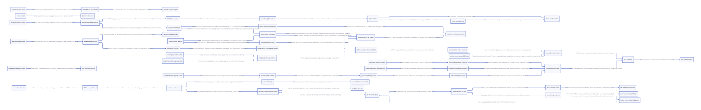

#+TITLE: C23 Development Refactor: Stable Native ABI and Phase Artifacts
#+SETUPFILE: ../../modeling/org/setup.org
#+OPTIONS: toc:3 num:nil
#+PROPERTY: header-args :eval never
#+PROPERTY: COLUMNS %ITEM %STATUS %OWNER %PROOF_SCOPE
#+TODO: RESEARCH DECIDED | ADMITTED RETIRED

* DECIDED Scope and structural authority :c23:macos:compiler:
:PROPERTIES:
:CUSTOM_ID: c23-development-refactor
:AUTHORITY: GambitDarwinDevelopment c23Feature0..5; c23Boundary0..3
:STATUS: design; concrete source refinement and performance open
:OWNER: existing native-descriptor and incremental compiler components
:END:

The design replaces per-module header parameterization and opaque whole-module
build completion with Scheme-owned native contracts and phase-specific compiler
results. Gambit remains the semantic compiler/runtime foundation; Gerbil owns
the incremental phase service; gxi/gxc become clients. C23 is the native language
baseline. Standard selection alone is not a build or SMP optimization.

[[file:models/sysml/macos-development.sysml][Existing native SysML]] owns feature policy and typed boundary references to
[[file:models/sysml/native-descriptor.sysml][ModuleSpec/FrameSpec fields]] and [[file:models/sysml/incremental-compiler-architecture.sysml][compiler stages]]. The [[file:c23-development-refactor-matrix.org][matrix]] and
 derive from those rows. The actual [[file:../../modeling/ascent/c23-development-design.rules.scm][ASCENT DSL]] checks the exact
role/stage/field/source/test/lemma/scope association. It cannot turn mathematical
key laws or historical timings into native source/performance acceptance.

The existing scheduler and owned-session QNT/Lean models remain authoritative.
[[file:models/quint/native_artifact_partition.qnt][A focused native-artifact companion]] models only the new ABI/module/native key
separation and publication cut; it is not another scheduler. Its [[file:models/lean/NativeArtifactPartition.lean][Lean laws]] state
structural noninterference and explicit publication conditions. No automated
QNT-to-Lean extraction or actual C dependency simulation is claimed for it.

* RESEARCH Evidence and current-source boundary
:PROPERTIES:
:CUSTOM_ID: c23-current-evidence
:END:

The local Scheme emitter writes SYMCOUNT, GLOCOUNT, LBLCOUNT and MODDESCR before
including gambit.h, then emits symbol/global/constant/procedure/module sections.
The modular module_generation.h.in still consumes these definitions for table
construction. A header file split alone leaves this protocol and token work intact.

The historical [[file:../../../../../patches/gerbil-v19-darwin/receipts/d802-darwin-gcc-frontend.json][D802 component record]] reports 15.45 to10.37 seconds for one large generated
C object, with identical object bytes after disabling macro provenance tracking.
Its reported GCC cumulative allocation is not peak RSS. [[file:../../../../../patches/gerbil-v19-darwin/receipts/d861-gambit-header-pch-rejection.md][D861]] reports PCH rejection
because GLOCOUNT was defined. These support investigating the interface boundary;
they do not prove a current-head speedup or a universal Darwin/Linux ratio.

Pre-first-compile Scheme execution is a different budget. Local Gerbil import
source reads a module, creates a context, expands its body, quotes syntax and
registers a delayed evaluator. It does not merely load inert declarations.
The retained five-second first-log ceiling is not evidence of a fixed sleep.
See [[file:studies/darwin-first-compile-boundary.org][the first-compile study]] and [[file:studies/interface-construction-aot-design.org][interface-construction program design]].

Some earlier imported documents describe a native-profile.m4 candidate. That
file was absent in the inspected local vendor tree during this design pass.
Those candidate implementation claims are not promoted to this checkout. This
study adds no configure policy, compiler flags, runtime code or native benchmark.

* DECIDED What the C23 baseline adds
:PROPERTIES:
:CUSTOM_ID: c23-standard-benefit
:PROOF_SCOPE: standard mechanisms and proposed applications, not speedup
:END:

The [[https://gcc.gnu.org/projects/c-status.html][compiler status table]] separates actual C23 additions from C11 foundations.
[[https://www.open-std.org/jtc1/sc22/wg14/www/docs/n3018.htm][WG14 N3018]] explains constexpr objects and their limits; [[https://www.open-std.org/jtc1/sc22/wg14/www/docs/n2669.pdf][WG14 checked arithmetic]]
provides the integer-checking rationale. These are language design sources, not
measurements of Gambit or qualification of the installed macOS toolchain.

#+NAME: c23-benefit-ledger
| Mechanism | Proposed use | Boundary |
|-----------+--------------+----------|
| constexpr objects | Typed scalar counts, masks and admissible compile-time constants | No constexpr functions; not a general compile-time interpreter; non-null pointer relocation tables need another representation |
| typeof / typeof_unqual; local object inference | Reduce private generated-helper type duplication and some compiler-specific glue | Public ABI stays explicitly typed; existing GCC typeof use is not new performance |
| nodiscard | Diagnose accidental ignoring of fallible setup/admission/publication outcomes | A diagnostic is not a linear ownership or cleanup proof |
| stdckdint checked arithmetic | Check count*elementSize+header and growth before native storage publication | Charge checks; do not consume overflow output; library/provider capability remains unqualified |
| Atomics, TLS, alignment, static assertion, Generic selection | Keep standard foundations for runtime contracts | Present before C23; no new multicore, GC, lock-free or tail-call guarantee |
| Ordinary functions, data and controlled inline | Replace repeated textual construction with one ABI and compiled shared helpers | Architecture work using older C mechanisms; not a benefit created by -std=c23 |

A compiler accepting the language mode does not qualify every SDK/library
facility, target ABI or attribute diagnostic. Capability identity includes the
actual compiler, headers/SDK, target, options and provider. Unqualified required
features refuse the profile or use an explicitly accepted implementation behind
the same interface. Do not add a second permanent handwritten ABI/flag authority.

* DECIDED Native emission boundary and proposed data schema
:PROPERTIES:
:CUSTOM_ID: c23-emission-boundary
:OWNER: C-MODULE; C-FRAME; C-LITERAL
:END:

#+NAME: c23-native-data-products
#+BEGIN_EXAMPLE
NativeAbiIdentity = {
  targetDataModel, compilerCallingMode, objectTags, rootAndFrameLayout,
  allocationAndBarrierContract,
  tailAndContinuationProtocol, effectiveAbiDefines, inlinePolicy
}
ModuleSpec = immutable {
  semanticModuleIdentity, nativeAbiIdentity,
  boundedCounts, symbolNames, suppliedDemandedOrder,
  literalGraphPlan, typedRelocations, frameAndPointIndices, initEffects
}
BindingInstance = mutable {
  bindingDomainAndGeneration, resolvedTables, roots,
  labelAndCodeResolver, enteredStage, completedStage, retainedFailureState
}
#+END_EXAMPLE

These are proposed contracts, not current C ABI declarations. Scheme owns names,
order, roots, liveness, control effects and phase semantics. One native layout
encoder consumes those decisions; runtime consumers stop reconstructing them
from independent macro conventions. ModuleSpec stays unchanged during fixup.
Current global/interning ownership must be traced; this design does not assume
all current tables are VM-local or copy every initialized object for each VM.

A constexpr object is a C-level constant, not a preprocessor definition. Existing
count-controlled ifdef/if branches must move into the Scheme producer or explicit
descriptor interpretation; a spelling substitution for define is not equivalent.
Genuine platform-selection macros may remain under the qualified ABI profile.

The stable public ABI is independent of individual module counts. Counts and
local storage extents are emitted into each module's private declarations/data.
Non-null addresses may appear in appropriate static-const objects and admitted
relocation plans; constexpr is reserved for eligible objects. Dynamic root,
label resolution, foreign initialization and interning remain explicit work.

Cold common setup/validation/decoding helpers can be compiled once per ABI/tool
profile. Truly hot operations may remain controlled inline. Putting every
helper into the public header repeats parsing and is not this design. Moving
every hot macro to a call can regress runtime cost. Tail-transfer/trampoline
edges remain governed by their own protocol; plain C calls are not substitutes.

Literal payload lowering reuses C-LITERAL ownership. Binary embedding or a new
initializer syntax is not credited with eliminating parser work without actual
producer/consumer accounting. No universal PCH or header-unit gain is selected.
The split only makes a genuinely invariant header possible; macro environment,
SDK/compiler options and other PCH conditions would still require qualification.

* DECIDED Artifact identities and invalidation
:PROPERTIES:
:CUSTOM_ID: c23-stage-keys
:OWNER: existing incremental compiler query engine
:END:

#+NAME: stage-key-contract
| Product | Complete identity inputs | Change behavior |
|---------+--------------------------+-----------------|
| Reader/syntax | Bytes, logical paths, reader profile and observed capabilities | Reader/path/effect changes reach affected semantic queries |
| Interface/phase program | Module and phase, binding projection, transformer/helper code, dependency programs, initializer plan | Equal exported names do not imply equal executable support |
| Expanded/GVM result | Semantic input, declarations/origins, actual dependency trace, optimizer facts and semantic target | Reusable only after graph/identity/effect closure; no raw live-context cache |
| Generated C | GVM/native contract, emitter identity, representation/FrameSpec ABI and diagnostics mapping | A layout change can invalidate emission; target-semantic changes may reach earlier stages |
| Common runtime object | Stable ABI, helper source, compiler/SDK/effective argv and native read closure | Module-local counts do not invalidate this object under the accepted split |
| Module object | Its C/data bytes, descriptor shape, stable ABI/header closure, compiler/SDK/effective argv | Local changes rebuild actual consumers; no dependency is omitted just because it looks private |
| Link manifest | Exact object/helper/library closure, ordered module metadata, linker and mode | Output files alone are not a complete accepted group |

Nonces for sessions/attempts identify ownership, not automatically semantic cache
identity. Generativity, source names and context-bearing values need a proved
reconstruction or mapping before that distinction can enable persistent reuse.
Unknown reader/eval/native/FFI observations deny a reuse permit. Ordered duplicate
argv entries and opaque legacy fragments are not silently normalized away.

Native-only tool/policy changes preserve semantic output /only when/ that input
is not observed by a semantic generator. ABI and allocation/barrier-contract changes propagate to every real
consumer; unchanged C function signatures alone do not qualify old objects. A FrameSpec change also retains old code/descriptors while captured
continuations, scanners or foreign users can still reference them. New object
publication does not authorize unloading an old image.

The companion key model assumes admitted noninterference: module count does not
enter common HeaderKey, while ObjectKey includes module identity, header, tool, source and module
descriptor. Concrete dependency closure must establish that assumption. Its
negative controls reject cross-module aliasing, stale count reuse, a changed in-flight snapshot and
opaque inputs. Failed publication preserves the old committed artifact and cannot
mint a new completion. Actual atomic filesystem publication remains open.

* DECIDED Phase execution and shared resource budget
:PROPERTIES:
:CUSTOM_ID: c23-phase-execution
:OWNER: Gerbil service; Gambit CompileContext
:END:

Consumers need binding interfaces and executable macro support before expansion;
they need not await unrelated phase-zero object compilation. Phase constructors
may reuse immutable program instructions and rebuild current semantic instances.
Required initialization, dynamic lookup, side effects, lexical marks, exceptions
and continuation behavior remain observable. A frozen lookup result is not a
substitute for a current-instance binding when the semantics require late lookup.

Gambit's mutable options/environment/ptree/GVM/target/primitive/emission state
must become request-owned or otherwise qualified. A mutex around the entire
compiler is not the desired architecture. Separate processes can supply isolation
while same-VM worker safety remains unqualified; they do not supply stage-level
reuse by themselves. The single resource scheduler budgets expansion, C jobs,
linking and retained memory together. It must avoid nested independent pools.

The initial correct query grain is module × phase × stage × semantic profile. Native
units retain approved module/host-function groups: arbitrary per-Scheme-function
C sharding can break labels, tail edges, shared literals and binding setup. Further
partitioning needs HostGraph/FrameSpec/point ownership proof, not a smaller file.

* RESEARCH Migration and real retirement
:PROPERTIES:
:CUSTOM_ID: c23-migration
:END:

#+NAME: retirement-order
| Cut | Migration | Retirement condition |
|-----+-----------+----------------------|
| Semantic schema | Seal ModuleSpec/FrameSpec/PointId and source/diagnostic/effect projections | One semantic owner and complete writer/alias census |
| Stable ABI/data encoder | Emit module-local counts/tables and separate mutable binding state | Every binding mode/setup/GC/control/FFI consumer accepted; old count-driven role unused |
| Stage publication | Publish exact completed semantic/C/native/link projections | Clients consume manifests; stale/failed/unknown output cannot masquerade as success |
| Owned compiler sessions | Move protected mutable state and macro instance ownership | Every protected writer migrated before retiring its lock/global path |
| Phase-query clients | gxi/gxc use the same engine and readiness contracts | Whole-module completion is no longer the sole dependency authority |

A seed-built service and its rebuilt producer have separate identities. Cold
bootstrap remains supported; a warm reused artifact is not reported as a fresh
complete bootstrap. Unknown outcomes retain storage/context/root responsibility.
No old path is retired merely because this design or its models validate.

* RESEARCH Work, latency and cost acceptance
:PROPERTIES:
:CUSTOM_ID: c23-gain-cost
:END:

Let R be demonstrated removed work and A added validation, instantiation,
serialization, synchronization, retained-artifact and helper-call work. Positive
work requires R>A under complete accounting. For fixed worker capacity P,
max(totalWork/P,criticalPath) is only a scheduling lower bound; a critical-path
reduction must be established separately. No C23 language feature supplies R.

#+NAME: gain-cost-matrix
| Mechanism | Removed work target | Added work / risk | Required observation |
|-----------+---------------------+-------------------+----------------------|
| Stable ABI/data | Repeated module-parameterized header expansion and duplicate layout decisions | Module data, relocations, helper calls, changed inline/code size | Expanded tokens, frontend phase work, object/runtime/GC/control parity |
| Stage projections | Unnecessary Scheme generation/C/object/link executions | Validation, trace storage, correct invalidation | Actual stage counts for no-change/leaf/macro/ABI/tool deltas |
| Compiled interface constructor | Repeated text/generic expansion of stable scaffolding | Fresh identity, initialization and mandatory effects remain | First-output prefix decomposition, semantic and failure parity |
| Phase readiness/private sessions | Unnecessary whole-module waits and global serialization | Context/IPC/RSS and scheduling costs | Dependency critical path, CPU utilization, retained memory and cancellation |
| C23 features | Type/constant/checking boilerplate and avoidable diagnostic mistakes | Capability gates and explicit overflow/outcome handling | Feature-specific compatibility and code/diagnostic evidence; no automatic speed claim |

Future performance qualification must separate cold bootstrap, no-change, leaf,
shared macro, ABI/tool change and failure/cancel; use the same valid source/tool
cohort, actual final outputs, meaningful first progress and unchanged ceilings.
Historical component timings and the user's reported platform ratio are not a
current performance baseline. No runtime/native implementation or test is run
by this design study.

* DECIDED Darwin evidence becomes replacement contracts, not a patch stack :macos:refactor:
:PROPERTIES:
:CUSTOM_ID: darwin-fundamental-reconstruction
:AUTHORITY: GambitDarwinDevelopment::reconstruction0..5
:OWNER: existing phase service, native descriptor, snapshot and scheduler components
:STATUS: source-grounded architecture; native source replacement and speedup open
:END:

The Darwin patches are historical experiments and counterexamples. They are
neither the delivery mechanism nor the future architecture. This study applies
none of them. An accepted refactor edits the owning Gambit/Gerbil modules and
retires their previous authority after consumer migration. A service that merely
invokes every old script, repeats every check and owns another queue has not
achieved that replacement. The six SysML reconstruction rows bind local source, historical bytes, existing
component/stage owners and actual QNT/Lean subjects. Gambit anchors are the local
vendor tree; Gerbil anchors are the existing gerbil-gambit-bootstrap-audit source
snapshot. This cross-snapshot comparison does not identify the installed gxc or
claim those Gerbil bytes reproduce each historical measured executable. ASCENT distinguishes those design links from source-refinement and
whole-request gain evidence.

** Diagnose four budgets before attributing a macOS slowdown
#+NAME: darwin-cost-budgets
| Budget | Source / historical observation | Architectural cause to address | Claim boundary |
|--------+---------------------------------+--------------------------------+----------------|
| Scheme interface/expansion and Scheme-to-C preparation | D802 retains >=120 seconds frontend silence before native submission; local import/optimizer work uses the driver mutex | Executable phase support, mutable compiler sessions and readiness are not explicit reusable products | Historical silence is not a current matched expansion timer; no fixed five-second sleep is inferred |
| Native preprocessing/parsing | D802: 11 MiB C, 97 MiB preprocessed; object 15.45 ->10.37 seconds with equal object bytes | Module-specific count/layout protocol repeatedly constructs a large native interface | Diagnostic provenance suppression is not elimination of semantic C expansion or Scheme expansion |
| Invalidation and resource scheduling | Local std/make already has coordinators/workers; base.ss has deferred native jobs and its own capacity counter | Whole-module readiness, shared mutable stages and multiple scheduling authorities restrict useful overlap and reuse | Twelve available cores cannot shorten an unavoidable serial path or manufacture independent queries |
| Request/launch/link/lifecycle | Original process branch uses fork/exec; D1510 preparation/coordinator increased HIT-request mean 0.88 ->1.59 seconds | Native request context and validation authority must be explicit and shared at the right lifetime | More coordination is not a gain; spawn, PATH, PTY, fd, signals and natural exit require equivalence |

The first object comparison is a 5.08-second / 32.88-percent reduction within
that historical request, not a whole-build forecast. GCC's 8915-to97 MiB figure
is cumulative allocator reporting, not peak RSS. Another small D861 object
attributed only 0.06 of 0.39 compiler seconds to preprocessing: do not extrapolate
the large embedded unit to all modules. D861's rejected PCH is not a valid PCH
speed comparison. The existing macOS/Linux gap is a research input to trace back to its original
records. Reorganizing the model does not invalidate prior tests or require
repeating them; package-level ratios are not copied onto every stage.

** Target service and native boundary
#+NAME: darwin-target-pipeline
#+BEGIN_EXAMPLE
gxi/gxc request
  -> Gerbil phase-query service + stable input cohort
  -> binding interface / executable phase construction program
  -> private lexical/module/optimizer instance + owned Gambit CompileContext
  -> expanded result -> GVM + ModuleSpec/FrameSpec/PointId
  -> generated modern C + private module data / shared compiled runtime helpers
  -> typed NativeAction through a platform backend
  -> atomic complete result manifest + diagnostics + custody of unfinished work
#+END_EXAMPLE

Gambit must expose structured phase results, preserve its Scheme, proper tail
calls and multi-shot continuations, and remove process-global compiler state as
the only phase authority. Gerbil owns the query graph, phase dependency tracing,
consumer projections, scheduling and cache admission. gxi and gxc use this one
engine. A long-lived service is optional physical placement, not the source of
correctness or speed by itself. Reusing a worker never authorizes reuse of its
mutable session state.

The first macro improvement is reuse of the construction program and admitted
semantic results, not copying live expander heaps. Fresh lexical marks, module
instances, ports, native bindings and required initialization effects retain
appropriate ownership. Macro/eval/reader code that observes undeclared I/O is
executed under an owned context but receives no reuse permission. Diagnostics,
exceptions, dynamic-wind and continuation reentry are part of the observable
contract. Arbitrary macros are not silently redefined as pure functions.

An independent query becomes runnable when its consumed interface AND executable
phase support are ready; it need not wait for unrelated native compilation.
Native successors can start as their own C units seal. One CPU/memory admission
budget covers phase workers and native follow-ups, rather than multiplying two
12-worker pools. Waiting parents release/delegate execution capacity while
retaining roots and unfinished-work custody. Process-isolated workers are one
valid placement while same-VM GC/SMP admission remains open; future same-VM
parallelism requires the owned contexts and runtime contracts, not deleting the
mutex or assuming green threads prove physical parallelism.

The native side replaces count-controlled public-header construction with
Scheme-generated ModuleSpec data, explicit mutable binding instances and an ABI
that does not vary with module-local counts. Common cold helpers are compiled
once per qualified ABI/tool profile; hot inlining is explicit. Literal payloads
remain under C-LITERAL ownership, with actual byte/parse cost charged. Modular
header files alone change organization, not expanded tokens. C23 supports this
engineering baseline but does not implement any of these phase boundaries.

NativeAction carries the executable identity, ordered argv, environment, cwd,
fd actions, signal policy, output mode and exit observation. Darwin launch
selection belongs behind this interface. It must preserve PATH resolution and
PTY behavior; a faster backend cannot silently change them. Legacy shell
interpretation retires only in the admitted compiler-action domain, while
Gambit's general process API retains its wider semantics. Unknown exit or cancel
results retain unfinished work; the manifest cannot manufacture completion.
Natural unload/exit remains separately observed, including old code/descriptors
held by continuations, scanners and foreign users.

LLVM/MLIR can consume the same GVM/native semantic contract behind another
backend. A native tool upgrade reaches its actual consumers; it does not
logically force Scheme re-expansion unless the semantic stage observed that
input. Frame/object/continuation ABI changes do propagate and retain old
metadata for live users. Zig is not required to create this separation.

** Exact expected work under each developer edit
#+NAME: darwin-edit-work-matrix
| Request / delta | Reusable under closed admission | Work still required | Forbidden shortcut |
|-----------------+--------------------------------+---------------------+--------------------|
| No change | Every completed demanded pure phase/native result | Input/trace/output validation, required effects and request diagnostics | Relabel an old run as fresh execution; assume zero wall time |
| Private Scheme leaf A | Other independent results; downstream consumed projections that remain equal after validation | Read/expand/lower/emit A as affected; compile/link changed native closure | Rebuild the whole package merely because A's source changed |
| Macro implementation changes, exports unchanged | Results not consuming changed phase support | Rebuild changed support and affected semantic consumers; refresh observed traces | Use export-name or SSI equality as support equality |
| Native C helper changes | Reader/expansion/GVM/C results that do not observe that native input | Helper object and affected link closure; ABI-dependent consumers if ABI changes | Let coarse configure identity automatically invalidate every semantic result |
| SDK/compiler/native options change | Unobserving semantic stages | Actual native/header/tool consumers and final link | Omit implicit includes/specs/environment to force cache reuse |
| Frame/object/GC contract changes | Only semantically independent stages with compatible declared projections | New lowering/layout/native consumers and old-metadata lifetime handling | Reuse old objects from unchanged C function signatures alone |
| Failure/cancel/unknown publication | Earlier immutable successful products that still qualify | Drain live tasks, retain roots/resources, refuse incomplete result group | Refund live work or publish a partial file set as complete |

These are acceptance expectations, not measured current behavior. The actual
macro/eval/native dynamic closure remains a source-refinement obligation. The
existing scheduler model's native-only and macro-support counterexamples are
reused rather than implementing a second scheduler here.

** Net benefit and root replacement order
Let W be actual useful plus repeated work, S the critical-path length, P the
admitted processor budget, and H the added validation/coordination/IPC work.
Work reduction and span reduction are separate: W_new+removed=W_old+H needs
removed>H for positive work return, while useful parallelism additionally needs
a shorter admitted critical path. Ideal lower bounds max(S,W/P) are not a native
speedup prediction. Do not substitute a tautological span inequality or model
step count for scheduling evidence.

Learning from [[https://simon.peytonjones.org/assets/pdfs/build-systems-original.pdf][Build Systems a la Carte]], scheduling and the decision to rebuild
are separate mechanisms. The existing [[file:iter-compiler-service-design.org::#iter-dune-source-learning][pinned Dune source study]] adds concrete lessons about
single-flight computations, dependency refresh after equal output and structured
error/dependency handling. Its cooperative collector is not a proof of Gambit
SMP safety. Gambit's advantage to explore is phase-aware reuse that knows
Scheme binding identities, executable macro support and GVM contracts; no
superiority over Dune or OCaml is demonstrated.

#+NAME: darwin-root-replacement-matrix
| Order / owner | Old authority that must disappear | Structural return | Added work and negative control |
|---------------+----------------------------------+-------------------+---------------------------------|
| Phase contracts and input broker | Whole live context and file timestamp as sole readiness identity | Reuse admitted construction/semantic products; native edits can stop at native consumers | Full observed dependency/effect closure; macro-support change must invalidate despite equal exports |
| Owned CompileContext / private instances | Process-global target/expander/optimizer mutation as the only execution model | Independent semantic sessions become schedulable | Instance/root lifetime and isolation; duplicate context control must fail |
| Stage query scheduler and publication | Separate opaque whole-module/native completion authorities and partial output acceptance | Earlier native work, single-flight demand and selective invalidation | Budget, cycle, cancellation and unknown-work custody; old queues retire only after all producers migrate |
| Scheme ModuleSpec/FrameSpec and stable C ABI | Count-driven shared header and independent layout/initializer reconstruction | Less repeated native construction; reusable common helper implementation | Relocations, calls, ABI validation, GC/control and diagnostic parity; header splitting alone gets zero gain |
| Typed native request / Darwin execution backend | Repeated shell/tool/environment interpretation and duplicated validation ownership | Fewer launch/preparation operations when equivalence allows | Preserve PATH/fd/PTY/signal/error semantics; D1510 regression remains the negative cost control |
| Client and bootstrap cutover | Parallel legacy request paths after consumers migrate | One service contract for CLI/interactive development | Keep full bootstrap separate from warm service; no skipped required bootstrap pass or forced process exit |

The experimental target is the complete ownership and dependency redesign above,
not a minimal runtime patch. Migration is ordered to make retirement reviewable;
no runtime code is implemented or old path retired by this study. Source-linked
models remain conditional and all six concrete source-refinement gates stay
open. C23 selection, a daemon, another cache, or more threads alone are insufficient.

* DECIDED One evidence chain, multiple cost projections :benefit:darwin:linux:
:PROPERTIES:
:CUSTOM_ID: conditional-benefit-framework
:AUTHORITY: GambitDarwinDevelopment::benefit0..7; BenefitAccounting; PlatformPhaseCost
:STATUS: conditional theoretical objectives; existing observations reused
:END:

The existing experiments, test failures and source records remain ONE evidence
base. Platform and metric projections are not separate research silos, new
benchmarks or a demand to re-prove prior observations. The chain is:

#+BEGIN_EXAMPLE
original experiment/source/test and its exact scope
  -> existing reconstruction owner and stage
  -> mechanism that can remove work or shorten an admitted path
  -> typed benefit ledger, conditions and counterexamples
  -> consumer/producer migration and retirement obligations
#+END_EXAMPLE

The eight SysML benefit rows reference the six existing reconstruction rows,
which already bind the historical files and actual source/model symbols. Each
row explicitly states what evidence is reusable and what NEW architectural
mapping remains. Historical component success stays established at its recorded
scope; historical regression stays a negative control. Neither requires a new
experiment merely because this document or model changes. Proposed code that
does not yet exist cannot acquire its implementation acceptance from an older
patch, so the source-replacement duties remain distinct from historical test
coverage. Missing projection/mapping is not automatically missing evidence.

** Parametric objectives, not invented timings
The [[file:models/lean/DevelopmentBenefit.lean][benefit kernels]] quantify natural costs/counts and signed platform differences.
They import the existing incremental compiler accounting law. All premises
about real action identity, isolation, effects, service capacity and measurements
remain explicit. SysML's numeric constraints are type-checked parameterized
specifications, not a solver proof of native speedup.

#+NAME: conditional-benefit-objectives
| Projection | Parametric gain condition | Real interpretation and negative control |
|------------+---------------------------+-------------------------------------------|
| Repeated phase construction | (n-k)*c > H | Within a homogeneous identity/cost cohort, n constructions become k; private instances and effects still execute. If n=k, this credit is zero |
| Repeated native construction | removed > helperBuild+data+validation | Only implementation that actually leaves repeated header construction earns build credit. A merely modular header earns none; runtime helper-call cost has its own observation/budget |
| Selective incrementality | cost(omitted actual actions) > validation+publication+storage | Use complete consumed projections. Native edits can preserve unobserving semantic results; an already incremental old path earns no fictional saving |
| Independent two-branch region | H_span < min(A,B) | Serial prefix+A+B becomes serial prefix+max(A,B)+H_span only when both branches are independently ready and resource-admitted |
| Qualified request preparation | (n-k)*c_prep > H_prep | Keep mandatory per-object checks and actual compiler actions. The retained D1510 0.88->1.59 regression falsifies unconditional coordination gain |
| Resident state | addedBytes <= reclaimedBytes | Count shared programs, private heaps, caches, pins and unknown tasks under one memory boundary; a persistent service can consume more memory |
| First useful feedback | removed critical-path time > added validation/IPC time | Compare the same semantic result/diagnostic, preserve error/effect order, and keep cold/warm scenarios separate; early logging is not success |
| Authority replacement | new independent authorities < old | One owner per responsibility after migration; fewer authorities is not a time saving or a person-day estimate |

H includes validation, coordination, transfer and interaction work in the SAME
unit as the credited work. Different action classes may have different weights;
use the general accounting law instead of pretending their costs are equal.
The retained required initialization work cancels only when both arms execute
it equivalently. The non-regression threshold is added<=removed; strict positive
work return requires added<removed.

** Explain the Darwin/Linux differential inside that same model
The user's observed at-least-fourfold package cost gap is the problem to explain
and reduce. Existing source-bound records supply the baseline facts. For each
additive CPU-work phase use the same action identities but retain each platform's
execution count n, unit cost c and overhead H:

#+BEGIN_EXAMPLE
W_D = n_D*c_D + H_D
W_L = n_L*c_L + H_L
W_D-W_L = (n_D-n_L)*c_L + n_D*(c_D-c_L) + (H_D-H_L)
#+END_EXAMPLE

The three terms separate extra work, higher cost per same work and extra
preparation/coordination. This exact algebra does not establish their empirical
values. It applies per homogeneous phase/cost cohort, with sums for varied
classes. Parallel wall time also depends on the real dependency/resource span;
CPU costs are not summed and relabeled elapsed build time.

The underlying compiler/header algorithm can be shared while its native launch,
frontend or link cost is amplified on Darwin. Conversely, a divergent Darwin
recipe can execute extra work. Establish the mechanism from the existing
records, not from the OS label alone. Historical D802 macro-provenance evidence
and the Darwin launch experiment are reusable platform-specific mechanism
seeds; they do not imply every Scheme expansion is Darwin-only. Shared compiler
contracts retain platform-specific realizations where they are justified.

Darwin gain does not mathematically imply Linux gain: added_D<removed_D may
coexist with removed_L<=added_L. The platform acceptance requirement therefore
combines reduced Darwin cost with Linux non-regression for the matched demand.
Linux may keep its cheaper direct realization of NativeAction; it need not run
Darwin preparation machinery. This is one shared contract and evidence chain,
not two unrelated compilers or duplicate test repositories. Existing eligible
Darwin/Linux results can discharge their respective observation fields; only
changed or uncovered claims require new evidence.

** Prevent double counting and theorem-to-timing promotion
Each original eliminated action must map to ONE declared work-credit owner.
A skipped complete C compilation cannot also earn an additional additive saving
for its internal preprocessing. Shared validation is charged once to its owner;
new interactions are charged, not hidden. Work, span, bytes and authority count
form a vector; there is no scalar total obtained by adding different units and
no multiplication of independently quoted speedup ratios.

ASCENT checks canonical credit owner/metric pairs and rejects an extra credit
attributed to another benefit. It also rejects wrong metric, Darwin-only
acceptance presented as Linux acceptance, and conditional algebra presented as
measurement. Real action-to-credit injectivity remains a source-refinement
premise; the DSL is not a native action tracer. The coupling theorem requires
an accounting equation with disjoint removed work and interaction costs; it
does not synthesize that premise from a diagram.

The existing QNT scheduler, session and native-artifact models remain in place.
Their histories witness dependency readiness, native-only changes, unknown-work
custody and coherent publication. The nine new Lean laws close conditional
algebra, not actual Darwin speedup. No new runtime implementation or native
performance test is introduced in this study.

* DECIDED Expand the net-gain basis and bind whole-request targets :plan:benefit:
:PROPERTIES:
:CUSTOM_ID: whole-request-target-plan
:AUTHORITY: GambitDarwinDevelopment::target0..1; lever0..7; ElapsedTargetBudget
:OWNER: existing compiler service, native descriptor and resource owners
:STATUS: source-bound conditional plan; no achieved ratio claimed
:END:

The accepted planning objective is approximately 2x Darwin/Linux elapsed cost,
with 1.5x as a stretch objective. These are targets for the matched package-build
scenario, not empirical forecasts, confidence intervals or new measurements.
The accepted 4-5x problem envelope remains an input from the existing evidence
and discussion. Its original source/tool/build/cache identities are retained
when allocating amounts; there is no new claim that every package has that gap.

** Whole-request budget and feasibility floor
Let D0/D1 denote before/after Darwin elapsed time and L0/L1 the corresponding
Linux times. R is removed elapsed time established by a faithful schedule
projection, and H includes validation, coordination and interaction on that
same elapsed boundary:

#+BEGIN_EXAMPLE
D1 + R = D0 + H
2x objective:   D1 <= 2*L1       iff D0+H <= 2*L1+R
1.5x objective: 2*D1 <= 3*L1     iff 2*D0+2*H <= 3*L1+2*R
Linux condition: L1 <= L0
Mandatory floor: F <= D1
#+END_EXAMPLE

The [[file:models/lean/DevelopmentBenefit.lean][existing benefit kernel extended with nine target laws]] proves these conditional
relations, the four fixed-baseline thresholds, two floor exclusions and the
moving-Linux-comparator limitation. The existing
[[file:../../../models/build/incremental_build.qnt::darwin_development_work][darwin_development_work budget module]] now carries the matching target admission
predicates and ten arithmetic histories. It does not introduce another scheduler.
The unit-normalized 16/20/4 examples represent 4x/5x baseline ratios exactly;
they are mathematical test inputs, not fabricated package timings. Cohort,
semantic parity, overhead, floor and moving-Linux negative controls are retained.
QNT-to-Lean extraction is not claimed for this handwritten scalar correspondence.

#+NAME: whole-request-ratio-thresholds
| Fixed Linux baseline | Target | Required net elapsed reduction | Original Darwin time removed | Original Darwin excess removed |
|----------------------+--------+--------------------------------+------------------------------+--------------------------------|
| D0=4L | 2x | R-H >= 2L | 50 percent | 2/3 |
| D0=5L | 2x | R-H >= 3L | 60 percent | 3/4 |
| D0=4L | 1.5x | 2R-2H >= 5L | 62.5 percent | 5/6 |
| D0=5L | 1.5x | 2R-2H >= 7L | 70 percent | 7/8 |

No per-lever percentage is invented to fill those totals. Linux improvement
lowers the allowed Darwin time too: meeting 2L0 is not sufficient if L1<L0.
If F>2L1, the 2x target is impossible under that retained floor; if 2F>3L1, the
1.5x target is impossible. This is the feasibility question to close before
claiming that several positive local changes achieve a global target.

F must itself be a valid elapsed-time lower bound, not a sum of mandatory CPU
work that can overlap. CPU-work savings, overlapped phase timers and changed
critical paths cannot be summed into R by default. The existing scheduler's dependency/resource cuts
must justify that projection. First useful feedback, total build completion,
peak resident bytes and runtime execution cost remain distinct observations.

** Eight source-bound levers, with two additional reconstruction seams
#+NAME: expanded-net-gain-plan
| Lever | Actual source mechanism and replacement | Original duty that can retire | Added work / composition limit |
|-------+-----------------------------------------+-------------------------------+--------------------------------|
| Qualified phase construction program | core-eval-module and phase-support construction feed sealed instructions with private instances | Repeated reconstruction of the same support program | Required initialization, lexical/module identity and effects remain; no raw live-context clone |
| Consumed-projection incrementality | std/make coordinator and compiler stage results become phase query products | Unrelated generation/native actions after a local change | Complete trace/output validation; a genuinely first-time source action supplies no cross-request cache credit |
| Structured Scheme handoff | compile-scm-file currently pretty-prints declarations/code to a file before gsc; GeneratedSchemeResult feeds the stage API | Mandatory print/write/re-read transport as authoritative handoff | Preserve declaration, source, binding/literal identity and failure observations; reconstruction/IPC may erase the saving |
| Stable ABI and common native implementation | _t-c-1 writes module counts before gambit.h; compile shared cold implementation and emit private data | Repeated count-specialized common interface construction | Small ABI header and module data remain; runtime helper calls have a separate cost budget |
| Literal/object-data lowering | targ-dump-sub dispatches strings and other subtypes under existing C-LITERAL ownership | Repeated textual object construction for fully migrated representations | Cover tags, interning/shared/cyclic identity, word size, endian, relocations, fixup and GC; no automatic #embed gain |
| One configured native request | Existing BUILD_OBJ policy plus typed NativeAction owns exact execution context | Repeated selection and duplicate preparation under a qualified lifetime | Preserve mandatory per-object validation and process semantics; unchanged D1510 coordinator route remains rejected |
| Phase overlap and one resource budget | Deferred execute-pending-compile-jobs plus independent contexts become ready-stage successors | Unnecessary waits and competing pool authority | Actual dependency/initializer order and resource capacity remain; this is span reduction, not automatically less CPU work |
| Complete single-owner cutover | compile-frontend and existing stage clients migrate to one owning API | Redundant global/file/script authority after consumer migration | Transitional adapters cost resources; owner-count reduction earns no elapsed credit until actual operations disappear |

Structured Scheme handoff and literal/object-data lowering expand the underlying
mechanism basis instead of relying only on caches or a new executor. Both have
real source anchors and already owned semantic contracts. Their new whole-request
contribution is unallocated: this preserves the distinction between an existing
source mechanism, a conditional removable duty and an implementation outcome.

** Reuse evidence at its original scope and compose it once
All lever rows reference the existing benefit and reconstruction objects. Their
history links are not independent re-measurements. D802 retains a 5.08-second
historical single-object saving; D861 retains the PCH rejection and small-object
limit; the launch experiment retains its measured context; D1510 retains the
request-preparation regression. Those observations stay established as recorded.
A useful retained signal remains after the diagnostic optimization: D802 reports
12.00 seconds parsing out of 12.24 GCC-reported total seconds, approximately
98.04 percent, versus 16.95/17.19 before. Code generation is reported as 0.23
seconds in both arms. This motivates common-interface and literal-data lowering
as separate mechanism research beyond disabling macro diagnostics. These are
compiler-reported phase figures for one embedded object, not peak memory, a
whole-request wall-time share, or evidence that all parsing is removable.

They do not allocate 5.08 seconds to every module or transfer the same delta to
a different runtime/ABI. Conversely, an unallocated contribution is not evidence
that the original tests failed or must be repeated.

For composition, one omitted complete compile supersedes its internal parse
credit. A structured-handoff saving is not earned when the whole semantic action
was already omitted. Common-helper construction and literal regions need
nonoverlapping source/cost extents before their costs can add. Phase-overlap
savings must be reprojected after cache/transport changes alter the critical
path. Native context validation is charged once under its true lifetime;
worker/cache memory and runtime call costs stay on their own axes.

** Scenario-specific roadmap and retirement decisions
1. Bind each original package scenario to its source/tool/SDK/environment/cache
   and output/failure identities. Package-cold, SDK-warm package build, no-change,
   leaf edit and full compiler bootstrap are different demands in the SAME
   evidence graph. Do not apply an incremental cache saving to a fully new cold
   action or relabel a retained toolchain bootstrap as a fresh one.
2. Associate actual source duties and original event/cost extents with the eight
   levers. Keep credited, mandatory, added and overlap/alternative ownership
   explicit. Reuse retained traces/receipts that already cover the question;
   absent mapping does not automatically demand another native experiment.
3. Close the program/instance and GeneratedSchemeResult seams before retiring
   global compiler/file authority. Close ModuleSpec/C-LITERAL/runtime consumers
   before retiring macro/object construction. Preserve tail calls, multishot
   continuation, roots, module binding and old descriptor users.
4. Project the changed graph into elapsed savings and the retained floor, then
   apply target0/target1 independently. The stretch target does not block adoption
   of an otherwise accepted 2x outcome. If the floor or added costs defeat a
   target, expand the removable mechanism basis or revise that target honestly.

SysML owns these objectives, typed references, conditions and retirement links.
ASCENT checks exact lever/target provenance and rejects a changed target ratio,
a single-object result presented as whole-request evidence, a 2x result presented
as 1.5x acceptance, and use of the old Linux comparator as the final comparator.
Only synthetic controls populate completed target evidence in this study;
actual achieved target ratios remain empty. Native runtime/build implementation,
new native timing and historical failed-experiment replay are outside this step.

* DECIDED Scientific selection from retained causal and phase evidence :causality:plan:
:PROPERTIES:
:CUSTOM_ID: scientific-net-gain-selection
:AUTHORITY: GambitDarwinDevelopment::causal0..5; observed0..4; target2; lever8
:STATUS: retained observations and conditional sensitivity; no new native run
:END:

The requirement is a whole-request plan capable of at least twofold acceleration,
not a choice of one convenient micro-optimization followed by a benefit story.
Existing evidence already establishes substantial facts and counterexamples. It
must rank the mechanisms before implementation. Choosing structured Scheme I/O
as the first deep path was premature without that ranking; it remains a valid
candidate, not an established dominant cost or a guaranteed 2x contributor.

** Keep acceleration and the residual platform gap separate
Both earlier residual-gap objectives remain. The additional explicit objective
is D_before/D_after>=2, equivalently 2*D_after<=D_before. With
D_after+removed=D_before+added, the exact requirement is
2*removed>=D_before+2*added. The new Lean acceleration theorem and the QNT
counterexample distinguish it from D_after/L_after<=2.

For a fixed Linux comparator, halving a 5x Darwin build leaves a 2.5x residual
gap. Reaching a residual 2x instead requires 2.5x acceleration from that baseline.
This is one plan with three named objectives, not a silent substitution of one
meaning of "2x" for another. The same semantic/failure and Linux non-regression
conditions apply. None of these target instances is marked achieved.

** Existing evidence changes the priority order
#+NAME: scientific-evidence-selection
| Retained record | Established observation / decision | Rejected inference | Architectural consequence |
|-----------------+------------------------------------+--------------------+---------------------------|
| D802 object A/B | One large object's macro diagnostic change reduced wall time with identical object bytes; parsing still dominates its compiler report | All package time is macro expansion or 98 percent removable | Investigate common native interface and literal construction for that object class; keep whole-request scope separate |
| D803 instrumented MCP, 12 workers | Its decision rejects import/macro expansion as primary tail and identifies main.ss executable-closure production; one main producer interval is 33.270 s | 5.242 s cumulative import work or 175.095 s producer work is an additive wall partition; probable prepare-link cause is proved | Add an explicit executable-closure LinkPlan/product refactor, with independently owned generation, object and final-link products |
| D867 reader-ID diagnostic | Index 6.240->0.068 s and first compile 12.964->6.926 s, but whole build 76.162->75.294 s; imports remain necessary and effects vary across cases | Moving first compile six seconds earlier removes six seconds of total work | Preserve useful-feedback gains as their own outcome; require actual elimination or safe overlap for whole-build credit |
| D1510 focused ASCENT phase record | One 70-HIT/2-MISS source-change interval has a complete disjoint stage partition; preparation includes 26.907860 s outside compiler intervals | The uncovered gap is proved macro time, dyld time, validation alone or the same closure bottleneck as MCP | Preparation and object critical path are distinct high-leverage regions; refine mechanisms within their own recorded cohort |
| D1510 request ABBA | Preparation/coordinator costs 0.88->1.59 s despite equal object/proof bytes | A new coordinator establishes parallelism or net gain | Reject the unchanged route; replace duplicate responsibility and account all validation/launch work |
| D853 startup localization | One interrupted silence interval precedes std/make/GCC; separate normal startup probes do not reproduce it | A completed build time, proven GCC stall or a nearby warning's causal fault | Retain startup/import/dispatch as its own node in the same request model, with unresolved host cause explicit |

The source-bound [[file:models/sysml/macos-development.sysml][SysML case records]] reference the original receipts and the existing gain
levers. The reconstruction is not a replay of their patches. Case clocks,
cohorts and excluded hypotheses are part of the association checked by ASCENT.

** A quantitative sensitivity result already available from existing data
The original [[file:../../../../../patches/gerbil-v19-darwin/receipts/d1510-ascent-native-phases.md][D1510 phase record]] gives 73.686833 seconds for its diagnostic monotonic
interval, including observer/admission boundaries. It is a focused 30-Case
ASCENT run, not an uninstrumented package cold build. Its microsecond values are
mapped into SysML, checked against the original table and projected into a
small generated QNT case that imports the existing budget predicates. There is
no second scheduler or handwritten copy of these timings in the Lean kernel.

#+NAME: retained-partition-sensitivity
| Disjoint interval | Seconds | Share of that interval | Ideal acceleration if this interval alone vanished |
|-------------------+---------+------------------------+----------------------------------------------------|
| Preparation | 35.308139 | 47.916 percent | 1.920x |
| GSC link generation | 5.870445 | 7.967 percent | 1.087x |
| Object stage | 21.313312 | 28.924 percent | 1.407x |
| Final compiler link | 0.206477 | 0.280 percent | 1.003x |
| Cases and post-run admission | 10.988460 | 14.912 percent | 1.175x |

These are single-stage-only ceilings under the explicit counterfactual that all
other elapsed partitions remain fixed, the selected stage is entirely removable
and added overhead is zero. They are not realistic savings forecasts. Actual
required work, new validation and inter-stage interactions reduce that ideal;
a redesign that also changes another partition is a different combined plan.
Cases/admission is not assumed removable or a pure runtime-test measurement.

The useful conclusion is already strong: in this retained cohort neither
optimizing object work alone nor link generation alone can supply 2x. Even
removing ALL preparation leaves 38.378694 seconds, more than half of 73.686833.
At least another 1.535278 seconds would have to disappear elsewhere in this
integer-microsecond model, even before added overhead. A feasible plan therefore
has to explain a combined reduction, not merely a local HIT or a faster first log.

The five new Lean laws prove the acceleration threshold, remaining-stage floor,
single-stage exclusion, extra-removal requirement and moving platform meaning.
They are parameterized; the reported sensitivity is obtained only after binding
the actual disjoint cohort. The literal QNT projection is a trusted orchestration
step checked against native SysML and receipt values, not a verified extractor.

** Mechanism plan governed by those findings
1. Prioritize preparation/currentness/import/entry work and remaining object
   critical path within the ASCENT cohort; keep the 26.91-second unclassified
   portion unclassified until retained records/source callers establish its
   owner. Separately prioritize executable closure production in the D803 MCP
   cohort. Do not combine their durations into one invented package baseline.
2. Reconstruct executable closure as an explicit LinkPlan with sealed module,
   runtime, object and link products. The real separate executable producer
   gathers runtime dependencies and materializes SCM/C/object paths before its
   combined work. Retire opaque whole-executable completion only after all
   clients use exact products, order, initialization and failure semantics.
3. Evaluate common C ABI/ModuleSpec and C-LITERAL lowering against actual native
   front-end work. Evaluate phase program/result reuse against real repeated
   actions. Charge qualified native preparation once, preserving mutation and
   context checks rather than just removing them.
4. Keep structured GeneratedSchemeResult handoff as a scoped candidate. The
   local [[file:../../../vendor/gambit/gsc/_front.scm::215][Gambit frontend already has a source-object input branch]] that skips
   read-source but performs sourcify-deep, expansion, parsing and normalization.
   This is a reusable internal seam, not an already admitted public concurrent
   service. Gerbil's declarations/origins/identity, script-line differences and
   owned target state remain explicit. Eliminating transport is not eliminating
   semantic processing or proving that transport dominates.
5. Combine disjoint removed duties and reproject the changed dependency graph.
   Shared validation, cache hits, object internals and prefix shifts may overlap;
   a successful plan must show that added cost plus retained elapsed work fits
   the whole-request target. Preserve runtime, memory and Linux non-regression
   budgets independently.

Historic improvements already present in the chosen baseline are not future
credits. For example, a frozen implementation that already streams native jobs,
uses object reuse or disables macro tracking cannot earn those same savings
again. A slower unpatched vendor baseline is a different comparison; restoring
an established fast policy is catch-up, not newly demonstrated architectural
speedup over the frozen consumer. Original failed, excluded and diagnostic-only
records remain part of this single evidence graph.

This is the scientific selection method: bind a scenario and clock; use actual
controls to establish or exclude mechanisms; assign real source responsibilities;
construct a whole-request cost/span counterfactual; reject isolated changes whose
optimistic ceiling cannot reach the requirement; and only then choose a coherent
replacement plan. Native performance evidence is reused where its claims fit;
this design step executes no original consumer or old failed experiment.

* RESEARCH Current modern-c base: executable closure products :source:incremental:
:PROPERTIES:
:CUSTOM_ID: modern-c-link-products
:AUTHORITY: GambitDarwinDevelopment linkCut0..3; causal6; c23Edge19
:BASE: vendor/gambit modern-c working tree; staged and unstaged bytes included
:STATUS: source-grounded replacement design; native refinement open
:END:

** Current base and historical transfer

This study uses the current local modern-c vendor, not an imagined pristine
upstream Gambit. HEAD at inspection is c745ef03; branch identity alone is
insufficient because the working tree contains staged and unstaged runtime,
header and generated-product changes. The study records the actual branch,
HEAD and status, and hashes every selected source consumer. Existing
GENDISTFILES in gsc/makefile.in and lib/makefile.in already distribute generated
C. Credit only missing work beyond that baseline. The modularized gambit.h.in
remains a useful refactoring seam, but per-module construction still has to be
replaced at its producer and consumers before repeated compiler work disappears.

The Gerbil driver source below is the local audit source snapshot. It establishes
its inspected call chain, not identity with every historical installed gxc.
D803 and D855 remain evidence for their original tool/source/sample cohorts;
applying their owner attribution to this vendor is an explicit transfer obligation.

** Complete source chain and its four admission cuts

#+NAME: modern-c-link-cuts
| Cut | Actual producer and consumer | Replacement contract | Remaining equivalence duty |
|-----+------------------------------+----------------------+----------------------------|
| Scheme generation | gsi/main.scm:621-678 routes non-target inputs through do-compile-file-to-target even for link mode | Generated product readiness precedes managed link assembly | Declarations, source identity, exceptions and effects must match the requested compiler mode |
| Semantic link | _back.scm:604-718 reads each target's link info; _t-c-1.scm:880-1043 validates and combines it | Ordered LinkObservation consumed without recompiling Scheme | Preserve target/compiler identity, flags, supplied/demanded resources, metadata and diagnostics |
| Native group | Gerbil driver.ss:240-337 invokes gsc -link, then compile-obj for each dependency, entry, stub and linker unit | Current generated C, object and observation are independently reusable products | Effective headers/ABI/tool/options and complete successful output group, not existence/mtime alone |
| Commit and delivery | Same driver deletes temporary stub/link C and objects after final link | Stable immutable product record survives acknowledgement loss and can serve another consumer | Exact committed-record lookup and cleanup/drain; unknown process completion cannot issue success |

=compile-obj= loops sequentially inside one executable compile job. The outer
executor may run other jobs concurrently; this is not proof that the whole build
is serial. It skips an existing object when the Scheme timestamp is not newer,
but the linker unit is passed with =scm-path=#f=, making its object compilation
unconditional in this source. The executable stub is also regenerated before
submission. These are concrete replacement candidates; how often they dominate
a current package remains a separate evidence question.

The semantic linker has observable order. =combine-meta-info= retains the last
non-false script-line and concatenates ld-options-prelude, ld-options,
pkg-config and pkg-config-path with order preserved. =targ-get-mod= appends
per-input flags. A set of module digests is therefore insufficient. Native
libraries/options may contain intentional repetitions. Internal resource
set-union behavior does not authorize deduplicating every link input.

#+NAME: ordered-link-product-schema
#+BEGIN_EXAMPLE
GeneratedProduct = { semanticResult, compiler/target, generatedBytes,
                     LinkObservation, source/effectClosure, completion }
LinkPlan = { mode/base/linkerName, ordered[(moduleIdentity, flags,
             generatedProduct, observation)], metadataFoldPolicy,
             nativeABI, orderedLibrariesAndOptions, outputIdentity }
ObjectProduct = { generatedBytes, effectiveHeaderClosure, nativeABI,
                  compiler/SDK/options/environment, successfulObject }
CommittedGroup = { exactPlan, requiredProducts, outputHashes,
                   successfulQuiescentOutcome, stableLookupIdentity }
#+END_EXAMPLE

This is a proposed value contract. Arbitrary macro/eval/native effects lacking
a complete input/effect account refuse cross-request reuse. A generated-C
product can serve semantic link assembly while its native object is still
being produced; final executable linking waits for all required objects.
Per-module objects may run in parallel only with immutable current inputs and
private outputs/workspaces; mutable target/primitive state must remain owned.
The existing phase scheduler retains scheduling authority.

** Positive and negative model obligations

The [[file:models/quint/link_product_admission.qnt][admission companion]] covers exact output groups, ordered member and metadata
changes, tool changes, opaque effects, lost acknowledgement and repeat consumers.
Counterexamples deliberately bypass the publication guard; an expected invariant
violation demonstrates the missing premise rather than admission of that path.
The [[file:models/lean/LinkProductContract.lean][Lean companion]] proves the corresponding conditional projection obligations.
It does not prove filesystem atomicity, crash recovery, hash collision resistance,
compiler equivalence or an automatically extracted QNT/Lean simulation relation.

SysML owns the source/test/lemma/proof-limit bindings. The existing ASCENT
route relation consumes linkCut0..3 together with the earlier boundaries;
wrong metadata-order, partial-group and unknown-reply associations must produce
a gap. Source substrings and matching file hashes establish association, not
semantic refinement. Actual generated record parsing, writer/effect closure,
atomic output publication and source-level error traces remain unresolved.

** Benefit, added work and retirement matrix

#+NAME: modern-c-link-benefit-matrix
| Mechanism | Truly eliminated work when admitted | Added or retained work | Scope and falsifier |
|-----------+------------------------------------+------------------------+---------------------|
| Generated product into semantic link | Repeated Scheme generation for identical current input products | Semantic/effect validation and ordered observation fold | Refuted by untracked macro/native effects or mode/origin mismatch |
| Persistent entry/stub/link products | Rewriting and recompiling unchanged disposable products | Stable identity, storage, failure/unknown-result reconciliation | Refuted if publication cost exceeds avoided work or output names affect generated semantics |
| Independent object readiness | Eligible redundant object jobs; overlap of ready independent products | Private compiler state and workspace; complete final object join | Cannot promise more CPU capacity from additional worker count |
| Typed LinkObservation | Re-reading/reconstructing compulsory embedded records at migrated consumers | One validated representation; optional compatibility encoding | Reject unordered metadata or permanent dual-authority maintenance |
| Stable ABI plus module descriptor data | Repeated macro/token construction beyond current modular headers | Descriptor validation/decoding and controlled inlining | Must preserve runtime/root/continuation behavior; standard mode itself earns no speed credit |

D855 measured post-graph worker occupancy of 11.89/12 in its diagnostic, not
CPU utilization. Seven event lines were unparseable. The large embedded job
ended 16.531 seconds before the last compile-file; its entire duration is not
an available wall-time saving. This complements D803's executable-closure tail:
which path dominates depends on the cohort. Both invalidate a universal claim
that simply increasing workers or moving import work earlier yields a large gain.

The at-least-twofold acceleration objective stays active. This iteration increases
the source-grounded mechanism base; it does not assign invented seconds to these
cuts. In D1510's separate diagnostic partition, even ideal removal of preparation
alone cannot double speed: the combined plan must also remove work on other
critical elapsed intervals and pay its new validation/coordination/storage costs.

** Replacement order and remaining closure

1. Define immutable GeneratedProduct and ordered LinkObservation at existing
   Gambit producer endpoints, keeping Scheme semantics and metadata fold authority.
2. Give Gerbil phase consumers independently admitted generated/object products;
   stop asking the managed link consumer to compile source inputs implicitly.
3. Replace timestamp-only object checks and disposable stub/link product creation
   with exact group admission and retained ownership. Unknown acknowledgement
   queries the stable record; unknown execution remains owned and unresolved.
4. Retire old compulsory transport and unmanaged acceptance only when every
   executable mode, diagnostic/error/cleanup path and compatibility consumer has
   migrated. No runtime or build-path retirement is performed by this study.

#+BEGIN_QUOTE
Closed here means source association and conditional product-model obligations.
Current native source refinement, effect closure, whole-package acceleration and
Darwin/Linux non-regression remain open. Historical measurements remain valid at
their original scope; no original experiment is replayed or invalidated.
#+END_QUOTE

* RESEARCH LinkPlan caller closure, invalidation and parallel admission :c23:incremental:
:PROPERTIES:
:CUSTOM_ID: link-plan-stage-closure
:AUTHORITY: GambitDarwinDevelopment stageCut0..4; linkCaller0..10; linkPropagation0..7
:BASE: current vendor/gambit modern-c selected source bytes
:STATUS: direct caller families mapped; indirect capabilities and native refinement open
:END:

** Caller inventory and the scope of completeness

The [[file:c23-development-refactor-matrix.org][native SysML projection]] now names eleven caller/consumer families rather than
just the Gerbil separate-executable path. Each row names the actual source,
input projection, admission rule, retirement duty and remaining open callers.

#+NAME: link-plan-caller-families
| Family | Concrete source | Design consequence |
|--------+-----------------+--------------------|
| Gerbil separate executable | compiler/driver.ss:174-343 in the local audit source | Preserve dependency order, runtime builtin list and per-module product identity |
| Gerbil full-program executable | same driver, lines 345-471 | Reset declarations and ordered includes form a different generation unit; tree shaking and empty builtin list prohibit substitution by a separate-mode plan |
| GSC CLI link/exe | vendor/gambit/gsi/main.scm:621-751 | Source input can generate target code; preserve preload flags, modes, base, diagnostics and temporary-output rules |
| Public flat-link API | gsc/_gsclib.scm:678-731 | Force/check public arguments and preserve ordered module/flag input |
| Public incremental API | gsc/_gsclib.scm:603-676 | Base is prepended; default-base lookup consumes current-directory/library resolution, not just an absent-argument token |
| Target hooks | gsc/_back.scm:604-718; gsc/_t-c-1.scm:243-277 | begin/end and link-info/link callbacks use mutable target state; C, universal and CPU backend support cannot be conflated |
| Compiler bootstrap | gsc/makefile.in:289-300 | Explicit base/preload and generated-C inputs; retain existing GENDISTFILES reuse |
| Runtime bootstrap | lib/makefile.in:239-241 | Flat runtime closure has its own current generated artifacts and ABI |
| Native build API | gsc/_gsclib.scm:363-391;449-493 | Consumes helper, relative object paths, base, cwd and metadata file; successful tool exit is part of publication |
| Unix native helper | bin/gambuild-C.unix.in:155-288;342-400 | Consumes cc/ld metadata and pkg-config results; its decoding and warning/error effects matter |
| Runtime module binding | lib/setup.c:1559-1632;2212-2282 | linkertbl entries are mutated; fixups and program roots belong to a live instance, not a cached immutable file product |

This is a closed inventory of the enumerated direct families in the inspected
source boundary, not a claim to enumerate arbitrary Scheme clients. For example,
link-flat/link-incremental occurrences in lib/_geiser/_geiser.scm are API catalog
data, not additional execution sites. Public procedure aliases, eval, private
namespace access, native extensions and dynamically replaced target callbacks
remain possible ingress. A text search cannot issue a capability-closure receipt.

The proposed Gerbil service admits a request only through a stage producer whose
complete consumed capabilities are owned/traced or qualified immutable. Public
API semantics remain available; an untracked caller runs without a cross-request
reuse credential and cannot concurrently mutate the managed target instance.
Direct C/universal/CPU backend substitution requires a distinct qualified adapter.
ASCENT retains =link-caller-capability-closure= as an unmet source obligation;
listing these families is not a witness that all indirect callers are controlled.

** A necessary correction: metadata is not one invalidation class

The actual native helper first extends PKG_CONFIG_PATH, runs pkg-config for both
cflags and libs, reads per-file cc-options, ld-options-prelude and ld-options,
then appends explicit native options. Unsupported metadata expressions can warn
to /dev/tty; pkg-config failure can terminate the helper. The Gerbil driver also
splits gsc generation, cc and ld options, while =gcc-ld-options= uses string-split
on spaces. None of this authorizes silently changing decoding to a new argv rule.

Consequently a metadata-only edit does not generally preserve an object:

- A change to a field consumed only by the semantic linker or final native linker
  can preserve a leaf object's exact native input view.
- A per-module cc-options change invalidates that object even when executable
  Scheme body bytes are unchanged.
- A pkg-config declaration, resolution database/path/environment, selected tool,
  output or error trace can affect both compilation and linking. An unknown
  native query closure refuses reuse; an arbitrary cache lifetime is not proof.

#+NAME: link-plan-projection-keys
#+BEGIN_EXAMPLE
GeneratedView = complete immutable { codeAndDescriptorBytes, sourceIdentity,
                  compilerAndTarget, consumedSemanticOptions, effectClosure }
LinkObservation = complete immutable { moduleIdentity, suppliedDemandedOrder,
                  flags, resourceData, orderedConsumedMetadata, formatIdentity }
NativeModuleMetadata = { orderedCcOptions, packageQueryTraceAndResolvedCflags }
SemanticLinkKey = { orderedModuleIdentitiesAndObservations, flags, mode,
                    resolvedBaseIdentity, linkerName, formatAndAbi }
LeafObjectKey = { moduleIdentity, GeneratedViewConsumedByCompiler,
                  NativeModuleMetadata, headersAndAbi, compilerSdkOptions }
FinalKey = { SemanticLinkKey, linkUnitObjectKey, orderedLeafObjectsAndLibraries,
             resolvedPackageLibs, nativeLinkToolAndSdk, orderedLdOptions,
             cwdAndOutputIdentity, completeRelevantEnvironment }
#+END_EXAMPLE

These are consumed projections, not independently handwritten authorities. The
Scheme producer must seal them from one source result. Reusing a code/body view
independently of a changed observation is admitted only after typed-format and
consumer equivalence is proved. Current embedded-C transport may require the
conservative whole-file key until then. A claimed metadata split is not itself a
proof that current GCC input bytes or helper observations remain unchanged.

The [[file:models/quint/link_stage_contract.qnt][pure stage model]] treats ids as exact complete view identities; it is not a
hashing implementation. Its membership sequences and option sequences remain
lists. List indices quantify coverage, while fold/append preserves element order
and multiplicity. The [[file:models/lean/LinkStageContract.lean][Lean mirror]] uses Nat identities and ordered List.map,
with exact structural projection/readiness laws. QNT has the explicit two-member
finite domain; Lean generalizes the conditional laws. There is no verified
extractor or automatic simulation relation between them.

** Invalidation and readiness matrix

#+NAME: link-plan-invalidation
| Change | Retained when its consumed view is unchanged | Work that must become stale |
|--------+---------------------------------------------+-----------------------------|
| Leaf generated body | Other leaf objects; semantic linker output if its complete observation is unchanged | Changed leaf object and final executable |
| Link-only metadata | Independent leaf objects | Semantic linker output/link-unit object and final executable |
| Per-module cc metadata | Other objects with unchanged native views | Affected object and final executable |
| Resolved pkg-config input/output | Higher Scheme semantic products if native-only | Every object/link consumer of changed flags/libs |
| Native compiler or SDK | Semantic generation and observation when producer/schema/ABI unchanged | Affected native objects, link-unit object and final executable |
| Ordered membership/flags/base/mode | Admitted unchanged leaf products | Semantic link unit and final executable; whole-program generation has its own key |
| Module/frame/root ABI | Semantic products proved independent of that ABI | ABI-consuming generation, descriptors, objects and final executable |
| Final ld options only | Leaf objects and semantic link unit | Final executable; order and repetition preserved |

The protocol does not require all native objects before semantic linking. It
requires all generated observations needed by that semantic linker and a closed
stable input view. Final native linking additionally requires every demanded
object and the compiled link unit. This removes the unnecessary global boundary
without removing any real dependency. Native publication remains subject to the
existing complete-output and unknown-result custody requirements.

** Parallel admission is stronger than adding workers

Two distinct products may overlap only with qualified input snapshots, private
mutable compiler contexts, private output/workspace namespaces and retained roots.
Identical requested products join one producer. Context/output identities stand
for disjoint complete mutable footprints, not merely different integer labels:
actual target/primitive tables, ports, diagnostics, cwd-dependent operations,
header helpers and callback roots still require source refinement. Existing
phase scheduler capacity and failure/unknown-owner protocols remain authoritative.

Runtime setup is a separate consumer. =linker_to_mod_or_lnk= replaces linker table
entries with resolved module/link structures, and =setup_modules= allocates and
fixes program/module data. Cached file products are reusable inputs; a previously
mutated live descriptor graph is not an immutable product for a second VM.
Fresh or explicitly owned binding instances must preserve GC roots, continuation
code/descriptor lifetime and cleanup. This study does not claim that the current
setup path already supports arbitrary parallel VM binding.

** Whole-request twofold acceleration: necessary work removal

Use one cohort and disjoint elapsed intervals. With =T_after + R = T_before + A=,
where R is schedule-projected removal and A is added validation/coordination and
interaction, twofold acceleration requires =2R >= T_before + 2A=. CPU work or
nested role unions cannot be substituted for R. Conditional Lean accounting
already owns this law; no duplicate theorem or scheduler is added here.

The existing D1510 diagnostic partition has T=73.686833 seconds. Its twofold
threshold is at most 36.8434165 seconds, with original case scope and limits.
The following are counterfactual necessary conditions, not predicted candidate
speedups; selected stages are optimistically removable and all others fixed.

#+NAME: link-plan-twofold-constraints
| Optimistic removal scenario | Consequence at zero added overhead | Architectural implication |
|-----------------------------+------------------------------------+---------------------------|
| All preparation disappears | Remaining 38.378694 s still exceeds half | At least another 1.535278 s must disappear elsewhere at microsecond resolution |
| All generation/object/final-link stages disappear | Preparation plus Cases/admission still costs 46.296599 s | Preparation must additionally lose at least 9.453183 s if Cases/admission is retained |
| All GSC link generation and final link disappear | Only 6.076922 s is removed | At least another 30.766495 s must disappear from other elapsed intervals |
| Cases/admission and final link retained | Preparation+generation+objects must supply the reduction | Combined net removal at least 36.843417 s; add A to the required removal |

D1510 already had 70 object HITs and two MISSes. Counting all 72 as newly avoided
objects would spend existing reuse a second time. The remaining 26.907860-second
preparation gap lacks a finer causal owner; it cannot be relabeled macro expansion
or automatically credited to LinkPlan. D803's executable-closure attribution and
D855's 11.89/12 worker occupancy constrain mechanism selection in their own cohorts,
but are not extra additive seconds in the D1510 budget. Existing successful and
failed records remain intact, and their gates are not relaxed or replayed.

** Net benefit and replacement decision

#+NAME: link-plan-net-benefit
| Change | Positive net-benefit condition | New mandatory costs | Remaining evidence gap |
|--------+--------------------------------+---------------------+------------------------|
| Generated-product reuse | Omitted genuine generation exceeds validation and retention on the current baseline | Complete effects/origin/option identity and root ownership | Exact dynamic caller/effect closure and clean-build equivalence |
| Persistent stub/link unit | Stable admitted product replaces actual repeated generation/compilation | Lookup, output identity, storage, failure/unknown-result reconciliation | Current package frequency and whole-request contribution |
| Independent readiness | Removed wait is on the critical path and exceeds new scheduling/coordination | Private contexts, immutable views, single-flight and capacity | Actual alias footprint and composition with existing scheduler |
| Metadata projection cutoff | Downstream input observations stay equal despite upstream changes | Typed classification/decoding and optional compatibility transport | cc/pkg-config/diagnostic parity; conservative full-byte fallback until proved |
| Stable C23 ABI/module data | Removed macro/parse work beyond existing modern-c exceeds decoding/helper overhead | Layout validation, descriptors, controlled inlining and ABI migration | Current generated-C/GCC cost attribution; D802 is not whole-package credit |

A correct incremental architecture can eliminate repeated generation on a qualified
no-change request; that does not prove a twofold cold build. Cold builds need less
actual generation/native token/parse work and a better critical path, while leaf
and macro edits require minimal consumer-driven invalidation. Both must preserve
Scheme semantics and legitimate re-execution of effects. These are distinct
workloads within one evidence graph, not interchangeable performance populations.

#+BEGIN_QUOTE
Closed: direct family/source associations, exact abstract projection/readiness
laws, specified negative controls and diagnostic necessary-budget constraints.
Open: indirect capability closure; actual stable GeneratedView/LinkObservation
extraction; metadata/argv/effect equivalence; private-context/root and binding
footprints; filesystem publication and unknown execution custody; QNT/Lean
simulation; current candidate whole-request gain and Linux non-regression.
No runtime implementation, native compilation, native tests or path retirement.
#+END_QUOTE

** Composition adapter and preserved current isolation

The [[file:models/quint/link_context_composition.qnt][five composition histories]] import the existing owned-session model and the
new pure admission predicates. The adapter projects =s.ctx=, =s.roots=, born epoch,
observed support and live owner; active admission also requires the existing CPU
lease. Histories cover distinct owners, an overwritten shared context, suspension,
support edits and unknown outcomes. Paused/unknown work retains roots and ownership
but cannot be treated as runnable. No new scheduling transition is introduced.

The model assigns each consumer a distinct private output namespace. Establishing
that this is a bijection to actual files, aliases, temporary outputs and callback
footprints remains a source obligation. The Lean SessionView guard proves required
CPU/private-context/root premises, but extraction of that view and full state-step
simulation are still open. These are bounded composition checks, not a fairness
or complete concurrent-runtime proof.

Current external gsc jobs already have process isolation. Their isolation is not
newly created by this design and earns no new speed credit. A persistent in-process
service can reduce startup/reconstruction only after it replaces that isolation
with actual private frontend/target state and root/lifetime contracts. Retaining
process isolation is valid where those conditions cannot yet be established.
Dynamic-module compilation/loading has its own output versioning, setup and cleanup
semantics; its entry family is covered by native API/binding inventory, but this
flat/incremental pure model does not admit arbitrary dynamic-load instance reuse.

The research receipt also pins the local literal QNT import closure, including
parameter modules and both composition inputs, before checking. This prevents a
parameter edit from disappearing behind an unchanged top-level model hash.
Import-syntax projection and native tool/standard-library trust remain explicit;
this does not claim a verified module resolver or compiler.

* RESEARCH Preparation products and the uncovered interval
:PROPERTIES:
:CUSTOM_ID: preparation-products
:END:

The [[file:preparation-product-design.org][preparation product architecture]] follows the recovered historical consumer
through inventory, layer currentness, registry and fresh compiler entry, while
keeping exact exclusive time attribution open. SysML owns six caller/cost families,
independent layer readiness, foundation/output successor contracts and the original
26.907860-second complement. This extends the same LinkPlan evidence graph; it
does not substitute a new patch series or relabel the gap as guaranteed savings.
