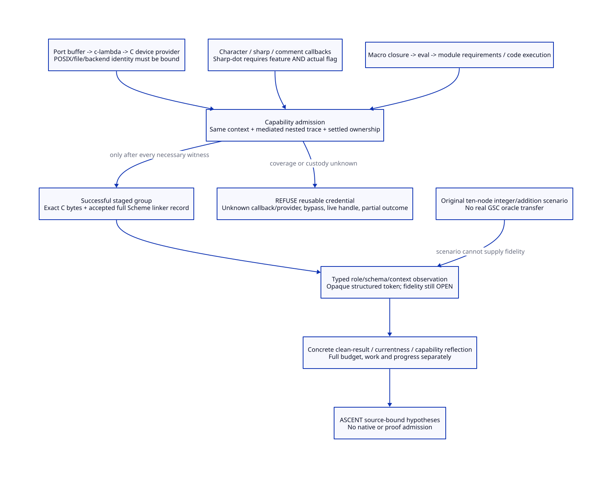

#+TITLE: GSC Capability Closure, Credential Refusal and Output Fidelity
#+SETUPFILE: ../../modeling/org/setup.org
#+CATEGORY: toolchain
#+OPTIONS: toc:3 num:t
#+PROPERTY: header-args :eval never

* RESEARCH Modern C retains Scheme semantics and governs native authority
:PROPERTIES:
:ID: f74d715e-d9d7-481e-8a96-b08be45332c2
:CUSTOM_ID: gsc-capability-observation-closure
:OWNER: Gambit toolchain architecture
:AUTHORITY: GambitToolchain; GambitAssuranceRelations
:STATUS: source-slice-closure-and-fidelity-open
:EVIDENCE_CLASS: source-callers-and-bounded-mathematics
:DEPENDS_ON: BF-BUILD-CUT; BF-BUILD-BUDGET; BF-SCHEMA
:END:

The required direction remains Scheme plus generated modern C. Existing macro,
reader, evaluator, FFI and C-emission semantics stay owned by Gambit. A future
native service must establish input/handle authority, effect completion and
artifact provenance before issuing reusable credentials. This study changes
research/formal sources and document derivation only; it implements no build
engine, reader replacement, sandbox, native adapter or compiler workload.

The [[file:capability-observation-map.org][capability/refusal, fidelity and benefit matrices]] and  derive
from [[file:models/sysml/architecture.sysml][toolchain SysML]]. [[file:../../modeling/models/sysml/assurance.sysml][Assurance SysML]] binds the formal sources and
ASCENT projection. The preceding [[file:read-snapshot-design.org][read/credential design]] and its eight issuers
remain prerequisites. These selected source edges do not enumerate every
possible Scheme closure, loaded native object or configured boot producer.

* RESEARCH Actual macro and eval callers
:PROPERTIES:
:CUSTOM_ID: gsc-macro-eval-closure
:END:

[[file:../../../vendor/gambit/gsc/_ptree1.scm::2952][add-macro]] evaluates an expander, and [[file:../../../vendor/gambit/gsc/_ptree1.scm::1004][macro-expand]] calls that procedure.
The active host adapter invokes public eval. Public eval's default/global
branch goes through [[file:../../../vendor/gambit/lib/_eval.scm::5342][eval-global]], ##eval and [[file:../../../vendor/gambit/lib/_eval.scm::5097][##eval-top]], which compiles and
passes code to [[file:../../../vendor/gambit/lib/_eval.scm::1334][setup-requirements-and-run]]. That function calls ##load-modules
before macro-code-run. Thus procedure creation can require code dependencies;
invocation can execute more than a filename include. Namespace separation is
not host capability confinement, and process freshness does not prevent effects
performed during the current compilation.

There is also a concrete [[file:../../../vendor/gambit/lib/_eval.scm::5448][load-binary -> load-object-file]] path to
[[file:../../../vendor/gambit/lib/_eval.scm::5569][os-load-object-file]]. Its requested object identity is only part of native
closure: dependent libraries, initialization, hooks and later procedure calls
must be covered. These are callable source paths. Their execution by this
GSC source cohort, and the complete resolver path from every demand-module,
remain unresolved. A possible dynamic target is not recorded as an observed
call or as proof of a current defect.

include-adt is a concrete candidate for a restricted transformation: its body
constructs declarations and an include path. That syntax alone does not prove
that all called bindings or evaluator state equal the audited definitions.
An admitted instance must bind procedure code, binding/environment identity,
producer stage and transitive capabilities. A list of allowed symbol names
cannot establish that identity in a language with first-class procedures and
mutable evaluation context.

* RESEARCH Reader callbacks are execution boundaries
:PROPERTIES:
:CUSTOM_ID: gsc-reader-callback-closure
:END:

[[file:../../../vendor/gambit/lib/_io.scm::12694][read-datum-or-label-or-none-or-dot]] fetches and invokes a procedure from the
character table. [[file:../../../vendor/gambit/lib/_io.scm::13310][read-sharp-aux]] does the same through the sharp table.
[[file:../../../vendor/gambit/lib/_io.scm::13300][skip-comment-done]] invokes a procedure-valued comment handler. Consequently,
comment bytes are not universally irrelevant to generated output. A callback
can affect state or produce observations even when no ordinary datum changes.

[[file:../../../vendor/gambit/lib/_io.scm::13560][Sharp-dot read-time eval]] is conditional on both enable-sharp-dot and the
actual readtable's eval-allowed flag. The selected native configuration and
whether the input reaches that branch are not established here. Its presence
in source is not evidence that every GSC read executes eval. Conversely,
qualification of ordinary character handlers does not cover an enabled eval
handler automatically.

Standard reader callbacks are reusable semantic support. Rejecting all reader
procedures would discard that support unnecessarily. The required boundary is
specific: fixed handler/table/context identity, governed nested calls and
observable state, and complete effect/port custody. A shallow readtable copy
cannot prove that captured closure state is immutable or that callbacks cannot
invoke unmanaged host functions. A module's initial readtable, start-syntax
selection and later permitted mutations must belong to the same producer
context contract.

* RESEARCH Native IO reaches C devices and platform-dependent operations
:PROPERTIES:
:CUSTOM_ID: gsc-native-io-callers
:END:

[[file:../../../vendor/gambit/lib/_io.scm::2077][Byte-port refill]] calls ##os-device-stream-read; [[file:../../../vendor/gambit/lib/_io.scm::2215][drain]] calls the write primitive.
Both have retry/wait/error behavior. [[file:../../../vendor/gambit/lib/_kernel.scm::4264][The c-lambda bindings]] route them to C.
[[file:../../../vendor/gambit/lib/os_io.c::9784][os_device_stream_read]] obtains the foreign device pointer and buffer slice,
then invokes device-stream dispatch or, under USE_PUMPS with a non-null read
pump, returns through a nonblocking pipe. That pump branch needs its own
provenance, ordering and error/ownership evidence; the file path requires the
branch to be excluded or governed. The [[file:../../../vendor/gambit/lib/os_io.c::7494][file implementation]] checks open state
and uses POSIX read, Win32 ReadFile or stdio under different compile guards.
This is a concrete selected path to bytes/errors, not a proof that every port
is a regular file or that the inspected build selects POSIX.

[[file:../../../vendor/gambit/lib/os_io.c::10480][Native open-path]] converts the Scheme pathname, sets up a device in the global
group, creates its foreign wrapper and cleans up on wrapper failure. The
[[file:../../../vendor/gambit/lib/_kernel.scm::4302][primitive family]] also exposes process and raw-fd entries. Path recording alone
therefore cannot cover inherited handles, shared file offsets, custom device
providers or native calls bypassing Scheme ports. The capability provider must
bind backend identity, immutable-view membership, offset/decoder ownership,
handle lifetime and returned bytes/error/EOF semantics.

Preserve retry semantics at the chosen observation level. EINTR that the
existing loop hides need not become a distinct compiler-visible value if
an equivalence proof permits it. A timeout/wait callback that executes user
code cannot disappear from the effect trace. Unknown I/O completion, buffered
output still pending, shared-offset races or an unqualified native provider
prevent reusable-success issuance. The actual complete wait/timeout/device
callback universe remains open.

C is required support, not itself a reason for refusal. Existing device and
FFI code can be reused behind a qualified provider. A changed native adapter
must also respect the [[file:../runtime/ffi/index.org][runtime root and VM-ownership contracts]] rather than
invent a second root/participation model in the build subsystem. No such
adapter or lifetime refinement is implemented or qualified here.

** Native artifact text and native execution have different phases
:PROPERTIES:
:CUSTOM_ID: gsc-native-text-phase
:END:

[[file:../../../vendor/gambit/gsc/_ptree1.scm::1593][extract-defs]] collects c-declare and c-initialize bodies. [[file:../../../vendor/gambit/gsc/_t-c-1.scm::337][targ-dump]] takes the
C-interface queues, clears them in the frontend structure and emits declarations,
initializers and procedures into C. These collection/emission sites do not
execute that C text during Scheme-to-C generation. Include the exact text in
artifact observations; qualify actual native compilation/load phases separately.
A real FFI call executed by a macro or loaded object is a current build effect.

The early queue clearing matters for retry design: a failed dump in a pooled
compiler context cannot be assumed to have its original C-interface state.
Require a fresh qualified context or proved rollback/restoration before retry.
A successful [[file:../../../vendor/gambit/gsc/_t-c-1.scm::1393][targ-end-dump]] closes a normal output stream; it is not an atomic
multi-product publication or proof of every exceptional exit. Keep source
mutation, native file writing and successful manifest admission distinct.

* RESEARCH Admission and refusal policy
:PROPERTIES:
:CUSTOM_ID: gsc-capability-refusal-policy
:END:

#+NAME: capability-request-shape
#+BEGIN_EXAMPLE
CapabilityUse = (attempt, phase, callsite, actual procedure/provider identity,
                 initial context, parent callback/request identity,
                 authority/view/handle, input answers, outcome, settled owner)
Reusable = valid successful origin and complete output group
           and closed governed effects and settled borrowed authority
           and current source/dependency/context receipts
           and faithful observations for this consumer
#+END_EXAMPLE

A reusable profile can admit pure bound transformations, image-backed reads,
attempt-owned writes, validated code/group loads and explicitly fixed queries.
Each still needs concrete identity and semantic evidence. Required governance
extends through callbacks, loaded code and C providers. A replayable clock/RNG
may use an explicit fixed input; a live clock, random source or external state
without a validation rule makes this profile volatile/unqualified. Recording
an answer once is not proof it remains a valid current answer.

Refuse a reusable credential when a relevant procedure/provider is unknown,
a required capability bypasses the owner, reads use mutable live/inherited
resources, context or binding state cannot be related, an outcome/borrow is
unsettled, the group is partial, or source/dependency admission is revoked.
Refusal concerns the managed reuse claim. It does not remove Scheme evaluation,
reader extensibility or C FFI from Gambit; ordinary execution outside that
qualification has a different evidence boundary. No Darwin sandbox, interception
API or external-write exclusion provider is assumed qualified.

[[https://www.usenix.org/legacy/events/sec10/tech/full_papers/Watson.pdf][Capsicum: practical capabilities for UNIX]] motivates separating ambient
authority from explicitly delegated object/descriptor authority. For this
design the useful lesson is to govern authority across native and callback
boundaries, rather than infer confinement from an API name. Its FreeBSD
mechanisms do not qualify a Darwin provider, establish stable input snapshots
or prove a net performance gain for Gambit.

The five added Lean theorems include capabilityCoverageAppend and
uncoveredCapabilityRejects. They show how caller/callback coverage composes
under one interpretation and why an actually uncovered use defeats a coverage-
requiring issuer. They do not discover the trace, enforce the gate or certify
an allowlist. Historical observation of a quiet branch is not a universal
closure proof for arbitrary dynamic values. An enforced future profile must
also cover the execution that creates the callback and the admitted current
initial state.

* RESEARCH Actual output to model observations
:PROPERTIES:
:CUSTOM_ID: gsc-output-observation-correspondence
:END:

The original ten-node QNT bytes:int/meta:int and additive calculate oracle stay
unchanged as a mechanism scenario. Integers can in principle encode exact data,
but that does not prove this addition-based producer computes real GSC output.
The checked scalarSummariesLoseOrder gives equal length and sum for [1,2] and
[2,1] while the lists differ. It refutes these shortcuts, not every possible
integer encoding. Original symbolic 0/4/10 work counts remain scenario-only.

The additional gsc_observation_contract QNT module specifies opaque structured
observations and necessary qualification predicates. It is neither an output
parser nor an operational replacement scheduler. rawC is an exact sequence
under a separately proved byte encoding. linkDatum is a faithful typed encoding
of the accepted Scheme record and its relevant context. schema, product role
and full consumer context must agree; success, completion, effect closure,
settlement and currentness predicates require real issuer evidence. Setting
them true in an abstract record supplies no native evidence.

** C consumer observation
:PROPERTIES:
:CUSTOM_ID: gsc-c-byte-observation
:END:

Use the complete generated C bytes, logical filename and all native compile
inputs: configured headers, flags/defines, target, actual compiler/provider
closure, environment and any relevant volatile values. User C text may add
preprocessor includes or time/path-sensitive macros. The Scheme input trace
cannot certify those native compiler reads. Equal rawC alone is insufficient
if other native inputs differ. Equality of metadata cannot justify reusing an
object when C body bytes changed.

** Linker record observation
:PROPERTIES:
:CUSTOM_ID: gsc-link-record-observation
:END:

[[file:../../../vendor/gambit/gsc/_t-c-1.scm::1297][targ-start-dump]] writes the marker and metadata into the same stream as C.
[[file:../../../vendor/gambit/gsc/_t-c-1.scm::880][targ-link-info]] accepts the leading record only after marker and compiler/target
checks. [[file:../../../vendor/gambit/gsc/_t-c-1.scm::1086][targ-get-mod]] extracts the following zero-based positions:

#+NAME: gsc-link-record-shape
#+BEGIN_EXAMPLE
0 compiler identity; 1 target record; 2 module name;
3 supplied modules; 4 demanded modules; 5 ordered modules/flags;
6 symbol resources; 7 keyword resources;
8 supplied-and-demanded globals; 9 supplied-not-demanded globals;
10 not-supplied globals; 11 meta-info.
Observation also binds logical input file, caller flags, ordered composition,
reader/producer context and successful accepted group identity.
#+END_EXAMPLE

Preserve types, symbol/string distinctions, dotted structure and order wherever
the actual consumer observes them. Do not replace this with JSON sorting,
module-name equality or a text slice declared meaningful. A normalization can
be admitted only after its own consumer-factorization proof. Exact raw metadata
bytes provide a conservative comparison under the correct parser/context;
coarser typed observations need faithful decoding and all-consumer coverage.
Generated metadata, module body, library object and executable roles cannot
be interchanged merely because a file exists.

* OPEN Concrete safety reflection and the next proof obligations
:PROPERTIES:
:CUSTOM_ID: gsc-observation-safety-reflection
:END:

observationEqualityReflection proves actual-versus-clean observation equality
only from faithful relations for both groups and abstract equality. The new
factorizationSufficient derives consumer equality from a proved factorization
through the observation. Neither constructs the real decoder, producer oracle
or clean build. Combine these with concreteSafetyFromRefinement only after
actual initial-state and step-or-stutter witnesses are available.

#+NAME: gsc-property-specific-reflection
| Property | Concrete meaning | Required reflection obligation |
|---+---+---|
| Reuse | Actual and clean complete consumer observations agree | Successful clean origin, same closed inputs/context, faithful actual/abstract encodings and deterministic producer relation |
| Publication | CURRENT manifest belongs to complete successful group under valid source/dependency authority | Actual revoke/commit linearization and group leases; an abstract current flag is insufficient |
| Capability closure | Every relevant executed nested effect is governed under the admitted identity/context | Actual caller/provider universe or enforced complete gate; trace capture and required-set completeness cannot be asserted |
| Dependency/order | Generated inputs are validated before use and composition preserves required order | Source/group read ordering, complete metadata/flags and failure-to-model correspondence |
| Resources | Full selected plus omitted weighted use stays admitted | Full budget/ownership proof, independently of the selected bound |
| Work/progress | Count all actual attempts, bytes and waiting obligations | Cost-preserving accounting and progress hypotheses; safety stutter can consume work |

The source caller slice is now more precise, including selected C device edges.
It still does not close arbitrary procedure bodies, module resolution,
configured native providers, output parser fidelity or actual GSC transition
reflection. All 73 existing global obligation dispositions remain unchanged.
The standalone theory has 31 theorems after five additions. Four QNT modules
are typechecked only; no exploration, native test or performance run is claimed.

* RESEARCH Support and net-benefit boundary
:PROPERTIES:
:CUSTOM_ID: gsc-capability-fidelity-benefits
:END:

[[file:capability-observation-map.org][The SysML-derived matrix]] names necessary support and refusal per component.
Reuse Scheme evaluator/reader implementations and mature C IO/emission; add
context/capability ownership, handle-view leases, complete staged manifests and
faithful per-consumer observations. Retire duplicated include-only recording,
existence acceptance or dirty propagation only after one qualified owner covers
all migrated callers. No current build/runtime path retires in this study.

#+NAME: capability-output-benefit-summary
| Mechanism | Possible saved work | Cost / limiting condition |
|---+---+---|
| Closed macro/reader replay | Avoid rerunning a producer with equal validated answers | Govern nested calls, code loads and mutable context; absent closure forces refusal |
| Native image-backed reads | Share one qualified source view across the 34 generator candidates | Preserve handle/offset/decoder/error and runtime lifetime contracts; native bypass invalidates qualification |
| Exact C observation | Avoid C compilation when complete bytes and other compile inputs agree | Group validation and native input closure remain; metadata equality alone saves no object work |
| Faithful linker observation | Avoid descriptor/linkfile regeneration on relevant unchanged records | Full typed record, flags/order and producer context; changed code still propagates through native consumers |
| Structured observations | Eliminate unsound length/sum/partial-metadata acceptance | Parser/encoding and commuting producer proofs are additional necessary support, not demonstrated speedup |
| Credential refusal | Preserve correctness instead of counting an invalid cache hit as savings | Rejecting reuse may increase necessary execution; no positive performance guarantee follows |

Modern C and Zig need the same semantic, IO and provenance proofs. No additional
Zig benefit is established by these contracts. The net-work criterion remains
actual avoided recipe work minus acquisition/validation, effect/handle support,
output comparison and retries. A no-change eligible cohort targets zero recipes,
not zero checking. Shared macro changes still expose 34 declared generator
candidates, and validation of the 64 omitted actions cannot disappear from the
ten-node cost view. No person-day or hypothetical timing estimate is used.

[[https://simon.peytonjones.org/assets/pdfs/build-systems-jfp.pdf][Build Systems a la Carte: Theory and Practice]] separates dynamic task/rebuilder
reasoning from scheduling and repeated work. [[https://www.mathematik.uni-marburg.de/~seba/publications/pluto-incremental-build.pdf][Pluto's consistency model]] requires
generated dependencies to be established before their files are consumed. These
are methodological support; they do not prove Gambit's native capability closure
or this proposed observation encoding. The [[file:../../../evidence/research/gsc-capability-observation-closure/checks.json][current bounded evidence receipt]]
records actual source identities and validation scope.
