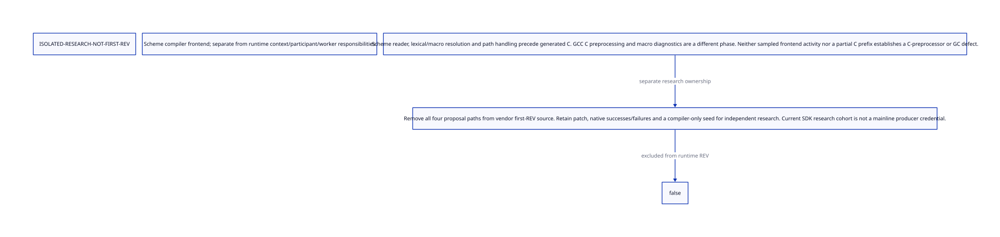

#+TITLE: Compiler Binding Resolution — Isolated Research
#+SETUPFILE: ../../modeling/org/setup.org
#+LANGUAGE: en
#+PROPERTY: header-args :eval never

* Scope correction
:PROPERTIES:
:STATUS: ISOLATED-RESEARCH
:AUTHORITY: models/sysml/compiler-binding-resolution.sysml
:FIRST_REV_ADMISSION: false
:END:

The user explicitly excluded this frontend optimization from the first runtime
REV. [[file:models/sysml/compiler-binding-resolution.sysml][SysML]] owns this research boundary.
[[file:compiler-binding-resolution.d2][The native-model projection]] has a
.
[[file:../../../evidence/research/compiler-binding-resolution/proposal.patch][The complete proposal]] and
[[file:../../../evidence/research/compiler-binding-resolution/receipt.json][retained native observations]] preserve the work without keeping it in vendor
mainline. No research bootstrap is relabeled as mainline qualification.

* Two different expansion costs

| Phase | Current evidence | What it does not establish |
|---+---+---|
| Scheme reader / lexical and macro resolution / paths | Two external samples contain environment lookup, getcwd, path normalization and source I/O. The independent output file was created about57.68 seconds after launch. | Not all elapsed time is proven macro expansion; it is not a GCC preprocessing or GC-copy failure. File birth time is not an exact compiler phase boundary. |
| C preprocessing / compiler diagnostics | Existing Darwin/Bazel profile and earlier preprocessing observations remain separate. | Frontend sampling does not quantify this phase or justify another C optimization in this REV. |
| Whole build and correctness | Mainline bootstrap and runtime tests retain their own source identities. | A failed diagnostic ceiling does not invalidate an already completed bootstrap; a missing required correctness test still blocks admission. |

* Proposal and counterevidence

The proposal shares one managed binding cell across declaration and namespace
views. It replaces repeated global variable scans and proposes a macro-name
absence filter; positive macro lookups still use the exact view's ordered list.
There is no process-global identity table. Constructor-assigned binding names
replace an unused name-mutation operation after a production-caller audit.

| Observation | Outcome | Boundary |
|---+---+---|
| Variable-index compiler bootstrap | PASS340.13s within600 | Proposal source, not mainline or matched throughput |
| Variable-index compiled binding/GC cases | PASS | Shared views, shadowing, replacement, namespace and GC; not universal compiler equivalence |
| Complete default-family diagnostic | INCOMPLETE within180; per action60 unchanged | Failed and unstarted work retained; no complete generation or positive net-benefit claim |
| Combined name-filter source preflight | PASS in an isolated interpreter process | Not compiled-cohort or whole-program admission |
| Combined proposal bootstrap | PASS283.94s within600 | Distinct proposal event; no causal speedup or lower-peak conclusion |

The added tables consume O(binding and macro-name count) strong storage and may
increase GC/growth peaks. Performance, compiler reentry assumptions and complete
output equivalence remain independent research questions. QNT/Lean GC duties
are not duplicated here.

* First REV remains a runtime responsibility replacement

[[file:../../refactoring/modern-c/commit-admission.org][The runtime admission policy]] covers execution contexts, frozen root
participants, collector workers and common round/restoration/exit custody.
Known Darwin construction costs are classified separately. They do not grant
permission to enlarge the implementation scope, waive a necessary correctness
check, increase the heap or extend a watchdog.
