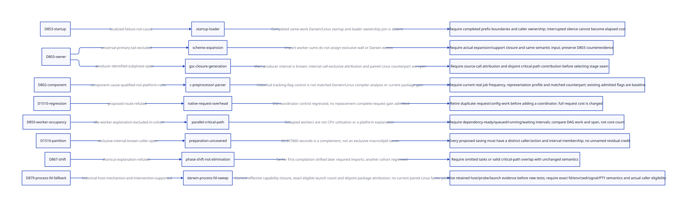

#+TITLE: Darwin Development Cost: Factors, Evidence and Refactor Admission
#+SETUPFILE: ../../modeling/org/setup.org
#+OPTIONS: toc:3 num:nil
#+PROPERTY: header-args :eval never
#+TODO: RESEARCH GROUNDED | QUALIFIED RETIRED

* GROUNDED Decision: attribution precedes another native experiment :c23:darwin:evidence:
:PROPERTIES:
:CUSTOM_ID: darwin-factor-admission
:AUTHORITY: GambitDarwinDevelopment costFactor0..8; causal0..7
:STATUS: nine factor routes; differential attribution remains incomplete
:END:

The reported package gap reaches and, for some real development packages,
exceeds fivefold. Five is not an upper bound; each package keeps its own
original observed ratio and evidence identity. Existing
tests, failed attempts, source audits and patch receipts are retained in one
evidence graph. Their clocks and scopes must be joined before using them as
causal weights. Keeping those distinctions does not discard historical evidence
or require repeating every test. First recover the missing associations from the
existing records; a new test is allowed only after a particular missing causal
edge and a discriminating outcome have been identified.

The [[file:models/sysml/macos-development.sysml][native SysML]] owns factor/evidence/source/gate associations.
The [[file:c23-development-refactor-matrix.org][generated matrix]] and  project that source.
The actual [[file:../../modeling/ascent/c23-development-design.rules.scm][ASCENT DSL]] separates factorMapped from factorCausalReady.
The existing [[file:models/quint/native_artifact_partition.qnt][partition QNT]], [[file:models/quint/preparation_reuse.qnt][reuse QNT]] and
[[file:models/lean/DevelopmentBenefit.lean][benefit Lean]] retain arithmetic, semantic and non-double-counting obligations.
Neither a file association nor a model theorem supplies a missing platform timer.

* GROUNDED Factors and falsifiers

#+NAME: factor-review
| Factor | Retained evidence | What it establishes | What it does not establish |
|--------+-------------------+---------------------+-----------------------------|
| Process launch / fd cleanup | D879 source and host capabilities; historical 120-module control | Near-million-descriptor fallback on that host; launch median 28.853 to 10.465 s | Isolated fd versus fork cost; current package attribution; Make-direct compiler cost |
| Native preprocessing / parsing | D802 real embedded unit | Admitted tracking-flag control 15.45 to 10.37 s with identical object bytes | Every module has this distribution; a new saving after that flag is already baseline |
| Scheme expansion / import | D803 full frontend record | Rejects import/macro expansion as the primary tail in that cohort | Scheme expansion is free, or every startup pause is a macro cost |
| Executable closure production | D803 main producer interval | Identifies the producer and a real dependency bottleneck | Exclusive allocation among its internal calls or a current platform ratio |
| Uncovered preparation | D1510 disjoint partition | 26.907860 s outside recorded compiler intervals inside preparation | All that time is macro expansion, dyld, removable or one caller |
| Parallel critical path | D855 worker attribution | Recorded drain occupies about 11.89/12 workers | CPU utilization, a universal scheduler bottleneck or linear twelve-core speedup |
| Request / coordinator overhead | D1510 HIT control | Proposed route worsened complete requests 0.88 to 1.59 s | Shared infrastructure automatically amortizes or improves performance |
| Moving phase boundaries | D867 import/index control | Much earlier first compile did not remove the downstream imports | Prefix reduction equals package reduction |
| Startup / loader silence | D853 incomplete failure and separate completed probes | Failure precedes std/make/GCC in that event | A fixed sleep, causal loader fault, or completed build duration |

All are useful evidence. Several are counterevidence against tempting fixes.
They do not form a single additive experiment: cohorts, revisions and clocks
differ. The graph keeps the counterevidence attached to each candidate mechanism.

** GROUNDED A concrete Darwin mechanism, not a universal explanation

Current local vendor still has the child call in os_io.c:9237 and fallback loop
in os_setup.c:225-278. os.h chooses bulk-close capabilities conditionally. D879
records the host capability result and connects it to the retained launch control.
This is stronger than guessing that all of preparation is a macro cost.

Modernization replaces ordinary-launch fd-limit work through an explicit
NativeAction descriptor/environment/cwd/signal plan. Unsupported requests keep an
explicit equivalent launch path. Required descriptor closure, PTY behavior,
startup failure reporting, process identity and natural-exit custody remain
mandatory. C23 does not change OS process cost by itself. The old patch is a
mechanism/intervention reference, not the new architectural implementation.

* RESEARCH Causal edge and evidence obligations :ascent:sysml:

#+NAME: causal-edge-contract
#+BEGIN_EXAMPLE
request identity + source/config/compiler identity + input/artifact cohort
  -> completed action DAG with actual caller and phase
  -> elapsed ownership / nesting / critical-path role
  -> factor mechanism and relevant platform branch
  -> retained intervention AND counterevidence
  -> matched work / semantics / clock / closed confounders
  -> proposed duty removal and full added cost
  -> package acceptance, without duplicate credits
#+END_EXAMPLE

factorMapped requires the exact source, evidence, observation, exclusions,
remaining gap and experiment gate from SysML. factorCausalReady additionally
requires a joined comparison identity, same work, same contract, same clock,
closed confounders and a qualified mechanism intervention. No such final
Darwin/Linux differential join is issued by this selected study. That says
something precise about the present graph, not that all earlier controls are
invalid or that the observed slowdown is imaginary.

Four ASCENT counterfactuals must fail to map: wrong caller, erased D803
counterevidence, relabeling the uncovered preparation complement as a macro timer,
and treating a LinkPlan design as measured causal attribution. Existing fake
speedup, cross-cohort, worker-sum and duplicated-credit controls remain active.

Before any subsequent native test, record the unresolved edge, exact existing
records already searched, competing explanations, predicted discriminator,
fixed matched workload and stop decision. A candidate without that record does
not enter native experimentation. Unknown or baseline-failed runs produce no
speedup credit. Do not continue cycling through macro, compiler or loader tweaks.

* RESEARCH Twofold target: an obligation, not a forecast

For a same-work baseline T and replacement T', at least twofold acceleration
requires T' <= T/2. Net benefit is removed critical-path work minus new validation,
materialization, synchronization and retained-state costs. Work moved later is
not work removed; an omitted whole action already includes its internal parsing.
Linux non-regression and unchanged semantic/resource admission are separate gates.

Twofold acceleration and reaching twice the Linux time are different goals.
Write r=T_D/T_L for each actual comparable workload, with T_L>0. No upper
bound r<=5 is assumed. Reaching T_D_prime<=2*T_L requires net removal
>=T_D-2*T_L, or fraction >=1-2/r. If r>5, this exceeds 60 percent.

With unchanged Linux time, a Darwin baseline of 4L needs net removal >=2L
(50 percent) to reach 2L; a baseline of 5L needs >=3L (60 percent). Merely
halving 5L leaves 2.5L. DevelopmentBenefit already separates these target
laws and the halfTimeAtFiveStillAboveTwoLinux counterexample. These are
conditional examples of the general budget relation, not bounds on the observed
slowdown or a prediction of an attainable platform ratio. Twofold acceleration
alone gives r_prime=r/2 when Linux time is unchanged; for r>5 it leaves r_prime>2.5.

#+NAME: factor-benefit-budget
| Existing interval / mechanism | Scientific budget | Refactor dependency | Current credit |
|------------------------------+-------------------+---------------------+----------------|
| D1510 total 73.686833 s | Remove net >=36.843417 s for that cohort | Same action ownership and acceptance | Target only |
| Uncovered preparation 26.907860 s | Upper ceiling, not identified saving | LibraryReadiness, immutable foundation products and actual caller closure | No numeric saving assigned |
| GSC link generation 5.870445 s; final link 0.206477 s | Both are bounded intervals; cannot each exceed their own wall | Exact LinkPlan/input projection and complete successor result | No numeric saving assigned |
| Ideal elimination of all three intervals above | Still short by >=3.858635 s, before added costs | Additional disjoint actual work must disappear | Conditional impossibility bound |
| D879 eligible process launch | Historical 2.76x within its fixture | Caller eligibility, owned fd actions and effective capability identity | Not transferred to the D1510 budget |
| Existing HIT/native flag gains | Already in the relevant baseline when admitted | Preserve existing controls | Zero additional credit |
| New literal specialization | Synthetic gain failed to transfer to real _gsc.c | See isolated study rejection | Zero package credit; no merge |

The architecture remains Gambit structured stage APIs and modern generated C,
with Gerbil owning incremental query results, dynamic dependencies and scheduling.
LibraryReadiness, GeneratedSchemeResult, FrameSpec/ModuleSpec and LinkPlan specify
which actions may cease to exist. Stable roots, task supervision and scoped
destructor manifests make reuse safe; they are not independent performance claims.

* RESEARCH Closure ledger

#+NAME: factor-closure-status
| Obligation | Status |
|------------+--------|
| Source/evidence/counterevidence association for nine factors | Checked by native SysML projection and ASCENT |
| Local source mechanism for descriptor-limit fallback | Present; historical host qualification retained |
| Differential allocation of each actual package gap, including ratios above five | OPEN; recover original pair/cohort and per-action associations |
| Ownership of the full 26.907860 s complement | OPEN; no macro/dyld blanket attribution |
| Whole-package twofold replacement proof | OPEN; conditional budget only |
| Runtime/native implementation of the proposed stage service | OPEN; no candidate merge |

* Source-caller continuation under the existing nine factors

[[file:darwin-native-path-design.org][Current C23 process/fd/bundle review]] refines the existing process/request
factors with real MCP versus POO mode selection. It separates shared POSIX code,
host-configured fd realization, conditional Darwin wrapper/metadata multiplicity
and mandatory native-format work. Existing fixes are deducted. The source counts
are not a current Linux trace, a whole-package process ratio or new timing weight.

* Reached Bazel evidence corrects the source-first continuation

[[file:darwin-bazel-evidence-matrix.org][The existing execution records]] now join the native-process/request factors:
D1469 directly reaches zero Gambit fork in retained MCP, while0015 already has
complete build-only substitution gain with metadata parsing unchanged. Rejected
metadata-empty, terminal-exec, extra-coordinator and simple-fusion routes remain
falsifiers. [[file:native-products-design.org][Native products]] replace authorities only beyond those baselines;
no additional native run or historical cache restoration is required to retain
these conclusions. The original factor cases remain historical facts, with
later reached evidence taking precedence for its actual cohort.
