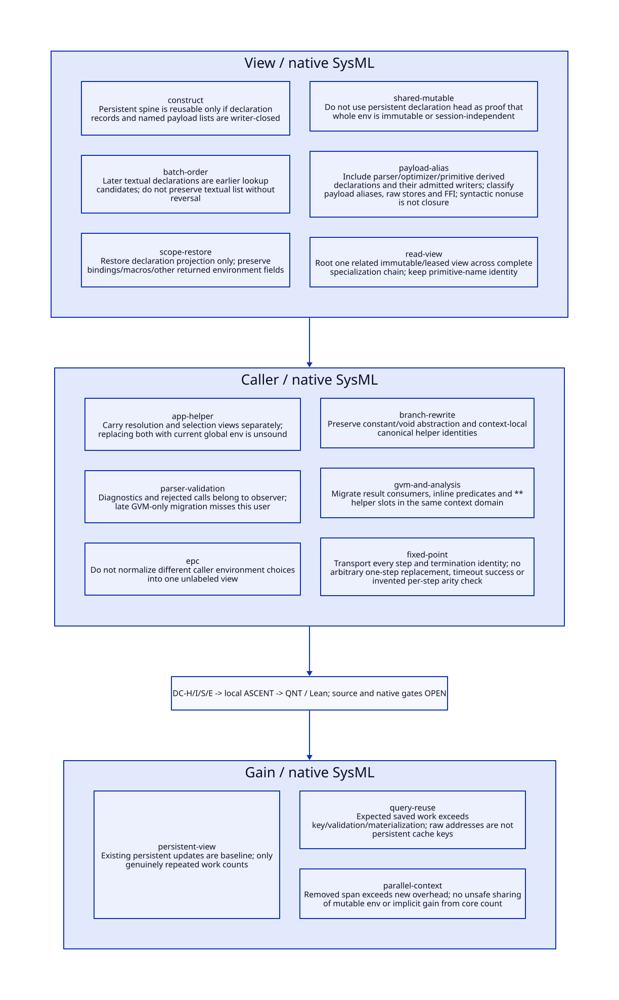

#+TITLE: Persistent Declaration Views and Real Specialization Caller Contexts
#+SETUPFILE: ../../modeling/org/setup.org
#+CATEGORY: toolchain
#+OPTIONS: toc:3 num:t
#+PROPERTY: header-args :eval never

* RESEARCH Architecture decision and boundary :gambit:gerbil:modern_c:
:PROPERTIES:
:CUSTOM_ID: declaration-specialization-context
:AUTHORITY: DeclarationSpecializationContext
:STATUS: conditional-models-source-platform-open
:EVIDENCE_CLASS: source-and-local-formal-research
:END:

Gambit remains the compiler/runtime base and Gerbil implements the incremental
compiler service. Reuse the existing functional declaration representation as a
qualified view; do not freeze whole env objects or assume single-step provider
equivalence proves a real specialization caller correct. The caller repeatedly
specializes until object identity reaches a fixed point, and different callers
supply different node environments.

[[file:models/sysml/declaration-specialization-context.sysml][SysML]] owns six declaration-view families, six caller families, three gain cases,
four refinement routes and seven open gates. Native SysML drives [[file:../../modeling/tools/declaration-specialization-context-study.py][Python]], [[file:../../modeling/ascent/declaration-specialization-context.rules.scm][actual
ASCENT DSL]], [[file:../../../models/build/declaration_specialization_context.qnt][QNT]] and [[file:../../../models/build/DeclarationSpecializationContext.lean][Lean]], generating [[file:declaration-specialization-context-matrix.org][the matrix]] and . [[file:../../../evidence/research/declaration-specialization-context/checks.json][Checks]] are local formal
evidence, not host-attested source/native admission. No compiler/runtime code,
Scheme generation, native test or performance experiment is implemented/run.

* RESEARCH Declaration producers, sharing and writer boundary :source:
:PROPERTIES:
:CUSTOM_ID: declaration-view-writers
:COMPLETENESS: stock-constructor-paths-and-syntactic-census-not-open-world-alias-proof
:END:

| Real producer/access path | Source behavior | Reuse boundary |
|---+---+---|
| [[file:../../../vendor/gambit/gsc/_env.scm::64][env-frame]] | Inherits parent declaration head | Parent view lifetime must cover child reads |
| [[file:../../../vendor/gambit/gsc/_env.scm::102][env-declare/env-decl-set]] | Conses a new record onto the existing list; returns a new env vector | Old view remains stable through this operation; new record payload still needs validation |
| [[file:../../../vendor/gambit/gsc/_env.scm::94][env-macros-set]] and [[file:../../../vendor/gambit/gsc/_env.scm::116][env-namespace-set]] | New vectors retain the declaration head and other references | An alias of the head can exist in several environment vectors |
| [[file:../../../vendor/gambit/gsc/_ptree1.scm::2769][transform-declaration]] | Stock flag/boolean/named forms validate identifiers; parameterized forms accept exact integers or allowed booleans | Qualified stock-registry profile bounds the payload grammar |
| [[file:../../../vendor/gambit/gsc/_ptree1.scm::2852][extract-names]] | Allocates a fresh proper list of validated symbol objects | No reuse of the input names-list spine in this path; symbol identity still matters |
| [[file:../../../vendor/gambit/gsc/_env.scm::327][namable constructors]] | Attach the supplied names list as record tail | Direct constructor/env-declare callers can bypass parser freshness guarantees |
| [[file:../../../vendor/gambit/gsc/_env.scm::124][env-vars-set!]] and externals/parent aliases | Other env fields remain mutable/shared | Declaration persistence does not qualify the whole env as immutable |

The recorded rg corpora retain all syntactic references to declaration accessors and
specialization entry names in top-level gsc .scm files. They include definitions,
quoted name lists and setters as well as calls; they are not a lexical binding or
higher-order reachability proof. No absence-of-match claim closes raw vector/FFI,
reflective mutation, arbitrary env-declare arguments or user compiler extensions.

** Compiler-created declaration views are real writers

The closed managed writer interface must cover more than source declare forms:

| Writer | Concrete callers in the checked gsc corpus | View change |
|---+---+---|
| add-extended-bindings | [[file:../../../vendor/gambit/gsc/_ptree1.scm::57][primitive reference construction]] | Adds extended binding policy before resolving the reference |
| add-not-safe | [[file:../../../vendor/gambit/gsc/_ptree1.scm::1076][parser-generated calls]], [[file:../../../vendor/gambit/gsc/_ptree2.scm::433][primitive call construction]], [[file:../../../vendor/gambit/gsc/_prims.scm::5485][primitive simplification]] | Creates an unsafe derived view; not a mutation of the parent's view |
| remove-std-ext-rt-bindings | [[file:../../../vendor/gambit/gsc/_ptree2.scm::218][epc global-operator transformation]] | Prepends three false binding policies in a defined order |
| add-not-inline-primitives / add-dead-end-calls | [[file:../../../vendor/gambit/gsc/_ptree2.scm::445][gen-call-maybe-dead-end]] | Generates a call with noninline and optional dead-end policy |
| add-proper-tail-calls | [[file:../../../vendor/gambit/gsc/_prims.scm::3083][primitive simplifier]], [[file:../../../vendor/gambit/gsc/_prims.scm::3211][another simplifier]] | Enables proper tail calls in a derived environment |
| add-safe / add-not-interrupts-enabled | Definitions at _ptree1.scm:577,589; no additional syntactic call in this corpus | Not proof of absence of reflective or extension calls |

A separate derived-view-callers census preserves all syntactic matches, including
fixnum.scm's quoted name lists. These are not all executable call edges. In
particular parser/optimizer-derived views must participate in identity, invalidation
and custody exactly like source-derived views. Interning only textual declarations
would miss them. All inspected stock helpers construct fresh bool records; arbitrary
extension payloads retain the unresolved admission requirement.

There is a useful bounded positive result: stock transformed declarations do not
require retaining arbitrary closure/port/native-resource payloads. Under the checked
stock declaration-registry profile, their representation consists of fresh cons
structure plus booleans, exact integers and canonical/validated symbols. A managed
view can seal those records and the inherited already-sealed tail rather than copy
all compiler state. Declaration registries are themselves mutable globals, so their
identity and admitted extension policy must be inputs to that profile.

Proposed publication evidence is DeclViewId + ordered-content/registry identity +
root/lifetime ownership + recursive payload classification + closed writer admission.
A child extension may reuse its parent's evidence only if the parent remains sealed
and the new record and new spine cannot be mutated by surviving aliases. Validation
can then account for the new record rather than rescanning an unchanged tail; no
implemented asymptotic optimization or measured saving is claimed. Existing list
persistence is baseline and cannot be credited as newly eliminated work.

** Source order, lookup order and scoped restoration

[[file:../../../vendor/gambit/gsc/_ptree1.scm::2868][add-declarations]] visits textual declarations in order, prepending each transformed
record. [[file:../../../vendor/gambit/gsc/_env.scm::335][declaration-value]] takes the first matching record. Consequently a later
textual declaration can precede an earlier one in the effective lookup list.
Reconstructing the textual order as the lookup list, sorting records or flattening
named/universal declarations into one global flag changes the result.

[[file:../../../vendor/gambit/gsc/_ptree1.scm::754][parse-exprs]] and [[file:../../../vendor/gambit/gsc/_ptree1.scm::1557][extract-defs]] save the incoming declaration head in a CPS
closure and restore it using env-decl-set on the returned environment. The correct
operation is a declaration lens update, not restoration of the entire old env.
Replacing the whole env can discard bindings/macros or other state learned while
parsing the body. Saved heads and callback closures remain rooted until their
continuation exits; the current source pattern is not evidence that arbitrary
multi-shot/cross-thread parser continuations are transferable between sessions.

* RESEARCH Actual specialization call graph :callers:
:PROPERTIES:
:CUSTOM_ID: real-specializer-callers
:END:

The direct provider invocation is [[file:../../../vendor/gambit/gsc/_ptree1.scm::367][specialize-proc]]. It checks a nonfalse procedure
and initial argument count, maps constant argument nodes to values and nonconstants
to void-object, then repeats provider selection until (eq? spec proc). There is no
native fuel bound, visited set or general cycle handler in that inspected loop.
The providers selected in the preceding study ignore args, but the caller interface
must preserve the argument abstraction for other providers.

| Caller family | Actual path and environment | Additional consumer duty |
|---+---+---|
| [[file:../../../vendor/gambit/gsc/_ptree1.scm::347][app->specialized-proc]] | app environment passed to specialize-app | Preserve application view and argument nodes |
| [[file:../../../vendor/gambit/gsc/_ptree1.scm::333][Global reference resolution]] | target.prim-info then standard/extended/dialect checks using operand node-env | Resolution view may differ from selection view; both belong to the request |
| [[file:../../../vendor/gambit/gsc/_ptree1.scm::1101][Parser checks]] | app helper used during parse/validation | Preserve parse-time diagnostics; a GVM-only migration misses this user |
| [[file:../../../vendor/gambit/gsc/_ptree2.scm::187][epc-app]], constant and global operands | specialize-proc uses operand node-env; resulting nodes can use app node-env | Do not replace these choices with a single current/global env |
| [[file:../../../vendor/gambit/gsc/_ptree2.scm::1434][br-app-simplify]] | transformed argument nodes + app node-env, guarded by constant-fold? | Preserve simplifier eligibility and subsequent arity/diagnostic behavior |
| [[file:../../../vendor/gambit/gsc/_ptree2.scm::1116][Branch rewriting]], [[file:../../../vendor/gambit/gsc/_front.scm::2079][switch extraction]], [[file:../../../vendor/gambit/gsc/_front.scm::3226][GVM calls]], [[file:../../../vendor/gambit/gsc/_front.scm::3833][triviality/type analysis]] | Compare selected objects and inspect their metadata | Private primitive table, inlining/testability and ** helper identities must migrate together |

The helper slots are concrete aliases: [[file:../../../vendor/gambit/gsc/_back.scm::425][target-select!]] initializes **identity,
**not, **eq? and other procedure globals from target.prim-info. A newly relocated
selected primitive compared against an old global helper can take a different
optimization/emission path. Merely returning the correct semantic name is therefore
insufficient. The corresponding helpers must use the same private identity domain.

* RESEARCH Caller context and full-chain transport :contract:lean:
:PROPERTIES:
:CUSTOM_ID: caller-view-coherence
:END:

#+begin_src text :eval never
SpecializationRequest = {
 callerKind, resolutionView(node-env operand),
 selectionView(node-env app OR operand according to caller),
 admitted primitive graph + private helper domain,
 constant/void argument projection + initial arity contract,
 target/dialect/registry/profile identity, origin/diagnostic projection,
 input epoch, rooted view lease and attempt/context generation
}
#+end_src

A declaration view is not determined by target profile alone. Preserve per-name
scope/order/defaults and the exact caller-selected view. Keep the view and primitive
metadata stable for the complete specialization chain, not one step at a time;
otherwise a later provider can observe another safety/arithmetic policy or another
context's primitive objects. A read lease/pinned immutable view protects data and
lifetime only if all writers and aliases have actually entered that protocol.

The earlier SP transport theorem covers a provider step. This study adds a generic
Lean chain theorem: if every destination step commutes with an injective rho, then
a bounded observation of the source fixed-point walk maps to the destination walk.
The equality stopping condition is preserved by injectivity; downstream helper
comparisons are preserved by the same argument. If the real source chain terminates,
choose a sufficient mathematical observation bound to transfer that outcome.
This does NOT add a runtime cutoff, claim every extension terminates, or turn a
cycle/timeout into success. Provider errors/missing objects and native exceptions
need their own outcome simulation; the walk theorem covers total valid-object steps.

The actual unsafe fixnum + path can proceed + -> ##+ -> ##fx+ -> self; a safe fixnum
path can proceed + -> fx+ -> self. The source registrations for + and ##+ are in
[[file:../../../vendor/gambit/gsc/_prims.scm::1889][the arithmetic table]], and [[file:../../../vendor/gambit/gsc/_prims.scm::2075][fx+]] installs an unsafe specialization. These are
conditional source traces under the stated declarations and bindings, not observed
compiled artifacts. A stale self reference can prevent the eq? fixed point; a newly
introduced cycle cannot be justified by single-step output tests.

* RESEARCH Real iter integration and observer :iter:
:PROPERTIES:
:CUSTOM_ID: declaration-context-iter
:END:

iter/macros -> iter/api -> std/iter feeds string/misc and sync/wg. [[file:../../../../gerbil-gambit-bootstrap-audit/src/std/iter/macros.ss::130][for1-in-range-generic]]
introduces comparisons and (+ k $step); this is a concrete arithmetic consumer.
Its actual specialization branch depends on the resolved binding, lexical declaration
views and optimizer transformations. Type annotations alone are not substituted
for actual Gambit declaration/GVM evidence.

[[file:../../../../gerbil-gambit-bootstrap-audit/src/gerbil/compiler/compile.ss::401][Gerbil annotation/declaration emission]] and [[file:../../../../gerbil-gambit-bootstrap-audit/src/gerbil/compiler/driver.ss::702][nested-module resets]] must reproduce those
views through the generated Scheme handoff. Preserve lexical identities and named
primitive symbols, scoped declarations and positive-phase policy. Baseline generated
file source positions remain separate from richer original expansion provenance.
Parser, optimizer and emitter failures retain their original phase/status/diagnostic
observer; raw internal exceptions are not silently substituted for the existing
[[file:../../../../gerbil-gambit-bootstrap-audit/src/gerbil/compiler/driver.ss::963][invoke]] nonzero-status surface. No compilation or reader roundtrip is run here.

* RESEARCH Model and closure matrix :sysml:ascent:qnt:
:PROPERTIES:
:CUSTOM_ID: declaration-context-assurance
:END:

| Duty | Conditional result | Open source/platform premise |
|---+---+---|
| DC-H | QNT persistent parent/child view, scope lens restoration, caller-specific view, pinned full chain, private helper identity | Symbolic views/handles; no complete Scheme heap, argument semantics or liveness proof |
| DC-I | Eight Lean theorems: chain/fixed-point/helper transport, scope lens, batch order, head/other-name lookup and cost | Actual caller/provider/registry relation and C/GC memory/lifetime refinement |
| DC-S | Native SysML routes operations/lemmas/source anchors to actual DSL and artifacts | Decl record/list alias closure, all extension callers and observer equivalence; depends on SP-S |
| DC-E | Independent environment duty | Roots, GC/FFI/SMP, memory order and measured work/span/retention |

Sixteen named QNT scenarios include eight negative controls: payload mutation,
whole-env rollback, wrong caller view, old helper identity, stale primitive identity,
premature single-step stop, dropped pinned view and changed origin. Two starting
workspaces exercise private identity domains. Integer graph IDs and mode tables
represent selected illustrative chains, not every registered provider transition.

Native ASCENT evaluates six local receipt/routing controls: current H/I, missing QNT,
stale subject, wrong Lean scope, synthetic all-closed and unqualified chain. Current
source/platform, external SP-S and all seven gates remain open. The inherited host
attestation registration gap is not retried unchanged or claimed fixed; these are
local checks only. Failures and exact source/log hashes remain retained.

* RESEARCH Migration, retirement and net benefit :benefit:
:PROPERTIES:
:CUSTOM_ID: declaration-context-benefit
:END:

First qualify stock transformed-record views and writer admission, then expose
caller-labeled resolution/selection projections. Reconstruct private primitive and
helper identities in one domain; migrate parse, optimization, analysis, code generation
AND link consumers. Only after their actual callers are covered can global lookup,
helper slots and mutable environment authority retire. Keep the source's functional
updates and scoped restoration behavior; a second long-lived wrapper authority is
not the goal.

The [[file:declaration-specialization-context-matrix.org][net-benefit matrix]] separates three opportunities. Persistent views can avoid
unnecessary whole-env copying, but current cons sharing is already baseline. Query
reuse saves only genuinely repeated specialization/downstream work under matching
caller/view/argument/profile/origin projections. A persistent key cannot contain raw
private addresses; canonical identity and per-attempt handles remain distinct.
Parallel benefit requires removing real global-state serialization without sharing
mutable env fields or stale helper identities.

If R is avoided work and H is added view validation/key/materialization/custody work,
positive work benefit requires R>H. Span reduction and peak retained memory are
separate acceptance criteria. A linear declaration scan remains linear unless an
independently proven indexing algorithm replaces it; no such implementation or
speedup is claimed. The design amplifies Scheme's existing persistent representation
and Gambit's C portability while making their context and publication contracts
explicit; it does not require Zig or a new language to obtain these properties.
