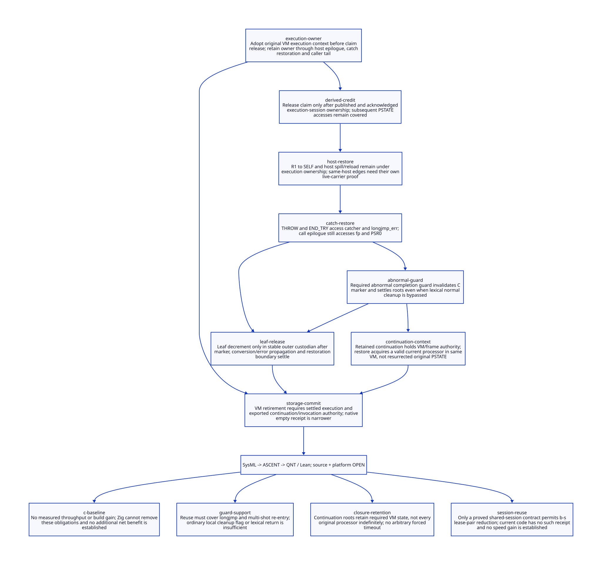

#+TITLE: Modern C Decrement Placement and Restoration Closure
#+SETUPFILE: ../../modeling/org/setup.org
#+PROPERTY: header-args :eval never
#+OPTIONS: toc:3 num:nil

* RESEARCH Decision and authority
:PROPERTIES:
:CUSTOM_ID: decrement-restore-closure
:STATUS: conditional-models-source-open
:CANONICAL_MODEL: models/sysml/decrement-restore-closure.sysml
:END:

Modern C remains mandatory. This study refines [[file:gate-empty-root-materialization-design.org][dual-gate empty inspection]] into
real host/call/catcher/marker restoration seams and a proposed execution-session
handoff. There is no universal existing source line at which handler completion
permits decrement of the last VM lifetime owner. A claim decrement and the final
execution-session release are different events and different authorities.

A claim may be released after a confirmed handoff to a process-owned execution
session, even though restoration still accesses PSTATE. Without that handoff, a
leaf release must wait until a complete outer boundary has no further protected
accesses. Neither host return nor marker invalidation alone is that boundary.
Persistent exported continuation roots retain VM semantics independently.

SysML owns eight source/action/guard/lemma contracts, ten dependencies, seven open
gates, four benefit rows and an installed Darwin declaration profile. Python queries
native sysml, derives Org/D2 and feeds actual ASCENT rules and QNT/Lean subjects.
No runtime code, compilation or native test is performed. Static installed declarations
are not a matched effective-argv/runtime-object/SMP qualification receipt.

* RESEARCH Darwin configuration: statically observed versus still missing
:PROPERTIES:
:CUSTOM_ID: decrement-restore-closure-darwin
:END:

The PATH gxi wrapper was resolved without execution. Its literal GERBIL_HOME points
to an installed Cellar current target, from which bin/gambuild-C and include/gambit.h
were read and hashed. [[file:../../../evidence/research/decrement-restore-closure/darwin-declared-profile.json][The installed declaration receipt]] records those exact paths,
source lines and digests. No gxi/gsc/compiler process, preprocessor, object or runtime
producer was launched to infer configuration.

| Input actually read | Static observation | Qualification limit |
|-
| gxi wrapper | Default GERBIL_GCC is /opt/homebrew/bin/gcc-16; literal GERBIL_HOME follows current | Environment may override GCC; installed SDK is not automatically this task's selected compiler session |
| SDK bin/gambuild-C:15–30 | C_COMPILER gcc-16; DEFS_OBJ/DYN/LIB/EXE include SINGLE_HOST, INLINE_JUMPS, TRUST_C_TCO; dynamic adds DYNAMIC | Producer options and environment/CC_OPTIONS can override effective macros |
| Installed generated gambit.h | VERSION=409008, SINGLE_HOST_LIMIT=0, NB_ARG_REGS default 3, MAX_LOCAL_GVM_REGS default 25 | These are pinned installed declarations, not proof of effective per-object masks |
| Installed header:1469–1472 | Configure substitution defaults to SINGLE_THREADED_VMS | Cannot qualify this repository's proposed SMP roster or nonzero-processor behavior |
| Driver flags | -foptimize-sibling-calls and -ftrack-macro-expansion=0 present | Optimizer flag is not a machine-level TCO or lifetime proof |
| PATH gsc | Resolves to Ghostscript | Never use it as Gambit provenance; no program was run |
| PATH gambuild-C | Points to a different project wrapper | Not interchangeable with the gxi-selected SDK driver |

Additional source inputs are outside this nested repository: outer
../../gerbil/gambit_runtime.bzl:14–72, ../../gerbil/host_system.bzl:105–158 and
../../gerbil/repository.bzl:252–270. The outer source reads the installed producer
compiler unless overridden, while Darwin executable linker selection uses host
Clang. Producer and linker identity must remain separate; linker Clang does not
prove LLVM compiled the generated Scheme C. The GNU macro-tracking patch at
../../patches/gerbil-v19-darwin/0004-gambit-darwin-gcc-macro-expansion.patch is also
hashed as source, not as evidence that an active runtime was rebuilt from it.

** Conditional host route from the actual header rules

| Declared mode / condition | Static route | Still required |
|-
| Plain C compilation | Header selects USE_SETJMP | Exact producer language/macro inputs; C++ exception branch is not this research direction |
| TRUST_C_TCO and compatible compiler | PROPER_TAIL_CALL macro is defined; noncentralized supported mode may select exclusive tail-host calls | Effective compiler builtins/attributes and SUPPORT_MULTIPLE_C_COMPILERS/centralized overrides |
| No exclusive tail-host mode | Trampoline and potentially C-stack-trip unwinding branches remain | Configuration-matched branch and artifact identity |
| Default argument/local-register counts | Local R1, SELF in R4 | Effective flags and generated read/write masks must match |
| GNU setjmp feature branch | Header can select builtin_setjmp for supported GNU compiler versions unless disabled | Builtin ABI is not established by standard setjmp reasoning alone |

[[file:../../../evidence/research/decrement-restore-closure/installed-macro-parity.json][Six literal macro spans]] also match between the installed header and repository
template: R1 local/direct, host exit, catcher, thread restore, continuation capture
and SELF transfer. This closes their byte-level correspondence only. It does not
select a preprocessor branch or match generated live-register masks to an object.

This advances the previous missing-config record to a pinned installed declaration
profile. It does not turn the checked-in vendor/gambit/lib/_kernel.c into a matched
installed object. Registered profile clues also report not-observed/current-unqualified
configuration; those bounded query results are retained. Active argv, compiler macro
identity, native object origin and selected SMP configuration remain unresolved.

* RESEARCH Actual restoration closure and candidate decrement sites
:PROPERTIES:
:CUSTOM_ID: decrement-restore-closure-source
:END:

Paths here are relative to vendor/gambit. The canonical source bindings hash every
input, including the installed and outer sources separately.

| Proposed shortcut | Actual later source accesses | Decision |
|-
| Release immediately after vector handler call | _kernel.c:12430–12449 loads R1; JUMPNOTSAFE assigns SELF; host end stores pc/W_ALL | Unsafe as final VM owner; handoff to execution-session custody first |
| Release at END_COD before exit | gambit.h.in:6815–6841 stores pc/registers, may read c_stack_trip, then calls next host with ps | Host exit is a transition, not detachment |
| Release on host return to trampoline | setup.c:3223–3270 repeatedly reads ps->pc and passes ps to next host | Trampoline still owns execution and restoration debt |
| Release when return_to_c starts unwinding | _kernel.scm:1020–1065 reads processor identity, marker, handler_return_to_c, frame and W_ALL before throw | These accesses require a live original execution context |
| Release when longjmp lands | gambit.h.in:9981–9988 reads longjmp_err and restores ps->catcher | Catch restoration remains an old-PSTATE access |
| Release after ___call catches | setup.c:3383–3389 compares marker with ps->fp, may rethrow, adjusts fp and restores PSR0 | Still not a universal final source access |
| Release just before ___call returns | setup.c:3390; generated SFUN macros:10043–10059 | Caller may invalidate marker, convert result, invoke conversion handler and propagate error using PSP |
| Release at ___run's return | setup.c:3394–3419 contains marker cleanup inside TRY, END_TRY restoration before return | Candidate local boundary only with classified callers and separate execution/restore authority |

The SIGINT Scheme handler does not create a fresh C-to-Scheme ___call frame for
every signal. It executes within an existing VM/processor execution session.
___call and SFUN markers are real embedding/nested-callback seams in that larger
closure, not a proposed per-SIGINT wrapper. A session-level owner can therefore be
shared if every admitted claim and restoration path is tied to that same session.

** R1 to SELF and host re-entry

The real path remains _kernel.c:12430 vector fetch into R1, header 8109–8117
assignment to SELF, then host jump or same-host transfer. Header 7082–7098 distinguishes
local R1 from direct ps->r[1]. END_COD writes pc and W_ALL; host entry performs R_ALL
(6909,6956). Same-host edges may skip that exit/entry pair. Direct GC seams in
_kernel.scm:55–72,274–283,1971–1977 explicitly save RA, W_ALL, call GC, R_ALL and
restore RA. FrameSpec/PointId must map whichever carrier is actually live and every
subsequent restore edge. The checked-in masks are witnesses, not an effective-object
closure proof under the installed SDK's different configuration.

* RESEARCH Exceptions, markers and continuation identity
:PROPERTIES:
:CUSTOM_ID: decrement-restore-closure-exceptions
:END:

Scheme exception dispatch and continuation grafting (_thread.scm:4544–4604) are
not identical to C longjmp. Native error/return unwinding uses throw_error/THROW
(setup.c:839–866; gambit.h.in:9981–9988). Both can preserve later PSTATE accesses;
a generated completion contract must cover each semantic edge without replacing
Scheme exception/dynamic-wind behavior with a generic native return code.

The return_to_c handler first checks processor identity, then marker validity.
A continuation restored on another processor can follow the wrong-processor path
before reaching the multiple-return marker check. After a physical C frame has
returned normally, kill_sfun_stack_marker clears marker[0] and drops its still
refcount (c_intf.c:6555–6563). This prevents returning to that dead C activation;
it does not prove the whole captured Scheme continuation cannot execute or restore
Scheme state before the rejected C return.

The normal kill call in ___run lies inside TRY after ___call. ___call can rethrow
before returning; generated SFUN cleanup is also lexical. These source locations
do not prove every abnormal escape invalidates every marker. They establish an
all-caller completion obligation, not a demonstrated native marker bug. A proposed
AbnormalCompletionGuard must run from a stable catch/unwind registry or another
qualified landing boundary; adding cleanup after the normal call is insufficient.
The source make_sfun_stack_marker also retains a TODO about pre-allocation proc root
protection; that inherited root gate must be closed before reusing it as admission.

** VM lifetime is not an original-PSTATE pin

CONTINUATION_CAPTURE (gambit.h.in:6587–6605) records frame/denv and updates stack_break.
THREAD_RESTORE (6377–6387) and CONTINUATION_GRAFT_NO_WINDING (6654–6667) access the
current ps, stack break, interrupt mask, current thread and dynamic environment.
They are not evidence that a continuation stores a permanent raw pointer to its
original PSTATE. A valid exported continuation retains required VM/frame/denv state;
each invocation must acquire a valid current processor context in that VM. The old
processor can retire only after its active accesses and storage/arena handoff close.

Capture/export/invocation are distinct responsibilities. The model's captureK
abstracts an exported retained handle or unsettled external restoration obligation,
not every internal Scheme continuation allocation. Internal cycles must not create
a process root that keeps its own VM alive forever. External handle closure and
RootRegistry/arena migration are inherited proof obligations. Multi-shot invocation
can reacquire context repeatedly; it cannot resurrect a dead C catcher or silently
move a continuation into a new VM generation.

* RESEARCH Two valid release contracts
:PROPERTIES:
:CUSTOM_ID: decrement-restore-closure-handoff
:END:

| Contract | Required order | Where it can be placed |
|-
| Leaf release | Complete normal/abnormal cleanup, marker invalidation, result/error propagation, PSTATE restoration/detachment; then decrement using stable native token | A classified outer custodian with no subsequent protected access; no universal existing line proved |
| Execution-session handoff | Establish independent execution lease and scanned-root responsibility; publish immutable receipt; acknowledge exact transaction; then claim decrement | Earlier claim completion is possible while the execution session protects later host/catch/caller accesses |

A proposed RestoreReceipt identifies VM incarnation, execution session, active
context/roster authority, registered root/FrameSpec subject, normal and exceptional
completion obligations, externally retained handles, transaction identity and source
profile digest. It contains no unprotected movable SCMOBJ in a process mailbox.
Native receipt storage outlives the released claim and the old VM. Claim release
cannot reset a gate or grant a VM retirement permit by itself.

For nested callbacks, the child owner cannot retire the outer owner or overwrite its
catcher chain. Unknown handoff response retains original claim and candidate session
custody and queries that transaction. Do not retry by attaching to a new VM. A derived
cleanup or restoration action remains charged to its original session. Old-roster
GC participation must continue while those roots are still awaiting scanning.

The final execution-session release is a separate operation, after its own last
PSTATE access and after any retained continuation/root responsibilities have been
handed to independently registered owners. It can occur from stable native custody;
its post-release code may not touch PSTATE, Scheme marker or old roots. This is the
concrete refactoring boundary: Scheme supplies semantic completion/restore metadata;
modern C supplies typed native ownership, publication and landing-boundary machinery.

* RESEARCH C11 and compiler-specific ordering obligations
:PROPERTIES:
:CUSTOM_ID: decrement-restore-closure-memory
:END:

The initial gate protocol stays SC. Establish execution ownership before publishing
RestoreReceipt; immutable fields/root-registration authority precede release/SC
publication. The releasing side must confirm acquire/SC visibility of the same
transaction and live execution owner before decrement. Unknown acknowledgement is
not visibility or retirement evidence. Root-slot registration and VM/roster lifecycle
must prevent a scanner from observing a partially installed handoff.

Normal/abnormal guard state cannot depend on a changed nonvolatile local surviving
longjmp. Store persistent custody in a stable native registry reached from a qualified
catcher/session; reload it at the landing boundary. Each settled obligation is
recorded before its final owner decrement, and every remaining old access has another
owner. A compiler fence alone cannot make an unrooted value GC-visible or restore a
dead catcher. Release-sequence and final closed-zero arguments remain those of the
frozen parent; handing off request custody does not close execution/root counters.

[[https://www.open-std.org/jtc1/sc22/wg14/www/docs/n1570.pdf][N1570]] 5.1.2.4 supplies the release/acquire reasoning, while 7.13.2.1 restricts
values of changed nonvolatile automatic locals after longjmp. [[https://gcc.gnu.org/onlinedocs/gcc/Nonlocal-Gotos.html][GCC's nonlocal-goto documentation]]
distinguishes its builtins from library setjmp/longjmp and describes their register/
stack restrictions. The header may choose those builtins, so standard-C reasoning
alone does not qualify the effective GNU path. [[https://gcc.gnu.org/onlinedocs/gcc/_005f_005fatomic-Builtins.html][Atomic documentation]] describes possible
external fallback; signal/ABI admission remains independent. No C11 execution graph
or compiler builtin preservation theorem is claimed here.

* RESEARCH Actual models, source alignment and remaining gates
:PROPERTIES:
:CUSTOM_ID: decrement-restore-closure-models
:END:

[[file:models/sysml/decrement-restore-closure.sysml][SysML]] is the architecture authority. [[file:../../modeling/ascent/decrement-restore-closure.rules.scm][ASCENT]] joins exact subject path/hash/scope,
component/action/guard/lemma and prior dependencies. Eleven scenarios include missing
and wrong guard controls plus an unmatched-profile control. The installed profile is projected into the matrix, but
its sourceMatch=false cannot be interpreted as qualified current runtime evidence.
ASCENT also blocks the current/unmatched profile using path-derived driver/header
digests and a separate object-match premise. Only hypothetical controls synthesize
that premise; literal macro parity alone cannot satisfy it.
Only synthetic rule controls can reach candidacy; inherited host registration is open.

[[file:../../../models/build/decrement_restore_closure.qnt][QNT]] separates claim ownership, prepared/published/known session handoff,
host/SELF steps, catcher restoration, normal call tail, abnormal completion guard,
marker invalidation, boundary settlement and detachment. Two activations cover
nested ownership. Exported-handle and active-invocation authority are separate, and
processor replacement within one VM is distinct from VM retirement. Wrong-processor
and dead-marker checks preserve their modeled source order. Multi-shot histories
retain exported authority; dropping one alias does not release an active invocation.

These are proposed lifetime contracts over abstract phases. Abnormal unwindGuard
is a required new path, not a claim that existing source already provides it. The
model does not execute arbitrary Scheme effects, winding, all catcher-stack shapes,
GC relocation, native ABI or real processor/storage migration. Parent subjects are
hash-bound prerequisites, not composed proofs. No liveness or bounded-shutdown result
follows from its safety invariant.

[[file:../../../models/build/DecrementRestoreClosure.lean][Lean]] proves conditional handoff step/history coverage, explicit restoration
ownership, final VM blockers, separation from original-processor retention, and
return-to-C decision order. Publication/read-from and root completeness stay premises.
These lemmas do not prove the complete QNT invariant, every C exit or actual dynamic
wind semantics. No axiom or theorem hole is accepted.

| Obligation | Closed locally | Still unresolved |
|-
| Host/catch/caller tail still touches old PSTATE | Concrete source seams and guard model | Every generated PointId and effective mask/return edge |
| Early claim decrement retains restoration owner | QNT handoff histories; Lean coverage induction | Actual native lease/root publication and source placement |
| Exception cleanup cannot depend on normal return | Source rethrow/lexical cleanup witnesses; proposed guard and counterexample | All real callers, builtin/longjmp landing and exactly-once completion |
| Retained continuation does not pin original processor forever | Scoped model and decision lemmas | External holder census, same-VM context admission and arena handoff |
| Effective Darwin source/profile | Installed declarations hashed and outer selection source traced | Effective argv, selected task product, SMP configuration and object/source relation |

* RESEARCH Benefit and added-cost matrix
:PROPERTIES:
:CUSTOM_ID: decrement-restore-closure-benefit
:END:

[[file:decrement-restore-closure-matrix.org][The canonical projected matrix]] records work bounds, profile and seven open gates.
For b claimed batches sharing s proved execution sessions, a shared owner could
replace b per-batch session-lease pairs with s pairs, a conditional b-s reduction
against that hypothetical per-batch design. It still needs b claim settlements and
handoff associations. The current runtime has no typed receipt being retired here;
this is not a measured improvement over current flag handling.

Restoration guards, unknown-result query, external handle registration and invocation
leases add work and retained memory. Existing register/frame/marker mechanisms can
be reused only after their provenance and cleanup closure hold. Root or session
retention lasts as long as actual authority requires; forcing a timeout is not a
net-benefit argument. No callback-count reduction, runtime acceleration or macOS
build speedup is established. Zig does not remove these obligations.

| Legacy responsibility | Proposed modern C replacement | Retirement condition |
|-
| Handler/host return as implicit lifetime boundary | Session-owned RestoreReceipt and explicit completion graph | All later PSTATE and captured-root paths classified |
| Lexical normal marker cleanup | Generated normal/abnormal completion guard | All throw and nonlocal paths settle exactly once |
| Raw PSTATE capture or unconditional pinning | VM/frame handle plus admitted current processor context | Real handle, invocation and processor-storage handoff closure |
| Toolchain/default macros treated as effective ABI | Immutable compiler/header/argv/generated-object profile | Same configuration and source product proven; no SDK/SMP substitution |

* RESEARCH Receipts
:PROPERTIES:
:CUSTOM_ID: decrement-restore-closure-receipts
:END:

[[file:../../../evidence/research/decrement-restore-closure/checks.json][Checks]], [[file:../../../evidence/research/decrement-restore-closure/ascent-model-results.json][ASCENT scenarios]],
[[file:../../../evidence/research/decrement-restore-closure/prior-model-alignment.json][prior bindings]], [[file:diagrams/decrement-restore-closure.d2][D2 source]] and .
Static profile discovery and declaration receipts remain bounded inputs, not native
acceptance. Raw logs/failures are in [[file:../../../evidence/research/retained/decrement-restore-closure/receipt.json][the retained observation inventory]]. Parent
research remains frozen. No runtime code, native build/test or performance run occurred.
