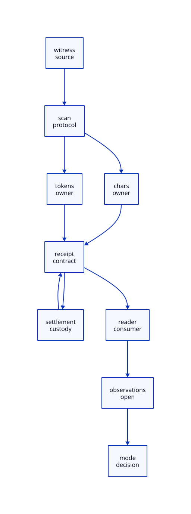

#+TITLE: EBNF Lexer to Scheme Reader Cursor Handoff
#+SETUPFILE: ../../modeling/org/setup.org
#+CATEGORY: toolchain
#+OPTIONS: toc:3 num:t
#+PROPERTY: header-args :eval never

* RESEARCH Source-derived reachability before cursor refactoring :modern_c:gxi:gxc:
:PROPERTIES:
:CUSTOM_ID: ebnf-cursor-handoff
:AUTHORITY: EbnfCursorHandoff
:STATUS: selected-source-witness-derived-adapter-open
:EVIDENCE_CLASS: source-derivation-and-conditional-models
:END:

This refines the open cursor boundary in [[file:ebnf-reader-custody-design.org][the reader custody study]].
Modern C remains the native engineering baseline; Scheme owns reader,
transformer, identity, exception and continuation semantics. No target program,
reader, compiler or generated parser is implemented or executed here.

[[file:models/sysml/ebnf-cursor-handoff.sysml][SysML]] owns seven selected source cases, nine protocol nodes, ten edges,
four admission gates, typed CursorRecord/requirements, benefit records and
CH-H/I/S/E obligations. [[file:ebnf-cursor-handoff-matrix.org][The matrix]] and  derive from native evaluation.
The broader ER-S/IC-S closure is retained, not declared complete by this witness.

** Cohort and claim strength
Research head =2211f9d400b65ecfeeb4b154004b8b43da0a36b1=;
Gerbil sibling =1cfb032c7a1612637da6205f5f8a15683eba3ba0=;
Gambit vendor =7c490c3ab5b5a4238b26f4a59d8cd9fd4b085882=.
[[file:../../../evidence/research/ebnf-cursor-handoff/checks.json][The receipt]] binds selected bytes, native fields, a retained assurance policy
and exact model scopes. Source derivation, finite model checks, native
reproduction and full source-to-model refinement are distinct evidence levels.
Earlier study receipts and their unresolved-at-that-time conclusions are preserved.

* RESEARCH A reader-accepted quote-loss witness
:PROPERTIES:
:CUSTOM_ID: cursor-legal-witness
:END:

The following is a source-derived witness specification, not an executed test:

#+begin_src scheme :eval never
#lang :std/text/parser/ebnf/lang
(def (T n) n)
%%lexer lex-loss
x ->'(T 42)
#+end_src

The prelude path has a real consumer in [[file:../../../../gerbil-gambit-bootstrap-audit/src/std/encoding/protobuf/grammar.ss::1][protobuf/grammar]].
[[file:../../../../gerbil-gambit-bootstrap-audit/src/std/text/parser/ebnf/lang-reader.ss::318][lex-lexer]] recognizes ACTION with ={WS}+->= and has no trailing-space
condition. Its RX rule excludes leading space; the whitespace-only rule cannot
continue through the arrow. Therefore, at the accepted arrow no other live
lexer language can extend through the following quote.

| Step | Source anchor | State/result under ordinary file input and standard readtable |
|---+---+---|
| Read section | [[file:../../../../gerbil-gambit-bootstrap-audit/src/std/text/parser/ebnf/lang-reader.ss::20][read-module-body/read-section-head]] | Scheme body and %%lexer/id are read; lex-loss starts a lexer section |
| Read RX | [[file:../../../../gerbil-gambit-bootstrap-audit/src/std/text/parser/ebnf/lexer.ss::120][lex1]] | RX x wins; the following space is returned to the private char buffer |
| Recognize ACTION | [[file:../../../../gerbil-gambit-bootstrap-audit/src/std/text/parser/ebnf/lang-reader.ss::321][WS+ arrow pattern]] | Space is consumed from that buffer, then - and > from the port; accepted ACTION reduction is saved |
| Probe longer | [[file:../../../../gerbil-gambit-bootstrap-audit/src/std/text/parser/ebnf/lexer.ss::163][maximal-munch E]] | Quote is read, all derivative languages fail, and E pushes the quote into char-stream.buf |
| Deliver ACTION | [[file:../../../../gerbil-gambit-bootstrap-audit/src/std/text/parser/ebnf/lexer.ss::54][token-stream-next/get]] | The direct lexer-body path consumes ACTION; no parser production has queued additional future tokens in this witness |
| Read action | [[file:../../../../gerbil-gambit-bootstrap-audit/src/std/text/parser/ebnf/lang-reader.ss::237][read-lexer-body]] | read-syntax receives the physical port after the quote, starting at (T 42) |
| Build definition | [[file:../../../../gerbil-gambit-bootstrap-audit/src/std/text/parser/ebnf/lang-reader.ss::59][read-%%-section]] | The resulting action is (T 42), and the section terminates normally at newline/EOF |
| Check shape | [[file:../../../../gerbil-gambit-bootstrap-audit/src/std/text/parser/ebnf/deflexer.ss::51][deflexer action pattern]] | (T 42) has identifier token-t and expr; its generated reduction has token tag T and value 42 |

The corrected logical-suffix reader instead sees the quote. Gambit's standard
[[file:../../../vendor/gambit/lib/_io.scm::13835][quotation handler]] constructs =(quote (T 42))=. This too fits the same
two-element action pattern: tag quote, expression (T 42). The body defines T,
so neither shape needs to rely on an unbound T to demonstrate the distinction.
These are different accepted reader outputs and well-shaped generator actions.
This establishes a selected source-level reachable counterexample under the
stated binding/readtable assumptions. It does not claim that this module has
been compiled or run, nor that every native/bootstrap configuration is equivalent.

** Boundaries that must not be conflated
The current lexer has no after-arrow whitespace requirement in this path.
Existing [[file:../../../../gerbil-gambit-bootstrap-audit/src/std/encoding/protobuf/grammar.ss::147][protobuf examples]] use spacing, but examples do not add a lexer guard.
The language tutorial's [[file:../../../../gerbil-gambit-bootstrap-audit/doc/tutorials/languages.md::297][grammar discussion]] is not a complete whitespace specification.
Current reader acceptance, generator pattern validity and successful full
module compilation are separate claims; only the first two are source-derived here.

The parser lexer has a different competition: ACTION => ties with Ident, with
ACTION listed first. A following quote cannot extend Ident, so the selected
quote boundary has the same private-buffer issue once its helper is reached.
By contrast =>42 is a longer Ident because digits belong to its character
class. It must not be modeled as an ACTION followed by a lost digit. The
complete parser-production token-rewind path remains a separate CH-S refinement.

* RESEARCH Character, token and coordinate conservation
:PROPERTIES:
:CUSTOM_ID: cursor-conservation
:END:

For the lexer witness body line =x ->'(T 42)=, zero-based character indices
put quote at 4 and opening parenthesis at 5. After probing, the character-port
next position is 5, while the logical next input still begins with quote at 4.
These are character-stream coordinates, not the OS file descriptor's seek
offset or UTF-8 byte offsets. Port buffering can read ahead at a lower layer.

[[file:../../../../gerbil-gambit-bootstrap-audit/src/std/text/parser/ebnf/stream.ss::40][char-stream-getc/ungetc]] maintains its own last-character location and newline
history. A last-character location is not automatically the next-input cursor.
Replay order is private characters followed by the still-unconsumed port suffix;
newlines and source-name/container identity must travel with that order.
Preserving characters but using an unrelated proxy port's zero-based counters
does not prove location equivalence.

Token residue is a different view. [[file:../../../../gerbil-gambit-bootstrap-audit/src/std/text/parser/ebnf/lexer.ss::81][unget/peek]] stores actual token objects;
[[file:../../../../gerbil-gambit-bootstrap-audit/src/std/text/parser/ebnf/defparser.ss::17][parser-rewind]] uses list-tail eq identity. Token payloads do not retain all
whitespace, comments, raw spelling, readtable history or source extents.
Therefore =write(token-e)= is not a valid character replay adapter. The initial
handoff profile requires no pending future tokens. A later token-span profile
needs stable raw spans and an independently proved replay/identity relation.

** Fresh-stream end location is an intermediate observation
The lexer action path creates a fresh lex-lexer, then immediately calls
token-stream-loc before reading any character. [[file:../../../../gerbil-gambit-bootstrap-audit/src/std/text/parser/ebnf/stream.ss::31][Its initial location]] is zero;
[[file:../../../../gerbil-gambit-bootstrap-audit/src/std/text/parser/base.ss::85][location-delta]] can consequently produce off=0-start.xoff+0. For positive
start.xoff this is negative. Do not infer an ordinary displayed-location defect
from this arithmetic alone: [[file:../../../vendor/gambit/lib/_io.scm::10314][make-filepos]] normally packs line/column and
ignores its third char-count argument; that argument is used on the overflow
fallback path. Preserve the intermediate location fields for consumers that
can observe them, and qualify packing/overflow separately. Replacing zero with
the physical end can be a behavior repair, not an already-proved refactoring.

* RESEARCH Explicit observation modes and delivery protocol
:PROPERTIES:
:CUSTOM_ID: cursor-contract
:END:

The canonical =CursorRecord= binds port/input generation, encoding/EOL,
readtable and reader-instance identities, physical and logical coordinates,
last-location/newline history, char/token residue identities, callback extent,
root pin, one owner and one declared observation mode.

| Mode | Read entry and obligation | Compatibility consequence |
|---+---+---|
| Legacy | Reproduce current physical-port entry and retain/quarantine old private residue and aliases | Can preserve the current quote-loss output; must also retain locations/errors/effects and continuation references |
| Coherent | Present private characters then source suffix through a location-aware admitted adapter | Preserves the intended quote but changes the accepted witness output; requires an explicit behavior-repair decision |
| Datum-only shortcut | Treat equal parsed datum as full equivalence | Rejected: handlers, locations, exceptions and input consumption can distinguish it |

The coherent path is not silently issued a legacy-equivalence credential.
The study chooses no production behavior change and implements neither path.

1. Reserve under the source owner. Check input epoch, aliases, roots, mode and
   token boundary before exposing any adapter. Source retains every obligation.
2. Publish one rooted authoritative transfer record at commit. Modern C needs
   a proven lock or CAS/release-acquire protocol joining epoch validation and
   ownership change; the design does not claim an existing implementation.
3. Target rejection before commit leaves source custody and original buffers
   intact. Do not discard character residue merely because legacy entry skips it.
4. Unknown commit/result retains the authoritative record. Query its state;
   do not re-read, re-lex, reopen or repeat callbacks to guess whether it ran.
5. Record success or the exact raised object and effect/position state before
   acknowledging completion. If the target already finished while delivery was
   unknown, settlement returns that result without a second read.
6. Retire the old view only after all token, exception and continuation aliases
   have drained. Moving control does not roll back mutable buffers or I/O.

** Exception equivalence
EOF after the arrow reaches read-syntax as EOF, then the helper raises its
explicit syntax error using rule/token context. A datum parsing exception,
ParseError translated by read-%%-section, a non-ParseError rethrow and later
deflexer rejection are different endpoints. Preserve the endpoint, raised-object
identity where observable, irritants, locations, input consumption, dynamic
handlers and cleanup order. A generic adapter ERROR or automatic retry does not
establish this relation. Arbitrary reader/refill callbacks and continuation
winding remain open; the finite model abstracts them rather than proving them.

* RESEARCH Actual model chain and open source obligations
:PROPERTIES:
:CUSTOM_ID: cursor-model-chain
:END:

Native SysML projects the exact fixture strings to [[file:../../../models/build/ebnf_cursor_parameters.qnt][QNT codepoint lists]],
classifications, gates and dependency facts. [[file:../../../models/build/ebnf_cursor_handoff.qnt][QNT]] distinguishes selected ACTION
boundaries from the merged Ident control, physical lookahead from char residue,
legacy/coherent observations, pending token refusal, epoch validation and
single-custody commit. It retains unknown-before-read and completed-before-
settlement histories. Its datum function recognizes only the seven fixture
suffixes; it is not an independent Gambit reader, regex compiler or source interpreter.

[[file:../../../models/build/EbnfCursorHandoff.lean][Lean]] checks seven conditional kernels for suffix conservation, empty-buffer
agreement, distinct quoted/unquoted constructors, noninjective token payload,
intermediate off arithmetic, single owner and work threshold. It does not prove
the Scheme source implements the model or that C publication is linearizable.

[[file:../../modeling/ascent/ebnf-cursor-handoff.rules.scm][ASCENT DSL]] carries source-derived witness scope separately from native
reproduction, derives mode-repair obligations from differing observations and
keeps actual adapter gates open. [[file:../../modeling/ascent/ebnf-cursor-handoff.request.scm][The composed request]] retains ancestor
needs and adds CH-H/I/S/E. A retained policy snapshot avoids unrelated shared
planner mutations; it grants no execution or production admission authority.

The selected lexer witness reduces the earlier generic reachability gap.
CH-S still requires complete production/token simulation and callback/exception
observation reflection; CH-E requires native port/counter, GC-root, publication
and continuation refinement. All four adapter gates remain false. Source witness
derivation is true; native reproduction and actual adapter admission remain false.

* RESEARCH Net work and retirement sequence
:PROPERTIES:
:CUSTOM_ID: cursor-net-work
:END:

Baseline source constructor calls remain T=S+A for each char-stream/token-stream
and initial location. If one qualified cursor domain could replace every action
reset while retaining one pair per section, the structural upper bound is 2A
removed stream constructor calls plus A initial-location constructor calls.
This is a conditional source-call bound, not eliminated native allocations or
measured speedup; aliases, callbacks and observed fresh-state identity may
prevent those removals. Reuse already supplied by module grammar loading is baseline.

Net work subtracts span/receipt storage, owner/epoch/root tracking, adapter
dispatch, callback validation and settlement from genuinely avoided work.
Do not credit a correctness repair as faster compilation. Independent-input
parallelism is a separate span benefit and does not permit two owners to
advance the same physical resource independently.

Retirement order: qualify observation mode and source witnesses; qualify raw
token boundary and coordinate/effect delivery; introduce authoritative custody;
migrate action read/reset consumers and location/error consumers together;
retire raw-port/reset assumptions only after source reflection and native
acceptance. Existing unqualified execution remains outside managed reuse.
No runtime/compiler/build implementation, native test or performance run is included.
