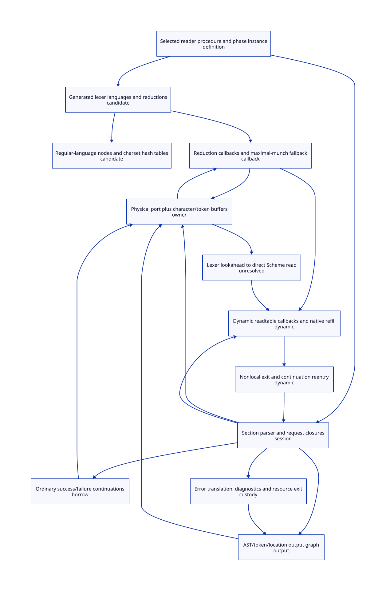

#+TITLE: EBNF Reader Captures, Dynamic Effects and Continuation Custody
#+SETUPFILE: ../../modeling/org/setup.org
#+CATEGORY: toolchain
#+OPTIONS: toc:3 num:t
#+PROPERTY: header-args :eval never

* RESEARCH Reader isolation before parallel gxi/gxc consumption :modern_c:gxi:gxc:
:PROPERTIES:
:CUSTOM_ID: ebnf-reader-custody
:AUTHORITY: EbnfReaderCustody
:STATUS: source-refinement-open
:EVIDENCE_CLASS: source-and-conditional-models
:END:

This refines the concrete EBNF boundary in [[file:initialization-closure-design.org][the initialization study]].
Modern C remains the native baseline. Scheme retains reader/expander semantics,
binding identity, exception identity, dynamic extent and continuations.
[[file:models/sysml/ebnf-reader-custody.sysml][SysML]] owns twelve regions, nineteen capture/call edges, five admission gates,
four net-work families and ER-H/I/S/E obligations. The [[file:ebnf-reader-custody-matrix.org][matrix]] and  derive
from this model; the graph is an audited spine, not a whole-program closure.

** Source identity
Research head =1a2d8612f2065387c62858e10baf63ce369cc48c=;
Gerbil sibling =1cfb032c7a1612637da6205f5f8a15683eba3ba0=;
Gambit vendor =7c490c3ab5b5a4238b26f4a59d8cd9fd4b085882=.
Selected bytes and model scopes are bound in [[file:../../../evidence/research/ebnf-reader-custody/checks.json][the receipt]]. No Scheme/native
program was built, expanded or run. Previous receipts remain unchanged.

* RESEARCH Actual reachable state and callback producers
:PROPERTIES:
:CUSTOM_ID: ebnf-capture-cut
:END:

| Producer | Captures/references | Actual writes or effect | Classification |
|---+---+---+---|
| [[file:../../../../gerbil-gambit-bootstrap-audit/src/gerbil/expander/module.ss::275][read-body]] | Selected phase-1 reader, input port, path/args and prelude | Resolves/evaluates reader binding; dynamically parameterizes invocation | Same phase instance; invocation-specific port and parameters |
| [[file:../../../../gerbil-gambit-bootstrap-audit/src/std/text/parser/ebnf/deflexer.ss::73][deflexer output]] | Generated ::L language list and ::R reduction procedures | Module initialization builds definitions; each lexer call builds a token stream | Qualified definition candidate; not a new per-token grammar build |
| [[file:../../../../gerbil-gambit-bootstrap-audit/src/std/text/parser/ebnf/rlang.ss::35][charset/negset]] | Mutable hash tables reachable inside language structs | deriv/delta read tables and construct derivative results | Read-only in this implementation path; external aliases/writers still need qualification |
| [[file:../../../../gerbil-gambit-bootstrap-audit/src/std/text/parser/ebnf/lexer.ss::120][lex1.loop/E]] | cs, original Rs, accepted chars, start/end, deltas and fallback E | Advances port, pushes excess characters into cs.buf, invokes reduction R | Per-token callback closure and live resource custody |
| [[file:../../../../gerbil-gambit-bootstrap-audit/src/std/text/parser/ebnf/lexer.ss::20][token-stream]] | cs, token buf, Ls, Rs, memoized EOF token | get/peek/unget/next mutate buf and EOF field | Per-invocation state; same-port aliases share one resource domain |
| [[file:../../../../gerbil-gambit-bootstrap-audit/src/std/text/parser/ebnf/stream.ss::19][char-stream]] | port, lookahead buf, location, newline-offset history | getc/ungetc mutate stream state; close closes underlying port | Owner-managed mutable graph; no deep-freeze of a live stream |
| [[file:../../../../gerbil-gambit-bootstrap-audit/src/std/text/parser/ebnf/lang-reader.ss::131][read-parser-body K/E]] | port, ts, accumulated rules and section parser continuation | Recursive callbacks progress the section reader; action syntax is read from port | Fresh invocation closures, not shareable parser progress |
| [[file:../../../../gerbil-gambit-bootstrap-audit/src/std/text/parser/ebnf/defparser.ss::17][parser-rewind]] | ts and persistent token-list tails toks/xtoks | Uses tail eq identity; pushes tokens back into the stream | Reconstructing equal lists independently can break the stop condition |
| [[file:../../../../gerbil-gambit-bootstrap-audit/src/std/text/parser/ebnf/defparser.ss::37][parser-parse and generated rules]] | wrap-e, K/E, token stacks and production locals | Invokes callbacks; generated alternatives rewind token state | Ordinary callback protocol; not evidence of captured first-class continuations |
| [[file:../../../../gerbil-gambit-bootstrap-audit/src/gerbil/runtime/syntax.ss::255][read-syntax]] | current-readtable, port, wrapper/unwrapper and read environment | Calls Gambit datum reader | Dynamic handler graph must be admitted |
| [[file:../../../vendor/gambit/lib/_io.scm::12694][datum/sharp/comment dispatch]] | Handler procedures in readtable and their transitive captures | Arbitrary extension callbacks; [[file:../../../vendor/gambit/lib/_io.scm::5240][read-char]] also invokes rbuf-fill | Reader source alone does not close the callback/native refill capability cut |
| [[file:../../../../gerbil-gambit-bootstrap-audit/src/std/text/parser/base.ss::7][tokens, locations and errors]] | Token payload, location.port and diagnostic irritants | Diagnostic display can query the port name and perform output | Error/output roots can outlive the active read |

The actual EBNF reductions in [[file:../../../../gerbil-gambit-bootstrap-audit/src/std/text/parser/ebnf/lang-reader.ss::267][lang-reader]] build tokens and grammar data.
The action read at =read-parser-body/parse-rule-action= and
=read-lexer-body= is Scheme syntax inserted into a generated definition; it
is not evaluated by those read calls. Later macro expansion/generation may
install executable actions, so a reader-phase effect claim must not silently
extend to every later generated parser or arbitrary wrap-e/lexer argument.

No explicit call/cc occurs in the selected reader/lexer/stream/rlang source.
That observation does not rule out capture by a readtable handler, callback,
native refill, error handler or imported procedure. The ordinary K/E protocol
must be kept distinct from first-class continuation lifetime.

* RESEARCH One cursor has several observable views
:PROPERTIES:
:CUSTOM_ID: ebnf-cursor-handoff
:END:

The [[file:../../../../gerbil-gambit-bootstrap-audit/src/std/text/parser/ebnf/lexer.ss::163][longest-match fallback]] returns excess characters with char-stream-ungetc,
which writes a private list in [[file:../../../../gerbil-gambit-bootstrap-audit/src/std/text/parser/ebnf/stream.ss::59][char-stream]], not the underlying port buffer.
[[file:../../../../gerbil-gambit-bootstrap-audit/src/std/text/parser/ebnf/lang-reader.ss::165][parse-rule-action]] then calls read-syntax on the raw port and constructs a new
lexer. The lexer-body action path does the same. No explicit buffer transfer
appears at either reset. A transparent reset therefore needs a proof of its
input boundary; an old stream must not be discarded merely because a new
stream can be constructed from the same port.

For the abstract suffix model, logical input is B ++ P (buffer then port).
Using P alone loses B unless B is observationally harmless for the exact reader
entry and its diagnostics/effects. B=[] is sufficient, not necessary. Ignored
whitespace might preserve a particular datum but custom handlers, locations,
comments and error behavior can distinguish it.

The retained [17] ++ [18] versus [18] counterexample is a model counterexample,
not a demonstrated native EBNF failure. Whether a concrete accepted grammar
can reach a harmful nonempty buffer at each handoff remains ER-S. Do not repair
the source or silently change accepted grammar/reader observations in this study.
Native refill/port buffering is an additional layer, not a replacement for the
private char/token buffers. Per-character mutexes do not serialize this protocol.

* RESEARCH Owner, reentry and continuation semantics
:PROPERTIES:
:CUSTOM_ID: ebnf-owner-continuation
:END:

An invocation domain owns its port aliases, token/character buffers, parse
callbacks, dynamic reader parameters, result/error roots and selected module
instance reference. Distinct admitted ports and private request state can
advance concurrently. Two wrappers around the same physical port are not
independent domains. A private lease must retain actual alias identity.

An owner is a semantic authority, not permission to replace Scheme execution
with an unqualified remote C call. Nested callbacks carry the same invocation
identity and dynamic binding stack. A nested reader on another port gets
fresh state; same-port reentry must preserve all aliases, consumption order
and source observations. A reentrant mutex alone proves none of those facts.

[[file:../../../vendor/gambit/lib/_thread.scm::8302][dynamic-wind]] installs before/after actions in dynamic state; continuation
return/graft paths handle winding. Restore dynamic context through Scheme's
semantics. Do not substitute an exception-only cleanup sequence.
Crucially, continuation restoration does not roll back mutable heap or completed
I/O: resuming a captured continuation must see the current shared stream state,
not a copied saved cursor, unless an explicitly different API is being designed.

| Transition | Required custody/observation | Refusal or open obligation |
|---+---+---|
| Nested K/E call | Same resource domain, token-tail identities and callback order | Off-thread dispatch, copying progress or acquiring a non-reentrant lock requires refinement |
| Callback escapes | Release physical execution lock in a proven winding protocol; retain logical lease and roots | Do not release live references or let another alias steal the stream |
| Continuation reenters | Preserve invocation identity, dynamic bindings and current mutation history | Snapshot rollback, I/O replay and per-resume module reinitialization are invalid replacements |
| Normal reader return | Existing file wrapper closes after normal return; captured port object may survive | Rooting an object does not keep its OS resource open |
| Reenter after close | Preserve source closed-port outcome or refuse the managed capability before admitting it | Do not silently reopen a file at a saved offset and report equivalent behavior |
| Exception translation | Translate ParseError as source does; propagate other exceptions unchanged | Error irritants and tokens may still root ports; diagnostics are not pure AST data |
| Suspended multi-shot continuation | Keep logical resource/callback roots until references are genuinely retired | No general retirement or liveness proof is supplied; unbounded retention remains a cost |

[[file:../../../../gerbil-gambit-bootstrap-audit/src/gerbil/core/runtime.ss::52][call-with-input-file]] is exported as a host primitive; the inspected Gambit
[[file:../../../vendor/gambit/lib/_io.scm::10003][implementation]] calls proc, then closes on normal return without an explicit
dynamic-wind wrapper in this function. The expander's source-file wrapper
adds no such guard. This supports a conservative custody obligation; it is not
a proof of all VM/finalizer cleanup, resource leakage, or every raised-object
behavior. A new eager-close guard on escape could change later reentry semantics.

* RESEARCH Freeze and effect admission
:PROPERTIES:
:CUSTOM_ID: ebnf-freeze-admission
:END:

Freeze candidates are definitions/recipes and qualified immutable grammar
graphs, including their reduction references. Generated grammar singleton
identity and mutable charset-table aliases must be preserved or fully mediated.
No current candidate is issued a deep-freeze certificate.

Live streams, ports, lookahead, progress closures and token-tail aliases remain
owned. Readtable handlers and port-refill procedures require a transitive
capability description or refusal. Diagnostics and output graph qualification
include locations, symbol/binding identity, arbitrary extension-produced
payloads and mutable aliases. Returned AST equality alone does not establish
reader/result reuse. Source input identity, readtable generation, reader phase
instance and observable effects/errors must all match the admitted observation.

The five native gate records remain false: captureAliases, callbackEffects,
cursorHandoff, continuationExtent and outputFreeze. The broader foundation/native
obligations remain dependencies through IC-S, not silently discharged here.

* RESEARCH Executable model chain and limits
:PROPERTIES:
:CUSTOM_ID: ebnf-model-chain
:END:

Native SysML evaluation projects [[file:../../../models/build/ebnf_reader_parameters.qnt][model parameters]], classifications and edges.
[[file:../../../models/build/ebnf_reader_custody.qnt][QNT]] models two invocation identities, aliased versus independent resource
domains, bounded nesting, buffered/direct reads, capture/suspension/reentry,
normal close, error roots and delayed reclamation. It checks reuse admission
and readtable-generation invalidation. Synthetic admitted initialization is
separate from initActual; no actual source admission follows from simulation.
Capture is abstracted to a retained reference with repeated suspension/resumption;
it is not a full multi-shot stack or dynamic-wind interpreter.

[[file:../../../models/build/EbnfReaderCustody.lean][Lean]] gives seven conditional observation/custody kernels: buffer-head
observation, empty-buffer handoff, a buffer-loss counterexample, mutation and
port-state preservation, root-protected reclamation and positive work threshold.
Source simulation, QNT-to-Lean simulation, native error equivalence, scheduling
liveness, full payload freezing and actual resource retirement remain open.

[[file:../../modeling/ascent/ebnf-reader-custody.rules.scm][ASCENT]] computes reachability over native capture/call edges and derives
freeze candidates, owner/borrow obligations and unresolved dynamic boundaries.
[[file:../../modeling/ascent/ebnf-reader-custody.request.scm][The actual composed request]] retains the complete ancestor need/dependency graph
and adds ER-H/I/S/E. Formal evidence cannot override missing source gates.
Synthetic positive and missing-gate controls test the inference, not runtime authority.

The shared assurance planner changed concurrently during finalization. Runs are
bound to the [[file:../../../evidence/research/ebnf-reader-custody/planner-refreshed.ss][retained evaluated policy snapshot]], whose digest is a separate input
factor. Later shared-file edits are outside this receipt. Ancestor needs and
scopes remain native-derived; snapshotting this policy does not override those
obligations or modify the live shared planner. The refreshed controls also check
lossless grouped subject transport against the full native requirement set.

* RESEARCH Net work and genuine retirement
:PROPERTIES:
:CUSTOM_ID: ebnf-net-work
:END:

For a normal path through S parser/lexer sections and A embedded action reads,
there are T=S+A calls to lex-parser/lex-lexer: one per section plus one reset
after each action. With a port input, lexer-input-stream constructs a fresh
char-stream and lex constructs a token-stream each time: T calls to each stream
constructor, and T initial make-location calls in char-stream initialization.
Generated parsers receiving an existing token-stream do not rebuild it through
parser-input-stream. These are source constructor counts under the stated path,
not measured allocation counts, byte costs or an equivalence proof for removing
the resets. Errors/early exits count only calls actually reached. A fused cursor
design must first close the handoff obligation before claiming these savings.

For R materializations genuinely removed, define avoided work as their measured
or separately justified decode/initialize/validate work. Net work is avoided work
minus alias qualification, per-invocation identity maps, ownership handoffs,
root retention and effect/output validation. Existing module ::L/::R construction
and caching are baseline reuse, not a new saving. Derivative allocations, fresh
locations, token buffers and Scheme-visible callbacks remain necessary work.

Independent-port parallel span is limited by provider/effect dependencies and
total necessary work; it does not imply less work or a measured macOS speedup.
Retire coarse reader/session serialization only after the complete shared-state
and capability cut is qualified. Retire repeated grammar construction only where
it actually occurs. Retire raw buffer-reset assumptions only after source
equivalence, not by changing tests to accept a different reader. No runtime,
compiler or build implementation, native test, or performance run is included.
