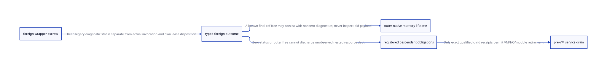
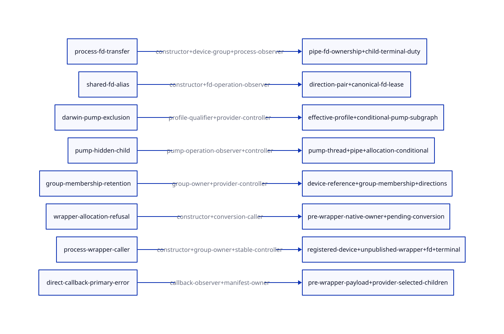

#+TITLE: Foreign Destructor Outcomes: Owned Leases, Native Storage and GC Policy
#+SETUPFILE: ../../modeling/org/setup.org
#+OPTIONS: toc:3 num:nil
#+PROPERTY: header-args :eval never
#+TODO: RESEARCH DECIDED | ADMITTED RETIRED

* DECIDED Authority and scope :c23:foreign:gc:ownership:
:PROPERTIES:
:CUSTOM_ID: foreign-destructor-outcome-contract
:AUTHORITY: GambitDarwinDevelopment preparationCut15; foreignResult0..9; providerDuty0..7; shutdownCase7
:BASE: current vendor/gambit modern-c working source, not a qualified native binary
:STATUS: source result classification and conditional models; native source refinement OPEN
:END:

The [[file:models/sysml/macos-development.sysml][native SysML]] is the structural authority. Its result classes drive the
[[file:c23-development-refactor-matrix.org][matrix]],  and actual [[file:../../modeling/ascent/c23-development-design.rules.scm][ASCENT]] contract/descendant guards.
The [[file:models/quint/service_shutdown.qnt][service QNT owner]] extends the existing whole-family/preparation product;
[[file:models/lean/ServiceShutdown.lean][Lean]] distinguishes a known own-container release from a full resource receipt.
This is a refinement of [[file:stable-task-group-design.org][the stable supervisor]], not a new GC or a parallel cleanup runtime.

* RESEARCH The actual result producers and consumers

#+NAME: foreign-result-source-matrix
| Producer / caller | Source-established behavior | Owned-duty conclusion | What remains unproved |
|-------------------+-----------------------------+-----------------------+-----------------------|
| release_pointer; c_intf.c:1717-1726 | Returns NO_ERR and deliberately does nothing to C-owned data | No managed native free is required for this callback | External C owner and any cross-domain references remain separate |
| release_function; 1732-1739 | Drops one RC reference if a C closure, returns NO_ERR | One owned reference may be settled | Other references, container free and image retirement do not follow |
| release_foreign; 1694-1708 | Bad type refuses before callback; a nonnull callback is saved, wrapper fields cleared, then invoked | Invocation/clear-before-call must be recorded separately | Cleared fields and a second no-op success do not establish first-call disposition |
| free_unmarked_still_objs; still-sweep.inc:31-47 | Ignores callback return code; after normal return clears escrow and frees wrapper storage | Existing ordinary-GC diagnostic policy | No resource disposition follows from normal return or wrapper reclamation |
| free_still_objs; 98-107 | Nonzero return retains teardown escrow after release_foreign may already clear wrapper | Outstanding outcome is not replay authority | Saved native pointer may already be dead; no unsafe inspection to classify it |
| device_cleanup; os_io.c:1625-1666 | Detaches then closes directions; may return before final reference release | Direction/FD obligations may remain | Error code alone cannot locate actual progress or permit close retry |
| device_release; 1603-1622 | At final count, virtual release is followed by outer free even if the virtual result is nonzero | Known return on that branch establishes outer free | Nested effects and other resource obligations require independent witnesses |
| POSIX process release chain; 3126-3131,3519-3539,3664-3674,3765-3785 | Pipe raw release returns NO_ERR; POSIX process cleanup has no OS release operation; process raw release combines these | Current process raw path is not evidence of a reachable nonzero final-release result | Selected flags/vtable/pump closure and native terminal/FD receipts remain open |
| STRUCT/UNION/TYPE conversion failure; c_intf.c:5310-5383 | Calls release_fn directly and returns original conversion error | Primary error must stay distinct from cleanup disposition | Destructor return is not delivered to the original caller; pre-wrapper owner/catcher requires refinement |
| Arbitrary registered foreign callback | Function pointer ABI accepts provider-defined result/effects | Opaque until its owned scope and progress contract are qualified | Neither zero nor nonzero status can certify arbitrary resources |

The generic device code proves a conditional ordering, not that every built-in
provider can return a nonzero final-release result. In particular, do not present
the generic error-after-free branch as an established Darwin GSC/GCC process
failure. Earlier error paths in direction close are distinct from that final
release. USE_PUMPS and selected configuration/vtable qualification remain explicit.

* DECIDED One outcome vector, separate from the legacy status

#+NAME: release-outcome-record
#+BEGIN_EXAMPLE
ReleaseInvocation = (InvocationId, AttemptGeneration, ProviderKey, CallerPolicy,
                     ResourceKey, OwnLeaseId, source/target context identity)
ProviderKey = (source digest, selected callback/vtable, effective configuration,
               qualified owned-duty and child-resource manifest)
ReleaseOutcome = (legacyStatus, invocationObserved, wrapperDetached,
                  ownLeaseDisposition, nativeStorageDisposition,
                  childReceipts, residualDebtOwner)
OwnLeaseDisposition = NotInvoked | Released | TransferredWithReceipt | Unknown
NativeStorageDisposition = NotOwned | StillLive | Freed | Unknown
FullReceipt = providerQualified && observed && ownDutySettled
              && every required child obligation settled or validly transferred
#+END_EXAMPLE

A transfer settles the source's lease only after the target acknowledges its own
scannable/resource custody. It does not erase VM-level debt. The receiving owner
must outlive the source and retain required context, I/O routing and module image.
A task-local receipt is not an all-VM or all-image retirement permit.

The model's childrenSettled represents the required scope's complete descendant
receipt set, not a guess based on errno or a claim that the container has no
children. A provider with an empty owned child set can supply that witness only
through a qualified contract. Keys and manifests must exist before irreversible
release; an error cannot reconstruct lost child identities from freed memory.
If a legacy callback has no such manifest, leave disposition unclassified and
refuse a full managed receipt. This study does not invent an observation API that
can recover arbitrary hidden native effects.

#+NAME: outcome-disposition-matrix
| Observation | Own lease / native memory | Full resource completion | Required custody |
|-------------+---------------------------+--------------------------+------------------|
| Zero status, borrowed-pointer release | No managed payload free; C world still owns it | Only the empty owned duty is complete | External owner remains responsible |
| Zero status, one RC decrement | This reference may be gone; allocation may remain | Other owners are not settled by this receipt | Preserve their independent leases/module roots |
| Nonzero before callback | No invocation/transfer established | Refused request, original caller still owns its input | Original owner |
| Nonzero from partial device cleanup | May be detached and partly closed, no final free on that return | Incomplete or unknown | Live device/control and direction cursor |
| Known final-reference free with nonzero diagnostic | Outer allocation is dead | Complete only with all child receipts | Keep diagnostics; never touch/release old payload again |
| Outer free known, child effects unknown | Outer allocation is dead | Incomplete even when callback returned normally | Independent residual-debt controller, live required domains |
| Nonlocal escape / lost outcome | Actual disposition may be unknown | No full receipt | Stable escrow/controller and exact invocation |
| Cleared wrapper returns a later no-op success | No new release observation | Query the original immutable outcome | Retained resolver; no second native call |

The ordinary and teardown callers share the outcome mechanism while retaining
separate diagnostic policies. Callback status remains a diagnostic observation,
not a compressed representation of all owned resources.

* DECIDED Semantic preservation versus required repair

#+NAME: foreign-policy-migration
| Behavior | Classification | Migration condition |
|----------+----------------+---------------------|
| Existing release_foreign return value and clear-before-call order | Preserve for existing callers | Do not re-invoke the callback to obtain a richer result |
| Ordinary GC does not newly raise a Scheme exception for destructor error | Preserve observable policy | Managed disposition travels through an independent typed owner; status is not turned into a new exception |
| Conversion failure returns its original conversion error | Preserve | Record cleanup outcome separately rather than overwrite the primary error |
| Borrowed pointer release does not free C-owned memory | Preserve | State the empty owned duty explicitly |
| One RC lease completion does not retire other owners | Preserve and expose scope | Complete all actual owners before global reclamation |
| Ordinary sweep erases managed residual custody on normal error return | Necessary managed-resource repair | Provider/controller acknowledgement survives GC wrapper reclamation; opaque legacy callbacks are not silently certified |
| Teardown interprets every nonzero code as live native payload | Necessary typed-outcome repair | Separate known released diagnostics from retained resource debt; never inspect stale saved pointer |
| A boolean/void cleanup result acts as full shutdown authority | Replace after caller migration | Use resource disposition plus diagnostics; preserve legacy error observation where required without treating it as a resource permit |

A managed release adapter can preserve the existing callback ABI and legacy
status while publishing typed progress to a registered stable owner. That owner
must already exist before invocation and wrapper clear. GC sweep may clear its
wrapper escrow only after known completion or acknowledged transfer of all managed
debt. Teardown must not replay the already-cleared wrapper: a no-op would hide the
original outcome, and the copied native payload might already have been freed.

Changing when a VM advances after known released-with-diagnostics is not claimed
to be automatically equivalent to the old boolean/void shutdown API. Existing
callers must migrate to a typed final state plus diagnostics. RetainedWithDebt
and RetiredWithDiagnostics are different states, even if both report an error.
Generic foreign callback error policy remains explicit and unqualified; no
whole-language semantic change is smuggled in as a GC optimization.

* DECIDED Device cursor joins pre-VM service drain

Use the existing cleanup escrow/supervisor as one custody mechanism, with the
provider's typed outcome; do not build separate sweep, shutdown and conversion
resource registries. This does not mean an unmodified escrow already contains
all required device/FD/child progress.

#+BEGIN_EXAMPLE
register exact invocation + owned child manifest in stable controller
  -> claim wrapper before clear-before-call
  -> detach/read/write cursor with actual operation receipts
  -> known own-reference release / outer free (status kept separately)
  -> settle or acknowledge transfer of every descendant obligation
  -> exact full receipt + observer/root/GC grace
  -> service drain -> VM/I/O/module retirement
#+END_EXAMPLE

The service model now keeps outer releaseStage==2 and cursor stage==8 separate
from childrenSettled. A known free can retire the old payload while residual
resource metadata remains rooted. VM/module teardown still refuses until those
receipts arrive. ChildCertificate now checks attempt, member, generation, provider,
issuer, manifest closure, observed outcome, exact required/settled resource sets
and absence of transferred VM debt. Concrete native identity resolution and
manifest completeness remain source-refinement premises; numeric model identities
are fixtures, not native issuer authentication.

Residual metadata contains stable logical keys, not a usable pointer to dead
storage. The [[https://www.open-std.org/jtc1/sc22/wg14/www/docs/n3096.pdf][C23 public draft N3096, 6.2.4]] does not permit evaluating an old pointer
after its object's lifetime. Qualify same-lock or matching release/acquire
publication separately from GC slot updates, OS operation completion and callback
thread affinity. These are provider/runtime obligations, not C23 syntax benefits.

Known EAGAIN/select may resume only at a qualified cursor cut with the actual
resource/FD generation and owner. Partial error, EINTR classification, shared FD
sides, callback escape and unknown final free remain unresolved where the selected
provider cannot supply evidence. There is no blind retry, timeout eviction or
assumption that an outer free implies global resource quiescence.

* RESEARCH Model closure and net benefit

The QNT adapter preserves all previous histories and adds nine outcome/family
cases. The first thirty histories cover borrowed/no-op success, unqualified and unknown
results, nonzero status with full witnesses, outer-free child debt and stale child
receipts. The previous error-after-final-free history still proves no replay; it
no longer stands for descendant completion. The first nineteen Lean laws include six new
outcome laws; knownReleaseErrorStillFinished now explicitly requires child closure.
This strengthens its prior conditional projection rather than claiming a new
native proof.

ASCENT uses the SysML result classifications and requires descendantDebt=no in
its semantic shutdown guard. An additional counterfactual case has both outer
release stages complete but outstanding child debt: it must refuse VM teardown.
These are model fixtures, not extracted native traces. Provider selection,
resource-manifest completeness, cross-context roots, all conversion/GC callers,
callback effect observation and C23/native physical refinement remain OPEN.

#+NAME: foreign-outcome-net-benefit
| Shared mechanism | Work or error actually avoidable | Mandatory added cost | Positive-condition / counterexample |
|------------------+----------------------------------+----------------------+-------------------------------------|
| One provider-scoped outcome vector | Repeated status decoding and unsafe whole-cleanup replay across callers | Provider manifest/identity plus one owned completion record | Positive only if existing escrow/controller is reused and old duplicate authority retires |
| Own lease versus storage versus descendants | Duplicate decrements/free and false resource completion | Residual child keys/receipts and diagnostics | Known outer free with child debt still blocks shutdown |
| GC wrapper-to-controller handoff | Retaining/reconstructing a wrapper solely to recover a lost native outcome | Acknowledged independent custody before wrapper reclamation | An opaque callback cannot reconstruct child keys after free |
| Stage/phase reuse enabled by sound service lifetime | Eligible unchanged preparation/generation/native jobs need not exist | Dependency/ABI checks, retained root graph and unresolved debt | Count omitted actual jobs, not faster bookkeeping or repeated existing cache HITs |

No speedup is established by these proofs. The same D1510 partition still needs
net >=36.843417 s removed for twofold acceleration. Even ideal elimination of the
entire uncovered preparation complement and both link intervals leaves
>=3.858635 s plus new costs to remove elsewhere. These outcome changes are safety
and reuse enablers; phase products, LibraryReadiness, LinkPlan and reduced native
emission/parse work must supply actual elapsed-work removal. The destructor protocol remains research-only. Separately authorized isolated
literal-header component experiments are documented in
[[file:darwin-turbo-study.org][the Darwin experiment report]]; they do not qualify this runtime protocol
or establish a package speedup. Resource limits remain unchanged.

* DECIDED Complete provider duties before an irreversible callback :provider:manifest:
:PROPERTIES:
:CUSTOM_ID: provider-manifest-closure
:AUTHORITY: GambitDarwinDevelopment providerDuty0..7
:STATUS: eight source routes and conditional model guards; native issuance OPEN
:END:

The generated [[file:c23-development-refactor-matrix.org][providerDuty matrix]] is authoritative for the eight source routes;
 derives from the same native SysML projection.
The manifest is a closed set of obligations, not a list reconstructed after free.

#+NAME: concrete-provider-closure
| Actual cut | What is owned / discoverable | Completion authority still required |
|------------+-----------------------------+-------------------------------------|
| os_io.c:2434-2450 stream setup | refcount=1; directions; close_direction=0; group registration precedes wrapper construction | Constructor plus group owner records exact scope before callback exposure |
| os_io.c:9319-9340 process setup | Successful setup transfers pipe-close responsibility; error retains redirection-pipe cleanup in caller | Transfer receipt must name the same FD incarnation and process invocation |
| os_io.c:2940-3006 pipe close | Equal fd_rd/fd_wr represents a shared close lease, not two frees; stage can become CLOSED before error | Canonical native ResourceKey, operation outcome and direction coverage; integer FD equality alone cannot handle reuse |
| os.h:390-397, os_io.c:2011-2037 | Pump subtree is conditional on Win32 configuration; stream release ignores pump cleanup results | Effective provider/profile qualification; do not invent Darwin pump costs |
| c_intf.c:5160-5222, os_io.c:10610-10635 | Failed foreign wrapper allocation does not call its release callback; registered device remains discoverable via group | Pre-wrapper native custody plus primary-error propagation; discovery is not completion |
| c_intf.c:5310-5383 | Struct/union/type failure calls callback directly and returns the conversion error | Stable controller pre-exists callback; cleanup disposition is separate from primary error |

A process device's native-release scope and the compiler supervisor's process
completion scope differ. POSIX raw process cleanup does not establish wait/reap.
The manifest for service retirement must additionally account for terminal child
status and output completion. A borrowed-pointer provider can have an empty owned
manifest; a device group, opaque FFI callback or arbitrary library cannot infer
one merely from a NO_ERR return.

** DECIDED Issuers and receipt scope

1. The constructor and group owner register the complete required resource keys
   while native storage is live. The selected provider/configuration qualifier
   fixes which virtual methods, optional pumps and foreign ownership policies apply.
2. The actual operation observer records each disposition; a diagnostic error is
   not evidence of either live or freed storage. Unknown results retain stable
   metadata, roots, descriptor/image holds and any required owner context.
3. The stable controller joins these observations with the closed manifest and
   exact InvocationId/generation. It may re-deliver a previously committed receipt
   after response loss; it may not re-invoke a destructive native operation.
4. Source transfer is accepted only after independent target acknowledgement.
   Outstanding transferred debt still belongs to the VM-level service ledger;
   it cannot become a full stop permit by changing the source owner.
5. Final service drain requires all members and all manifests, no new producer,
   and observer/root grace. A provider-local receipt never authorizes global
   module unload on its own.

In C23, construct the immutable manifest and observed result before same-lock
publication or release publication; consume it through that lock or a matching
acquire that reads the published state. The stable controller/record must be
pinned independently of the dead payload. No relaxed flag, unrelated acquire,
error code or timeout establishes native completion. Existing group links and
refcounts are not silently reclassified as a concurrent C23 registry.

** RESEARCH Conditional proof and counterexamples

The service model now has forty local histories, preserving the previous thirty
and adding ten checks: missing/extra resource, wrong provider/issuer, generation
reuse, open manifest, lost disposition, transferred VM debt, alias canonicalization
and duplicate receipt delivery. Seven added Lean laws prove resource-set coverage,
extra-resource exclusion, stale-generation refusal, producer closure, transfer-debt
refusal, completion composition and receipt idempotence. These are conditional
model facts. They do not prove that an actual provider enumerates every resource,
that a raw FD identifies an incarnation, or that the native code implements the
modeled atomic cut. The QNT Set abstraction and Lean List membership relation need
an explicit canonical-key extraction proof before native refinement can close.

ASCENT joins exact SysML manifest/issuer requirements with source/test/lemma
routes. Negative controls replace a required resource scope or issuer and must
lose that association. This detects evidence-association errors; it does not
observe native resource release.

#+NAME: provider-net-benefit
| Change | Eliminated work / hazard | Added mandatory work | Positive condition / counterexample |
|--------+--------------------------+----------------------+-------------------------------------|
| One pre-callback closed manifest shared by GC, shutdown and conversion failure | Reconstructing progress from dead memory; duplicate destructor replay | One canonical entry per distinct owned obligation plus issuer/profile checks | Empty borrowed scope is valid; hidden provider effects refuse certification |
| Alias-aware FD obligations | Double-accounting shared read/write FD and duplicate close | Native incarnation identity and per-direction coverage | Recycled FD integer must not settle the former lease |
| Stable result plus exact delivery identity | Re-running callback after lost answer | Result retention until observer grace, idempotent receipt lookup | Wrong generation/issuer or unknown outcome cannot drain |
| Transfer accounting in the same service ledger | Losing debt when an outer allocation or source owner retires | Target acknowledgement and residual owner lifetime | Source transfer alone cannot authorize VM cleanup |
| Reusable compiler service with safe teardown | Eligible unchanged phase work can be omitted | Dependency, root, manifest and observer validation | Safety is an enabler; no elapsed seconds credited until actual jobs disappear |

Retire boolean/void completion authority only after all actual callers consume
these scoped outcomes. Preserve clear-before-call, borrowed ownership and primary
conversion errors. Complete callback/FFI writer closure, effective generated-header
identity and native memory-order refinement remain OPEN.
