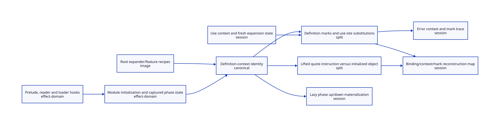

#+TITLE: Foundation Images, Syntax Quotes and Binding Identity Reconstruction
#+SETUPFILE: ../../modeling/org/setup.org
#+CATEGORY: toolchain
#+OPTIONS: toc:3 num:t
#+PROPERTY: header-args :eval never

* RESEARCH Preserve definition identity while isolating mutable work :modern_c:gxi:gxc:
:PROPERTIES:
:CUSTOM_ID: foundation-binding
:AUTHORITY: GerbilFoundationIdentity
:STATUS: conditional-models-checked-foundation-source-open
:EVIDENCE_CLASS: source-and-conditional-identity-transport
:DEPENDS_ON: FI-H; FI-I; FI-S; FI-E; GS-S
:END:

This refines [[file:gerbil-session-closure-design.org][execution support and session ownership]]. The target is not to
reinitialize every definition for every consumer. Share qualified immutable
definition data and preserve its logical identity; isolate use-site work and
retain the original initialization scope of stateful module instances.

[[file:models/sysml/foundation-binding.sysml][SysML]] owns ten regions, ten ownership/reconstruction edges, identity-model
parameters, an unresolved foundation flag and a typed reconstruction requirement.
The requirement states admission premises; no satisfaction is asserted.
[[file:foundation-binding-matrix.org][The sharing/reconstruction matrix]],  and [[file:../../../models/build/foundation_binding_parameters.qnt][QNT parameters]] derive from native
evaluation. An image candidate is not an already frozen live heap graph.

Source cohort: Gerbil sibling =1cfb032c7a1612637da6205f5f8a15683eba3ba0=;
Chez vendor =41d5ffca7a07cbfc8807e719dedcc70ed74811cd=;
OCaml vendor =46e1c324fb9e9f21f52c9cc3399020f7ef8b9b91=.
Selected bytes and prior checked scopes are bound in [[file:../../../evidence/research/gerbil-foundation-identity/checks.json][the receipt]]. Dune is a
retained mutable-main source snapshot with unresolved commit provenance, not
a runtime dependency or a qualified installed implementation.

* RESEARCH Actual definition/use and initialization paths
:PROPERTIES:
:CUSTOM_ID: foundation-source-paths
:END:

[[file:../../../../gerbil-gambit-bootstrap-audit/src/gerbil/compiler/compile.ss::1150][generate-runtime-quote-syntax%]] lifts identifier quotes with a context read
at initialization. Serialized marks carry phase and substitution pairs; mark
contexts resolve to the current module or imported/nested context references.
[[file:../../../../gerbil-gambit-bootstrap-audit/src/gerbil/compiler/compile.ss::1219][context-ref-origin/nested]] distinguishes module origin and relative nesting.
Do not replace these references with the consumer's current context.

[[file:../../../../gerbil-gambit-bootstrap-audit/src/gerbil/expander/core.ss::518][core-resolve-identifier]] resolves a quoted identifier through its saved
syntax-quote context and marks, while plain/use syntax follows the current
context and wrapping marks. resolve-identifier follows import bindings and
aliases. core-resolve-binding incorporates requested/source phase and walks
mark substitutions and their definition contexts. Lookup is therefore more
than a symbol-name table operation.

[[file:../../../../gerbil-gambit-bootstrap-audit/src/gerbil/expander/top.ss::644][free-identifier=?]] uses resolved binding object or binding-id equality, with
separate bound/unbound cases. bound-identifier=? also observes context eq and
mark-list equality. Reconstructing an equivalent binding table twice can still
break bound-identifier equality. Preserve repeated-reference aliases as well
as distinctions; a fresh target object for every occurrence is incorrect.

[[file:../../../../gerbil-gambit-bootstrap-audit/src/gerbil/expander/core.ss::484][User macro application]] creates a fresh use mark holding the definition
context/phase, marks the input, applies the transformer, and marks its result.
[[file:../../../../gerbil-gambit-bootstrap-audit/src/gerbil/expander/stx.ss::176][apply-mark]] cancels the same top mark by eq; order and repeated mark identity
matter. [[file:../../../../gerbil-gambit-bootstrap-audit/src/gerbil/expander/core.ss::600][Binding insertion]] can lazily allocate/update a mark substitution table.
[[file:../../../../gerbil-gambit-bootstrap-audit/src/gerbil/expander/core.ss::652][core-context-shift]] lazily writes reciprocal up/down phase links during a
resolver query. A nominally read-only definition lookup can thus mutate today's
context graph. Freezing just its top-level binding table is insufficient.

[[file:../../../../gerbil-gambit-bootstrap-audit/src/gerbil/expander/root.ss::168][Root initialization]] binds core syntax/macro expanders and features into a
new table. [[file:../../../../gerbil-gambit-bootstrap-audit/src/gerbil/expander/init.ss::8][expander/init]] creates a top context, installs import/eval/compiler
hooks and the root prelude. The observed iter SSI uses gerbil/base, whose
[[file:../../../../gerbil-gambit-bootstrap-audit/src/gerbil/base.ss::8][source]] imports core at phases 0, 1 and 2 and runtime. [[file:../../../../gerbil-gambit-bootstrap-audit/src/gerbil/core.ss::8][core]] imports module-sugar,
runtime/sugar/mop/match/more-sugar/contract and phase support. These are real
closure edges, not a proof that every reader, native hook or further phase is
enumerated. [[file:../../../../gerbil-gambit-bootstrap-audit/src/gerbil/expander/module.ss::277][Custom reader resolution]] can evaluate read-module-body support.
Module contexts, preludes and delayed evaluation introduce more live state;
the complete foundation execution cut remains open.

* RESEARCH Target image, canonical identities and owned overlays
:PROPERTIES:
:CUSTOM_ID: foundation-reconstruction
:END:

An immutable image contains instructions, data-only binding declarations,
serialized mark/context references, complete input/phase provenance and an
initialization plan. Its freeze certificate must cover the entire reachable
payload and all native escape paths. Existing syntax/AST payloads, tables,
closures and lists are not declared immutable merely because they are quoted.

Use an origin map for definition context, module/nesting, phase, binding and
mark references. Repeated origins resolve consistently to one canonical target
within the admitted cohort. Keep fresh use-site origins distinct. Generation
distinguishes artifact/cohort reuse; it does not unilaterally redefine the
language-visible binding-id of an existing export. The source simulation must
preserve both successful and missing lookups and both identifier comparisons.

Canonical definition objects may share only if deep immutability is established.
Mutable use contexts, lifted constants requiring instance state, mark overlays,
lazy phase caches and diagnostics acquire explicit owners. Move derived lazy
cache writes to owned side state or materialize a qualified finite phase cut.
Do not assume arbitrary phases can be eagerly completed once. If a macro uses
raw context introspection, mutable definition marks, native escapes or observable
cross-module state, its effect domain needs explicit serialization until a
stronger contract exists. One scheduler can serialize such domains while
running independent work; this does not require another compiler implementation.

** Module instance is a semantic scope, not a worker identity

The current registry and delayed evaluation can share a module instance across
consumers. A stateful macro provider returning successive counter values may
produce 1 then 2; resetting it for each consumer produces 1 then 1. This is a
constructed semantic counterexample, not a newly executed repository program.
An independent session must preserve the source's initialization scope, once
behavior and effects. A provider may be shared through a serialized owner, or
admitted as immutable/independent after proof. Fresh initialization per worker
is not a generally valid replacement for existing shared phase state.

* RESEARCH Learn identity and lifecycle mechanisms from source
:PROPERTIES:
:CUSTOM_ID: foundation-learning
:END:

[[file:../../../vendor/chez/s/syntax.ss::1171][Chez wraps]] separate marks and substitutions; its labels are designed for
identity comparison and local-label records carry mutable bindings/levels.
[[file:../../../vendor/chez/s/syntax.ss::2478][Visit/invoke state]] separates requirements and restores pending code on reset.
Learn identity-preserving representation and lifecycle protocols, not that a
syntax wrapper or label graph is automatically immutable or parallel-safe.

[[file:../../../vendor/ocaml/typing/ident.ml::95][OCaml Ident]] distinguishes local/scoped stamps from global names;
[[file:../../../vendor/ocaml/typing/ident.ml::175][equal and same]] have different meanings. Import consistency in persistent_env
also has explicit dependency identities. Learn to keep textual equality,
binding identity and artifact provenance separate; do not copy OCaml's module
semantics or infer concurrent compiler sessions from its runtime capabilities.

[[https://github.com/ocaml/dune/blob/main/src/memo/memo.ml][Dune Memo.Poly]] uses typed input/output identities and detects mismatches.
Learn an identity-aware memo key: an unchanged printed syntax name is not a
valid cutoff when definition origin, phase, inputs or instance semantics change.
The retained snapshot remains provenance-limited; no Dune implementation
component is required in the proposed runtime or action graph.

* RESEARCH Conditional models, counterexamples and evidence routing
:PROPERTIES:
:CUSTOM_ID: foundation-formal-chain
:END:

[[file:../../../models/build/foundation_binding_identity.qnt][QNT]] models definition and consumer contexts, quoted lookup under shadowing,
phase keys, repeated mark references, private/shared phase-cache writes,
module-instance effects and generation-bound reuse. Twenty-one histories comprise
thirteen positive cases and eight unsafe controls. The latter include definition
rebasing, per-occurrence fresh marks, merged marks, shared lazy writes, stateful
resets, collapsed phases, name-only cutoff and duplicated equivalent contexts.
Both pure and stateful-owner initializations have 100 simulations of at most
80 transitions. These are finite models, not exhaustive verification or a Scheme
resolver implementation. The observed-source foundation flag remains false.

[[file:../../../models/build/FoundationBindingIdentity.lean][Lean]] proves seven conditional statements: injective mark renaming commutes
with top-mark cancellation, binding equality/inequality is preserved, transported
lookups and misses agree, the stateful-reset observations differ, and avoided
work can exceed explicitly charged overhead. Mark eq cancellation is narrower
than all source equal? behavior and diagnostics. Actual import/alias traversal,
phase displacement, capture graphs, failures, reflection APIs and QNT-to-Lean
simulation remain FI-S/FI-E obligations.

The lookup transport statements cover encoded source references; they do not
establish behavior for arbitrary raw target keys or unrestricted context
reflection. Those require a complete admitted reference cut or further simulation.

[[file:../../modeling/ascent/foundation-binding.rules.scm][The domain DSL]] derives image candidates, canonical identities, reconstruction
requirements and effect-owner requirements from native region classifications.
[[file:../../modeling/ascent/foundation-binding.request.scm][The composed request]] includes FI-H/I/S/E and GS-S dependencies alongside
the ancestor build/session needs. Candidate classification never issues a freeze
certificate. Exact prior local scopes are inherited only with matching bytes;
synthetic all-scoped controls do not override foundation-census denial.

* RESEARCH Net benefit and actual retirement conditions
:PROPERTIES:
:CUSTOM_ID: foundation-net-benefit
:END:

The baseline already reuses registry and sticky optimizer state. Count only
newly avoided repeated planning/decoding/validation, and charge identity maps,
canonical-object bookkeeping, overlays, fresh state, effect-owner scheduling,
snapshot validation and reclamation. Stateful initialization is necessary work,
not a cacheable effect to erase. Parallel span reduction is reported separately.

Retire context-bound serialization only for audited read-only definition cuts;
retire per-module coarse waits only for their actual immutable product consumers.
Retire shared lookup writes only after replacing every phase-cache/substitution
writer, including native or reflection callers. The [[file:foundation-binding-matrix.org][native matrix]] records the
region-specific conditions. There is no measured speedup, native execution,
runtime/compiler/build implementation, or claim that the complete foundation
has been frozen successfully in this study.
