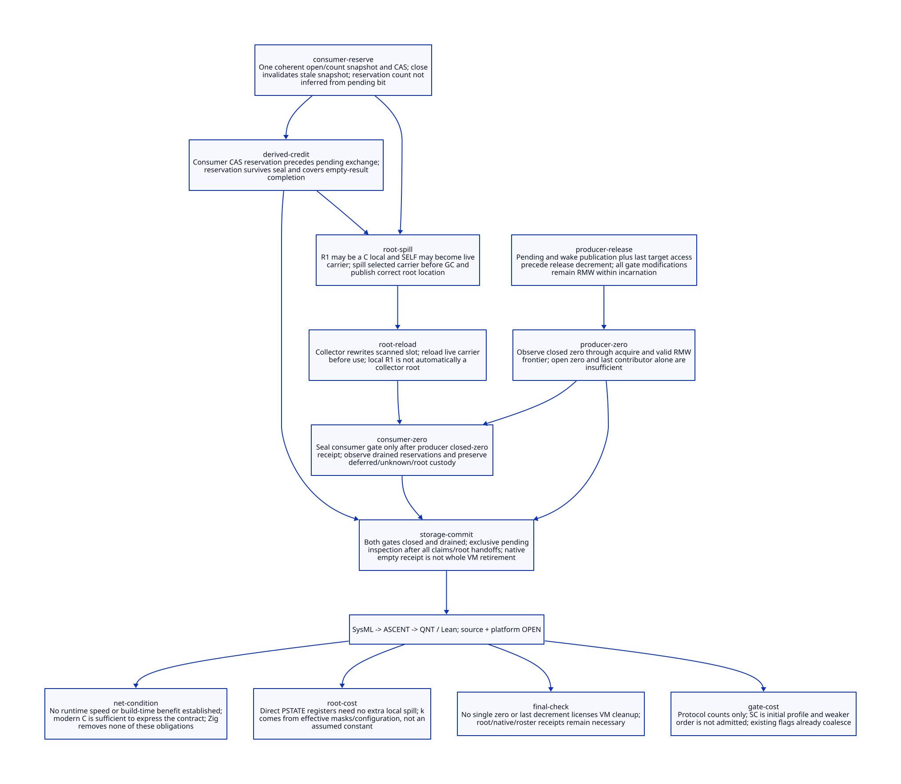

#+TITLE: Dual Admission Gates, Stable Empty Inspection and R1 Materialization
#+SETUPFILE: ../../modeling/org/setup.org
#+PROPERTY: header-args :eval never
#+OPTIONS: toc:3 num:nil

* RESEARCH Decision and scope
:PROPERTIES:
:CUSTOM_ID: gate-empty-root-materialization
:STATUS: conditional-models-source-open
:CANONICAL_MODEL: models/sysml/gate-empty-root-materialization.sysml
:END:

Modern C remains the mandatory direction. This study refines
[[file:interrupt-custody-handoff-design.org][interrupt custody handoff]] into proposed atomic-operation cuts and the real
Gambit R1/SELF spill, scan and reload paths. It does not implement gates or replace
runtime code. The new EmptyReceipt concerns one native interrupt delivery domain;
it is explicitly not a permission to free the entire VM.

SysML owns eight contract/action/guard/lemma tuples, ten dependencies, seven open
gates and four benefit rows. Native sysml drives Org/D2 projections. Actual ASCENT
rules compare guard and source/subject bindings; QNT explores explicit event order;
Lean proves conditional frontier and root lemmas. Their scopes remain distinct.
Source simulation, full C axiomatic-memory refinement and native qualification are open.

* RESEARCH Concrete old paths and what they do not prove
:PROPERTIES:
:CUSTOM_ID: gate-empty-root-materialization-source
:END:

Paths are relative to vendor/gambit. [[file:../../../evidence/research/gate-empty-root-materialization/input.json][The input receipt]] hashes actual files and the
frozen parent. No native preprocessing or configuration rebuild has been performed.

| Source | Observation | Boundary |
|-
| lib/os_setup.c:3044–3049 | user_intr selects vmstate0/processor0 at callback time | Proposed acceptance must match this target cut |
| lib/setup.c:66–92 | Flag assignment, stack trip, fence and device abort | No dual-gate or release-count protocol exists here |
| lib/setup.c:206–242 | Clear selected pending flag before returning code | Native clear is not callback or root completion |
| include/gambit.h.in:11014–11026 | Legacy __sync CAS, arithmetic and barrier backend | Available primitives do not prove new coherent word layout or source atomic discipline |
| lib/setup.c:1049–1113,1182–1200 | Sync-op barrier and on_all_processors GC request | Useful participation path; not an existing vector mutation/retirement protocol |
| lib/setup.c:4834–4878 | Disable interrupt handling, resize/cleanup processors and VM | New empty receipt must compose with root/roster/OS cleanup rather than bypass them |

A source census is syntactic evidence, not completeness over embedding aliases,
direct FFI writes, dynamic entry points or configuration branches. The parent
retains normal/derived vector writers, unknown outcomes and root custody obligations.

* RESEARCH Proposed C operation sequence
:PROPERTIES:
:CUSTOM_ID: gate-empty-root-materialization-operations
:END:

PGate and CGate are separate initialized unsigned atomic words. Each combines
Open, Count and the admitted incarnation identity. Open/count comparison must be
coherent. Successful acquisition increments one count unit without carrying into
another field. Saturation rejects; decrement requires ownership and a nonzero count.
Close clears Open through RMW while preserving Count and incarnation. No ordinary
store, reset or generation reuse is permitted until all prior authority is retired.

| Event | Proposed operation | Required sequence |
|-
| P0 | SC load PGate | Snapshot only; no target authority |
| P1 | Strong CAS PGate, SC success/failure | Compare full expected word; success owns ingress before target access; failure owns none |
| P2 | SC pending.fetch_or(reason) | After successful admission; domain owns accepted pending work |
| P3 | SC stable wake OR / admitted wake transport | After P2; notification failure retains custody |
| P4 | SC PGate.fetch_sub(count unit) | After all old target accesses and publication; release final ingress ownership |
| K0 | SC PGate.fetch_and(clear Open) | Stops new acceptance, does not cancel pre-close owners |
| K1 | SC load PGate returning closed zero | Qualifying producer-drain observation, after K0 |
| C0/C1 | SC load and strong CAS CGate | Reserve before pending exchange; stale-open snapshot fails after seal |
| C2 | SC pending.exchange(0) | Returns old batch; a later publication stays pending; empty return still owns a reservation |
| C3 | Normal rooted execution / explicit deferred holder | No collapse of earlier claim back into new pending |
| C4 | SC CGate.fetch_sub(count unit) | After claimed work and required root/restoration handoff; not merely after exchange |
| K2 | SC CGate.fetch_and(clear Open) | Only after K1; existing reservations remain valid |
| K3 | SC load CGate returning closed zero | After K2; acquire all qualifying consumer exit publications |
| K4 | Exclusive pending load/exchange and any residual rooted drain | No producers or normal claimers can re-enter |
| K5 | Issue native EmptyReceipt | Only when residual work and coordinator-owned activation are settled |

The first profile uses SC throughout. This is a specification of C operations,
not an assertion that QNT contains an actual C implementation or hardware fences.
Each operation still needs a lock-free, signal-safe admitted representation.
Do not invoke a hidden libatomic lock in a signal handler. Plain target descriptor
reads and platform signal semantics require a separate ABI contract; thread memory
ordering alone does not establish ISO-only asynchronous signal safety.

** Why the last decrement must carry more than its own producer

Let producer Pi publish Wi before its release exit Di. Let R be K1's qualifying
acquire read. The required argument is Wi sequenced-before Di, then Di synchronizes
with R through the same gate's valid RMW/release sequence or a justified acquire-release
chain, yielding Wi happens-before R. This must hold for every accepted producer,
not merely the producer whose exit changed Count from one to zero. All intermediate
admission/close/exit writes to that word must preserve the chain. An unrelated
store-to-zero or reinitialization can invalidate this reasoning.

The corresponding consumer argument covers publications before every C4, including
root/continuation settlement. A decrement alone does not flush an arbitrary native
local or register that was never made part of the protocol. Counting an owner and
making its effects visible are separate obligations.

An acquire read must qualify the actual closed word and appropriate read-from edge;
it is not permission to choose a convenient old zero from a history. In the initial
SC profile, all accesses to these protocol objects use the common SC discipline.
Weakening just the final read or mixing ordinary and atomic accesses requires a new
proof. A producer does not become the retirement coordinator simply because fetch_sub
returned a word whose count field was one; the return value may still have Open set.

** Candidate weakening, deliberately not admitted

| Object / event | Possible later order | Required proof before changing SC |
|-
| Admission CAS | Acquire success, relaxed failure | Matching initialized route publication; failed comparison grants no descriptor access |
| Pending OR / exchange | Release / acquire-release | Correct pending modification-order cut and batch read-from relation |
| Gate exit | Release RMW | All prior contributions reach coordinator's qualifying acquire through valid same-object sequence |
| Close | Acquire-release RMW | Preserves count and inherited publications; no re-open or reset interference |
| Closed-zero read | Acquire | Reads a qualifying side effect; no stale-zero receipt or unchecked incarnation reuse |

This table proposes proof targets, not minimum orders already established. No
runtime cost reduction is attributed to it.

[[https://www.open-std.org/jtc1/sc22/wg14/www/docs/n1570.pdf][C committee draft N1570]] 5.1.2.4 paragraphs 10–11 defines release sequences and
synchronizes-with; 7.17.3 paragraph 12 constrains RMW reads. Its signal restrictions
are a separate contract (7.14.1.1). [[https://gcc.gnu.org/onlinedocs/gcc/_005f_005fatomic-Builtins.html][GCC atomic documentation]] also describes ordering
and possible external fallback. These support the stated proof premises, not a
claim that current Gambit or this proposed protocol is already qualified.

* RESEARCH Final empty inspection and close races
:PROPERTIES:
:CUSTOM_ID: gate-empty-root-materialization-final
:END:

| Race / observation | Correct result |
|-
| Producer snapshots Open before K0, CAS occurs afterwards | Full-word comparison fails; no pin or target read |
| Producer CAS precedes K0, publication occurs afterwards | Its count remains present; K1 cannot qualify until P4 |
| Count rises and falls to same value while incarnation stays open | Not inherently invalid: later CAS may legitimately acquire same immutable route; count ABA is not incarnation reuse |
| Consumer reserved before K2 but has not exchanged pending | Its reservation prevents K3 from qualifying |
| Pending false while consumer owns a batch | No final empty authority; its CGate count and active/root custody remain |
| K1 and K3 qualified, residual pending true | Exclusive coordinator drains on original target; never drops or rebinds it |
| Native signal arrives after K0 | Rejected admission may affect stable process custody, not old target pending; parent gap policy applies |
| Failure or unknown result after claim | Keep original claim/roots and transaction; no retry by merging it into new pending |

Under the no-bypass producer inventory and monotone-close premises, K1 excludes
future target publications. K2/K3 then exclude future normal claimers. Only after
both cuts does the coordinator own stable pending inspection. A zero observed while
a gate remains open proves no such stability. Multiple independent SC loads do not
form a transaction in the absence of these admission and drain rules.

EmptyReceipt(g) records both closed-zero observations, their incarnation and
frontier subjects, exclusive-drainer authority, pending empty result and completed
coordinator work. It does not assert that unrelated GC roots, FFI/native borrowers,
writer requests, OS handlers/joins or continuation captures have disappeared. Those
remain parent prerequisites for a separate VM retirement receipt.

After P4/C4, code must not perform another access protected only by that released
ownership. The gate word itself lives in stable shell storage. A Scheme return is
not automatically the last old-VM access: host epilogues and caller restoration may
still write PSTATE. Release must occur from a safe outer custodian or after an explicit
handoff to a longer-lived VM/root lease. This source placement remains unresolved.
Do not stop old-roster GC/sync-op participation while waiting for roots it must scan.

* RESEARCH Real R1, SELF and root materialization path
:PROPERTIES:
:CUSTOM_ID: gate-empty-root-materialization-r1
:END:

| Seam | Actual source | Meaning |
|-
| Selected handler | lib/_kernel.c:12421–12449 | Service result in R1, vector fetch into R1, then general call |
| Local versus direct R1 | include/gambit.h.in:7082–7098 | If MAX_LOCAL_GVM_REGS>1, R1 is local r1; W_R1 writes ps->r[1], R_R1 reloads; otherwise R1 aliases ps->r[1] |
| Effective read/write sets | lib/_kernel.c:12399–12408; include/gambit.h.in:6801–6803 | Dispatcher masks include R1 through R4; R_ALL/W_ALL select module or procedure masks |
| General-call carrier | include/gambit.h.in:8109–8117 and NB_ARG_REGS branches | JUMPNOTSAFE assigns SELF before jumping; live procedure reference need not remain solely in R1 |
| Host exit | include/gambit.h.in:6815–6818 | END_COD writes pc then W_ALL before exiting host |
| Host entry | include/gambit.h.in:6909,6956 | R_ALL reloads the selected mask before host execution |
| Direct GC seam | lib/_kernel.scm:55–72,274–283,1971–1977; lib/_kernel.c:16748–16755 | Save return address, W_ALL, possible GC, R_ALL, restore return address |
| GC request | lib/setup.c:1182–1200 | on_all_processors requests collection |
| Scan and rewrite | lib/mem.c:3513–3652,6511–6537,6852–6862 | mark_array rewrites cells; register and saved arrays plus continuation paths are scanned |
| Explicit native temporaries | include/gambit.h.in:8059–8084 | GC_SAVE/RESTORE use scanned saved slots, reload and clear them; bounded slots are not arbitrary nested pin capacity |

The template defaults are MAX_LOCAL_GVM_REGS=25 and NB_ARG_REGS=3, implying a
local R1 and SELF in R4 under those defaults. This is not the effective Darwin
configuration receipt. Generated masks and effective argument/local-register settings
must match; compiling an artifact under different register conventions cannot be
admitted by assuming defaults. No artifact was regenerated or preprocessed here.

The no-safepoint interval starts when the movable handler is loaded and ends when
the actual live carrier is in a collector-visible slot. If general-call dispatch
moves it into SELF, the generated mask and FrameSpec/PointId must describe SELF's
location and all restore edges. A same-host jump may not run END_COD; therefore
host-exit spill alone cannot justify every possible subsequent safepoint. Direct
GC seams must perform the corresponding W_ALL/R_ALL or an explicitly registered
root protocol. Poll/check macros route through host machinery, but arbitrary new
native calls must not be assumed to do so.

A moving GC updates scanned memory, not an unconstrained C local. Reusing the old
local after collection is forbidden even if the global vector still has an entry.
A later vector replacement also cannot reclaim an independently selected or captured
handler. Once a register is dead, its obligations may transfer to SELF, a frame,
saved slot or continuation; blindly retaining every R1 forever is neither the
correct proof nor an optimization. Complete restore/capture closure is still open.

* RESEARCH Model refinement and actual evidence chain
:PROPERTIES:
:CUSTOM_ID: gate-empty-root-materialization-models
:END:

[[file:models/sysml/gate-empty-root-materialization.sysml][SysML]] drives [[file:../../modeling/ascent/gate-empty-root-materialization.rules.scm][ASCENT]] through exact source/action/guard/lemma and subject
hash/scope bindings. Missing/wrong guard, missing step/component/prior, stale hash
and wrong scope controls cannot create a candidate. Current source/platform needs
remain open; synthetic-all is only a rule control, not runtime evidence.

[[file:../../../models/build/gate_empty_root_materialization.qnt][QNT]] now separates snapshot, successful CAS, pending OR, wake publication,
producer decrement, qualifying zero reads, consumer reservation, exchange, root
load/SELF transfer/spill, moving GC, reload, root retirement and consumer decrement.
There are two producers, two normal claimers and an exclusive final-drainer role.
Each modeled atomic event uses SC order. Open/count are one logical atomic word;
this is not an implementation with independently racing fields.

The frontier sets are ghost synchronization summaries assuming every gate RMW
preserves its predecessor and exit contributions. They are not native metadata,
a C11 axiomatic engine or proof of allowed relaxed executions. The last-contributor
control deletes an inherited frontier to demonstrate the missing proof edge; it is
not claimed as a C execution allowed under the intact SC protocol. The stale-local
control witnesses a disallowed use guard, not a violation by the intact model.
QNT collection abstracts the required all-context stop/root-map premise rather
than modeling a complete collector roster. Writer/deferred/unknown/continuation
closure stays in the frozen parent; the local EmptyReceipt is intentionally narrower.

[[file:../../../models/build/GateEmptyRootMaterialization.lean][Lean]] proves conditional RMW-frontier history preservation, qualifying
closed-zero conditions, last/nonlast decrement arithmetic, reservation and final
inspection requirements, root spill/relocation/reload and SELF value preservation.
An acquire read's read-from equality is an explicit premise; the theorem does not
choose or prove a C execution graph. These lemmas do not constitute a proof of the
whole QNT invariant or the generated program's root completeness. No theorem hole
or axiom is accepted. Earlier parse failures stay in the task cache.

| Obligation | Progress | Still open |
|-
| Every accepted producer exits after publish and last access | Explicit QNT cuts; release-frontier lemmas | C locations, compiler semantics, signal reentrancy and final-access placement |
| Final inspection excludes future mutation | Two qualified drains and exclusive coordinator in model | Complete producer/claimer/writer inventory and effective lifecycle implementation |
| Last decrement includes all contributors | Conditional history/frontier proof and negative control | Actual modification-order/read-from graph and any proposed weakening |
| R1 is not automatically a root | Macro and generated consumer witnesses; spill/move/reload histories | Effective configuration, SELF masks, precise PointId/frame/restore closure |
| Native empty versus VM retirement | Separate receipt authority documented | Parent GC/FFI/continuation/OS retirement prerequisites |

* RESEARCH Work budget and retirement matrix
:PROPERTIES:
:CUSTOM_ID: gate-empty-root-materialization-benefits
:END:

[[file:gate-empty-root-materialization-matrix.org][The projected matrix]] retains quantitative protocol counts and seven open gates.
The existing flag already coalesces repeated signals, so equivalent callback-count
savings remain zero. The proposed uncontended native acceptance budget is one
snapshot and four RMWs including stable wake publication; a normal claim budget is
one snapshot and three RMWs. Finalization adds two close RMWs, at least two qualifying
observations, drain polling and residual inspection/drain. These are logical work
counts, not measured instruction counts or a signal latency bound.

For k live local carriers, a complete materialization round uses k slot stores and
k reloads plus frame/host overhead. k comes from the effective generated masks;
existing spills must not be counted again as new work, and direct PSTATE registers
need no separate local spill. Repeated spills at unnecessary boundaries could be
removed only after a live-carrier/PointId proof, which is not established here.
No performance benefit is credited to the unadmitted weaker-order table.

| Old responsibility | Modern C replacement | Retirement condition |
|-
| Flag clear treated as delivery completion | Reserved claim plus rooted completion | Every empty/nonempty/failed/unknown path accounted for |
| Unqualified count/pending zero checks | Scoped closed-zero receipts and exclusive final inspection | Whole-word gates, no incarnation reuse, complete publisher/claimer closure |
| Implicit local-register visibility | Generated carrier spill/scan/reload contract | Effective mask/configuration and restoration closure proven |
| VM cleanup inferred from interrupt drain | Native EmptyReceipt composed with other retirement receipts | All root, continuation, writer, roster and native authority independently settled |

The net-value condition remains eliminated real work or lifetime failures exceeding
added admission, synchronization and root costs. Neither runtime speed nor macOS
build acceleration is established. Modern C expresses the required protocol; adding
Zig does not discharge any of these proof obligations.

* RESEARCH Receipts
:PROPERTIES:
:CUSTOM_ID: gate-empty-root-materialization-receipts
:END:

[[file:../../../evidence/research/gate-empty-root-materialization/checks.json][Checks]], [[file:../../../evidence/research/gate-empty-root-materialization/ascent-model-results.json][ASCENT scenarios]],
[[file:../../../evidence/research/gate-empty-root-materialization/prior-model-alignment.json][frozen prior bindings]], [[file:diagrams/gate-empty-root-materialization.d2][D2 source]] and .
Raw command output and failures remain in [[file:../../../evidence/research/retained/gate-empty-root-materialization/receipt.json][the retained observation inventory]].
Inherited host attestation remains unresolved and was not retried. No runtime code,
native build/test or performance experiment was performed.
