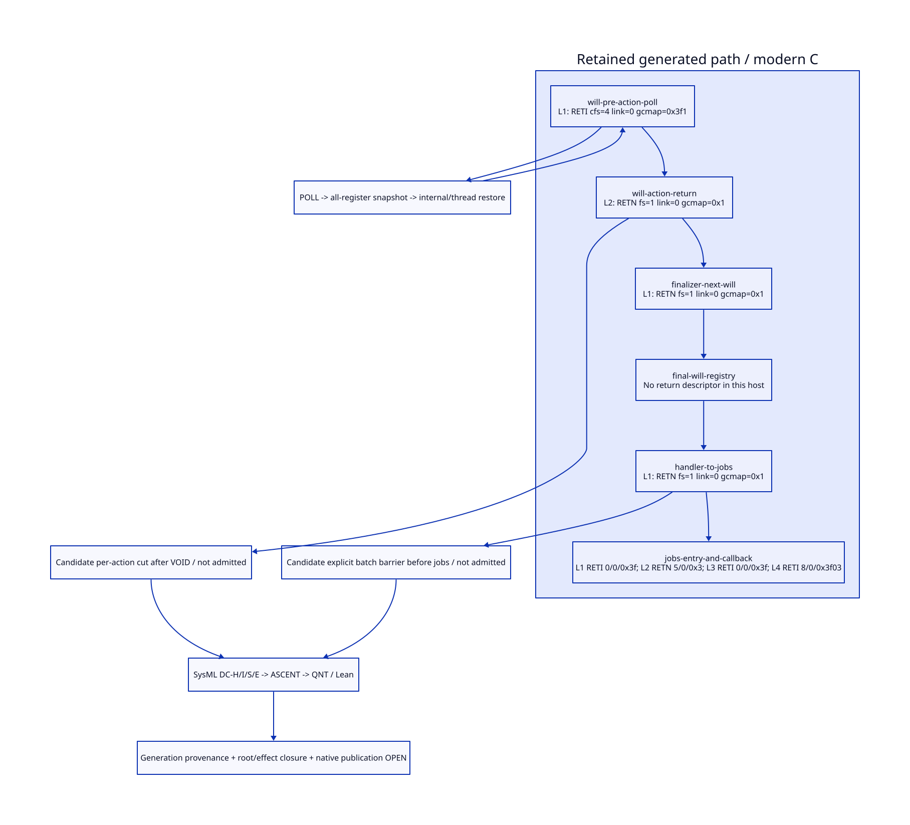

#+TITLE: Generated Will Return to GC Drain: Root Retirement Cuts
#+SETUPFILE: ../../modeling/org/setup.org
#+CATEGORY: toolchain
#+OPTIONS: toc:3 num:t
#+PROPERTY: header-args :eval never

* RESEARCH Concrete generated cuts, with no current issuer :modern_c:gxi:gxc:
:PROPERTIES:
:CUSTOM_ID: gc-drain-retirement-cut
:AUTHORITY: GcDrainRetirementCut
:STATUS: retained-generated-path-derived-issuer-unqualified
:EVIDENCE_CLASS: source-and-conditional-formal-models
:END:

This continues [[file:notifier-root-retirement-design.org][root retirement]] for the proposed gxi/gxc reader-session owner
protocol. Scheme semantic/control identity and generated modern C remain the
mainline. A generic GC job is not already an owner-notice drain, and no current
restricted notifier or RootRetirementReceipt issuer is being claimed.

[[file:models/sysml/gc-drain-retirement-cut.sysml][SysML]] owns seven concrete path boundaries, seven unresolved gates and four
benefit/cost rows. [[file:../../modeling/tools/gc-drain-cut-study.py][Python]] invokes native SysML, [[file:../../modeling/ascent/gc-drain-retirement-cut.rules.scm][actual ASCENT rules]], [[file:../../../models/build/gc_drain_retirement_cut.qnt][QNT]] and
[[file:../../../models/build/GcDrainRetirementCut.lean][Lean]], checks retained generated labels/descriptors, and derives [[file:gc-drain-retirement-cut-matrix.org][the matrix]]
and . [[file:../../../evidence/research/gc-drain-retirement-cut/checks.json][Receipts]] retain exact source/model identities.
No source regeneration, compiler/runtime implementation, native test or performance
run is performed. Reading generated C is not native execution.

* RESEARCH Evidence cohort and what generated C proves
:PROPERTIES:
:CUSTOM_ID: drain-generated-cohort
:END:

[[file:../../../vendor/gambit/lib/_kernel.c::1][The retained generated file]] identifies Gambit 4.9.8 and linker-info value
409008. Its exact bytes and the current Scheme, emitter and header bytes are
hashed together. This establishes a retained-artifact cohort and structural
correspondences, not the original generation invocation, complete macro input
closure, or equivalence to current Darwin object code. The selected snapshot
cannot issue a current-program receipt from a label string alone.

The Python source census extracts bounded named host blocks, SLBL identities,
inline descriptors and write macros from the retained file. It checks their
expected anchors and compares header/compiler default register count against
native SysML projection. It does not preprocess C or emulate the compiler/VM.
All original-generation and configured-object provenance remains unresolved.
Labels are evidence coordinates, not stable public PointIds across regeneration.

* RESEARCH Actual return and drain route
:PROPERTIES:
:CUSTOM_ID: drain-generated-path
:END:

[[file:../../../vendor/gambit/lib/_kernel.scm::2082][GC finalization]] calls will-execute! for each dequeued will, recurs, then
runs registry pruning. [[file:../../../vendor/gambit/lib/_kernel.scm::2153][handle-gc-interrupt!]] calls gc-finalize! before
execute-jobs!. [[file:../../../vendor/gambit/lib/_kernel.scm::1934][execute-jobs!]] traverses registered jobs without removing them.
The generated path makes the intervening root operations concrete:

| Program point in retained _kernel.c | Actual operation | Local descriptor / consequence |
|---+---+---|
| [[file:../../../vendor/gambit/lib/_kernel.c::17146][will entry through L1]] | R2=testator; R3=action; clear will fields; R1=R2; POLL(1); generic action jump | L1 internal return: caller fs 4, link 0, gcmap 0x3f1 |
| [[file:../../../vendor/gambit/lib/_kernel.c::17161][will L2 then L3]] | Reload R0 from STK(-3), ADJFP(-4); set R1=VOID; return | L2 ordinary return: fs 1, link 0, gcmap 0x1. No blanket R2/R3/R4/saved retirement |
| [[file:../../../vendor/gambit/lib/_kernel.c::17094][finalizer L1]] | Reload/pop return frame; dequeue next will or tail-call registry | Ordinary fs 1/link 0/map 0x1; another callback may run before drain |
| [[file:../../../vendor/gambit/lib/_kernel.c::17236][registry entry/loop/exit]] | R1/R2 traverse global registry; conditionally R3 holds action | Empty route overwrites R1/R2 but does not clear R4, saved, or restoration snapshots |
| [[file:../../../vendor/gambit/lib/_kernel.c::17331][GC handler L1]] | R1=gc-interrupt-jobs; reload R0; ADJFP(-4); tail-call execute-jobs! | Ordinary fs 1/link 0/map 0x1. No private receipt or explicit root cut |
| [[file:../../../vendor/gambit/lib/_kernel.c::16579][execute-jobs! entry/L1/L4]] | Obtain job list; poll; save list/RA; poll; call arbitrary job | Internal maps 0x3f / 0x3f03 and ordinary map 0x3; another save/capture/throw boundary |

The false-action branch skips action and its L2 entirely; it joins L3. Therefore
L3 reachability alone cannot attest normal return of an action. Manual will
execution reaches the same host without GC dequeue provenance. The alternate
[[file:../../../vendor/gambit/lib/_kernel.c::17190][execute-final-wills!]] also calls this host from shutdown processing; a
receipt must bind an actual GC-selected attempt rather than assume every caller
is the GC drain route.

The ordinary one-slot will-return descriptor contains the saved RA, as shown by
SET_STK(1,R0). Returning pops that active frame on the normal direct path; it does
not prove that copied frames, separate banks or saved destinations are absent.
Do not infer testator liveness solely from a nonzero bitmap or solely from frame
size. A skipped action needs a separate non-action outcome, not fabricated return
success. Failure/escape can bypass handler L1 and arbitrary jobs altogether.

* RESEARCH Maps and register/restoration closure
:PROPERTIES:
:CUSTOM_ID: drain-root-map
:END:

[[file:../../../vendor/gambit/lib/_kernel.c::30125][Label-table entries]] bind gc-finalize!, will-execute! and handler descriptors;
[[file:../../../vendor/gambit/lib/_kernel.c::30082][execute-jobs! entries]] bind four return descriptors. [[file:../../../vendor/gambit/include/gambit.h.in::9252][IFD decoding]] distinguishes
RETI caller size from actual expanded internal-frame size. [[file:../../../vendor/gambit/gsc/_t-c-2.scm::870][Emitter construction]]
marks all saved GVM register positions and the return temporary live for internal
returns; [[file:../../../vendor/gambit/gsc/_t-c-3.scm::471][bitmap construction]] and actual-fs helpers explain these masks.
Thus 0x3f is not evidence that there are six argument registers: the default
[[file:../../../vendor/gambit/gsc/_t-c-1.scm::31][compiler]] and [[file:../../../vendor/gambit/include/gambit.h.in::1380][header]] provide five GVM registers, with a distinct return temporary
in the internal frame. Configuration and alignment are part of the contract.

[[file:../../../vendor/gambit/include/gambit.h.in::8521][POLL]] can jump to the stack-limit handler with a return label. The
[[file:../../../vendor/gambit/lib/_kernel.scm::249][handler]] pushes all GVM registers, live or not, then may enter GC/interrupt
handling; [[file:../../../vendor/gambit/lib/_kernel.scm::1320][internal return]] later restores them. Before-action POLL may therefore
preserve testator/action. This is a concrete restore path; it does not prove
that a particular owner's callback is active in every nested handler invocation.
Nested GC notices must be matched per attempt. A snapshot containing another
owner is not a reason to erase it; a snapshot containing this owner blocks this
owner's receipt until it can no longer restore that root.

[[file:../../../vendor/gambit/lib/_kernel.c::9017][Module register synchronization]] covers R0-R4, while handler host PR_ALL/PW_ALL
cover R0/R1 and jobs host includes R4. [[file:../../../vendor/gambit/include/gambit.h.in::2436][SINGLE_HOST selection]] chooses module versus
host synchronization. [[file:../../../vendor/gambit/include/gambit.h.in::6802][R_ALL/W_ALL]] are selected macro expansions, not a magic
clear. Clearing only PSTATE bank may be undone by cached-register writeback;
clearing only cache may leave scanned bank values until synchronization.
The [[file:../../../vendor/gambit/lib/mem.c::6511][collector]] scans the register bank and saved bank independently of frame maps.

[[file:../../../vendor/gambit/include/gambit.h.in::8059][GC_RESTORE]] clears saved storage after transferring to the destination.
[[file:../../../vendor/gambit/include/gambit.h.in::6314][THREAD_SAVE/RESTORE]] transfers frame custody; [[file:../../../vendor/gambit/include/gambit.h.in::6589][capture]] and [[file:../../../vendor/gambit/include/gambit.h.in::6715][continuation return]] can
reinstall frames/denv. [[file:../../../vendor/gambit/lib/mem.c::4096][Captured-frame scanning]], [[file:../../../vendor/gambit/lib/mem.c::6814][other strong roots]] and Gerbil
[[file:../../../../gerbil-gambit-bootstrap-audit/src/gerbil/runtime/error.ss::37][exception capture]] retain the ancestor obligations. Root retirement closes
restoration paths for this target, not all VM roots or all continuations.

* RESEARCH Candidate issuer placement and rejection boundaries
:PROPERTIES:
:CUSTOM_ID: drain-issuer-placement
:END:

| Candidate | Research decision | Required new contract |
|---+---+---|
| Action entry / L1 poll | Reject | Action not complete; live argument and restorable snapshot |
| L2 return before L3 cleanup | Not an existing issuer | Per-attempt normal return is known only with private provenance; remaining roots still need retirement |
| After L3 sets VOID, before JUMPRET (17165-17166) | Conditional per-action generated-cut candidate | Separate skipped/manual paths, certified dead masks, cache/bank synchronization, no target-bearing restore/capture, nonallocating rootless publication |
| Finalizer queue becomes empty | Reject as sufficient evidence | Later callbacks and registry writes do not attest every earlier attempt's completion or root absence |
| Handler L1 after ADJFP(-4), before jobs jump (17334-17335) | Preferred conditional batch sealing boundary | Explicit generated/runtime barrier before arbitrary jobs; per-attempt outcome slots, full restore closure, backend-bound point and rootless publication |
| First or later arbitrary GC job | Reject as automatic issuer | Previous jobs/polls can fail, reenter or retain state; FIFO position and drain entry are not completion certificates |

Neither candidate is admitted today. Introducing a Scheme-visible annotation
alone cannot qualify the implicit save/restore machinery. Scheme semantic
completion must describe the private attempt, allowed effects and normal exit;
modern-C generation owns the point identity, descriptor/dead-location mask and
safe synchronization. Runtime owns canonical slots, publication and storage
grace. Do not hand-maintain a parallel root map inside a Zig adapter.

The per-action cut may reduce dependence on later unrelated finalizers, but an
allocation/poll in the issuer could reopen the very snapshot it must close. A
new issuer needs either a verified no-poll/no-allocation leaf contract or an
explicit state transition that accounts for every new snapshot. The batch cut
amortizes barrier entry only; it still settles each completed attempt separately.
A GC queue emptiness check does not replace B completion records.

* RESEARCH Conditional histories, obligations and retained counterexamples
:PROPERTIES:
:CUSTOM_ID: drain-proof
:END:

DC-H restricts its candidate profile to the native-projected five-register/retained-map shape; this checks profile identity, not root absence. It models the named normal-path progression, target-bearing R1/R2 and a possible
R4 cached/bank pair, saved storage, a restorable snapshot, capture/failure taint,
proposed generated epilogue/batch cuts, skipped-action/manual-entry denial and receipt identity. The initial R4 target
valuation is an adversarial callback postcondition, not an observed reader native
trace. Absence of R4 writes in the intervening hosts is source-derived; whether
a particular restricted notifier leaves such a value still requires generated
action evidence. R1=VOID is an actual write, not proof that every other register
still contains testator on every execution. This distinction preserves conditional
counterexamples without pretending to have reproduced a native leak.

Saved destination and snapshot controls deliberately clear one location then
restore into another. Other controls forge complete claimed issuance at empty
queue, jobs, partial sync, failed/captured/live state, stale identity or repeated
commit. Generic post-cut polls can only snapshot target-free roots in the model;
source must prove that closure for the actual candidate. Eight Lean kernels prove
transfer/guard facts under these abstractions, not all emitter or collector code.

DC-S must provide the original generated cohort, concrete root-location/cached
state simulation at each edge, real notifier effects/dead mask, all enabled
thread/interrupt paths and skipped-action/manual/shutdown handling. DC-E needs
actual Darwin ABI/object/configuration qualification, point-specific safepoint
behavior, native ordering and lifetime grace. No native test is used to fill
these gaps. SysML requires DC-H/I/E and NR-S before DC-S can close; ASCENT retains
the full ancestor frontier and rejects stale/wrong/missing receipts.

* RESEARCH Net work, bounds and retirement conditions
:PROPERTIES:
:CUSTOM_ID: drain-benefit
:END:

| Mechanism | Potential reduction | Added work / bound | Admission or countercondition |
|---+---+---+---|
| Per-action generated cut | Eligible attempt need not wait through remaining arbitrary jobs/finalizers | Per-attempt cut and identity checks; O(K) work if K dead target locations need retirement | Full no-restore/effect proof; no latency or speed claim |
| Pre-jobs batch barrier | Amortize barrier entry across B completed slots | O(B+K) sealing/retirement work, O(W) outstanding storage; B outcomes remain | No user job before seal; nested/failed/skipped attempts individually settled |
| Generated dead masks and synchronization | Remove heuristic return/empty-queue/job-success issuers and accidental stale-root retention | Compiler/configuration-bound root contract, cache/bank/restore proof | Clearing live or restorable roots is invalid; whole-heap scanning per notice could erase net benefit |
| Modern C language baseline | Reuse existing descriptors and Scheme semantic completion | Same required semantic support if Zig is later added | No independent positive Zig net gain shown; no duplicated handwritten root maps |

Structural bounds compare proposed mechanisms; no claimed speed ratio, person-day
estimate or current gxi memory reduction. Earlier slot/job savings are inherited
and not counted again. Exact K/B, supported point families and runtime costs are
unmeasured. Retire internal heuristics only after generation provenance, all
callers/outcomes, actual root/restore closure, native publication and delayed
users qualify. Public wills, arbitrary jobs and multi-shot continuations retain
their existing semantics; an unsafe case stays on owned legacy handling.
