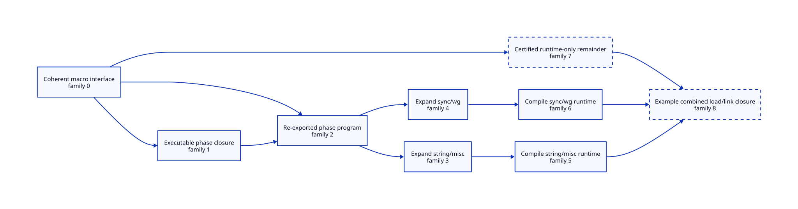

#+TITLE: Gerbil Iterator Macro Readiness and Concurrent Consumers
#+SETUPFILE: ../../modeling/org/setup.org
#+CATEGORY: toolchain
#+OPTIONS: toc:3 num:t
#+PROPERTY: header-args :eval never

* RESEARCH One actual macro chain, not Gambit's Make bootstrap :incremental:modern_c:
:PROPERTIES:
:CUSTOM_ID: gerbil-macro-chain
:AUTHORITY: GerbilPhaseReadiness
:STATUS: conditional-models-checked-source-refinement-open
:EVIDENCE_CLASS: source-formal-and-work-bound
:DEPENDS_ON: GM-H; GM-I; GM-S; GM-E
:END:

This refines [[file:gerbil-module-build-design.org][gxi/gxc module incrementality]]. Read-only Gerbil source cohort:
=gerbil-gambit-bootstrap-audit@1cfb032c7a1612637da6205f5f8a15683eba3ba0=.
Selected source identities, native SysML evaluation and check transcripts are
retained in [[file:../../../evidence/research/gerbil-phase-readiness/checks.json][the study receipt]]. This is not identification of an installed compiler.

[[file:models/sysml/gerbil-phase-readiness.sysml][SysML]] owns nine abstract action families, prerequisites, source anchors,
formal scopes and six new refinement edges. [[file:gerbil-macro-chain-matrix.org][The action/readiness matrix]],
 and [[file:../../../models/build/gerbil_phase_topology.qnt][QNT topology]] derive from native evaluation. They do not
form competing graph owners. One node may denote several source actions;
there is no claim of a nine-action real build or complete source simulation.

** Actual producers and consumers
:PROPERTIES:
:CUSTOM_ID: iterator-macro-callers
:END:

#+NAME: selected-real-macro-route
#+BEGIN_EXAMPLE
std/iter/macros -> std/iter/api -> std/iter
                                      -> std/string/misc
                                      -> std/sync/wg
#+END_EXAMPLE

[[file:../../../../gerbil-gambit-bootstrap-audit/src/std/iter/macros.ss::4][macros.ss]] imports std/interface, list-builder, iterator/interface and
iterator/iterators. Its begin-syntax defines binding-contract? and for-binding?.
The =for= transformer calls for-binding?; =for1= dispatches specialized forms
or a generic iterator path. The emitted generic form uses iter and Iterator;
do not confuse an identifier emitted into runtime code with a procedure
executed by the transformer. All executed helpers, including transitive
interface machinery, must nevertheless belong to its phase closure.

[[file:../../../../gerbil-gambit-bootstrap-audit/src/std/iter/api.ss::4][api.ss]] imports interface, iterators and macros and exports for and other
iteration forms. [[file:../../../../gerbil-gambit-bootstrap-audit/src/std/iter.ss::4][iter.ss]] re-exports api. [[file:../../../../gerbil-gambit-bootstrap-audit/src/std/string/misc.ss::34][string/misc]] imports iter and uses for
at its string-substitution loops (227-234). [[file:../../../../gerbil-gambit-bootstrap-audit/src/std/sync/wg.ss::4][sync/wg]] imports iter and channel;
wg-wait! uses for to join workers (37-38). The selected modules have different
additional imports. This study assumes those closures complete and fixed;
it has not established independence for every recursively imported module.

The [[file:../../../../gerbil-gambit-bootstrap-audit/src/gerbil/expander/module.ss::839][import expansion path]] collects positive-phase dependencies and calls
eval-module on them. [[file:../../../../gerbil-gambit-bootstrap-audit/src/gerbil/expander/module.ss::102][core-eval-module]] forces delayed module evaluation;
[[file:../../../../gerbil-gambit-bootstrap-audit/src/gerbil/expander/module.ss::139][import-source]] constructs a mutable context, expands the body and installs
registry entries and delayed evaluation. [[file:../../../../gerbil-gambit-bootstrap-audit/src/gerbil/compiler/driver.ss::707][compile-meta-code]] writes SSI and
phase code and may put load-module in SSI. These source paths establish that
interface publication, executable phase support and fresh live instantiation
are different obligations. They do not enumerate a complete evaluated macro
closure or prove which emitted artifact is actually loaded on a given host.

* RESEARCH Three readiness credentials
:PROPERTIES:
:CUSTOM_ID: macro-readiness-credentials
:END:

1. *Interface credential*: a committed coherent interface/metadata group with
   source, compiler, options, phase dependencies and target projections. No
   reader observes a partially rewritten SSI. This is reusable producer data,
   not permission to execute a transformer by itself.
2. *Phase support credential*: executable transformer code and every helper it
   can actually execute are available under the same validated input cohort.
   Include optimizer information and native/FFI helpers when consumed. Before
   allowing each consumer to expand, instantiate its own lexical/dynamic
   state. Cached mutable contexts and shared macro-global mutation invalidate
   the proposed independent-session assumption.
3. *Runtime credential*: all objects/loader records and ordered dependencies
   needed for eventual link or activation are committed. A runtime-only
   remainder may lag consumer expansion only with proof that neither macro
   execution nor optimizer observation consumes it.

The ninth-family graph includes an optional =runtimeOnly= remainder. Its
nonemptiness is *not proved for this source chain*. Required iterator or
interface runtime helpers are included in =phaseSupport= conservatively. If
all runtime work is needed there, the remainder is empty and that overlap
benefit is zero. Splitting artifacts without this audit merely creates a
missing-dependency bug. The final link node represents a proposed combined
request for both consumers, not a discovered existing executable target.

** Reuse and parallelism boundaries

Reuse compiled interface/phase programs, exact generated products and native
objects when their complete consumed projections and successful origin match.
Do not reuse a previous request's mutable phase instance. A no-change request
need not instantiate a phase program merely to reuse an already valid consumer
artifact. gxi session activation remains a separate operation.

The selected two consumers can be scheduled together after their common phase
closure and their other dependencies are ready, provided their expansion
states and effects are isolated. This is the proposed replacement for the
[[file:../../../../gerbil-gambit-bootstrap-audit/src/std/make.ss::220][shared import critical section]], not permission to delete its lock. Process
workers are one ownership option; they add startup, repeated import and IPC
cost. An isolated in-VM session is another option, but genuine execution
parallelism requires an independently qualified VM/thread configuration.

The [[file:../../../../gerbil-gambit-bootstrap-audit/src/std/make.ss::299][current coordinator]] waits for imported modules' overall completions. Split
that signal only after each consumer is attached to its actual product
projection. Existing [[file:../../../../../patches/gerbil-v19-darwin/0002-gerbil-streaming-compile-executor.patch][streaming native-job support]] is reused evidence, not a
newly invented gain. There must be one global CPU admission authority and
a separate memory ledger, not multiplicative module/GSC/native worker pools.

* RESEARCH Checked mathematical slice and actual ASCENT routing :qnt:lean:ascent:
:PROPERTIES:
:CUSTOM_ID: macro-formal-boundary
:END:

[[file:../../../models/build/gerbil_phase_readiness.qnt][QNT]] has nine action families with pending/running/staged/published/discarded
states, two unit credits, phase/body/optimizer key projections, consumer
session identity tokens, snapshot invalidation and cancellation. Finished work
is staged; it neither releases dependents nor publishes automatically.
Cancellation retains credits until observed physical completion. The model
does not implement files, actual compiler processes, memory bounds or Scheme
bindings. Publication is one atomic complete-group operation by assumption.

17 named histories were checked: twelve protocol histories and five omitted-
guard controls. The controls demonstrate premature SSI-only readiness,
forged reuse, stale publication, early cancellation refund and shared consumer
session identity. A control passes by observing its intended invariant
violation; it is not a successful unsafe execution. Positive random simulation
uses 100 samples, 80 steps and seed 17; it is not exhaustive verification.

[[file:../../../models/build/GerbilPhaseReadiness.lean][Lean]] checks ten conditional statements: start/finish/publish and trace
preservation, enabledness of a second consumer, epoch equality, complete-key
reuse, work positivity and cancellation credit identity. Finish and publication
are distinct transitions in both models. Lean's dependency theorem is generic
over graphs; QNT's generated graph supplies the selected finite topology.
Connecting every QNT transition to Lean, proving exact credit cardinality in
Lean, and refining source state remain open. Session tokens do not prove that
real macro contexts cannot alias or perform interfering I/O.

Native SysML binds GM-H to QNT and GM-I to Lean, GM-S to source simulation and
GM-E to platform/effect evidence. GM-S depends on both local checks, GM-E and
BP-S/BS-S/BU-S. The [[file:../../modeling/ascent/gerbil-phase-readiness.request.scm][actual ASCENT request]] is a generated ancestor-closed view:
the three existing build components' 12 needs plus four GM needs. Existing
method policy derives QNT, Lean and source-audit work; file availability
cannot satisfy a proof need. Fresh exact-scope receipts qualify GM-H/GM-I
locally. Missing source/platform evidence still blocks readiness. Wrong-scope
and stale-subject controls must remove the corresponding local qualification.
This does not reissue or silently extend the previous global assurance receipt.

* OPEN Explain slow builds by work, span and admission
:PROPERTIES:
:CUSTOM_ID: macro-platform-benefit
:STATUS: matched-performance-and-platform-attribution-open
:END:

The user's approximately fivefold macOS/Linux difference and poor utilization
on a twelve-core host are reported symptoms, not newly measured receipts.
This study makes no causal fraction or platform-wide performance claim.

Let W be necessary CPU work, S the dependency/serialization critical path, and
P the admitted CPU capacity. T >= max(W/P,S) is an ideal lower bound, not a
predicted duration. The selected graph exposes two consumer frontend jobs,
not twelve. Scheduling cannot manufacture twelve independent jobs out of that
two-consumer cut. The whole project's phase graph and serial import/optimizer
regions determine its available width; memory, I/O and external waits can
further limit actual progress. Independent process jobs and same-VM execution
must be identified separately before interpreting utilization.

If R repeated work is removed and H validation, fresh instantiation, IPC and
publication work is added, positive total-work benefit requires R > H.
Parallelism can reduce S without reducing W; process isolation can even
increase W. No-change targets zero eligible compilation actions, while charging
validation and requested activation. Runtime-body-only changes can spare the
two consumers only if every transformer and optimizer projection is unchanged.
Macro/helper changes invalidate their real phase consumers. No fixed percentage
or person-day estimate is used.

#+NAME: macos-linux-attribution-obligations
| Hypothesis | Source-grounded mechanism | Evidence still required; no native test performed |
|------------+--------------------------+--------------------------------------------------|
| Not enough ready jobs | Whole-module completion and shared macro chain | Per-action ready/start/finish spans and actual full-project dependencies |
| Shared frontend state serializes work | import-mx and driver mutex regions | Lock hold/wait identity, VM SMP backend and effective processor population |
| Repeated expansion/instantiation dominates | import-source and delayed evaluation; new processes may repeat imports | Separate cold startup, source expansion, compiled phase load and fresh context construction |
| Native compilation dominates | Generated Scheme/C and native compiler follow-ups | Same source/configuration, compiler image/options, debug provenance and output parity |
| Platform/environment dominates | SDK/toolchain/filesystem/resource differences are not modeled by module keys alone | Matched artifact state, CPU capacities, caches, memory pressure, filesystem and instrumentation overhead |

GNU Make's jobserver is a CPU-token adapter, not a semantic incrementality
solution. [[https://www.microsoft.com/en-us/research/publication/build-systems-a-la-carte/][Build Systems a la Carte]] separates rebuilding decisions and scheduling;
we use that separation for Gerbil's phase-aware producer and executor.
[[https://docs.racket-lang.org/raco/Dependency_Files.html][Racket's dependency files]] illustrate tracking compilation dependencies beyond
the leaf source. Its [[https://docs.racket-lang.org/raco/API_for_Making_Bytecode.html][compilation manager]] offers an additional architectural
lesson: dependency management belongs at compilation/load boundaries. These
sources do not establish that Gerbil macros are pure or that arbitrary native
effects have a complete dependency trace.

* OPEN Migration and retirement cuts
:PROPERTIES:
:CUSTOM_ID: macro-retirement
:END:

[[file:../../knowledge/systems/build-modernization.org][Chez and OCaml/Dune mechanism learning]] informs these cuts. Native SysML
owns its mechanism/reflection records and links each to the open source duty.

Retire timestamp-only *reuse authority* after complete input observations and
clean-origin parity; timestamps may remain an optimization hint. Replace the
whole-module completion signal only for audited product consumers. Retire
shared import locking only after session ownership replaces every protected
registry/load-path/optimizer mutation. Retire duplicate pools after all native
and follow-up submitters share one budget and failure/drain owner. Old paths
remain operational until those source gates close; no compatibility wrapper is
credited as eliminated work. Runtime, build rules and compiler code are unchanged.
