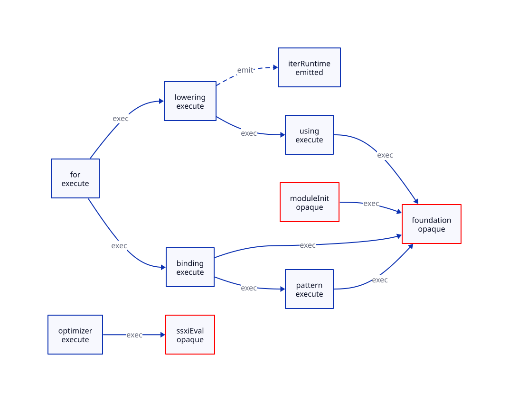

#+TITLE: Iterator Execution Support and Independent Compilation Sessions
#+SETUPFILE: ../../modeling/org/setup.org
#+CATEGORY: toolchain
#+OPTIONS: toc:3 num:t
#+PROPERTY: header-args :eval never

* RESEARCH From session numbers to executable cuts and owned state :modern_c:incremental:
:PROPERTIES:
:CUSTOM_ID: gerbil-session-closure
:AUTHORITY: GerbilSessionClosure
:STATUS: conditional-kernels-checked-source-census-open
:EVIDENCE_CLASS: pinned-source-and-conditional-formal
:DEPENDS_ON: GS-H; GS-I; GS-S; GS-E; GM-S
:END:

This refines [[file:gerbil-macro-chain-design.org][the iterator macro chain]]. Different session numbers do not prove
that objects reachable from their contexts and optimizer tables are disjoint.
[[file:models/sysml/gerbil-session-closure.sysml][SysML]] owns ten support groups, ten classified edges, eight state domains,
roots, formal needs and the unresolved census flag. [[file:gerbil-session-closure-matrix.org][The ownership/benefit matrix]],
 and [[file:../../../models/build/gerbil_session_topology.qnt][QNT topology]] derive from native evaluation. No previous checked
scope is implicitly widened. A finite source catalogue is not a complete call graph.

** Source cohorts

Gerbil sibling checkout: =1cfb032c7a1612637da6205f5f8a15683eba3ba0=.
Chez vendor: =41d5ffca7a07cbfc8807e719dedcc70ed74811cd=.
OCaml vendor: =46e1c324fb9e9f21f52c9cc3399020f7ef8b9b91=.
Selected bytes are hash-bound; selected Chez/OCaml files had no working-tree
delta when inspected. Dune src/memo/memo.ml was read through an upstream
GitHub main snapshot. Its immutable repository revision and full source archive
remain unresolved; the retrieved excerpt is retained, not called a pinned
checkout. Raw fetches failed in this environment. No compiler or build ran.

* RESEARCH Selected syntax and its execution support
:PROPERTIES:
:CUSTOM_ID: selected-support-cut
:END:

[[file:../../../../gerbil-gambit-bootstrap-audit/src/std/string/misc.ss::227][string/misc]] contains both an iterator expression headed by if and a literal
in-range form. [[file:../../../../gerbil-gambit-bootstrap-audit/src/std/sync/wg.ss::37][wg-wait!]] iterates over a field expression. The literal form
can select the specialized range path; the if/field forms take the generic
fallback under the expected lexical resolution. This is source-path analysis,
not a recorded expansion; identifier spelling is not binding identity.

[[file:../../../../gerbil-gambit-bootstrap-audit/src/std/iter/macros.ss::10][for-binding?]] first tries binding-contract?. Empty traits fail the selected
signature-contract? definition, so simple bindings also reach match-pattern?.
[[file:../../../../gerbil-gambit-bootstrap-audit/src/gerbil/core/match.ss::209][match-pattern?]] uses call/cc and a syntax-error handler around pattern parsing;
the selected identifier reaches the identifier terminal. The parser also has
a [[file:../../../../gerbil-gambit-bootstrap-audit/src/gerbil/core/match.ss::143][user match-expander branch]] calling core-apply-expander. Excluding that branch
requires the selected shape/binding proof, not library-wide purity. Non-syntax
exceptions propagate to the enclosing handler.

[[file:../../../../gerbil-gambit-bootstrap-audit/src/std/iter/macros.ss::173][for1-generic]] emits using and iter. Recursive expansion executes [[file:../../../../gerbil-gambit-bootstrap-audit/src/gerbil/core/contract.ss::401][using]],
which resolves type/interface metadata and selects [[file:../../../../gerbil-gambit-bootstrap-audit/src/gerbil/core/contract.ss::664][with-interface]] to construct
a type environment. The emitted iter call is runtime code. Removing that false
execution edge does not prove that opaque module initialization never calls
iterator runtime helpers. Required initialization stays in the support cut.

Syntax primitives, root/prelude construction, interface/mop initialization and
positive-phase import evaluation also belong to complete support. Optimized
builds add SSXI execution. Foundation, SSXI evaluation and module initialization
remain three opaque groups; the native census is false. File availability and
reachability of nine catalogue groups cannot issue a full support credential.

* RESEARCH State ownership and safe parallelism
:PROPERTIES:
:CUSTOM_ID: session-state-owners
:END:

[[file:../../../../gerbil-gambit-bootstrap-audit/src/gerbil/expander/module.ss::12][Registry/package caches]] are global hash tables. Module contexts contain
mutable tables and delayed evaluation. [[file:../../../../gerbil-gambit-bootstrap-audit/src/gerbil/expander/core.ss::567][core-bind!]] mutates substitutions reached
through lexical marks. A thread-local parameter may still reference a shared
mutable graph; parameter copying is not deep ownership isolation.

[[file:../../../../gerbil-gambit-bootstrap-audit/src/gerbil/compiler/optimize.ss::22][optimizer-info-init!]] intentionally preserves optimizer state across batch
compilation. Some local tables are fresh, but module-context-code, type,
classes, ssxi and methods are mutated. [[file:../../../../gerbil-gambit-bootstrap-audit/src/gerbil/compiler/optimize-base.ss::437][Declaration operations]] also reach mutable
class objects; shallow table copies are insufficient. [[file:../../../../gerbil-gambit-bootstrap-audit/src/gerbil/compiler/optimize.ss::135][SSXI loading]] chooses an
output artifact or a library fallback and imports with reload/evaluation enabled.
Lookup absence, generation identity and executed effects are dependencies. Its
warning/false failure path cannot be cached as successful immutable information.

[[file:../../../../gerbil-gambit-bootstrap-audit/src/gerbil/runtime/loader.ss::14][Load paths]] are process-global. [[file:../../../../gerbil-gambit-bootstrap-audit/src/gerbil/compiler/base.ss::287][Job/core counters]] are another shared owner;
copying them per session multiplies admission. Generated files need unique
attempt/output ownership. Exception handlers, diagnostics and escaped callbacks
need explicit lifecycle and effect contracts.

Two consumers may proceed together only when their complete support and other
imports are stable; transitive mutable footprints are disjoint; shared reads
are deeply frozen; native/phase effects are independent or ordered; output and
CPU/memory admission permits both. Fresh mark/identifier reconstruction must
preserve binding and alpha-equivalence. Process isolation separates heaps but
not filesystem/environment/FFI effects. Same-VM CPU parallelism is a separate gate.

Borrowed immutable support stays pinned until workers and callbacks stop using
it. Cancellation or unknown exit does not prove termination. Retain custody;
reject publication against a changed generation. Actual callback drain,
complete manifests and source-state simulation remain GS-S/GS-E obligations.

** Lifted syntax constants require binding reconstruction

[[file:../../../../gerbil-gambit-bootstrap-audit/src/gerbil/compiler/compile.ss::1150][generate-runtime-quote-syntax%]] emits lifted syntax-quote structures containing
current-expander-context and serialized mark/context references. Read-only
historical [[file:../../../../gerbil-gambit-bootstrap-audit/build/lib/std/iter/macros.ssi][macros.ssi]] explicitly loads std/iter/macros~1 in begin-syntax;
[[file:../../../../gerbil-gambit-bootstrap-audit/build/lib/std/iter/macros~1.scm][the phase Scheme artifact]] allocates constants containing the current context.
[[file:../../../../gerbil-gambit-bootstrap-audit/build/lib/std/iter/macros.scm][The main generated Scheme artifact]] loads interface/list-builder/iterator
dependencies. Their full producer/profile identity has not been qualified;
they corroborate a mechanism already located in generator source, not native
acceptance. Their bytes and provenance limit are retained separately.

The target phase product therefore needs immutable instructions plus an explicit
instantiation/binding-relocation plan and owned lifted constants. Sharing a
loaded module's syntax constants across otherwise distinct sessions can retain
the first session's lexical context. The new QNT alias control models that
failure independently of optimizer-table aliasing. Executable native code may
be shareable, but existing module-global initialization must acquire an instance
boundary before the loaded object graph can be treated that way.

* RESEARCH Implementation lessons and counterexamples :chez:ocaml:dune:
:PROPERTIES:
:CUSTOM_ID: session-source-learning
:END:

[[file:../../../vendor/chez/s/syntax.ss::2478][Chez visit-loaded-library]] recursively visits some dependencies and invokes
others before visit code. Compile-time support can require runtime invocation.
Pending markers, on-reset restoration and successful completion have different
states; [[file:../../../vendor/chez/s/syntax.ss::2516][invoke-loaded-library]] has its own requirements. Learn separate phase
requirements and failure transitions, not concurrent-visit safety from this snippet.

[[file:../../../vendor/ocaml/middle_end/compilenv.ml::35][OCaml compilenv]] also has global mutable tables and a current compilation
unit. [[file:../../../vendor/ocaml/middle_end/compilenv.ml::121][reset]] reinitializes unit state; it does not prove simultaneous session
isolation. [[file:../../../vendor/ocaml/typing/persistent_env.ml::300][persistent_env]] records imported unit CRCs in saved CMI information.
Learn explicit consumer identities and state lifetimes; do not infer that
OCaml compiler internals can compile units concurrently in one mutable environment.

[[https://github.com/ocaml/dune/blob/main/src/memo/memo.ml][Dune Memo implementation]] uses typed inputs, dependency nodes and cutoff
policy. Var.set retains the old representative on cutoff and invalidates
otherwise. reset restarts run state. The inspected source says concurrent
top-level runs do not occur and would require separately scoped cycle state.
Learn dependency-aware invalidation and run-local state, not parallel CPU
execution from fibers or harmless Scheme effects from memoization. Its
mutable-main provenance limit remains open.

* RESEARCH Compare against existing reuse, not a fabricated baseline
:PROPERTIES:
:CUSTOM_ID: session-net-work
:END:

#+NAME: session-cost-comparison
| Architecture | Existing reuse | Added work | Benefit boundary |
|--------------+----------------+------------+------------------|
| Current batch | Registry/optimizer imports and initialization | Locks/coarse completion; actual repetition unmeasured | Baseline; credit none of its reuse as new |
| Process per module | External immutable files | Startup, duplicate imports/setup, IPC | Span may improve while total work increases |
| Frozen programs plus owned sessions | Qualified programs/dependency/optimizer declarations | Fresh instances, overlays, validation, reclamation | Retain existing reuse while removing false serialization; source isolation still open |

Two concrete candidates go beyond claiming already-cached imports as new savings.
for calls for-binding? and then for1 calls it again on the selected simple
binding path; a validated binding descriptor could avoid repeated validation
within that expansion, subject to unchanged binding and exception observations.
optimizer-load-builtin-ssxi avoids reloads through its sticky cache but still
checks the builtin list per optimize call. A deeply frozen, generation-bound
builtin-set credential could replace repeated per-entry checks. Both require
source-equivalence and validity proofs; neither is a measured benefit. The
native opportunity matrix keeps their added metadata and invalidation costs.

Against duplicated isolated workers only, 2P+2I becomes P+2I+H and reduces
work if H<P. Current batch may already pay P once and share initialization;
private sessions can add setup. Against actual current behavior, require avoided
work R to exceed *all* added initialization, overlays, validation, IPC and
reclamation. Critical-path reduction is a separate benefit. No native speedup,
macOS/Linux causal ratio or twelve-core utilization claim is established.

* RESEARCH Actual model and DSL chain
:PROPERTIES:
:CUSTOM_ID: session-formal-chain
:END:

[[file:../../../models/build/gerbil_session_closure.qnt][QNT]] imports native-generated topology and models actual heap locations,
shared read-only storage, epochs, pins, cancellation, completion/release and
publication. Sixteen histories include five unsafe controls; positive simulation
has 100 samples of at most 80 transitions. Qualified histories explicitly assume
a complete support cut; the actual-source census remains false. This is not
exhaustive verification or an implementation of Scheme's heap/closures.

[[file:../../../models/build/GerbilSessionClosure.lean][Lean]] checks seven conditional statements covering disjoint-write
noninterference, commuting writes, exclusive ownership, closed support,
unknown-census refusal, a work inequality and epoch identity. Full QNT refinement,
Scheme observational equivalence, deep source capture-graph separation and
callback/GC correctness are not proved.

[[file:../../modeling/ascent/gerbil-session-closure.rules.scm][The actual ASCENT domain DSL]] derives execution reachability, opaque groups,
state ownership and census-based refusal from native facts. [[file:../../modeling/ascent/gerbil-session-closure.request.scm][The composed request]]
also routes GS-H/I/S/E through existing method policy and GM-S prerequisites.
Earlier GM-H/I are inherited only if subject bytes and exact checked scopes
match their receipts. Synthetic all-scoped controls do not override source
census denial. [[file:../../../evidence/research/gerbil-session-closure/checks.json][The receipt]] retains provenance, model checks and failures.
Runtime/compiler/build implementation and native tests are outside this study.
