#+TITLE: Toolchains and artifacts
#+SETUPFILE: ../../modeling/org/setup.org
#+CATEGORY: toolchain

[[file:native-stage-design.org][Modern C native build boundary and retained experiment history]]
uses existing configure and Make; the separate typed-profile experiment is withdrawn.
It grants no general Scheme cache permit. The SysML-owned
[[file:macos-development-map.org][native-stage boundary projection]] and
[[file:diagrams/macos-development.d2][D2]] connects fixed-workspace incremental
controls to the existing proof owners. Earlier typed-mode receipts remain historical.
The [[file:native-stage-design.org::#validation-cost][measured validation-cost partition]]
separates Make, fixture compilation, fresh execution and artifact/custody checks.
Its six reuse lifetimes derive from SysML; equal test source bytes alone do
not admit a compiled-artifact or fresh SMP-result cache.

The [[file:../../refactoring/why-refactor.org::#migration-order][modern-C refactoring rationale]] connects effective multicore configuration, native artifact closure and work reuse. The two necessary profile predicates in this category's SysML model distinguish requested flags, effective capability and actual runtime population. Build jobs do not establish runtime parallelism.

[[file:incremental-build-design.org][Fundamental incremental and parallel build design]] treats planning, dependency cuts, early cutoff, shared resource admission and atomic artifact publication separately. [[file:build-map.org][The artifact/delta/source matrix]] and [[file:diagrams/incremental-build.svg][dependency graph]] derive from the same toolchain model. Existing jobserver and streaming-executor support is explicitly retained as source evidence.

[[file:source-chain-design.org][The actual GSC leaf/macro/no-change chain]] now instantiates those contracts. [[file:source-chain-map.org][Source, phase and benefit rows]] derive from this model; [[file:../../modeling/component-model-map.org][the component/model map]] resolves the QNT/Lean sources and ASCENT associations through SysML.

[[file:correctness-design.org][Dynamic closure, immutable input cohorts and consumer cutoff]] now separates three correctness proofs and the ten-node/74-action boundary. [[file:correctness-map.org][Population and benefit matrices]] and [[file:diagrams/build-correctness.svg][D2]] derive from SysML.

[[file:read-snapshot-design.org][Real GSC read closure and snapshot credentials]] adds source caller boundaries and a precise selected-population relation. [[file:read-snapshot-map.org][Issuance/refinement/benefits matrices]] and the [[file:diagrams/read-snapshot.svg][read graph]] / [[file:diagrams/build-refinement.svg][refinement graph]] derive from SysML.

[[file:capability-observation-design.org][Macro/eval, reader/native capability closure and output fidelity]] adds concrete caller/refusal boundaries and structured observations. [[file:capability-observation-map.org][The admission/fidelity/benefit matrix]] and [[file:diagrams/capability-observation.svg][D2]] derive from SysML.

[[file:incremental-compiler-architecture-design.org][Mainline: modern incremental and concurrent compiler architecture]] defines the
replacement query graph, eight result stages, session ownership, dynamic trace
algorithm, migration/retirement order, Dune/OCaml lessons and falsifiable work/span
benefits. [[file:incremental-compiler-architecture-matrix.org][The architecture matrix]] and 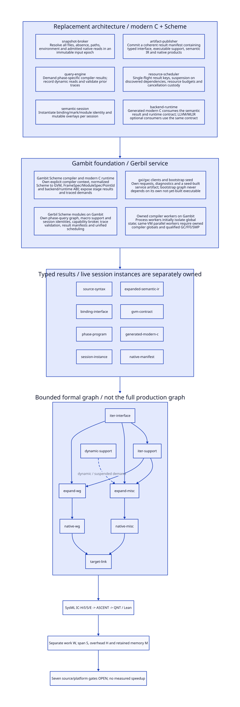 derive from SysML. GC notifier
forensics are a supporting native-contract lane, not the compiler architecture.

* RESEARCH Iter chain: Gambit foundation and Gerbil incremental service
:PROPERTIES:
:CUSTOM_ID: iter-compiler-service-entry
:END:

[[file:iter-compiler-service-design.org][Source-grounded stage/context and Dune study]],
[[file:iter-compiler-service-matrix.org][retirement/net-benefit matrix]], and
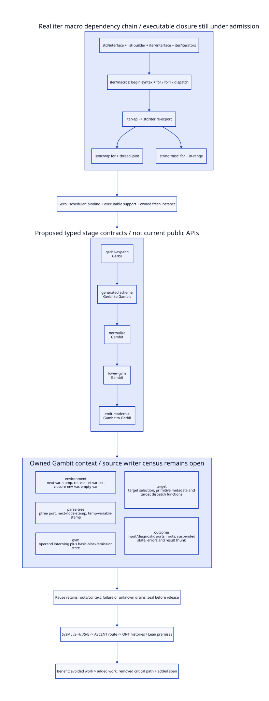. SysML IS-H/I/S/E routes actual
QNT/Lean/ASCENT checks; source/platform refinement remains open.

* RESEARCH Target writers, stage sealing and generated Scheme fidelity
:PROPERTIES:
:CUSTOM_ID: target-stage-sealing-entry
:END:

[[file:target-stage-sealing-design.org][Target/context writer and handoff study]],
[[file:target-stage-sealing-matrix.org][net-benefit and obligation matrix]], and
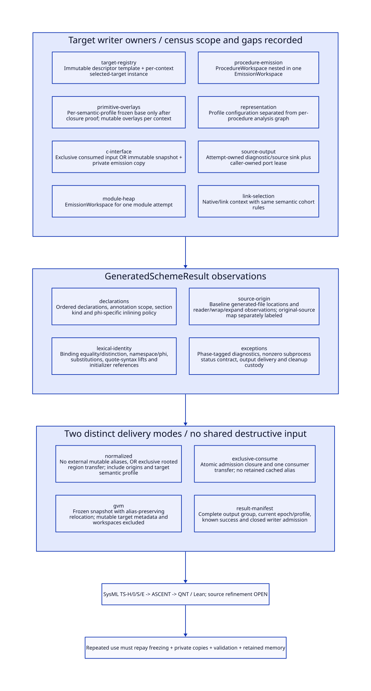. SysML TS-H/I/S/E connects actual ASCENT,
QNT and Lean subjects; alias/source/platform closure remains open.

* RESEARCH Target/primitive aliases and workspace reconstruction
:PROPERTIES:
:CUSTOM_ID: alias-workspace-reconstruction-entry
:END:

[[file:alias-workspace-reconstruction-design.org][Alias/recipe reconstruction research]],
[[file:alias-workspace-reconstruction-matrix.org][net-benefit and proof matrix]], and
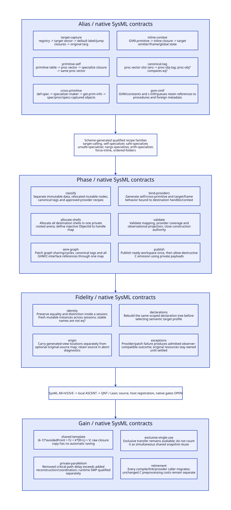. AR-H/I/S/E routes actual local
ASCENT/QNT/Lean checks; host registration and source/platform closure stay open.

* RESEARCH Safe/unsafe/arithmetic specializer equivalence
:PROPERTIES:
:CUSTOM_ID: specializer-provider-semantics-entry
:END:

[[file:specializer-provider-semantics-design.org][Real specializer transport and iter fidelity study]],
[[file:specializer-provider-semantics-matrix.org][net-benefit/proof matrix]], and
[[file:diagrams/specializer-provider-semantics.svg][D2]]. SP-H/I/S/E routes actual local
ASCENT/QNT/Lean subjects; source/platform/host closure remains open.

* RESEARCH Persistent declaration views and actual specialization callers
:PROPERTIES:
:CUSTOM_ID: declaration-specialization-context-entry
:END:

[[file:declaration-specialization-context-design.org][Declaration writer/alias and fixed-point caller study]],
[[file:declaration-specialization-context-matrix.org][net-benefit/proof matrix]], and
[[file:diagrams/declaration-specialization-context.svg][D2]]. DC-H/I/S/E routes native
SysML to local ASCENT/QNT/Lean; source/platform/host closure remains open.

* RESEARCH Registry and named-view sealing
:PROPERTIES:
:CUSTOM_ID: registry-view-sealing-entry
:END:

[[file:registry-view-sealing-design.org][Declaration registry writers, named payload ownership, retirement and full specialization chains]]
links the canonical SysML routes to actual ASCENT, QNT and Lean obligations.

* RESEARCH Stable copy and sealed publication
:PROPERTIES:
:CUSTOM_ID: stable-copy-publication-entry
:END:

[[file:stable-copy-publication-design.org][Indirect registry/payload writers, stable-read alternatives and private-copy publication]]
connects actual source seams to the SysML, ASCENT, QNT and Lean research chain.

* RESEARCH Ordered registry delivery and cache retry
:PROPERTIES:
:CUSTOM_ID: ordered-registry-delivery-entry
:END:

[[file:ordered-registry-delivery-design.org][Actual macro caller order, registration event identity, failure prefixes and continuation custody]]
connects SysML source duties to actual ASCENT, QNT and Lean models.

* RESEARCH Atomic registry commit and nested event identity
:PROPERTIES:
:CUSTOM_ID: registry-atomic-commit-entry
:END:

[[file:registry-atomic-commit-design.org][Whole-bundle authority, existing-event-first retry and nested/continuation lineage]]
links source obligations to actual SysML, ASCENT, QNT and Lean models.

* RESEARCH Bundle roots, C visibility and publication
:PROPERTIES:
:CUSTOM_ID: bundle-root-publication-entry
:END:

[[file:bundle-root-publication-design.org][Registry bundle allocation/GC roots, C ordering, reader retirement and continuation custody]]
connects actual scanner/allocation/sync seams to SysML, ASCENT, QNT and Lean.

* RESEARCH VM root registry and GC lease retirement
:PROPERTIES:
:CUSTOM_ID: vm-root-registry-entry
:END:

[[file:vm-root-registry-design.org][VM membership, nonzero roots, GC slot updates, storage handoff and lease retirement]]
connects actual native callers to SysML, ASCENT, QNT and Lean obligations.

* RESEARCH Still storage handoff, accounting and foreign release authority
:PROPERTIES:
:CUSTOM_ID: storage-handoff-receipt-entry
:END:

[[file:storage-handoff-receipt-design.org][StorageHandoffReceipt issuance and real closure/Tcl custody]],
[[file:storage-handoff-receipt-matrix.org][retirement, cost and proof matrix]], and
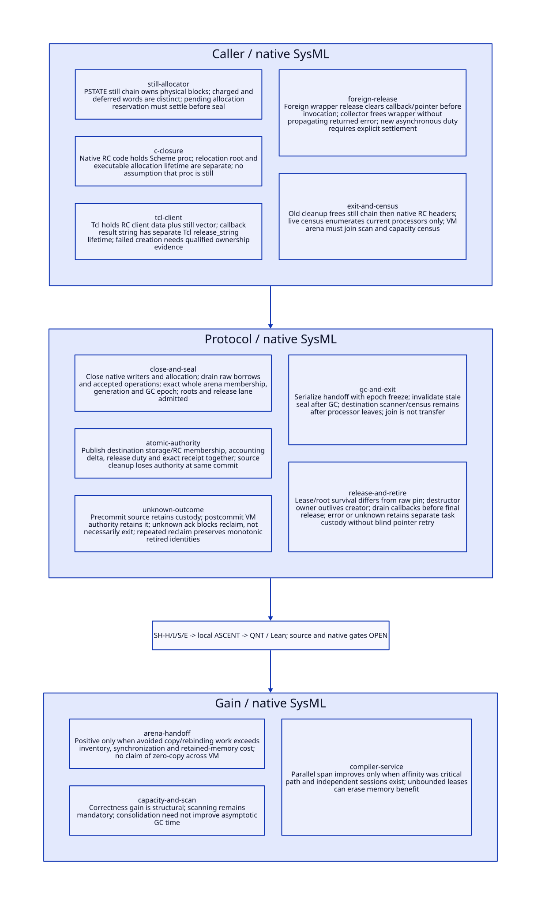. SH-H/I/S/E joins actual local
ASCENT/QNT/Lean; whole-arena source/GC/foreign qualification remains open.

* RESEARCH Target VM arena scan, sweep, census and allocation history
:PROPERTIES:
:CUSTOM_ID: vm-arena-collector-entry
:END:

[[file:vm-arena-collector-design.org][VM arena collector and history-rebase contract]],
[[file:vm-arena-collector-matrix.org][source/refinement/net-benefit matrix]], and
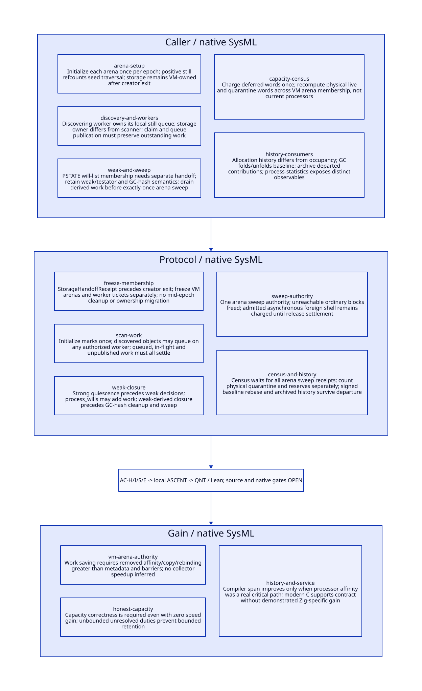. AC-H/I/S/E extends SH-S with actual local
ASCENT/QNT/Lean subjects; weak/foreign/statistics/source qualification stays open.

* RESEARCH Movable will domain migration and Scheme action ownership
:PROPERTIES:
:CUSTOM_ID: will-domain-migration-entry
:END:

[[file:will-domain-migration-design.org][Weak-list migration, forwarding and actual action callers]],
[[file:will-domain-migration-matrix.org][source/refinement/net-benefit matrix]], and
[[file:diagrams/will-domain-migration.svg][D2]]. WM-H/I/S/E joins actual local
ASCENT/QNT/Lean and depends on AC-S; native and source qualification stay open.

* RESEARCH Shared testator interference and global strong decision cut
:PROPERTIES:
:CUSTOM_ID: will-strong-cut-entry
:END:

[[file:will-strong-cut-design.org][Two-processor source witness and semantic repair]],
[[file:will-strong-cut-matrix.org][source/refinement/net-benefit matrix]], and
[[file:diagrams/will-strong-cut.svg][D2]]. WS-H/I/S/E links guarded source-model
counterexamples and proposed decision-cut QNT/Lean through actual ASCENT; native remains open.

* RESEARCH Strong closure receipts and existing barrier reuse
:PROPERTIES:
:CUSTOM_ID: strong-closure-receipt-entry
:END:

[[file:strong-closure-receipt-design.org][Root producer, private work and global closure contract]],
[[file:strong-closure-receipt-matrix.org][source/prior-model/net-benefit matrix]], and
[[file:diagrams/strong-closure-receipt.svg][D2]]. SR-H/I/S/E connects actual ASCENT/QNT/Lean
and root-directory model invariants; native/source closure remains open.

* RESEARCH Root producer census and idle settlement
:PROPERTIES:
:CUSTOM_ID: root-producer-census-entry
:AUTHORITY: RootProducerCensus
:END:
[[file:root-producer-census-design.org][Modern C root-domain, FFI admission and idle custody design]],
[[file:root-producer-census-matrix.org][source/closure/net-benefit matrix]], and
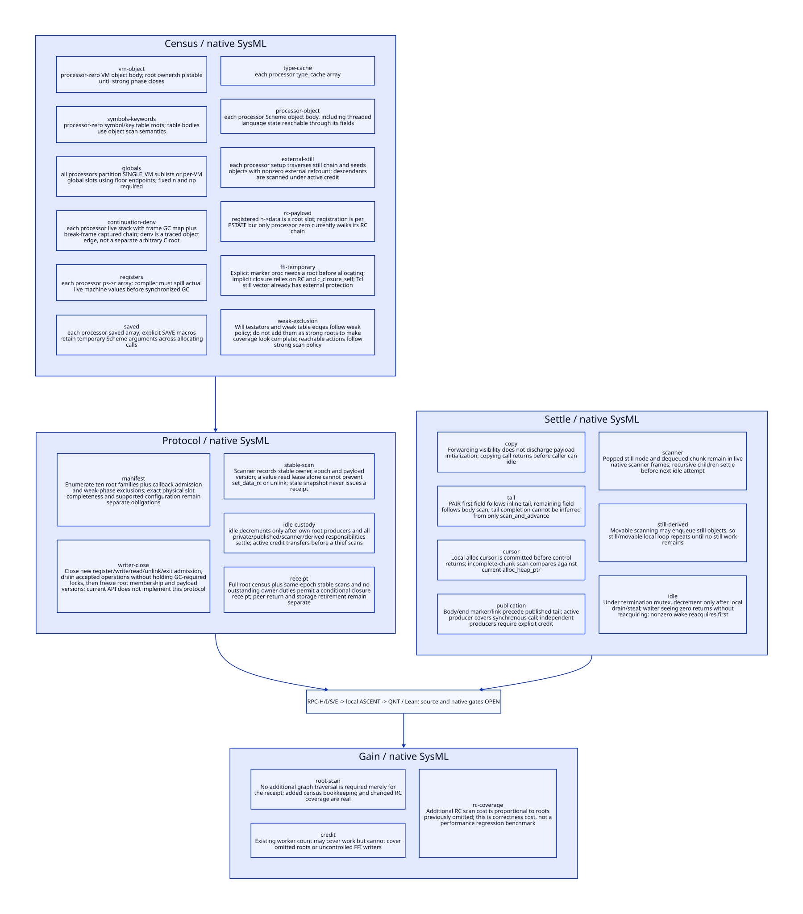. RPC-H/I/S/E maps actual SysML,
ASCENT, QNT and Lean obligations; parent/source/native gates remain open.

* RESEARCH FFI scan-ready root handoff
:PROPERTIES:
:CUSTOM_ID: ffi-scan-ready-handoff-entry
:AUTHORITY: FfiScanReadyHandoff
:END:
[[file:ffi-scan-ready-handoff-design.org][Modern C preparation-to-scan-ready protocol]],
[[file:ffi-scan-ready-handoff-matrix.org][source/obligation/net-benefit matrix]], and
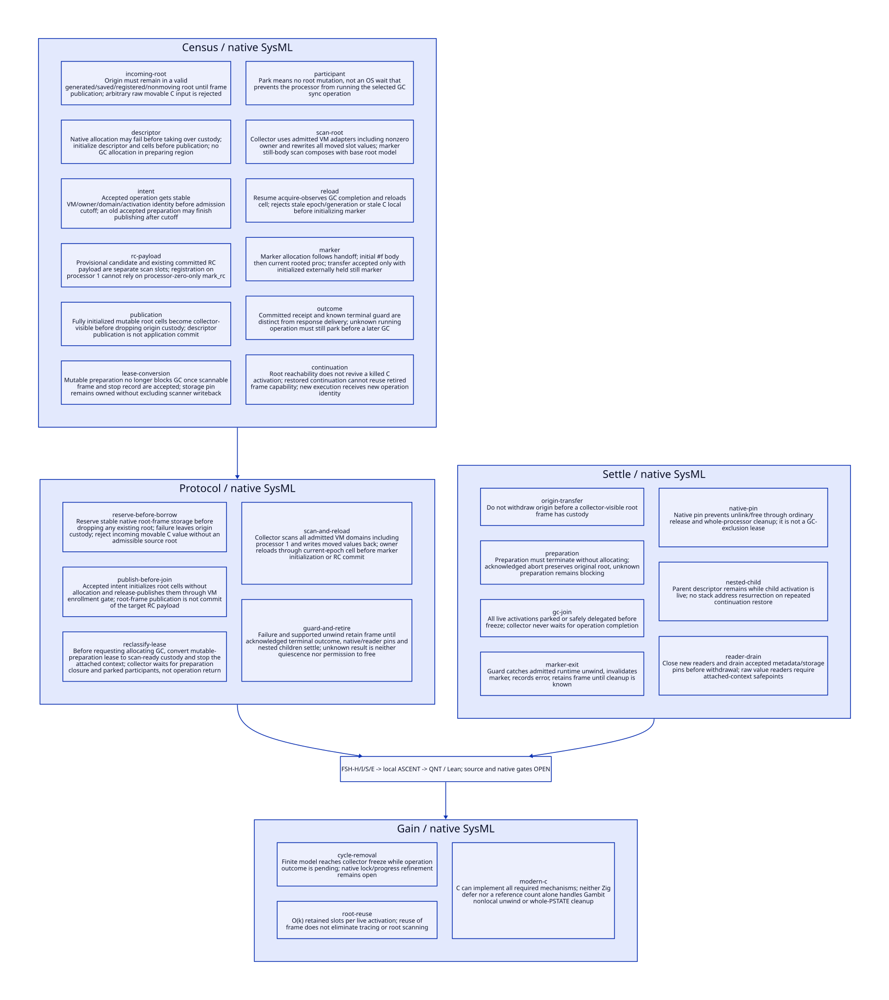. FSH-H/I/S/E links actual
SysML, ASCENT, QNT and Lean; source/participant/exit/native refinement remains open.

* RESEARCH Sync-op participants and completion-guard custody
:PROPERTIES:
:CUSTOM_ID: syncop-guard-custody-entry
:AUTHORITY: SyncOpGuardCustody
:END:
[[file:syncop-guard-custody-design.org][Modern C sync-op, unwind and cleanup integration]],
[[file:syncop-guard-custody-matrix.org][source/obligation/net-benefit matrix]], and
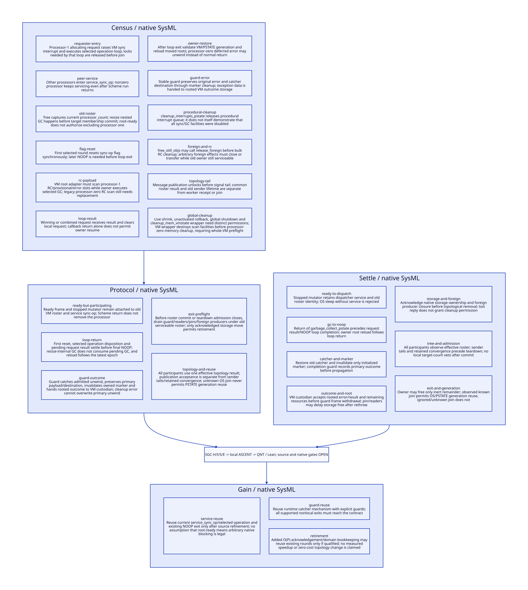. SGC-H/I/S/E binds actual
SysML, ASCENT, QNT and Lean, retaining source/ABI/foreign-producer gaps.

* RESEARCH Foreign cleanup closure and storage custody
:PROPERTIES:
:CUSTOM_ID: foreign-cleanup-closure-entry
:STATUS: conditional-models-source-open
:END:

[[file:foreign-cleanup-closure-design.org][Modern C release effects, derived work and VM cleanup permit]];
[[file:foreign-cleanup-closure-matrix.org][benefit and closure matrix]];
[[file:models/sysml/foreign-cleanup-closure.sysml][canonical SysML]];
[[file:diagrams/foreign-cleanup-closure.d2][D2 projection]]. Actual QNT/Lean and ASCENT bindings
are source/digest-scoped; runtime implementation and native qualification remain open.

* RESEARCH Device cleanup cursor and managed wait
:PROPERTIES:
:CUSTOM_ID: device-cleanup-wait-entry
:STATUS: conditional-models-source-open
:END:

[[file:device-cleanup-wait-design.org][Modern C cursor, wait and old-roster participation]];
[[file:device-cleanup-wait-matrix.org][benefit matrix]];
[[file:models/sysml/device-cleanup-wait.sysml][canonical SysML]];
[[file:diagrams/device-cleanup-wait.d2][D2 projection]]. Separate resume, processor-exit,
VM and global-service permits; native signal/source refinement stays open.

* RESEARCH Native wake channel and generation lifetime
:PROPERTIES:
:CUSTOM_ID: native-wake-channel-entry
:STATUS: conditional-models-source-open
:END:

[[file:native-wake-channel-design.org][Modern C durable requests, self-pipe outcomes and signal lifetime]];
[[file:native-wake-channel-matrix.org][benefit matrix]];
[[file:models/sysml/native-wake-channel.sysml][canonical SysML]];
[[file:diagrams/native-wake-channel.d2][D2 projection]]. Failure custody, finite fallback,
old-roster service and generation retirement have separate proof obligations.

* RESEARCH Signal route entry and generation retirement
:PROPERTIES:
:CUSTOM_ID: signal-route-retirement-entry
:STATUS: conditional-models-source-open
:END:

[[file:signal-route-retirement-design.org][Modern C atomic entry/revoke, late handlers and native-thread mask policy]];
[[file:signal-route-retirement-matrix.org][benefit matrix]];
[[file:models/sysml/signal-route-retirement.sysml][canonical SysML]];
[[file:diagrams/signal-route-retirement.d2][D2 projection]]. Pin drain, semantic work,
process mailbox lifetime and old-roster closure have distinct proof obligations.

* RESEARCH Generation gate and stable mailbox admission
:PROPERTIES:
:CUSTOM_ID: signal-gate-mailbox-entry
:STATUS: conditional-models-source-open
:END:

[[file:signal-gate-mailbox-design.org][Modern C CAS outcomes, reason semantics and leased VM binding]];
[[file:signal-gate-mailbox-matrix.org][benefit matrix]];
[[file:models/sysml/signal-gate-mailbox.sysml][canonical SysML]];
[[file:diagrams/signal-gate-mailbox.d2][D2 projection]]. Process mailbox custody survives
old VM retirement; route generation is not signal provenance.

** RESEARCH SIGINT delivery semantic cuts
:PROPERTIES:
:CUSTOM_ID: sigint-delivery-semantics-index
:STATUS: conditional-models-source-open
:END:

[[file:sigint-delivery-semantics-design.org][Source and semantic design]], [[file:sigint-delivery-semantics-matrix.org][closure and benefit matrix]],
[[file:models/sysml/sigint-delivery-semantics.sysml][canonical SysML]] and [[file:diagrams/sigint-delivery-semantics.d2][derived D2]].
Modern C preserves target, claim, vector and dynamic-handler cuts; a process mailbox is only a wake hint.

** RESEARCH Interrupt acceptance, publication and rooted claim custody
:PROPERTIES:
:CUSTOM_ID: interrupt-custody-handoff-index
:STATUS: conditional-models-source-open
:END:

[[file:interrupt-custody-handoff-design.org][Design]], [[file:interrupt-custody-handoff-matrix.org][closure and benefit matrix]],
[[file:models/sysml/interrupt-custody-handoff.sysml][canonical SysML]] and [[file:diagrams/interrupt-custody-handoff.d2][derived D2]].
Modern C separates publisher drain, reserved claim custody and GC-visible activation roots.

** RESEARCH Dual gate instruction order and R1 root materialization
:PROPERTIES:
:CUSTOM_ID: gate-empty-root-materialization-index
:STATUS: conditional-models-source-open
:END:

[[file:gate-empty-root-materialization-design.org][Design]], [[file:gate-empty-root-materialization-matrix.org][closure and benefit matrix]],
[[file:models/sysml/gate-empty-root-materialization.sysml][canonical SysML]] and [[file:diagrams/gate-empty-root-materialization.d2][derived D2]].
Modern C release/decrement, reserved pending exchange and stable final inspection are distinguished from R1/SELF root materialization and VM retirement authority.

** RESEARCH Decrement placement, restoration and installed Darwin profile
:PROPERTIES:
:CUSTOM_ID: decrement-restore-closure-index
:STATUS: conditional-models-source-open
:END:

[[file:decrement-restore-closure-design.org][Design]], [[file:decrement-restore-closure-matrix.org][closure, profile and benefit matrix]],
[[file:models/sysml/decrement-restore-closure.sysml][canonical SysML]] and [[file:diagrams/decrement-restore-closure.d2][derived D2]].
Modern C hands claim custody to an execution session before later PSTATE restoration, and distinguishes VM continuation lifetime from original processor lifetime.

* RESEARCH Outer completion landing and native session custody
:PROPERTIES:
:CUSTOM_ID: outer-completion-landing
:STATUS: conditional-models-source-open
:END:

[[file:outer-completion-landing-design.org][Actual call/run/SFUN/CFUN callers and stable completion protocol]];
[[file:outer-completion-landing-matrix.org][native SysML closure and benefit matrix]].
Modern C mainline; native marker/catcher/root/roster qualification remains open.

* RESEARCH Stable completion guard registration and single settlement
:PROPERTIES:
:CUSTOM_ID: stable-guard-settlement
:STATUS: conditional-models-source-open
:END:

[[file:stable-guard-settlement-design.org][Marker acquisition, exceptional custody and one native decrement]];
[[file:stable-guard-settlement-matrix.org][Canonical memory, closure and benefit matrix]].
Modern C mainline; VM root adapter, cleanup nonabandonment and native qualification open.

* RESEARCH Release commit, interruption and unknown custody
:PROPERTIES:
:CUSTOM_ID: release-commit-custody
:STATUS: conditional-models-source-open
:END:

[[file:release-commit-custody-design.org][Qualified native segment versus authoritative release token]];
[[file:release-commit-custody-matrix.org][C11, closure and benefit matrix]].
Modern C mainline; release accounting is distinct from physical caller/VM completion.

* RESEARCH Marker writer closure and quiescent auditor succession
:PROPERTIES:
:CUSTOM_ID: marker-audit-quiescence
:STATUS: conditional-models-source-open
:END:

[[file:marker-audit-quiescence-design.org][Single-credit premises, storage-before-exit and fresh-cut audit]];
[[file:marker-audit-quiescence-matrix.org][Writer routes, memory and benefit matrix]].
Modern C mainline; open native aliases refuse audit qualification.

* RESEARCH Toolchains and artifacts :toolchain:
:PROPERTIES:
:ID: a47ff6a7-fef3-56fb-bccf-c6760f5d3e99
:CUSTOM_ID: toolchain-contract
:OWNER: Gambit architecture research
:STATUS: design-only
:EVIDENCE_CLASS: source-and-model-design
:END:

Darwin/GCC inputs, argv/configuration, observation, build cache, AOT and artifact invalidation.

Cache reuse is not fresh module/context instantiation or native semantic acceptance.

[[file:gerbil-module-build-design.org][Gerbil gxi/gxc module incrementality and concurrent compilation]] separates
the std/make dependency and expander-session problem from Gambit's Make
bootstrap. Its SysML boundaries link to existing planner/scheduler/publisher
source obligations; its benefit matrix does not claim a measured speedup.

[[file:gerbil-macro-chain-design.org][The real iterator macro chain]] refines that lane through two consumer
modules, native-derived QNT topology, conditional Lean checks and an actual
ASCENT ancestor-closed request. Source isolation and platform attribution
remain open; the 12-core/fivefold observations are not measured by this study.

[[file:gerbil-session-closure-design.org][Execution support and independent compilation sessions]] refines that chain
with heap aliasing, sticky optimizer/SSXI state and Chez/OCaml implementation
lessons. [[file:gerbil-session-closure-matrix.org][The ownership/benefit matrix]] keeps existing batch reuse as the baseline;
the incomplete source census blocks admission independently of model receipts.

[[file:foundation-binding-design.org][Foundation images and binding reconstruction]] separates canonical definition
identity from fresh use-site work and stateful module-instance ownership.
Its [[file:foundation-binding-matrix.org][sharing/reconstruction matrix]] retains lazy lookup writes and identifier
comparison semantics as source-refinement gates.

[[file:initialization-closure-design.org][Foundation, reader and native initialization closure]] separates code availability,
successful instances and deep-freeze qualification. Its [[file:initialization-closure-matrix.org][matrix]] derives from
SysML; stateful owners preserve reference histories while independent consumer
work overlaps. Recursive capture/capability closure remains an explicit gate.

[[file:ebnf-reader-custody-design.org][The real EBNF reader capture and custody study]] separates generated grammar
definitions from live streams, dynamic handlers and continuation lifetime.
Its [[file:ebnf-reader-custody-matrix.org][native-derived matrix]] records the direct-port/lookahead handoff gap
and keeps source admission separate from formal controls.

[[file:ebnf-cursor-handoff-design.org][The lexer-to-Scheme cursor handoff study]] derives a quote-loss witness from
reader and generator source, distinguishes behavior repair from legacy
equivalence, and models token/character custody with unknown-result settlement.
Its [[file:ebnf-cursor-handoff-matrix.org][matrix]] retains location, exception and native adapter qualification gaps.

[[file:logical-cursor-design.org][The unified logical cursor contract]] separates accepted/raw/trivia spans,
canonical token identity, position modes and live continuation custody.
[[file:logical-cursor-matrix.org][Its closure and net-benefit matrix]] and 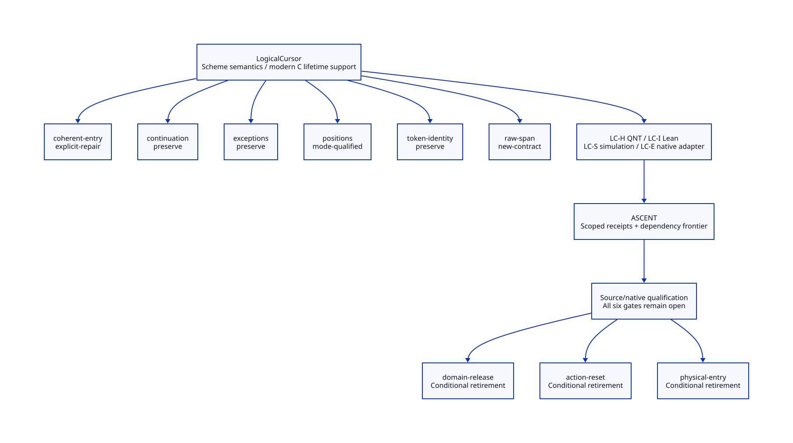 derive from native
SysML through Python, with actual ASCENT rules and scoped QNT/Lean checks.

[[file:reader-span-custody-design.org][The reader span producer/custody study]] traces the five datum entries,
six raw header I/O sites and two distinct reset consumers. It separates
failed-attempt horizons, mutable reduction strings, header/body exception
routes and live continuation aliases. [[file:reader-span-custody-matrix.org][Its matrix]] and [[file:diagrams/reader-span-custody.svg][D2]] retain the source
simulation and native root/delivery gates after conditional QNT/Lean checks.

[[file:span-storage-handoff-design.org][The isolated storage and multi-shot handoff study]] separates mutable @@,
raw chunks, error stacktrace roots and individual resumption/operation identities.
[[file:span-storage-handoff-matrix.org][Its matrix]] and [[file:diagrams/span-storage-handoff.svg][D2]] record per-resource retirement, failure custody and
the conditional constant-$ materialization opportunity, with actual QNT/Lean scopes.

[[file:stream-release-authority-design.org][The old-stream release authority study]] distinguishes actual will/RC producers
from proposed owner-token coverage, closed native admission and composed permits.
[[file:stream-release-authority-matrix.org][Its matrix]] and [[file:diagrams/stream-release-authority.svg][D2]] preserve self-retention/hidden-alias counterexamples,
rootless unknown-release custody and the corrected caller-root reservation guard.

[[file:owner-notifier-closure-design.org][The owner/notifier closure study]] grounds resource-capable holders, manual
will execution, testator resurrection and persistent GC-job capture in source.
[[file:owner-notifier-closure-matrix.org][Its matrix]] and 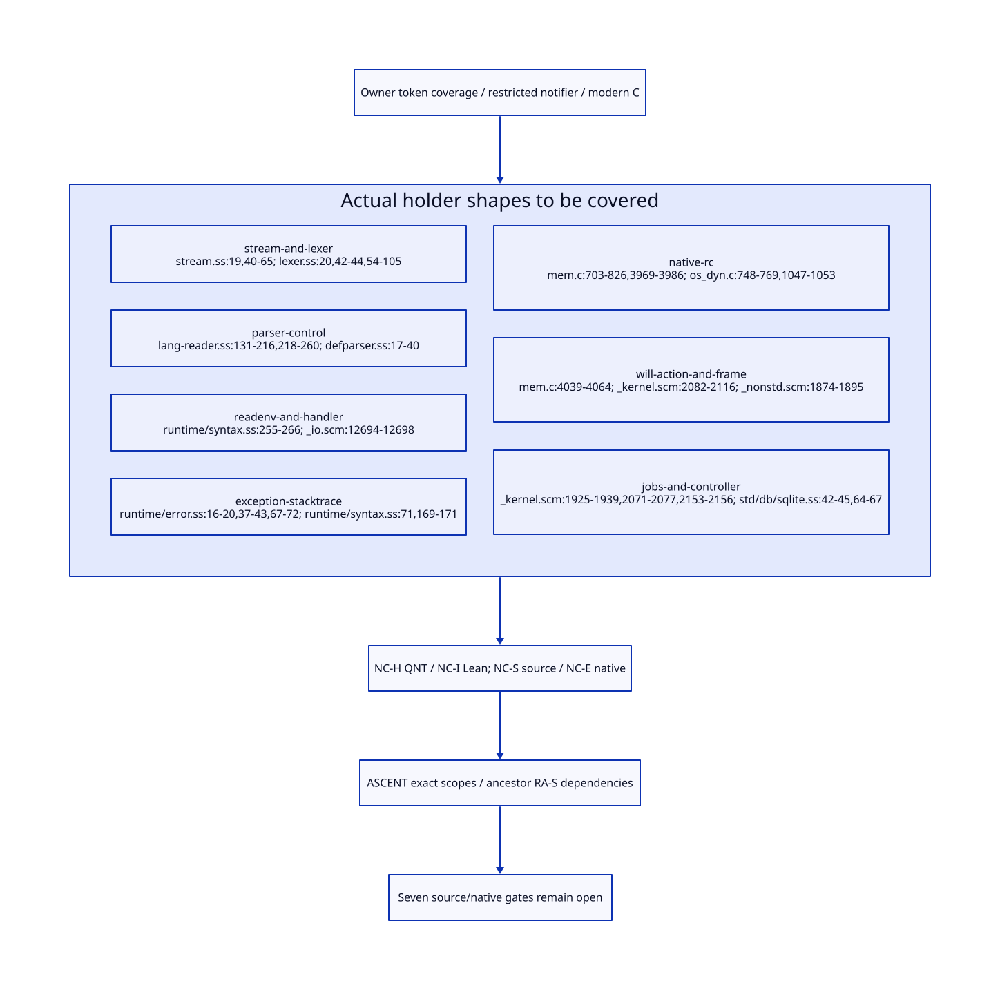 distinguish selection/preparation/action return from
qualified invocation-root retirement and sealed release-evidence contribution.

[[file:notifier-root-retirement-design.org][Callback root retirement and repeated continuation]] refines the notifier exit
boundary through arguments, register/saved transfers, active/captured frames and
exception custody. [[file:notifier-root-retirement-matrix.org][The matrix]] keeps root/restoration closure and native issuer
qualification open; conditional models cannot grant release authority.

[[file:gc-drain-retirement-cut-design.org][Generated will return through GC drain]] binds retained C labels and descriptors,
separates register clearing from restore closure, and proposes per-action versus
pre-jobs batch issuer cuts. [[file:gc-drain-retirement-cut-matrix.org][The net-work matrix]] keeps generation provenance and
all current-program/native qualification open.

[[file:will-action-admission-design.org][Real will action and Darwin generation cohorts]] follows SQLite statement-close
through expanded Scheme, matched arm64 object/debug metadata and kernel call
sites. [[file:will-action-admission-matrix.org][Its matrix]] separates semantic last use, absent machine dead masks and
causal generation; both proposed issuer cuts remain unqualified.

** Contract and ownership
:PROPERTIES:
:CUSTOM_ID: ownership
:END:
One Scheme semantic contract; one selected implementation owner for each mechanism. C-facing capability remains mandatory. Imported alternatives are comparisons, not simultaneous deployment decisions.

** Models and views
:PROPERTIES:
:CUSTOM_ID: models
:END:
- [[file:models/sysml/architecture.sysml][SysML architecture and necessary requirements]]
- [[file:diagrams/overview.d2][Maintained D2 view source]]
- [[file:diagrams/overview.svg][Rendered D2 view]]

#+NAME: toolchain-sysml-source
#+INCLUDE: "models/sysml/architecture.sysml" src sysml

#+NAME: toolchain-d2-source
#+INCLUDE: "diagrams/overview.d2" src d2

** OPEN Evidence and admission gaps
:PROPERTIES:
:ID: 38c4a8b1-ced6-5f23-8269-af494923b283
:CUSTOM_ID: gaps
:STATUS: unresolved
:END:
Source reading, model validation, checked proof, native semantic acceptance and measured benefit are distinct. No validation result satisfies the runtime gates automatically.

** Study catalogue
:PROPERTIES:
:CUSTOM_ID: studies
:END:
#+NAME: toolchain-studies
| Study | Evidence lineage |
|---+---|
| [[file:studies/compilation-cost-and-aot-design.org][compilation-cost-and-aot-design]] | ~9af5c8ebb37a~ |
| [[file:studies/compilation-cost-evidence.org][compilation-cost-evidence]] | ~ab06983dba0e~ |
| [[file:studies/compilation-unit-artifact-contract.org][compilation-unit-artifact-contract]] | ~f26945ab1de2~ |
| [[file:studies/darwin-configured-input-design.org][darwin-configured-input-design]] | ~623ea66b7acb~ |
| [[file:studies/darwin-configured-input-evidence.org][darwin-configured-input-evidence]] | ~20953eeca127~ |
| [[file:studies/darwin-consumer-support-evidence.org][darwin-consumer-support-evidence]] | ~4cb79d80072c~ |
| [[file:studies/darwin-consumer-support-matrix.org][darwin-consumer-support-matrix]] | ~c118f554b70d~ |
| [[file:studies/darwin-dtrace-adapter-architecture.org][darwin-dtrace-adapter-architecture]] | ~41bd5c370481~ |
| [[file:studies/darwin-dtrace-adapter-evidence.org][darwin-dtrace-adapter-evidence]] | ~e15d9a33023f~ |
| [[file:studies/darwin-external-observer-design.org][darwin-external-observer-design]] | ~e7d424d94e92~ |
| [[file:studies/darwin-external-observer-evidence.org][darwin-external-observer-evidence]] | ~5cafd4ce0a17~ |
| [[file:studies/darwin-first-compile-boundary.org][darwin-first-compile-boundary]] | ~a530f8140616~ |
| [[file:studies/darwin-local-stack-correspondence.org][darwin-local-stack-correspondence]] | ~aa000174fd9e~ |
| [[file:studies/darwin-observation-platform-evidence.org][darwin-observation-platform-evidence]] | ~63557def4d2c~ |
| [[file:studies/darwin-recorder-observation-design.org][darwin-recorder-observation-design]] | ~ec810a2d2901~ |
| [[file:studies/darwin-supplemental-evidence-design.org][darwin-supplemental-evidence-design]] | ~fb4d226bbd16~ |
| [[file:studies/darwin-supplemental-evidence.org][darwin-supplemental-evidence]] | ~d56631ef5273~ |
| [[file:studies/effective-configuration-darwin-gcc.org][effective-configuration-darwin-gcc]] | ~2c1bf657e64f~ |
| [[file:studies/effective-configuration-evidence.org][effective-configuration-evidence]] | ~0a85e703f640~ |
| [[file:studies/equivalence-observation-evidence.org][equivalence-observation-evidence]] | ~9e8bfb22d3d3~ |
| [[file:studies/independent-equivalence-evidence-plan.org][independent-equivalence-evidence-plan]] | ~1c3f0b7075de~ |
| [[file:studies/interface-construction-aot-design.org][interface-construction-aot-design]] | ~02df019ed69b~ |
| [[file:studies/interface-construction-evidence.org][interface-construction-evidence]] | ~677fdd28946b~ |
| [[file:studies/interface-construction-operations-and-state.org][interface-construction-operations-and-state]] | ~c045941c8f4f~ |
| [[file:studies/native-argv-equivalence-matrix.org][native-argv-equivalence-matrix]] | ~6db2c726fb8d~ |
| [[file:studies/native-request-configuration-migration.org][native-request-configuration-migration]] | ~c19e61913b8f~ |
| [[file:studies/native-request-migration-evidence.org][native-request-migration-evidence]] | ~5064d24e1abe~ |
| [[file:studies/single-source-native-profile.org][single-source-native-profile]] | ~2a5147b3c392~ |
| [[file:studies/single-source-profile-evidence.org][single-source-profile-evidence]] | ~221b56fc36b3~ |

** Cross-cutting references
- [[file:../../index.org][Development architecture]]
- [[file:../../catalog.org][Complete source-to-Org and diagram migration map]]
- [[file:../../research/validation.org][Validation boundary and retained receipts]]

** Column view for local research obligations
#+BEGIN: columnview :id local :format "%ITEM %STATUS %EVIDENCE_CLASS"
#+END:

** Output fidelity, independent clean origins and failure reflection
[[file:output-fidelity-design.org][The source-backed _host generation/composition study]] adds twelve SysML-owned
fidelity/clean/failure obligations. Seven new Lean results bring the total to
38; five QNT modules are typechecked only. Exact byte/atom injection is checked;
recursive datum decoding, real clean origin and concrete safety reflection
remain open. No build implementation or native tests are claimed.
- [[file:output-fidelity-map.org][Derived proof and benefit matrix]]
- [[file:diagrams/output-fidelity.d2][D2 source]] / [[file:diagrams/output-fidelity.svg][rendered graph]]

** Recursive wire and actual metadata domain
[[file:recursive-codec-design.org][The metadata-domain study]] adds eight SysML duties and eight Lean theorems
(46 total), including recursive mathematical wire inverse and injection. Six
QNT modules are typechecked only. Actual Scheme scalar/identity admission,
reader fidelity, consumer factorization and resource bounds remain open.
No build/runtime implementation or native tests are claimed.
- [[file:recursive-codec-map.org][Derived source/proof/cost matrix]]
- [[file:diagrams/recursive-codec.d2][D2 source]] / [[file:diagrams/recursive-codec.svg][rendered graph]]

** RESEARCH Actual Scheme values, roots and linker reflection
[[file:scheme-value-admission-design.org][The Scheme value study]] adds nine SysML duties and ten Lean statements
(56 total). Seven QNT modules typecheck only. Mutable-view stability, canonical
symbol identity and actual GC scanner participation are separate obligations.
ROOT-HANDOFF is reused by reference; actual readback and linker reflection
remain open. No build/runtime implementation or native testing is claimed.

- [[file:scheme-value-admission-map.org][Derived source, proof and cost matrix]]
- [[file:diagrams/scheme-value-admission.d2][D2 source]] / [[file:diagrams/scheme-value-admission.svg][rendered graph]]

** RESEARCH Script-line capture and complete linker observations
[[file:script-line-reflection-design.org][The script-line study]] adds ten SysML duties with bounded research status,
twelve Lean statements (68 total) and an eighth QNT module (typechecking only).
Named writers, captured aliases and input currentness have separate cuts.
Full outcome/effect reflection is conditional; actual readback and cleanup
refinement remain open. ROOT-HANDOFF is reused; no native tests are claimed.

- [[file:script-line-reflection-map.org][Derived closure and benefit matrix]]
- [[file:diagrams/script-line-reflection.d2][D2 source]] / [[file:diagrams/script-line-reflection.svg][rendered graph]]

** RESEARCH Stable-view lifecycle and macOS development cost
[[file:stable-view-design.org][Stable-view issuance/revoke/continuation entry]] and
[[file:macos-development-design.org][macOS development architecture]] use separate owned SysML models.
Nine lifecycle transitions reference shared runtime contracts. Thirteen duties
add bounded source/history/refinement and benefit accounting; 82 standalone Lean
statements pass and ten QNT modules typecheck only. Actual issuer/provider/control/
I/O and whole-request native performance remain unqualified. No implementation
or native tests are added.

- [[file:stable-view-map.org][Lifecycle evidence/transition matrix]] / [[file:diagrams/stable-view.svg][D2 lifecycle]]
- [[file:macos-development-map.org][Darwin evidence/cost matrix]] / [[file:diagrams/macos-development.svg][D2 dependencies]]

*** EVIDENCE Fixed-cache topology compilation sharing
:PROPERTIES:
:CUSTOM_ID: fixed-cache-topology-sharing
:AUTHORITY: GambitDarwinDevelopment::sharedFixture
:END:
[[file:native-stage-design.org::#topology-artifact-sharing][The existing executable-test contract]] now shares the two explicit topology
pairs' actual compiled artifacts with original cwd and full source/tool/runtime
identity. Current-engine control: five compilations / five fresh executions;
selected: three / five. All pass within unchanged budgets. Fixture-stage time
was 28.923 / 21.520 seconds including checks; one matched observation, not a
stable latency gain. Native SysML and ASCENT eight missing-guard cases pass;
113 unit controls remain separate from native evidence. General compilation
caching and whole modern-c runtime acceptance remain open. QNT/Lean ownership
is unchanged.

** RESEARCH ModuleSpec and FrameSpec consumer contracts
[[file:native-descriptor-design.org][The modern generated C descriptor design]] connects Scheme semantic generation, native binding, GC and continuation consumers. [[file:native-descriptor-map.org][Source/proof/retirement/benefit matrix]] and [[file:diagrams/native-descriptor.svg][D2]] derive from owned SysML; [[file:../../modeling/ascent/native-descriptor.ss][ASCENT]] joins current code to fields, cuts and proof owners. All eight new proof duties remain open; no new formal/native execution.

** RESEARCH Planner, scheduler and publisher assurance
[[file:component-assurance.org][Behavior, scoped QNT/Lean checks and source obligations]] /
[[file:../../modeling/component-assurance.org][cross-component closure matrix]]. Host credits, complete input cuts and
output-group publication are separate contracts with explicit failure custody.

* RESEARCH Marker aliases, audit revocation and Gambit design amplification
:PROPERTIES:
:CUSTOM_ID: marker-alias-revocation-entry
:END:

[[file:marker-alias-revocation-design.org][Frame/continuation/FFI source chain and revoke/drain architecture]],
[[file:marker-alias-revocation-matrix.org][SysML-derived closure and net-benefit matrix]], and
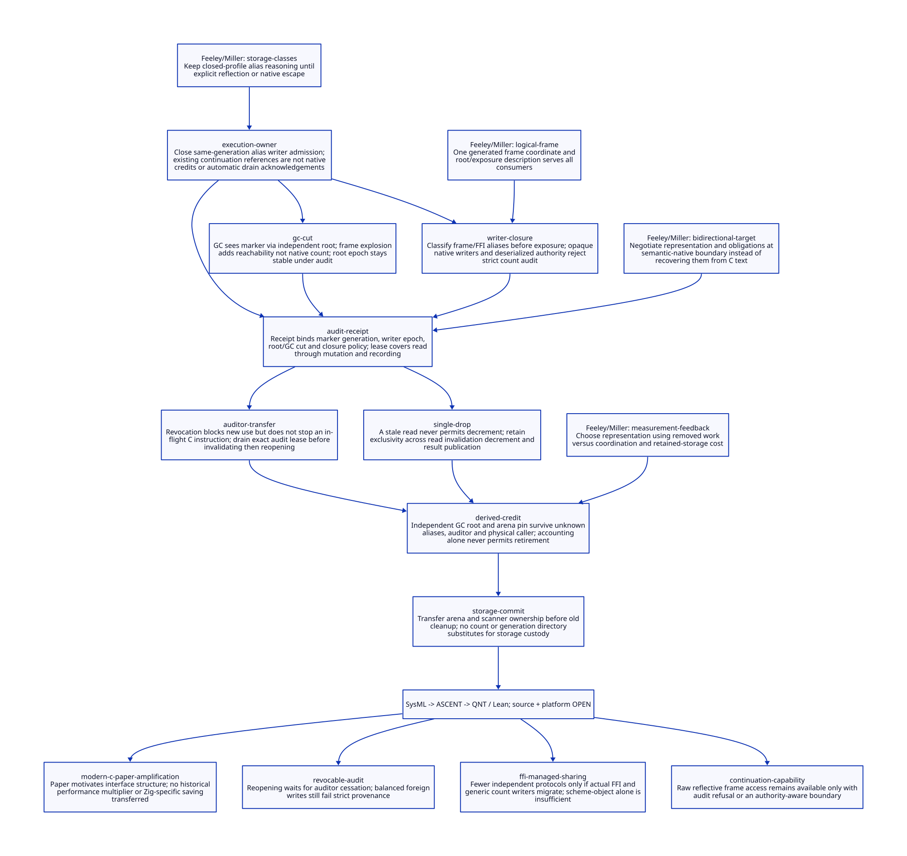. MAR-H/I/S/E connect actual QNT, Lean and ASCENT subjects;
Feeley's PVM ideas are tied to generated frame and ownership contracts. Modern C
remains the mainline; alias completeness and source/platform admission remain open.

* RESEARCH C23 stable ABI and phase-artifact refactor
:PROPERTIES:
:CUSTOM_ID: c23-development-refactor-entry
:AUTHORITY: GambitDarwinDevelopment
:END:
[[file:c23-development-refactor-design.org][Concrete C23 design and standard-versus-architecture benefit ledger]] connects
the existing descriptor and incremental-service owners. [[file:c23-development-refactor-matrix.org][Native SysML matrix]] and
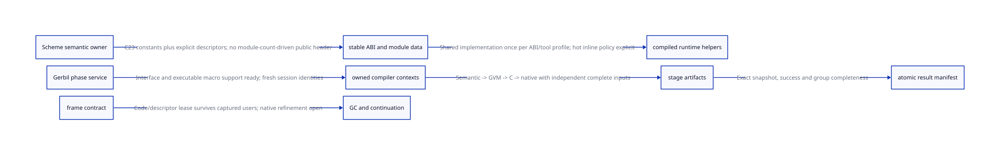 cover four typed migration routes; a focused native-key QNT/Lean companion
and actual ASCENT checks retain concrete source/performance gaps.
