#+TITLE: Toolchains and artifacts
#+SETUPFILE: ../../modeling/org/setup.org
#+CATEGORY: toolchain

The [[file:../../refactoring/why-refactor.org::#migration-order][modern-C refactoring rationale]] connects effective multicore configuration, native artifact closure and work reuse. The two necessary profile predicates in this category's SysML model distinguish requested flags, effective capability and actual runtime population. Build jobs do not establish runtime parallelism.

[[file:incremental-build-design.org][Fundamental incremental and parallel build design]] treats planning, dependency cuts, early cutoff, shared resource admission and atomic artifact publication separately. [[file:build-map.org][The artifact/delta/source matrix]] and 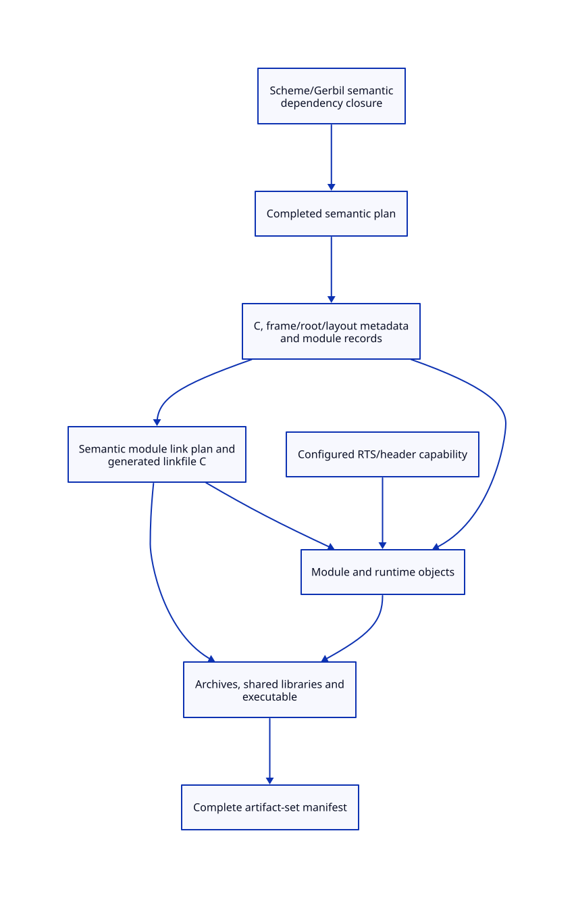 derive from the same toolchain model. Existing jobserver and streaming-executor support is explicitly retained as source evidence.

[[file:source-chain-design.org][The actual GSC leaf/macro/no-change chain]] now instantiates those contracts. [[file:source-chain-map.org][Source, phase and benefit rows]] derive from this model; [[file:../../modeling/component-model-map.org][the component/model map]] resolves the QNT/Lean sources and ASCENT associations through SysML.

[[file:correctness-design.org][Dynamic closure, immutable input cohorts and consumer cutoff]] now separates three correctness proofs and the ten-node/74-action boundary. [[file:correctness-map.org][Population and benefit matrices]] and 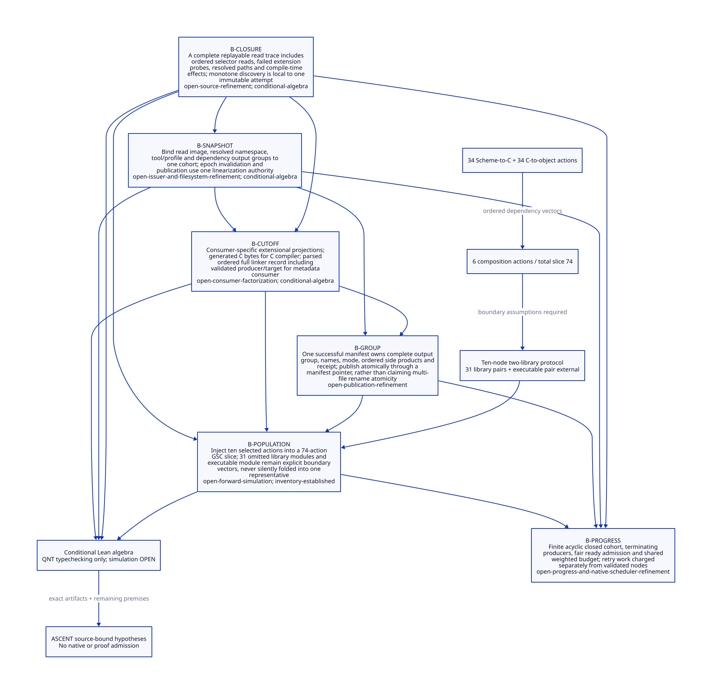 derive from SysML.

[[file:read-snapshot-design.org][Real GSC read closure and snapshot credentials]] adds source caller boundaries and a precise selected-population relation. [[file:read-snapshot-map.org][Issuance/refinement/benefits matrices]] and the 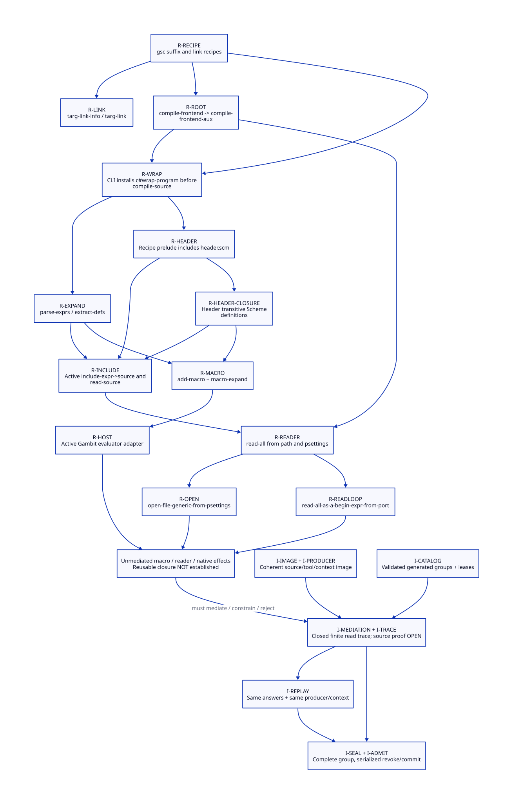 / 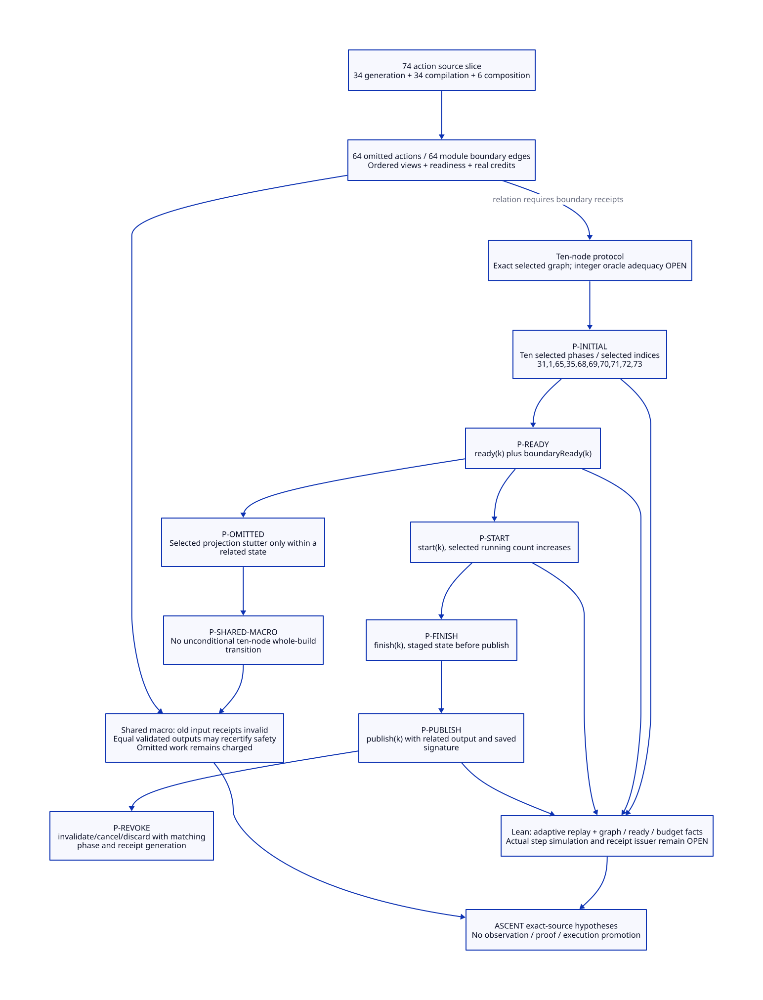 derive from SysML.

[[file:capability-observation-design.org][Macro/eval, reader/native capability closure and output fidelity]] adds concrete caller/refusal boundaries and structured observations. [[file:capability-observation-map.org][The admission/fidelity/benefit matrix]] and [[file:diagrams/capability-observation.svg][D2]] derive from SysML.

* RESEARCH Toolchains and artifacts :toolchain:
:PROPERTIES:
:ID: a47ff6a7-fef3-56fb-bccf-c6760f5d3e99
:CUSTOM_ID: toolchain-contract
:OWNER: Gambit architecture research
:STATUS: design-only
:EVIDENCE_CLASS: source-and-model-design
:END:

Darwin/GCC inputs, argv/configuration, observation, build cache, AOT and artifact invalidation.

Cache reuse is not fresh module/context instantiation or native semantic acceptance.

[[file:gerbil-module-build-design.org][Gerbil gxi/gxc module incrementality and concurrent compilation]] separates
the std/make dependency and expander-session problem from Gambit's Make
bootstrap. Its SysML boundaries link to existing planner/scheduler/publisher
source obligations; its benefit matrix does not claim a measured speedup.

[[file:gerbil-macro-chain-design.org][The real iterator macro chain]] refines that lane through two consumer
modules, native-derived QNT topology, conditional Lean checks and an actual
ASCENT ancestor-closed request. Source isolation and platform attribution
remain open; the 12-core/fivefold observations are not measured by this study.

[[file:gerbil-session-closure-design.org][Execution support and independent compilation sessions]] refines that chain
with heap aliasing, sticky optimizer/SSXI state and Chez/OCaml implementation
lessons. [[file:gerbil-session-closure-matrix.org][The ownership/benefit matrix]] keeps existing batch reuse as the baseline;
the incomplete source census blocks admission independently of model receipts.

[[file:foundation-binding-design.org][Foundation images and binding reconstruction]] separates canonical definition
identity from fresh use-site work and stateful module-instance ownership.
Its [[file:foundation-binding-matrix.org][sharing/reconstruction matrix]] retains lazy lookup writes and identifier
comparison semantics as source-refinement gates.

[[file:initialization-closure-design.org][Foundation, reader and native initialization closure]] separates code availability,
successful instances and deep-freeze qualification. Its [[file:initialization-closure-matrix.org][matrix]] derives from
SysML; stateful owners preserve reference histories while independent consumer
work overlaps. Recursive capture/capability closure remains an explicit gate.

[[file:ebnf-reader-custody-design.org][The real EBNF reader capture and custody study]] separates generated grammar
definitions from live streams, dynamic handlers and continuation lifetime.
Its [[file:ebnf-reader-custody-matrix.org][native-derived matrix]] records the direct-port/lookahead handoff gap
and keeps source admission separate from formal controls.

** Contract and ownership
:PROPERTIES:
:CUSTOM_ID: ownership
:END:
One Scheme semantic contract; one selected implementation owner for each mechanism. C-facing capability remains mandatory. Imported alternatives are comparisons, not simultaneous deployment decisions.

** Models and views
:PROPERTIES:
:CUSTOM_ID: models
:END:
- [[file:models/sysml/architecture.sysml][SysML architecture and necessary requirements]]
- [[file:diagrams/overview.d2][Maintained D2 view source]]
- 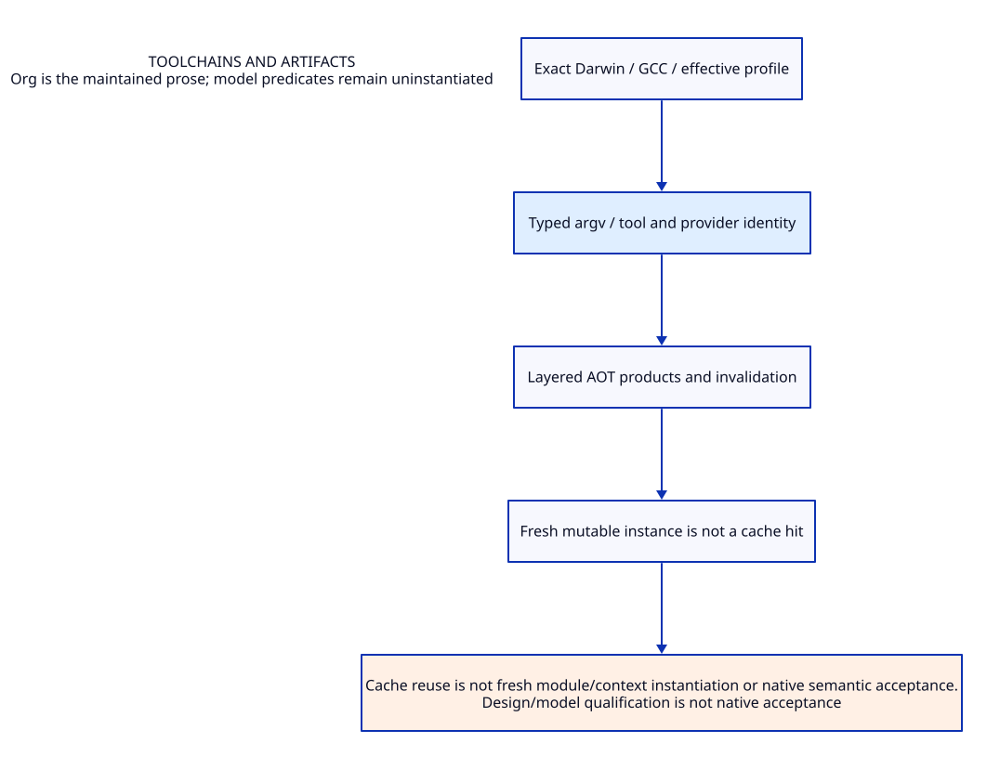

#+NAME: toolchain-sysml-source
#+INCLUDE: "models/sysml/architecture.sysml" src sysml

#+NAME: toolchain-d2-source
#+INCLUDE: "diagrams/overview.d2" src d2

** OPEN Evidence and admission gaps
:PROPERTIES:
:ID: 38c4a8b1-ced6-5f23-8269-af494923b283
:CUSTOM_ID: gaps
:STATUS: unresolved
:END:
Source reading, model validation, checked proof, native semantic acceptance and measured benefit are distinct. No validation result satisfies the runtime gates automatically.

** Study catalogue
:PROPERTIES:
:CUSTOM_ID: studies
:END:
#+NAME: toolchain-studies
| Study | Evidence lineage |
|---+---|
| [[file:studies/compilation-cost-and-aot-design.org][compilation-cost-and-aot-design]] | ~9af5c8ebb37a~ |
| [[file:studies/compilation-cost-evidence.org][compilation-cost-evidence]] | ~ab06983dba0e~ |
| [[file:studies/compilation-unit-artifact-contract.org][compilation-unit-artifact-contract]] | ~f26945ab1de2~ |
| [[file:studies/darwin-configured-input-design.org][darwin-configured-input-design]] | ~623ea66b7acb~ |
| [[file:studies/darwin-configured-input-evidence.org][darwin-configured-input-evidence]] | ~20953eeca127~ |
| [[file:studies/darwin-consumer-support-evidence.org][darwin-consumer-support-evidence]] | ~4cb79d80072c~ |
| [[file:studies/darwin-consumer-support-matrix.org][darwin-consumer-support-matrix]] | ~c118f554b70d~ |
| [[file:studies/darwin-dtrace-adapter-architecture.org][darwin-dtrace-adapter-architecture]] | ~41bd5c370481~ |
| [[file:studies/darwin-dtrace-adapter-evidence.org][darwin-dtrace-adapter-evidence]] | ~e15d9a33023f~ |
| [[file:studies/darwin-external-observer-design.org][darwin-external-observer-design]] | ~e7d424d94e92~ |
| [[file:studies/darwin-external-observer-evidence.org][darwin-external-observer-evidence]] | ~5cafd4ce0a17~ |
| [[file:studies/darwin-first-compile-boundary.org][darwin-first-compile-boundary]] | ~a530f8140616~ |
| [[file:studies/darwin-local-stack-correspondence.org][darwin-local-stack-correspondence]] | ~aa000174fd9e~ |
| [[file:studies/darwin-observation-platform-evidence.org][darwin-observation-platform-evidence]] | ~63557def4d2c~ |
| [[file:studies/darwin-recorder-observation-design.org][darwin-recorder-observation-design]] | ~ec810a2d2901~ |
| [[file:studies/darwin-supplemental-evidence-design.org][darwin-supplemental-evidence-design]] | ~fb4d226bbd16~ |
| [[file:studies/darwin-supplemental-evidence.org][darwin-supplemental-evidence]] | ~d56631ef5273~ |
| [[file:studies/effective-configuration-darwin-gcc.org][effective-configuration-darwin-gcc]] | ~2c1bf657e64f~ |
| [[file:studies/effective-configuration-evidence.org][effective-configuration-evidence]] | ~0a85e703f640~ |
| [[file:studies/equivalence-observation-evidence.org][equivalence-observation-evidence]] | ~9e8bfb22d3d3~ |
| [[file:studies/independent-equivalence-evidence-plan.org][independent-equivalence-evidence-plan]] | ~1c3f0b7075de~ |
| [[file:studies/interface-construction-aot-design.org][interface-construction-aot-design]] | ~02df019ed69b~ |
| [[file:studies/interface-construction-evidence.org][interface-construction-evidence]] | ~677fdd28946b~ |
| [[file:studies/interface-construction-operations-and-state.org][interface-construction-operations-and-state]] | ~c045941c8f4f~ |
| [[file:studies/native-argv-equivalence-matrix.org][native-argv-equivalence-matrix]] | ~6db2c726fb8d~ |
| [[file:studies/native-request-configuration-migration.org][native-request-configuration-migration]] | ~c19e61913b8f~ |
| [[file:studies/native-request-migration-evidence.org][native-request-migration-evidence]] | ~5064d24e1abe~ |
| [[file:studies/single-source-native-profile.org][single-source-native-profile]] | ~2a5147b3c392~ |
| [[file:studies/single-source-profile-evidence.org][single-source-profile-evidence]] | ~221b56fc36b3~ |

** Cross-cutting references
- [[file:../../index.org][Development architecture]]
- [[file:../../catalog.org][Complete source-to-Org and diagram migration map]]
- [[file:../../research/validation.org][Validation boundary and retained receipts]]

** Column view for local research obligations
#+BEGIN: columnview :id local :format "%ITEM %STATUS %EVIDENCE_CLASS"
#+END:

** Output fidelity, independent clean origins and failure reflection
[[file:output-fidelity-design.org][The source-backed _host generation/composition study]] adds twelve SysML-owned
fidelity/clean/failure obligations. Seven new Lean results bring the total to
38; five QNT modules are typechecked only. Exact byte/atom injection is checked;
recursive datum decoding, real clean origin and concrete safety reflection
remain open. No build implementation or native tests are claimed.
- [[file:output-fidelity-map.org][Derived proof and benefit matrix]]
- [[file:diagrams/output-fidelity.d2][D2 source]] / 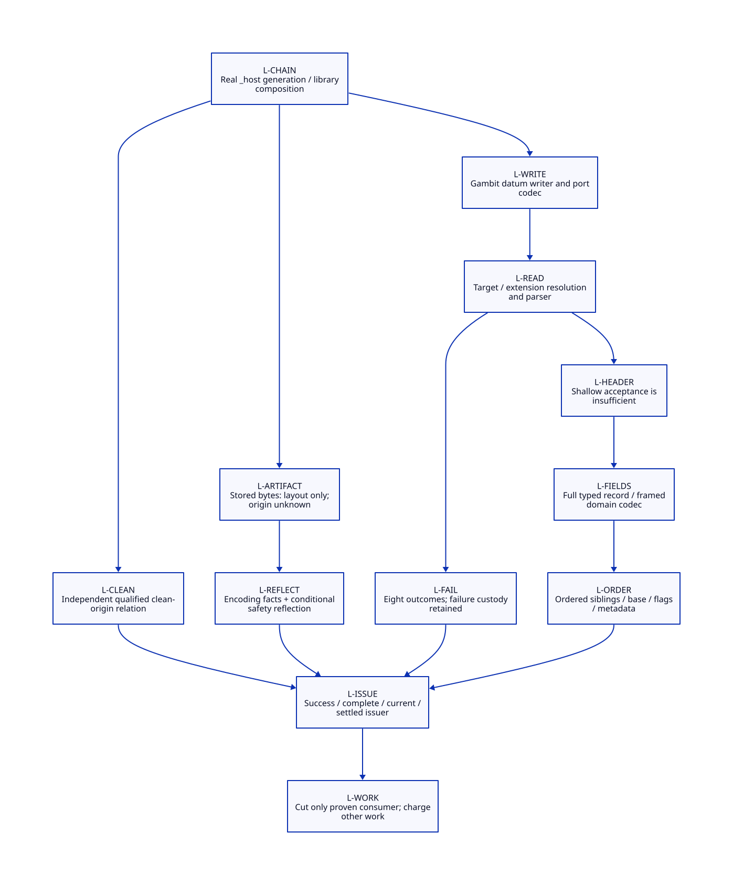

** Recursive wire and actual metadata domain
[[file:recursive-codec-design.org][The metadata-domain study]] adds eight SysML duties and eight Lean theorems
(46 total), including recursive mathematical wire inverse and injection. Six
QNT modules are typechecked only. Actual Scheme scalar/identity admission,
reader fidelity, consumer factorization and resource bounds remain open.
No build/runtime implementation or native tests are claimed.
- [[file:recursive-codec-map.org][Derived source/proof/cost matrix]]
- [[file:diagrams/recursive-codec.d2][D2 source]] / 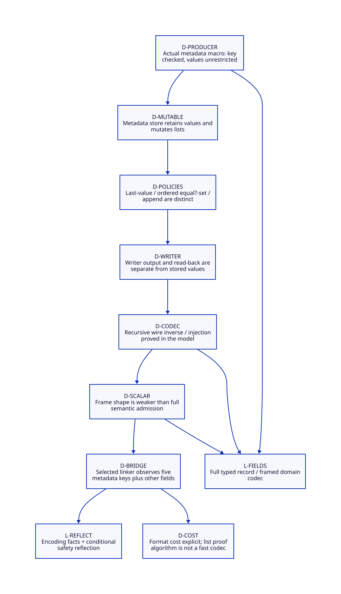

** RESEARCH Actual Scheme values, roots and linker reflection
[[file:scheme-value-admission-design.org][The Scheme value study]] adds nine SysML duties and ten Lean statements
(56 total). Seven QNT modules typecheck only. Mutable-view stability, canonical
symbol identity and actual GC scanner participation are separate obligations.
ROOT-HANDOFF is reused by reference; actual readback and linker reflection
remain open. No build/runtime implementation or native testing is claimed.

- [[file:scheme-value-admission-map.org][Derived source, proof and cost matrix]]
- [[file:diagrams/scheme-value-admission.d2][D2 source]] / 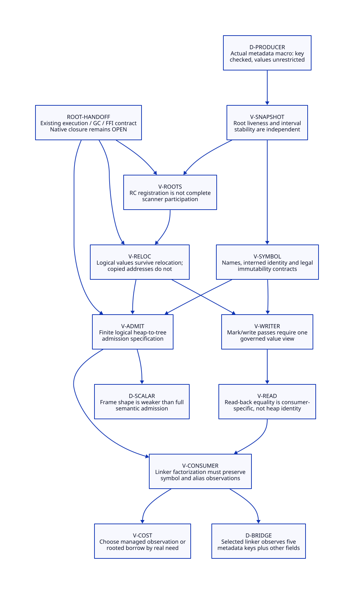

** RESEARCH Script-line capture and complete linker observations
[[file:script-line-reflection-design.org][The script-line study]] adds ten SysML duties with bounded research status,
twelve Lean statements (68 total) and an eighth QNT module (typechecking only).
Named writers, captured aliases and input currentness have separate cuts.
Full outcome/effect reflection is conditional; actual readback and cleanup
refinement remain open. ROOT-HANDOFF is reused; no native tests are claimed.

- [[file:script-line-reflection-map.org][Derived closure and benefit matrix]]
- [[file:diagrams/script-line-reflection.d2][D2 source]] / 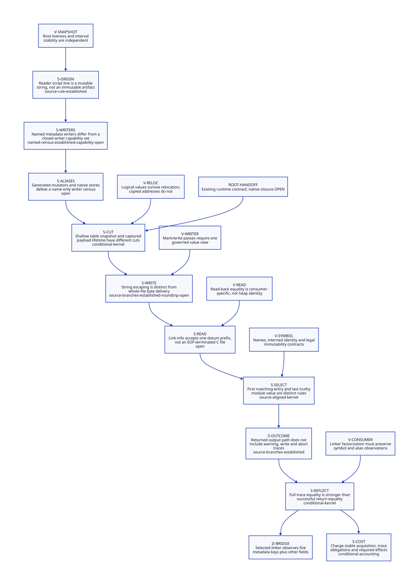

** RESEARCH Stable-view lifecycle and macOS development cost
[[file:stable-view-design.org][Stable-view issuance/revoke/continuation entry]] and
[[file:macos-development-design.org][macOS development architecture]] use separate owned SysML models.
Nine lifecycle transitions reference shared runtime contracts. Thirteen duties
add bounded source/history/refinement and benefit accounting; 82 standalone Lean
statements pass and ten QNT modules typecheck only. Actual issuer/provider/control/
I/O and whole-request native performance remain unqualified. No implementation
or native tests are added.

- [[file:stable-view-map.org][Lifecycle evidence/transition matrix]] / 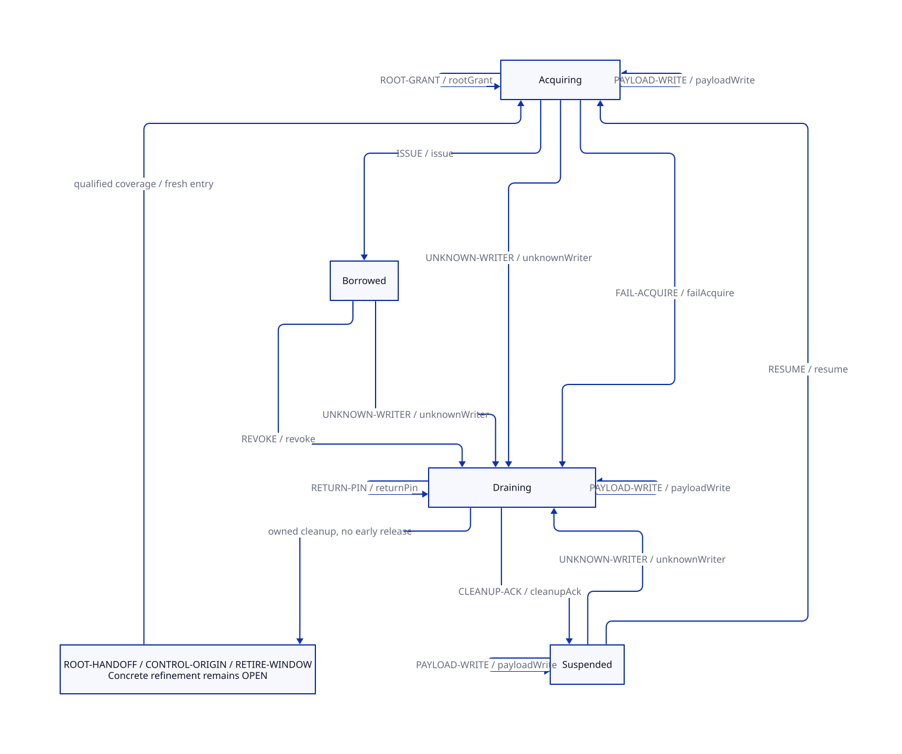
- [[file:macos-development-map.org][Darwin evidence/cost matrix]] / 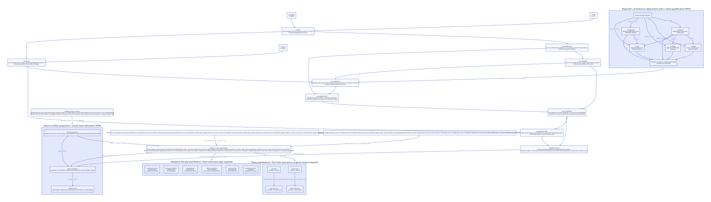

** RESEARCH ModuleSpec and FrameSpec consumer contracts
[[file:native-descriptor-design.org][The modern generated C descriptor design]] connects Scheme semantic generation, native binding, GC and continuation consumers. [[file:native-descriptor-map.org][Source/proof/retirement/benefit matrix]] and 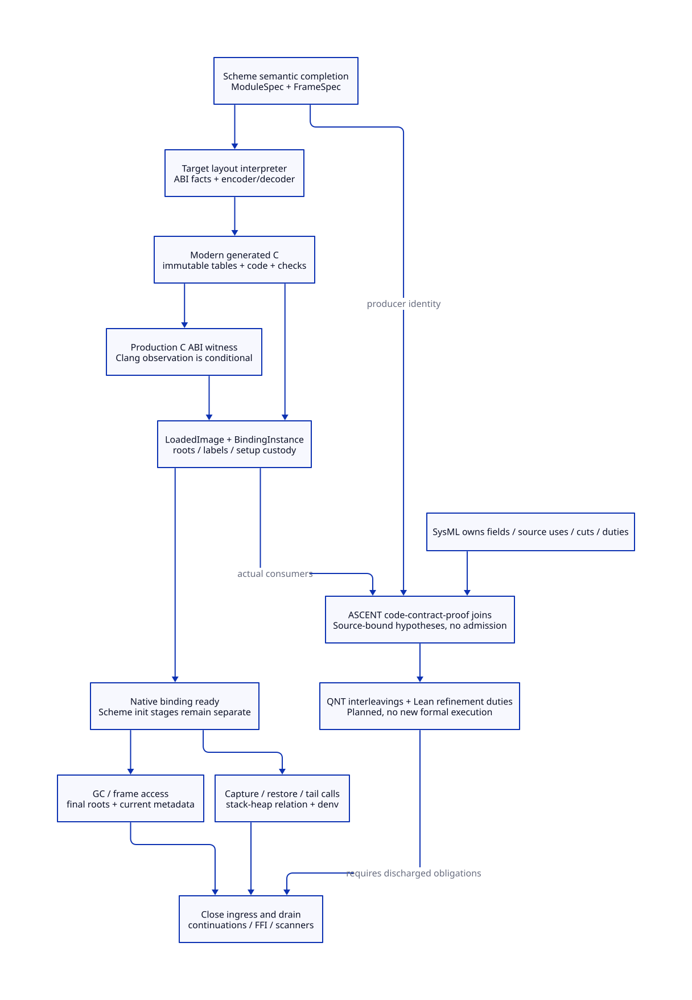 derive from owned SysML; [[file:../../modeling/ascent/native-descriptor.ss][ASCENT]] joins current code to fields, cuts and proof owners. All eight new proof duties remain open; no new formal/native execution.

** RESEARCH Planner, scheduler and publisher assurance
[[file:component-assurance.org][Behavior, scoped QNT/Lean checks and source obligations]] /
[[file:../../modeling/component-assurance.org][cross-component closure matrix]]. Host credits, complete input cuts and
output-group publication are separate contracts with explicit failure custody.
