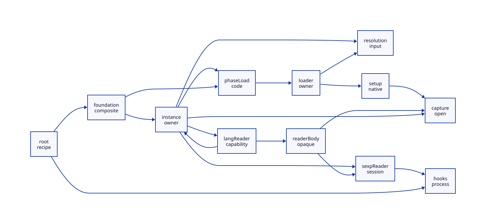

#+TITLE: Foundation, Reader and Native Initialization Closure
#+SETUPFILE: ../../modeling/org/setup.org
#+CATEGORY: toolchain
#+OPTIONS: toc:3 num:t
#+PROPERTY: header-args :eval never

* RESEARCH Closure is an executable-state contract :modern_c:gxi:gxc:
:PROPERTIES:
:CUSTOM_ID: initialization-closure
:AUTHORITY: GerbilInitializationClosure
:STATUS: source-closure-open
:EVIDENCE_CLASS: source-and-conditional-models
:END:

This continues [[file:foundation-binding-design.org][foundation identity reconstruction]], not a new runtime implementation.
Modern C remains the native engineering baseline; Scheme owns expansion,
binding identity, dynamic extent and continuation semantics. No Zig dependency
is needed to express or qualify this contract.

[[file:models/sysml/initialization-closure.sysml][SysML]] owns the twelve-node caller spine, eighteen classified dependencies,
eight qualification gates, five benefit families and IC-H/I/S/E obligations.
The graph is a concrete source spine with explicit open capture/capability
boundaries, not a census of every transitive module or reachable heap object.
The native-derived [[file:initialization-closure-matrix.org][matrix]] and  are projections.

** Source identity and evidence boundaries
:PROPERTIES:
:CUSTOM_ID: initialization-source
:END:
Research checkout =1a2d8612f2065387c62858e10baf63ce369cc48c=;
Gerbil sibling =1cfb032c7a1612637da6205f5f8a15683eba3ba0=;
Chez =41d5ffca7a07cbfc8807e719dedcc70ed74811cd=;
OCaml =46e1c324fb9e9f21f52c9cc3399020f7ef8b9b91=.
The [[file:../../../evidence/research/gerbil-initialization-closure/checks.json][receipt]] binds selected source bytes, native projections and exact model scopes.
Existing generated SSI is inspected as an observation, not regenerated or
qualified as an exact-source producer result. Prior receipts remain unchanged.

* RESEARCH Real initialization and reader spine
:PROPERTIES:
:CUSTOM_ID: initialization-callers
:END:

| Boundary | Real producer/consumer | Consequence |
|---+---+---|
| Root | [[file:../../../../gerbil-gambit-bootstrap-audit/src/gerbil/expander/root.ss::168][root constructor]] creates a mutable table and binds syntax/macros/features; [[file:../../../../gerbil-gambit-bootstrap-audit/src/gerbil/expander/init.ss::8][initialization]] sets context/import/eval/compiler hooks | The root recipe can be shared; live table and hooks are not frozen by construction |
| Foundation phases | [[file:../../../../gerbil-gambit-bootstrap-audit/src/gerbil/base.ss::8][base]] imports core at phases 0, 1 and 2; [[file:../../../../gerbil-gambit-bootstrap-audit/src/gerbil/core.ss::8][core]] adds displaced syntax support; [[file:../../../../gerbil-gambit-bootstrap-audit/src/gerbil/runtime.ss::11][runtime]] imports loader/eval/syntax/init | Traverse actual phase displacement recursively; three initial phases do not establish a global phase bound |
| Instance | [[file:../../../../gerbil-gambit-bootstrap-audit/src/gerbil/expander/module.ss::139][core-import-module]] resolves aliases, reads and expands, installs delayed evaluation, then publishes path/id registry entries | Interface existence, expanded context and successful delayed evaluation are distinct states |
| Evaluation | [[file:../../../../gerbil-gambit-bootstrap-audit/src/gerbil/expander/module.ss::102][core-eval-module]] visits prelude and forces module/prelude promise under its context and phase 0 | Retain instance identity, evaluation status and original dynamic context; delay-atomic is not a proof of arbitrary macro thread safety |
| Resolution | [[file:../../../../gerbil-gambit-bootstrap-audit/src/gerbil/expander/module.ss::358][package ascent]] and [[file:../../../../gerbil-gambit-bootstrap-audit/src/gerbil/expander/module.ss::414][ordered library search]] read package metadata and prefer SSI over source | Search misses and earlier absent candidates matter; digesting the selected file alone is insufficient |
| Ordinary read | [[file:../../../../gerbil-gambit-bootstrap-audit/src/gerbil/expander/module.ss::211][core-read-module]] first tries sexp, falls back to #lang on a parsing exception at position 0; [[file:../../../../gerbil-gambit-bootstrap-audit/src/gerbil/runtime/syntax.ss::255][syntax reader]] uses current readtable and creates located ASTs | Record branch/failure/readtable/locations; ports and read environments are request-owned |
| Language read | [[file:../../../../gerbil-gambit-bootstrap-audit/src/gerbil/expander/module.ss::275][#lang]] imports prelude, selects phase-1 read-module-body export, evals its binding and calls it with reader path/args parameters | This is executable extension code, not just a declared input file |
| Concrete reader | [[file:../../../../gerbil-gambit-bootstrap-audit/src/std/text/parser/ebnf/lang.ss::5][EBNF lang]] imports lang-reader at +1; [[file:../../../../gerbil-gambit-bootstrap-audit/src/std/text/parser/ebnf/lang-reader.ss::5][lang-reader]] imports parser/lexer helpers and reads sections recursively | Imports are known, but helper captures, callbacks, readtable mutation and other effects need recursive admission |
| Phase code | [[file:../../../../gerbil-gambit-bootstrap-audit/src/gerbil/compiler/compile.ss::1258][begin-syntax]] and [[file:../../../../gerbil-gambit-bootstrap-audit/src/gerbil/compiler/compile.ss::1471][define-syntax]] emit phase-block load-module calls; [[file:../../../../gerbil-gambit-bootstrap-audit/src/gerbil/compiler/driver.ss::707][compile-meta-code]] writes SSI and phase artifacts | A phase interface is not a successful phase initialization certificate |
| Real iter observation | [[file:../../../../gerbil-gambit-bootstrap-audit/build/lib/std/iter/macros.ssi::10][macros.ssi]] loads std/iter/macros~1 before binding runtime helpers and transformers | The real macro chain consumes executable phase support, even when its interface already exists |
| Runtime loader | [[file:../../../../gerbil-gambit-bootstrap-audit/src/gerbil/runtime/loader.ss::32][load-module]] publishes loading, unlocks around load, then stores success/error and broadcasts | Retain waiters, failure object and state owner; this loader already avoids repeating completed loads within its registry |
| Native setup | [[file:../../../vendor/gambit/lib/_eval.scm::5447][load-binary]] loads an object, registers descriptors and loads modules; [[file:../../../vendor/gambit/lib/setup.c::2068][os-load-object-file]] invokes setup and marks linkfile version -1; [[file:../../../vendor/gambit/lib/os_dyn.c::255][dlopen path]] resolves linker symbol | OS load, descriptor setup and Scheme initialization have separate effects; their success/failure boundaries cannot be conflated |

The native setup marks the linkfile after setup_modules returns; this alone does
not establish rollback on failure. A loader catch storing =(error exn)= does
not undo native constructors, globals or external I/O. Failed/unknown setup
retains custody and blocks successful-image issuance. Retry/reload policies
must distinguish the existing source behavior from a proposed managed policy.

[[file:../../../../gerbil-gambit-bootstrap-audit/src/gerbil/runtime/init.ss::15][__load-gxi]] changes compiler/expander state, main readtable, standard/console
ports and Gambit hooks. Treat this as process/VM bootstrap ownership, not
per-consumer work and not an immutable library object. Process-specific
addresses and handles are instantiated; immutable recipes and code bytes are
the reusable artifact. Cross-process sharing does not transplant a live heap.

* RESEARCH Deep-freeze issuance and revocation
:PROPERTIES:
:CUSTOM_ID: freeze-receipt
:END:

A =DeepFreezeReceipt= describes an admitted cut and its exclusions, not the
entire foundation by name. Its identity includes selected module origins and
phases, original instance domain, source/reader/code identities, search and
package observations including negative lookups, readtable/hooks configuration,
capability policy and image generation. It records export/reference origins,
owner handles for excluded mutable state, initialization outcome and pin domain.
Receipt existence is a derived fact, never a caller-provided Boolean authority.

All eight native gate records are currently unqualified. Issuance requires:

1. A recursive fixed point of actual executable dependencies and reachable
   captures, including lazy phase transitions, reader callbacks, imports/eval
   and native callbacks. An opaque edge is a retained boundary, not closure.
2. All effect producers mediated, frozen or excluded behind a qualified owner.
   An arbitrary Scheme closure can invoke arbitrary I/O; static imports cannot
   prove the absence of such behavior. Unmanaged code refuses this profile.
3. Stable bytes and environment observations over the complete derivation and
   publication interval. A later resolution change revokes future reuse.
4. Definition/use identity, context aliases and original module-instance scope
   preserved under the [[file:foundation-binding-design.org::#foundation-reconstruction][reconstruction relation]]. File/name equality is insufficient.
5. Success of every required initializer, not just native code availability;
   failed, pending and unknown outcomes cannot issue success.
6. No unowned writer reachable from the shared cut. Redirect lazy phase and mark
   writes to owned overlays; a closure capturing mutable provider state is not
   admitted as a concurrent immutable call merely because its code is constant.
7. Atomic acquire-and-pin versus revoke, plus drain before reclamation. A bare
   pointer load followed later by pin increment has a use-after-free race.
8. A process/VM-specific native policy for global state, initializer order,
   constructors, addresses, handles and callbacks. Code hashes alone do not qualify it.

** Modern C publication obligation
An owner constructs and validates privately, then publishes image+receipt with
release semantics. Acquisition uses an acquire operation and a proven atomic
pin/revoke protocol (for example a lock-protected generation gate), then checks
the same generation under that protocol. Revocation closes new acquisitions;
old pinned consumers finish against their admitted generation. Memory is
reclaimed only after borrowers and in-flight owner calls drain. This is a
design obligation, not a demonstrated lock-free algorithm or existing runtime.

* RESEARCH Stateful instances with parallel consumers
:PROPERTIES:
:CUSTOM_ID: instance-parallelism
:END:

The owner key includes the original session/registry domain, selected origin,
phase and generation. Preserve path/id alias relationships actually established
by the source. Do not merge unrelated instances merely because files match.
Independent historical processes have independent instances; sharing them
would be a semantic change. Conversely, two consumers of one batch instance
must not receive two freshly initialized copies.

Separate consumer-local expansion, immutable definition reads and provider
state access. The first two can overlap after qualification. Mutable provider
access enters one owner and preserves an admitted reference history. If a
transformer captures state, the transformer invocation itself belongs to that
owner; declaring a narrow accessor does not hide the capture.

The finite model fixes the reference provider order 0 then 1. It demonstrates
two active consumers surrounding serialized provider calls, not equivalence
of all possible schedules. Queue order, cross-provider dependencies, exception
identity, dynamic parameters, continuation/escape semantics and reentry must
be refined before a real scheduler may use this split. An owner must execute
Scheme with the appropriate context and roots; an unqualified remote C RPC is
not an equivalent replacement for a direct Scheme call.

| History | Required custody/result | Refusal boundary |
|---+---+---|
| A/B share one provider | One instance, original aliases; admitted call results/history preserved | Per-consumer reset or changed effect order is rejected |
| Ready provider with immutable exports | Independent consumer work may overlap | Shared captures or reflective raw access require owner or refusal |
| Initializer fails or has unknown outcome | Keep failure/unknown owner and partial native resources | Do not publish success or blindly rerun initializer |
| A loads B which refers back to loading A | Resolve a qualified cycle protocol or reject managed admission | Waiting on one's own loading state is not a deadlock solution; current runtime equivalence remains open |
| Owner reenters through callback | Preserve same dynamic extent, roots and ownership stack | Non-reentrant lock, changed continuation behavior or untracked task is rejected |
| A reference ticket is cancelled or fails | Settle its result/order obligation before dependent tickets | The model has no cancellation/liveness proof; skipping a ticket is not admitted |
| Inputs change while B is pinned | Close new pins; retain B's old image and owner until drain | Reclaim before drain or silently rebase B is rejected |

* RESEARCH Learn and reflect on implementation mechanisms
:PROPERTIES:
:CUSTOM_ID: initialization-learning
:END:

[[file:../../../vendor/chez/s/syntax.ss::2478][Chez visit/invoke]] distinguishes library requirements and pending execution;
it motivates separate readiness states, not an assumption of concurrent
transformer safety. [[file:../../../vendor/ocaml/typing/persistent_env.ml::70][OCaml persistent_env]] explicitly owns mutable caches,
import sets and consistency state; it motivates environment ownership and
identity validation rather than freezing the environment record wholesale.
The previous [[file:gerbil-session-closure-design.org][Dune Memo study]] distinguishes memo invalidation and execution dependency;
its retained mutable-main snapshot remains provenance-limited. No Dune code
or OCaml-specific effect semantics are imported into Gambit.

* RESEARCH Actual formal chain and remaining refinement
:PROPERTIES:
:CUSTOM_ID: initialization-formal
:END:

Native SysML evaluation supplies [[file:../../../models/build/initialization_parameters.qnt][QNT parameters]] and the graph/gate facts.
[[file:../../../models/build/initialization_closure.qnt][QNT]] models init/publish/pin, independent consumers, reference-ordered owner
calls, revocation and drain; explicit unsafe actions retain failed issuance,
duplicate/rebased instances, raw mutation, premature reclaim and effect reorder
counterexamples. Its synthetic fully-qualified initializer is a control;
=initActual= remains unable to issue a receipt. The native-derived caller map
also drives reached/expanded discovery, including the reader-to-instance cycle;
omitting the concrete reader body violates closure. Closing this known spine
does not close arbitrary executable/capture edges beyond it.

[[file:../../../models/build/InitializationClosure.lean][Lean]] contains seven conditional kernels for closed-cut path coverage, successful readiness, identity and
history preservation, revoke/drain and positive work threshold. These are
deliberately weaker than a full inductive simulation of QNT or the source.
IC-S requires transition mapping and reflection of observations/errors/effects,
the full source closure, original module aliases and dynamic-context semantics.
IC-E requires the modern-C publication/pin/root and platform-native obligations.

[[file:../../modeling/ascent/initialization-closure.rules.scm][ASCENT DSL]] computes recursive reachability over native edges, surfaces open
nodes, derives per-gate denial and requires every gate for an issuance candidate.
[[file:../../modeling/ascent/initialization-closure.request.scm][The composed request]] includes IC-H/I/S/E and FI-S dependency closure. Formal
receipts alone cannot override source/gate denials. An issuance candidate is
still not execution authority or a production freeze receipt.

* RESEARCH Net benefit and retirement gates
:PROPERTIES:
:CUSTOM_ID: initialization-benefit
:END:

For N consumers, count only baseline repetitions actually present: avoided work
= sum over admitted products of (baseline materializations - retained
materializations) times their work. Net work is avoided work minus closure
validation, identity reconstruction, overlays, owner crossings and pin/drain.
Existing batch module/load caches mean the difference may be zero. Stateful
initialization is necessary work; no saving is credited for deleting it.

Parallel span is bounded below by the longest dependency path, serialized
provider history and total admitted work divided by available execution
capacity. Twelve cores do not remove the first two bounds. This study measures
neither macOS attribution nor wall time; it provides no acceleration percentage.

Retire duplicate construction only after exact product equivalence is proved.
Retire coarse waits only after every consumer is routed by immutable/owner
access. Retire mutable shared lookup caches only after all writers are replaced.
Retire global bootstrap repetition only within its original process/VM scope.
Retain legacy execution for unqualified capabilities; do not falsely issue a
reuse receipt for it. Full foundation closure and runtime admission remain open.
