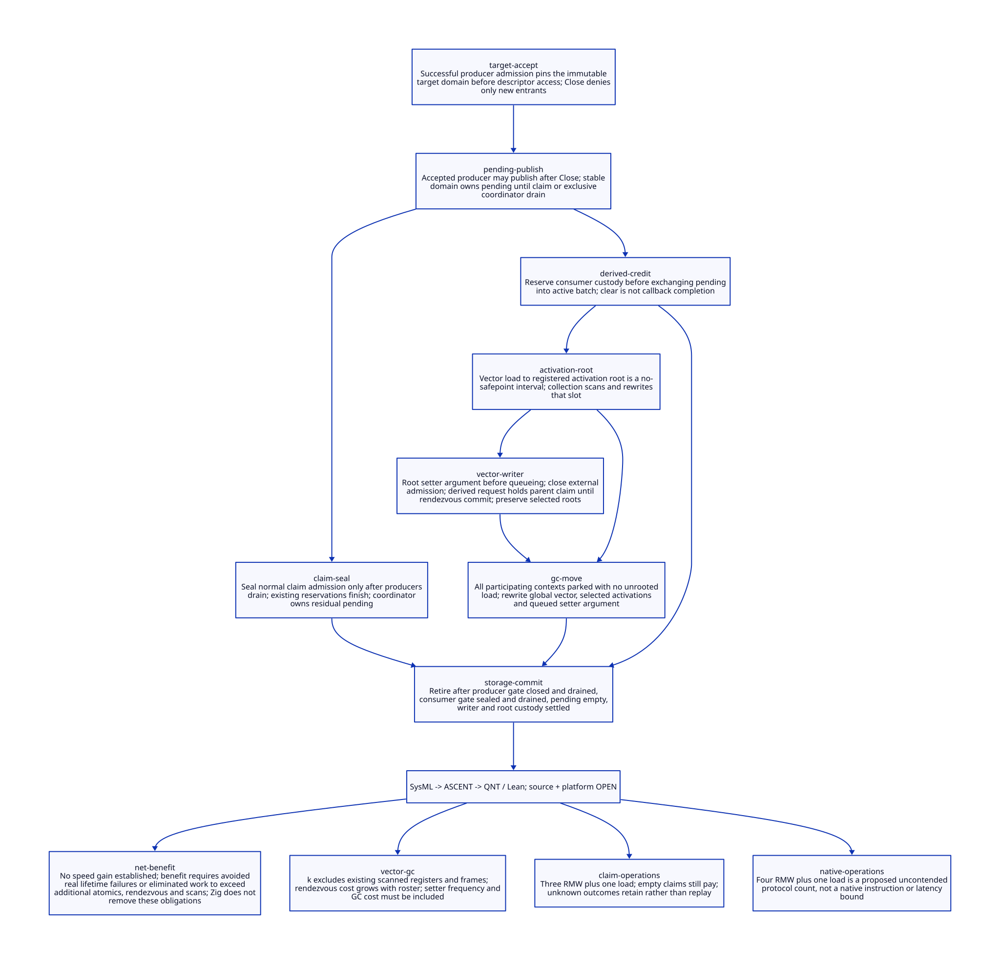

#+TITLE: Modern C Interrupt Custody from Target Acceptance to Rooted Claim
#+SETUPFILE: ../../modeling/org/setup.org
#+PROPERTY: header-args :eval never
#+OPTIONS: toc:3 num:nil

* RESEARCH Decision and authority
:PROPERTIES:
:CUSTOM_ID: interrupt-custody-handoff
:STATUS: conditional-models-source-open
:CANONICAL_MODEL: models/sysml/interrupt-custody-handoff.sysml
:END:

Modern C remains the required runtime direction. This study splits the atomic
publish/claim specification of [[file:sigint-delivery-semantics-design.org][SIGINT delivery semantics]] into ingress custody,
domain-owned pending, reserved claims and scanned Scheme activations. It adds
separate producer and normal-claimer admission domains and an exclusive final
drainer. These are proposed runtime contracts, not existing Gambit facilities.
A stable native shell and immutable generation descriptor outlive the target.

SysML owns eight contracts, ten dependencies, seven open gates and four benefit
rows. Its guardName fields are queried by native sysml alongside source/action/lemma
bindings. Python projects Org/D2 and checks actual QNT guard text. ASCENT consumes
those facts and rejects missing/wrong guards as well as missing bindings or receipts.
This is stronger association checking, not a source simulation or theorem checker.
Actual QNT and Lean remain separate evidence subjects with exact hashes and scopes.
No runtime/compiler implementation, native test, runtime build or benchmark occurs.

* RESEARCH Source constraints and actual writers
:PROPERTIES:
:CUSTOM_ID: interrupt-custody-handoff-source
:END:

Paths are relative to vendor/gambit. Exact inputs and the frozen parent are bound
in [[file:../../../evidence/research/interrupt-custody-handoff/input.json][the input receipt]]. The census records syntactic witnesses; aliases, eval and
embedding extensions remain explicit admission gaps.

| Producer / consumer | Source | Established behavior | Consequence |
|-
| SIGINT target | lib/os_tty.c:8700–8714; lib/os_setup.c:3044–3049 | Callback calls user_intr, which selects vmstate0 processor0 | Target selection is at callback, not kernel origin or deferred drain |
| Native publish | lib/setup.c:66–92 | Assigns intr_flag before stack trip, barrier and select abort | Wake is not custody; the old fence does not define an atomic pending/claim protocol |
| Native claim | lib/setup.c:206–242 | Clear chosen flag before returning interrupt code | A later publication is another claim epoch even before callback completion |
| Scheme fetch / setter | lib/_kernel.scm:1448–1476 | vector-ref after claim; setter is vector-set! under local interrupts-disabled declaration | No cross-processor exclusion follows from that declaration |
| Generated fetch | lib/_kernel.c:12421–12449 | Service result in R1; VECTORREF result in R1; then stack-tripped branch and generic jump | Real register root route exists; exact spill/PointId/configuration proof remains open |
| Generated setter | lib/_kernel.c:12473–12483; include/gambit.h.in:4231,5482 | VECTORSET expands to ordinary indexed word assignment | Atomic pointer replacement alone is insufficient for movable objects |
| GC global roots | lib/mem.c:6591–6645; include/gambit.h.in:6758–6762 | Globals partitioned across processors; VM glos used in multi-VM mode | Root authority belongs to the correct VM and actual participant set |
| GC activation roots | lib/mem.c:6511–6537,6852–6862 | Strong phase marks continuation, register array, saved array and processor objects | Selected handler must remain in these scanned paths or a new registered equivalent |
| Moving references | lib/mem.c:3513–3652 | mark_array reads cells and writes forwarded/copied object references back | Registering an address is not enough if native code continues using an old unrewritten temporary |
| Sync-op | lib/setup.c:1049–1113 | Barrier, synchronous flag reset, combined operation and later error throw | Useful participation mechanism; not an existing vector-mutation operation or proof of precedence |
| Cleanup | lib/setup.c:4834–4878 | Disables interrupt handling before processor/VM cleanup | A new close/drain state machine must integrate with this order and retain serviceable old roster |

** Bounded writer inventory

| Actual writer | Entry / source | Scope distinction |
|-
| Generic primitive | _kernel.scm:1473–1476 | Can receive arbitrary code and handler; direct internal callers are not the whole alias closure |
| GC setter wrapper | _kernel.scm:2158–2162 | Entry 4; initialization plus exported internal wrapper |
| Terminate setter wrapper | _kernel.scm:4743–4747 | Entry 1; initialization plus wrapper |
| SMP thread setup | _thread.scm:3232–3235 | Entries 2,3,4,5; startup is not evidence all later writers are startup-only |
| Non-SMP branch | _thread.scm:6939,8846–8848 | Separate configuration; not silently included in SMP qualification |
| Real custom handler | examples/misc/signals.scm:15–45 | C SIGUSR1 raises INTR_USER through broadcast raise_interrupt, while Scheme replaces entry 3; different target policy from user_intr |
| Runtime custom/restore | tests/mix.scm:1940–1959 | Replaces heartbeat vector with an effectful wrapper and restores it after work |

The same interrupt code can have different native origins and routing. A generated
reason profile must carry producer policy; this SIGINT study must not relabel the
SIGUSR1 broadcast example as vm0-only. All Scheme aliases, direct vector aliases,
foreign writes and generated/universal backends require source-specific admission.
The checked-in _kernel.c is a real generated consumer witness, not a newly rebuilt
or configuration-matched Darwin artifact. Its root behavior is not native acceptance.

* RESEARCH Custody state machine and close races
:PROPERTIES:
:CUSTOM_ID: interrupt-custody-handoff-custody
:END:

The target domain owns one native pending bit for this reason and stable storage
for its whole lifetime. No Scheme value is carried in that bit. Accepted ingress
pins protect target descriptor access; they are temporary and distinct from pending
and activation ownership. Every accepted obligation must be covered by an ingress
owner, pending state, an active/deferred claim or a settled completion.

| Step | Preconditions and cut | Owner after step |
|-
| Accept | One successful coherent gate admission before descriptor access | Producer ingress pin on original target generation |
| CloseProducer | Atomic open-to-closed transition | Reject new entrants; already admitted producers retain authority |
| PublishPending | Accepted producer still pinned; domain storage valid | Pending owns coalesced obligation; producer remains pinned through final access |
| LeaveProducer | Publication known committed, last descriptor/wake access complete | Domain pending or claimant; no leaked lease per coalesced publication |
| ReserveClaim | Consumer gate admits before any pending clear | Consumer reservation protects target even if exchange later finds empty |
| Claim | Atomic pending exchange while reservation held | Original batch moves to claimant; later publications stay separately pending |
| LoadAndRoot | Load selected vector into generated activation slot without intervening safepoint | Scanned activation root plus original target custody |
| Settle | User effect and root/continuation obligations known settled | Completion receipt; release claim ownership last |

A producer admitted before Close is allowed to publish after Close. Checking the
open bit again and discarding that producer loses accepted work. Conversely, a
failed admission may not access the target even if a later gate load looks open.
The source acceptance-cut equivalence and gate packing remain inherited obligations.

No per-raise pending lease is allocated: domain lifetime covers the pending slot;
retirement is prohibited while that slot or any accepted ingress/claim is live.
The ghost event sets in QNT audit coverage only; they are not proposed signal counts
or a native queue. Native signal coalescing before callback entry is outside this ledger.

** Closing both admission domains

1. Close producer admission and keep the old VM/roster available.
2. Wait for pre-close producer pins to drain; waits remain GC/sync-op participating.
3. Seal normal claim admission. A reservation made before seal remains authoritative,
   including an exchange not yet performed. Do not infer drain from pending=false.
4. Drain those existing claimers. Then an exclusive coordinator assumes responsibility
   for any residual pending bit. It uses the same target, root and settlement rules.
5. Final retirement requires no producers, claim reservations, pending, deferred or
   unknown claims, writer requests, root/continuation leases or inherited native work.

The coordinator is proposed exclusive authority, not a third real Gambit processor.
The QNT three-slot representation names two normal claimers and this takeover role.
The consumer-gate seal followed by drain makes final pending inspection stable after
producer drain; a collection of unrelated SC loads without these cuts would not.
No automatic reopen/rebind is needed. Failed or unknown drain keeps old storage and
old participants alive; it does not manufacture a successful VM deletion receipt.

** Failure after claim must not cross the claim boundary

A failed pre-fetch step retains its original ClaimReceipt and batch in a deferred
claim holder. Resume continues that claim. OR-ing it back into general pending can
merge it with a later publication and collapse two required deliveries. This remains
wrong even when no Scheme handler effect has yet run. The model explicitly forbids
claimed event identities from returning to pending and retains that counterexample.

After effects may have occurred, unknown result retains original target, activation
roots and transaction identity. Query/reconcile may settle that transaction; it cannot
blindly re-execute the handler. Exceptional Scheme unwinding, continuation re-entry
and persistent captures must be refined independently. Model complete means receipt
settlement, not an implementation of arbitrary handler effects or proof that C return
is enough. No finite timeout can turn these unresolved obligations into completion.

* RESEARCH Cross-processor vector mutation and GC roots
:PROPERTIES:
:CUSTOM_ID: interrupt-custody-handoff-vector
:END:

The proposed initial profile uses a VM-wide mutation rendezvous rather than raw
atomic SCMOBJ fields. This deliberately favors a precise correctness base over
assuming cross-processor vector writes are harmless. It reuses GC/sync-op participation
concepts; adding a vector command, its priority and its rooted request representation
still requires runtime refactoring. It is not an existing sync-op supported today.

| Stage | Required root and exclusion rule |
|-
| Request | Candidate handler must be in a scanned requester/registered request slot before queue publication or a waiting safepoint |
| Park | All actual VM processors participate; requester does not hold a mutator exclusion token while waiting for them |
| Commit | GC relocation excluded; no outstanding unrooted fetch interval; vector store occurs once using rewritten rooted argument |
| Return | Synchronous setter observes committed result; lost response queries same request instead of repeating mutation |
| Concurrent selection | Fetch before commit keeps selected old handler; fetch after commit gets new handler; both activations remain independently rooted |
| Collection | Scan global vector, selected activation slots, queued setter arguments, saved values, frames and dynamic environments; rewrite references before resuming |

Interrupt-disabled is not a cross-processor mutex. A pointer-sized atomic slot
would address neither object relocation nor a missing queued-argument root. An old
handler can disappear from the vector after replacement while still being selected
or captured by a continuation. It must remain live through the activation/frame
roots. After GC, code must reload the updated root slot, not a stale native copy.

LoadVector to RootCapture is a bounded no-safepoint mutator interval: no allocation,
blocking wait, foreign call, hidden checkpoint or collector rendezvous inside it.
A stop request waits for this interval to publish its scanned slot; the processor
must not announce itself parked first. This is a design obligation for the Scheme
semantic-completion/FrameSpec/PointId generator and modern C consumer together.
The existing R1 path is evidence for reuse, not proof of every generated restore edge.

Nested setters or callbacks cannot wait for a rendezvous while holding an admission
resource the coordinator needs. Requests must be rooted before a participating park,
and no VM teardown wait may block the very roster required to scan those roots.
New external setter requests require lifecycle admission before Close. Already
accepted setter requests may commit afterwards. A setter derived from an accepted
callback after Close carries that parent claim identity: its rooted request must
settle before the synchronous parent completes. It must not reopen external
admission. QNT models this parent dependency; the normal-thread registry admission
and actual C instruction split still need refinement. A nested request with no available rooted slot must stay in an explicit owned failure
or deferred state; no unregistered native temporary may escape. Queue capacity,
request identity, synchronous exceptions and continuation replay are open gates.

* RESEARCH C memory order and source refinement
:PROPERTIES:
:CUSTOM_ID: interrupt-custody-handoff-memory
:END:

| Native object / operation | Initial order | Refinement required |
|-
| Coherent producer gate | SC load, bounded strong CAS, exit decrement | Initialize immutable target record before open; failed CAS grants no authority; count/generation cannot wrap |
| Target pending | SC fetch-or and SC exchange | Publish before ingress release; reserve before exchange; preserve claim cut and reason identity |
| Stable wake mailbox | SC OR and exchange | Wake after pending; exchange does not clear target work; recheck before sleep and keep native fallback |
| Consumer gate | SC reserve/seal/release | Seal only after producer drain; reservation cannot be invisible to retirement |
| Vector / Scheme roots | Owner or rendezvous-confined ordinary stores | No concurrent read/write or GC relocation; request and activation slots included in actual collector root domain |
| Queue / rendezvous records | Release publication, acquire consumption as a future weakening target; SC control initially | Synchronizes-with must read the matching publication; queued argument remains scanned while waiting |

SC provides a total order on admitted atomic operations, not one transaction across
all objects and not protection for racing ordinary vector or root accesses. Gate
drain must synchronize with all accepted producers; a last decrement is not a proof
that another producer's publication became visible without a valid whole-gate order.
Final empty inspection is authorized only after both admission domains are closed
and drained, with exclusive coordinator authority over the residual slot.

[[https://gcc.gnu.org/onlinedocs/gcc/_005f_005fatomic-Builtins.html][GCC's atomic builtins documentation]] explains memory-order options and possible
external fallback when lock-free lowering is unavailable. It is toolchain evidence,
not signal-safety qualification of a particular instruction sequence. The proposed
modern C abstraction must reject signal-path profiles that require hidden locking.
The runtime language remains C; use of compiler concurrency documentation does not
introduce a C++ runtime dependency.

[[https://www.cl.cam.ac.uk/~pes20/cpp/popl085ap-sewell.pdf][Batty et al., Mathematizing C++ Concurrency, POPL 2011]] separates source-language
memory semantics from hardware execution and demonstrates why rigorous refinement
matters. We apply that methodological lesson: an SC QNT transition graph is not a
compiler/hardware weak-memory proof. No claim is made that the paper establishes
this proposed C protocol, current Gambit race freedom or Darwin signal correctness.

* RESEARCH Actual formal chain and limits
:PROPERTIES:
:CUSTOM_ID: interrupt-custody-handoff-models
:END:

[[file:models/sysml/interrupt-custody-handoff.sysml][Native SysML]] owns the source anchors, action/lemma/guard tuples, dependencies,
open gates and benefit rows. [[file:../../modeling/ascent/interrupt-custody-handoff.rules.scm][The ASCENT DSL]] joins exact guard receipts in addition
to subject path/hash/scope and component bindings. Guard text is verified within
its actual QNT action pre-update region. Removing or changing a guard receipt blocks
candidacy. This is syntactic contract alignment, not a proof that a lemma entails
that guard or that the source implements the action.

[[file:../../../models/build/interrupt_custody_handoff.qnt][QNT]] splits producer acceptance, publication, exit, consumer reservation,
exchange, raw load, rooted capture, closure and coordinator takeover. It includes
two publishers, two normal claimers, a coordinator role, coalesced ghost identities,
two object identities, a bounded setter count, parent-derived requests after close and repeated abstract GC relocation.
The noTemp guard prevents parking/GC in an unrooted load interval; queued setter
arguments and selected roots are relocated together. Unknown and pre-fetch-failed
claims keep distinct custody. Safety checks do not establish eventual progress.

Its close/wake/root model is a new refinement candidate, not a native signal
scheduler. It does not model machine instructions, signal reentrancy, OS joins,
full root graphs, arbitrary custom handler effects, denv or continuation operational
semantics. Counterexamples mutate the specific missing transition/ownership edge;
they are proposed protocol faults, not demonstrated native bugs. The failed initial
model typecheck and all later command failures are retained in the task cache.

[[file:../../../models/build/InterruptCustodyHandoff.lean][Lean]] proves custody coverage step/history preservation for abstract accept,
publish, claim and settlement. Separate subset lemmas identify what is additionally
needed to prohibit forged claim/completion work; coverage alone is insufficient.
Root relocation, registration, stale-reference counterexamples, derived-setter parent
completion guards, producer/consumer
retirement blockers and the algebraic net-benefit condition are also formalized.
These mathematical results require their stated premises. They do not prove the
whole QNT invariant, C memory order, source simulation or eventual shutdown.

| Obligation | Local closure | Remaining source refinement |
|-
| Accepted work always has custody | QNT invariant; Lean coverage induction | Pin/slot/activation instruction cuts and exception exits |
| Claimed batch cannot return to pending | QNT claimed/pending disjointness and negative control | Every retry, cancellation and unknown-result implementation path |
| Reserve precedes clear | QNT claim guard and source/guard association | Consumer gate ABI and actual active/root slot publication |
| Vector replacement preserves selected root | QNT moving-GC history; Lean identity and relocation lemmas | Actual PointId, registers, spill, continuation and all writers |
| Stable final empty decision | Both gates drained plus exclusive model drainer | Real roster, GC participation and inherited native cleanup |
| Current system admission | Intentionally open | Source/platform needs and inherited host attestation unresolved |

* RESEARCH Benefit, added cost and retirement conditions
:PROPERTIES:
:CUSTOM_ID: interrupt-custody-handoff-benefit
:END:

[[file:interrupt-custody-handoff-matrix.org][The projected matrix]] is authoritative for the four quantitative rows and seven
gates. Uncontended operation counts are a protocol budget, not instruction counts:
one native acceptance uses one gate snapshot plus four RMWs (admit, pending, wake,
leave); one normal claim attempt uses one snapshot plus three RMWs (reserve, exchange,
release), in addition to scanned-root stores and actual wake transport. Failed CAS,
empty claims, drain loads, masking and notification fallback add work. Coordinator
claims have a different exclusive path and must not be charged as zero-cost.

For n accepted callbacks, b normal claim attempts, w wake exchanges, r committed
setter operations and k activation plus q queued-argument roots, the added work
budget includes 4n+3b+w RMWs, n+b snapshot loads, two gate closures, drain work,
r VM-wide rendezvous operations and O(k+q) slot visits per modeled GC. Here k counts newly materialized activation
slots beyond existing register/frame scanning; reusing an existing scanned R1 is
not charged as an extra root. q counts extra queued setter-argument slots.
These are candidate costs relative to their own defined operations; the current
flag path must be measured and subtracted, not counted as if it had no work.
There is no extra handler-count reduction versus the existing bit under equal
claim boundaries. The scheme avoids a per-signal heap allocation and a per-raise
pending lease, but current flags already avoid per-signal allocation too.

The net-value claim is conditional: real eliminated repeated work or lifecycle
failure cost must outweigh additional admission, claim, rendezvous and scan costs.
No measured latency, macOS build acceleration or positive throughput inequality is
established. Modern C can reuse collector/root/generator machinery; Zig cannot
remove these semantic obligations and has no incremental net benefit established.

| Legacy path | Proposed replacement | Retirement prerequisite |
|-
| Unleased user_intr target dereference | Coherent producer admission on immutable target domain | Acceptance-cut simulation, all native origins and exported aliases covered |
| Ordinary intr_flag publication/clear | Domain-owned atomic pending and reserved claim | Priority/mask behavior, memory order, closure and wake proof |
| Direct cross-processor VECTORSET | Rooted synchronous setter request and mutation rendezvous | Every alias/writer, nested completion and exception semantics covered |
| Implicit selected-handler lifetime | Generated scanned activation/FrameSpec/PointId contract | Register, saved, frame, continuation and GC relocation correspondence |
| Cleanup after handler count alone | Dual-domain closure and exclusive final drain | All active/deferred/unknown/root/native receipts settled on old roster |

* RESEARCH Receipts
:PROPERTIES:
:CUSTOM_ID: interrupt-custody-handoff-receipts
:END:

[[file:../../../evidence/research/interrupt-custody-handoff/checks.json][Checks]], [[file:../../../evidence/research/interrupt-custody-handoff/ascent-model-results.json][ASCENT scenarios]],
[[file:../../../evidence/research/interrupt-custody-handoff/prior-model-alignment.json][prior subjects]], [[file:diagrams/interrupt-custody-handoff.d2][D2 source]] and .
Raw logs stay in [[file:../../../evidence/research/retained/interrupt-custody-handoff/receipt.json][the retained observation inventory]]. Source and platform needs
remain open even when model and projection checks pass. Prior subjects are frozen
hash-bound dependencies, not a composed proof. Inherited host registration remains
unresolved and was not retried. Only synthetic ASCENT controls may reach candidate;
no local model result is registered as runtime admission.
