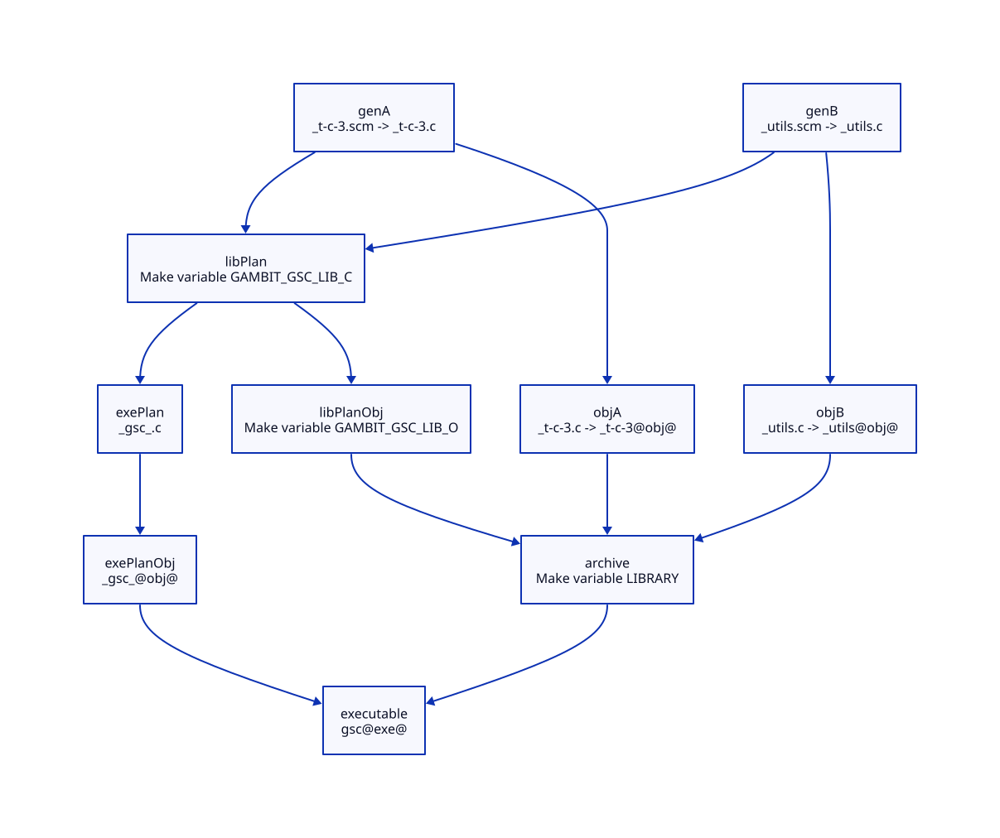

#+TITLE: macOS Development Cost as a Modern Generated C Architecture Contract
#+SETUPFILE: ../../modeling/org/setup.org
#+CATEGORY: toolchain
#+OPTIONS: toc:3 num:t
#+PROPERTY: header-args :eval never

* RESEARCH Remove repeated work across the complete developer request
:PROPERTIES:
:ID: 65da2a7e-c4bb-4f3f-824f-24ba0ae1a57e
:CUSTOM_ID: macos-development-design
:OWNER: Gambit toolchain architecture
:AUTHORITY: GambitDarwinDevelopment; GambitAssuranceRelations
:STATUS: historical-evidence-and-conditional-architecture
:EVIDENCE_CLASS: historical-source-bound-and-theoretical
:DEPENDS_ON: BF-BUILD-CUT; BF-BUILD-BUDGET
:END:

macOS build/development cost is a required modernization objective alongside
runtime correctness. A modern generated C design must reduce repeated generation,
front-end work, request preparation and serialization. Merely changing language,
adding a coordinator or introducing another cache layer supplies no such gain.
Scheme semantic ownership and C interoperability remain core constraints.

[[file:models/sysml/macos-development.sysml][Owned SysML]] defines five duties and separate development acceptance.
[[file:macos-development-map.org][The evidence/cost matrix]] and [[file:diagrams/macos-development.svg][D2 architecture dependencies]] derive from it.
Existing [[file:source-chain-map.org][GSC source/action inventory]], , [[file:correctness-map.org][build correctness matrix]]
and [[file:stable-view-design.org][stable-view lifecycle]] are reused. This is not a replacement build system,
a second dynamic-dependency graph or a qualified toolchain configuration.

* RESEARCH Historical evidence must keep its exact scope
:PROPERTIES:
:CUSTOM_ID: macos-development-historical-evidence
:END:

The following reports are in the outer gerbil-bazel workspace. Their current
file hashes and outer repository head are bound in [[file:../../../evidence/research/script-view-lifecycle-darwin/checks.json][this research receipt]].
They describe historical profiles and selected experiments, not a new run on the
current Gambit checkout. No retained private binary is assumed reconstructible
from Git alone.

#+NAME: macos-development-historical-matrix
| Evidence | Actual retained finding | Boundary / negative evidence |
|---+---+---|
| [[file:../../../../../patches/gerbil-v19-darwin/receipts/d802-darwin-gcc-frontend.json][Darwin GCC frontend]] and [[file:../../../../../patches/gerbil-v19-darwin/0004-gambit-darwin-gcc-macro-expansion.patch][capability patch]] | One real 11 MiB generated C / 97 MiB preprocessed object: 15.45 -> 10.37 s; GCC allocation 8915 -> 97 MiB; identical object SHA | GNU GCC/Darwin profile; diagnostic macro provenance changes; not a whole-build speedup |
| [[file:../../../../../patches/gerbil-v19-darwin/receipts/d861-gambit-header-pch-rejection.md][PCH rejection]] | PCH built but was rejected because per-module ___GLOCOUNT was defined | Rejected-PCH timings are not valid A/B; invariant/per-module header separation needs architecture work |
| [[file:../../../../../patches/gerbil-v19-darwin/receipts/d1510-interface-reader-budget.md][Reached interface reader]] | Four standard-library roots, 271 reached reads; reader own wall 0.024055 / 0.022395 / 0.059050 / 0.040119 s | Does not support a several-fold startup win from replacing the reader; JSON allocation accounting unqualified |
| [[file:../../../../../patches/gerbil-v19-darwin/receipts/d1510-interface-architecture-transfer.md][Interface architecture transfer]] | Native phase providers already coexist with interface reconstruction of fresh contexts, bindings and syntax | Compiled construction programs are a hypothesis; do not reuse another process's initialized lexical/context state |
| [[file:../../../../../patches/gerbil-v19-darwin/receipts/d1510-startup-process-resource-boundary.md][Startup resource boundary]] | Root execution can become nearly idle while the actual build child continues | Whole silent interval is not established root Scheme expansion; deadline observations are not measured first-log times |
| [[file:../../../../../patches/gerbil-v19-darwin/receipts/d1510-member-tool-snapshot.md][Member tool snapshot]] | 55-member one-change component: 3.671269 -> 0.189643 s with C/link parity; stable HIT 0.073285 -> 0.174391 s | One matched component sample; cold essentially unchanged; compiled mutation injections and whole-consumer admission incomplete |
| [[file:../../../../../patches/gerbil-v19-darwin/receipts/d1510-object-request-cost.md][Configured request regression]] | All-hit ABBA waves 0.83 / 1.52 / 1.66 / 0.93 s; pair means 0.88 vs 1.59 s | Existing scheduler already submits object jobs; unchanged preparation-plus-coordinator route is DENIED |
| [[file:../../../../../patches/gerbil-v19-darwin/README.md][Patch overview]] and [[file:../../../../../patches/gerbil-v19-darwin/receipts/d1510-reader-whitespace-47-baseline.json][frozen whitespace record]] | Multiple historical frozen profiles carry distinct first-output/build/test gates and outcomes | A 5-second first-output ceiling is not evidence of a mandatory five-second cooldown; later strict DENYs remain |

[[https://gcc.gnu.org/onlinedocs/gcc/Preprocessor-Options.html][GCC's preprocessor documentation]] says -ftrack-macro-expansion tracks token
locations for macro diagnostics and consumes additional memory; zero disables
that tracking. It does not remove C macro semantics or Scheme macro expansion.
[[https://gcc.gnu.org/onlinedocs/gcc/Precompiled-Headers.html][GCC's PCH documentation]] constrains reuse by the compilation and macro state.
These mechanisms help interpret the retained reports; they do not qualify this
checkout or support an automatic PCH/LLVM/Zig performance claim.

* RESEARCH Structural modern C changes and their retirement conditions
:PROPERTIES:
:CUSTOM_ID: macos-modern-c-structural-plan
:END:

#+NAME: macos-modern-c-replacement-matrix
| Boundary | Structural design to research | Work actually targeted | Added cost / retirement condition |
|---+---+---+---|
| Scheme interface preparation | AOT reusable construction program; instantiate fresh context/lexical bindings under current phase/dependencies | Repeated generic preparation/expansion that is genuinely invariant | Preserve phase cycles, delayed evaluation, identity, mutation, exceptions and roots; live instantiation remains necessary |
| GVM -> generated C | Scheme semantic completion emits explicit module/frame/root descriptors and governed native operations | Repeated macro expansion and redundant generation at stable backend roles | Preserve object, tail-call, continuation, GC and module ABI; old macro role retires only after all emitters/callers migrate |
| C runtime header | Separate invariant ABI declarations/helpers from per-module counts/layout data | Per-translation-unit repeated invariant parsing and diagnostic metadata | Helper calls/inlining/relocations and diagnostics must be charged; direct PCH of the old macro header is not the plan |
| Literal/data lowering | Separate stable bulk data and compact generated descriptors from executable macro expressions | Repeated tokenization/constant construction where existing evidence identifies it | Alignment, relocation, string representation, object identity and runtime parity; retain historical rejected variants |
| Link metadata | One semantic producer of a complete typed observation, optionally a governed sidecar | Re-reading huge generated C solely for link metadata and rebuilding identical link plans | Old embedded record remains until every consumer and failure mode has an equivalent replacement; no compulsory duplicate serialization |
| Native request preparation | One scoped tool/config/input snapshot with complete before/after validity and exact argv/env/cwd | Duplicate shell substitutions, full tool hashing and repeated preparation within the same request | Do not wrap the existing preparer in another preparer; preserve source/options/tools, mutation rejection and resource delivery |
| Incremental population | Phase/member products with real transitive read closure and current input/output credentials | Rebuilding untouched members or unnecessarily invalidating complete directories | Leaf, macro/provider, tool and configuration deltas have different closure; unchanged work and validation must also shrink |
| Parallel execution | Bounded CPU AND memory, independent producer contexts/processes, ordered link barrier | Serial ready work where it is actually serial today | Existing executor already overlaps/submits some jobs; no duplicate scheduler; shared-VM SMP remains separately qualified |
| Cleanup and publication | Acquisition-owned failure/cancel/drain and complete output-group delivery | Duplicate ownership bookkeeping and repeated preparation after avoidable partial failures | Preserve required warnings/I/O/finalizers and old failure receipts; no force exit or timeout relaxation |

** RESEARCH Replace source responsibilities, not configuration profiles
:PROPERTIES:
:CUSTOM_ID: macos-c-responsibility-retirement
:END:

The canonical SysML now names five required replacement roles; the generated
[[file:macos-development-map.org][responsibility/retirement matrix]] binds every role to current source ranges,
Scheme ownership, native contracts, dependencies and acceptance conditions.
None is a toolchain flag profile. They extend the existing
[[file:../../../vendor/gambit/gsc/_back.scm][target begin/end/dump/link boundary]] (lines 199-213), while requiring explicit
producer/consumer changes inside that boundary.

The concrete module problem is at _t-c-1.scm:1189-1205: GSC writes SYMCOUNT,
GLOCOUNT, LBLCOUNT and other per-module definitions before including gambit.h.
The header uses GLOCOUNT for table construction at gambit.h.in:9328-9355 and
LBLCOUNT for host/layout policy at 1244-1265. A different compiler flag cannot
separate these responsibilities. C-MODULE must move module-specific data into
an explicit plan, with one native representation owner and a stable invariant
runtime interface. A descriptor must not become an extra copy of the old macros.

Likewise _t-c-1.scm:1938-1970 writes frame kind, size, link and GC map as
DEF_LBL_RET plus IFD/OFD expressions; gambit.h.in:9294-9324 decodes them.
C-FRAME keeps liveness and continuation meaning in Scheme, but makes the native
encoding, runtime decoding and their agreement an explicit contract. Changing
the emitter alone cannot retire the old ABI. GC, continuation capture/restore
and stack consumers must migrate together; tail-call behavior remains a gate.

C-LITERAL isolates semantic constant graphs from target data representation.
C-EMISSION gives every request an owned emitter state instead of relying on
ambient targ-port/source-position globals and the normal close path.
C-LINK separates semantic link observations from compulsory embedded text
transport. The observed reader only reads the header record; no whole-C-file
scan is presumed. All three require actual identity, cleanup, control and
consumer refinement, beyond the bounded stable-view ledger.

C-MODULE precedes native layout acceptance for C-FRAME and C-LITERAL;
C-EMISSION and C-MODULE precede complete C-LINK publication. A dependency arrow
means an acceptance dependency, not a claim that current code is broken or
that every port must become C-owned. Scheme still chooses semantic values,
conditions, diagnostics and observable effects. A future LLVM/MLIR encoder
must consume these same completed contracts; it must not rediscover semantics
from C macro text. Zig, if later justified, replaces an accepted native role
rather than requiring Scheme to maintain duplicate semantic implementations.

The retirement law requires producer coverage, consumer coverage, runtime
semantics, failure/control parity and one representation owner. Its SysML
constraint is an unsatisfied requirement; it is not an executed ABI proof.
No old source responsibility has retired in this design-only study.

Modern C means generated typed contracts and explicit lifecycle/ABI boundaries,
not replacing every macro with a function or inlining every helper. Moving work
into a runtime library can reduce compile work while adding calls or relocations;
that trade must be explicit. Diagnostics need a deliberate source/PointId mapping
and error-reporting policy, including the existing macro-provenance precision
choice. Correct runtime behavior does not alone establish usable diagnostics.

AOT preparation and fresh instantiation are also distinct. The interface transfer
record already identifies language work remaining after native provider reuse.
That distinction belongs to Scheme/Gerbil semantics; the modern C layer can carry
artifacts and lifetime/configuration contracts without attempting to cache live
contexts across processes. Zig would need exactly the same semantic boundary.

* RESEARCH Invalidation, latency and resource accounting
:PROPERTIES:
:CUSTOM_ID: macos-development-accounting
:END:

For one qualified request, let U be unavoidable work, D demonstrated duplicate
work, V validation, and A added support. Old work is U+D; new work U+V+A.
positiveDevelopmentWork proves the conditional gain when V+A<D.
coordinatorWithoutRemovedWork proves that adding positive work without removal
increases total work. These are Nat work inequalities, not CPU/wall conversion
or a theorem that the historical coordinator's cost has a specific cause.

Wall latency additionally depends on the critical path, startup prefix,
resource contention and cleanup. More workers cannot by itself remove a serial
prefix. Peak compiler memory and process/thread budgets constrain safe overlap;
CPU count alone is insufficient, particularly for macro-heavy GNU frontends.
Nested import timings and reader GC intervals must not be added twice.

#+NAME: macos-development-scenario-matrix
| Scenario | Expected architectural behavior | Required independent evidence |
|---+---+---|
| No change | Validate only necessary identities; no new generation/native jobs or repeated preparation | Original context/parity; validation cost and real first progress; no stale input |
| Leaf change | Regenerate/compile only the affected member and actual downstream closure | Transitive read proof, sibling/base consistency, ordered link and untouched-output parity |
| Shared macro or dynamic provider | Invalidate every actual dependent phase/artifact; reuse only separately current observations | Dynamic effect/read closure; no source-name-only shortcut |
| Tool/SDK/ABI/configuration change | Invalidate affected native products; preserve only independently compatible earlier products | Effective argv/environment/cwd, tool contents, runtime/frame ABI and linker policy |
| Cold build | Minimize total necessary preparation and serial prefixes; overlap genuinely ready jobs | Complete request, peak memory, bounded concurrency and output/exception parity |
| Cancel/failure/retry | Retain source, partial output and cleanup custody until settled; reuse only complete accepted artifacts | Stable-view revoke/drain, process exit and required semantic effects |
| Editor/debug cycle | Fast useful diagnostics plus source mappings, bounded no-change and leaf work | Real diagnostic delivery and valid output; early heartbeat logging is not progress |

Existing ten-node QNT to 74-source-action refinement remains open. The new
work-budget module does not close that graph, infer a scheduler speedup or make
these scenarios performance-qualified. The source-chain and native acceptance
boundaries must stay explicit.

[[https://simon.peytonjones.org/assets/pdfs/build-systems-jfp.pdf][Build Systems a la Carte]] separates scheduling and rebuilding choices and
models dependency-aware tasks. The lesson for this design is to eliminate the
right repeated work and retain complete requirements; adopting another scheduler
cannot repair missing dependency identity or semantic effect contracts.

* RESEARCH Gain and maintenance matrix
:PROPERTIES:
:CUSTOM_ID: macos-development-benefit
:END:

#+NAME: macos-development-net-benefit
| Change | Potential gain | Necessary cost / disproof condition | Current disposition |
|---+---+---+---|
| Invariant C ABI / explicit module data | Less repeated front-end token/layout work | Runtime calls, descriptors, debug mapping and ABI migration can outweigh savings | Architecture hypothesis; no new native evidence |
| Interface construction AOT | Less repeated generic semantic preparation | Required fresh bindings/phases/roots and validation remain; observed reader budget is not the whole residual | Unimplemented hypothesis |
| Member-level reuse | Smaller leaf-change closure | Stable HIT and cold costs must be accepted separately; provider changes may invalidate widely | Historical component gain with explicit negative evidence |
| Shared request snapshot | Fewer duplicate tool/config reads | Duplicate preparation already regressed; snapshot acquisition/revalidation must genuinely replace it | Historical unchanged route denied; replacement conditional |
| Shared modern C lifecycle | One owner for roots, buffers, callbacks and cleanup across necessary services | Complete provider/store/control migration; extra guards and allocation charged | Conditional support sharing, no old path retired |
| Optional Zig | No unique reduction in semantic or repeated work established here | Additional language/toolchain and same correctness/refinement obligations | No present requirement to introduce it |

This is a fundamental modernization design, with explicit old-role retirement
conditions and both gain and regression evidence. It is not a new speed claim.
No build/runtime implementation, native tests, toolchain rebuild, benchmark or
historical gate change is performed. Source-bound reports, model/kernel checks
and eventual whole-request qualification remain separate evidence classes.
