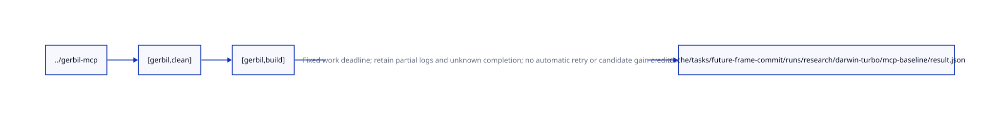

#+TITLE: Official Gerbil MCP Development Benchmark
#+SETUPFILE: ../../modeling/org/setup.org
#+PROPERTY: header-args :eval never

* RESEARCH Workload and model authority
:PROPERTIES:
:AUTHORITY: GambitMcpDevelopmentBenchmark::workload
:STATUS: one incomplete installed-SDK observation; no replacement or Linux ratio
:END:

The [[file:models/sysml/mcp-development-benchmark.sysml][native SysML workload]] binds the official commands to the existing
package-gap target, source-grounded process-launch factor and evidence manifests.
The  derives from that native projection.
Its target is not capped at a fivefold starting gap. The existing target QNT/Lean
and ASCENT factor admission remain the owners of the conditional budget and
causal-evidence gate; this workload is not a second benchmark engine.

The user-selected package is ../gerbil-mcp at clean commit
05ed8728a4871e3483fe9792480ecee2d9653e4b. build.ss contains 186 ordinary
string entries and a final main executable. This is a different source population
from the historical 120-module launch fixture. No historical speedup is transferred.

#+NAME: official-package-request
#+BEGIN_EXAMPLE
cwd: .data/gerbil-mcp
gerbil clean
gerbil build
#+END_EXAMPLE

No compiler flag, package source or dependency workaround was changed.
The resolved dispatcher is the installed Homebrew SDK and GCC16, not the current
vendor/modern-c binary. Tool/source hashes and exact command context are retained
in the input plan (local locator: =../../../.cache/tasks/future-frame-commit/runs/research/darwin-turbo/mcp-baseline/plan.json=; unavailable in a clean checkout). Official package clean does not imply a cold OS cache or
cleared shared native cache.

* RESEARCH Single observation and stop condition

#+NAME: official-package-observation
| Boundary | Observation | Meaning |
|----------+-------------+---------|
| gerbil clean | exit 0; 8.069914 s | Completed official clean request |
| gerbil build | Fixed whole-request work deadline reached; termination observed | Incomplete, not a valid completed build timer |
| Whole request | About 98.01 s including termination after the 97 s work budget | Not an achieved baseline build duration |
| Source and tool identities | Input hashes unchanged | No source edit or SDK replacement by this observation |
| Linux / replacement comparison | None in this observation | No ratio or speedup conclusion |

The result (local locator: =../../../.cache/tasks/future-frame-commit/runs/research/darwin-turbo/mcp-baseline/result.json=; unavailable in a clean checkout), raw stdout/stderr and audit preserve the partial observation.
No automatic repetition, enlarged timeout or candidate experiment follows it.
Recover existing completed package runs and join their source/toolchain/clock
identities before selecting the next discriminating observation. The logs alone
do not attribute silence to macro expansion, loader work or fd cleanup.
