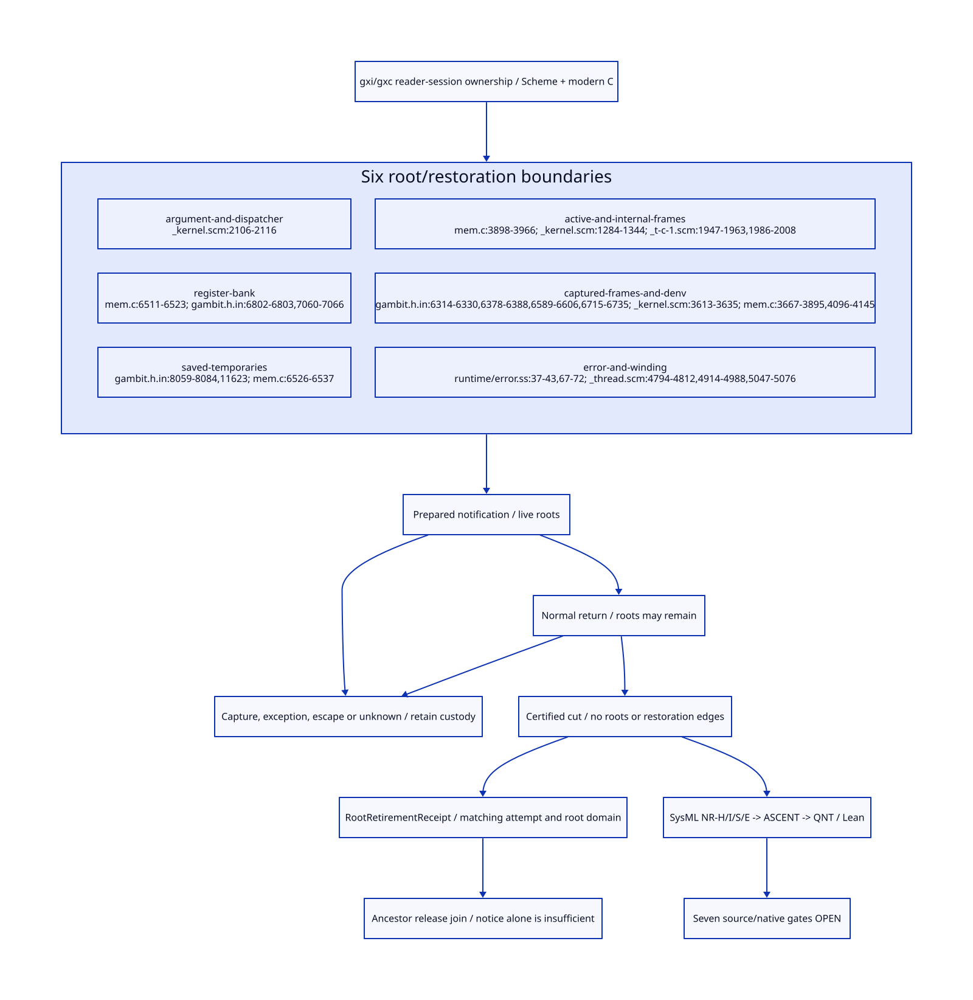

#+TITLE: Notification Callback Root Retirement and Repeated Control
#+SETUPFILE: ../../modeling/org/setup.org
#+CATEGORY: toolchain
#+OPTIONS: toc:3 num:t
#+PROPERTY: header-args :eval never

* RESEARCH Root retirement is a closed restoration boundary :modern_c:gxi:gxc:
:PROPERTIES:
:CUSTOM_ID: notifier-root-retirement
:AUTHORITY: NotifierRootRetirement
:STATUS: conditional-protocol-source-refinement-open
:EVIDENCE_CLASS: source-and-conditional-formal-models
:END:

Continue [[file:owner-notifier-closure-design.org][the owner/notifier closure study]] for proposed gxi/gxc reader-session
ownership. No owner token, restricted notifier or root-retirement issuer exists
in the selected reader sources. Scheme retains semantic identity and unrestricted
continuation behavior; generated modern C is the mandatory runtime baseline.
This study refines the previous abstract frame-retired predicate, not a new GC
implementation. A returned callback is not a proof that invocation roots cannot
be restored later.

[[file:models/sysml/notifier-root-retirement.sysml][Native SysML]] owns six root boundaries, seven unresolved gates, four cost rows,
NR-H/I/S/E and the NC-S dependency. [[file:../../modeling/tools/notifier-root-study.py][Python]] invokes native SysML and actual
[[file:../../modeling/ascent/notifier-root-retirement.rules.scm][ASCENT rules]], checks [[file:../../../models/build/notifier_root_retirement.qnt][QNT histories]] and [[file:../../../models/build/NotifierRootRetirement.lean][Lean kernels]], and derives
[[file:notifier-root-retirement-matrix.org][the matrix]] and . [[file:../../../evidence/research/notifier-root-retirement/checks.json][Receipts]] bind exact source bytes, subjects and scopes.
No runtime implementation, native test, compilation experiment or performance
measurement is performed.

* RESEARCH Actual root lifetimes and transfers
:PROPERTIES:
:CUSTOM_ID: notifier-root-source
:END:

| Root domain | Actual source | Transfer and retirement obligation |
|---+---+---|
| Argument / dispatcher | [[file:../../../vendor/gambit/lib/_kernel.scm::2106][will-execute!]] binds testator/action, clears will fields, calls action with testator, evaluates void | Slot clearing leaves the invocation; discarded return value does not prove register or frame liveness |
| GVM register bank | [[file:../../../vendor/gambit/lib/mem.c::6511][mark_registers]] scans all PSTATE r entries; [[file:../../../vendor/gambit/include/gambit.h.in::6802][R_ALL/W_ALL]] and [[file:../../../vendor/gambit/include/gambit.h.in::7060][cached register macros]] synchronize state according to configuration | No assumption that a dead Scheme lexical variable erases a scanned register; account for cached values and future writes |
| Saved roots | [[file:../../../vendor/gambit/include/gambit.h.in::8059][GC_SAVE/RESTORE1-3]], [[file:../../../vendor/gambit/include/gambit.h.in::11623][saved bank]], [[file:../../../vendor/gambit/lib/mem.c::6526][mark_saved]] | RESTORE clears saved slots to VOID only after assigning values to caller destinations; follow destination roots |
| Stack / internal return | [[file:../../../vendor/gambit/lib/mem.c::3898][mark_continuation]] decodes RETI/RETN and calls mark_frame; [[file:../../../vendor/gambit/lib/_kernel.scm::1284][internal return handler]] restores saved GVM registers | Dropping one ordinary frame cannot retire an internal return snapshot; require complete restoration closure |
| Captured frames / denv | [[file:../../../vendor/gambit/include/gambit.h.in::6589][CONTINUATION_CAPTURE]] stores frame/denv; [[file:../../../vendor/gambit/lib/_kernel.scm::3613][continuation-copy]] shares those fields; [[file:../../../vendor/gambit/lib/mem.c::4096][continuation scanner]] traverses frames and other fields | Stack-to-heap movement changes storage, not ownership. Dropping one alias does not eliminate copied captures or denv references |
| Error / winding control | [[file:../../../../gerbil-gambit-bootstrap-audit/src/gerbil/runtime/error.ss::37][raise]] may attach a captured continuation; [[file:../../../../gerbil-gambit-bootstrap-audit/src/gerbil/runtime/error.ss::67][with-catch]] grafts to handler; [[file:../../../vendor/gambit/lib/_thread.scm::4914][unwind/wind]] executes before/after | Catching an exception or observing an after thunk does not prove no retained or resumable frame |

The [[file:../../../vendor/gambit/gsc/_t-c-1.scm::1947][C emitter]] emits return descriptors from kind/fs/link/gc-map and may emit
out-of-line maps. The [[file:../../../vendor/gambit/gsc/_t-c-2.scm::4275][capture/return emission]] adjusts stack and compiler
context around continuation primitives. [[file:../../../vendor/gambit/include/gambit.h.in::6715][Continuation return]] installs the saved frame and
denv again. [[file:../../../vendor/gambit/lib/mem.c::3667][mark_captured_continuation]] handles captured frames still in stack storage;
[[file:../../../vendor/gambit/lib/mem.c::4103][heap frames]] use descriptors too. Closure free variables are scanned at mem.c:4149-4172.
A root-map proof must cover relevant descriptor slots and the separately scanned
register/saved banks, not treat a frame map as the whole root universe.

[[file:../../../vendor/gambit/include/gambit.h.in::6314][THREAD_SAVE]] writes the frame into the current thread's continuation;
[[file:../../../vendor/gambit/include/gambit.h.in::6378][THREAD_RESTORE]] reinstalls it before clearing the thread continuation field.
That clearing is another transfer, not proof of retirement. The model's suspended
bit covers an additional restorable snapshot; it abstracts both internal-return
and scheduler custody rather than simulating their exact representations.
[[file:../../../vendor/gambit/lib/mem.c::6814][The strong-phase root driver]] also calls VM, symbol/keyword, RC, global,
type-cache and processor-object scanners. Those are not erased by the proposed
issuer. Ancestor holder coverage and no-publication gates must exclude notifier
backedges through them. These six boundaries are focused invocation domains,
not a claim that the whole Gambit root set has only six sources.

Dead stale roots usually cause excess retention, not by themselves a usable
Scheme alias. Root-bearing captured control, error payloads or publication can
also preserve future use. The stronger restricted-profile condition rejects both;
it must not erase semantically live values to shorten retention.

Both thread implementations contain winding machinery (_thread.scm:4794-5097
and 8302-8605). This source census binds the complete file, but qualification of
each enabled thread/SMP/ABI configuration remains open. It does not claim that
every lexical testator necessarily survives optimization or every exception
captures every callback local.

* RESEARCH RootRetirementReceipt and issuer placement
:PROPERTIES:
:CUSTOM_ID: notifier-root-receipt
:END:

Proposed immutable rootless receipt fields:

#+begin_src text :eval never
RootRetirementReceipt {
  ownerIdentity, ownerGeneration, closeEpoch,
  dispatchAttempt, gcDispatchTicketIdentity,
  vmIdentity, rootDomainEpoch,
  programDigest, backendConfiguration, pointId, frameSpecDigest,
  normalReturnWitness, restorationClosureWitness
}
#+end_src

These are design identities, not a serialized ABI or implemented producer.
No field contains testator, Scheme closure, exception or captured continuation.
The proof controller must not retain such objects indirectly through a debug
record or job. Native control storage remains live through delayed delivery.

1. Registration qualifies the private action, its transitive effects, handlers,
   interrupt/poll edges, thread-save behavior and publication closure. Reserve a
   rootless canonical slot before will registration; preserve NC's GC provenance.
2. Action prepares only scalar status. Normal return is recorded separately from
   root retirement. Failure, escape, capture or publication taints this dispatch
   attempt irreversibly; unknown return is not success.
3. A generated/runtime issuer runs at a certified GC-safe point after the last
   invocation-root use. The point excludes root-bearing arguments, all relevant
   active frames, register/saved/cached destinations, suspended restore regions,
   captured frames/denv and error references. No future allowed transition can
   restore one of those roots or reenter the root-bearing invocation.
4. Join normal return, source-certified effect/restoration closure, actual root
   cut and exact identities before signing. Publish with release/acquire or an
   equivalent proven lock handoff; acquire alone proves no root absence. The
   current source has neither this issuer nor a qualified cut/memory order.
5. Receiver matches every identity and settles duplicate/unknown delivery against
   the canonical slot. A rootless outer continuation may replay delivery; it
   cannot replay action or manufacture a second retirement event. Reuse the same
   attempt result. A root-domain/configuration/generation change needs new evidence.

The issuer cannot live in the action's own epilogue, a dynamic-wind after thunk,
or a generic catch handler unless the complete cut is independently proved.
Normal-path GC drain entry is a candidate, not proof. Existing generated artifacts
have not been compiled/inspected here; exact callback PointId/FrameSpec and all
root locations remain NR-S/NR-E obligations. No whole-heap search per notice is
proposed. A static closed profile plus point-specific root retirement is the
candidate mechanism; its no-capture effect proof is currently unresolved.

* RESEARCH Repeated continuation, exception and notification validity
:PROPERTIES:
:CUSTOM_ID: notifier-root-control
:END:

[[https://standards.scheme.org/corrected-r7rs/r7rs-Z-H-8.html][R7RS sections 6.10-6.11]] permit repeated use of stored continuations and describe
winding on entry/exit. This supports the semantic requirement; Gambit source is
the implementation evidence. The report does not supply a root-retirement ABI.

| History | Current-attempt notice | Custody / semantic treatment |
|---+---+---|
| Qualified leaf returns; all root domains retire; restore closure is closed | May seal after matching the full receipt | Notice remains only a contribution to the ancestor release/admission/drain join |
| Action returns but register, saved destination or internal-return snapshot remains | PREPARED only | Keep slot/control and roots under their actual owner |
| Callback continuation retained or copied; callback returns and resumes repeatedly | Never qualifies this attempt | Preserve multi-shot semantics on ordinary route; no one-shot conversion or clearing captured frames |
| All known capture handles dropped | Still denied after taint | No complete alias/unreachability proof exists; a new unrelated dispatch cannot overwrite this attempt's history |
| Exception attaches StackTrace, is caught, or callback later resumes and returns | Still denied after failure/capture taint | Keep error/capture custody. Do not wait for their GC while rooting them in notifier controller |
| Escape invokes after; later reentry invokes before | Does not qualify | after is a winding event, not a root retirement acknowledgement |
| Continuation captured wholly outside the retired root-bearing region replays scalar delivery | Existing receipt remains usable if identities match | Settle idempotently; no new action or release authority |
| Claimed valid receipt followed by restoration of a callback root | Invalid architecture, not a safe revocation strategy | Must preclude restoration before signing; release may already have consumed the receipt |
| Unknown publication or stale delayed result | Retain canonical custody; no new credential | Match attempt/root-domain/generation and query slot; never rerun action to settle delivery |

Restricted notifier capture prohibition includes asynchronous wrappers that may
retain root-bearing state, not merely explicit call/cc in the action body.
Effects remain a source gate. Failure does not entitle the controller to suppress
Scheme exceptions, truncate StackTrace, delete captures or force resource close.
A recovery protocol needs separate proof; this study does not invent one.

* RESEARCH Conditional proof and counterexample obligations
:PROPERTIES:
:CUSTOM_ID: notifier-root-proof
:END:

NR-H models separate argument, register, saved, active-stack, suspended-restore,
copied capture and error roots. It models clear-and-transfer, repeated resume,
monotone taint, normal return, certified cut, immutable attempt receipt and
idempotent delivery. Counter-adapters deliberately forge both receipt and
acceptance; rejection is not merely absence of a sealed flag. Stale identities,
post-cut restoration, live roots and duplicate commitment are negative controls.
Sampling is bounded, not exhaustive verification or source simulation.

NR-I proves eight conditional support/transition kernels. In particular,
saved-slot clear transfers the root, copy does not retire capture, and a closed
post-cut step preserves root absence. The last theorem assumes the admitted
post-cut relation contains only rootless delivery/settlement; it does not prove
GVM actually satisfies that relation. The Lean taint kernel inducts over arbitrary event lists; capture taint abstracts any number of
hidden copies. QNT's two named capture handles are witnesses, not a full heap.

To refine source: map each actual program point/root location to the model;
show every source step either stutters or corresponds to an allowed transition;
show every hidden capture/save/interrupt edge is represented or denied; prove
no root restoration after a valid cut. Match failure, exceptional and unknown
outcomes without converting them to successful retirement. Lean then needs the
actual FrameSpec/root sets and an inductive simulation, not more Bool kernels.
SysML NR-S depends on NR-H/I/E and NC-S; ASCENT checks exact scopes, digests,
dependencies and seven new gates. Synthetic all-gates scenarios check the
inference rules only; no component receives runtime admission.

* RESEARCH Net benefit and retirement sequence
:PROPERTIES:
:CUSTOM_ID: notifier-root-benefit
:END:

| Design work | Removed / avoided | Added work and positive-benefit condition |
|---+---+---|
| Certified generated cut | Ad hoc return/after/slot-clear success heuristics | Effect and root/restoration proof per backend/configuration; useful only if actual source qualifies |
| Point-specific dead-root retirement | Unnecessary notifier retention at that cut | O(K) operations for K proven-dead locations, if explicit clearing is needed; never clear unrelated live roots |
| Canonical slot and identity | Action retries and duplicate commitments on unknown delivery | O(W) outstanding slots plus constant identity checks; reclaim storage only after all delayed users drain |
| Error/capture isolation | False release despite multi-shot reentry | Failed attempts can retain indefinitely; no bounded-latency benefit claimed |
| Language choice | Share Scheme semantic completion and modern-C generated descriptors | Zig has the same semantic obligations and currently no separately demonstrated net gain |

These are structural work bounds, not invented speed ratios, implementation LOC
counts or person-days. No total throughput or memory reduction is claimed.
Earlier one-drain-job/O(W)-slot benefits are inherited, not counted again here.
The direct benefit is sound release evidence and removal of specific invalid
heuristics. A source-qualified cut that costs more scanning/coordination than the
retention it removes could have negative runtime benefit; safety remains required.

Migration: first source-bound root/effect census; then generated PointId/FrameSpec
and issuer proof; then slot/exception custody and native ordering qualification;
then consumer join and delayed-delivery grace. Retire only internal heuristic
issuers after all callers and captures drain. Public wills, exceptions,
continuation copying, multi-shot resume and general GC job behavior remain legal.
