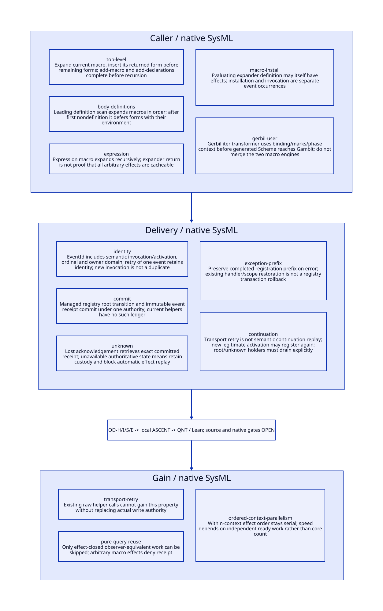

#+TITLE: Ordered Registry Effects, Cache Retry and Continuation Custody
#+SETUPFILE: ../../modeling/org/setup.org
#+CATEGORY: toolchain
#+OPTIONS: toc:3 num:t
#+PROPERTY: header-args :eval never

* RESEARCH Architecture decision :gambit:gerbil:modern_c:
:PROPERTIES:
:CUSTOM_ID: ordered-registry-delivery
:AUTHORITY: OrderedRegistryDelivery
:STATUS: conditional-local-models-source-platform-open
:EVIDENCE_CLASS: source-and-local-formal-research
:END:

Gambit remains the semantic compiler/runtime base and modern C foundation. Gerbil
implements incremental query scheduling, ordered effect handoff and private sessions.
A cache retry must not silently rerun an effectful expander. Separate a real semantic
invocation from a retry of one already-identified event's delivery. Registry mutation
is not idempotent merely because its name and payload match an existing entry.

[[file:models/sysml/ordered-registry-delivery.sysml][SysML]] owns five real caller families, five delivery boundaries, five refinement
routes, three benefit rows and seven open gates. [[file:../../modeling/tools/ordered-registry-delivery-study.py][Python]] projects native SysML to
[[file:../../modeling/ascent/ordered-registry-delivery.rules.scm][actual ASCENT DSL]], [[file:../../../models/build/ordered_delivery_parameters.qnt][QNT parameters]], [[file:ordered-registry-delivery-matrix.org][Org matrix]] and [[file:diagrams/ordered-registry-delivery.d2][D2]] / . [[file:../../../models/build/ordered_registry_delivery.qnt][QNT]] and [[file:../../../models/build/OrderedRegistryDelivery.lean][Lean]] check
conditional protocols. [[file:../../../evidence/research/ordered-registry-delivery/checks.json][Checks]] distinguish local evidence from source/platform and
host admission. No compiler/runtime implementation, native test or performance
experiment is performed.

* RESEARCH Real macro callers and source order :source:macro:
:PROPERTIES:
:CUSTOM_ID: actual-macro-order
:COMPLETENESS: concrete-caller-families-not-arbitrary-effect-closure
:END:

| Real caller | Exact source behavior | Service preservation duty |
|---+---+---|
| [[file:../../../vendor/gambit/gsc/_ptree1.scm::659][parse-program / parse-exprs]] | At 664-669 expand current macro and cons its output before remaining forms; at 706-710 install macro before recursion; at 735-739 add declarations before recursion | Expansion output enters the work queue before source tail; registry effects completed during callback precede parsing that output |
| [[file:../../../vendor/gambit/gsc/_ptree1.scm::1489][pt-body / extract-defs]] | Expands leading macro at 1501-1507, installs at 1527-1533, processes declaration at 1545-1550 | Preserve definition-scan state and environment; after a nondefinition, forms are deferred with env in vectors at 1494-1499, not eagerly expanded there |
| [[file:../../../vendor/gambit/gsc/_ptree1.scm::949][pt]] | Macro expression recursively calls pt on macro-expand output | Preserve expression-use/source observer and recursive expansion order |
| [[file:../../../vendor/gambit/gsc/_ptree1.scm::2931][add-macro / make-descr]] | scheme-global-eval of macro procedure occurs before env-macro installation; active [[file:../../../vendor/gambit/gsc/_host.scm::852][host implementation]] calls eval | Installation-time effects are distinct from later invocation effects |
| [[file:../../../../gerbil-gambit-bootstrap-audit/src/gerbil/expander/core.ss::430][Gerbil core-apply-expander / user-expander]] | Calls actual procedure/method; core-apply-user-macro creates a fresh mark under context/phase at 484-490 | Keep Gerbil lexical marks, context and phase separate from GSC's environment/registry |

[[file:../../../../gerbil-gambit-bootstrap-audit/src/gerbil/compiler/driver.ss::134][Gerbil driver]] imports the module under with-driver-mutex before compiling it;
the same file also guards optimizer work. These are concrete global coordination
seams, not evidence that arbitrary imports/expanders are now independent. The iter
[[file:../../../../gerbil-gambit-bootstrap-audit/src/std/iter/macros.ss::130][range defrules]] runs in Gerbil expansion, then generated Scheme reaches Gambit.
There is no demonstrated registry write by this transformer and no justification
for conflating Gerbil macro execution with GSC macro-expand callbacks.

The source census retains exact macro-expand/add-macro/add-declarations references
and Gerbil apply/mark references. It distinguishes definitions and quoted names from
call sites; it does not prove closure of arbitrary higher-order/native effects.

** Scope restoration does not restore a registry transaction

[[file:../../../vendor/gambit/gsc/_ptree1.scm::754][Top-level]] and [[file:../../../vendor/gambit/gsc/_ptree1.scm::1557][body]] declaration scopes save a declaration head and restore only
that field in the returned env. Global registry roots are different objects. If a
resolved extension registers a new declaration while expanding, later declarations
read the extended registry unless another real write changes it. Moving that effect
after expansion-output parsing, or rolling it back on ordinary scope exit, changes
that conditional source behavior.

[[file:../../../vendor/gambit/gsc/_env.scm::296][define-* registration helpers]] prepend entries and return the empty list. Two real
calls with identical arguments prepend twice. Duplicate category entries and order
can affect parsing metadata; even when lookup is unchanged, skipping arbitrary
allocation/identity effects is not automatically observer-equivalent. Never dedupe
these real calls by payload, declaration name or source location.

* RESEARCH Event identity and ordered handoff :contract:retry:
:PROPERTIES:
:CUSTOM_ID: ordered-effect-delivery
:END:

#+begin_src text :eval never
InvocationId = (owner domain, semantic branch/activation, dynamic invocation)
EventId      = (InvocationId, ordered occurrence ordinal)
RegistryEvent = (EventId, predecessor identity, category, canonical name, payload)
CommitReceipt = (EventId, predecessor identity, resulting identity,
                 ordered journal position, owned payload/profile)
ExpansionOutcome = (input identity, returned syntax OR phase-specific failure,
                    committed effect prefix, unresolved deliveries, observer)
#+end_src

Identities are opaque semantic identities, not source spellings or registry counts.
A failed/uncommitted event can consume an EventId without advancing the registry.
The QNT model explicitly keeps nextId, committed generation and receipt map separate.
New invocations and legitimate continuation activations receive fresh semantic
identity; a transport retry of the same operation keeps its original EventId.

The proposed managed owner executes the following contract:

1. Prepare and validate an immutable registry event under one invocation's ordered
   lane. Admit all write capabilities or deny reusable service mode.
2. Atomically decide whether that EventId was already committed. If new, verify the
   predecessor and commit registry transition plus immutable receipt in the same
   authority. If already committed, return that exact receipt without another write.
3. Deliver the receipt. Lost acknowledgement does not imply an uncommitted write.
   Query authoritative ownership state; retry event delivery, not the macro body.
4. Resume parsing expansion output/source tail only after the preceding invocation
   returned and all effect deliveries required for that boundary are resolved.
5. Publish output/failure with the ordered committed prefix and captured state key.
   Never label an old result with a newly observed registry identity.

The existing helper does not contain an EventId, receipt map or combined commit.
Wrapping a raw helper by logging before/after it leaves a failure gap. It cannot
provide this contract until actual write authority is replaced. Atomic QNT commit
is a design linearization, not a proof of a Scheme/modern C implementation or disk
crash recovery. If the only authoritative journal is lost, do not infer completion
from equal current registry contents. Different histories can have the same lookup
result. Keep the context unavailable/tainted or recover from independently qualified
state; automatic replay of unknown macro effects is denied.

* RESEARCH Cache retry is not semantic replay :incremental:
:PROPERTIES:
:CUSTOM_ID: cache-retry-versus-effects
:END:

| Situation | Required behavior | Reuse boundary |
|---+---+---|
| Lost acknowledgement for committed EventId | Retrieve exact existing receipt; registry unchanged | Conditional managed delivery retry |
| Same macro called again at another dynamic occurrence | Execute as a new semantic invocation/event history | Equal payload/source position is not a duplicate |
| Continuation legitimately returns before a registration instruction | Preserve that program execution; it may register again under new activation identity | Cannot treat semantic reexecution as transport retry |
| Continuation resumes after registration | Preserve completed prefix and remaining PC/state | No fabricated second registration or silent prefix rollback |
| Same completed query requested again in the same qualified semantic context | Attach observer-equivalent result/receipt; do not apply its effects again | Requires declared effect closure and private syntax/primitive identity reconstruction |
| Cached expansion instantiated in a different private context | Establish equivalent predecessor and instantiate that context's managed state/identities | Not reuse of the old owner's delivery ledger; fresh world has its own logical events |
| Unknown native/eval/I/O effects or unavailable authority | Preserve direct execution without reusable receipt, or refuse that service mode | Cache engine cannot claim generic exactly-once execution |

A cached transformed syntax object is not itself sufficient. Gerbil's fresh mark,
phase and definition context participate in binding identity. Gambit's effective
view and private primitive/helper domain participate in complete specialization.
Arbitrary I/O, counters, resource effects, diagnostic delivery and captured object
identity must be represented or excluded by the observer/profile. Prefix/value
fingerprints alone cannot declare a whole expander pure.

For the actual iter chain, a qualified pure range expansion could be reused only
under the admitted lexical/source/phase and dependency relation. This does not prove
that every iter dependency is pure or that a generated Gambit macro remains. A late
registry event must invalidate/split the relevant subsequent parser queries, not all
unrelated immutable inputs. Named + versus ##+ arithmetic coverage remains distinct
through the previously established ordered-lookup/specialization relation.

* RESEARCH Exceptions, unknown results and continuation ownership :control:
:PROPERTIES:
:CUSTOM_ID: exception-prefix-custody
:END:

[[file:../../../vendor/gambit/gsc/_utils.scm::426][with-exception-handling]] installs a compiler-global throw continuation and restores
the saved handler after call/cc returns. [[file:../../../vendor/gambit/gsc/_utils.scm::506][compiler-abort]] invokes that continuation.
The function is not a registry rollback transaction or proof that all raw Scheme
exceptions/native escapes follow it. add-macro builds an error-proc, but the inspected
active host scheme-global-eval simply calls eval and does not invoke that err argument;
there is no basis for claiming universal exception conversion from this wrapper.

| Boundary | Responsible holder | Release / refusal condition |
|---+---+---|
| Prepared event, no committed effect | Invocation owner | May reject preparation after resolving noncommit; partial data stays private |
| Committed effect, acknowledgement lost | Registry/effect owner retains receipt; coordinator retains dependent wait/custody | Resolve exact EventId; macro exception does not erase prefix |
| Macro throws after one or more commits | Outcome owner retains original failure and committed prefix | Do not roll back registrations or retry expander automatically |
| Authoritative executor unavailable | Coordinator retains unresolved ownership reference and blocks dependent parser/cache admission | No liveness guarantee or inferred successful cleanup |
| Saved continuation/callback/native pin | Explicit accounted holder of registry/view/syntax/context roots | Return/error/cancellation alone cannot retire holder; multishot semantics remain open |
| Failure outcome cache | Result owner | Failure/diagnostic/source/effect observer must be equivalent; never convert unknown effect into ordinary repeatable error |

A simple finally/dynamic-wind wrapper is insufficient to invent exactly-once event
semantics: reentry can run before/after thunks again and may represent a new execution.
If the managed service cannot distinguish retry from legitimate activation while
preserving user semantics, deny reusable admission. Existing compiler global handler,
registry and mutable target authorities need session ownership before concurrent
compiler calls become qualified. The current study does not implement continuation
rewriting or alter Scheme's tail calls and continuation semantics.

* RESEARCH Source, QNT, Lean and ASCENT closure :sysml:ascent:qnt:lean:
:PROPERTIES:
:CUSTOM_ID: ordered-delivery-closure
:END:

| Duty | Local result | Remaining source premise |
|---+---+---|
| OD-H | 20 QNT scenarios including 8 negative controls; two equal-payload effects; distinct EventId/generation; acknowledgement loss, failure prefix, parser boundary, new activation and unavailable owner | Finite two-event/one-holder slice; not arbitrary macro effects/queues, durable recovery, weak memory or multi-shot PC simulation |
| OD-I | Eight Lean lemmas: event commit idempotence/order, distinct equal payload, parse boundary, receipt lookup, failure prefix, blocked drain and work threshold | Abstract commit state is proposed; actual source writer/observer/custody refinement remains open |
| OD-S | Five native SysML source/action/lemma routes checked by actual ASCENT DSL, with missing/stale controls | Depends on SC-S; anchored text and name alignment do not prove Scheme-to-model semantics |
| OD-E | Separate platform need | Modern C atomic authority/root/GC/FFI protocol, persistence if promised, host registration and measured performance |

QNT controls retain duplicate delivery, payload-based deduplication, prefix rollback,
premature parsing, wrong receipt identity, unknown-custody loss, conflated semantic
replay and stale parser boundary. The unavailable-owner case demonstrates safety by
retention, not progress. Two workspace starts sample context-local values; this is
not proof of simultaneous multi-context isolation.

ASCENT runs eight local scenarios: current, missing QNT, stale subject, wrong scope,
synthetic-all, unqualified authority, missing source anchor and missing model step.
The synthetic case only checks admission logic. All seven real gates remain open;
host attestation has the inherited unresolved registration gap and is not retried
unchanged. No formal result is called compiler-native acceptance.

* RESEARCH Theory, retirement and net benefit :benefit:
:PROPERTIES:
:CUSTOM_ID: ordered-delivery-benefit
:END:

[[https://www.microsoft.com/en-us/research/publication/build-systems-la-carte/][Mokhov, Mitchell and Peyton Jones, Build Systems a la Carte]] distinguishes scheduling
from rebuilding decisions and provides a framework for dynamic dependencies. We use
that separation to assign per-context ordering to the scheduler and qualified reuse
to the rebuilder. The paper does not prove arbitrary macro effect replay correct;
the event/prefix/custody contract above is an additional Gambit/Gerbil obligation.

Retire raw registry write authority only after all resolved direct/indirect writers
use the managed event boundary or are excluded from reusable profiles. Retire the
compiler-global coordination role only after handler, target, primitive, registry
and expander/session state have real ownership. Keep Scheme registration and parser
semantics; replace implicit shared authority, not language behavior.

[[file:ordered-registry-delivery-matrix.org][SysML-derived matrix]] records three mechanisms and their costs. For n equivalent
pure demands with work C, validation/key cost V, private reconstruction M, total
ledger/publication/drain cost L and initial qualification S, conditional work benefit
requires (n-1)*C > n*(V+M)+L+S. Do not count arbitrary effect execution as skipped
work unless its observer-equivalent replay/instantiation is proved.

Delivery deduplication prevents incorrect extra writes; it is primarily a correctness
property, not evidence that source macro work becomes faster. Independent context
lanes can expose parallel work while preserving serial effect order within a context.
Long effectful prefixes, cheap pure tasks, extensive ledger/identity validation or
retained unknown/continuation holders can negate work/span/memory gains. No numeric
speedup or person-day estimate is asserted, and no Zig/C++ addition is needed for
these architecture properties on the modern C mainline.
