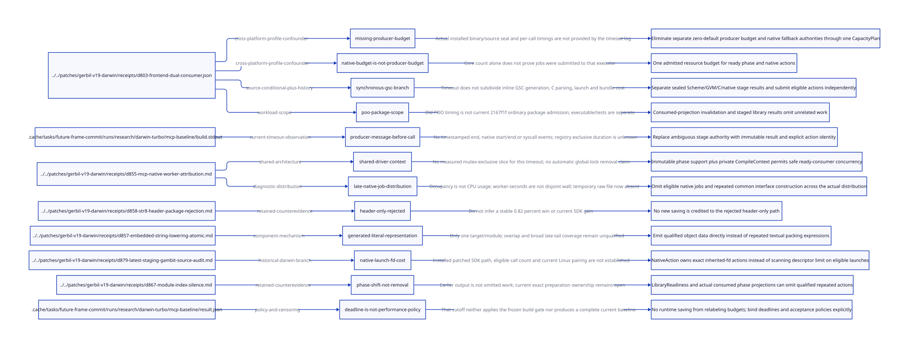

#+TITLE: MCP and POO: Package Cost Attribution and Modern C Refactoring
#+SETUPFILE: ../../modeling/org/setup.org
#+LANGUAGE: en
#+OPTIONS: toc:3 num:nil
#+PROPERTY: header-args :eval never :tangle no
#+TODO: RESEARCH GROUNDED | QUALIFIED RETIRED

* GROUNDED Executable paired-comparison protocol :c23:darwin:acceptance:
:PROPERTIES:
:CUSTOM_ID: paired-comparison-protocol
:AUTHORITY: GambitPackageDevelopment::pairedExperiment
:IMPLEMENTATION: src/gambit_smp/scientific_package_development_benchmark_study.py::paired_elapsed_values
:TESTS: tests/test_package_benchmark_admission.py
:STATUS: value/DSL controls implemented; native observation extraction and package measurements open
:END:

SysML owns the required repositories, cases, threshold, timing/cache scope and
exclusive verification responsibilities. The shared Python scientific library
now checks exact integer nanoseconds against a projected policy. It has no new
runner, implicit subprocess, cache search, source copy or retry loop. Existing
execution and artifact capabilities must authenticate native observations before
their values enter this function. A SHA256-shaped receipt name alone is not
authentication; the function always leaves native/merge admission false.

The actual ASCENT fragment now distinguishes =measurementReady=,
=optimizationAccepted= and =twofoldAccepted=. Matched isolated measurement
does not wait for every general semantic proof. Promotion still needs its
source/semantic/failure obligations and authentic paired numeric witnesses.
The older positive-performance status label cannot establish the twofold goal.

#+NAME: paired-workload-contract
| Case | Complete request and expected discrimination | Rejection boundary |
|------+----------------------------------------------+--------------------|
| package-clean | Official gerbil clean followed by gerbil build; include both in the primary wall interval | A retained build-only timer, component compile or shortened manifest cannot substitute |
| no-change | Repeat the same complete package request; verify action inventory and unchanged qualified output identity | A fast return or timestamps alone do not establish reuse correctness |
| leaf-edit | Freeze one exact edit and its true downstream closure before either arm | An input/graph mismatch or omitted necessary successor rejects the pair |
| macro-edit | Freeze one exact macro/provider edit and all consumed phase dependencies | A package importing no changed macro is not a macro-invalidation test |
| required-correctness | Run the existing full selected correctness graph and negative controls | No reduced test inventory or silent conversion of unknown results to success |

Inputs, outputs, compiler/core/library/tool identities and complete package graph
are sealed separately. Both arms use the same explicit resource/heap/timeout
profile and dependency closure; compiled artifacts differ by the declared delta.
Compiler bootstrap is reported separately. Official clean is package-cold,
not a claim that Darwin's filesystem or dyld caches were flushed. Each arm owns
its outputs; no generated/native artifacts may leak between arms.

For each package independently, =factor * candidateNs <= referenceNs= must
hold for the cold case, with factor at least2. Every other declared case must
meet =candidateNs <= referenceNs=. Both complete inventories must be present.
Missing cells, duplicates, reused execution receipts, nonzero exits, timeouts,
unreaped/nonquiescent processes, budget excess or failed semantic/negative
controls cannot produce a numeric witness. Net savings are signed: regressions
are retained, never clipped to zero or averaged away across packages.

One paired round is feasibility evidence. Any confirmation schedule and sample
count must be declared in advance; every round remains visible. Do not retry
until a favourable pair appears, widen budgets, or claim distributional confidence
from one pair. Existing Lean DevelopmentBenefit owns the conditional threshold
law; existing QNT package_benchmark_admission owns temporal publication and
censoring. Neither authenticates raw elapsed extraction or proves native code.

** RESEARCH Current implementation and next causal cut

Fresh rationaldict passes normal loading, GC and two continuation restorations
in the frozen compiler cohort. ModuleImageSpec is an enabling contract, while
the full private header and four sizeof paths remain. Prefix checkpoint recovery
is useful but contributes no demonstrated cold-build speedup. The next candidate
must actually replace repeated generated/native interface work or qualified
phase production. Both package comparisons then evaluate that source delta;
unrelated historical cleanup and full-runtime proof completion are not gates
for safely performing the comparison.

Current vendor and package checkouts may have advanced from historical model
heads. Bind a fresh cohort before native admission; do not silently reinterpret
an older receipt as matching the new source. No current matched pair, twofold
result or merge permission is supplied by the synthetic controls below.

* GROUNDED Authority, scope and stop decision :c23:darwin:evidence:
:PROPERTIES:
:CUSTOM_ID: dual-package-development
:AUTHORITY: GambitPackageDevelopment
:STATUS: offline source attribution and conditional admission; no optimized package qualified
:END:

The [[file:models/sysml/package-development-benchmark.sysml][native SysML]] owns two repository cases, twelve source/evidence/refactor
routes, nine architectural edges, five replacement components and ten exclusive verification obligations.
Its [[file:package-development-benchmark-matrix.org][generated matrix]],  and
 are projections. The actual [[file:../../modeling/ascent/package-development-benchmark.rules.scm][package ASCENT DSL]] checks
source/evidence identities, exact workload scope and both-repository admission.

No native build, compiler-flag experiment or runtime implementation is performed
by this study. The earlier timeout, negative header experiment and historical
complete runs remain intact. Neither adding more samples nor changing an SDK
is the next action until a specific missing causal edge and its discriminator
are declared. This report replaces the idea of treating the previous timeout as
a valid twelve-worker performance baseline.

* RESEARCH Architecture that removes work, beyond a concurrency setting

The five component instances and eighteen component-to-obligation uses are
declared in SysML, not selected by the Python driver. The driver projects those
instances into ASCENT. The shared owner catalogue constrains their roles.

#+NAME: replacement-architecture-summary
| Replacement component | Structural responsibility | Old authority to retire |
|-----------------------+---------------------------+-------------------------|
| Gerbil incremental query service | Dynamic dependency and consumer projections; one resource plan; independent ready-stage demand | Whole-module freshness/completion and duplicated capacity policy as the only scheduling interface |
| Gambit phase engine | Private semantic CompileContext with sealed Scheme/GVM/descriptor results | Process-global compiler context and mandatory text/process transport as the only phase boundary |
| Native module/data emitter | Scheme-owned semantic generator plus portable generated C, compiled common helpers and qualified data layouts | Repeated common C interface construction and migrated textual object packing |
| C23 native action runtime | Typed process/FD/environment/signal realization and stable result/cleanup custody | Multiple recipe/launch authorities and eligible descriptor-limit cleanup work |
| Phase artifact graph | Exact consumed-input identities, atomic publication, invalidation and LinkPlan reuse | Timestamps or exit status as sufficient whole-module reuse authority |

This is a replacement architecture, not an optimizer wrapped around the old
compiler. Each component's SysML record lists its boundary, owned duties,
input/output contracts, retained semantics, added cost and retirement condition.
Public gxi/gxc/gsc command entrypoints may remain adapters to the one new engine;
they must not preserve a second independent compiler/build authority.

Reuse the existing [[file:models/sysml/iter-compiler-service.sysml][compiler-service]], [[file:models/sysml/native-descriptor.sysml][native descriptor]] and
[[file:models/sysml/incremental-compiler-architecture.sysml][incremental architecture]] owners rather than copying their contracts here.
The full phase-query/private-context composition and new cross-consumer
ModuleSpec/FrameSpec representation are explicitly open scope extensions of
the existing QNT and Lean owners. An existing model filename is not evidence
that this new architecture is already proved.

Historical patch records appear below as supporting mechanism observations and
counterexamples. They neither define these component boundaries nor authorize
reintroducing a patch stack.

Setting an explicit capacity is controlled-profile preparation. It is not the
modern C refactor and does not reduce the number of required compilation jobs.
The target architecture instead gives Gambit structured phase results, private
CompileContext instances and Scheme-owned GVM/FrameSpec/ModuleSpec generation.
Gerbil owns dynamic dependencies, consumed projections and ready-action demand.
Modern generated C owns portable native data, a reusable compiled runtime and
typed NativeAction realization under one admitted resource plan.

#+NAME: refactor-benefit-gap-matrix
| Refactor cut | Work genuinely removable | Required work and added overhead | Evidence / positive condition | Current numeric credit |
|--------------+--------------------------+----------------------------------+-------------------------------+------------------------|
| Shared CapacityPlan | Conflicting producer/native defaults and duplicated resource arbitration | Dependency waits, memory admission, private compiler state | Source proves split authority; normalize both repos before comparison | No C23 speedup credit from setting an environment variable |
| Sealed phase support + private contexts | Reconstructing the same qualified support program and recompiling unaffected consumer projections | Fresh lexical/module identity, initializer effects, snapshots and validation | Must close dynamic reads, writers and output-successor contracts | Unallocated until actual omitted actions and critical path are identified |
| Explicit stage results | Mandatory text/file/re-reader transport where structured semantics fully replaces it; duplicate stage demand | Declarations, source positions, exception order, roots and reconstruction | Complete Scheme-to-GVM/consumer correspondence required | No blanket attribution of startup silence or26.91 s |
| Common compiled native interface | Repeated count-specialized common C construction and parsing across real job distribution | Private module descriptors/data, portable ABI, cold helper calls and relocations | Preserve tail calls, continuation and GC; header partition alone is insufficient | Existing flag/HIT savings already in relevant baseline; no double credit |
| Native literal data lowering | Repeated textual packing expressions for qualified representations | Width/endian/character/tail/cycle identity, fixups, I/O and GC/module-root checks | D857 supports one atomic mechanism; D858 excludes extrapolating it to package success | No package gain assigned from isolated8.11 s reduction |
| Typed launch backend | Descriptor-limit-proportional child cleanup for eligible ordinary requests | Exact fd/env/cwd/signal/PTY semantics, failures and native custody | Historical branch evidence; verify effective current path before changing it | Do not count a historical launch fix again if installed SDK already has it |
| Projection-based native reuse + LinkPlan | Unchanged generated/native actions and redundant closure/link-plan production | Real misses, ABI invalidation, source safety, result verification and record lifetime | Exact consumed-input closure; retire old authority, do not add another coordinator | D1510 coordinator regression is retained counterevidence |

For repeated work n*c, moving to k*c plus full added overhead H is beneficial
only when (n-k)*c > H. Existing DevelopmentBenefit owns this generic law and the
arbitrary-baseline target equations. Do not create another QNT arithmetic model.
If r=T_D/T_L exceeds5, reaching twice the final Linux time requires more than60%
net removal when Linux is unchanged. Twofold acceleration alone leaves r/2>2.5.
No upper bound r<=5, fixed future ratio or estimated person-day saving is used.

* GROUNDED What the previous MCP timeout actually establishes

The current MCP source is clean at 05ed8728a4871e3483fe9792480ecee2d9653e4b.
The original plan (local locator: =../../../.cache/tasks/future-frame-commit/runs/research/darwin-turbo/mcp-baseline/plan.json=; unavailable in a clean checkout) records no GERBIL_BUILD_CORES override. Its resolved
dispatcher uses the installed Homebrew SDK, not current vendor/modern-c. The
result (local locator: =../../../.cache/tasks/future-frame-commit/runs/research/darwin-turbo/mcp-baseline/result.json=; unavailable in a clean checkout) records clean=8.069914 s, then build censored by the combined
97-second work deadline. The approximately 98.01 s includes termination; it is
not completed build time. The stdout (local locator: =../../../.cache/tasks/future-frame-commit/runs/research/darwin-turbo/mcp-baseline/build.stdout=; unavailable in a clean checkout) contains fourteen compile-entry messages,
ending at mcp/registry. No per-module end timestamps or native phase events were
recorded. The source and tool bytes bound by that observation did not change.

#+NAME: timeout-caller-and-clock
| Observed cut | Actual source path / caller | Valid conclusion | Remaining gap |
|--------------+-----------------------------+------------------+---------------|
| Official clean | gerbil dispatcher -> gxpkg pkg-clean -> build.ss clean -> std/build-script make-clean | Whole clean request completed in 8.07 s | No loader/import/cleanup subphase timers; cannot call all 8.07 s macro time |
| Missing producer override | Installed std/make settings -> gerbil-build-cores -> getenv default 0 | Source semantics select zero; worker count is max(1,0)=1 | Installed source-to-binary seal remains explicit; this is not a recorded CPU-utilization trace |
| Compiler dispatch | std/make gxc-compile -> compile-module parallel:false -> current-compile-parallel | Source's false branch calls GSC compile-it inline | No individual GSC, native launch, preprocessing, parse or bundle durations for this request |
| Native capacity fallback | Compiler base available-build-cores can independently fall back to core-count | Native capacity discovery does not turn the producer's false flag on | Do not describe this request as twelve active workers merely because the host has twelve cores |
| Last registry line | std/make gxc-compile emits and flushes the message before compile-module | A producer entry was observed | Not a completion, an exclusive registry timer or proof of the interrupted native subphase |
| Stop | External deadline followed by termination | Censored observation, retained for analysis | Not natural completion, a crash diagnosis or an end-to-end acceleration measurement |

The source chain is grounded in the exact installed source snapshots in
the input audit (local locator: =../../../.cache/tasks/future-frame-commit/runs/research/package-benchmark/input-audit.json=; unavailable in a clean checkout) and the generated route matrix. Its binary/source semantic seal
is not inferred from their presence in the same SDK directory.

The existing D803 record independently documents a completed 393.33-second run
with omitted GERBIL_BUILD_CORES and explicitly excludes it from the twelve-worker
comparison. Its valid parallel MCP observation was 81.03 seconds. This supports
the missing-profile mechanism; it is not a new matched speedup, a C23 refactor
result, or the cause of an arbitrary Darwin/Linux ratio. The same configuration
mistake can occur on Linux.

** GROUNDED Correct the deadline interpretation

The frozen D1510 policy is 4.5 s first log / 42 s cold build / 97 s complete
tests. The previous observation's 97 s combined clean/build cutoff did not apply
that frozen build policy. Preserve the observation exactly as executed; do not
retroactively rename it a failed frozen42-second build or a completed97-second
build. The current package, SDK, scope and concurrency must be matched before
any historical policy or timing is inherited. No historical limit is widened.

* GROUNDED Complete records joined to their callers and exclusions

#+NAME: retained-package-evidence
| Record | Retained complete observation | Owner / factor | Reuse boundary |
|--------+-------------------------------+----------------+----------------|
| D803 MCP | 81.03 s; 187 producer events; main producer33.270 s; import/expand5.242 worker-seconds | Executable closure production plus native work; missing-capacity control excluded | Different source/SDK/profile; sums are not wall partitions |
| D803 POO | 13.13 s on preexisting dirty POO source through just clean/build | A smaller real consumer used twelve workers | Not current2167f1f library admission or a current clean source comparison |
| D855 MCP | 74.671 s; graph ready12.510; graph end40.054; last compile-file68.718; native drain end73.823 | Overlapping graph/native work and broad late native-job distribution | Instrumented observation; 11.89/12 occupancy is not CPU utilization |
| D857 literal lowering | One isolated object mean12.04 ->3.93 s; identical object hash | Native literal representation mechanism | One target/module; not a package saving or all543 jobs |
| D858 header-only A/B | 77.650 /77.013 s; embedded job ends before last native job | Negative package result despite atomic improvement | Reject exact header-only mechanism; no stable0.82-percent win established |
| D879 launch | Historical host selects descriptor-limit fallback; 120-module launch control28.853 ->10.465 s | Concrete Darwin process-path mechanism | Current installed patch eligibility, call count and Linux counterpart are not joined |
| D1510 frozen MCP | Three complete builds36.414 /35.552 /37.770 s; full39-file965-case test86.924 s | Content-locked historical complete-package reference | Preserve complete evidence; cannot transfer timings to the current SDK/package by name |
| D1510 ASCENT | Disjoint73.686833-second diagnostic with26.907860-second uncovered preparation | Method and alternative-consumer evidence for attribution | Not this MCP timeout; do not fill MCP's unobserved preparation with26.91 s |

The D855 and D858 temporary raw JSON paths are now absent locally. Their durable
reports remain usable at that evidence level; do not fabricate fresh raw event
graphs or exact-current-source native admission from them. All these records
belong to one evidence chain, with explicit cohort and clock labels rather than
being discarded or added together.

The earlier literal-selection experiment repeated a direction already studied
in D857. The new ASCENT trial guard retains the exact rejected variants and
blocks their repetition. The structurally different emitter/data proposal is
not rejected merely because the header-only proposal failed, and is not
automatically admitted either.

* RESEARCH Two repository contracts and future acceptance

#+NAME: two-repository-scope
| Repository | Current source | Official package graph | Additional correctness scope |
|------------+----------------+------------------------+------------------------------|
| MCP | 05ed8728a4871e3483fe9792480ecee2d9653e4b | gerbil clean -> gerbil build; includes final main executable | Complete existing executable/module and package-test population, bound to exact source |
| POO | 2167f1f87bb0ffda3c29ff7497b35bcd47aeffe9 | gerbil clean -> gerbil build; library-build-spec projection | Explicit existing qualification/test-program graph; ordinary library success is not that graph's success |

POO's Justfile exports hardware capacity and an owned output root; direct gerbil
commands do not automatically inherit those settings. The two paths must not be
silently combined into one baseline. Preserve POO's existing single-host limit,
FFI/include and Darwin linkage settings in both arms. Do not shrink the package
or test graph, and do not turn missing targets into cache success.

Before a candidate run, bind both repository heads, exact normalized manifests,
tool/runtime/compiler inputs, effective capacity, output/cache scope, clock,
deadline and acceptance policy. Require package-clean, leaf-edit, macro-edit,
no-change and required-correctness cases in both repositories. Completed current
baselines and matched candidate contexts are prerequisites. One package, one
module or a timeout cannot authorize both-package optimization acceptance.

The user has authorized those two repositories as native benchmarks. This study
does not spend that authorization on another uncontrolled clean/build: there is
no qualified modern-C candidate and no matched current baseline yet. The next
native action must name a missing edge, predicted discriminator and stop rule.

* GROUNDED QNT, Lean, source and native have different obligations :model-ownership:
:PROPERTIES:
:CUSTOM_ID: package-model-responsibilities
:AUTHORITY: GambitVerificationResponsibilities; GambitPackageDevelopment responsibility0..7
:END:

Reuse the existing [[file:../../modeling/verification-responsibilities.org][exclusive verification policy]] and its exact
[[file:../../modeling/ascent/obligation-ownership.rules.scm][ownership DSL]], rather than introducing another verifier catalogue.
The ten SysML responsibility instances assign one semantic key and one owner to
each question. A component can consume several different obligations; that
does not authorize Quint and Lean copies of the same protocol.

#+NAME: model-selection-explanation
| Owner / tool | Question for this component | What is deliberately absent |
|--------------+-----------------------------+-----------------------------|
| quint / QNT | Bounded interleavings of label, process exit, verification, timeout, late result, generation reuse, case collection and two-repository publication | No budget-normalization function or timing arithmetic copied from Lean |
| lean / Lean | All-natural-input configuration semantics; arbitrary string/generation key abstraction and reflection; existing general cost laws reused unchanged | No duplicate request state machine, scheduler or timeout-guard lemmas |
| source / source refinement | Actual caller and writer closure; extraction fidelity, source/binary seal and implementation of modeled atomic cuts | Token/hash presence does not close refinement |
| native / execution | Complete exact-source/profile package correctness, progress and measured performance in both repositories | Model success or historical binaries do not become a new package pass |

The eighteen SysML ComponentObligation instances attach those keys to the five
replacement components. The data emitter has representation/source obligations;
it is not given a QNT packing model by default. NativeAction uses a QNT lifetime
obligation and a distinct Lean budget-normalization obligation. The artifact
graph uses a QNT invalidation obligation and a distinct Lean key-reflection
obligation. The two scope extensions remain open rather than inheriting a green
receipt merely by pointing to existing model files.

The new QNT explores request ordering and distinct-key completion. The new Lean
does not repeat those guards: it proves data normalization and key reflection
under injective interning. Model keys have to match the actual source/tool/graph/
profile manifest; that extraction premise is an explicitly open source obligation.
Cost algebra reuses the existing23-law DevelopmentBenefit artifact by hash.

ASCENT checks declared owner conflicts, same-key renamed aliases, wrong-domain
assignments and wrong-owner evidence through the existing policy. It cannot
decide arbitrary natural-language semantic equivalence, discover empirical
causes or prove a theorem. Source/QNT/Lean correspondence and C23 weak-memory
refinement are not closed by passing both endpoint tools.

* RESEARCH Closure ledger

| Obligation | Current state |
|------------+---------------|
| Twelve caller/evidence/refactor associations | Checked against native SysML, current source bytes and retained reports |
| Temporal protocol and two-repository combination | Finite QNT histories/samples; conditional model scope |
| Data normalization and key representation | Lean laws under explicit assumptions; not a second protocol proof |
| Generic benefit algebra | Existing Lean artifact reused, not rewritten |
| New phase-query/private-context composition and ModuleSpec/FrameSpec scope extensions | OPEN; two additional primary obligations |
| Source/binary seal and exact timeout internal costs | OPEN |
| Cross-model extraction and C23 implementation refinement | OPEN |
| Complete matched current baselines / optimized packages | None admitted |
| Full explanation of observed ratios above5 | OPEN; profile confounders and mechanisms are now separated in the same graph |

The concrete check receipt (local locator: =../../../.cache/tasks/future-frame-commit/runs/research/package-benchmark/checks.json=; unavailable in a clean checkout), exclusive-owner controls (local locator: =../../../.cache/tasks/future-frame-commit/runs/research/package-benchmark/ownership.json=; unavailable in a clean checkout) and
package admission counterexamples (local locator: =../../../.cache/tasks/future-frame-commit/runs/research/package-benchmark/ascent.json=; unavailable in a clean checkout) preserve these boundaries.

* Complete compiler construction from the Darwin branch
:PROPERTIES:
:CUSTOM_ID: darwin-complete-compiler-producer
:SYSML: models/sysml/darwin-acceleration.sysml::darwinBazelCompiler
:IMPLEMENTATION: src/gambit_smp/gerbil_build.py::build_bazel_compiler
:END:

The existing Python execution owner invokes the repository's Bazel source
producer, =tools/ci/build_source_toolchain.sh=, with the exact local Darwin
Gambit working tree. The upstream manifest prevents configure from replacing
it with Gerbil's older gitlink. The producer retains the existing Gerbil
patch selection, complete upstream build stages, installation and verification.
Its inputs include source bytes and modes, the compiler, SDK flags, and producer
inputs. No Homebrew native artifact is overlaid.

The previous package attempts used incomplete construction and source tool
fallbacks. They remain historical failures, but do not qualify the intended
complete Darwin compiler or establish that the package tests are faulty.
A compiled =gxpkg= / =gxtest= closure and a coherent resulting prefix are
prerequisites to repeat the original package requests.

| Obligation | Owner | Acceptance boundary |
|------------+-------+---------------------|
| Pin and materialize working source | Existing Python build capability | Preserve dirty source bytes, tracked deletions and modes; reject drift |
| Construct and install complete compiler | Existing Bazel source producer | All stages, verification, reaped process and quiescent children |
| Package correctness | Original MCP / POO entrypoints | Complete tests and actual markers, not core/tool readiness |
| Performance | Existing paired experiment | Matched sources and budgets; no acceleration credit from construction |
| Temporal model | Existing QNT owner | Request/publication/custody histories; native refinement remains open |
| Mathematical model | Existing Lean owner | Identity reflection and cost laws; no duplicate request-state proof |
