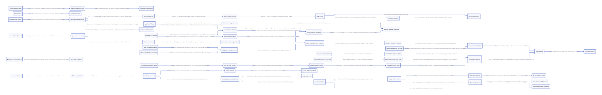

#+TITLE: Preparation Products: Dependency Readiness and Provenance Architecture
#+SETUPFILE: ../../modeling/org/setup.org
#+OPTIONS: toc:3 num:nil
#+PROPERTY: header-args :eval never
#+TODO: RESEARCH DECIDED | ADMITTED RETIRED

* DECIDED Refactoring scope :c23:incremental:macos:
:PROPERTIES:
:CUSTOM_ID: preparation-product-architecture
:AUTHORITY: GambitDarwinDevelopment preparationCut0..1; preparationOwner0..5; preparationPartition0
:BASE: current vendor/gambit modern-c; historical consumer commit explicitly separate
:STATUS: source-grounded architecture and conditional models; exclusive time attribution open
:END:

Preparation is part of the compiler architecture, not an opaque script prefix.
Gambit owns Scheme/GVM/ABI/root semantics and explicit compiler-stage products.
Gerbil owns demand, dependency snapshots, per-consumer currentness, bounded
sessions and scheduling. gxi/gxc and build clients consume these products.
C23 shared native ABI/module data and LinkPlan remain the native continuation of
this service. No new patch, compiler flag, package-specific cache or native runner
is introduced by this study.

[[file:models/sysml/macos-development.sysml][SysML]] owns the preparation/source/history/retirement rows projected into the
[[file:c23-development-refactor-matrix.org][matrix]] and . The existing [[file:../../modeling/ascent/c23-development-design.rules.scm][ASCENT DSL]] joins those rows to source hashes,
formal routes and unresolved evidence scopes. [[file:models/quint/preparation_reuse.qnt][QNT]] models independent layer
currentness and foundation/output handoff; [[file:models/lean/PreparationReuse.lean][Lean]] states conditional key/guard laws.
These are admission companions to the existing scheduler, not another scheduler.

* RESEARCH What the retained 26.91-second record actually establishes

The D1510 source-change reuse diagnostic has 73.686833 seconds of disjoint elapsed
stages. Preparation is 35.308139 seconds; compiler-event coverage inside it is
8.400279 seconds; the complementary interval union is 26.907860 seconds. A
complement of recorded intervals does not identify exclusive Scheme procedures,
CPU time, macro expansion, loading, filesystem work, lock waits or GC.

The original receipt remains valid evidence at its original scope. The raw
phase-reuse event directory and recorder source were not found at the document's
original paths in the inspected gerbil-bazel, gerbil-ascent and runtime-throughput
roots. This is scoped availability, not a claim that all archives were searched
or that historical experiments are invalid. The receipt retains exact raw hashes.
Without the original same-clock records or additional original exclusive timers,
this study cannot assign an exclusive number of seconds to the source families.
No native replay is performed to fill that absence.

The exact consumer commit 21e3638687d42ecfc36acebb28991987435ebc60 is available in
local Git. Eight selected files were recovered by reading Git objects, without a
checkout or execution. Their [[file:../../../evidence/research/source-references/compiler-consumer/provenance.json][commit/blob/SHA provenance]] binds the recovered source.
This does not reconstruct private diagnostic overlays. The Gerbil compiler/make
source is the local audit snapshot; current vendor modern-c is the modernization
base. Historical consumer, audit source and current vendor are not silently
identified as one executable build.

* RESEARCH Real preparation callers and the ordering cut

#+NAME: preparation-call-chain
#+BEGIN_EXAMPLE
just test-native -> qualification main test-file -> package lane
  -> artifact-sources
  -> prepare-test-library!
       enumerate modules; load-path/env setup
       -> entry-inputs + upper entry-current?
       -> on miss: compile production layer; compile support layer; compile Suite
          each child: qualification imports -> std/make -> graph imports/currentness
  -> prepare-native-tests!
       import Suite interface; inspect exports; write registry
       -> entry-inputs + entry-current?
       -> on miss: foundation entry-inputs(objects=false)
          -> fresh compile-entry child
             import compiler/support; compile-module; compile-exe -> LinkPlan path
          -> validate foundation again; acquire final input inventory; bind receipt
  -> validate source/binary/generated entry; execute real Cases; validate again
#+END_EXAMPLE

For the selected nonempty one-Suite warm-entry-miss branch, the source contains
five reached entry-inputs calls: one early library check, one registry check,
one before the entry child, one after that child and one for final receipt
binding. Only the first three precede its native link-generation call. All five
are conditional source-path counts, not a five-event timing census. Earlier
file absence or a HIT changes this branch.

Each entry-inputs traverses the package library, dependency prefix and toolchain
library, filters artifact suffixes, hashes selected files, reads environment,
resolves gxi/gsc/gcc and hashes those tools. It also calls artifact-sources,
which enumerates tracked/unignored Scheme sources and justfile and hashes them.
The native Reader hashing path is already compiled: this is evidence of repeated
scope acquisition, not a newly discovered interpreted byte-copy bug.

The three library children intentionally bound compiler-heap lifetime under the
same 1-GiB contract. In the inspected std/make source, module-id and coordinator
paths import module contexts under the import mutex, construct dependencies and
check timestamps even if object compilation is unnecessary. These checks are
real work. File existence plus timestamps alone are not the new reuse authority.

A fresh entry child imports compiler/support again. Its compile-module followed
by compile-exe does not prove two full expansions: one process can reuse its own
module context. Avoid adding overlapping imports, parent waits and child durations.

Registry construction also imports the Suite to inspect phase-zero exports and
preserves export/alias order and callbacks. Existing original binding contracts
require eager initializer calls, current export resolution, conflict/error timing
and fresh mutable target binding state. Share a construction program only where
proved immutable; do not cache an initialized context graph or skip live effects.

* DECIDED Replace the coupling with independent products

The historical prepare-test-library! uses an upper executable-entry receipt as
the gate for all library layers. That key spans project sources and native
artifacts, so a focused change can send unchanged production/support layers
through fresh compiler/currentness processes. This is the architectural coupling
to replace. It does not prove every source-change rebuild has zero legitimate
library work: a changed Suite must still validate/rebuild its affected closure.

#+NAME: preparation-products
| Product | Producer / issuer | Consumers | Invalidators and retained semantics |
|---------+-------------------+-----------+-------------------------------------|
| Source/lookup snapshot | Existing dependency/snapshot broker | All phase queries | Source identity, negative lookups, path/env resolution, read effects; unmanaged writes refuse reuse |
| Foundation manifest | Qualified toolchain/dependency owner | Generation/native stage requests | Runtime/header/helper/SDK/tool identity and external query closure; cannot use arbitrary stale filesystem metadata |
| Library readiness | Per-layer phase planner plus successful compiler products | Registry planning and LinkPlan | Actual consumed interface, executable macro support, code/ABI and dependency products; independent of unrelated upper entry bytes |
| RegistryPlan | Semantic export/binding planner | Scheme entry generator | Ordered exports/renames, callbacks, source identity, package/namespace and live instance requirements |
| Immutable phase program | Gambit/Gerbil semantic stage producer | Bounded private compilation sessions | Stage/compiler/declaration and executable support closure; never share mutable expander tables across sessions |
| Output successor | Successful quiescent managed producer and output store | Later currentness/LinkPlan consumers | Exact declared output delta, actual hashes, complete writer closure and stable foundation; unknown completion stays owned |

All products are semantic values or content identities under one compiler-service
contract. None replaces real Cases with a cached test verdict. Legacy clients
may remain non-reusable until their effects and consumers are migrated; the
public Scheme/C semantics are preserved.

** Scoped snapshots across real writes

A full old inventory cannot be carried unchanged across native compilation,
because objects and metadata legitimately change. Split the immutable external
foundation from task-owned writable outputs. The producer receives private output
storage and an explicit write set; its successful completed products issue a
successor manifest. Readers project only the identities they consume.

#+NAME: preparation-successor-contract
#+BEGIN_EXAMPLE
Successor = { sourceEpoch, foundationIdentity, priorOutputManifest,
              declaredAndActualWriteDelta, completeWriterAndAliasClosure,
              successfulQuiescentOutcome, newOutputManifest, custody }
Issue only when source/foundation remain valid and all writer outcomes are known.
On unknown completion: retain task/output/root custody; no successor or reuse grant.
On external or aliased write: revoke the view; reconcile or validate again.
#+END_EXAMPLE

This requires real writer/path/alias closure, not a request-local boolean or a
weaker hash rule. The source lane lock excludes cooperating package writers only;
it does not prove exclusion of editors, FFI writes or unrelated processes.
Where ownership cannot be established, validate the affected input content anew
or refuse reuse. Across requests the broker must resolve current source changes;
no persistent credential is justified by TTL or path name alone.

The three-layer model conservatively captures production -> support -> Suite
consumption. An entry-only change preserves library keys; a Suite change preserves
production/support; a support or production change invalidates the modeled
consumers; native foundation changes invalidate consuming library products.
Whether real consumer projections are smaller requires the existing read/effect
closure and QNT/Lean source-refinement work. The model does not assign an actual
comment-only fixture to the entry-only case without proving its stage projection.

* RESEARCH Cost attribution and combination for at least twofold speedup

#+NAME: preparation-attribution-matrix
| Source family | Established attribution | Removable repeated work | Must retain / unresolved |
|---------------+-------------------------+--------------------------+---------------------------|
| Broad input inventory | Concrete five-site selected branch; three pre-entry-compiler, two post | Repeated whole-prefix walks/hashes under a qualified common view and producer successor | Current source/tool/environment identity and post-producer delta; no exclusive seconds |
| Three layer entry processes | Real upper-entry-miss branch triggers layer currentness | Unrelated layer reconstruction when their own dependencies are unchanged | Heap isolation, true invalidation and bounded context lifetime; no exact gap contribution |
| std/make graph import | module-id/coordinator import and dependency timestamp paths | Repeated invariant graph/interface program construction | Dynamic lookup/support/effects and fresh mutable instances |
| Registry construction/import | Real export inspection and emitted Scheme | Re-rendering equal plans and re-generating admitted entry products | Ordering, aliases, callbacks, source/errors and live initializer effects |
| Fresh compiler entry | Explicit child and compiler/import calls | Reconstructing invariant support with owned phase products | Roots, source/control semantics and necessary context initialization |
| Lane/runner/IO/GC/waits | Reached lane/source/child boundaries; aggregate complement only | No cost credit without evidence of an omitted operation | No measured lock/GC/dyld exclusive share; runner scope distinct |

A separate latest-PR receipt observes 11.616248 and 11.508788 seconds of library
currentness with zero production recompilation. It supports the architectural
currentness concern; those seconds do not partition the 26.907860-second sample.
Another pair observes 17 object HITs but a 3.24-second cold regression. Existing
0.88-to-1.59-second request-preparation regression likewise rejects coordination
without net work removal. Current native digesting is already present in those
paths. None justifies another helper/hash patch as a fundamental solution.

The whole-package model remains T_after + R = T_before + A, with twofold requiring
2R >= T_before + 2A. R must be projected onto a same-cohort disjoint elapsed
schedule. Persistent service/context retention, snapshot validation, manifest
storage, publication and memory/GC costs belong in A.

#+NAME: preparation-combination-budget
| D1510 optimistic scenario; all other intervals fixed, A=0 | Necessary conclusion |
|----------------------------------------------------------+----------------------|
| Remove the entire uncovered preparation complement | Ideal ceiling about 1.575x; twofold remains impossible |
| Remove that complement plus all GSC link generation and final link | Still need at least 3.858635 s from the remaining compiler-covered preparation/object intervals |
| Keep Cases/admission and remove every later native interval | Preparation must still lose at least 9.453183 s |
| General combined plan | Net removal must reach 36.843417 s at microsecond resolution; each added second raises required removal by one second |

These are necessary counterfactual constraints, not forecasts that the uncovered
time is removable. The combined architecture must (1) eliminate unrelated
currentness and invariant reconstruction through independent phase products,
(2) reuse generated/stub/link products via LinkPlan, and (3) reduce actual native
C token/parse work beyond existing modern-c/GENDISTFILES reuse. Native object
critical paths remain relevant even if preparation improves. D855's near-full
worker occupancy is not extra twelvefold speedup capacity.

* RESEARCH Proof and retirement matrix

#+NAME: preparation-closure-matrix
| Obligation | Closed here | Still open |
|------------+-------------+------------|
| Historical calling path | Commit/blob/SHA-bound selected source and guarded branch order | Private overlay correspondence and same-clock exclusive timers |
| Preparation partition | Original summary values agree with native SysML; complement arithmetic checked | Causal ownership/removable seconds per caller |
| Layer currentness | Bounded QNT histories and conditional Lean key laws | Actual dynamic dependency/negative lookup/effect closure |
| Foundation/output handoff | Successor guards, mutation/unknown negative controls | Actual C23/filesystem ordering, complete writer aliases, GC roots and publication |
| Import/binding semantics | Existing original contract evidence remains required | Complete phase-program extraction and fresh instance construction proof |
| Whole-request benefit | Necessary combined-budget thresholds and negative evidence | Positive measured whole-task gain and Linux non-regression |

Retire the old broad scans and upper-entry-driven layer analysis only when the
same generic compiler service owns all affected callers and validation duties.
Retire none of source changes, initializer effects, output identity checks,
roots or test assertions merely to meet the target. This study performs no
runtime implementation, native compilation, native test or benchmark replay.

* RESEARCH Consumed closure, real writers and successor authority :c23:ownership:
:PROPERTIES:
:CUSTOM_ID: readiness-closure-and-successor-issuance
:AUTHORITY: GambitDarwinDevelopment preparationCut2..3; readinessDependency0..8; foundationWriter0..7
:STATUS: source families enumerated; actual read/write/alias extraction remains open
:END:

** A readiness receipt covers observations, not file classes

The audit std/make =spec-inputs= includes the main source, extra-inputs and nested
specs. That is a useful declaration boundary, not the full observed closure.
The inspected expander additionally searches ancestor gerbil.pkg files and reads
package, namespace and prelude configuration. Its library resolver searches each
load-path entry for SSI and alternative source suffixes, including failed earlier
candidates. The runtime loader walks .o1, .o2 and subsequent versions until the
first absent path, then falls back to source. Negative results and search order
are observations even when the previously selected file bytes do not change.

The historical artifact-sources enumerates project *.ss plus justfile; entry-inputs
uses a suffix filter for compiled/library files. These lists alone cannot establish
closure over gerbil.pkg, custom reader files, external native effects or namespace
replacement. This is a source-level coverage gap, not a claim that an observed
historical test executed with a stale package file.

Positive-phase reader code is executable. The inspected #lang path resolves a
phase-one read-module-body export, evaluates its binding to obtain a procedure
and invokes it under current reader path/arguments. Optimizer SSXI state is sticky
across batch compilation and has its own providers. Gambit read-source consumes
readtable and extension resolution. Native helper metadata also invokes pkg-config.
An SSI-only dependency graph misses necessary executable and native inputs.

#+NAME: readiness-observed-closure
#+BEGIN_EXAMPLE
LibraryReadiness(query, snapshot) = {
  queryModeAndCompilerPolicy,
  directSourceDeclaredInputsAndNestedSpecs,
  orderedResolvedPositiveAndNegativeLookups,
  packagePreludeReaderAndExecutableMacroSupport,
  consumedOptimizerFactsAndProviderIdentity,
  relevantRuntimeHeaderHelperCompilerSdkAndNativeQueryViews,
  sourceAndBindingGenerationIdentity,
  transitiveConsumedQueryResults,
  successfulCompleteOutputProducts,
  effectPolicyAndCurrentSnapshotWitness
}
#+END_EXAMPLE

The broker/planner validates a retained consumed trace under its current input
view; it need not re-execute all unchanged macro programs merely to rediscover
the same trace. This is sound only if the trace/effect policy really covers all
possible observation changes. Changed reader/macro code, captures, input resolution
or untracked time/random/native effects force re-execution, reconciliation or
refusal of reuse. Private initialized contexts are not interchangeable artifacts.
The full dynamic closure is not inferred by this study from import text.

The compiler also sets current-compile-timestamp and uses it in emitted module
metadata and fresh identifiers. Retaining an existing generated artifact differs
from executing the compiler again with an old timestamp. Force/reload, source
origin and generative identity need explicit semantics. Neither reproducible C
bytes nor unobservable timestamp changes are assumed; this remains part of the
actual generation-equivalence obligation.

** Exactly when an entry change is local

The finite model now projects query footprints transitively rather than relying
only on the earlier three-layer key shape. Its resource classes represent source,
reader/macro executable support, negative lookup, package configuration, optimizer
facts, extra inputs, native provider and compiler-context policy. Its four-query
closure is a bounded abstraction, not the real module graph or a verified extractor.

An entry edit can leave library queries reusable only if its changed observations
are outside every retained library footprint and all other admission premises
hold. If a macro/reader consumed that entry file, the same edit invalidates the
library and its dependents. Tests retain both histories. A query cycle refuses
this acyclic reuse plan; original language handling is not replaced by a new
semantic rejection of all cyclic programs.

#+NAME: readiness-invalidation-precision
| Changed observation | Reusable in the modeled qualified case | Necessary invalidation |
|---------------------+-----------------------------------------+------------------------|
| Entry-only plan/source with no library read edge | Production/support/Suite library products | Entry generation and downstream LinkPlan/native products |
| Suite input | Unaffected production/support queries | Suite query and its consumers |
| Macro/reader reads the changed entry | Only queries outside that real consumed closure | Library query plus its transitive consumers |
| Higher-priority absent path becomes present, package/prelude changes | Queries whose resolution observation is unchanged | Every affected resolver/reader/query result |
| SSXI/provider change | Queries not consuming those optimizer facts | Consuming optimization/generation/native results |
| Native tool/ABI/package-query view change | Semantic products proved independent of the native change | Native-consuming library products and their consumers |

These rows do not assert that the retained comment-only test edit belongs to the
first row. Its actual source/origin/effect projection must determine that. They
also do not make every transitive dependency change a full rebuild: unchanged
admitted consumer observations can stop propagation at an established cutoff.

** Foundation writers are not closed by a package lane

The generated SysML matrix names eight writer families with actual source anchors:
make copy/clean, Scheme emission, compiler/linker children, raw port/native writes,
rename/replacement, loader memory mutation, receipt publication and job-queue
exception handling. This enumerates relevant surfaces; it is not proof that every
external process or dynamically supplied native writer has been controlled.

make can delete/copy SSI, static includes and targets. Compiler output-dir/static
selection and Gambit/native helper commands create further outputs. The current
C23-base runtime still exposes ordinary truncating writes and rename operations;
FFI or an unrelated process can alias the same storage. A lane lock excludes
cooperating callers, not arbitrary editors/installers or native callbacks.
set-load-path!, module registry and initializer writes also change the meaning of
reads without changing a file digest.

#+NAME: foundation-writer-admission
| Scope | Required evidence before reuse | On uncertainty |
|-------+--------------------------------+----------------|
| Source/package/lookup view | Current coherent observation identity and complete relevant effect trace | Re-read/reconcile affected inputs or run without reuse |
| External foundation | Qualified unchanged provider identity or exact isolated input view preserving path semantics | No assumed readonly status from prefix name or copied directory |
| Managed private outputs | Resolved storage/namespace disjointness, declared actual write delta and complete writer group | Keep candidate isolated; no successor or unsafe deletion |
| Native/FFI and external writers | Qualified capability boundary or complete observation mechanism | Deny reusable credential; ordinary permitted build semantics remain available |
| Mutable loader/compiler state | Private owned overlays, binding/root lifetime and current semantic identity | Do not share initialized contexts as immutable foundation |

Hard links, symlinks, replacement, inherited descriptors and generated paths need
storage identity and generation checks. APFS copying or a path prefix alone does
not prove semantic isolation. When private snapshot paths would change __FILE__,
include resolution, diagnostics or Scheme origins, those observations must be
preserved or qualified; arbitrary path normalization is not an equivalence proof.

** Real completion sources and the proposed joint issuer

Current driver invoke observes one process status and raises on nonzero status.
That is evidence for that child, not for an entire group. Existing
execute-pending-compile-jobs! detaches a pending list, starts every thread and
joins in order; join! rethrows worker exceptions. The source does not ensure that
a later join has completed when an earlier join raises. std/make similarly has
worker-error/barrier paths whose whole group cleanup requires explicit review.
This is absence of a complete drain witness, not a reproduced native leak.

A stable producer supervisor must own the entire task group outside the lexical
parent frame. It retains thread/process handles, private output storage and
compiler/root/descriptor leases across parent exceptions, cancellation or unknown
outcomes. Request/task and attempt generation distinguish late replies from new
execution; unknown completion is queried through the retained record, never blindly
re-executed. A parent exception can be reported early while the supervisor retains
custody, but it cannot authorize publication or premature teardown.

#+NAME: successor-joint-authority
| Witness / proposed issuer | Existing evidence source | Condition for successor |
|---------------------------+--------------------------+-------------------------|
| Per-child outcome collector | driver invoke/process-status and worker join result | Exact attempt, every required child successful; no missing/failed/unknown child |
| Stable group supervisor | Queue/member registration and descendant lifecycle | Writer admission closed; all writers/descendants terminal; no group roots abandoned |
| Snapshot broker | Source/foundation view and managed writer capabilities | Same valid source/lookup epoch and foundation; no escaped write/alias |
| Artifact store | Actual output files and declared ModuleSpec/LinkPlan product set | All required outputs checked, complete, bound to this attempt; private publication succeeds |

The joint issuer is a proposed replacement authority. No current call to bind-entry!
or atomic rename already supplies these combined witnesses. Existing native/root
ownership contracts remain shared prerequisites; see the [[file:../../refactoring/modern-c/runtime-ownership-design.org][runtime ownership study]].

#+NAME: successor-publication-conditions
#+BEGIN_EXAMPLE
ReserveGroup(RequestId, AttemptId) before launch; root every live member.
Register each possible descendant before the parent's producer admission closes.
Collect known outcomes; parent return/exception alone does not set GroupSucceeded.
Require no live writers/descendants, no failed/unknown child, and complete outputs.
Revalidate source/foundation and declared actual write delta under the owned view.
Publish immutable successor metadata and transfer custody to the product store.
Retain old view until its existing reader/root/code leases can retire.
#+END_EXAMPLE

For C23 metadata, publishing an initialized immutable receipt can use an existing
lock protocol or qualified release/acquire atomic handoff with generation/pin
checks. An acquire operation does not prove filesystem visibility, child-process
quiescence, closed FDs or complete write effects. Process/file completion and GC
root custody require their own witnesses. Crash durability is a separate contract;
this design does not impose per-child fsync for ordinary non-durable reuse.

** Failure and unknown-result custody matrix

#+NAME: successor-custody
| Outcome | Old admitted view | Candidate / live members | Allowed action |
|---------+-------------------+--------------------------+----------------|
| Parent still running or returned success with live child | Pinned, subject to its own current key | Stable group owns all remaining handles/roots/output scope | Continue collection; no successor |
| Known child/parent failure, siblings running | Retained; never relabel candidate as success | Group continues to own siblings and partial outputs | Drain/reconcile; error return alone does not release custody |
| Known failure, complete drain, proven private outputs | Retained under unchanged identity checks | Artifact owner may discard private candidate | No successor; never delete through an unknown alias |
| Unknown process/group completion | Retained but not an authority for a different input epoch | Stable attempt record and group retain all unresolved custody | Query/reconcile exact attempt; no blind retry, discard or publication |
| Known successful group, no remaining writer, checked complete outputs | Retire only after reader/root leases allow | Product store takes successor custody | Publish once for the resolved attempt; late old responses cannot settle a new attempt |

** Model refinement and retained counterexamples

The earlier QNT companion had unknown-result and ownership guards, but did not
explicitly represent terminal success, sibling drain or checked output closure.
Its old immediate-seal trace is now an explicit negative control. Existing Lean
successor premises were conditional; the new QNT states expose those missing
premises rather than treating them as implicit successful runtime behavior.

The strengthened model includes parent status, live writers/descendants, failed
children, declared/actual writes, output checks, exact attempt resolution and
old/candidate custody. New histories cover parent success before child drain,
exception with live siblings, failed child, unknown alias preventing discard,
stale replies and a resolved parent still waiting on descendants. The finite
read-closure histories cover entry-local and macro-dependent entry changes,
negative paths, package metadata, readers, optimizer/native providers and cycles.
Lean adds conditional footprint and group-admission laws. Full transition induction,
QNT-to-Lean extraction, C23/file ordering and real roots remain unproved.

** Net benefit and retirement criteria

#+NAME: readiness-net-benefit
| Refactoring mechanism | Omitted work in the qualified case | Added work / positive condition | Retirement requirement |
|-----------------------+-----------------------------------+--------------------------------+------------------------|
| Independent consumed-query readiness | Three unrelated layer compiler/currentness processes may become zero on a genuinely entry-only change | Current trace/provider validation must cost less than the omitted construction; fresh compile mode still executes | Every library client uses readiness products instead of upper entry HIT |
| Scoped foundation plus output successors | Repeated broad prefix inventories can become one foundation acquisition plus output-delta checks | Complete input/writer/alias ownership, manifest lookup/storage and publication are charged | No old full inventory carried unchanged across actual writes |
| Stable producer task group | Duplicate retry/reconstruction caused by ambiguous delivery can be avoided | Member/root tracking, outcome queries and delayed retirement are mandatory costs | All join/error/cancel/unknown callers hand off custody correctly |
| LinkPlan and modern C23 generation | Repeated admitted generation/stub/link and native parser work beyond existing reuse | Preserve generative identity, ABI/root/control semantics and private context bounds | Replace old producer/consumer responsibility, not a permanent wrapper over both |

These are conditional work-count targets, not measured operation counts in D1510.
Unknown read/write closure denies reuse rather than guessing savings. The original
1-GiB process/context bound and 12-core scheduling setting remain evidence inputs;
retaining all mutable compiler heaps to avoid startup is not the proposed design.

The same-cohort twofold requirement remains net removal of at least 36.843417
seconds plus added overhead at microsecond resolution. Even optimistic removal
of the full uncovered preparation interval plus GSC link generation and final
link leaves at least 3.858635 seconds to remove from remaining compiler-covered
preparation/object intervals. Current evidence assigns no exclusive removable
seconds to these new contracts. Negative object/HIT/coordination results remain
part of the decision matrix; no repeated patch experiment or new native run occurs.

** Derived work and exact member settlement

A live child may still publish a registered descendant or private output after
its parent returns or reports failure. The group retains that child's producer
capability; reserve the descendant before retiring the child's own token. Parent
closure revokes the parent's grant, not a still-live child's grant. When the last
member token retires no old token can create new work. Queue reservations count
as live work before publication, not only after a worker starts.

The companion therefore tracks active/issued member identities scoped by attempt,
not just an anonymous counter. Repeated child completion cannot settle a sibling;
a late completion from an earlier attempt cannot settle a reused child number.
Missing required outputs refuse publication even when all actual writes were
within the declared set. New histories cover derivation and writes after parent
return/failure, revocation after child release, duplicate/stale member results and
missing outputs. The relationship to actual job handles, native publication and
source writer capability transfer remains an explicit refinement obligation.

* RESEARCH Stable registration and exceptional group drain
:PROPERTIES:
:CUSTOM_ID: stable-group-handoff
:END:

The [[file:stable-task-group-design.org][stable compilation task-group design]] refines the same preparation owner with
explicit reservation, publication, unique claim and known-result settlement. It
maps real compiler/bootstrap/public callers and current Gambit thread result paths
to a C23 synchronization contract, while preserving unknown-result custody and
the existing source/GC/native refinement gaps.
