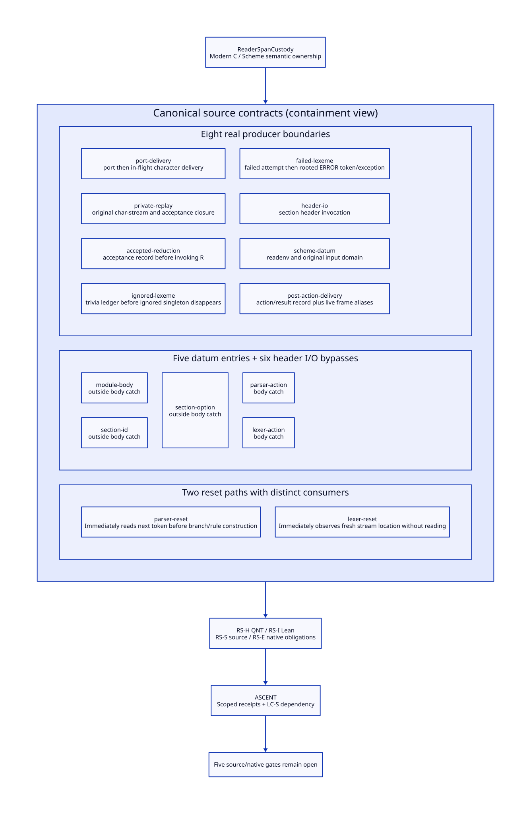

#+TITLE: Reader Span Producers, Entry Paths and Interrupted Custody
#+SETUPFILE: ../../modeling/org/setup.org
#+CATEGORY: toolchain
#+OPTIONS: toc:3 num:t
#+PROPERTY: header-args :eval never

* RESEARCH Source events before optimization :modern_c:gxi:gxc:
:PROPERTIES:
:CUSTOM_ID: reader-span-custody
:AUTHORITY: ReaderSpanCustody
:STATUS: source-census-derived-refinement-open
:EVIDENCE_CLASS: source-derivation-and-conditional-formal-models
:END:

This refines [[file:logical-cursor-design.org][the logical cursor contract]], not the runtime implementation.
The objective is a gxi/gxc compilation session whose read authority, source
provenance and interrupted work remain explicit. Scheme owns language and
control semantics; modern C owns necessary native delivery/root support.
Neither using Zig nor freezing arbitrary callbacks is required by this design.

The real module-loading connection is [[file:../../../../gerbil-gambit-bootstrap-audit/src/gerbil/expander/module.ss::283][core-read-module/lang's read-body]]: it imports
the #lang prelude, resolves its phase-1 read-module-body export, evaluates that
binding and invokes the procedure with inp under current-module-reader-path
and reader-args. Thus the EBNF reader is part of module reading used by compiler
sessions, not an invented standalone lexer. Unknown custom reader exports still
need their own domain-admission contract; this file census does not cover them.

[[file:models/sysml/reader-span-custody.sysml][SysML]] owns eight producer boundaries, five datum entries, two reset paths,
five open gates, three gain cases and RS-H/I/S/E obligations. The
[[file:../../modeling/tools/reader-span-study.py][Python runner]] reuses existing Python transport utilities, calls native SysML,
submits hypotheses through the dispatcher, evaluates [[file:../../modeling/ascent/reader-span-custody.rules.scm][actual ASCENT rules]]
through its Python API, and checks [[file:../../../models/build/reader_span_custody.qnt][QNT]] and [[file:../../../models/build/ReaderSpanCustody.lean][Lean]]. The [[file:reader-span-custody-matrix.org][matrix]] and 
are native-model projections. No native reader/compiler program is executed.
[[file:../../../evidence/research/reader-span-custody/checks.json][Receipts]] bind exact subjects, scopes and source bytes. Prior receipts remain
historical snapshots; no earlier unresolved claim is silently relabeled.

* RESEARCH Actual production and consumption
:PROPERTIES:
:CUSTOM_ID: span-producer-census
:END:

** Characters, accepted text and failure text have different producers
[[file:../../../../gerbil-gambit-bootstrap-audit/src/std/text/parser/ebnf/stream.ss::40][char-stream-getc]] either removes a character from its private buffer then
updates logical location, or records port-location, calls read-char, and
updates location/newline history. [[file:../../../vendor/gambit/lib/_io.scm::5240][The native primitive]] advances character-buffer
counters before returning the character and calls rbuf-fill on the slow path.
Port mutex scope does not itself make the outer Scheme location update one
atomic transaction. This identifies an in-flight delivery boundary; it does
NOT prove that call/cc can execute at every instruction between those writes.
The exact interrupt/capture/GC-safe cuts remain RS-E/source refinement duties.

[[file:../../../../gerbil-gambit-bootstrap-audit/src/std/text/parser/ebnf/lexer.ss::132][lex1]] accumulates reversed characters while taking regex derivatives. Its
saved acceptance closure at lines 158-176 holds accepted chars, start/end,
deltas, reductions and the original stream. It returns extra characters by
ungetc before invoking the first matching reduction R. There is a second
accepted-return endpoint at EOF, lines 139-146. Both must issue the acceptance
record BEFORE calling R, not after a token successfully returns.

The no-match continuation at lines 185-190 instead builds an ERROR token
with the unsuccessful consumed string and raises ParseError at lines 128-130.
That interval belongs to a failed-attempt horizon. It is neither an accepted
token nor discarded trivia. The old source does not provide a transactional
span ledger; adding this record is a proposed refactoring responsibility.

Ignored reductions have a real generator at [[file:../../../../gerbil-gambit-bootstrap-audit/src/std/text/parser/ebnf/deflexer.ss::40][deflexer lines 40-44]] and real
consumers at [[file:../../../../gerbil-gambit-bootstrap-audit/src/std/text/parser/ebnf/lexer.ss::62][token-stream-get lines 62-66]]. The singleton $ loses occurrence
identity/location. The parser's indentation, whitespace and comment rules at
lang-reader.ss:271-274 and lexer rules :323-324 therefore need occurrence spans
before the singleton is dropped. Not all skipped characters produce a token:
header I/O and Scheme-reader skipped text are separate producers.

** Mutable @@ prevents free source-storage reuse
[[file:../../../../gerbil-gambit-bootstrap-audit/src/std/text/parser/ebnf/lexer.ss::120][chars->string]] constructs the string passed to R. [[file:../../../../gerbil-gambit-bootstrap-audit/src/std/text/parser/ebnf/deflexer.ss::53][The generated reduction]]
binds @@ and @loc around user expr. A user expression may mutate or retain @@;
the generator imposes no immutability guard. A permitted expression shape
such as =(begin (string-set! @@ 0 #\x) @@)= is a source-level alias/mutation
counterexample specification, not an executed lexer test.

Therefore raw provenance can reuse numeric source coordinates, but replayable
raw contents need source-owned immutable chunks or a protected copy before
callback exposure. A token payload or mutable accepted string is insufficient.
Preserving existing mutation semantics means isolating the ledger; making @@
immutable would itself change behavior. Existing RX/quoted-token reductions
also transform text in [[file:../../../../gerbil-gambit-bootstrap-audit/src/std/text/parser/ebnf/lang-reader.ss::333][string->token-string/escape-chars]], confirming payload/raw
spelling are distinct even without mutation.

** Five datum entries are not the whole physical-port surface
The runner checks all five exact read-syntax sites in this file, plus the two
reset locations, against native SysML line metadata. The [[file:../../../../gerbil-gambit-bootstrap-audit/src/std/text/parser/ebnf/lang-reader.ss::88][header]] additionally has
peek-char :90/:105, read-char :96/:111/:120 and read-line :114. These six sites
must share the same authority. Peek may trigger refill while consuming zero
logical characters; read-line owns skipped comment text and terminator policy.
Error helpers :35-39 observe physical port name/location and are consumers too.
This is a bounded source-file census, not closure over reflective/native aliases.

| Datum entry | Post-read consumers | Exception/control boundary |
|---+---+---|
| :23 module body | AST-e test, body accumulation, section dispatch | Outside body catch; no-definition EOF uses read-error-token |
| :99 section id | identifier check, options recursion | read-section-head executes before with-catch is installed |
| :123 section option | cons option, recursive header probes | Same outside-catch boundary; header newline/comment I/O is observable |
| :166 parser action | reset :169, token-next :170, alternative/K/E and rule AST | Inside body catch; helper EOF syntax error is not ParseError |
| :238 lexer action | reset :242, location :243, make-rule :244, K :245 | Inside body catch; reset location is observed before any next character |

At [[file:../../../../gerbil-gambit-bootstrap-audit/src/std/text/parser/ebnf/lang-reader.ss::73][lines 73-76]], read-section-head is evaluated outside the with-catch around
read-body-e. The translation function at lines 60-71 translates ParseError
only when that catch is active; other errors are rethrown. Thus a custom
header reader raising the same ParseError class must not gain the body's
syntax-error conversion during migration. Even body conversion can allocate,
call token->syntax, query locations or itself fail before the replacement
exception exists. Keep original error/attempt roots until successor custody,
not merely until raise-e is entered. Diagnostic display can perform further
I/O, as shown in [[file:../../../../gerbil-gambit-bootstrap-audit/src/std/text/parser/base.ss::32][ParseError's display method]].

* RESEARCH Interrupted interval conservation and identity
:PROPERTIES:
:CUSTOM_ID: span-interruption-contract
:END:

Give every fetched decoded-character occurrence a source/domain generation and
offset; equal character values at distinct offsets remain distinct occurrences.
For a selected transaction, let P/A/T/U/F be pending delivery, accepted text,
trivia, unread lookahead and failed-attempt text. Their union covers fetched
occurrences, and they are pairwise disjoint. A transition moves custody before
its prior custodian releases it. The ledger is a unique accounting authority;
immutable source segments may have multiple rooted views without duplicating
ownership of the same accounting obligation.

An incomplete physical read remains owned by its native/port delivery record;
it is not silently included in the domain's completed-read frontier. The
QNT fetch action assumes that this bridge issues a complete finite batch.
Proving native buffer state maps into P, including refill errors/timeouts, is
an RS-E obligation; a guessed value or blind read retry is not that proof.

| Interruption cut | Authoritative custody | Required successor |
|---+---+---|
| Character fetched, outer location unfinished | In-flight record plus original port/stream | Publish occurrence and logical location, or retain unresolved native result |
| Partial unread suffix restoration | Acceptance closure and remaining suffix work | Finish ordered unget; do not release acceptance record at first push |
| Accepted span, reduction not returned | Acceptance record and live R frame | Token/trivia record, failed horizon, or still-pending invocation |
| Failed lexeme/error construction interrupted | Failed-attempt record | Rooted ERROR token/error; construction failure does not erase its text |
| Body error translation interrupted | Original exception and translation frame | Rooted replacement exception or retained original responsibility |
| Action returned, reset/K/E incomplete | Action result plus old/new stream aliases | Distinct post-action observation/delivery endpoint |
| Result may have completed but reply unknown | Original invocation record | Settle known value/error/control outcome without automatic replay |

[[file:../../../../gerbil-gambit-bootstrap-audit/src/std/text/parser/ebnf/defparser.ss::17][parser-rewind]] relies on token objects and eq list-tail identity. Preserve
those objects and view aliases; moving interval accounting does not authorize
relexing or rerunning reductions. The same condition applies to cached EOF
objects and token-stream-peek/unget, not merely the token's printed value.

[[file:../../../vendor/gambit/lib/_io.scm::12694][Readtable callbacks]] and generated reductions are real points at which user
code may capture or escape. Ordinary K/E lambdas are not themselves evidence
of captured continuations. A capture retains original live mutable objects and
the continuation's dynamic environment; [[file:../../../vendor/gambit/lib/_thread.scm::8555][restoration winds that environment]].
Reentry does not restore the ledger to saved offsets. Nor may an exactly-once
transport rule suppress legitimate multi-shot execution: reentering user code
can legitimately repeat its effects. A delivery receipt settles one operation;
source refinement must distinguish resuming a suspended invocation from a new
execution path that needs a fresh operation identity. The finite model checks
current-state observations only, not the full multi-shot control semantics.

* RESEARCH Retirement and net work
:PROPERTIES:
:CUSTOM_ID: span-retirement
:END:

1. Install one domain authority for character, header and datum operations;
   retain owned legacy instances for unqualified raw/native aliases.
2. Cover normal accept, EOF accept, ignored reduction and failure producers,
   with protected source contents before user code runs.
3. Preserve all five entry-specific consumers and exception routes; qualify
   dynamic readtables, roots and continuation restoration separately.
4. Replace parser reset only after its following-token/alternative/K/E effects
   match the selected mode. Replace lexer reset only after its immediately
   observed fresh location is preserved or explicitly repaired.
5. Retire old physical entry and reset instances only when their token, error,
   captured continuation and native aliases drain or remain represented by a
   qualified legacy view. An indefinitely retained capture blocks unconditional
   reclamation; reopening a closed input is not an allowed hidden repair.

The buffered quote repair from [[file:ebnf-cursor-handoff-design.org][the prior witness]] remains an explicit accepted-
behavior change. Corrected lexer-rule extent may also change exported
intermediate locations; Gambit's normal line/column packing means negative
off arithmetic alone is not evidence of a visible diagnostic defect.

The same upper bound remains: for A completed embedded actions, removing both
action reset constructors can remove at most 2A stream constructor calls plus
A initial-location constructor calls. This is not an additional saving on top
of the prior study, and no time/allocation speedup is inferred. Existing grammar
definition reuse is baseline. Native I/O and actual callback work remain.
Additional work includes source isolation/copying where required, per-span
records, interrupted-delivery accounting, location adaptation, pins and
settlement. Unique retained contents cost O(retained decoded characters), plus
O(spans + live views); capture lifetimes can make retained history unbounded.
Avoided work must exceed these added terms on the workload. Modern C and Zig
both need this support; no uniquely Zig saving is established by this study.

* RESEARCH Proof and evidence closure
:PROPERTIES:
:CUSTOM_ID: span-proof-closure
:END:

RS-H uses an occurrence-set QNT model with independently distinct accepted and
failure horizons, mutation isolation, entry-specific exception routing, roots
through wrapping, live captures and pending delivery. RS-I contains seven
conditional Lean kernels. RS-S requires actual event-to-state simulation and
mode-indexed safety reflection; RS-E requires native delivery/root/memory-order
qualification. SysML links RS-S to RS-H/I/E and LC-S. ASCENT must preserve all
ancestor needs rather than treating the new finite model as whole-component
closure. Synthetic positive/negative routing scenarios qualify inference only.

The source census checks sites/lines and exact file hashes, not semantic
callback purity or complete unmanaged-alias discovery. The source/ABI/root
gates remain unresolved even after bounded histories and conditional kernels
pass. No runtime implementation, native test or performance validation occurs.
