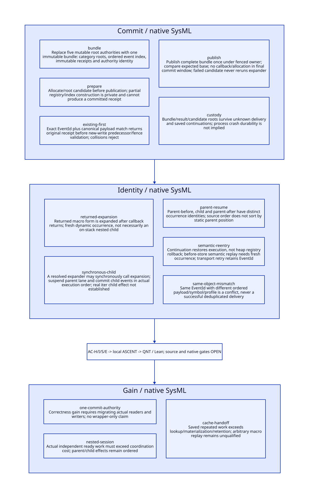

#+TITLE: Atomic Registry Bundles, Nested Macro Lineage and Retry Identity
#+SETUPFILE: ../../modeling/org/setup.org
#+CATEGORY: toolchain
#+OPTIONS: toc:3 num:t
#+PROPERTY: header-args :eval never

* RESEARCH Decision and scope :gambit:gerbil:modern_c:
:PROPERTIES:
:CUSTOM_ID: registry-atomic-commit
:AUTHORITY: RegistryAtomicCommit
:STATUS: conditional-local-models-source-platform-open
:EVIDENCE_CLASS: source-and-local-formal-research
:END:

Gambit retains declaration, parser, macro, continuation and private primitive semantics.
Gerbil owns incremental sessions, ordered effect delivery and result admission on the
modern C foundation. Replace the separate mutable registry authorities with one
complete state publication; do not put an optimistic journal around unmodified writes.
Separate atomic event commit from macro completion and from acknowledgement delivery.
This is a design, not an implemented registry service or a whole-macro transaction.

[[file:models/sysml/registry-atomic-commit.sysml][SysML]] owns commit/identity families, five source/action/lemma routes, three benefit
rows and seven open gates. [[file:../../modeling/tools/registry-atomic-commit-study.py][Python]] projects native SysML into [[file:../../modeling/ascent/registry-atomic-commit.rules.scm][actual ASCENT DSL]],
[[file:../../../models/build/atomic_commit_parameters.qnt][QNT parameters]], [[file:registry-atomic-commit-matrix.org][Org matrix]] and [[file:diagrams/registry-atomic-commit.d2][D2]] / . [[file:../../../models/build/registry_atomic_commit.qnt][QNT]], [[file:../../../models/build/RegistryAtomicCommit.lean][Lean]] and [[file:../../../evidence/research/registry-atomic-commit/checks.json][receipts]] retain local
check/source identities separately from host and native admission. No runtime/compiler
implementation, native test or performance experiment is performed.

* RESEARCH Source pressure and actual nested callers :source:
:PROPERTIES:
:CUSTOM_ID: atomic-registry-source
:END:

[[file:../../../vendor/gambit/gsc/_env.scm::290][Five registry globals]] are initialized independently; each define-* helper prepends
and performs one set!. [[file:../../../vendor/gambit/gsc/_ptree1.scm::2785][transform-declaration]] separately reads those roots in category
order. There is no EventId, payload identity, receipt index or joint publication in
these inspected helpers/readers. All these consumers must migrate to a captured bundle
view; updating five globals and then a journal is not the proposed linearization.

[[file:../../../vendor/gambit/gsc/_ptree1.scm::1004][macro-expand]] calls the expander, then sourcifies its return value. [[file:../../../vendor/gambit/gsc/_ptree1.scm::664][parse-exprs]] inserts
that returned form before the source tail; [[file:../../../vendor/gambit/gsc/_ptree1.scm::1501][extract-defs]] does the corresponding leading
definition scan. A macro returned inside an expansion is generally processed after
the callback returns. It is a later dynamic occurrence, not necessarily a child still
on the caller's native stack.

Gerbil has another concrete path: [[file:../../../../gerbil-gambit-bootstrap-audit/src/gerbil/expander/core.ss::208][core-expand-expression]] recursively expands a user
expander result; [[file:../../../../gerbil-gambit-bootstrap-audit/src/gerbil/expander/core.ss::254][core-expand*]] repeats until identity stops changing. [[file:../../../../gerbil-gambit-bootstrap-audit/src/gerbil/expander/core.ss::430][core-apply-expander]]
invokes a resolved procedure/method, and [[file:../../../../gerbil-gambit-bootstrap-audit/src/gerbil/expander/core.ss::484][core-apply-user-macro]] introduces a fresh mark
under definition context/phase. A transformer that itself calls expansion can create
a synchronous child. This is a supported execution seam, not evidence that the actual
iter transformer synchronously registers a child declaration.

[[file:../../../vendor/gambit/lib/_thread.scm::4623][SMP call/cc]] reifies a closure invoking continuation-return-aux; [[file:../../../vendor/gambit/lib/_thread.scm::4794][dynamic-wind]] stores
before/after thunks and a captured continuation in the dynamic environment. These
anchors lie in the enable-smp source branch (file line 9); non-SMP counterparts occur
later in the file. They establish restoration/control machinery, not a registry ledger
or a qualified native build. [[file:../../../vendor/gambit/gsc/_utils.scm::426][Compiler handler restoration]] similarly restores a global
throw continuation; it does not restore registry contents or make multi-session use safe.

* RESEARCH Complete bundle and publication cut :contract:
:PROPERTIES:
:CUSTOM_ID: complete-authority-bundle
:END:

#+begin_src text :eval never
AuthorityId = unique semantic owner/session incarnation
EventId = (AuthorityId, invocation lineage, semantic activation, occurrence ordinal)
RegistryBundle = {
 ordered category roots[5], registry identity,
 immutable EventId -> {canonical request, predecessor, resulting view, receipt},
 source-order / lineage position, immutable-profile identity
}
PreparedCommit = {expected bundle identity, writer permit/fence,
                  rooted candidate bundle, exact EventId/canonical request}
#+end_src

The event index contains exact immutable receipts, not just a boolean applied flag.
An EventId is not a registry counter. A fingerprint is only an accelerator unless
its canonical equality relation is proved; same EventId with a different symbol,
category, named payload, profile or owner domain is an error, never successful dedup.

The correctness target follows [[https://www.cs.columbia.edu/~wing/publications/HerlihyWing90.pdf][Herlihy and Wing, Linearizability (1990)]]: the
operation has one semantic effect between invocation and response. A pending response
can follow a committed effect; response loss is not rollback. Applying that criterion
to this specific bundle is a design obligation, not a completed source proof, and
linearizability alone supplies neither disk durability nor continuation semantics.

The proposed linearization is a single complete bundle publication. Under a serialized
owner it is a noncallback commit in the owner's lane. With concurrent readers it
requires a GC-aware publication handle and the actual C synchronization/lifetime
proof; a bare atomic pointer to movable Scheme storage is insufficient. Candidate
roots/index/receipt allocation, validation and possible allocation failure precede
that final window. No arbitrary expander/eval callback runs while a commit lock is held.
Async interruption, allocation safepoints and unwinding must have explicit safe cuts;
this study does not assume an uninterruptible arbitrary Scheme expression.

| Stage | Shared authority | Candidate / custody |
|---+---+---|
| Reserve and build registry | Old complete bundle | New root spine private/rooted; no successful receipt |
| Build index and receipt | Old complete bundle | Complete candidate private/rooted; failure may discard it |
| Verify fresh-write permit/base and publish | One transition from old to complete candidate | Transfer authoritative bundle custody; record exact receipt |
| Reply or lose acknowledgement | New complete bundle | Retain receipt and dependent roots; do not undo commit |
| Retire old read view | Current bundle remains complete | Release only after all snapshot/continuation/native holders retire |

Registry-only or index-only publication is forbidden. Existing old category aliases
cannot remain an independent writable authority. Source parsers, extension helper
calls and reflective/native access must use the managed snapshot/commit contract or
be excluded from reusable service profiles. Existing registry semantics, category
priority and declaration-list order remain in Scheme; a native service does not
reinterpret them.

** Existing-event lookup must precede fresh-write validation

#+begin_src text :eval never
resolve request in the exact authoritative owner domain:
  if EventId exists:
    require canonical request equality
    return the stored receipt and its original resulting view
  else:
    require live writer permit/fence + matching expected base + legal lineage order
    prepare/validate complete candidate without replaying user code
    commit whole bundle iff those premises still hold
#+end_src

After parent-before committed receipt 1, a nested child can commit receipt 2. A lost
reply for parent-before must still return receipt 1 even though the current root is
newer. Requiring the old predecessor for this read would misclassify a valid retry;
returning the current registry identity would forge the original outcome.

This is a late/retransmitted-request requirement. If the local helper caller is
still blocked awaiting that same acknowledgement, its synchronous child cannot
simply run ahead. Progress before an external observer receives a reply requires a
separate local execution/receipt-delivery boundary. The current QNT nested trace
resolves the local delivery first and then tests a later old-event lookup after the
child commits; it does not prove nested progress under an unresolved local reply.
The existing helper returns Scheme empty-list, so local user return and service
receipt delivery also need their own source/PC outcome relation.

Old writer permits are forbidden from creating new events after owner fencing. A
read-only resolution of an already committed exact event can still return its stored
receipt while that authority's journal remains available. A new owner incarnation
with an empty journal is not proof that an old request was uncommitted. Transfer the
complete authority under a qualified protocol or retain the result as unknown.

Base/fence failure discards or parks only the prepared candidate. It must not restart
the macro body to reconstruct an unknown effect. Rebase of a pure registration event
is admissible only when predecessor/order semantics explicitly allow it; the default
specified-predecessor contract rejects. Disk durability and process-crash recovery
would require additional journal/commit evidence and are not promised by an in-memory
atomic bundle or this finite model.

* RESEARCH Nested order, fresh occurrences and saved PCs :control:macro:
:PROPERTIES:
:CUSTOM_ID: nested-event-identity
:END:

| Execution case | Identity / order | Required ownership |
|---+---+---|
| Parent registers, synchronously expands child, then registers again | Parent-before, child, parent-after are three dynamic occurrences | Parent lane suspended while child runs; shared per-context committed prefix advances in actual order |
| Callback returns a form containing another macro | Later parser/expander work item with fresh occurrence identity and source relation | Do not hold an artificial parent stack lease merely from syntax nesting |
| Lost reply for parent-before after child commit | Same EventId, original receipt, no additional write | Exact authoritative lookup; newer current generation does not replace old receipt |
| Continuation resumes before a source registration instruction | Genuine semantic execution can register again, under a fresh occurrence/activation | Identity allocation cannot be a rewindable counter stored only in captured frames |
| Continuation resumes after registration | Keep committed prefix and resume remaining source PC | Restoring control is not restoring registry heap; no automatic second registration |
| Continuation resumes inside a pending delivery protocol | Distinguish accepted/committed event identity from user instruction replay | Requires explicit resumable protocol-state relation; arbitrary native PCs remain unqualified |

Invocation/occurrence issuance belongs to the semantic owner outside rewindable user
state. Allocate identity for a new actual event execution, not for each network or
mailbox retry. Do not allocate a fresh identity merely because a continuation was
invoked: resuming after a completed instruction can require no new registry event.
Conversely, preserving a captured local EventId at a before-store PC can wrongly
suppress legitimate reexecution. The actual PC/event relation is a source obligation,
not inferable from pointer equality of continuation objects or source locations.

The QNT model explicitly represents parent-before id 0, child id 1, parent-after id 2,
and fresh before-store activation id 3. These are finite symbolic identities, not a
runtime numbering scheme. Its synchronous child branch is conditional on the real
expander making such a call. Actual iter expansion retains its lexical marks/context,
source and phase through GeneratedSchemeResult and the previously studied private
Gambit primitive/view relation; no iter registry effect is invented here.

* RESEARCH Exceptions and roots :custody:
:PROPERTIES:
:CUSTOM_ID: atomic-commit-custody
:END:

Failure before publication leaves old authority unchanged. Partial allocation remains
candidate-owned; cleanup must not create a success receipt or destroy source holders.
After publication, an exception/unknown reply leaves the event committed. The exact
receipt and ordered prefix remain owned by the authority; dependent task coordination
retains unresolved custody instead of retrying arbitrary expander code.

Captured continuations, exception objects, callback arguments and native borrowers
can retain bundle/result references after a lexical return. Root retirement therefore
requires an actual holder/drain receipt. dynamic-wind before/after activity is itself
source execution; it cannot be treated as a generic exactly-once cleanup action.
Cancellation acknowledgement and owner timeout are not root-release evidence.

The design must distinguish the permanent authoritative bundle root, transient
candidate roots, retained snapshots/results and continuation/native holder roots.
QNT's roots flag abstracts only outstanding attempt/saved custody and assumes shared
bundle values remain held by the service; it is not a GC root-map proof. Exception
conversion, nonlocal return and unresolved owner transfer remain platform/source gates.

* RESEARCH Model, refinement and closure :sysml:ascent:qnt:lean:
:PROPERTIES:
:CUSTOM_ID: atomic-commit-closure
:END:

| Duty | Local scope | Open refinement |
|---+---+---|
| AC-H | 21 QNT scenarios including 10 negative controls; private root/index stages, complete publication, original receipt after child commit, payload conflict, base/fence and root/lineage controls | Four symbolic events, one context attempt, mathematical atomic steps; not weak memory/durable crash/GC or full continuation semantics |
| AC-I | Ten Lean lemmas: complete-state projection, existing lookup before base/fence checks, payload conflict, fresh-write rejection, distinct activation, unchanged lookup state, retained roots, unpublished abort and work threshold | Model definitions specify desired transition; do not prove current source already implements it |
| AC-S | Five native SysML source/action/lemma routes evaluated by actual ASCENT DSL | Depends on OD-S; lexical/PC/registry heap simulation and all indirect writers remain open |
| AC-E | Independent environment route | GC-aware C publication, async/unwind cuts, memory order, host registration and measured benefit |

Controls preserve registry-only/index-only publication, wrong canonical payload,
current-generation reply, stale fence/base commit, child/resumed identity collision,
unknown-result root loss and premature child return. Base/fence counterexamples record
the actual permit and prior state at the forced commit, not just a claimed success flag.

Eight ASCENT local scenarios retain current/missing/stale/wrong-scope routing,
synthetic-all, unqualified publication, missing source anchor and missing model step.
A synthetic qualification case is only a negative-control harness. All seven real
gates remain open; the inherited host attestation gap is not retried unchanged.
Org/D2 are native SysML projections; formal checks are not runtime or performance tests.

* RESEARCH Retirement and net benefit :benefit:
:PROPERTIES:
:CUSTOM_ID: atomic-commit-benefit
:END:

[[file:registry-atomic-commit-matrix.org][Canonical matrix]] separates complete-state correctness, independent context lanes
and reusable pure handoff. Required retirement order is: classify/admit actual writers;
make parser readers consume one snapshot; move real writes and receipt index into
one authority; prove source/continuation/GC cuts; retire old mutable category/helper
authority and global cross-session coordination only when all consumers migrate.
Keeping both authorities writable would defeat the atomic contract.

For n equivalent pure demands, work C, key/receipt validation V, private materialization
M, total candidate/index/publication/drain cost L and initial sealing S, conditional
work benefit requires (n-1)*C > n*(V+M)+L+S. Candidate persistent-path copying, failed
base/fence attempts, receipt retention, payload checks and old snapshot roots are
costs. Existing one-time registration and Scheme list sharing remain baseline.

Atomic publication prevents inconsistent observations and duplicate retry effects;
those are correctness gains, not measured compilation acceleration. Shared immutable
inputs and per-context lanes can expose safe parallelism across independent consumers,
while source-visible parent/child effect order remains serial. Low reuse, expensive
candidate construction or long-lived saved continuations can negate work/span/memory
benefit. This research does not claim a speedup from these conditions alone.
