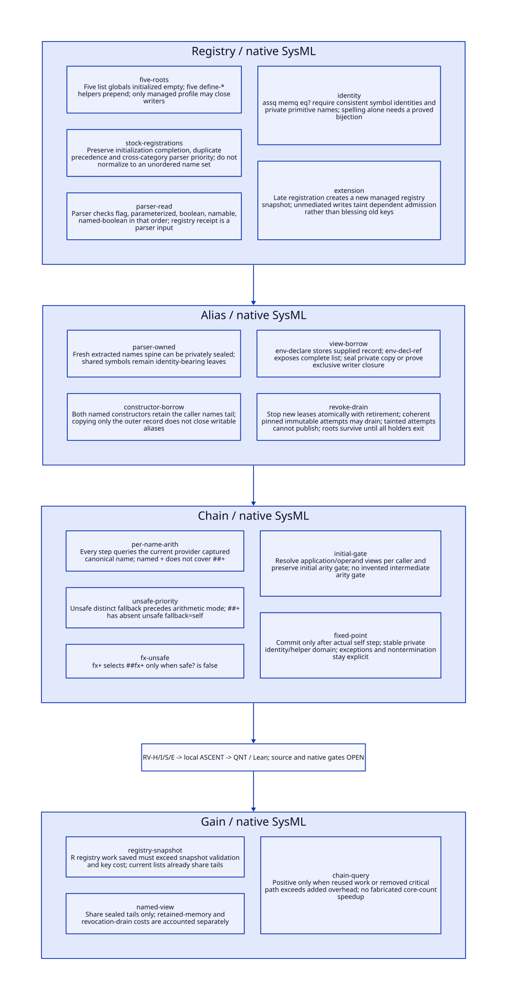

#+TITLE: Declaration Registry, Named Payload Sealing and Full Specialization Chains
#+SETUPFILE: ../../modeling/org/setup.org
#+CATEGORY: toolchain
#+OPTIONS: toc:3 num:t
#+PROPERTY: header-args :eval never

* RESEARCH Architectural decision :gambit:gerbil:modern_c:
:PROPERTIES:
:CUSTOM_ID: registry-view-sealing
:AUTHORITY: RegistryViewSealing
:STATUS: conditional-models-source-platform-open
:EVIDENCE_CLASS: source-and-local-formal-research
:END:

Gambit supplies compiler semantics and the modern C runtime/backend foundation;
Gerbil owns incremental queries, immutable result admission and private compilation
sessions. Introduce separate RegistryReceipt, DeclViewReceipt and AttemptLease
contracts. A registry snapshot describes parsing; a declaration view describes the
ordered effective policy; a private primitive graph describes provider identities.
None substitutes for another. This is a proposed replacement of global authority,
not an extra long-lived mutable wrapper around it.

[[file:models/sysml/registry-view-sealing.sysml][Native SysML]] owns registry/alias families, five source-to-model chain routes,
benefit rows and seven open gates. [[file:../../modeling/tools/registry-view-sealing-study.py][Python]] projects its values into [[file:registry-view-sealing-matrix.org][Org matrix]],
[[file:diagrams/registry-view-sealing.d2][D2 source]] / , [[file:../../../models/build/registry_sealing_parameters.qnt][QNT parameters]] and actual [[file:../../modeling/ascent/registry-view-sealing.rules.scm][ASCENT DSL]] relations. [[file:../../../models/build/registry_view_sealing.qnt][QNT]] and
[[file:../../../models/build/RegistryViewSealing.lean][Lean]] check the stated abstract protocols, not Gambit execution. [[file:../../../evidence/research/registry-view-sealing/checks.json][Checks]] retain
source/log identities. No runtime/compiler implementation, Scheme generation,
native test or performance experiment is performed.

* RESEARCH Registry writer closure :source:registry:
:PROPERTIES:
:CUSTOM_ID: registry-writers
:COMPLETENESS: stock-gsc-syntactic-census-not-open-world-alias-proof
:END:

[[file:../../../vendor/gambit/gsc/_env.scm::290][Five registry globals]] begin empty. Each of the five define-* helpers prepends
a fresh entry/list head using set!, then returns the empty list:

| Registry | Writer | Stored entry | Stock registration owner |
|---+---+---+---|
| flag-declarations | define-flag-decl | (name . type) | _ptree1.scm:483-498 |
| parameterized-declarations | define-parameterized-decl | (name . allow-boolean) | _ptree1.scm:495 and _back.scm:594 |
| boolean-declarations | define-boolean-decl | name | _ptree1.scm:489-524 |
| namable-declarations | define-namable-decl | (name . type) | _back.scm:575-589 |
| namable-boolean-declarations | define-namable-boolean-decl | name | _ptree1.scm:494-526 |

The driver retains a line-addressed stock registration inventory and three full
syntactic corpora: registry references, payload producers/accessors and specializer
callers. The current selected compiler has 41 top-level registration forms in
_ptree1.scm and _back.scm: 7 flag, 2 parameterized, 16 boolean, 11 namable and
5 namable-boolean forms. Native SysML owns the expected total; the source census
checks it independently. fixnum.scm includes quoted optimization names, not extra
registrations. vendor/gambit/bench/src/compiler.scm is a distinct benchmark compiler,
not part of this selected gsc registry. A textual corpus cannot establish lexical
binding, reflective reachability or the absence of indirect stores.

[[file:../../../vendor/gambit/gsc/_ptree1.scm::2785][transform-declaration]] checks categories in fixed order: flag, parameterized,
boolean, namable, namable-boolean. assq selects the first matching entry within its
category; prepending a duplicate in that category can change its metadata. Merely
registering the same name later in another category does not override the earlier
category's parser priority. Deduplication/sorting across categories is unsound.

** Required registry receipt

#+begin_src text :eval never
RegistryReceipt = {
 orderedEntriesByCategory, categoryDispatchOrder, grammarProfile,
 canonicalSymbolDomain, initializationClosure, extensionPolicy,
 snapshotIdentity, ownedImmutableStorage, rootsAndLifetime
}
#+end_src

InitializationClosure requires completion of both frontend and backend declaration
registrations and all admitted initialization dependencies. Checking that one module
loaded or one list is nonempty is insufficient. Managed late registration creates a
new snapshot under exclusive writer authority; it does not mutate an old immutable
snapshot. Module reload/global reset, direct set!, exposed list/entry pair stores,
reflection, native mutation and compiler extensions must either enter this authority
or reject reusable admission. Existing source has no such admission protocol.

Registry changes invalidate dependent parsing and the new request's query identity.
An already transformed immutable declaration record does not retroactively change
because a parser registry is extended. Reuse still requires the same requested
registry/grammar semantics and proof that transformation used that snapshot.
This separates derivation provenance from the value of a frozen declaration view.

* RESEARCH Named payload alias closure :alias:roots:
:PROPERTIES:
:CUSTOM_ID: named-payload-alias
:END:

[[file:../../../vendor/gambit/gsc/_env.scm::327][namable-decl and namable-boolean-decl]] allocate two prefix cells and retain the
provided names tail. env-declare additionally retains its supplied record. Aliases
can therefore run from caller names -> record cddr -> environment declaration head
-> node environment and saved CPS scope. env-decl-ref exposes that list; functional
env setters and env-frame propagate it. No existing accessor grants immutability.

[[file:../../../vendor/gambit/gsc/_ptree1.scm::2852][extract-names]] is a narrower positive case: it validates symbol objects and
allocates a fresh proper names spine. It preserves symbol identities, not input
source-wrapper/list identities. The extracted cells pass directly to the named
constructor; stock transformation itself does not publish their separate writable
alias. Subsequent record/list exposure still needs writer closure. Symbol objects
are identity-bearing leaves, not permission to clone them or trust arbitrary unsafe
symbol mutation. Flag type and named type values obtained from a custom registry
also need schema validation; arbitrary helper arguments are not stock-profile data.

| Source path | Seal condition | Refusal / failure responsibility |
|---+---+---|
| Stock parser-produced names | Complete successful transform; unexposed fresh cells; stable admitted registry and symbols; close subsequent writers | Partial construction remains attempt-private/rooted; syntax errors retain source/phase observer |
| Direct named constructor | Exclusive ownership of names and record, OR stable-read private copy with symbol identity preserved | Shallow outer copy cannot close names aliases; unknown alias denies sharing |
| Borrowed mutable input | Close mutation admission and establish a stable view before validating/copying | Copying concurrently changing data is not a snapshot; reject without stable read evidence |
| Inherited sealed declaration tail | Retain parent's immutable storage and receipt; validate only new prefix | Parent retirement closes new leases, not existing roots |
| Malformed/cyclic payload, unknown extension/FFI store | No stock managed receipt | Keep caller custody; do not silently repair malformed declaration semantics |

The relevant source lookup uses eq? for record key and memq for names; empty names
means universal. A transport must preserve/reflect those equality relations for all
queried symbols. Persistent cache identity uses qualified canonical symbols and
ordered values, not private addresses. Full closure of arbitrary reflective or FFI
writers remains unresolved; the positive statement is conditional on a closed
managed profile.

* RESEARCH Seal, revoke and drain :protocol:continuation:
:PROPERTIES:
:CUSTOM_ID: seal-revoke-drain
:END:

#+begin_src text :eval never
prepare -> stable-read/classify -> private immutable graph -> seal receipt
seal -> atomic attempt admission -> rooted lease -> whole-chain computation
retire -> close new admission -> drain admitted immutable attempts -> root release
taint -> close admission -> forbid result publication -> abort/drain -> root release
#+end_src

Seal commits the registry, ordered view and primitive/helper domain together for an
attempt. Validation before acquiring writer exclusion is not sufficient: a surviving
alias can mutate between validation and publication. The proposed admission/retire
linearization must decide whether a concurrent attempt acquired its lease before
closure. Actual modern C synchronization, acquire/release publication and root
registration are source/platform obligations, not consequences of a QNT action.

Retirement is an ordinary change of request generation. An admitted attempt may
finish/publish an old-generation result only while its complete immutable inputs and
observer remain valid; it must never satisfy a new-generation request by changing
the result key. Taint denotes loss of those premises, not ordinary retirement:
tainted attempts cannot publish. If corruption is discovered after publication,
dependent reuse must be quarantined/invalidation propagated; the current QNT slice
only models prepublication taint, and does not prove postpublication recovery.

Cancellation/exception/unknown delivery is not a root-release receipt. Leases include
all callbacks and resumable/multishot continuations retaining the view; a callback
return alone need not end that lifetime. Existing CPS declaration restoration changes
only the returned env's declaration field. It cannot revoke another holder's roots
or undo bindings learned in the body. A new holder after closure must be denied or
explicitly derived from an existing accounted lease; that derivation is outside the
single-holder QNT slice. Unknown holders keep custody and admission unresolved.

* RESEARCH Selected full specialization chain refinement :iter:source:
:PROPERTIES:
:CUSTOM_ID: named-full-chain
:REFINEMENT_SCOPE: selected-total-plus-providers-conditional-on-source-view-relation
:END:

[[file:../../../../gerbil-gambit-bootstrap-audit/src/std/iter/macros.ss::130][for1-in-range-generic]] produces (+ k $step) in both loop directions. Gerbil's
[[file:../../../../gerbil-gambit-bootstrap-audit/src/gerbil/compiler/compile.ss::401][annotation/declaration generation]] transports source declarations; it does not
prove the eventual Gambit mode. Generated bindings, node environments, optimizer
rewrites and the actual target remain explicit inputs. No generated iter artifact is
produced or inferred from type annotations here.

| Source operation | Abstract relation / obligation |
|---+---|
| [[file:../../../vendor/gambit/gsc/_ptree1.scm::353][specialize-app]] | Constant primitive or eligible global resolution; caller-specific operand resolution view and application selection view |
| [[file:../../../vendor/gambit/gsc/_ptree2.scm::187][epc-app]] | This caller selects operand node-env; unlike app helper, it initially obtains target primitive directly; preserve its binding tests/transformed arguments separately |
| [[file:../../../vendor/gambit/gsc/_ptree1.scm::367][specialize-proc]] | Nonfalse initial object and initial arity check, same env throughout, constant/void argument projection at every call |
| [[file:../../../vendor/gambit/gsc/_prims.scm::1793][def-spec]] | Each installed closure captures its own canonical proc-name and private self/cross-primitive references |
| [[file:../../../vendor/gambit/gsc/_prims.scm::1818][spec-arith]] | Lookup arithmetic policy using CURRENT provider name; then unsafe-distinct priority, fixnum, flonum, self |
| [[file:../../../vendor/gambit/gsc/_prims.scm::1889][+ / ##+ registrations]] | + has unsafe ##+; ##+ omits unsafe argument, therefore unsafe=self |
| [[file:../../../vendor/gambit/gsc/_prims.scm::2075][fx+]], [[file:../../../vendor/gambit/gsc/_prims.scm::2128][fl+]] | Unsafe spec-u edge to ##fx+ / ##fl+ |
| [[file:../../../vendor/gambit/gsc/_gvm.scm::189][Default specializer]], [[file:../../../vendor/gambit/gsc/_ptree1.scm::376][eq? stop]] | Default self identity terminates; private mapping must preserve self and downstream helper equality |

** Why named declarations change the complete trace

Under admitted binding, arity, symbol and private-provider premises:

| Effective selection declarations | Conditional source sequence including terminal self call |
|---+---|
| safe + named (fixnum +) | + -> fx+ -> fx+ |
| unsafe + universal (fixnum) | + -> ##+ -> ##fx+ -> ##fx+ |
| unsafe + named (fixnum +) only | + -> ##+ -> ##+ |
| unsafe + named (fixnum + ##+) | + -> ##+ -> ##fx+ -> ##fx+ |
| unsafe + earlier universal fixnum, later named (generic ##+) | + -> ##+ -> ##+ |

The earlier study's unsafe-fixnum chain requires the mode premise to hold at ##+;
this table makes that premise explicit. Carrying the initial + policy through all
steps changes the named-only case. QNT uses source-aligned primitive IDs and ordered
named/universal declaration records, not a single mode per whole chain. Advance
models one nonterminal or terminal provider transition; completeAttempt observes the
self condition. No runtime fuel bound or intermediate arity check is introduced.

Lean proves the selected unsafe-first/named-generic/fx-unsafe equations and injective
fixed-point transport; the preceding chain theorem supplies bounded-walk induction.
The table/source anchors are statically checked and ASCENT checks five required
anchor/action/lemma mappings. This is not an automated Scheme interpreter or a
complete source simulation. Other specializers using actual constant arguments,
provider #f/errors, custom cycles, exception provenance and actual iter transformation
still require outcome-sensitive refinement. Those gates remain open.

* RESEARCH Model closure and retirement :sysml:ascent:qnt:lean:
:PROPERTIES:
:CUSTOM_ID: registry-sealing-closure
:END:

| Obligation | Checked local scope | Still open |
|---+---+---|
| RV-H | QNT named/universal precedence, private identity, sealed admission, retire/drain, prepublication taint; two workspace starts | Full GC/continuation heap, multi-holder leases, memory order and postpublication taint |
| RV-I | Ten Lean lemmas: named membership/ordered lookup transport, selected provider equations, fixed-point identity, retirement preservation, arity rejection, taint rejection and work threshold | General source lookup/registry simulation and actual lease implementation refinement |
| RV-S | Five SysML chain routes checked against actual action/lemma names and source fragments; source census retained | Semantic truth of Scheme-to-abstract relation; depends on DC-S |
| RV-E | Explicit separate platform route | Modern C roots, SMP/FFI, admission atomics, native lifetime and observed performance |

ASCENT evaluates eight local cases: current, missing QNT, stale subject, wrong Lean
scope, synthetic-all, unqualified-chain, missing source anchor and missing model
step. The synthetic case tests admission logic, never serves as real evidence.
Current source/platform and external DC-S remain unqualified. Host attestation remains
the inherited unresolved registration gap, not retried unchanged. Local native ASCENT
engine execution is not host registration or compiler-native acceptance.

Retire old mutable global registry authority only after all registration, transform,
reflective-extension admission and initializer paths use snapshot identity. Retire
borrowed named-tail authority only after every producer uses private immutable data
or a fully closed ownership protocol. Retire primitive/global helper authority only
after parser, optimizer, analysis, GVM and emission consumers use the same private
domain. Removing these global authorities is what enables independent sessions;
parallelizing calls around unchanged globals would not establish that property.

* RESEARCH Net benefit and falsification :benefit:
:PROPERTIES:
:CUSTOM_ID: registry-sealing-benefit
:END:

[[file:registry-view-sealing-matrix.org][Canonical matrix]] records avoided work, added support and admission conditions.
For N attempts with the same qualified registry, current registration/setup work is
not assumed to repeat N times: source module initialization may already be one-time.
Count only work the actual chosen architecture would otherwise perform. Snapshot
sharing can avoid new per-session duplication; existing persistence is baseline.

For repeated keys k, let n(k) be demand count, C(k) uncached specialization/downstream
work, V(k) key/validation cost, M(k) per-consumer private materialization and P(k)
total publication/retirement cost per key. Conditional saved work is
sum_k[(n(k)-1)*C(k)-n(k)*(V(k)+M(k))-P(k)] minus one-time sealing/support work.
A positive result requires that expression > 0. Span additionally depends on actual
independent ready consumers and removed global serialization; retained immutable
snapshots and outstanding continuation leases add memory. These are work/memory
inequalities, not timing claims. Low reuse, cheap providers, alias-copy-heavy profiles
or unbounded retained continuations can falsify positive net benefit.

The value is independent-session semantics and principled reuse of Scheme/compiler
state on Gambit's modern C foundation. Zig is not required for these properties;
no language switch receives credit for an unimplemented ownership or scheduling
contract.
