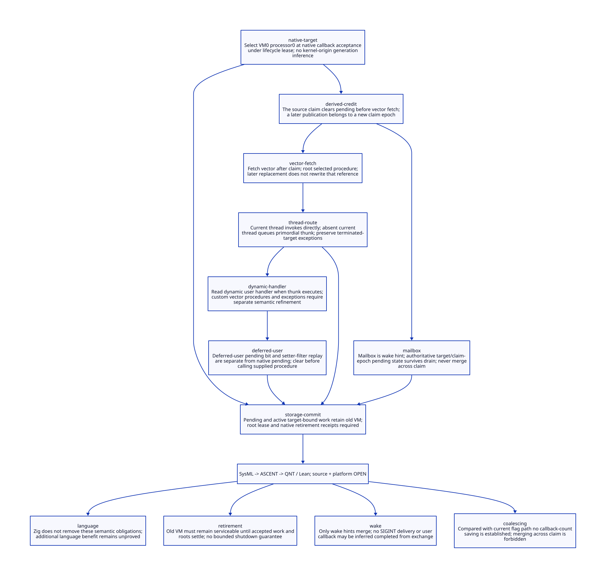

#+TITLE: SIGINT Delivery Cuts Across VM Retirement
#+SETUPFILE: ../../modeling/org/setup.org
#+PROPERTY: header-args :eval never
#+OPTIONS: toc:3 num:nil

* RESEARCH Decision and scope
:PROPERTIES:
:CUSTOM_ID: sigint-delivery-semantics
:STATUS: conditional-models-source-open
:CANONICAL_MODEL: models/sysml/sigint-delivery-semantics.sysml
:END:

Modern C is the mandatory runtime direction. This study refines
[[file:signal-gate-mailbox-design.org][the frozen gate/mailbox contract]] for the actual SMP SIGINT chain. A stable
process mailbox can preserve native custody without preserving delivery semantics.
For the compatibility lane it is a wake hint: target-bound pending state and its
claim boundary remain authoritative. No automatic reassignment to a new VM is
admitted. A process-current-at-drain policy is a separate, explicitly changed API.

SysML is the authority for eight components, ten contract dependencies, seven
open gates and four benefit rows. Python queries native SysML, derives Org/D2
and feeds actual ASCENT rules. QNT explores interleavings; Lean proves an
unbounded serial raise/claim refinement under explicit representation premises.
These are design/model checks, not runtime, native ABI or performance acceptance.
The existing runtime and all frozen parent receipts are unchanged.

* RESEARCH Source chain and semantic sampling cuts
:PROPERTIES:
:CUSTOM_ID: sigint-delivery-semantics-source
:END:

Paths below are relative to vendor/gambit; their exact bytes are hashed in the
[[file:../../../evidence/research/sigint-delivery-semantics/input.json][input receipt]]. A syntactic source census is not an embedding-caller completeness proof.

| Cut | Source | Source behavior | Required refinement |
|-
| Native entry | lib/os_tty.c:8700–8714 | SIGINT invokes tty module user_interrupt_handler | Int-only ingress carries no VM generation or kernel-origin timestamp |
| Native target | lib/os_setup.c:3044–3049 | user_intr selects GSTATE vmstate0 and processor 0 | Choose target at equivalent callback acceptance, not signal creation or eventual drain |
| Publish | lib/setup.c:66–92 | intr_flag assignment precedes masking, stack trip, fence and select abort | Pending may exist without immediate wake; wake failure cannot cancel accepted work |
| Claim | lib/setup.c:206–242 | Lowest enabled unmasked code chosen; flag cleared before returned code | Later raise can create another pending delivery before first callback finishes |
| Vector fetch | lib/_kernel.scm:1448–1469 | vector-ref follows service; #f becomes a no-op; selected procedure is locally bound | Preserve late lookup and root selected procedure; do not pre-capture at signal arrival |
| Vector writer | lib/_kernel.scm:1473–1476 | Setter mutates global vector with interrupts-disabled declaration | No proof of cross-processor exclusion follows from that declaration |
| Default installation | lib/_thread.scm:3218–3237 | Entry 3 becomes ##user-interrupt! | Startup/default installation is a semantic transition, not an immutable handler |
| Thread branch | lib/_thread.scm:3245–3251 | With current thread invoke thunk directly; otherwise queue on primordial | Preserve this branch, not arbitrary thread selection or always-primordial |
| Queue ownership | lib/_thread.scm:1320–1394 | Result mutex stores thunk and target; terminated target may cause abandoned-mutex exception | Native acceptance is not queued-thunk completion; retain target and roots |
| Queue consumption | lib/_thread.scm:1398–1429,2715–2745 | Execute thunk on matching current target or resumed thread; repropagate otherwise | Root/denv/exception obligations survive signal-handler exit |
| Dynamic lookup | lib/_thread.scm:5332–5353 | ##handle-user-interrupt! reads current-user-interrupt-handler when it executes | Queue the thunk, not an early snapshot of the dynamic parameter |
| Deferred replay | lib/_thread.scm:5303–5328 | Default sets pending-user bit; setter filter clears it then invokes supplied procedure | Separate coalescing stage; a throwing replay is not undone or replayed twice |
| Lifecycle | lib/setup.c:341–360,4834–4878,6243–6316 | Setup clears flags; cleanup disables handling before processor/VM cleanup | No proof that a signal straddling restart is accepted, replayed or generation-tagged |

There are four different observations: native target, vector procedure, thread
branch/target, and dynamic user handler. The last two occur only on paths that
actually use the default bridge. An arbitrary custom vector procedure may raise,
capture a continuation, mutate policy or bypass the bridge entirely. Treating
all vector entries as wrappers would silently restrict Scheme semantics.

The current non-atomic flag read/clear and volatile declaration (include/gambit.h.in:
11655–11657) do not constitute an ISO C concurrency proof. The source-serial
reference is a constrained specification extracted from control flow, not a claim
that every concurrent native history is defined or race-free. Modernizing this
part is a correctness redesign; repairing undefined races is not measured speedup.

* RESEARCH Native target and retirement protocol
:PROPERTIES:
:CUSTOM_ID: sigint-delivery-semantics-target
:END:

A proposed AcceptedUserInterrupt receipt contains route incarnation, logical
VM0/processor0 identity, acceptance cut and custody state. It contains no hidden
SCMOBJ in signal storage. The permanent shell remains process-owned; only successful
lifecycle admission permits dereferencing the target. A failed CAS, stale snapshot
or closed gate grants no target authority. The previous gate proof still applies.

The callback-acceptance cut must be mapped to the original user_intr target read.
Moving target selection to native entry or normal-thread drain can straddle a VM
replacement and produce a different target. Pinning earlier may be memory-safe
but needs a simulation argument, not a new timestamp named equivalent. If that
argument cannot be supplied for an embedding profile, reject compatibility admission.

After acceptance, pending flag work, a selected vector closure, an enqueued thunk
and an executing callback all keep their original target custody. A native handler
pin may end once accepted state is safely handed off; it cannot stand in for the
longer VM/root leases. Unknown enqueue/acknowledgement results retain custody and
query their original transaction; timeout is not permission to replay on another VM.

| Arrival/history | Compatibility decision | Custodian and retirement effect |
|-
| Kernel generated signal while old VM ran; callback first executes after replacement | Origin VM is unknowable from int-only signal | Preserve callback-time selection only under a qualified target-cut mapping; do not infer old generation |
| Callback accepted on old VM before route close | Preserve old target | Old VM remains serviceable through pending/selected/queued/executing work and root retirement |
| Gate closes before acceptance; old VM still exists | No acceptance receipt | Stable shell retains unresolved intent or records explicit rejection; cannot pretend old target accepted |
| No VM active between retire and start | Reject exact replay admission | Stable process custody may survive; it is not proof of old or new delivery |
| New route open and callback newly accepted | New target only for this new acceptance | Never consume unresolved prior intent as a new acceptance without explicit policy |
| Old accepted request survives new startup | Never rebind | New VM startup does not discharge old target or root custody |
| Legacy before-init/reset interval | Scope unresolved | setup clears flags and early masking exists; exact disposition/install history must be established before claiming ignore equivalence |

SIGINT is not a reliable counted message or a VM-origin envelope. Apple's
[[https://developer.apple.com/library/archive/documentation/System/Conceptual/ManPages_iPhoneOS/man2/sigaction.2.html][archived sigaction manual]] distinguishes generation, pending state and delivery,
and distinguishes int-only from siginfo handlers. It does not supply a Gambit VM
identity. This is historical platform evidence, not qualification of this machine's
Darwin ABI, signal distribution or lock-free atomic lowering.

* RESEARCH Pending epochs, vectors and dynamic environments
:PROPERTIES:
:CUSTOM_ID: sigint-delivery-semantics-coalescing
:END:

For one accepted target incarnation g define epoch e by successful claim/clear.
Publish maps Pending(g,e) to true; repeat publication while it remains pending
is idempotent. Claim consumes that pending state and advances e. A second raise
after claim belongs to the next epoch even if the first handler has not returned.
A process bit drained only after handler completion extends the coalescing window
and is not equivalent. Same vector identity is insufficient: two calls may increment
a counter, throw separately, or capture different continuations.

A mailbox exchange may clear only its wake batch. It does not clear target pending,
settle callbacks or release root leases. Publish pending first, then issue wake.
The consumer must recheck authoritative state after drain and before sleep; the
existing finite-wait fallback remains necessary until a no-lost-wake refinement is
closed. Bound native admission and SC pending exchange are proposed first choices,
not a proof that all combined gate/pending/lifecycle steps are one atomic operation.

Preserve vector lookup after claim. Replacing the vector before fetch changes the
chosen procedure; replacing it after fetch must not rewrite the already selected
rooted reference. There is no permission to freeze the whole vector until callback
completion. This design requires owner confinement or a generated write/read protocol
for cross-processor access and GC barriers; neither plain volatile nor local interrupt
masking is sufficient. The GC root must track a relocated selected closure.

The default bridge passes ##handle-user-interrupt! as a thunk. Direct invocation
uses the current thread; the queued fallback uses primordial's execution context.
Read its dynamic parameter at execution. A queued thunk is not a captured dynamic
handler value. A continuation can retain the old frame/denv after a callback returns;
retirement needs the existing root and continuation closure obligations, not a simple
C return-count check. Exception completion must settle queue/lease custody exactly
once while leaving Scheme unwinding behavior intact. Those source simulations remain open.

Deferred-user replay is separate: the setter filter observes pending?, clears it,
and calls the supplied procedure before returning that value. No theorem here says
that value was already installed in the dynamic environment when invoked. General
parameter setter, continuation re-entry and cross-thread pending-writer ordering
require further source refinement. A native epoch claim is not a receipt that this
replay completed, and an exception after clear must not automatically restore pending.

* RESEARCH C memory order and custody handoff obligations
:PROPERTIES:
:CUSTOM_ID: sigint-delivery-semantics-order
:END:

The first admitted modern C profile uses sequentially consistent atomics for the
coherent route gate, target pending claim/publication and stable wake mailbox.
Route descriptor initialization happens before the open publication; only successful
entry authorizes reading it. Do not weaken different objects independently merely
because each RMW is atomic. The following are logical transitions, not C code.

| Transition | Required publication or ordering edge | Failure and unknown-result owner |
|-
| Open(g) | Fully initialize immutable descriptor and native slot lifetime, then publish open gate | Lifecycle owner retains unpublished descriptor |
| Accept(g) | Successful gate admission before target read; keep ingress pin through final target access | Failed/stale/closed admission grants no descriptor read; shell owns unbound outcome |
| PublishPending(g,e) | Accepted target stays live; establish slot custody before visible pending; wake publication follows pending publication | Producer pin/custody cannot vanish on failed notification; repeated bit publication must not leak one lease per raise |
| Claim(g,e) | Atomic RMW consumes old pending; active work acquires custody before pending ownership can end | Unknown claim response queries original transaction; cannot repeat Scheme effects blindly |
| FetchVector | Claim return precedes vector read; selected procedure rooted before any allocation/checkpoint | Failed materialization keeps old target custody and follows Scheme exception path |
| QueueThunk | Root target, thunk and dynamic environment before release publication to thread queue; acquire before use | Abandoned/terminated target and unwinding require explicit completion; native pin is insufficient |
| Close(g) | Gate rejects new acceptance; drain pre-close entrants before pending-slot retirement | Close timeout or wake error retains old slot/VM; new Open is not evidence of old drain |
| Retire(g) | No entrants, pending, selected or queued/executing work; all root/continuation/native receipts complete | Old lifecycle owner retains storage until all premises hold |

A fetch-or pending publisher and an exchange claimant give a clear per-object
linearization order: publication before exchange is included; publication after it
remains pending. A separate mailbox exchange cannot substitute for this exchange.
A new publication after claim still needs a wake/recheck path even while the first
callback executes. Handler masks and enabled flags must also have defined atomic
or owner-confined accesses; this study does not silently replace their semantics.

Custody establishment, pending publication and lifecycle closure span objects.
SC alone does not prove their transaction: the source-refinement gate requires an
explicit slot-lifetime protocol and proof that no intermediate state loses custody.
QNT makes publish/claim atomic specification steps; splitting those into actual C
instructions is still an obligation. A numeric epoch is a ghost partition here;
finite native epochs require non-wrap or a proven safe recycling rule. No unbounded
retry, allocation, Scheme call, mutex or hidden libatomic fallback is admitted in
the signal handler merely because an operation is named atomic. Exact lock-free
lowering, signal safety and errno preservation require a qualified platform profile.

* RESEARCH Formal chain, premises and counterexamples
:PROPERTIES:
:CUSTOM_ID: sigint-delivery-semantics-models
:END:

[[file:models/sysml/sigint-delivery-semantics.sysml][SysML]] declares actual source/action/lemma triples and dependencies.
[[file:../../modeling/ascent/sigint-delivery-semantics.rules.scm][ASCENT DSL]] joins exact path/hash/scope receipts, component steps and parent
bindings. Missing-step, missing-component, missing-prior, stale-subject and wrong-scope
controls block candidacy. Only synthetic-all may become a candidate; this is a rule
control, not registered or host-attested runtime evidence.

[[file:../../../models/build/sigint_delivery_semantics.qnt][QNT]] compares a serial reference pending bit with a candidate singleton
(target,claim-epoch) key set, alongside ordered identity observations. It includes
two VM incarnations, current/primordial branches, queued parameter changes, vector
replacement and an unbound-custody counter. Wake exchange does not consume target
work. Epochs are bounded to eight; a stutter remains available at the bound.
Generation and epoch encodings in this model are ghost names, not packed C layouts.
The two observers share admitted cuts; this is not an independent source interpreter.

The model overapproximates intermediate scheduling. Its vector identities abstract
procedures that follow the modeled bridge; arbitrary custom vector effects, priority
among interrupt codes, exception/continuation execution, root movement and fairness
are not modeled. The singleton candidate representation requires only one target
pending slot for this study. It is not an implementation of simultaneous active VMs.

[[file:../../../models/build/SigintDeliverySemantics.lean][Lean]] separately defines Bool reference and 0/1 candidate pending machines,
and proves stepRefinement and historyRefinement for arbitrary finite raise/claim
histories. The representation premise restricts the candidate pending count to 0/1.
Other lemmas establish distinct selection observations, before-claim idempotence,
after-clear count distinction, deferred replay and work blocking retirement. They
are mathematical conditional results; no C memory-model or Scheme operational
semantics theorem is claimed.

| Counterexample | Source reachability classification | Required response |
|-
| Two raises separated by flag clear merged into one callback | Serial source path permits a second pending raise; native timing unqualified | Keep claim epochs; do not merge across them |
| Vector captured at signal arrival, replaced before source fetch | Setter exists; legal serialized writer cut required | Late fetch; do not freeze early |
| Vector replacement rewrites selected procedure after fetch | Contradicts local let binding in source | Root selected reference independently |
| Dynamic handler captured when fallback thunk queued | Queue-to-execution gap exists; particular parameter-change history remains source-refinement obligation | Preserve execution-time lookup; model witness is not native reachability proof |
| Old accepted target freed or moved to new VM | Proposed lifecycle fault; restart overlap is not demonstrated source behavior | Lease blocks retire; refuse rebinding |
| Wake exchange consumes authoritative pending state | Proposed transport fault | Separate wake from pending and completion |
| Deferred replay automatically retried after throwing | Filter clears before call; full nonlocal-exit path not modeled | Preserve clear order; complete exception/continuation proof before admission |

* RESEARCH Modern C replacement and net benefit
:PROPERTIES:
:CUSTOM_ID: sigint-delivery-semantics-gains
:END:

[[file:sigint-delivery-semantics-matrix.org][The canonical matrix]] contains quantitative work bounds and seven open gates.
Let n be native callbacks accepted by a target, b the claims, w wake exchanges,
A admission/publication cost, C claim cost, W wake publication cost, X exchange cost,
L target/root custody cost, and D the existing direct flag/wake cost. Then the
proposed native path costs n(A+W)+bC+wX+L before unchanged Scheme handler work.
It beats existing direct work only if measured eliminated work exceeds the added
terms relative to nD. No positive runtime inequality is established by these models.
Coalescing n callbacks in one epoch needs one pending slot and one claim, but the
current flag already does this; saved Scheme calls against current code are zero
under equivalent cuts. Savings n-b are only against a hypothetical per-event queue.
No macOS/Linux speed ratio or end-to-end build benefit follows from this study.

The demonstrated architectural value is a precise lifecycle/semantic boundary:
accepted target work cannot silently migrate or disappear when native handlers leave.
It is a necessary foundation for independent VM/compiler-session lifetime, not yet
an acceleration result. Faster incremental compilation requires the separate module
closure/snapshot/scheduler proofs; this study cannot substitute for them.

| Old responsibility | Replacement | Retirement condition |
|-
| signal-time unleased VM/PSTATE selection | generated modern C target-admission interface | Exact acceptance-cut simulation and all direct/embedding aliases covered |
| ordinary flag assign/read/clear protocol | atomic target pending publication and claim | Race-free C proof, matching masks/priority, signal-safe lowering and wake refinement |
| implicit vector/selected-procedure lifetime | explicit rooted selection contract | Full writer census and GC/continuation/exception root proof |
| treating handler exit as request completion | target/root custody plus completion receipt | Queue and direct branches, abandoned target and unknown result closure |
| process mailbox as universal SIGINT transport | wake-only mailbox plus separate unbound policy | Legacy timing equivalence or explicit changed API; never silent rebinding |

Scheme keeps vector policy, dynamic environments, handlers, tail calls and
continuations. Modern C owns native admission, atomics, leases and wake transport.
Zig would still need every listed semantic proof plus ABI/ownership integration;
no additional net benefit is established here. Replacing syntax is not the refactor.

* RESEARCH Local receipts and remaining gap
:PROPERTIES:
:CUSTOM_ID: sigint-delivery-semantics-receipts
:END:

[[file:../../../evidence/research/sigint-delivery-semantics/checks.json][Checks]], [[file:../../../evidence/research/sigint-delivery-semantics/ascent-model-results.json][ASCENT scenarios]],
[[file:../../../evidence/research/sigint-delivery-semantics/prior-model-alignment.json][prior bindings]], [[file:diagrams/sigint-delivery-semantics.d2][D2 source]] and .
Raw command logs and retained failures stay in [[file:../../../evidence/research/retained/sigint-delivery-semantics/receipt.json][the retained observation inventory]].
The source and platform needs remain open even when QNT/Lean pass. Parent model
hash references are dependencies, not a composed proof or rerun receipt. Inherited
host-registration/attestation failure remains unresolved and was not retried.
Native C draft N1570 retrieval timed out during research; no new retrieved standard
receipt is claimed. Apple documentation is archival. No runtime implementation,
native test, runtime build or performance validation was performed.
