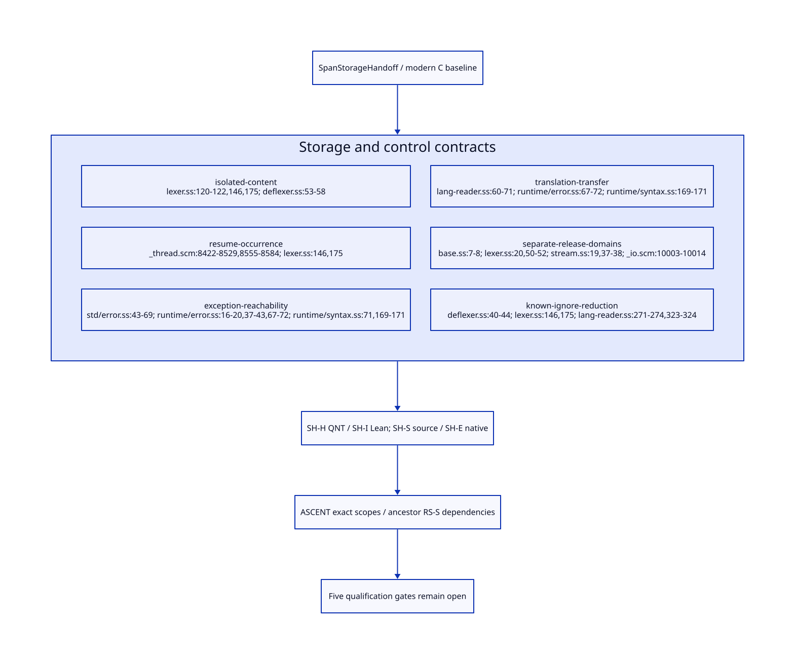

#+TITLE: Isolated Span Storage, Exception Roots and Multi-shot Control
#+SETUPFILE: ../../modeling/org/setup.org
#+CATEGORY: toolchain
#+OPTIONS: toc:3 num:t
#+PROPERTY: header-args :eval never

* RESEARCH Separate immutable contents from live control :modern_c:gxi:gxc:
:PROPERTIES:
:CUSTOM_ID: span-storage-handoff
:AUTHORITY: SpanStorageHandoff
:STATUS: conditional-design-source-refinement-open
:EVIDENCE_CLASS: source-derivation-and-conditional-formal-models
:END:

This continues [[file:reader-span-custody-design.org][the reader producer/custody study]]. It refines the #lang module
reader path used by compilation sessions, rather than implementing a new reader.
Scheme owns semantic classification and control; modern C remains the necessary
native baseline. [[file:models/sysml/span-storage-handoff.sysml][SysML]] owns six contracts, five open gates, four gain cases and
SH-H/I/S/E obligations. Python invokes native SysML and [[file:../../modeling/ascent/span-storage-handoff.rules.scm][actual ASCENT inference]],
checks [[file:../../../models/build/span_storage_handoff.qnt][QNT]] and [[file:../../../models/build/SpanStorageHandoff.lean][Lean]], and derives [[file:span-storage-handoff-matrix.org][the matrix]] and .
The [[file:../../modeling/tools/span-storage-study.py][Python study entry]] uses [[file:../../modeling/tools/formal-study.py][shared transport/check orchestration]]; native SysML
still owns values and obligations, while ASCENT owns dependency inference.
[[file:../../../evidence/research/span-storage-handoff/checks.json][The source-bound receipt]] distinguishes local models from source and native
qualification. No runtime implementation, native test or timing run occurs.

* RESEARCH Isolated storage and mutable aliases
:PROPERTIES:
:CUSTOM_ID: storage-isolation
:END:

[[file:../../../../gerbil-gambit-bootstrap-audit/src/std/text/parser/ebnf/lexer.ss::120][chars->string]] constructs the string passed to a reduction at both accepted
return sites, lines 146 and 175. [[file:../../../../gerbil-gambit-bootstrap-audit/src/std/text/parser/ebnf/deflexer.ss::53][The generated reduction]] binds @@ around arbitrary
user expr. The caller may retain, compare or mutate this object. A raw-content
record must not alias its writable storage. Coordinates alone preserve provenance,
not replayable characters. A shallow copy of a record holding the same string
does not isolate storage either.

| Design | Semantic consequence | Admission decision |
|---+---+---|
| Private retained chunks, existing mutable @@ materialized separately | Preserve callback-visible object identity/mutation and share raw contents | Preferred contract; backing-store exclusion remains a native/source obligation |
| Preserve existing @@ plus a private snapshot before exposure | Simple conceptual isolation, extra O(accepted text length) copying | Alternative; include copy and retention cost in net work |
| Freeze or replace @@ with an immutable foreign view | May change string mutation/type/identity observations | Explicit language/API change; no automatic compatibility claim |
| Copy @@ on every continuation resume | Changes identity and current mutations after an allocation cut | Rejected for preserving source semantics |
| Copy-on-write without intercepting all Scheme/native writes | Uncontrolled aliases may modify retained source | Not a qualified solution merely because the label says COW |

Private storage is an ownership claim: it must exclude exposed mutable aliases,
reflective/native writes or an input buffer reused by refill. Unknown native
aliases retain the legacy owner and deny sharing/reuse credentials; they do
not justify silently rejecting otherwise valid Scheme programs. Internal chunk
objects can live in the Scheme heap. No foreign call or atomic pin per character
is required by the abstract design; native integration is needed only at real
storage/resource/borrow boundaries. Its representation and cost remain open.

* RESEARCH Exception objects are control roots too
:PROPERTIES:
:CUSTOM_ID: storage-error-roots
:END:

The actual chain is [[file:../../../../gerbil-gambit-bootstrap-audit/src/std/text/parser/base.ss::28][ParseError]] -> [[file:../../../../gerbil-gambit-bootstrap-audit/src/std/error.ss::43][deferror-class default Error superclass]] ->
[[file:../../../../gerbil-gambit-bootstrap-audit/src/gerbil/runtime/error.ss::16][Error's StackTrace mixin]]. [[file:../../../../gerbil-gambit-bootstrap-audit/src/gerbil/runtime/error.ss::37][raise]] captures a continuation if that slot is absent.
[[file:../../../../gerbil-gambit-bootstrap-audit/src/gerbil/runtime/syntax.ss::71][SyntaxError also includes StackTrace]], and its raise path at :169-171 uses
the same raise. Thus both original and replacement exceptions may retain
control state even without explicit user call/cc. Tail-call elimination and
the precise capture point affect which frames survive; this is not evidence
that every exception retains every lexer or that a retention cycle always exists.

[[file:../../../../gerbil-gambit-bootstrap-audit/src/gerbil/runtime/error.ss::67][with-catch]] captures its continuation and invokes the handler by
##continuation-graft. [[file:../../../vendor/gambit/lib/_thread.scm::8498][Grafting]] can wind/unwind dynamic environments before handler
execution. A design that treats the handler as an ordinary call on the failing
reader's unchanged stack is therefore insufficient.

[[file:../../../../gerbil-gambit-bootstrap-audit/src/std/text/parser/ebnf/lang-reader.ss::60][raise-e]] queries the original error, constructs a message, maps token->syntax,
then applies raise-syntax-error. [[file:../../../../gerbil-gambit-bootstrap-audit/src/std/text/parser/base.ss::22][token->syntax]] can allocate AST/location data;
the syntax-error constructor and raise can allocate/capture again. Failure can
precede successful replacement construction or occur during replacement raise.

| Stage | Custody and semantic requirement |
|---+---|
| Original caught; replacement absent | Original error, failing interval and relevant control references remain represented |
| Message/irritants/AST preparation | Preserve original custody; partially built replacement is not a completed handoff |
| Secondary allocation/mapping/raise failure | Propagate the actual secondary outcome according to existing control; retaining original metadata must not replace it with the original exception |
| Replacement rooted; handoff committed | Local original custody can end only after all independent original-error/capture aliases are accounted for |
| Delivery response unknown | Authoritative operation record remains; no blind reconstruction/reraise retry |
| Replacement or secondary error delivered | External error/stacktrace roots may still hold old control state; delivery alone is not a release receipt |

The emergency/OOM path cannot depend on allocating another diagnostic object
to preserve bookkeeping. Existing [[file:../../../../gerbil-gambit-bootstrap-audit/src/gerbil/runtime/error.ss::77][wrap-runtime-exception]] deliberately avoids
wrapping heap/stack overflows. The proposed design therefore requires preexisting
attempt/root slots or managed frame references for failure custody, with no
new allocation as a prerequisite for keeping an already-live object reachable.
How those slots map into GC/native roots is SH-E, not an implemented guarantee.

* RESEARCH Multi-shot identities and operation settlement
:PROPERTIES:
:CUSTOM_ID: storage-multishot
:END:

#+name: control-identity-contract
#+begin_src text :eval never
DomainGeneration: identity of the live mutable input domain
CaptureId: one reachable control capture, including exception stacktrace captures
ResumptionId: one entry into that captured control state
ProgramPoint: before string materialization / inside R / before read / after read /
              during error preparation / during winding or delivery
OperationOccurrenceId: one source-executed I/O or handoff operation
TransportAttemptId: one delivery/settlement attempt for that operation
#+end_src

These identities serve different purposes; they do not clone Scheme lexical
locations. Resuming after @@ was allocated must retain that same mutable object
and its current contents. Resuming before the allocation can execute the
constructor again, yielding a new object according to the source program.
Resuming after a read does not itself perform that read again; resuming a
point before reader entry can legitimately execute another read from the current
mutable input. Later suffix effects can run for every legitimate resumption.
There is no global result memoization indexed solely by CaptureId.

Exactly-once settlement applies only to retransmission of the same operation's
unknown response. It must neither duplicate that operation nor suppress a fresh
source execution. [[file:../../../vendor/gambit/lib/_thread.scm::8422][Winding thunks]] are executable user control and may escape or
capture again; a counter of completed resume calls cannot prove their aliases
dead. The QNT model bounds resumptions to two and separates before/after-read
cuts. It assumes an environmental reachability witness for capture/trace loss;
it does not derive that witness from a counter or prove full multi-shot Scheme.

* RESEARCH Separate release domains and avoid self-rooting
:PROPERTIES:
:CUSTOM_ID: storage-release
:END:

[[file:../../../../gerbil-gambit-bootstrap-audit/src/std/text/parser/base.ss::7][Token/location fields]] are (t e loc) and (port line col off xoff).
[[file:../../../../gerbil-gambit-bootstrap-audit/src/std/text/parser/ebnf/lexer.ss::20][Token-stream]] owns cs/buf/Ls/Rs/EOF; [[file:../../../../gerbil-gambit-bootstrap-audit/src/std/text/parser/ebnf/stream.ss::19][char-stream]] owns port/buf/location/history.
An individual token does not structurally point back to its token-stream.
Actual callback payloads or closures can add edges, so this is an opportunity
for a detached view, not proof of universal independence.

Use a detached span view (chunk lease, source generation, interval, origin-port
reference) without an implicit owner-stream back pointer. Keep the actual token
and eq parser-tail identities. A token retaining port identity may outlive the
old stream; a raw span retaining text may outlive both stream adapters. This
refines the earlier conservative all-alias-drain rule into per-resource reachability.

| Resource | Necessary release condition | What does not establish it |
|---+---+---|
| Old logical stream adapter | No reachable control/error/payload alias to it; no active branch, native borrow or unresolved operation; admissions closed | Two resumptions finished; exception delivered; detached token still exists |
| Raw chunk | Last referencing span/capture/error/active operation gone, with publication/reclamation ordered | Old stream alone drained; one mutable @@ has been freed |
| Original exception root slot | Successor/secondary outcome custody committed and independent aliases retained through their own graph | Starting the handler; partial AST/message construction |
| Origin-port object | Ordinary Scheme/native reachability drained | No stream adapters; resource-close event alone |
| Physical input resource | Existing close semantics or an explicitly chosen resource contract | All object aliases disappearing, or continuation reentry demanding reopening |

Normal [[file:../../../vendor/gambit/lib/_io.scm::10003][call-with-input-file]] closes the port after proc returns. Retaining the port
object does not reopen its resource. Reclaiming an adapter is not permission
to run an I/O close on a collector thread or change exception/close ordering.

A native pin registry that strongly roots a continuation until its own count
becomes zero can create this bad design: registry -> capture -> domain -> pin
record. Dropping the last external capture reference then cannot make that
capture unreachable. Prefer GC-managed control capsules and traced references;
native strong roots represent real external borrows/in-flight work, not a
self-sustaining proof that a capture exists. Cycles entirely in the managed
object graph remain the tracing collector's responsibility. A weak/ephemeron
or foreign-finalization adapter requires its own proof; none is claimed here.

Before reclamation, close admissions and obtain a reachability/borrow/pending
work witness for the particular resource. Publish successor custody before
clearing predecessor roots. Unknown handoff retains the authoritative record.
Native memory ordering and GC-safe root publication remain SH-E obligations;
the abstract model's atomic handoff is not evidence of a C atomic implementation.
The finite profile closes old-stream admissions before releasing its last raw
chunk. More selective per-chunk reclamation would require proving that future
view/borrow acquisition cannot resurrect access to the released chunk. A zero
reference count observed before admissions close is insufficient. Native borrow
publication must establish the required managed roots before exposing a pointer;
clearing those roots requires both borrower drain and the appropriate GC-safe
publication/reclamation ordering, not merely a counter decrement.

* RESEARCH Net work, migration and proof obligations
:PROPERTIES:
:CUSTOM_ID: storage-net-work
:END:

The reset bound is unchanged: at most 2A stream constructor calls and A
initial-location calls for A completed actions; never add it again to prior
savings. A new source opportunity exists: [[file:../../../../gerbil-gambit-bootstrap-audit/src/std/text/parser/ebnf/deflexer.ss::40][generated constant-$ reductions]] do not
observe @@, yet lex1 still calls chars->string before R. For I qualified ignored
occurrences, a generated reduction descriptor could omit at most I such calls,
with lengths summing to L_ignore. This is not admitted for arbitrary Rs. Existing
compiler optimization may already eliminate some work; removing allocation also
needs an explicit resource-failure observation policy. The gate remains open.

Private chunks can be shared across R live resumptions without R full copies
of the same raw contents. Cost remains O(unique retained decoded contents +
views + active resumptions + pending operation records), plus separately exposed
mutable strings and any required snapshots. Captures/errors can keep history
alive indefinitely. Positive work requires avoided reset/materialization/replay
work to exceed isolation, view, rooting and adapter work. Correctness repairs
and identity preservation are not automatically speedups. Modern C and Zig
need the same semantic support; no uniquely Zig benefit has been established.

Migration proceeds from isolated source storage and generated reduction
classification to explicit operation/root records, then source-accurate control
cuts and exception transfer, detached views, and finally per-resource retirement.
Scheme generates classifications and contracts; modern C runtime consumers
implement only the necessary native protocol. No old path is retired merely
because finite tests or the protocol definition exist.

SH-H covers two-resumption identities, shared storage, failure custody and
separate release histories. SH-I contains eight conditional kernels. SH-S
requires source-to-model control/alias simulation and effect reflection; SH-E
requires actual storage isolation, reachability witnesses, root publication and
reclamation ordering. SysML makes SH-S depend on SH-H/I/E and RS-S; ASCENT
retains the full ancestor frontier. Generated matrices and inference controls
cannot issue native acceptance. All five new gates remain unresolved.
