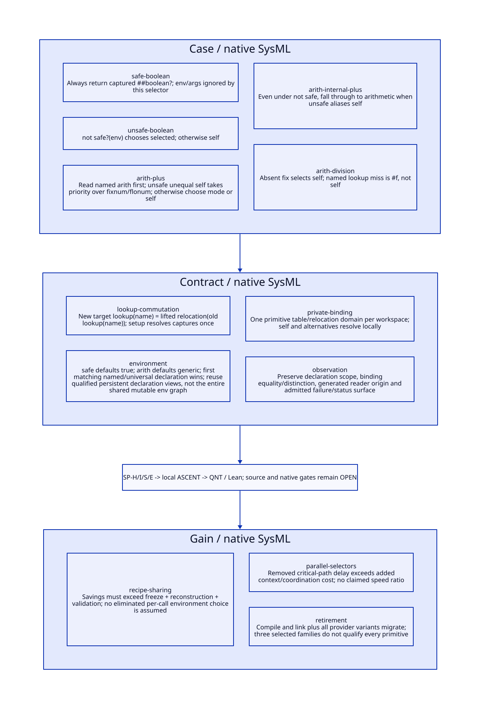

#+TITLE: Safe, Unsafe and Arithmetic Specializer Provider Equivalence
#+SETUPFILE: ../../modeling/org/setup.org
#+CATEGORY: toolchain
#+OPTIONS: toc:3 num:t
#+PROPERTY: header-args :eval never

* RESEARCH Decision and evidence boundary :modern_c:gambit:gerbil:
:PROPERTIES:
:CUSTOM_ID: specializer-provider-semantics
:AUTHORITY: SpecializerProviderSemantics
:STATUS: conditional-transport-proofs-source-platform-open
:EVIDENCE_CLASS: source-and-local-formal-models
:END:

Gambit provides compiler semantics and modern C runtime/backend contracts; Gerbil
owns the incremental compiler service. This study specializes the preceding
[[file:alias-workspace-reconstruction-design.org][workspace reconstruction design]] to actual specializer factories, giving a
transport proof for their selected return objects under explicit lookup, identity
and declaration-environment premises. It does not qualify every primitive provider.

[[file:models/sysml/specializer-provider-semantics.sysml][SysML]] owns five actual registration cases, four contracts, three gain cases,
four refinement routes and seven open gates. [[file:../../modeling/tools/specializer-provider-semantics-study.py][Python]] calls native SysML and drives
[[file:../../modeling/ascent/specializer-provider-semantics.rules.scm][actual ASCENT DSL]], [[file:../../../models/build/specializer_provider_semantics.qnt][QNT]] and [[file:../../../models/build/SpecializerProviderSemantics.lean][Lean]], deriving [[file:specializer-provider-semantics-matrix.org][the matrix]] and . [[file:../../../evidence/research/specializer-provider-semantics/checks.json][Checks]] separate
local model evidence from source/host/native admission. No compiler implementation,
Scheme compilation, native test or performance run is performed.

* RESEARCH Actual factories and registrations :source:
:PROPERTIES:
:CUSTOM_ID: actual-specializer-cases
:END:

[[file:../../../vendor/gambit/gsc/_prims.scm::1786][setup-prim-specializers]] closes over the selected target. def-spec resolves a
primitive and canonical primitive-name symbol, then installs the factory result.
Captured target lookup uses [[file:../../../vendor/gambit/gsc/_back.scm::300][prim-proc-info]], which returns #f on a missing entry.
The closures capture actual procedure objects, not names to be globally resolved
again during invocation.

| Real registration | Captures | Invocation behavior |
|---+---+---|
| [[file:../../../vendor/gambit/gsc/_prims.scm::1880][boolean? -> spec-s ##boolean?]] | Selected ##boolean? | Always return it; this selector ignores env and args |
| [[file:../../../vendor/gambit/gsc/_prims.scm::1883][boolean=? -> spec-u ##boolean=?]] | Self and selected ##boolean=? | Return selected when not safe?, otherwise self |
| [[file:../../../vendor/gambit/gsc/_prims.scm::1889][+ -> spec-arith fx+ fl+ ##+]] | Self +, canonical name +, three selected primitives | Read named arith; non-safe unequal unsafe wins first, then fixnum/flonum, otherwise self |
| [[file:../../../vendor/gambit/gsc/_prims.scm::1890][##+ -> spec-arith ##fx+ ##fl+]] | Unsafe candidate defaults to self | Non-safe alone does not force an unsafe branch; arithmetic selection remains |
| [[file:../../../vendor/gambit/gsc/_prims.scm::1893][/ -> spec-arith #f fl/ ##/]] | Fix candidate defaults to self | Fixnum mode does not invent a fixnum division primitive |

The representative names are present in the primitive metadata list: boolean?/##boolean?
at lines 26-27, boolean=?/##boolean=? at 31-32, +/##+ at 38-39, fx+/##fx+ at 308-309,
fl+/##fl+ at 442-443, / and ##/ at 42-43 and fl/ at 448. Combined with the C target's
make-prim-proc-table constructor, this supplies source evidence for these normal
capture paths. It is not an executed lookup or proof about arbitrary user targets.

** Branch order and optional names

[[file:../../../vendor/gambit/gsc/_prims.scm::1818][spec-arith]] computes arith-implementation(proc-name, env) before its cond.
The unsafe branch precedes fixnum/flonum and requires unsafe-spec not eq? self.
Thus (not safe) with a real ##+ candidate wins even under fixnum mode; an absent
unsafe argument aliases self and permits fallthrough. Recipe identity transport
must preserve both equality and inequality for that test.

An absent optional name and an unsuccessful named lookup are different:

- If fix-name is #f, fix-spec is self.
- If fix-name is supplied but lookup returns #f, the captured value is #f.
- The analogous distinction holds for a supplied versus absent unsafe argument.

The current helper does not universally throw immediately for lookup misses.
A recipe must not silently replace a missing lookup with self or introduce an
unconditional earlier exception while claiming exact equivalence. A managed reusable
profile can require complete capture lookup and reject cache admission separately;
that is not permission to change an accepted compilation's runtime/error behavior.
A safely owned noncached route may preserve the original path when available.

* RESEARCH Declaration environment and read observations :environment:
:PROPERTIES:
:CUSTOM_ID: specializer-environment
:END:

[[file:../../../vendor/gambit/gsc/_ptree1.scm::574][safe?]] queries safe-sym with default #t. [[file:../../../vendor/gambit/gsc/_back.scm::579][arith-implementation]] queries arith
for the captured primitive name with default generic. [[file:../../../vendor/gambit/gsc/_env.scm::335][declaration-value]] scans
in list order and takes the first matching declaration whose names are empty or
contain that exact element. A global arithmetic mode, an unordered declaration
map, a renamed primitive symbol or a stale environment can therefore change the
selected primitive.

There is an existing functional-design asset to retain: [[file:../../../vendor/gambit/gsc/_env.scm::102][env-declare]] prepends a
declaration, and env-decl-set returns a new environment vector rather than replacing
the old declaration slot. Qualified stable declaration-list views can therefore
be shared instead of deep-copying an entire compiler environment per provider.
But the new vector shares other fields; [[file:../../../vendor/gambit/gsc/_env.scm::124][env-vars-set!]] mutates a cell reachable
from that graph. Persistent declaration update is not proof that the whole env
is deeply immutable. The service needs a rooted, writer-qualified declaration
projection with its semantic epoch, not an indiscriminate frozen env pointer.
Any mutation of shared declaration payloads or raw field access remains a source
closure obligation. Existing persistence/reuse is baseline, not a new saving to
attribute to provider reconstruction.

The private context must supply the correct lexical declaration view at each call,
including module/annotation scope and per-name exceptions. A provider cannot cache
one result solely by recipe kind; safe?, primitive name and current declaration
view are inputs. Existing helper arguments are not automatically a sufficient cache
key for the compiler query; other semantic/profile/identity/origin inputs remain.
The three selected factories ignore args, but other specializers do not, so that
observation must not be generalized to the whole provider interface.

The conservative reconstruction records arith-read before safety-read for arithmetic,
safety-read for spec-u, and no invocation environment read for spec-s. Setup capture
lookup is a separate phase and is not moved to invocation. The QNT read trace is
an explicitly instrumented service-observer abstraction, not an observed native
trace or a claim that ordinary declaration lookup is externally effectful. A future
optimization may eliminate a proven pure irrelevant read only after a separate
observer/dependency/failure equivalence proof; it cannot silently omit tracked
inputs merely because the returned pointer happens to match in one case.

* RESEARCH Relocation and provider semantics theorem :lean:
:PROPERTIES:
:CUSTOM_ID: specializer-transport-proof
:END:

Let rho map the classified source object graph to one destination workspace.
Required premises are: injective identity mapping on compared primitive objects;
lookup commutation, including #f; matching safe?/named arithmetic observations;
canonical arithmetic markers; correct phase/profile; and the preceding graph/root
ownership contract. No provider keeps mutable source handles or resolves captures
through another workspace's table.

#+begin_src text :eval never
rho(OldSelect(source captures, old env))
  = NewSelect(relocated captures, related private env)
NewLookup(name) = lift(rho, OldLookup(name))
AbsentName -> relocated self
PresentName with lookup miss -> #f
#+end_src

Lean proves safe and unsafe transport directly and arithmetic transport for generic
source/destination identity types with an injective rho. The arithmetic proof uses
injectivity precisely to preserve unsafe != self. An Option-valued capture lemma
preserves both missing lookup and absent-name fallback. Additional lemmas distinguish
named declaration views/order and establish bounded relocation identity and the
net-work accounting consequence.

These are conditional mathematical theorems about selectors and capture transport.
They are stronger than merely asserting a checked flag, but do not prove that an
arbitrary Scheme closure factory, actual parsed environment or native object graph
implements the modeled functions. General compiler source simulation, observation
transport and concurrent memory/root correctness remain SP-S/SP-E obligations.

The destination workspace must construct all primitive shells, resolve every self
and alternative through one map, bind providers with that workspace's target and
lexical environment capabilities, and validate before publication. Inline callback
and target-global migration is inherited from AR-S; selecting the correct procedure
object does not itself qualify subsequent C emission or same-VM parallel execution.

* RESEARCH Actual iter chain and fidelity :iter:
:PROPERTIES:
:CUSTOM_ID: specializer-iter-fidelity
:END:

The inspected chain is iter/macros -> iter/api -> std/iter -> string/misc and sync/wg.
[[file:../../../../gerbil-gambit-bootstrap-audit/src/std/iter/macros.ss::124][for1-in-range-generic]] introduces comparisons and (+ k $step) in the loop. This
provides a concrete arithmetic consumer to connect to + specialization. It does
not establish which branch a particular existing GVM artifact selected: that still
requires its declarations, resolved bindings and actual compiler-stage evidence.
The boolean safe/unsafe examples above are real registered factories, not claimed
observed calls from this particular iter expansion.

| Fidelity dimension | Required condition | Remaining source proof |
|---+---+---|
| Declarations | Preserve scoped/order-sensitive declaration tree, module reset, standard/extended bindings and positive-phase policy | [[file:../../../../gerbil-gambit-bootstrap-audit/src/gerbil/compiler/compile.ss::401][Gerbil declaration generation]] to actual Gambit env lookup commutation |
| Identity | Preserve self/cross primitive equality/distinction, namespace/phi/gensym/marks and defining context | [[file:../../../../gerbil-gambit-bootstrap-audit/src/gerbil/compiler/base.ss::185][Identifier reconstruction]] and whole graph relocation; no same-spelling collapse |
| Origin | Preserve baseline generated-file locations plus separately labeled original expansion provenance | [[file:../../../vendor/gambit/gsc/_front.scm::215][Reader versus sourced datum]] equivalence; no roundtrip executed |
| Exceptions | Preserve setup lookup outcome, phase-tagged diagnostics, service failure/status and resource custody | [[file:../../../../gerbil-gambit-bootstrap-audit/src/gerbil/compiler/driver.ss::963][invoke nonzero-status behavior]] cannot be replaced by an arbitrary internal exception |

The iter body contains mutation/control and wg contains join/exception handling;
these are runtime semantics to retain, not evidence that compilation executes those
runtime effects. Provider invocation failures or unknown completion retain context
roots and callbacks until a truthful endpoint settlement. The local QNT model's
known/settled transition assumes that truth; it does not certify native cleanup or
transport live exception/continuation identity across processes.

* RESEARCH Refinement and counterexamples :sysml:ascent:qnt:
:PROPERTIES:
:CUSTOM_ID: specializer-proof-matrix
:END:

| Duty | Formal coverage | Missing refinement |
|---+---+---|
| SP-H | QNT 20 scenarios, eight negative controls; normal and missing-lookup samples | Actual Scheme values/envs, all provider alternatives and liveness |
| SP-I | Nine Lean proofs, including generic selector transport and optional capture transport | Source implementation relation and full concurrent transition induction |
| SP-S | Native SysML operation/lemma routes and actual registration/source anchors | Lookup/environment/graph/observer commutation; depends on AR-S |
| SP-E | Separate native/platform obligation | GC roots, FFI/SMP, memory order and actual performance |

The negative controls expose stale self, foreign-workspace captures, reversed unsafe
priority, invented absent unsafe, treating lookup miss as self, dropped declaration
read observations, wrong primitive name and ignored generated origin. The model uses
integer handles and symbolic observation traces, not real primitive execution.

ASCENT's six local cases check current H/I model receipts, missing QNT, stale subject,
wrong Lean scope, synthetic all-closed and provider-semantics denial. Current source,
platform, AR-S and all seven source gates remain open. Host attestation registration
remains unresolved from the retained previous failure; no unchanged retry or claimed
host-registered closure is made. Raw tool outputs stay under the task cache; exact
source/log hashes bind structured evidence.

* RESEARCH Retirement and net benefit :benefit:
:PROPERTIES:
:CUSTOM_ID: specializer-benefit
:END:

Scheme remains the semantic generator. The intended refactor replaces selected
closure installers with generated capture recipes and context-bound factory APIs,
then migrates target-local lookup, all dependent GVM references, and emission/link
consumers. Global target/primitive dispatch retires only after the relevant aliases,
writers and callers migrate. These selected cases do not retire all specializers,
folders or user-registered targets.

The [[file:specializer-provider-semantics-matrix.org][matrix]] separates savings from added work. Capturing and rebuilding primitive
objects/providers per workspace remains necessary; per-invocation environment choice
is not assumed removable. Let k uses avoid repeated frontend work F, require freeze
Z, per-use reconstruction/relocation R and validation V. Positive work benefit needs
(k-1)F > Z + kR + V. Existing sticky caches are baseline; unchanged metadata work
already reused cannot be counted again. Parallel benefit additionally requires
removed global-state span to exceed private-context construction/coordination costs,
with acceptable retained memory. No speedup, person-days or language-specific net
advantage is claimed from these selector theorems alone.
