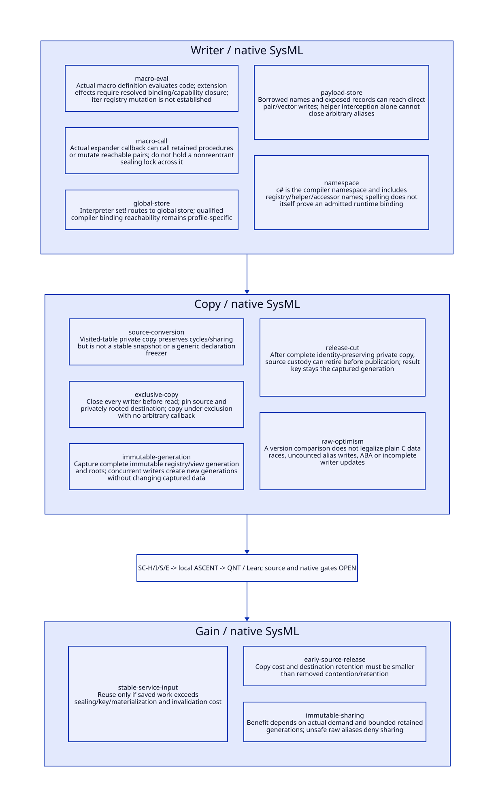

#+TITLE: Indirect Declaration Writers, Stable Copy and Sealed Publication
#+SETUPFILE: ../../modeling/org/setup.org
#+CATEGORY: toolchain
#+OPTIONS: toc:3 num:t
#+PROPERTY: header-args :eval never

* RESEARCH Architecture decision :gambit:gerbil:modern_c:
:PROPERTIES:
:CUSTOM_ID: stable-copy-publication
:AUTHORITY: StableCopyPublication
:STATUS: conditional-local-models-source-platform-open
:EVIDENCE_CLASS: source-and-formal-design
:END:

Gambit owns declaration and specialization semantics and the modern C compiler/runtime
foundation. Gerbil owns incremental query identities, managed effect boundaries,
private sessions and result publication. Separate three facts: a procedure capable
of writing, a resolved path to this compiler object's storage, and an observed write.
This study establishes concrete execution/store seams and conditional alias paths;
it does not assert that iter's transformer mutates a declaration registry.

[[file:models/sysml/stable-copy-publication.sysml][SysML]] owns five writer families, five copy boundaries, five source/action/lemma
routes and seven open gates. [[file:../../modeling/tools/stable-copy-publication-study.py][Python]] transports native SysML projections to
[[file:../../modeling/ascent/stable-copy-publication.rules.scm][actual ASCENT DSL]], [[file:../../../models/build/stable_copy_parameters.qnt][QNT parameters]], [[file:stable-copy-publication-matrix.org][Org matrix]] and [[file:diagrams/stable-copy-publication.d2][D2]] / . [[file:../../../models/build/stable_copy_publication.qnt][QNT]] and [[file:../../../models/build/StableCopyPublication.lean][Lean]]
check conditional abstract protocols. [[file:../../../evidence/research/stable-copy-publication/checks.json][Receipts]] retain source hashes and separate
local checks from host registration, native admission and performance. No runtime or
compiler implementation, native test or performance experiment is performed.

* RESEARCH Actual indirect execution and store paths :source:alias:
:PROPERTIES:
:CUSTOM_ID: indirect-writer-source
:COMPLETENESS: concrete-seams-plus-conditional-object-reachability
:END:

| Concrete path | Evidence | What it establishes / does not establish |
|---+---+---|
| Macro definition -> evaluated expander | [[file:../../../vendor/gambit/gsc/_ptree1.scm::2931][add-macro/make-descr]] calls scheme-global-eval; the active Gambit [[file:../../../vendor/gambit/gsc/_host.scm::852][host definition]] calls eval | Real code execution during macro installation; not a pure syntax-data conversion |
| Macro invocation -> arbitrary expander procedure | [[file:../../../vendor/gambit/gsc/_ptree1.scm::1004][macro-expand]] invokes expander on source or desourcified arguments | A retained procedure can call registry helpers or stores if it can reach their bindings/objects; the actual closure/capability is still a premise |
| Evaluated set! -> global storage | [[file:../../../vendor/gambit/lib/_eval.scm::2079][comp-set!]] -> gen-glo-set -> [[file:../../../vendor/gambit/lib/_eval.scm::3417][cprc-glo-set]] -> [[file:../../../vendor/gambit/lib/_eval.scm::532][glo-access-set!]] | Concrete interpreter lowering to ##global-var-set!, not an invented callback API |
| Helper-qualified compiler bindings | [[file:../../../vendor/gambit/gsc/makefile.in::255][Compiler prelude]] sets c# namespace; [[file:../../../vendor/gambit/gsc/fixnum.scm::382][fixnum namespace declarations]] include registry helpers, registry roots and accessors | Explains the qualified names; does not prove a particular loaded binary exposes a writable binding to every transformer |
| Named record -> retained names tail | [[file:../../../vendor/gambit/gsc/_env.scm::327][Both named constructors]] prepend two cells; [[file:../../../vendor/gambit/gsc/_env.scm::102][env-declare]] stores supplied record; env-decl-ref exposes list | Direct constructor caller can retain an alias; any reachable cddr/record cell can be a mutation target |
| Pair/vector/global write -> C storage | [[file:../../../vendor/gambit/gsc/_t-c-2.scm::3737][##set-car!/##set-cdr! emission]]; [[file:../../../vendor/gambit/include/gambit.h.in::5328][SETCAR/SETCDR]], [[file:../../../vendor/gambit/include/gambit.h.in::5482][VECTORSET]], [[file:../../../vendor/gambit/include/gambit.h.in::5957][GLOBALVARSET]] | Direct storage assignments; no declaration-specific sealing guard in these inspected macros |

The retained macro-entry and eval-store corpora include definitions, quoted names
and actual calls. They are not a whole-program lexical/alias proof. The previous
[[file:registry-view-sealing-design.org][registry study]] inventories the 41 stock registrations and fixed category priority.
No additional stock call that mutates the returned names spine is established here.
The real indirect danger is that general stores can bypass helper-only interception
once a writable alias exists. A blanket claim that all compiler macros do this would
be unsupported, as would a claim that absence of a direct setter proves closure.

Host code contains a quoted non-Gambit implementation and the active Gambit branch;
the cited active definition is at 852. Generated _env.c contains c# names but its
presence alone is not provenance for the currently loaded compiler. Native/FFI
mutation is an explicit unqualified capability: no named-payload-specific native
writer is claimed without a real object delivery/binding proof.

** Compiler extension effects must retain their source order

A legacy macro may register a declaration that a later form then parses. Replacing
that history with one registry frozen at the start of the entire compilation can
change accepted syntax or metadata. A managed registry event must therefore close
its preceding phase, publish a new immutable generation, and make subsequent parser
queries depend on that generation while earlier transformed views remain unchanged.
Repeated query execution must not replay the registration side effect twice.

This requires an ordered effect/result handoff, not merely adding a final registry
hash to a cache key. Arbitrary external writes or unknown callback delivery cannot
mint that handoff. Either preserve execution without reusable admission, or reject
that service mode explicitly. Existing Scheme programs are not silently rewritten
to ignore late registrations. The QNT slice below covers input capture/copy, not the
complete macro effect trace or its incremental replay algorithm.

* RESEARCH Existing copy algorithm and its exact limit :copy:source:
:PROPERTIES:
:CUSTOM_ID: source-copy-limit
:END:

[[file:../../../vendor/gambit/gsc/_source.scm::267][source->expression]] documents fresh expressions preserving cycles and shared
structure. The active implementation allocates a visited table, records a fresh
pair before recursively assigning its fields, and does corresponding visited copying
for vectors/boxes. This is useful existing graph-copy machinery to learn from.
It is not a generic declaration-freezing API: it expects source representations,
keeps noncontainer leaves, and does not certify writer exclusion, managed declaration
schema, symbol transport or lifetime after publication.

Suppose two source fields change from (0,0) to (1,1). Copying the first before the
write and the second after it yields (0,1), even though the destination is private.
Hashing or validating that mixed destination twice can reproduce the same stable
wrong value. Checking only the root pointer also misses in-place mutation. A shallow
copy leaves the original names tail writable. These are distinct failure modes.
The active source copy routine has no snapshot/read-lock/version protocol in the
inspected conversion path; this says nothing about whether an actual current build
executes a concurrent writer.

* RESEARCH Admitted stable-read protocols :protocol:modern_c:
:PROPERTIES:
:CUSTOM_ID: stable-copy-protocols
:END:

| Input class | Managed protocol | Reuse decision |
|---+---+---|
| Unexposed stock parser-produced names | Finish validation, close subsequent writers and root owned graph | Can qualify under a closed stock profile; openness of generic accessors is still accounted |
| Mutable graph with complete writer mediation | Acquire exclusion, root source/destination, validate and privately copy, certify complete copy, release source exclusion | Conditional admission; every alias writer must participate |
| Immutable generation | Acquire published generation and root lease; copy or share admitted immutable graph | Allows concurrent creation of newer generations while old input stays stable |
| Known borrowed graph with unknown writable alias | No truthful exclusion receipt | Reject shared/reusable result; a second identical read is insufficient |
| Arbitrary eval/native/reflective extension | Resolve and close capabilities plus ordered effects, or isolate without reusable admission | Default deny receipt when the closure is unknown; no claim that a wrapper is a sandbox |
| Optimistic raw C reads with a version counter | Unqualified | Version equality alone cannot legalize a C data race or catch writers that do not increment it |

Exclusive input reading and immutable-generation capture are alternative contracts.
The model does not require locking all compilation until emission finishes. After a
complete private copy with no source aliases, source-root custody/exclusion can be
released; metadata publication later uses the captured identity. Mutable compiler
workspaces and primitive objects still need the private reconstruction protocol of
the preceding studies, rather than being mistaken for immutable copied payload.

For modern C, ordinary pointer/field stores shown above cannot safely race ordinary
reads merely because a separate epoch is atomic. An optimistic design would need an
independent memory-model proof: all access paths participating, safe read storage,
writer begin/end coverage, nonwrapping identity/ABA handling, pinning and validation.
No such source refinement is supplied here. The proposed baseline either excludes
writes for the copy interval or reads already immutable storage published with
appropriate synchronization. Native acquire/release operations are a design duty,
not something established by the atomic QNT steps. The language basis is
[[https://www.open-std.org/jtc1/sc22/wg14/www/docs/n1570.pdf][WG14 N1570]], sections 5.1.2.4 (data races and happens-before), 7.17.3
(atomic ordering) and 7.26.4 (mutexes). These rules constrain a proposed implementation;
they do not prove that the current Gambit runtime admits such racing access.

** Copy completion and publication cuts

#+begin_src text :eval never
admit/capture registry + declaration generation + writer authority
  -> root source and private destination
  -> copy head / tail / all reachable admitted payloads
  -> complete-copy receipt (identity relation + no borrowed mutable edges)
  -> release source custody/exclusion if no other holder needs it
  -> validate private copy and exact captured request metadata
  -> atomically publish result + metadata under captured generation
#+end_src

The complete-copy receipt binds source generation, request profile, symbol identity
relation, private owned graph and attempt identity. It is not valid after copying
only a prefix. A registry update after source release does not invalidate the old
immutable result, but prevents using it for a request with changed semantics.
Copy bytes and metadata must commit together; a manifest/result mismatch or unknown
publication remains producer-owned and unavailable to consumers.

Normal retirement closes new admission and drains an already admitted coherent
attempt. Taint revokes its premises and forbids publication. Late discovery after
publication requires quarantine/invalidation of dependent results and is outside
this prepublication model. Roots remain until callbacks, native pins and captured
continuations have actually retired, regardless of cancellation acknowledgement.

* RESEARCH Reentry, exceptions and continuation custody :control:
:PROPERTIES:
:CUSTOM_ID: copy-reentry
:END:

Do not call arbitrary expander/eval hooks while holding a nonreentrant copy lock.
A callback acquiring the same authority can deadlock; allowing it to write under a
reentrant lock can instead invalidate the stable-copy premise. Schedule admitted
extension effects outside the noncallback copy region and serialize their generation
handoff. Existing macro-expand and make-descr are real callback/evaluation seams.
Allocation, root registration and exceptions still require the real runtime contract;
no claim is made that GC automatically executes arbitrary Scheme code at every copy.

If copying fails, the partial graph is attempt-private and cannot produce a receipt.
Unwind must transfer/retain root and exclusion responsibility exactly once. A saved
continuation can retain source/destination references after an exception; releasing
all roots at a lexical return is unsound. Reentering an old copy PC must not reuse a
prefix copied under expired exclusion. A managed explicit resumable copy protocol
could discard/revalidate pure private work, but arbitrary native/Scheme continuation
replay is not automatically equivalent and is denied reusable admission until its
state/custody/effect relation is proved.

QNT's saveContinuation/abort/retireContinuation/drain model retained custody and
negative stale resumption; it does not implement or prove a general multi-holder,
multishot continuation transformation. Unknown delivery keeps custody rather than
inventing a successful root-retirement receipt.

* RESEARCH Iter and complete specialization context :iter:refinement:
:PROPERTIES:
:CUSTOM_ID: stable-copy-iter
:END:

The real [[file:../../../../gerbil-gambit-bootstrap-audit/src/std/iter/macros.ss::130][iter range macro]] produces (+ k $step). Its generated declaration views
must retain registry provenance, effective order and canonical names. Freeze the
selected caller's resolution/selection view and reconstruct private primitive/helper
identities before entering [[file:../../../vendor/gambit/gsc/_ptree1.scm::347][app->specialized-proc / specialize-proc]]. The loop repeatedly
uses the same environment but different providers' captured names. As established in
the preceding study, unsafe (fixnum +) can stop at ##+, while universal fixnum or
named coverage of ##+ can select ##fx+.

A copied names tail that silently changes coverage from + to ##+, or a mixed registry
snapshot that parses it differently, can therefore change the complete chain. The
new snapshot relation is a prerequisite to the earlier ordered-lookup and chain
transport theorems; those theorems do not manufacture stable input. No evidence
shows iter itself performs the hypothetical raw store, and no iter compilation or
native execution is run. Other provider outcomes/exceptions remain source duties.

* RESEARCH Formal routing and closure :sysml:ascent:qnt:lean:
:PROPERTIES:
:CUSTOM_ID: stable-copy-closure
:END:

| Obligation | Local scope | Open refinement |
|---+---+---|
| SC-H | 18 QNT scenarios including 8 negative controls, exclusive/immutable reads, early source release, captured generation publication, retained continuation roots | Two abstract fields, one attempt/holder; not a Scheme heap/GC/weak-memory or full effect replay model |
| SC-I | Eight Lean lemmas: writer exclusion, copy equality, torn counterexample, source-release preservation, generation mismatch, no-ABA arithmetic, taint rejection, work threshold | Source exclusion/copy graph simulation; noABA assumes mathematical naturals and does not prove finite-counter nonwrap |
| SC-S | Five source/action/lemma mappings consumed by actual ASCENT DSL | Concrete execution seams do not close runtime binding/capability/alias reachability; depends on RV-S |
| SC-E | Independent environment route | C memory order, roots/native pins/GC/continuations, host registration and measured performance |

Eight local ASCENT cases retain current/missing/stale/wrong-scope evidence and
synthetic qualification, unqualified source, missing anchor and missing model-step
controls. A synthetic all-qualified case tests the gate logic only. Current seven
gates remain open. The inherited host attestation gap is not retried unchanged or
represented as repaired. Local formal checks and native acceptance remain separate.

* RESEARCH Retirement and net benefit :benefit:
:PROPERTIES:
:CUSTOM_ID: stable-copy-benefit
:END:

Retire global registry authority only after every resolved direct/indirect writer
and parser reader uses managed generation semantics. Retire borrowed named-tail
authority only after all consumers receive immutable ownership or an explicit
nonreusable borrowed mode. Retire wrapper locks once immutable private/shared
inputs provide the same contract; retaining both global and managed mutation
authorities indefinitely defeats independent compilation contexts.

[[file:stable-copy-publication-matrix.org][SysML-derived matrix]] lists avoided work, added support and positive conditions.
For a reusable key with n demands, uncached work C, per-demand key/validation V,
private materialization M, total publication/retirement P and initial sealing S,
positive work benefit requires (n-1)*C > n*(V+M)+P+S. Input copy size, alias auditing,
failed-attempt cleanup, effect ordering and retained generations are costs. Existing
module initialization and cons sharing are baseline, not newly saved work.

Early source release can reduce contention without reducing copied bytes. Immutable
sharing can reduce copying without reducing provider work. Parallel benefit depends
on independent ready consumers and removal of actual global-state bottlenecks;
work, critical path and peak memory are distinct metrics. Expensive copy/validation,
low reuse, long-lived continuations or unclosed raw writers can negate the benefit.
These contracts build on Scheme semantics and Gambit's modern C portability; no
Zig or other language change is required for the proposed architecture properties.
