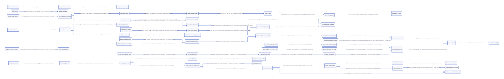
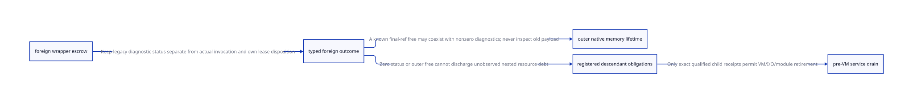

#+TITLE: Stable Compilation Task Groups: Registration, Handoff and Drain
#+SETUPFILE: ../../modeling/org/setup.org
#+OPTIONS: toc:3 num:nil
#+PROPERTY: header-args :eval never
#+TODO: RESEARCH DECIDED | ADMITTED RETIRED

* DECIDED Scope and authority :c23:compiler:ownership:
:PROPERTIES:
:CUSTOM_ID: stable-compilation-task-group
:AUTHORITY: GambitDarwinDevelopment preparationCut4..15; groupCaller0..8; groupSync0..2; groupLifetime0..9; groupCustody0..8; groupShutdown0..12; foreignResult0..9
:BASE: current vendor/gambit modern-c working source; audit Gerbil source separately identified
:STATUS: replacement design and conditional models; native/source/GC refinement open
:END:

The group is a lifetime/commit owner for the existing compilation service, not
another scheduler or a wrapper around unchecked global completion. Gambit retains
Scheme thread/control/GC semantics and qualified native synchronization. Gerbil
owns requested products, actual compiler jobs, dependency scheduling and the
stable producer supervisor. LinkPlan and the output store consume group completion.

[[file:models/sysml/macos-development.sysml][Native SysML]] owns nine caller families and three synchronization contracts,
projected into the [[file:c23-development-refactor-matrix.org][matrix]] and . The actual [[file:../../modeling/ascent/c23-development-design.rules.scm][ASCENT rules]] bind their source,
model tests, standard-reference metadata and unresolved obligations. The existing
[[file:models/quint/preparation_reuse.qnt][preparation QNT owner]] is refined with registration/publication/result states;
[[file:models/lean/PreparationReuse.lean][Lean]] adds conditional rooted-publication, immutable-result and HB laws. No
second task scheduler or runtime implementation is introduced.

* RESEARCH Real producer and completion callers

The audit compiler driver registers three distinct work forms: compile-scm-file
queues a generated Scheme unit's native invocation; separate-executable queues
GSC linking, object compilation, final link and cleanup; full-program mode queues
its distinct generation/native closure. build/build-bach.ss explicitly queues
native object jobs before executable linking; build/build1.ss drains compiled
core/runtime/expander/compiler/base work. std/make invokes deferred native drain
when parallel. compiler.ss publicly exports both add and drain APIs, so arbitrary
client thunks and reentrant registrations cannot be excluded by an internal-only
call inventory.

The current audit base.ss acquires the global jobs mutex, constructs make-thread
and inserts its handle into __compile-jobs. make-thread is allocative and inherits
thread-group/dynamic environment semantics. Constructor exceptions and root
protection inside that locked region therefore need explicit handoff; the source
snippet alone is not proof of a reproduced lock leak or safe nonlocal cleanup.
The proposed stable reservation precedes allocative construction and retains the
source-root carrier while construction occurs outside the short metadata lock.

pending-compile-jobs reverses and detaches the global list under the mutex. The
executor starts every detached thread and then joins in order. The named let in
the inspected body has no recursive loop call after joining: it does not establish
closure over arbitrary later registrations. Nor does an earlier join exception
prove that later joins ran. The worker unwind-protect returns an available-core
slot; capacity release is not task-group completion or output publication.

Current vendor _thread.scm shows ##thread-start! marking an initialized Scheme
thread started before putting it on a processor run queue. ##thread-join! can
return its result or raise uncaught/terminated/timeout conditions. These are
Scheme task handles; the pthread_create/join layer is a distinct native processor
mechanism. driver invoke observes one subprocess status and raises on nonzero;
that witness says nothing about unjoined sibling jobs, detached descendants or
unclosed output effects.

#+NAME: current-to-stable-group-cuts
| Existing cut | Proposed owner / handoff | What remains unproved |
|--------------+--------------------------+-----------------------|
| make-thread before global-list insertion | Reserve stable member/source-root custody, construct privately, initialize then publish | Actual allocative/GC exception window and source-to-carrier root update |
| Global list detached into local pending | Group retains every reserved/queued/claimed member across parent unwind | Complete public/reentrant caller migration |
| thread-start / native launch | At-most-once claim before side effect; stable exact-attempt handle record | Real start failure/unknown classification and child/FD closure |
| join/process-status and rethrow | Collector commits immutable per-member result before observer delivery | Native result authority and all cleanup/control paths |
| Success cleanup / output binding | Joint group/broker/store successor only after known complete drain | Actual output/alias/source epoch and physical retirement evidence |

* DECIDED Identity and producer grants

#+NAME: group-identity-contract
#+BEGIN_EXAMPLE
MemberKey = (stable GroupId, AttemptGeneration, MemberSequence)
Payload = (thunk, dynamic/compiler context, root carrier, output scope,
           dependency/native request identity, permitted descendant scope)
Result = immutable (MemberKey, terminal classification, relevant result/effects,
                    output/cleanup witness references)
#+END_EXAMPLE

A diagnostic name, Scheme closure identity, thread address, PID or OS thread ID
is not the member identity. Two legitimate invocations with the same display
name receive distinct members. A retry of a pure registration/publication reply
queries the same member. Replaying a continuation as a genuine new semantic
invocation requires a new admitted execution/member; it is not a late delivery
retry. Merely restoring an old dynamic parameter cannot revive a retired grant.

Every root and derived registration validates the pinned group and exact attempt.
Live child grants can register descendants after the parent has returned or
reported failure. Reserve the descendant before retiring the parent's member
token. Queued and reserved work counts before it starts. When the final grant
retires, old captured tokens cannot reopen that attempt. Generation/member-space
exhaustion refuses before launch; no wraparound or unknown-record eviction grants
new work. The finite model fixes one group, two attempts and two child identities;
real cross-group identity/lifetime and capacity remain refinement obligations.

Unknown observation does not prove termination or revoke a still-live producer
capability. The model keeps exact-attempt grants/root custody while execution may
continue. An actual cancellation/revocation protocol must close the producer's
permission explicitly and account for in-flight registrations; it cannot infer
that closure from a lost response or observer timeout.

* DECIDED Registration and result state machine

#+NAME: stable-member-states
| State | Custody and permissible next step |
|-------+----------------------------------|
| RESERVED | Stable member/source carrier already retained; no worker visibility; constructor may fail |
| READY | Complete rooted payload published in the owned queue; reply may be lost without dropping custody |
| CLAIMED | Exactly one consumer owns start/execution responsibility; native side effect occurs outside lock |
| UNKNOWN | Execution/start completion is unobserved; handle/root/grant stay owned and cannot be settled |
| KNOWN_SUCCESS / KNOWN_FAILURE | Authoritative immutable result installed; no further execution/derivation from this member |
| SETTLED | Exact active membership retired once; result record retained for duplicate/late observers |

The QNT convenience spawn action expands into reservation, payload initialization,
queue publication and claim. Those steps are also exposed separately for tests.
Construction failure before publication has a known-no-start path with zero start
count; it can settle without pretending an uninitialized payload ran. A claimed
start with unknown outcome has no automatic re-launch path.

One proposed per-group metadata lock owns ledger state and its ready entries.
Publication is queryable after lost acknowledgement; repeated publish lookup
cannot add another queue entry or start the job twice. This deliberately avoids
requiring an unproved atomic transaction between unrelated queue and ledger owners.
The lock protects only bounded, non-allocating metadata operations; source-root
reservation, native calls, user callbacks, GC-sensitive construction, process
waits and capacity waits need the appropriate outside-lock owned handoff.

A result notification is not authority to overwrite a result slot. The collector
installs a known record once; duplicate observers query it. Conflicting reports
before publication block a successor and require reconciliation. After publication,
a contradictory notice cannot silently mutate the authoritative record or free
its roots; genuinely contradictory authenticated outcome evidence remains a
qualification gap. The model does not prove safety under a compromised result
issuer or rollback of an already consumed external side effect.

* RESEARCH C23 synchronization contract

The design reference is the [[https://www.open-std.org/jtc1/sc22/wg14/www/docs/n3096.pdf][public C23 draft N3096]], particularly 5.1.2.4 and 7.28.4.
It supplies the same-mutex synchronization basis and matching release/acquire
observation rule. The installed provider, C threads support and actual native
reads-from remain unqualified here. These are established C concurrency
foundations used under the C23 baseline, not new speed benefits of C23 syntax.

#+NAME: group-c23-linearization
| Transition | Proposed protected update / publication | Required refinement |
|------------+----------------------------------------+---------------------|
| Reserve | Under group lock validate generation/live grant, reserve slot and add owned membership before exposure | Bounded reservation failure, source-carrier transfer and root scan enrollment |
| Initialize / READY | Finish payload/root descriptor, then publish ready state and queue entry under the same group lock | No collector or reader sees partially initialized payload |
| Claim | Under group lock remove ready entry and commit unique start responsibility; unlock before start/native call | Actual start unknown/failure classified without repeating side effects |
| Known result | Commit one immutable exact-member result; settle active membership only from a known outcome | All result writers and exception landings use the same authority |
| Successor | Under group protocol verify no live grants/writers, successful outcomes, required checked outputs and valid foundation | Source/file/process witnesses are separate from metadata visibility |
| Optional unlocked read | Pin immutable record and verify generation with a qualified atomic publication protocol | Actual matching release/acquire relation; unrelated atomic/volatile accesses are insufficient |

Lean composes explicit HB edges from initialization to release, through the
qualified synchronization edge, to the reader. Those edges are premises; source
clock order, a numeric epoch or a standalone fence is not their proof. The design
does not replace Scheme thread synchronization by assuming every green thread is
an OS thread, nor assume every existing volatile/emulated primitive is a C23
atomic adapter. Existing native mutex facilities are candidates to qualify.

Group lock ownership must never extend across a child wait, compiler invocation,
callback or GC participation. A suspended parent retains semantic/root ownership
but releases scarce execution capacity through the existing session scheduler.
Do not create a dependency cycle where the parent holds every worker slot while
waiting for its own queued children.

The Scheme execution lease and an outstanding native-compiler process lease are
distinct. Suspending or unwinding a Scheme parent may release its execution slot,
but an unknown still-running GSC/GCC child keeps its native admission/resource
lease until an actual terminal/reap witness. Existing unwind-protect capacity
return alone cannot establish that witness. The mapping from claimed members and
internal invoke calls to physical native slots remains a source/composition
obligation; no new timeout or oversubscription policy is introduced.

Memory publication cannot prove child-process termination, filesystem completion,
source snapshot validity or GC-root retirement. Durable recovery is separate; no
new per-job fsync requirement or extended native deadline is introduced.

* DECIDED Exceptional drain and successor issuance

A parent can report an error while the stable supervisor continues to own its
group. Parent failure, returned CPU capacity and an empty visible queue are each
insufficient to release candidate storage. Reserved work, unresolved launches,
active descendants and known-result deliveries still belong to the ledger.

#+NAME: stable-group-custody-matrix
| Observation | Retained owner / state | Allowed completion |
|-------------+------------------------+--------------------|
| Constructor fails before exposure | Stable reservation and rooted result metadata | Record known-no-start failure; settle exact member; group cannot issue success |
| Parent throws with siblings active | Supervisor keeps thread/process handles, root/context leases and candidate namespace | Continue drain/reconciliation; preserve the original failure |
| Lost queue publication acknowledgement | Group record retains exact ready/claimed state | Query/repeat the metadata lookup; no second execution |
| Unknown launch/result | Stable exact-attempt record owns all unresolved responsibilities | Observe/reconcile; do not discard/retry native execution merely because reply is absent |
| Duplicate known result | Immutable result slot remains the authority | Return the same record; no extra membership decrement |
| Late result or registration from old attempt | Old pinned resolver/record, never the new member with reused sequence | Reject mutation of the new attempt |
| Group drained with any failed member | Old admitted view retained; private candidate still owned | Discard only after isolation/alias and complete-drain evidence |
| All required members successful and drained | Group, snapshot broker and output store supply joint witnesses | Verify required outputs and foundation, publish successor, then transfer custody |

Settlement does not imply physical record reclamation. Source-payload roots,
immutable reply records, queue references and late observer pins have different
last-use points. The model conservatively retains metadata/root ownership; real
retirement must join existing [[file:../../refactoring/modern-c/runtime-ownership-design.org][GC/root/code ownership contracts]]. Unknown groups
remain charged against bounded service capacity. A fixed heap limit is not raised
to hide unclosed custody, and an observer is not silently timed out to free a record.

* RESEARCH Refinement, counterexamples and twofold net benefit

The refined preparation model now represents registration, initialization, queue
visibility, claim count, unknown execution, known immutable results and settlement.
It preserves the existing footprint/currentness and output-successor owner. Tests
cover lost publication acknowledgements, duplicate claims/results, conflicting
reports, same-name distinct jobs, constructor failure, root loss, unknown live
grants and stale registration attempts. Lean laws remain conditional on actual
source/provider mapping; no general C weak-memory checker or verified extraction
is claimed.

#+NAME: stable-group-net-benefit
| Change | Work or authority genuinely replaceable | Mandatory added cost | Net-benefit boundary |
|--------+-----------------------------------------+----------------------+----------------------|
| Registered group replaces detached global-list lifetime | Repeated ad hoc whole-batch reconstruction and ambiguous retry; one explicit completion owner | O(actual members) reservation/root/result state and short lock operations | Correctness enabler; no standalone elapsed credit |
| Independent admitted phase products | Unchanged generation/native jobs need not exist at all | Current dependency/provider/manifest checks | Reuse hit should not construct a fresh compiler member merely to rediscover the HIT |
| Same-lock queue/ledger handoff | Duplicate queue/claim/settlement work after lost metadata reply | Per-group contention and retained reply slots | No assumed global-CAS scaling gain or measured mutex bottleneck |
| LinkPlan plus C23 ABI/module emission | Repeated eligible generation, stub/link products and native parse work | ABI/root/control parity, output validation and binding-instance lifetime | Whole-request removal must exceed all new service/coordination/storage costs |

The original D1510 budget remains unchanged: at least 36.843417 seconds of net
removal plus added cost for twofold acceleration. Even ideal removal of its full
uncovered preparation gap, GSC link generation and final link still requires at
least 3.858635 seconds from remaining compiler-covered preparation/object stages.
Task-group bookkeeping itself earns none of those seconds. D855 occupancy and
negative request-coordination/cold-object results still constrain the plan.

Migration must cover generated-unit, separate/full-program executable, bootstrap,
std/make and public arbitrary-thunk callers before retiring the old completion
authority. Preserve API semantics while denying reusable credentials for unclosed
raw effects. Keep existing capacity cleanup as capacity cleanup; replace first-error
unwind as a supposed group completion proof with explicit ErrorWithCustody or
known drained failure. Replace successful temporary-output deletion by the product
store lifecycle only when LinkPlan consumers have migrated. No runtime path is
retired, native implementation built, native test run or performance gate changed.

The immutable native member/result metadata refers to stable root handles; it does
not freeze moving Scheme object words. GC slot updates still require the existing
root-registry/scanner protocol. A published thunk and inherited dynamic/compiler
context may contain mutable Scheme state under private execution ownership.
Initialization visibility, permission to mutate that state and GC root coverage
are separate obligations; the C23 HB lemma establishes none of the latter two.

* DECIDED Root custody, moving GC and result retirement :roots:gc:resolver:
:PROPERTIES:
:CUSTOM_ID: stable-group-root-retirement
:AUTHORITY: preparationCut6..8 and groupLifetime0..9 in native SysML
:MODEL: task_group_roots.qnt; TaskGroupRoots.lean
:CLOSURE: source observations bound; bounded histories and conditional mirror; concrete simulation OPEN
:END:

** RESEARCH What the current modern-c source actually supplies

The compiler caller identity remains the separately identified Gerbil audit tree;
Gambit runtime observations use the current vendor modern-c working bytes. This
is not a claim that the proposed supervisor already exists in either source.

#+NAME: group-root-source-cuts
| Actual source cut | Existing responsibility | Replacement contract and limit |
|-------------------+-------------------------+--------------------------------|
| compiler/base.ss:294-334 | Global list holds Scheme thread handles, then detached pending list and executing frames hold them; worker captures thunk/name | Replace lexical pending ownership with a stable Scheme supervisor/member graph; do not put unrooted SCMOBJ words into native immutable records |
| _thread#.scm:1326-1348 and alternate layout at 3508 | Initializer retains resume thunk, continuation, denv, name and thread-group links | Complete both configured layouts and generated root liveness; a visible thread handle is not proof that a new native carrier is scanned |
| _thread.scm:1586-1654; 1719-1746 | Terminal result/exception stored under thread lock; thread denv/cont cleared; join returns or raises | Keep the authoritative terminal thread/result or rooted error in the stable member before rethrow; inspect inherited resume-thunk retention rather than assume all captures disappear |
| _mem/rc-allocation.inc:127-179,257-349 | Context-owned registration, guarded data/span writes, counted cell borrows, initialized span before root_count | Reuse current context registration/update protocol for native roots; no implicit arbitrary-thread VM-wide registry |
| _mem/collection-round.inc:411-420; root-origins.inc:145-165 | Close writers, freeze participant context, collective publishes root origins; worker scans origin context | Retain the origin context while member/root obligations exist; nonzero processor is not synonymous with an unscanned RC chain in this modern-c source |
| _mem/rc-roots.inc:11-30 | Closed-domain gate protects RC traversal and mark_array updates of data and root_count cells | Preserve exact cell storage; after collection reload from the cell, not a copied pre-GC word |
| _io.scm:7339-7374; driver.ss:963-978 | Wait/retry status, OS exception or timeout; driver separately reads output, obtains status, closes port and raises on nonzero | Separate Scheme terminal, native terminal, port/output closure and group success |
| os_io.c:8524-8558;9547-9562 | waitpid terminal status matched to process device; cached status or false returned | Preserve exact invocation/device lifetime; PID matching is source behavior, not a stable generation credential |
| _mem/memory-lifecycle.inc:482-499; rc-allocation.inc:57-98 | Teardown refuses outstanding cell borrows before foreign cleanup/RC free | A task-group exception cannot bypass context custody; live native/observer leases block teardown |
| c_intf.c:6599-6725 | SFUN argument banks root inputs; thrown control transfer runs cleanup before propagation | Reuse actual bank/landing mechanism where applicable; do not infer all public FFI/cancellation paths are covered |

** DECIDED Use Scheme roots first; retain the native boundary explicitly

The proposed stable supervisor is a Scheme service object rooted independently of
the requesting continuation. Its member fields retain actual thunk/context,
thread handle, process port and result/error objects. Gambit's existing tracing
of ordinary objects and closure free variables (object-scanning.inc:182-208)
then traverses that graph. The new service anchor and its writers still need a
complete source realization; a native pointer to the service is not that anchor.
On an admitted stage HIT, create no compiler member merely to rediscover the HIT.

Native adapters retain handles to registered cells, not copied Scheme words.
The inspected RC APIs bind a cell to ps->context->mem and reject wrong-domain
writes/borrows. A collector worker's carrier is not the root storage owner.
A detached supervisor cannot keep such a context-owned cell after freeing its
origin context. Either retain that context as a valid collective participant or
complete the separate storage-handoff/VM-registry design before migration. This
study does not introduce a second root registry to evade that constraint.

A source root remains live until the target scanned slot is registered and
initialized. Under the participating-context protocol, registration happens
while running, before freeze; a frozen domain refuses new writes. The collector
may update retained cells while borrowers wait. It must not wait for those
borrowers to finish before scanning: that would create a borrower-needs-GC /
GC-needs-borrower cycle. Borrow pins cell storage, not a stable value or permission
to read a raw word concurrently with GC. Resume reloads after the qualified
collective/gate handoff. Allocation failure keeps the source owner; there is no
publish-then-hope-to-root path.

** DECIDED Result resolver, observation and retirement

#+NAME: result-retirement-sequence
#+BEGIN_EXAMPLE
stable service anchor -> exact (GroupId, AttemptGeneration, MemberId)
lookup + admission + observer-pin under the same qualified group metadata lock
known outcome + effects witness -> registered result slot -> immutable result metadata
close observer admission -> settle all existing pins/queue/source references
exclude active GC scan; retire scanned slots -> release context/descriptor ownership
only then reclaim record storage; generation exhaustion refuses before reuse
#+END_EXAMPLE

The resolver itself must remain reachable before acquiring its lock; pinning a
record through an already freed directory is invalid. Group mutex visibility
publishes metadata; RC gate/collective visibility governs Scheme slot updates.
Do not nest a group lock across GC participation, callbacks or waits. Prepare the
rooted result outside that lock, validate the same attempt on reentry, and publish
only the stable handle. Reject or retain the candidate on validation failure.
An owned record cannot be detached between lookup and pin. A close winning the
same lock makes a later unpinned lookup return Closed/Retired without exposing a
raw pointer. An earlier pin keeps storage alive even after close.

Pins are exact observation tokens, with no reuse in a live generation. Duplicate
return cannot decrement another observer; continuation restoration must either
retain its old live token or acquire a fresh admitted token. Restoring Scheme
frames is not permission to reopen a closed resolver. A raw callback or pointer
that escapes this protocol blocks physical retirement. Existing generated code,
FrameSpec and module descriptor obligations remain in force while such readers
or roots can refer to them. Root scanning must finish before freeing a slot;
metadata acquire alone does not prove this grace period.

Known native terminal is necessary when a process was launched. It is not
sufficient: stdout/stderr draining/closing, actual output effect closure and any
qualified descendants still need witnesses. On the inspected POSIX branch, ___device_process_cleanup (os_io.c:3519-3540)
sets cleanuped without a wait/reap operation; its name cannot supply a terminal
witness. Observer timeout, Scheme termination,
join exception, close-port return and result-delivery acknowledgement are not
substitutes for the complete native/effect closure. An unknown process keeps its
port/device identity, resource lease, source/result roots and candidate namespace
under the stable supervisor. No blind relaunch, timeout eviction or slot release.
A nonzero result can become a known drained failure; success still requires the
other preparation and output-store checks.

Successor publication transfers eligible outputs, not every observer/result/root
lifetime. A result can remain pinned after the output successor has been consumed.
Conversely physical result retirement need not invalidate an already transferred
immutable output product. Replies that may arrive after closure carry logical
keys into a still-valid resolver/tombstone path, never addresses into retired
records. Tombstone capacity, service shutdown, external raw aliases, cancellation
of a pin holder and generation reuse are not proven by a finite two-observer model.

** RESEARCH Concrete-to-model simulation, not file association

[[file:models/quint/task_group_roots.qnt][The root companion]] projects one exact member of the existing
[[file:models/quint/preparation_reuse.qnt][preparation owner]]; it is not another scheduler. Each member in the full ledger
must have this projection. The old rooted predicate is discharged only while the
corresponding carrier/context/descriptor obligations hold. The old known result
step additionally needs this companion's native/effects and registered-result
premises. The preparation owner's all-members, output-footprint, alias and
foundation checks are still required; the companion's successor action abstracts
only its local contribution and cannot prove global output admission.

#+NAME: group-root-abstraction-map
| Concrete observation / authority | QNT observation or step | Lean mirror / required simulation |
|----------------------------------+-------------------------+-----------------------------------|
| Supervisor/source root to initialized context carrier | sourceHeld; roots set; registerPayload then transferSource | No unrooted source-to-slot interval; constructor failures stutter and keep source |
| Context close + frozen complete origins | freeze; manifest=roots | Source completeness/no late insertion and gate exclusion are preconditions |
| mark_array forwards each live slot | scan then thaw; slot value changes, semantic index stable | relocate and relocationUpdatesEveryDeclaredSlot; only declared slots change |
| Post-GC borrowed-cell read | currentSlot at gcEpoch | stalePayloadWordAfterRelocation rejects stale cached payload; numeric addresses model identity only |
| Thread end/exception before unknown subprocess reconciled | schemeExit with process=1 | unknownProcessBlocksRetirement; exception is not a terminal witness |
| Actual native terminal plus port/output/child closure | terminalWitness then closeEffects | terminalAloneIsInsufficient; map true terminal/reap, not arbitrary signal or integer result |
| Rooted result and exact-generation collector commit | registerResult then commitResult | Root before publication; commit authority and original preparation immutable-result law remain separate |
| Locked resolver lookup/close/token return | pin / closeObservers / unpin | closeRefusesNewPin; wrongGenerationRefusesPin; retiredPinCannotReturnTwice |
| Complete all-obligation retirement | retire guarded by canRetire | guardedRetirementPreservesSafety; no live observer, native work, source, queue or frozen scan |

The currently retained config.status records POSIX thread-system selection but
___SINGLE_THREADED_VMS, and include/gambit.h has that default selection too.
These generated files are retained as input evidence; they are not qualification
of an SMP binary or of the modular source emitting that header. gvm_operations.h.in
contains alternative spinlock providers. The source design must qualify the
selected generated provider/flags before treating the logical locks as C23 HB.
No preprocessor/compiler invocation is used to resolve that gap here.

Each real transition must map to a listed step or a stutter preserving custody;
constructor/native status exceptions may not map to success. The native source is
not instrumented/extracted into these states. In particular, existing RC refcounts
and locks do not by themselves establish all fields of canRetire. The actual
ASCENT lifetime relation joins source digests, exact observation/handoff text,
QNT test and Lean lemma; missing/tampered obligations produce gaps, not native
admission. [[file:models/lean/TaskGroupRoots.lean][Lean]] checks the abstract formulas, not an automated translation of C.

The [[file:models/quint/task_group_root_composition.qnt][executable product-state adapter]] imports both actual QNT owners, stutters the
other owner on local transitions and guards ledger known-result commit by local
root/native/effect completion. Six histories include a negative unchecked commit
while the native process is unknown and a pinned result after output admission.
Lean additionally proves the conditional commit bridge and unknown refusal; this
is not an all-members induction or extraction of the actual native invocation.

The finite model covers one member, two slot roles and two non-reused observer
tokens. Eighteen explicit histories include three negative controls: missing root,
stale post-GC payload and retirement while native completion is unknown. Five hundred bounded sampled executions (up to 80 steps, seed 953) additionally
check the guarded transition set; they are not exhaustive. Fourteen
Lean laws prove the relocation formula, guarded-retirement preservation and
refusal/idempotence projections. Universal every-step simulation, full multi-member
composition, C weak memory and native pointer/descriptor reclamation remain OPEN.

** RESEARCH Benefit, added cost and retirement matrix

#+NAME: root-retirement-net-benefit
| Change | Work actually removable / benefit | Added cost / risk | Admission or counterexample |
|--------+-----------------------------------+-------------------+-----------------------------|
| Stable Scheme member graph | Reuse existing Scheme tracing; avoid duplicate native copies of thunk/context graph | Live graph GC cost, one anchor and member records | An unrooted native pointer or detached context defeats reuse |
| Exact result plus resolver tokens | Avoid duplicate execution/settlement after reply loss; preserve exceptions | O(M+P+U) retained member/pin/unresolved state; bounded lookup/close operations | Unknown work cannot be evicted just to satisfy capacity |
| Context RC slots reused at native boundary | Reuse actual registration, freeze, scan-update and cleanup refusal | Retain context/root slots and source-to-target handoff; post-GC reload | Arbitrary owner transfer needs its own complete scan/census protocol |
| Separate successor and record retirement | Consumers can use completed products while pinned replies drain | Longer result/descriptor retention; no unconditional immediate free | Output publication alone cannot reclaim callback-visible records |
| Admitted phase HIT avoids creating jobs | Remove eligible preparation/generation/native execution, not merely reorder it | Dependency/snapshot/ABI checks and product storage | Stable group bookkeeping alone receives zero elapsed-time credit |

M is retained member records, P live observer/queue tokens and U unresolved native
resources, with their retained object graphs charged separately. Fixed capacity
exhaustion backpressures before launch; this research proves no fairness or total
memory bound when U never resolves. Private payload/context roots may be retired
earlier only with a stronger role-specific last-use proof; the companion chooses
conservative whole-record retention to avoid claiming that optimization.

The unchanged D1510 target is:
#+BEGIN_EXAMPLE
removedPreparation + removedGeneration + removedObject + removedFinalLink
  - addedRootAndServiceAndValidationCost >= 36.843417 seconds
#+END_EXAMPLE
Only non-overlapping work removed from the measured request's elapsed critical
path earns credit. The recorded 26.907860-second uncovered preparation complement
is not automatically removable or uniquely macro expansion. Even making that
whole complement, 5.870445-second link generation and 0.206477-second final link
zero leaves >=3.858635 seconds plus new costs to remove from covered preparation
or native object work. Thus the refactor still needs admitted library/phase product
reuse plus LinkPlan/native-emission work elimination, not just faster registration
or more workers. Existing 70 object HITs cannot earn the same saving twice.
The earlier worker-occupancy and cold-object/coordination negative results remain
constraints. Whole-package twofold and Linux non-regression are unmeasured.

Retire the old detached-list lifetime only after all producer families migrate;
retire immediate lexical result disposal only after complete resolver/observer
closure; retain current context RC scanning and native status/device lifecycle
until qualified replacements cover their actual semantics. No existing runtime
path is removed in this study.

* DECIDED VM anchor, whole-family custody and physical reclamation :vm:ownership:
:PROPERTIES:
:CUSTOM_ID: supervisor-family-physical-retirement
:AUTHORITY: preparationCut9..11; groupCustody0..8
:SOURCE: current vendor modern-c; separately identified Gerbil audit callers
:STATUS: static cuts and conditional family composition; native refinement OPEN
:END:

** RESEARCH Root anchor and actual teardown callers

A live thread-group link is not a permanent result root. The SMP startup path
creates primordial-tgroup/primordial-thread and stores ##primordial-thread
(_thread.scm:3170-3202), while thread end removes the thread from its group
(1633-1639). The non-SMP path has its own initialization/removal implementation.
The proposed compiler supervisor therefore has an explicit Scheme global anchor
owned by the VM/service lifetime, not by the requesting thread or the set of
currently runnable threads. compiler/base.ss:287-312 supplies the concrete old
global-list-to-local-pending cut to replace; this source has no new supervisor.

The existing consumer is mark_global_variables (root-origins.inc:46-101): the
single-VM branch scans GLOCELL values and the multi-VM branch scans vm->glos,
partitioned by GC worker count. Ordinary object and closure scanning then follows
the supervisor/member graph. The actual generated global binding, all writers,
module/code lifetime and correct VM branch must be qualified. Do not turn a
native static pointer or a thread-group membership claim into this root witness.
A cross-VM root requires a separate protocol; this design admits same-VM delivery.

VM resize_requests already provide a useful local ownership precedent:
root-origins.inc:33-40 scans retained thunk slots even when the origin is absent
or an operation failed. Those slots are not compiler-service roots and are not
reused as an untyped catch-all. The compiler global anchor needs its own actual
registration and shutdown source refinement.

** DECIDED Two distinct cross-context handoffs

#+NAME: supervisor-context-transfer
| Transfer | Required evidence before source release | Actual source restriction |
|----------+-----------------------------------------+---------------------------|
| Scheme member/result value within one VM | Target delivery is rooted before source reference drops; preserve binding/object identity and descriptors | Global/object scanning can retain the shared graph; a raw SCMOBJ copy cannot |
| Native RC cell payload | Target context registers its own initialized cell from rooted delivery; source writers close and all source borrows return; no frozen scan crosses slot withdrawal | rc-allocation.inc validates current ps->context->mem; it is not a reparent API |
| Origin context retirement | No remaining source cells, borrows, pending source requests or native execution responsibility; actual roster/join/still accounting conditions | can_retire_pstate refuses any nonempty RC chain and effectful/refcounted still ownership |
| Still storage after successful shrink join | Closed old collective, known successful join, target chain and capacity/statistical transfer | setup.c:1045-1064 transfers still and cleans context only after join success; failed join retains slot |

Target readiness does not imply origin retirement. An unknown GSC/GCC process or
callback may still belong to the old event/native owner, even after its Scheme
payload has a target root. The supervisor retains that native lease and origin
context until a real terminal/ownership witness. It may not infer handoff from an
empty visible queue, completed parent or a target's metadata acknowledgement.
Target rejection keeps the source; lost acknowledgement queries the same target
registration, without a second transfer or source release. Unknown target state
is an unresolved dual-custody obligation, not permission to drop either side.

The family model's targetReady stands for registered own-context scan coverage,
not elapsed time, a delivery reply or mandatory completion of a new GC cycle.
Completeness of the target's next-round root enumeration remains a concrete
simulation obligation. Native root handoff must not nest the group lock over a
context gate, collecting callback or collective wait. Serialize short metadata
transitions under the qualified group lock; root preparation/GC participation
happens outside it with retained custody and revalidation of the exact key.

** DECIDED Unpublish, detach roots and free are separate operations

The proposed result API returns a rooted Scheme value or copies immutable native
metadata. It does not let an unenrolled native record pointer escape. Existing
observer tokens are exact (GroupId, AttemptGeneration, MemberId, ObserverId)
identities; the same observer sequence in two members is not the same token.
An unknown delivery keeps its token and custody until ownership is resolved.
After close, a new unpinned lookup returns Closed/Retired via the still-live
service, without loading an address from freed record storage.

#+NAME: physical-reclamation-cuts
| Cut | Issuer and evidence | What it does not prove |
|-----+---------------------+------------------------|
| Observer admission closed | Group resolver lock serializes close with lookup+token enrollment | Existing observers/continuations have returned |
| Final observer delivered/detached | Exact token owner transfers value to a rooted receiver or provides a no-future-access witness | Raw FFI/diagnostic aliases are enrolled |
| Roots withdrawn | Source/target root owners plus GC task owner certify no writer, borrower or frozen scan still uses slots | Scheme object memory is already free |
| Scheme graph reference removed | Supervisor clears its owning references at a safe runtime cut | Any other Scheme alias is unreachable; actual GC reclamation has happened |
| Native final release entered | Independent ledger records irreversible release before calling device/provider outside locks | Error return means storage survived; unknown permits retry |
| Native final release known | Actual final-ref release/free endpoint, including error outcome, recorded outside allocation | Whole service/VM or late resolver handles may be destroyed |

The actual device code makes this separation necessary. ___device_cleanup
(os_io.c:1625-1666) first removes the device from its group, then closes read/write
directions with select/retry loops; errors may return after detachment. A repeated
cleanup may instead see group==NULL. A resumable adapter must retain detach,
directional close and release progress outside the device. It cannot blindly
restart the whole cleanup after an error.

___device_release (1603-1622) decrements the reference count, invokes virtual
release at zero, then frees the native allocation even when the returned code is
nonzero. The caller-visible error is not a no-free witness. It is also distinct
from ___device_process_cleanup, whose POSIX branch does not wait/reap. Existing
USE_PUMPS and plain-refcount alternatives require selected-provider and complete
writer serialization evidence; no C23 atomic refcount is inferred here.

The native release outcome must be stored outside the allocation that might have
been freed. While completion is unknown, the ledger remains rooted and the old
address is never dereferenced, compared for identity or retried. A stable logical
key identifies the invocation. This follows the object-lifetime constraint in
[[https://www.open-std.org/jtc1/sc22/wg14/www/docs/n3096.pdf][C23 public draft N3096, 6.2.4 paragraph 2]]; same-lock publication follows
5.1.2.4/7.28.4.3. Neither substitutes for actual GC/OS/provider qualification.
No new per-job native allocation is required for a Scheme-only result record:
clear Scheme ownership and let Gambit GC reclaim it. Model releaseStage represents
an existing native payload/device release where one actually exists.

A compact resolver outcome/retired-key record may outlive the heavyweight payload.
If clients require exact results indefinitely, retain those results in the output
store or keep the corresponding lease; an unbounded exactly-once query contract
cannot be made free by deleting tombstones. A Retired response is admissible only
when the observation contract explicitly allows it. The finite model fixes one
attempt and does not qualify generation reuse, stable-directory shutdown or
arbitrary external aliases. Unknown processes/releases continue to charge bounded
admission capacity; exhaustion backpressures before launch instead of evicting them.

** RESEARCH Whole-group mathematical composition and source refinement

[[file:models/quint/task_group_custody.qnt][The family adapter]] imports the real preparation QNT owner and pairs each
ledger transition with unchanged or updated custody state. It covers two members,
parent failure, child registration after parent failure, context handoff, frozen
root manifests, independently pinned observers and staged native release. Every
known ledger member needs its own local terminal/effect witness. A known member
cannot close an unknown sibling. Existing preparation output completeness,
foundation, write-footprint and alias checks still guard the successor.

#+BEGIN_EXAMPLE
for every admitted member m:
  active(m) => VMAnchor && rootedCustody(m)
  ledgerKnown(m) => SchemeExited(m) && NativeKnown(m) && EffectsClosed(m)
  nativeUnknown(m) => originLeaseHeld(m) && VMAnchor
  releaseEntered(m) => noObserver && noRawAlias && rootsWithdrawn
wholeSuccess => every required member known-success + preparation/store guards
#+END_EXAMPLE

[[file:models/lean/TaskGroupCustody.lean][Lean]] uses an arbitrary Member type: pointwise bridge plus all-known premises
implies whole-family terminality, and a single unknown member refutes it. A
parametric replacement lemma lifts an established local invariant to the whole
family while preserving all other members. This is mathematical composition,
not a claim that every native step is local or that all source members were
extracted. Additional laws preserve root coverage on source detach and reject
borrowed/writable source detach, unknown origin retirement, raw-alias root removal,
and repeated native release.

The 22 local family histories are counted separately from imported preparation
controls. Five hundred bounded sampled executions (80 steps, seed 953) check the
guarded family transition set. Twelve new Lean laws are conditional on the actual
source/domain/observer mapping. All-member source inventory completeness, global
binding installation, C23 provider/reads-from, cleanup progress capture and
Scheme/native physical reclamation remain OPEN. No source/native proof is created
by the source-to-model route linking alone.

#+NAME: family-closure-and-net-benefit
| Mechanism | Closed at this research layer | Remaining source/native gap | Work benefit and added cost |
|-----------+-------------------------------+-----------------------------+-----------------------------|
| VM Scheme anchor | Static global/object root consumers identified; bounded family coverage | Actual compiler-service global, module/VM shutdown and all writers | Reuse Scheme tracing instead of duplicating a native object graph; charge retained graph scanning |
| Context handoff | Ordered target-before-source conditions and unknown-origin refusal | Exact root slot receipt, borrowed aliases, provider/roster composition | Allows qualified context independence; target root plus transition overlap costs storage and checks |
| All-member result bridge | Two-member executable adapter and parametric conditional lifting | Complete source member/descendant enumeration and every-step simulation | Enables phase HIT to omit entire compiler groups; no speed credit for merely registering faster |
| Late observers | Per-member tokens block withdrawal/free; unknown delivery retains owner | Generated roots, callback/continuation detachment and raw FFI closure | Heavy payload can retire independently of admitted output; residual metadata/lease cost persists |
| Physical reclamation | Root removal and native final-release stages distinguished; unknown cannot retry | Actual GC unreachable proof and native cleanup/free progress | Avoid repeated cleanup/free; irreversible release needs external result custody |

The >=2x request target remains a net elapsed-work requirement, not a theorem about
C23 or root registration. Eligible phase HITs should create zero GSC/GCC members;
independent LibraryReadiness and LinkPlan must remove unchanged generation,
compilation/link work and necessary preparation. Merely moving those calls to a
supervisor or returning parent execution slots does not remove their cost.

Even under the optimistic removal of the entire 26.907860-second uncovered
preparation complement and both 5.870445/0.206477-second generation/final-link
intervals, >=3.858635 seconds plus new service/root/validation overhead must still
be removed elsewhere to reach the unchanged 36.843417-second net reduction.
Uncovered preparation still lacks exclusive caller attribution. Existing object
HITs and overlapping timing intervals cannot receive another saving credit.
Measure actual jobs/bytes/phase executions omitted, retained root graph size,
maximum unresolved resources and the critical path before admitting a speed ratio.
No native or performance execution is part of this study.

* DECIDED Root writers and pre-destructive service drain :shutdown:cleanup:
:PROPERTIES:
:CUSTOM_ID: root-writers-service-drain-cleanup-cursor
:AUTHORITY: preparationCut12..14; groupShutdown0..12; shutdownCase0..6
:MODEL: service_shutdown.qnt imports actual task_group_custody and preparation owners
:STATUS: source cuts and conditional abstract composition; implementation/native admission OPEN
:END:

** RESEARCH Actual root writers and alias limits

The inspected Gerbil compiler/base.ss has a global definition at 287, enqueue
replacement at 297, reverse! at 302 and clear at 303. reverse! mutates list links;
it is part of the writer inventory even though it is not another set! of the
binding. add/pending use __jobs-mx, but this only coordinates cooperating callers.
Module initialization/reinitialization must be included as a binding writer;
constructor or join exception cannot silently withdraw the stable group root.

Generic mutation is a real source escape hatch, not a hypothetical new API:
_kernel.scm:3825 declares ##global-var-set!, _t-c-2.scm:4118-4121 lowers it, and
gvm_operations.h.in:2071 assigns GLOCELL directly. Native GLOCELL/module binding
writers, dynamic eval and escaped mutable list aliases cannot be excluded by
counting the two lexical set! sites. GC is another actual slot writer:
root-origins.inc scans/updates GLOCELL or vm->glos. Collector updating and semantic
root replacement require distinct permissions and shared storage-lifetime proof.

The proposed service root has one canonical owner under the unified native/root
contract. A private Scheme binding may realize that owner only after its generated
identity, initialization, reload, semantic setters, GC updates, aliases and teardown
are managed. No second compiler-specific native registry is added in this study.
Unrestricted mutation of a protected internal root prevents a reuse/drain receipt;
it does not justify changing general Scheme evaluation semantics or pretending
that visibility restrictions sandbox arbitrary native writes. Complete indirect
writer inventory and actual generated enforcement remain unresolved.

Closing root-writer admission and draining admitted writers are separate. Reserve
a nonallocating exact execution/generation writer grant before potentially
allocative service construction. Close and grant creation share the qualified
metadata lock; a grant already issued retains its source/root responsibility.
A captured continuation does not receive a new grant by restoring an old dynamic
parameter. New external registrations stop, while a live exact child grant may still derive
a new member after parent failure and external closure. The adapter reserves a
child writer token, registers that descendant, then returns the writer token;
the original family retains both members until known outcomes. External closure
is not child-grant revocation. Never hold the group
lock while waiting for those children or participating in GC.

** RESEARCH VM and module cleanup: a retained shell is insufficient

The current modern-c _setup/vm-lifecycle.inc already has important machinery to
reuse. vm_cleanup_admitted checks the current owner, one-processor roster, idle
resize, running GC participant, empty cleanup escrow, all resize source slots,
catcher conditions and RC borrows. cleanup_vmstate_owned publishes CLOSING and
retains registry ownership on incomplete cleanup; registry removal follows known
completion. These are source facts, not a missing-VM-lifecycle claim.

They do not inspect compiler service member/writer/observer state. The actual
cleanup chain calls cleanup_mem_pstate, then cleanup_mem_vmstate, which frees
sections and multi-VM glos (memory-lifecycle.inc:530-532). A VM marked RETAINED
after an unknown destructive stage may no longer have a usable Scheme heap,
root table or collector. The proposed root supervisor must therefore drain before
vm_cleanup_admitted permits any destructive stage. Retaining only vm->lifecycle
or an outer C record after that point cannot preserve its Scheme roots.

The global source chain is cleanup_runtime -> cleanup_vmstate_owned ->
cleanup_os_and_mem -> ___cleanup_mem then ___cleanup_os. os_setup.c:3250-3259
cleans I/O before dynamic loading. io_module_cleanup stops child interrupt
handling before device-group cleanup; cleanup_dynamic_load traverses loader
entries and may dlclose/free them. Unknown compiler processes must retain usable
status routing and their actual registered device identity before those cuts.
Pending cleanup callbacks and descriptor/continuation observers must retain their
module images. The service gate augments the existing runtime coordinator; it
cannot replace the coordinator's VM/processor/RC/interrupt obligations.

The required source ordering is:
#+BEGIN_EXAMPLE
close external service/root-writer admission
  -> drain already admitted work, source/target handoffs and native terminal status
  -> complete device directions, exact results and observer delivery/detachment
  -> retire resource payloads with independent known cleanup receipts
  -> withdraw final service root while GC/VM is still live
  -> existing qualified VM destruction / global I/O shutdown / module unload
#+END_EXAMPLE

This is not a proposed wait inside CLOSING while the old collective is no longer
available. An unknown producer or destructor retains the live pre-destructive
owner and admission debt. If destructive shutdown has already begun without the
service receipt, keep that history as a failed qualification; do not reinterpret
a VM shell as a working collector or rerun completed destructive stages.

** DECIDED Recoverable device cursor and foreign wrapper handoff

The actual release path supplies a useful irreversible cut. ___release_foreign
(c_intf.c:1684-1711) reads pointer/function, clears both fields, then calls the
release function. On error, invoking it again may return a no-op success; that
success says nothing about the first destructor completing. still-sweep.inc:98-105
already saves payload/function/inflight in GC cleanup escrow before the call and
retains unknown/error ownership. Reuse that custody principle and existing owner;
the escrow still needs device-specific progress and service lifetime integration.

The ordinary sweep caller differs: free_unmarked_still_objs (still-sweep.inc:31-47)
does not inspect the returned error code and clears escrow after normal return;
its comment explicitly keeps resource-disposition policy outside that cut. The
teardown caller free_still_objs:98-105 retains on error. Therefore “GC escrow
exists” does not establish a shared all-caller resource completion contract.
Compiler-owned resources need independent typed completion before retiring the
cursor. Changing generic foreign error handling is an explicit semantic/policy
choice; this study neither silently changes it nor declares the two callers
equivalent. The model preserves a partial-error cursor and retains a negative
history where normal callback return incorrectly erases it.

A physical device release must not race a later GC destructor of the same live
wrapper. The source-refining adapter first installs stable external escrow and
adopts wrapper ownership at the clear-before-call cut, while preserving required
Scheme roots. Only then can it detach or close the native device. The earlier
family model's root-withdrawal step is now guarded in this adapter by claimed
wrapper custody plus known direction completion. It was not a source proof that
one may drop the port root and call native cleanup concurrently with finalization.

#+NAME: recoverable-device-cursor
| Stage / source event | Stable responsibility | Resume or refusal |
|----------------------+-----------------------+-------------------|
| Wrapper claim before clear | GC/context or explicit owner transfers payload/function into independent escrow; root anchor stays live | No allocation/throw gap may abandon the handoff; complete callers remain an obligation |
| Detach intent / acknowledgement | Cursor records original device/group identity before remove_from_group | Unknown acknowledgement retains intent; never restart whole cleanup just because group is NULL |
| Read intent | Save logical direction and actual resource identity; pipe code writes read_stage=CLOSED before native close | Logical CLOSED is not a physical-close receipt |
| Known read completion | Qualified provider reports completion of this exact operation | Advance to write; do not re-detach |
| Read error/unknown | Retain cursor, device/control lifetime and native resource responsibility | Require classified operation-specific reconciliation; no reset/retry by fd number |
| Write intent/completion | Same per-direction ownership, including shared read/write fd cases | Advance only after known completion of the actual required physical resource |
| Final native release intent | Cursor/result owner lies outside the allocation; no observers or root-slot users remain | Unknown forbids pointer evaluation or blind retry |
| Known final release | Record completion even if the final-release error code is nonzero | Do not decrement/free again; now account for remaining service/module debt |

The source device_group_cleanup (183-193) stops on an error but frees dgroup.
___device_cleanup detaches before direction loops and can return before release.
That void group return is not a full-drain witness. A replacement needs a stable
inventory of every group device plus its cursor; known completed entries advance,
failed/unknown entries remain charged, and the group storage survives while any
remaining link/control reference exists. The whole-runtime inventory includes
noncompiler devices too; the two-member compiler model does not prove that inventory.

Known EAGAIN/select paths in the generic cleanup loop may be resumed only with
the selected device/vtable's repeatability contract and live WaitContext. This
model does not turn every error into EAGAIN or certify the native close wrapper's
Darwin EINTR behavior. The pipe path's early CLOSED assignment, shared fd sides,
fd reuse, child-status lookup and external aliases require separate source/provider
proof before classifying any ambiguous close as safe to retry. A typed cursor
preserves progress; it does not create missing OS evidence.

** RESEARCH Full-group refinement and executable ASCENT guards

[[file:models/quint/service_shutdown.qnt][The service adapter]] imports both existing family and preparation owners.
Each step preserves the other owners' state. It adds root-writer grants,
pre-VM drain, external wrapper custody and separate detach/read/write/release
intent/results. Native process terminality must precede cleanup entry; read/write
completion precedes producer-effect/result commit. A known output successor can
coexist with later physical resource retirement, but those resource obligations
still prevent VM/I/O/module teardown.

Twenty-one local histories include raw-global-clear and VM-shell negative controls,
unknown detach/read/free, indirect writers, target-root-without-native-handoff,
late observers, final-release error and complete staged shutdown. Five hundred
bounded sampled executions use the unchanged 80-step/seed-953 model limits.
[[file:models/lean/ServiceShutdown.lean][Thirteen conditional Lean laws]] state the corresponding refusal/ordering projections
and arbitrary-member all-complete prerequisite. Actual global writers, foreign
claim, close receipt and native release are still refinement premises; these are
not a proof of native termination or physical memory reclamation.

SysML also owns seven illustrative observation cases. Actual [[file:../../modeling/ascent/c23-development-design.rules.scm][ASCENT rules]]
join required members to complete observations and reject missing members,
unknown stages, admitted writers, raw writers, retained anchor or active producer.
They separately flag a destroyed VM/module with unknown work. This is now a
semantic guard computation, beyond file associations. Cases are explicit
model-observation fixtures, including an omitted-member extraction negative;
they are not claimed to be extracted native traces. shutdownModelReady never
supplies nativeGainAccepted or a source-refinement receipt.

#+NAME: service-shutdown-closure-benefit
| Contract / change | Research closure | Source/native obligation | Net benefit and mandatory added work |
|-------------------+------------------+--------------------------+--------------------------------------|
| Canonical root writer grants | Static init/enqueue/reverse/clear/generic/GC cuts; close retains issued grants | Full protected-binding aliases and actual generated guards | Avoid repeated whole-group reconstruction; short grant ledger and indirect-writer qualification |
| Pre-VM service drain | Product model forbids destructive stop with any member/cursor debt | Actual gate before cleanup_vmstate_owned and every service enrolled | Preserve persistent incremental service safely; no elapsed credit for merely retaining VM |
| Foreign claim and device cursor | Independent intent/result states; wrapper clear is not completion | Actual escrow handoff, selected close/vtable semantics, finite resource inventory | Avoid whole-cleanup replay and duplicate release; retain cursor plus unresolved resource lease |
| Late observer/source transfer | Target readiness does not retire old native owner; exact observer blocks payload release | Complete generated roots and source/target/context/module lifetime | Permit independent result payload retirement; charge overlap and residual metadata |
| SysML-derived ASCENT guards | Missing/unknown member and writer/teardown counterexamples computed | Faithful source-to-observation extraction remains open | One structural authority; no parallel layout/config registry or automatic native admission |

The twofold target is unchanged: net critical-path work removal >=36.843417 s.
Even ideal removal of the entire unassigned preparation complement plus both
recorded link intervals leaves >=3.858635 s plus added service/root/cursor costs
to remove elsewhere. Current unknown cleanup and root custody are correctness
costs, not new speed credits. Actual phase HITs must eliminate compiler jobs;
LibraryReadiness must avoid eligible repeated preparation/expansion; LinkPlan
must avoid repeated generation/link and native object work. Do not count the same
70 existing object HITs or overlapping intervals twice. Exclusive ownership of
the uncovered preparation duration, matched whole-request performance and Linux
non-regression remain unresolved. No runtime implementation or native test runs.

* DECIDED Foreign result refinement: outer free is not full drain
:PROPERTIES:
:CUSTOM_ID: foreign-result-refinement
:AUTHORITY: preparationCut15; foreignResult0..9; shutdownCase7
:END:

The [[file:foreign-destructor-outcome-design.org][foreign outcome contract]] now separates observed legacy status, owned-lease
settlement, native storage lifetime and descendant receipts. The existing cursor's
stage 8 / known final release cannot alone permit VM teardown: childrenSettled is
an additional qualified, exact-attempt receipt. A pending child keeps independent
custody even if the outer device has already been freed. The no-replay property
is retained and its earlier “known release complete” projection is strengthened
with this explicit prerequisite.

The detailed source/classification and semantic-preservation versus repair matrix
is maintained in that contract, with . It distinguishes
ordinary sweep, teardown, borrowed/RC callbacks, conversion-failure cleanup and
conditional generic versus actual POSIX process release behavior. This is a
research correction to status-only/outer-free authority, not a runtime change or
proof that every callback can already produce the required result.
