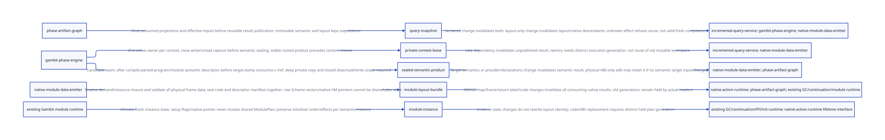
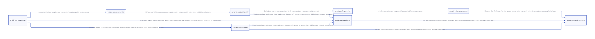

#+TITLE: Shared Stage Contracts and Modern C Reconstruction Gates
#+SETUPFILE: ../../modeling/org/setup.org
#+LANGUAGE: en
#+OPTIONS: toc:3 num:nil
#+PROPERTY: header-args :eval never :tangle no
#+TODO: RESEARCH GROUNDED | QUALIFIED RETIRED

* GROUNDED Architectural authority and proof ownership
:PROPERTIES:
:CUSTOM_ID: stage-reconstruction-contracts
:AUTHORITY: GambitStageReconstruction; GambitPackageDevelopment; GambitVerificationResponsibilities
:STATUS: concrete contract design and conditional interface/data slices; no runtime implementation
:END:

The five [[file:models/sysml/package-development-benchmark.sysml][replacement components]] remain the architecture. The new
[[file:models/sysml/stage-reconstruction-contracts.sysml][native SysML contracts]] specify what crosses their boundaries, which source
writers/consumers must migrate, how invalidation propagates and when the old
authority can retire. The [[file:stage-reconstruction-matrix.org][matrix]],  and
 are generated from that source.

QNT is assigned the context/result handoff protocol under the existing canonical
control obligation. Lean is assigned immutable ModulePlan/instance representation
and frame-table projection under the existing canonical data obligation. No new
owner, duplicate scheduler or second bitfield algebra is introduced. Source and
native obligations remain distinct. A conditional slice does not close either
canonical scope extension or authorize old-path retirement.

This design follows current vendor/gambit source bytes on modern-c, including
its existing edits. The installed SDK is only a historical/native observation
identity. No patch is applied, no compiler option is changed and no package is
built in this study.

* GROUNDED Five shared contracts

#+NAME: shared-stage-contract-overview
| Contract | Boundary | Required separation |
|----------+----------+---------------------|
| QuerySnapshot | Artifact graph -> query service / phase engine / emitter | Semantic consumed inputs versus physical layout/native profile |
| PrivateContextLease | Phase engine -> semantic work / private emitter | Owner and generation versus a shared mutable target or primitive table |
| SealedSemanticProduct | Phase engine -> emitter / artifact graph | Canonical rooted semantic data versus live frontend/c-intf objects |
| ModuleLayoutBundle | Emitter -> native action / artifact / runtime consumers | Code, FrameSpec, ModuleSpec and image holds form one result |
| ModuleInstance | Existing module runtime -> GC/continuation/FFI/init | Per-VM flags, init state and native handle versus shared immutable plan |

** GROUNDED Query keys and private contexts

SemanticKey binds actual source/expanded form, declarations/provider registry,
semantic target options, origins and the closed dynamic-input/effect projection.
LayoutKey binds that semantic product plus ABI, register/frame convention,
physical descriptors, debug/native profile and relevant module defaults.
target-select! already distinguishes target-semantics-changing options in
_back.scm:388-413. This is a source basis for the split, not proof that arbitrary
flags can be omitted from either key.

A layout-only change may keep a semantic product only after that classification
and all actual consumers are qualified. A semantic change invalidates its layout
and native descendants. An unclassified macro/eval/native effect refuses reuse;
it does not make a legal Scheme program uncompilable. The same engine must
support fresh owned compilation for those programs.

ContextLease carries ContextId, generation, owner, private target/primitive
environment, frontend queues, ports/effect state and rooted carriers. Existing
env.begin!, ptree.begin!, virtual.begin!, target-select!, global *proc*/queues
and target function slots cannot be privatized merely by allocating a struct.
Every direct and indirect reader/writer, specializer closure and exception/
continuation reentry must be bound to the private context. Removing the global
mutex before that closure would expose shared state rather than create parallel
compilation.

Fourteen typed SysML ComponentEndpoint references bind those contracts to the
five replacement components. Existing GC/continuation/FFI/module runtime actors
remain explicit external consumers, not additional build components.

The first protocol slice composes with the existing incremental_build DAG.
It models two selected semantic queries and private contexts, not another graph
scheduler or the entire real action population. It checks owner exclusion,
context-epoch reuse, input invalidation, semantic/layout handoff, independent
product custody, response loss and context release. A stale context epoch does
not regain write authority after that context is reused. Semantic readiness is
separately published before native-layout readiness. A qualified semantic product
can hand off to a distinct private emitter workspace, allowing the frontend
context to serve another query before the old layout is complete. The product
root survives; late dependency invalidation blocks new readers without erasing
existing custody. This is an interface slice, not yet a full real-DAG refinement.

** GROUNDED The actual frontend-to-backend seam

In _front.scm:352-438, compile-parsed-program constructs module procedures;
compile-program constructs a descriptor with supply/demand, metadata, preload
default, module main and a placeholder native pointer. It then calls target.dump.
That is the candidate semantic-product seam. It follows semantic/GVM construction
but precedes destructive backend consumption; it is not merely the earlier
normalize-program return value.

In _t-c-1.scm:337-347, targ-dump reads c-intf fields and then clears all four
fields. It subsequently scans procedures and discovers resources. The new
semantic result therefore contains a closed canonical recipe/procedure graph,
not the live c-intf object. Each emitter reconstructs its own working queues.
Copying or closing can fail; the original context retains custody until stable
rooted transfer is acknowledged. Unknown outcome queries the same committed
identity and never authorizes a second destructive emission.

An empty procedure scan queue is insufficient to seal the whole layout:
targ-use-obj(module-descr), c-objs, symbol/global demand and output/init callbacks
can extend resource demand later. Layout sealing requires the full resource
fixed point and all actual writers/aliases, not an invented early freeze point.
Those source premises remain open.

** GROUNDED ModuleSpec, FrameSpec and runtime instances

targ-make-frame-spec in _t-c-3.scm validates kind, stored size, actual size,
link and root map. It nevertheless returns a mutable vector. The word "Freeze"
in its comment does not establish immutable sharing, alias closure or FFI safety.
The new layout result must copy/validate into a canonical owned representation
whose writers are closed; generic vector/FFI escape must be managed or refuse
reuse.

StoredFs and ActualFs are separate. RETI actual size depends on the register,
alignment and reserve ABI; RET/OFD emission stores the corresponding descriptor
fields, and captured-continuation GC consumes decoded physical size/link before
reading link+1. The common descriptor decoder explicitly trusts live metadata
and does not acquire module lifetime. The bundle must carry real code/image/
descriptor/root holds. Neither a valid integer layout nor a copied pointer
proves that lifetime.

Current setup_module_collect_moddescrs overwrites both descriptor flags and its
foreign module pointer. init-mod then consumes that pointer. Sharing this whole
legacy vector would share runtime instance state. The target design separates:

#+BEGIN_EXAMPLE
ModulePlan: semantic identity, layout ABI, complete frame table,
            ordered initializer recipe, default initialization flags
ModuleInstance: VM/instance identity, plan reference, effective flags,
                native ModuleHandle, init/cleanup state and lifetime holds
#+END_EXAMPLE

Default flags belong to the plan key because constructing an instance without
an override consumes them. Effective overrides and native handles belong to the
instance. Changing default flags therefore invalidates the layout/metadata key;
changing one instance's override does not mutate the shared plan. Initializer
order and effects still execute according to module-instance semantics. Cached
plan availability never means initialization has already happened in another VM.

* GROUNDED Exclusive formal slices and exact limits

#+NAME: stage-proof-responsibility
| Canonical owner from SysML | This slice | Deliberately not claimed |
|---------------------------+------------+--------------------------|
| quint: control/phase-query-invalidation-publication | Existing DAG plus private context/semantic/layout handoff interleavings | An unbounded invariant proof, second scheduler, native GC or C23 weak-memory refinement |
| lean: data/module-frame-spec-cross-consumer-layout | Plan/instance separation, ABI/frame/default-key discrimination and inline descriptor-table projection | A scheduler, timeout model, proof that live Scheme vectors are frozen, or full RETI/OFD/all-ABI correctness |
| source: refinement/package-caller-observation-refinement | Complete writer/alias/consumer and extraction/atomic-step correspondence | Token/hash presence or two green tools as source refinement |
| native: native/package-two-repository-performance-correctness | Complete matched MCP and POO correctness/progress/resource/performance | Historical SDK or component success as current package admission |

The Lean slice imports existing FrameContract lemmas rather than duplicating
their bitfield equations. Its table projection is limited to explicitly bounded
inline fields. It does not newly prove all root positions, OFD chunk encoding,
RETI coordinate conversion, memory order, module unloading or physical root
registration. The broader ModuleSpec/FrameSpec obligation remains open.

The QNT slice imports incremental_build rather than reimplementing dependencies
or signature arithmetic. Read/write closure and stable product roots are model
premises for source adapters to discharge. The broader query/private-context
composition remains open. Connecting the two mathematical slices still requires
real source extraction, data identity and C23 step-refinement evidence.

The actual [[file:../../modeling/ascent/stage-reconstruction.rules.scm][ASCENT DSL]] refuses shared live contexts, validated-vector-as-freeze,
shared native pointers, code-only manifests, collapsed semantic/layout keys,
wrong model owners, artifact drift and promotion of a subset into full closure.
Migration receipts are distinct from formal slice receipts. Child-stage evidence
without its predecessor cannot authorize retirement; an old reader blocks the
physical retirement even after logical migration is qualified.

* GROUNDED C23 publication and root custody

The SysML PublicationProtocol is one shared interface, not another runtime
component. A stable ledger owns context grants, generations and the complete
result-manifest publication. DAG readiness is a projection of the same committed
record; it is not a separate flag written before descriptors are installed.

Prepare canonical data and register its actual root carrier before publication.
The qualified runtime synchronization domain publishes through release-unlock
and consumes through acquisition of that same ledger. A consumer matches the
generation and obtains its hold before dereferencing the result. An acquire-only
pointer load cannot prevent concurrent reclamation. Allocation, Scheme callbacks,
foreign finalizers and waits for GC must not occur while holding that ledger.

Semantic immutability does not prohibit collector updates of physical root
slots. Those updates must use the existing qualified carrier/scan protocol;
raw movable Scheme pointers cannot be borrowed across safepoints. Context
release and physical code/descriptor reclamation are distinct events. The latter
requires module-instance, continuation, native and reader holds to be discharged
plus collector grace.

The QNT atomic publish step is this proposed single-ledger cut. It is not proof
that a multi-lock C implementation, C23 atomic sequence or native callback path
implements that cut. Those source/native obligations remain open and are not
repeated as a second Lean scheduler proof. Unknown commit or response keeps its
stable owner and is resolved by the same identity, not a second destructive run.

* RESEARCH Migration dependencies and retirement

#+NAME: stage-migration-sequence
| Gate | Replaces | Prerequisite / exit condition |
|------+----------+-------------------------------|
| Profile and key contract | Conflicting effective configuration and monolithic freshness key | Exact consumed semantic/layout inputs and both package adapters |
| Private context ownership | Global compiler state as sole context authority | Complete writers, aliases, nested entry and exception restoration |
| Semantic product handoff | Mandatory text transport and live context as only result | Rooted canonical result before destructive c-intf consumption |
| Layout bundle generation | Repeated common C/layout construction for migrated classes | Whole resource fixed point; code/descriptors/roots/init/relocations match one manifest |
| Module-instance consumers | Shared flags/native-pointer descriptor as instance authority | Setup/init/registry/GC/continuation/FFI consume plan-plus-instance and lifetime holds |
| NativeAction authority | Independent recipe/launch/config decisions | After profile contract; all compile/link/query/failure modes consume one rooted native ledger |
| Artifact query authority | Timestamp/whole-module freshness and duplicated generation/LinkPlan demand | After profile, semantic product and NativeAction gates; every gxi/gxc/package reader consumes exact phase projections |
| Two-package and retirement | Old authoritative build/emitter/launch routes | Both complete matched package scopes plus every real caller migrated; separate reader/GC/native grace |

NativeAction migration can proceed after the profile contract independently of
private-context work. Artifact-query authority joins the semantic-result and
native-action branches. Final package/retirement admission joins that result
with module-instance consumers. The SysML dependency DAG, not list position,
defines these requirements.

These are dependency gates, not runtime implementation performed by this study.
An adapter may preserve a public CLI while routing to one new engine. Retaining
the old independent freshness/compiler/launch authority behind a new wrapper is
not completion. A failed/unknown transfer keeps its original custody; it is not
a cache hit and cannot disappear from the retirement manifest.

* RESEARCH Net benefit and whole-package acceptance

#+NAME: stage-net-benefit-matrix
| Boundary | Removable work | Mandatory retained / added work | Positive condition and present gap |
|----------+----------------+--------------------------------+------------------------------------|
| Semantic query HIT | Qualified repeated frontend construction/normalization and downstream duplicate demand | Key/effect validation, origins and any required fresh instance state | Source closure and actual omitted requests; no whole-stage saving inferred from a log |
| Layout-only invalidation | Unnecessary repeated semantic work | Regenerate all changed ABI/frame/code consumers and preserve old reader holds | Semantic/layout input classification must match actual target/provider behavior |
| Shared sealed semantic result | Serial ownership of one live frontend heap across independent consumers | Private emitter workspaces, copied recipes, rooted result storage | The model permits two private contexts; actual alias/GC/source composition remains open |
| Compiled common C plus typed module data | Repeated shared header/interface construction and migrated textual packing | Cold helpers, relocations, fixups, descriptors and ABI/root checks | Runtime hot-path cost and broad native-job distribution must be charged |
| Plan versus instance | Rebuilding immutable layout solely because VM flags/handles differ | Fresh init effects, instance state and image/root lifetime | Changed plan defaults still invalidate; no cross-VM initializer reuse |
| Complete result bundle | Revalidation/reconstruction caused by ambiguous code-only completion | Atomic result/manifest publication and unknown-result retention | No old path retires before all actual consumers and both package gates qualify |

No elapsed saving is assigned by these model checks. Reuse the existing generic
benefit laws and the actual per-package baseline, including ratios above5.
Twofold acceleration requires removing at least half of matched baseline time
net of added costs; reaching twice Linux time may require more. Historical patch
timings remain supporting observations, not additive savings for this design.

MCP remains the complete executable-package benchmark. POO remains its ordinary
library package plus explicitly named qualification/test-program scope. Both
must retain exact source/tool/effective capacity, output/cache, clock, limits and
correctness populations across baseline/candidate clean, leaf-edit, macro-edit
and no-change cases. No native test is performed here and no new speedup or old
path retirement is admitted.

The check receipt (local locator: =../../../.cache/tasks/future-frame-commit/runs/research/stage-reconstruction/checks.json=; unavailable in a clean checkout) records conditional model coverage. All canonical source/native
obligations and both broader scope extensions remain visibly open.
