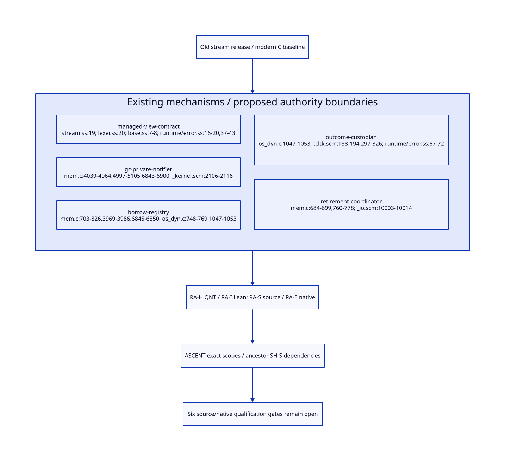

#+TITLE: Old-stream Release Authority, Borrow Closure and Rootless Outcomes
#+SETUPFILE: ../../modeling/org/setup.org
#+CATEGORY: toolchain
#+OPTIONS: toc:3 num:t
#+PROPERTY: header-args :eval never

* RESEARCH An issuer must establish a fact, not name a receipt :modern_c:gxi:gxc:
:PROPERTIES:
:CUSTOM_ID: stream-release-authority
:AUTHORITY: StreamReleaseAuthority
:STATUS: issuers-source-grounded-proposed-protocol-open
:EVIDENCE_CLASS: source-derivation-and-conditional-models
:END:

This refines [[file:span-storage-handoff-design.org][isolated span storage and multi-shot custody]] on the gxi/gxc
#lang reader path. Scheme retains reader/control semantics and owns managed-view
classification; modern C is the native baseline. No composite old-stream release
credential issuer currently exists in the selected source. Existing GC, RC,
exception and callback mechanisms provide different facts, not an already
implemented release protocol.

[[file:models/sysml/stream-release-authority.sysml][SysML]] owns five issuer boundaries, six gates, four gain cases, ReleaseWitness/
ReleaseLaw and RA-H/I/S/E dependencies. [[file:../../modeling/tools/stream-release-study.py][Python]] uses [[file:../../modeling/tools/formal-study.py][shared orchestration]] to invoke
native SysML, [[file:../../modeling/ascent/stream-release-authority.rules.scm][actual ASCENT rules]], [[file:../../../models/build/stream_release_authority.qnt][QNT]] and [[file:../../../models/build/StreamReleaseAuthority.lean][Lean]], then derives [[file:stream-release-authority-matrix.org][the matrix]]
and . [[file:../../../evidence/research/stream-release-authority/checks.json][Receipts]] bind source bytes and exact formal scopes. No runtime,
native test or benchmark is implemented/executed.

* RESEARCH Current actual producers and their authority limits
:PROPERTIES:
:CUSTOM_ID: release-current-issuers
:END:

| Current mechanism | Source-established fact | Fact it does not establish |
|---+---+---|
| Strong/weak GC phases | [[file:../../../vendor/gambit/lib/mem.c::6843][Strong phase]] scans roots before weak traversal; weak phase invokes process_wills | Exported per-stream reachability certificate, no resurrection, or native drain |
| Will selection | [[file:../../../vendor/gambit/lib/mem.c::4997][determine_will_executability]] tests whether testator remains unmarked by strong paths | Testator currently inaccessible after action invocation |
| Will execution | [[file:../../../vendor/gambit/lib/_kernel.scm::2106][will-execute!]] reads testator/action, clears will slots, then calls action(testator) | Callback parameter dead, no capture/publication, or thread-affine cleanup authorized |
| RC allocation/data | [[file:../../../vendor/gambit/lib/mem.c::703][alloc/register/set_data]] records an external holder and Scheme payload | Admission closure, all-processor scan coverage, or automatic object-death notification |
| RC release | [[file:../../../vendor/gambit/lib/mem.c::760][release_rc]] decrements and unlinks/frees at zero | All callbacks/in-flight accesses are excluded by that decrement alone |
| Error stacktrace | [[file:../../../../gerbil-gambit-bootstrap-audit/src/gerbil/runtime/error.ss::37][raise]] captures a continuation for an unpopulated StackTrace slot | Handler delivery has removed captured aliases |
| External release callback | [[file:../../../vendor/gambit/lib/os_dyn.c::1047][c_closure_release]] releases RC; [[file:../../../vendor/gambit/examples/tcltk/tcltk.scm::188][scheme_delete_cmd]] releases vector and RC data | A generic gxi/gxc borrow-admission/settlement service already exists |

These are real mechanisms/callers, not evidence that the EBNF reader already
registers a native pin. [[file:../../../vendor/gambit/lib/os_dyn.c::748][make_c_closure]] creates RC storage and sets its Scheme
payload to proc when C_CLOSURE_CODE_SIZE is enabled; this is not qualification
of every platform/configuration. The Tcl example at :297-326 allocates RC and a still
vector holding a Scheme procedure. They demonstrate how a future pin can be a
strong GC path. The example does not independently prove deletion excludes
in-flight callbacks or every creation-failure path; those remain separate duties.

[[file:../../../vendor/gambit/lib/mem.c::277][rc_head is processor-state storage]]. [[file:../../../vendor/gambit/lib/mem.c::3969][mark_rc]] marks every registered data field;
the selected strong-phase caller at :6845-6850 invokes it only for processor
zero. This is not a proof that a new all-processor native pin service would be
scanned correctly. The ordinary writes in register_rc/set_data/addref/release
also do not supply the proposed concurrent reserve/commit protocol. This does
not assert that every existing serialized caller races; it blocks importing
that concurrency guarantee without further source/native qualification.

* RESEARCH Root graphs that a weak wrapper cannot repair
:PROPERTIES:
:CUSTOM_ID: release-owner-coverage
:END:

The managed owner token is a proposed private lifetime anchor, not the old
stream itself automatically becoming weak. Every governed alias that can still
use the resource must strongly reach the token: active reader/control frames,
resource-capable native closures, captured continuations, and error stacktrace
paths. A token that merely points TO the stream does not establish the reverse
implication. Counterexample: token -> stream, while an external raw alias ->
stream; token becomes unreachable although the stream remains usable.

Therefore ManagedOwnerCoverage is a Scheme/generated-contract plus native-alias
admission obligation. An unknown raw/native alias keeps legacy ownership and
denies release/reuse qualification. Detached tokens/chunk views that cannot use
the old stream instead keep their separate origin/chunk owners; they need not
artificially keep the old stream token alive.

[[file:../../../vendor/gambit/lib/mem.c::4039][Will scanning]] makes testator weak but action strong. The following are bad
monitor designs, not claims that these exact loops already exist in the reader:

#+begin_src text :eval never
strong will action -> captured old stream -> managed owner token
native RC root -> Scheme callback/continuation -> reader view -> owner token
rooted retirement coordinator -> owner token while waiting for its GC notice
#+end_src

In each case dropping the last ordinary user alias need not enable the notice.
The last cycle is especially easy to introduce through diagnostic closures or
an exception held by the coordinator. A native pending-record identity must
not quietly contain an error, continuation, Scheme object or writable stream
pointer that reinstates such a path.

* RESEARCH Proposed issuers and ordered handoff
:PROPERTIES:
:CUSTOM_ID: release-proposed-issuers
:END:

| Credential | Sole proposed issuer | Required evidence / custody |
|---+---+---|
| ManagedOwnerCoverage | Scheme/native-contract admission | Complete resource-capable view/alias graph; compatible token tracing; unmanaged cases remain legacy |
| BorrowAdmissionClosed | Owner's borrow registry | One close cut and generation shared with reserve/commit; all earlier reservations enumerated |
| NativeBorrowDrain | Canonical registry plus actual external releases | Reserved/active holders accounted, roots published before exposure, rollback/unregister completed |
| ManagedDetachedNotice | Restricted GC/notifier adapter | Owner identity and generation, covering contract, completed strong-phase observation, no action backedge/resurrection, callback-held reference drained |
| OutcomeSettled | Authoritative operation custodian | Grant/release outcome identified; cancellation/timeout is not release; no blind retry |
| ReclaimPermit | Retirement coordinator joining the above | Same resource/generation/close epoch, no outstanding reservation/borrow/pending responsibility, correct release executor and single consume |

The current GC selects executable wills and then [[file:../../../vendor/gambit/lib/mem.c::5032][continues marking wills/testators]].
Later the action receives the testator, so an executable will proves a past
strong-reachability observation, not permanent absence of usable references.
A public action may publish testator or capture control. A qualifying internal
notifier must instead capture only stable identity/rootless native control data,
never expose the token, avoid user callbacks and exception formatting, and hand
off a preexisting/rootless notice. Its temporary testator argument and any
callback frame must drain before the notice is sufficient for the coordinator.
The source provides no ready-made API guaranteeing those restrictions; the
adapter and safe post-callback observation point remain RA-S/RA-E.

The coordinator must not re-root or dereference a supposedly dead token merely
to validate its notice. It uses stable control identity, generation and close
epoch whose storage outlives outstanding notices. Native control storage cannot
be reused while stale notifications/acknowledgements may still target it. The
model checks generation mismatch, not an actual allocator/grace implementation.

* RESEARCH Reserve, close and late borrowers
:PROPERTIES:
:CUSTOM_ID: release-admission-close
:END:

1. Reading open is advisory only. Reserve atomically validates current open
   state/epoch and installs a counted reservation while the caller still roots
   the managed owner.
2. Publish a GC-visible native root while reservation/caller custody remains.
   Allocation/publication failure retains that custody until rollback settles.
3. Commit revalidates the close generation before exposing a capability. This
   design rejects a prepared-but-uncommitted request after close. Reject does
   not erase its reservation or pin until rollback actually completes.
4. Close atomically prevents both fresh reservations and late commits. It
   preserves all previously committed borrows and unresolved replies; those
   must drain through canonical holder release.
5. Borrow/root drain permits managed reachability observation. The owner token
   still cannot die if any legitimate capture/error/root remains reachable.
6. Join valid private notice and settled native responsibilities, issue one
   permit, and consume it on the authorized executor. Resource close, adapter
   reclamation, chunk release and origin-port object GC remain different events.

The atomic steps are abstract protocol cuts, not a C implementation. A real
service needs a lock/atomic/generation protocol covering publication with GC,
processor/VM binding, failure unwind, callback reentry and reclamation grace.
Do not hold the admission lock across user code, external release or GC-notice
waiting; those paths can need the same owner. Lock-free labels alone provide
none of these facts. A late request with an old open observation is rejected;
a reply delivering a previously committed borrow after close is accounted
existing work, not a newly admitted borrow.

The initial model omitted caller-root presence from reserve. Exploration found
the reachable history observe-open -> drop-caller -> reserve, leaving an
unrooted reservation. The [[file:../../../evidence/research/stream-release-authority/historical_reservation.qnt][retained prior model]] and
[[file:../../../evidence/research/stream-release-authority/historical-reservation-witness.stdout][focused witness]] preserve that failure. The current guard requires the caller
root at reserve and forbids dropping it until a registered root or completed
rollback takes custody. This is a corrected model premise, not proof of a
corresponding existing-runtime defect.

* RESEARCH Unknown replies and responsibility without self-roots
:PROPERTIES:
:CUSTOM_ID: release-unknown-outcomes
:END:

| Authoritative state | Managed root | Remaining custodian |
|---+---+---|
| Grant may be committed, reply unknown | Keep committed holder/root | Registry and original operation record; query/settle same operation identity, never grant twice |
| Reservation rejected, pin rollback incomplete/unknown | Keep reservation plus required caller/native root | Rollback executor until unregister/outcome is authoritative |
| Actual external release committed, acknowledgement unknown | Managed holder root can end once no actual borrower remains | Rootless outcome/tombstone record; no Scheme callback/error/token backedge |
| Managed notice exists, release acknowledgement still pending | No artificial new managed root | Coordinator waits on rootless canonical record; final permit remains blocked |
| All replies settled but managed error/capture still live | Keep ordinary tracing reachability | Its real holder; no deadline can manufacture GC detachment |

Thus an unresolved delivery need not always strongly retain the Scheme owner.
It must always retain the appropriate authoritative responsibility. Keeping a
managed pin solely until an acknowledgement that itself waits for GC creates
a deadlock; erasing the record merely to obtain GC creates a loss of custody.
The rootless record alternative avoids that cycle but requires lifetime for
its own identity and reply routing. Existing RC release functions are evidence
of actual release endpoints, not proof that every client implements this ledger.

* RESEARCH Benefit, cost and formal boundary
:PROPERTIES:
:CUSTOM_ID: release-benefit-closure
:END:

For B proposed borrow requests, bookkeeping has O(B) reserve/commit/settlement
operations, plus root publication/removal and O(outstanding reservations,
borrows, outcomes and notices) storage. This is a work bound, not nanoseconds,
scaling throughput or fixed GC/finalization latency. After canonical release,
rootless acknowledgement records can shorten managed retention; genuine live
errors/continuations still allow indefinite retention. Prior reset/ignored-string
savings are not counted again. Modern C and Zig both need these semantics.

RA-H exercises admission/close races, private notice, hidden aliases, strong
monitor cycles, unknown grants/releases and generation-qualified permit checks.
RA-I has eight conditional kernels. Coverage, GC notification and native root
publication are assumptions in those models, not established runtime facts.
RA-S requires complete alias/control/collector event simulation; RA-E requires
all-processor root coverage, native ordering, notification grace and executor
affinity. SysML links RA-S to RA-H/I/E and SH-S; ASCENT preserves the ancestor
frontier and rejects stale/scope-mismatched formal receipts. The six new gates
remain unresolved. No runtime path can retire on model success alone.
