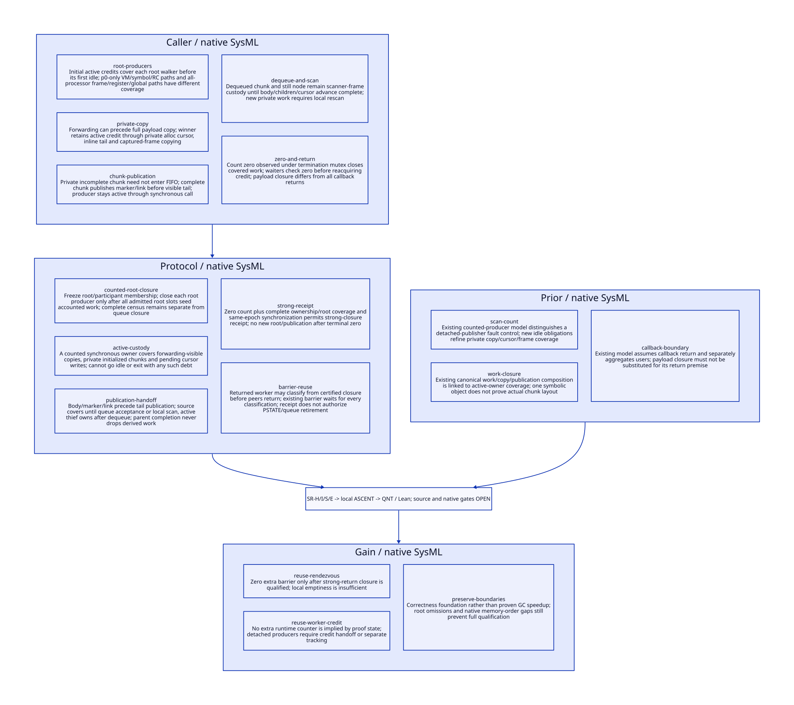

#+TITLE: Strong Closure Receipts, Counted Custody and Existing Barrier Reuse
#+SETUPFILE: ../../modeling/org/setup.org
#+CATEGORY: toolchain
#+OPTIONS: toc:3 num:t
#+PROPERTY: header-args :eval never

* RESEARCH Modern C decision and qualification boundary :modern_c:gambit:gc:smp:
:PROPERTIES:
:CUSTOM_ID: strong-closure-receipt
:AUTHORITY: StrongClosureReceipt
:STATUS: conditional-custody-models-root-source-platform-open
:EVIDENCE_CLASS: source-and-local-formal-research
:END:

The current scanning structure offers a conditional route to reusing the existing
strong/weak barrier. Synchronous copying, publication, private scanning and root
production can be covered by an existing active worker credit. It is unnecessary
to require every private chunk to enter a public FIFO or to introduce an atomic
counter for each copy merely because it appears in the proof model. The required
condition is stronger: no worker may relinquish its credit while it still owns
any private, unpublished, queued, dequeued, root or derived-work responsibility.

Count zero alone is not a full-VM StrongClosureReceipt. It closes admitted traced
work only if the count/ownership/phase relation is valid, all root producers are
covered, the root census is complete and the observation carries the correct
memory synchronization and epoch. Payload closure is also different from all
scan callbacks returning, resource retirement and weak-phase admission.

This extends [[file:will-strong-cut-design.org][the shared-testator decision cut]], with Gambit as runtime/semantic base,
Gerbil as incremental service and modern C as implementation direction.
[[file:models/sysml/strong-closure-receipt.sysml][Native SysML]] owns callers, custody/cut protocols, five source/action/lemma routes,
three existing-root-model relations, refinement and benefit rows, and seven open
gates. [[file:../../modeling/tools/strong-closure-receipt-study.py][Python orchestration]] evaluates sysml, projects [[file:strong-closure-receipt-matrix.org][Org matrix]], [[file:diagrams/strong-closure-receipt.d2][D2]] / 
and [[file:../../../models/build/strong_closure_parameters.qnt][parameters]], and runs [[file:../../modeling/ascent/strong-closure-receipt.rules.scm][actual ASCENT DSL]], [[file:../../../models/build/strong_closure_receipt.qnt][QNT]] and [[file:../../../models/build/StrongClosureReceipt.lean][Lean]]. [[file:../../../evidence/research/strong-closure-receipt/checks.json][Receipts]] separate local
checks from source/native qualification. No runtime implementation, Scheme code
generation, native tests or performance tests are performed.

* RESEARCH Root producers and the initial population :source:roots:
:PROPERTIES:
:CUSTOM_ID: strong-root-producers
:COMPLETENESS: traced-source-families-not-complete-native-root-proof
:END:

[[file:../../../vendor/gambit/lib/mem.c::3454][Setup]] initializes both strong and weak scan worker counts to np. Each processor
performs its root walkers before entering mark_reachable_from_marked. A worker
that has not yet finished producing its roots is therefore still included in the
initial active population. This is why an early helper seeing no work cannot
alone make the global count zero.

| Producer | Source anchors | Closure duty |
|---+---+---|
| VM object, symbols, native RC | [[file:../../../vendor/gambit/lib/mem.c::6845][p0-only dispatch]], [[file:../../../vendor/gambit/lib/mem.c::3969][RC scanner]], 6573-6587 and 6651-6664 | Complete admitted VM/native root census; p0-only RC traversal does not prove arbitrary nonzero registration coverage |
| Global variable partitions | [[file:../../../vendor/gambit/lib/mem.c::6591][global scanner]] | Exact partition over stable np; distinguish SINGLE_VM list partitions from per-VM array partitions |
| Stack and captured continuation | [[file:../../../vendor/gambit/lib/mem.c::3817][frame GC map]], [[file:../../../vendor/gambit/lib/mem.c::3898][continuation walker]], [[file:../../../vendor/gambit/lib/mem.c::3667][captured-frame copier]] | Complete root map, copied frame/inline-tail custody and final local cursor commit |
| Registers and saved slots | [[file:../../../vendor/gambit/lib/mem.c::6511][register scanner]], 6526-6538 | Actual mutable slot writeback, not just container lifetime |
| Type cache and processor object | [[file:../../../vendor/gambit/lib/mem.c::6541][type cache]], 6556-6569 | Both source containers covered before producer closes |
| Externally referenced still objects | [[file:../../../vendor/gambit/lib/mem.c::4210][setup seeds]], [[file:../../../vendor/gambit/lib/mem.c::4235][still scan loop]] | Every admitted arena initialized once and all positive-refcount seeds transferred into covered scan work |
| Derived body roots | [[file:../../../vendor/gambit/lib/mem.c::4001][body scanner]], [[file:../../../vendor/gambit/lib/mem.c::4196][PAIR fast path]] | Child discovery, captured continuation and inline tail work remain accounted until complete |

The count measures participating workers, not correctness of these root maps or
completeness of root domains. Existing native/RC admission and future VM arena
adapters remain parent obligations. An omitted root can coexist with perfectly
terminated scanning. The model's rootCoverage premise is deliberately independent
of rootsOpen: finishing all listed producers is not proof that the list was complete.
External FFI/root writers outside the frozen protocol must be refused or use an
explicit accepted-work/participation handoff; current plain RC stores are not a
general concurrent root-update contract.

* RESEARCH Private allocation, copying and cursor custody :copy:publication:
:PROPERTIES:
:CUSTOM_ID: strong-private-work
:END:

[[file:../../../vendor/gambit/lib/mem.c::3504][mark_array]] uses private alloc/limit variables. A successful forwarding CAS at
3578-3582 can make an identity visible before the payload-copy loop at 3607-3611
completes. The winner still owns initialization; a losing observer following the
forwarding pointer does not take that duty away. Final alloc_heap_ptr commit is
at 3663, after inline work, not at the forwarding CAS.

[[file:../../../vendor/gambit/lib/mem.c::3602][Inline tail handling]] can immediately continue from the first copied field;
the PAIR fast scanner later marks the other field at 4200. Proving only the body
scanner loop would miss part of this split. Captured-frame copying similarly uses
a private alloc at 3693, copies fields at 3766-3767, writes forwarding at 3788,
continues frame chains and commits the cursor at 3808. The threshold test at 3794
does not by itself certify that every private region was publicly queued.

All these operations are synchronous under the calling worker in the traced
source. They cannot be abstracted as detached tasks unless another owner takes
their credit. A blocked inline copier remains counted; this preserves safety but
does not prove freedom from allocation/continuation-lock deadlock or bounded delay.
Any exception, cancellation or nonlocal exit introduced by future refactoring
must settle/transfer the duty before dropping active credit. Unknown outcomes
retain custody rather than reducing the count on timeout.

The proof state distinguishes a forwarding-visible copy, initialized private
data, uncommitted cursor, publication in progress and scanner frame. These are
semantic obligations, not a requirement to implement per-object runtime counters.
Independent atomic credits may be removed only when this synchronous-lifetime
coverage is proved for every admitted producer.

* RESEARCH Complete and incomplete chunks :chunks:
:PROPERTIES:
:CUSTOM_ID: strong-chunks
:END:

[[file:../../../vendor/gambit/lib/mem.c::3251][end_heap_chunk]] writes a terminal marker even for the currently scanned chunk.
When publication is needed it writes the link at 3280, orders contents/marker/link
before tail visibility with the first barrier at 3288, publishes the new tail at
3290, then orders that update with another barrier at 3301. The FIFO lock is
released and the termination condvar signaled at 3304-3305. The two fences carry
different ordering roles; replacing them with an unrelated counter is not a proof.

A chunk already under local scanning can avoid FIFO insertion. The incomplete
chunk is also scanned locally. [[file:../../../vendor/gambit/lib/mem.c::4279][scan_movable_objs_to_scan]] follows complete regions,
drains FIFO entries, moves to alloc_heap_chunk_start and scans toward the current
alloc_heap_ptr. Its return at 4333-4334 stores the updated scan frontier. New copies
can grow the allocation endpoint during scanning; the source fixed-point relation
is not a one-time comparison against a saved endpoint.

[[file:../../../vendor/gambit/lib/mem.c::6686][The local closure loop]] scans still work, then movable work, and repeats if still
work was produced. Stealing a complete chunk at 6717-6725 removes its FIFO link
before scan_complete_heap_chunk finishes. That automatic ptr frame owns the
dequeued region and any new work; after it returns, goto continue_local_scan at
6727 drains newly generated local work. A zero-length FIFO does not mean an
already dequeued chunk has finished.

| Responsibility | Required owner until transfer/finish |
|---+---|
| Private incomplete region | Counted allocating/scanning worker; no mandatory public publication |
| Complete chunk publication | Same counted worker through marker/link/tail commit |
| Queued chunk | Active publisher retains coverage until an active scanner accepts ownership; source local drain must prevent publisher idle with its own queue pending |
| Dequeued chunk / still node | Counted scanner frame until body, child publication and cursor advance finish |
| Newly discovered canonical child | Existing owner if already claimed; otherwise newly assigned active owner before parent releases responsibility |

The exact interval/sentinel/fast-path relation still needs source refinement. The
finite model's object-sized chunk abstraction does not prove no duplicate or
missing scan in actual msection layouts. Nor does a shared-memory barrier macro
alone establish ISO C legality of all unlocked head/tail hints and plain fields.

* RESEARCH Zero observation and the receipt issuance point :termination:
:PROPERTIES:
:CUSTOM_ID: strong-zero-receipt
:END:

After local drain and unsuccessful stealing, a worker takes the termination mutex
and decrements workers_count at [[file:../../../vendor/gambit/lib/mem.c::6738][6738-6740]]. The last worker signals waiters and
unlocks before returning. Others wait with the same mutex; on wake they test zero
at 6759 before incrementing at 6765. A terminal-zero observer does not reacquire
active credit and restart scanning in this phase. A nonterminal wake increments
credit before returning to the stealing loop.

Under the following invariants, the terminal-zero observation can issue a
generated-work closure receipt at mark_reachable_from_marked return:

1. count equals the exact active worker set in a fixed VM/phase/epoch.
2. Every still-open root producer owns an active credit.
3. Every copy, private cursor/tail, publication, queued region and dequeued frame
   has a counted owner; handoff to another scanner precedes source relinquishment.
4. Local drain and child coverage are complete before the owner can become idle.
5. No uncounted external root writer, detached publisher or late producer can
   reopen the terminated epoch.
6. Queue publication, scanner accesses and termination observation have the
   required visibility and happens-before relation.

With those premises, zero active owners implies no covered outstanding work.
A full-VM StrongClosureReceipt additionally requires exact root/domain coverage,
not just generated-work closure. The model rejects full receipt issuance when
rootCoverage is false even if all its traced graph work finished.

#+begin_src text :eval never
StrongClosureReceipt = {
  VM, phase=strong, epoch and stable cohort/domain incarnations,
  exact RootCensusReceipt, completed root-producer coverage,
  active-count/ownership invariant and terminal-zero observation,
  drained private/copy/cursor/queue/frame obligations,
  synchronization identity and no-reopen authority
}
CallbackReturnReceipt = {worker, epoch, final queue/resource use completed}
WillDecisionReceipt = {domain, StrongClosureReceipt, membership, classification}
#+end_src

Synchronous source publication can be covered by the publisher's active credit.
Its condvar signal is outside the termination mutex, but this alone is not a
source proof of lost work: the publisher is still active and must drain its own
work before the terminal decrement. Missing an opportunistic wake need not lose
safety under that invariant. Conversely, an asynchronous/detached publisher that
outlives the counted worker invalidates the argument and needs a persistent
credit/accepted-task handoff or an independent publisher count. Wake/progress and
native condvar correctness remain distinct qualification obligations.

* RESEARCH Memory synchronization and barrier reuse :memory:phase:
:PROPERTIES:
:CUSTOM_ID: strong-barrier-reuse
:END:

The source's FIFO lock/fences and termination mutex are integration seams for:
payload/link publication -> scanner acquisition -> descendant completion ->
idle/count update -> zero observation -> classification reads. For the modern C
contract, each hop needs an actual happens-before relation. The last worker must
observe preceding owners' published work/completion, and waiting zero observers
must acquire those effects before classification. Atomic/plain access choices,
lock implementations and configured ABI remain platform/source duties; the
sequentially consistent QNT abstraction does not establish them.

[[file:../../../vendor/gambit/lib/mem.c::6864][After mark_reachable_from_marked]], the strong phase has instrumentation/return
and then the existing barrier at 7016. It has no further explicit root walker in
this function. Instrumentation and transitive helpers still need a no-Scheme-
reentry/no-new-root-production qualification. Conditional reuse inserts a
nonallocating will-domain classifier after certified strong closure and before
that barrier. Every assigned domain, including an empty one, must contribute a
same-epoch decision acknowledgement before the existing barrier releases weak
preservation. The old weak-phase local classifier must then cease being a second
authority that rereads marks after preservation begins.

** Payload closure does not mean every callback returned

The last worker can observe zero while peers are still in the condvar-return
path. It may possess payload closure before they have returned from scanning.
That permits the proposed classification only if the remaining callbacks cannot
perform more strong work. It does not permit freeing their queues, locks, PSTATE
or wait state. [[file:../../../models/gambit/scan_barrier_quiescence.qnt][Existing callback-quiescence modeling]] treats complete callback return as a
separate premise. The reused barrier remains the convergence point for all
classification writes and callback/phase participants. Queue resources may also
be reused in weak phase, so even barrier arrival alone is not blanket destruction
permission. The model's retirement marker concerns epoch metadata only.

| Condition at strong return | Classification | Full receipt / retirement |
|---+---+---|
| Only local queue/cursor appears empty | No global authorization | Refuse |
| Terminal zero, but private work can outlive credit | Unsound | Refuse |
| Covered traced work closed, root census incomplete | Only a scoped diagnostic fact | Refuse full-VM receipt |
| Full root/work closure, peers still returning | Conditional classifier permitted | No callback/resource retirement |
| Every domain classified and all barrier participants arrived | Weak preservation may start | Still obey weak-resource users and retirement protocol |

* RESEARCH Existing root-model relations and actual DSL :sysml:ascent:qnt:lean:
:PROPERTIES:
:CUSTOM_ID: strong-prior-refinement
:END:

| Existing unchanged model | Actual relation to this design | Not inherited as proved |
|---+---+---|
| [[file:../../../models/gambit/gc_scan_termination.qnt][gc_scan_termination.safe]] | count/producer coverage -> idleCannotOwnDebt and idle transition | Detached-publisher fault control is not a claim the current source permits that fault |
| [[file:../../../models/gambit/gc_work_closure.qnt][gc_work_closure.terminationSafe]] | Recursive canonical child/copy/publication coverage -> finishScan and zeroActiveCloses | Symbolic chunks do not prove actual msection intervals or root maps |
| [[file:../../../models/gambit/scan_barrier_quiescence.qnt][scan_barrier_quiescence.callbackClosure]] | All-user return premise -> reuseBarrier and oneReturnNotAll | Payload closure cannot substitute for callback return and retirement |

SysML prior rows carry exact invariant names and action/lemma obligations.
Python checks the actual invariant/action/lemma declarations and hashes subjects;
ASCENT derives prioraligned only for matching bindings and model steps. A
missing-prior negative control blocks even synthetic all-qualified admission.
[[file:../../../evidence/research/strong-closure-receipt/prior-model-alignment.json][Alignment receipt]] explicitly marks source refinement unproved and old models
not rerun. This is a checked refinement obligation map, not a completed simulation
proof or a new green receipt for historical tests. Root models and their retained
failures are unchanged.

| Need | Local result and scope | Still open |
|---+---+---|
| SR-H | 24 QNT scenarios including 12 controls; 200 bounded runs, max 80 steps, with complete/incomplete root-census choices | Two workers, three canonical objects and one epoch; no actual layout, native weak memory or progress proof |
| SR-I | Thirteen Lean conditional lemmas, including arbitrary-domain zero-active/custody closure | Count/custody/root-census premises and actual C/source refinement not derived by algebra |
| SR-S | Five source/action/lemma routes and three prior-invariant relations through actual ASCENT; WS-S prerequisite | Complete root and inline-tail/copy/local-drain/msection/FFI call closure |
| SR-E | Seven explicit false gates | Native memory order/locks/ABI, configured roots, host attestation and native correctness |

The model separates forwarding-visible copy, private initialized region, cursor
debt, publication in progress, public queue, dequeued scan, child discovery and
pending advance. It permits a helper to be idle while another active owner holds
work, rather than requiring every global queue to be empty before any idle.
Private scanning requires no public publication. Derived graph edges are cyclic
and deduplicated by canonical identity. The seeded graph has a complete three-
object reachable population; arbitrary graphs remain a source/induction duty.

Positive histories also exercise an idle helper beside another active publisher's
nonempty queue, and reacquisition of worker credit before stealing that work.
Controls reject idle with copy/cursor/publication/dequeued/advance/root debt, early receipt
from local emptiness, receipt without complete census, stale epoch, metadata
retirement before peer returns, reopening after zero and weak phase before all
classification. Nine ASCENT cases include missing/stale/wrong-scope subjects,
missing source/model/prior binding and synthetic-only admission. All seven real
qualification gates remain open; inherited host attestation is not retried.

* RESEARCH Retirement order and net benefit :benefit:migration:
:PROPERTIES:
:CUSTOM_ID: strong-closure-benefit
:END:

| Old/proposed responsibility | Modern C decision | Retirement condition |
|---+---+---|
| Extra classifier rendezvous | Reuse existing 7016 barrier conditionally | Strong return has root/work/synchronization proof; every domain decision precedes barrier release |
| Hypothetical per-copy/publisher counters | Retain counted-worker coverage where synchronous | Every producer's last use precedes idle/exit, with accepted handoff when ownership changes |
| Local-empty heuristic as global closure | Replace authority with typed epoch closure receipt | Exact active/cohort/credit relation and complete root census |
| One receipt for closure, return and destruction | Separate payload, callback, decision and resource authorities | All real users and next-phase reuse accounted |
| Root/queue legacy ownership for migrated domains | Integrate VM root/arena/weak-domain contracts | Full accepted caller closure; cannot retire unmanaged paths by assumption |

| Metric | Potential benefit | Added cost / falsification |
|---+---+---|
| Rendezvous | Can avoid one additional all-classifier barrier | Existing barrier and classification skew remain; reuse rejected if strong-return proof fails |
| Atomics | Independent per-object publication credit can be unnecessary | Owner lifetime, queue visibility and idle guards still mandatory; asynchronous producers invalidate elimination |
| GC work | Keep current local incomplete-chunk scan and canonical dedup | No asymptotic reduction in required root/body/edge scanning |
| Span | Classify after payload closure while peers finish returning | Slow producer, copy, continuation lock or root walker still delays closure; no latency bound proved |
| Memory | Avoid forced publication or duplicate support structures solely for proof bookkeeping | Private/unknown work must retain storage; no unbounded-retention claim solved |
| Language | One modern C phase/ownership contract composes these mechanisms | Zig provides no demonstrated unique discharge of root, custody or memory-order obligations |

For a candidate that would add one new barrier, valid reuse saves that rendezvous
relative to the candidate, not relative to current uncorrected semantics. Net
work saving requires avoided coordination A to exceed added receipt/admission R;
net span requires saved barrier cost to exceed classification skew and new
critical-path coordination. Proof ghost state is not a mandate for runtime
per-object counters. Correctness and admitted-profile coverage precede any
performance claim; no native timing or invented speedup is reported.
