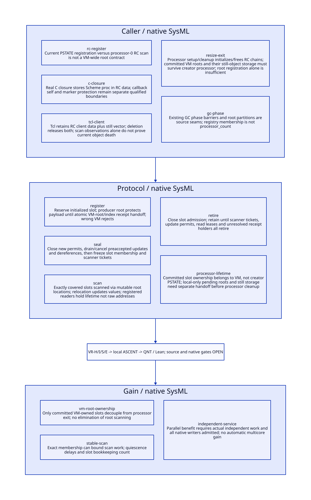

#+TITLE: VM Root Registry Membership, GC Slot Updates and Lease Retirement
#+SETUPFILE: ../../modeling/org/setup.org
#+CATEGORY: toolchain
#+OPTIONS: toc:3 num:t
#+PROPERTY: header-args :eval never

* RESEARCH Architecture decision :gambit:gerbil:modern_c:gc:smp:
:PROPERTIES:
:CUSTOM_ID: vm-root-registry
:AUTHORITY: VMRootRegistry
:STATUS: conditional-local-models-source-platform-open
:EVIDENCE_CLASS: source-and-local-formal-research
:END:

Gambit owns root/GC/continuation semantics and the modern C runtime foundation;
Gerbil's incremental service owns semantic bundles, private sessions and EventId
handoff. VM RootRegistry is a proposed collector-visible root authority, not a
renaming of processor RC chains. A slot's creator, its scanner, its current borrower
and its payload storage owner are distinct roles. Root reachability and backing
storage lifetime must both survive processor departure.

[[file:models/sysml/vm-root-registry.sysml][SysML]] owns real caller/protocol families, five source/action/lemma routes, three
benefit rows and seven open gates. [[file:../../modeling/tools/vm-root-registry-study.py][Python]] transports native SysML to [[file:../../modeling/ascent/vm-root-registry.rules.scm][actual ASCENT
DSL]], [[file:../../../models/build/vm_registry_parameters.qnt][QNT parameters]], [[file:vm-root-registry-matrix.org][Org matrix]] and [[file:diagrams/vm-root-registry.d2][D2]] / . [[file:../../../models/build/vm_root_registry.qnt][QNT]], [[file:../../../models/build/VMRootRegistry.lean][Lean]] and [[file:../../../evidence/research/vm-root-registry/checks.json][receipts]] keep
local checks separate from native/source admission. This component models the proposed
refactoring contract; it does not replace existing collector correctness evidence.
No runtime implementation, native test or performance experiment is performed.

* RESEARCH Real registration, callback and cleanup paths :source:
:PROPERTIES:
:CUSTOM_ID: vm-root-real-callers
:COMPLETENESS: concrete-source-caller-families-not-whole-program-native-closure
:END:

| Path | Concrete source | Consequence |
|---+---+---|
| RC creation/registration | [[file:../../../vendor/gambit/lib/mem.c::277][PSTATE_MEM]], rc_head at 306, [[file:../../../vendor/gambit/lib/mem.c::723][register_rc/alloc_rc]] | Chain is processor-owned; registration stores no VM membership/epoch receipt |
| RC scanning | [[file:../../../vendor/gambit/lib/mem.c::3969][mark_rc]] scans &h->data; [[file:../../../vendor/gambit/lib/mem.c::6845][strong phase]] calls it only under processor id 0 | Registration on a nonzero PSTATE is not itself evidence of coverage |
| C closure publisher | [[file:../../../vendor/gambit/lib/os_dyn.c::748][make_c_closure]] allocates RC with current PSTATE and stores proc in data; [[file:../../../vendor/gambit/lib/os_dyn.c::1047][closure release]] releases RC | Real procedure/root publisher, conditional on supported native trampoline configuration |
| C closure callback consumer | [[file:../../../vendor/gambit/lib/c_intf.c::6511][stack marker]] reads closure-self data; os_dyn.c:744 records thread-locality TODO | Callback VM/processor binding, marker preallocation protection and native self identity are separate obligations |
| Tcl command client data | [[file:../../../vendor/gambit/examples/tcltk/tcltk.scm::298][command construction]] holds RC plus still vector; [[file:../../../vendor/gambit/examples/tcltk/tcltk.scm::188][delete callback]] releases both | Real external holder and release path; still refcount protection means RC scan observation alone does not prove current object death |
| Processor setup/teardown | [[file:../../../vendor/gambit/lib/setup.c::4665][cleanup/setup_pstate]], [[file:../../../vendor/gambit/lib/mem.c::4659][setup_rc]], [[file:../../../vendor/gambit/lib/mem.c::4928][cleanup_mem_pstate]] | Processor cleanup releases local memory and RC chains; positive native refcount does not authorize outliving teardown |
| Resize departure | [[file:../../../vendor/gambit/lib/setup.c::918][nonzero processor cleanup]], [[file:../../../vendor/gambit/lib/setup.c::962][processor-count synchronization]], [[file:../../../vendor/gambit/lib/setup.c::973][join loop]] | Membership update, local resource release and join are different events; ignored join error is not a new root-transfer receipt |

These are source seams, not evidence that this specific build executes an unsafe
nonzero callback or fails natively. The retained census distinguishes helper bodies,
exports and actual calls. No claim closes arbitrary reflective, FFI or unlisted native
stores by syntactic absence.

** Root transfer does not transfer backing storage

[[file:../../../vendor/gambit/lib/mem.c::4432][free_still_objs]] detaches the processor's still list, invokes foreign release when
needed and frees every object in that list. cleanup_mem_pstate calls it before
cleanup_rc. Consequently a VM-owned root slot pointing to an object in a departing
processor's still storage is not by itself safe. A redesign must preserve/transfer
that storage's ownership/accounting/destructor responsibilities before calling the
old cleanup, or retain a VM-owned retired arena until its holders drain.

#+begin_src text :eval never
ProcessorExitReceipt = {
 no unhanded local root/update/dereference permits,
 all committed VM slots remain registered,
 StorageHandoffReceipt for retained processor-local storage,
 source/local-only pending roots drained or transferred,
 callback/native producers closed and participation epoch resolved
}
#+end_src

StorageHandoffReceipt is proposed, not emitted by current setup/cleanup. Moving only
an RC link or processor-id field cannot supply it. General cross-VM Scheme graph
migration is not admitted by a same-VM ownership receipt.

* RESEARCH VM slot, registration and acknowledgement contract :contract:
:PROPERTIES:
:CUSTOM_ID: vm-slot-registration
:END:

#+begin_src text :eval never
SlotId = (VM domain, RootRegistry incarnation, nonreused slot identity)
RootSlot = {initialized Scheme payload location, admission state, holder accounting}
RegistrationReceipt = {SlotId, registry membership identity, source custody transfer}
ScanTicket = {VM, GC epoch, exact frozen slot set, assigned scanner coverage}
DerefPermit = {SlotId, owner VM entry, nonmoving mutator quantum / safepoint contract}
#+end_src

The creator may be processor 1 while a qualified scanner is processor 0 or an
independent collector worker. The VM registry decides coverage by slot membership,
not by creator affinity or current processor_count. Stable slot containers must
remain allocated until scanner tickets retire; collector updates the payload at its
actual mutable root location, as mark_array currently does for known roots.

Registration prepares an initialized slot while the producer keeps its payload in
an existing qualified root domain. Atomic membership/index receipt handoff makes the
VM registry responsible; only then can the source root be released. Wrong VM/domain,
unknown scanner admission or a raw movable argument outside VM protection denies a
registration receipt. Lost acknowledgement keeps the registered slot/root and exact
receipt authoritative; it does not justify re-registration or source cleanup based
on timeout alone.

During GC closure, requests may queue only stable handles/metadata referring to
already accounted rooted objects. They may not introduce arbitrary new raw Scheme
references after roots freeze. A queued producer's existing root is updated by GC;
post-GC commit must resolve that root again rather than store a captured pre-GC
address. The QNT deferred-registration scenario models this producer-value update
as an assumption about the already qualified producer root, not proof of its real
scanner closure.

The finite model excludes slot reuse after retirement. Production reuse requires
incarnation checks against stale handles and outstanding receipts/continuations;
free-list reuse of a raw address cannot identify a new slot safely.

* RESEARCH Closing, draining and scanner coverage :gc:protocol:
:PROPERTIES:
:CUSTOM_ID: vm-root-gc-cut
:END:

#+begin_src text :eval never
Open(epoch): accept registration/update/dereference/lease permits
  -> Closing(epoch): reject new update/dereference permits;
                     complete or cancel preaccepted operations
  -> Frozen(epoch): exact slot membership + stable containers + scanner tickets
  -> Scan/writeback: every assigned slot visited, relocated payload stored in slot
  -> Complete(epoch): verify coverage, retire scan tickets, reopen admission
#+end_src

Close admission before waiting for quiescence, but permit already accepted updates
to finish/cancel while Closing. Forbidding their completion while waiting for their
count to become zero creates a deadlock. Freeze membership only after those updates
and raw dereference quanta drain. An accepted writer must not park at a GC barrier
while retaining a permit that prevents that GC from starting; commit/cancel must
precede participant arrival or use a separately proved cooperative handoff.

Existing [[file:../../../vendor/gambit/lib/mem.c::7002][GC orchestration]] has setup/strong/weak/cleanup/resize phase barriers.
These are integration seams, not proof that new root writers are stopped by those
barriers. Registered native borrowers, Scheme callbacks and future independent
workers need explicit participation. No callback, allocation or wait for GC is allowed
while holding a nonreentrant registry commit/retirement lock.

For snapshot S and scanner partitions P0..Pk, require union(Pi)=S and pairwise disjoint
assignment, or a separately proved duplicate-safe scanning algorithm. Completion
carries exact membership/epoch evidence, not just a visited count or number of
processors. Processor resize cannot silently change a current assignment; preserve
tickets for the admitted epoch and settle departures before changing participation.
The Lean coverage lemma proves only union inclusion; disjointness and real worker
assignment remain source/model obligations.

While Frozen/Scanning, slot membership and payload updates by mutators are closed.
A native lease keeps a slot/object alive but does not permit a raw pointer read during
relocation. Dereference requires the owner VM permit; after safepoint/GC resume,
reload from the updated slot. If future concurrent/incremental collection allows
mutator root writes during scanning, it requires an independently specified root
barrier/rescan contract, not removal of the guards here.

* RESEARCH Retirement races and ownership :retirement:memory:
:PROPERTIES:
:CUSTOM_ID: vm-slot-retirement
:END:

| Race | Required result | Custodian |
|---+---+---|
| Retirement vs new lease | One admission gate decides preaccepted lease or rejection | Slot owner retains root until every accepted lease ends |
| Last lease ends while GC holds snapshot | Do not unlink/free slot | Current ScanTicket retains container and payload location |
| Writer accepted before closing | Finish/cancel before freeze; no lost pending value | Producer retains input protection until slot store/abort acknowledged |
| Registration arrives after freeze | Defer through existing rooted handles; no membership insertion | Producer/inbox root remains scanner-covered |
| Registration committed, ack unknown | Retain root/index/receipt even if slot closes to new borrowers | VM authority and unresolved-result owner |
| Creator processor exits | Preserve VM slot and require separate storage handoff | VM registry/storage owner, not freed PSTATE list |
| VM shutdown with unknown external borrower | No truthful final reclamation receipt | Keep unresolved custody or refuse teardown contract; do not invent cross-VM transfer |

RootSlot transitions Open -> Closing -> Retired require no accepted updates, raw
reads, lifetime leases, scan tickets, unresolved registration receipts, native pins
or continuation holders. Existing leases can remain while GC runs if raw dereference
permits have ended; those holders reload through handles afterward. Do not wait for
all lifetime leases before every GC, which would allow long-lived callbacks to block
collection unnecessarily.

Current RC refcount/data/chain operations are plain storage operations. The registry
needs one explicit synchronization protocol for producer stores, collector writeback,
lease admission and container retirement. A scanner that writes through a plain
SCMOBJ pointer cannot race an atomic/plain mutator store merely because the native
handle index uses acquire/release. The actual C memory-order and collector-phase
refinement remains open. No CAS loop around old RC operations closes these duties.

* RESEARCH Incremental compiler integration and formal closure :sysml:ascent:qnt:lean:
:PROPERTIES:
:CUSTOM_ID: vm-registry-closure
:END:

The service roots registry bundles, declaration views, private primitive/helper graphs,
source/syntax results and exact EventId receipts through this common contract. The
real [[file:../../../../gerbil-gambit-bootstrap-audit/src/std/iter/macros.ss::130][iter arithmetic expansion]] still needs the earlier lexical/view/specialization
relations. VM registration is a prerequisite to sharing those results safely, not
proof of their semantic equivalence or purity.

| Duty | Local check | Still open |
|---+---+---|
| VR-H | 23 QNT scenarios including 11 controls: nonzero slot coverage, Closing updates, deferred registration/relocation, lease/deref split, snapshot retirement, unknown ack, creator storage handoff | Two slots, one borrower/updater per slot, registration producer 1 and one active VM epoch; no full heap, weak memory or progress proof |
| VR-I | Eleven Lean lemmas for domain rejection, Closing drain/new-writer exclusion, coverage union, scan/lease/unknown reclaim rejection, creator slot persistence, storage exit guard, slot update and work threshold | Storage handoff is a premise; no actual still-list transfer or source GC/root-map proof |
| VR-S | Five native SysML source/action/lemma routes evaluated by actual ASCENT DSL | Depends on BR-S; real C closure/Tcl/compiler/FFI admission and scanner membership closure |
| VR-E | Separate environment need | Native configured GC/barriers/VM teardown, C memory order, host attestation and measured benefit |

QNT values model relocation abstractly. Pending producers are assumed already rooted
outside the new registry snapshot; endScan updates that producer value before deferred
registration. StorageHandoff adds a model permission, not an implementation. A before/
after-root equality or a preserved slot id does not establish backing allocation
lifetime. One reader/updater per slot bounds the model; production counts and
multi-shot continuation/native holder accounting require refinement.

Controls retain omitted nonzero scan, mutation after scan, registration into frozen
membership, slot free under scan, slot free under lease, lost producer root, stale
address use, freeze with unfinished writer, unknown registration reclaim, wrong VM,
and creator exit without storage handoff. Two starting VM domains do not prove
simultaneous cross-VM isolation. Sampling is finite safety evidence, not fairness,
deadlock-freedom or native acceptance.

Eight local ASCENT scenarios exercise current/missing/stale/wrong-scope receipts,
synthetic-all, unqualified GC seal, missing anchor and missing model step. All seven
real gates remain open. The inherited host attestation gap is not retried unchanged.
Org and D2 remain native SysML projections.

* RESEARCH Migration and net benefit :benefit:
:PROPERTIES:
:CUSTOM_ID: vm-registry-benefit
:END:

First classify real payload publishers/borrowers and storage domains; then establish
VM slot/receipt authority; integrate Closing and GC snapshot/scanner tickets; qualify
dereference and retirement; require storage/PSTATE handoff; retire old independent
root authorities only when all users migrate. Processor-local native buffers without
Scheme payload need not become VM roots. Mixed RC + still-object consumers must
preserve both original responsibilities until their replacement is proved.

[[file:vm-root-registry-matrix.org][Canonical matrix]] separates VM root ownership, exact scan membership and independent
compiler contexts. Committed VM slots can remove task-to-processor affinity; this does
not eliminate scanning, storage transfer, foreign destructor affinity or lifecycle
coordination. Snapshot metadata, root slot initialization, permit draining, read
leases, unknown receipts and retained storage add costs.

For n equivalent reusable demands, avoided pure work C, per-demand validation V,
private materialization M, total registry/scan/handoff/drain L and initial qualification
S, conditional work benefit requires (n-1)*C > n*(V+M)+L+S. A GC census over exact
live slots can bound which roots are scanned; no asymptotic improvement over an
already exact source scan is assumed. Long quiescence delays, expensive storage
handoff or unbounded external holders can negate work/span/memory benefit. The next
proof must refine actual producer/collector/teardown operations before native or
performance qualification.
