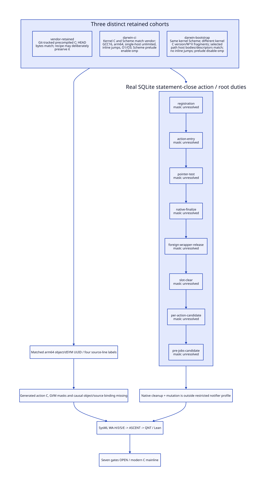

#+TITLE: Will Action Admission: Generated Cohorts, Darwin and SQLite Roots
#+SETUPFILE: ../../modeling/org/setup.org
#+CATEGORY: toolchain
#+OPTIONS: toc:3 num:t
#+PROPERTY: header-args :eval never

* RESEARCH A real cleanup action does not yet qualify a notifier cut :modern_c:gxi:gxc:
:PROPERTIES:
:CUSTOM_ID: will-action-admission
:AUTHORITY: WillActionAdmission
:STATUS: cohort-and-semantic-liveness-derived-machine-masks-open
:EVIDENCE_CLASS: retained-source-and-artifact-inspection
:END:

Continue [[file:gc-drain-retirement-cut-design.org][the generated GC drain cuts]] with a real registered action:
std/db/sqlite#__sqlite-statement-close. This is a gxi/gxc library compilation
case, not a claim that gxi/gxc's reader already has owner-token finalizers.
Scheme owns semantic completion; modern generated C owns the native baseline.
No runtime implementation, regeneration, build, native test or performance run
is performed. dwarfdump reads existing Mach-O/debug data without loading the
module or executing its code.

[[file:models/sysml/will-action-admission.sysml][SysML]] owns three cohorts, eight point duties, seven gates and four gain rows.
[[file:../../modeling/tools/will-action-study.py][Python]] drives native SysML, [[file:../../modeling/ascent/will-action-admission.rules.scm][ASCENT]], [[file:../../../models/build/will_action_admission.qnt][QNT]] and [[file:../../../models/build/WillActionAdmission.lean][Lean]], deriving [[file:will-action-admission-matrix.org][the matrix]] and
. [[file:../../../evidence/research/will-action-admission/checks.json][Receipts]] bind current bytes and qualified scopes. Matching
artifacts and conditional models are not native root-retirement admission.

* RESEARCH Generation provenance and three distinct Darwin cohorts
:PROPERTIES:
:CUSTOM_ID: action-generation-cohort
:END:

[[file:../../../vendor/gambit/gsc-boot.unix::5][Dummy gsc-boot]] explicitly preserves repository precompiled C during bootstrap.
[[file:../../../vendor/gambit/lib/makefile.in::173][The real Scheme-to-C recipe]] uses gsc-boot, COMPILATION_OPTIONS and a prelude
that includes header.scm. That header includes gambit#.scm and _gambit#.scm and
sets declarations. Configure can extend the prelude with feature definitions.
Therefore a nearby config.log records a configuration event, not necessarily a
Scheme-to-C generation event. A successful no-op bootstrap command also cannot
certify that generation happened.

Static Git inspection found that vendor _kernel.c equals HEAD and last changed
at 2228e4d163582733a3a67a5efcb22f8ebe93c02b; _kernel.scm also equals HEAD but
last changed at f825790b6ea13f77160885cbcdefc4a26a245b87. Different last-change
commits establish separate lineage, not by themselves incorrect generated code.
The exact working-file hashes and selected host comparisons are retained by
Python; timestamps are not used as proof.

| Cohort | Direct evidence | Supported correspondence | Unresolved boundary |
|---+---+---+---|
| Vendor retained | [[file:../../../vendor/gambit/lib/_kernel.c::1][generated C]], [[file:../../../vendor/gambit/lib/_kernel.scm::2082][Scheme]], [[file:../../../vendor/gambit/gsc-boot.unix][dummy bootstrap]] | C/Scheme equal tracked HEAD bytes; original C is precompiled repository input | Vendor has no configured header/config.status/lib makefile; original compiler image/options/input closure not recovered |
| Configured Darwin CI | [[file:../../../../ci-source-patch-check/src/gambit/config.log::7][configure invocation]], [[file:../../../../ci-source-patch-check/src/gambit/lib/makefile::27][compiler fields]], [[file:../../../../ci-source-patch-check/src/gambit/include/gambit.h::1232][configured header]] | C and Scheme hashes equal vendor; arm64/GCC16, single-host limit zero, inline jumps, O1 ordinary/O3 RTS, Scheme prelude enable-smp | Matching C does not prove CI generated it; final compile/link argv and actual object/runtime correspondence open |
| Bootstrap audit | [[file:../../../../gerbil-gambit-bootstrap-audit/src/gambit/config.log::7][configure invocation]], [[file:../../../../gerbil-gambit-bootstrap-audit/src/gambit/lib/makefile::173][prelude]], [[file:../../../../gerbil-gambit-bootstrap-audit/src/gambit/lib/_kernel.c][generated C]] | Same Scheme; different C version-string/W^X fragments; selected will/finalizer/jobs host bodies and descriptors are identical | No inline-jumps definition; prelude disable-smp. Do not transfer native point offsets/configuration into CI cohort |

Vendor/CI _kernel.c SHA-256 is
7435cfa1507f91de9fae77a6c5b4cf928ae764a73c1a91fb9349d53d1a9e5076;
bootstrap C is 674ed62f7caa1b6e6f8c68ae96df73dc2a24028e673fd3ded1b914aa80a7a042.
The shared _kernel.scm hash is
9afa811a1c15104b953a10d42cd11bddffbfa0b8684b4f8f8191d848fdb6d9ec.
Host-body equality is narrower than whole-module or linked-program equivalence.
The bootstrap differences include executable-memory handling and must not be
ignored when reasoning about an actual runtime.

[[file:../../../vendor/gambit/configure.ac::1266][Multiple OS threads per VM]] and [[file:../../../vendor/gambit/configure.ac::1287][Scheme SMP scheduler]] are separate options.
Both inspected configured headers default to SINGLE_THREADED_VMS and one
processor, despite CI's enable-smp prelude. This is configured-default evidence:
final command-line overrides, loaded image and actual processor population have
not been established. Both headers expose five default GVM registers, three
argument registers and max-local-register default 25; single-host limit zero
means no label-count downgrade. No host's actual compile mode can be proven
without its effective defines. The selected SQLite debug artifact is not evidence
that the future multicore gxi/gxc configuration has been qualified.

A complete generation receipt would bind compiler image and runtime dependency
closure, source/include/prelude bytes, sem-changing options, environment/cwd,
output set/hash, completion and failure outcome. The C compilation receipt must
separately bind generated C, configured headers, effective argv/defines, compiler,
object hash and linked image. No such complete pair was recovered here.

* RESEARCH Real action, expanded code and static object evidence
:PROPERTIES:
:CUSTOM_ID: action-real-call-chain
:END:

[[file:../../../../gerbil-gambit-bootstrap-audit/src/std/db/sqlite.ss::60][sqlite-driver-prepare]] registers __sqlite-statement-close with make-will.
[[file:../../../../gerbil-gambit-bootstrap-audit/src/std/db/sqlite.ss::70][The action source]] checks self.ptr, calls sqlite3_finalize, releases the foreign
wrapper, then sets self.ptr false. [[file:../../../../gerbil-gambit-bootstrap-audit/build/lib/std/db/sqlite~0.scm::498][The existing expanded artifact]] names that
same action; [[file:../../../../gerbil-gambit-bootstrap-audit/build/lib/std/db/sqlite~0.scm::536][its body]] exposes unchecked field reads and the final store.
This resolves the previously implicit unchecked __ binding without generating
new Scheme or C.

Existing sqlite~0.o1 and its dSYM have matching arm64 UUID
881EDB74-406E-33F1-ACDF-8D181BE9BFE3. Static DWARF identifies GNU C23 16.2.0,
O1, sibling-call optimization and the module compilation directory. Its compile
unit names sqlite~0.c; that generated C is absent from the inspected module output
directory. Debug labels map as follows:

| Label metadata | Declared expanded-source line | Native address in this artifact | What remains unknown |
|---+---+---+---|
| L0 unchecked statement close | 537 | 0x31b4 | Actual argument/closure registers, descriptor and dead mask |
| L1 unchecked statement close | 543 | 0x3338 | Whether this is pre-call poll/resume or another branch; complete root locations |
| L2 unchecked statement close | 543 | 0x3220 | Same source line, different location; cannot order execution by label ordinal |
| L3 unchecked statement close | 547 | 0x3274 | Foreign-release caller frame/register/saved contract |

The debug/object UUID match binds these two artifacts. It does not bind either
to the current expanded-file bytes, original generated C, effective headers or
linked Gambit/SQLite image. DWARF source locations are not GVM GC descriptors,
and native machine-register locations are not automatically GVM register masks.
No mask is reconstructed from label numbers or debug addresses. The Python
inventory records missing C and exact input digests rather than manufacturing
an output through compilation.

* RESEARCH Point-by-point root and effect duties
:PROPERTIES:
:CUSTOM_ID: action-live-mask-audit
:END:

| Semantic point | Proven source duty | Earliest permissible retirement | Machine dead mask |
|---+---+---+---|
| Registration | Will references action; testator is statement | No GC provenance or return yet | unresolved |
| Entry / pointer test | self is needed to inspect its field | Not before the read completes; false branch skips native cleanup | unresolved |
| sqlite3_finalize | self is read again afterward; raw statement is disposed | Keep Scheme self through foreign release and final store | unresolved |
| foreign-release! | self is needed for the subsequent slot mutation | Not at foreign-wrapper clearing or callback return | unresolved |
| self.ptr := false | Last explicit self use in this expanded sequential body | Semantic last use only; registers/caches/saved/captures may remain | unresolved |
| Action return to will L2/L3 | Caller sets R1 VOID but does not uniformly retire other roots | Proposed per-action cut requires complete root/restore closure | unresolved |
| GC handler before jobs | Previous callbacks may have completed or escaped independently | Proposed batch cut requires per-attempt outcomes plus barrier | unresolved |

There are eight SysML audit boundaries including entry and pointer test separately;
zero action machine dead masks are qualified. This is a concrete negative result,
not an invitation to guess a bitmap. self's semantic liveness is derived from its
actual later reads/store, not from how long its lexical binding appears in source.
Do not clear self before the final store merely to make a notifier fast.

[[file:../../../../gerbil-gambit-bootstrap-audit/src/std/db/sqlite-driver.ss::152][The driver]] maps sqlite3_finalize to a C-lambda. [[https://www.sqlite.org/c3ref/finalize.html][SQLite's API]] specifies that
finalize disposes the statement and can report the preceding evaluation error;
an error result is not permission to call finalize again on the same pointer.
The existing action discards that result and continues wrapper release/store.
This is distinct from an exceptional Scheme exit.

[[file:../../../../gerbil-gambit-bootstrap-audit/src/std/ffi.ss::287][Pointer-type expansion]] and [[file:../../../../gerbil-gambit-bootstrap-audit/build/lib/std/db/sqlite-driver~0.scm::132][existing expanded driver]] supply no custom release
function for sqlite3_stmt*. [[file:../../../vendor/gambit/gsc/_ptree2.scm::2618][The emitter]] selects RELEASE_POINTER for a pointer type without a custom release ID; the original generated wrapper remains unbound. [[file:../../../vendor/gambit/lib/c_intf.c::1683][release_foreign]] clears wrapper fields before invoking
an installed release function; [[file:../../../vendor/gambit/lib/c_intf.c::1716][release_pointer]] itself returns success without
freeing the native pointer. The two release mechanisms must not be conflated.
[[file:../../../vendor/gambit/lib/_kernel.c::21981][Public foreign-release!]] can poll before dispatch and has type-error paths;
[[file:../../../vendor/gambit/lib/_kernel.c::21940][the primitive]] has an error route if release_foreign returns an error. Whether
these paths survive inlining in the selected action needs its generated C.
A generic error branch is not proof that the well-typed SQLite pointer actually
reaches that branch. The QNT failure history is explicitly conditional.

[[https://www.sqlite.org/c3ref/bind_blob.html][SQLite binding contracts]] allow destructor-managed and externally owned data;
this driver uses SQLITE_TRANSIENT for its text/blob helpers. Do not infer that
this exact action necessarily invokes a user destructor from the general API.
[[https://www.sqlite.org/c3ref/create_function.html][SQLite also supports user-defined function callbacks]], but the selected library
binary/extension/callback graph has not been bound. Accordingly native reentry,
allocation, affinity and error closure remain unresolved, not asserted absent.
The model does not install hypothetical callbacks or treat an arbitrary callback
as observed in this module.

A public ptr-false guard makes a sequential second close skip work, not an atomic
owner claim. Explicit Closer calls and will execution share this action. A full
concurrent redesign needs resource ownership/serialization and outcome custody;
this study does not assert that the existing module has a reproduced double-close
race or change its semantics.

* RESEARCH Two candidate cuts and necessary redesign
:PROPERTIES:
:CUSTOM_ID: action-cut-admission
:END:

The actual action performs native resource cleanup, wrapper release and Scheme
mutation. It is not the previously proposed restricted, rootless notification
leaf. Moving this unchanged body under a label called notifier cannot satisfy
that profile. This does not prohibit ordinary user wills or prove that ordinary
cleanup is incorrect. A separate cleanup-completion contract could be studied,
but must not inherit the notification credential by naming alone.

For the per-action cut after will L3's VOID, admission requires original generation
and effective Darwin object binding; private GC ticket/called/normal-return
identity; selected action and caller descriptors/dead masks; cache/bank and all
saved/internal/thread/captured/error restoration closure; and a nonallocating,
noncapturing issuer with stable rootless delivery. Neither the debug UUID nor
semantic last use discharges these duties.

For the batch barrier before execute-jobs!, the same obligations remain plus
all B eligible completion slots, nested GC identity and no arbitrary job/poll
before sealing. Batching cannot turn cleanup completion or queue emptiness into
root absence. Both candidate cuts remain unqualified for this actual action.

A future architecture may split restricted notice delivery from owner-managed
cleanup. Native resource custody must be transferred before dropping roots; the
cleanup executor still needs affinity, cancellation, exceptions, partial failure,
shutdown draining and delayed-delivery grace. This is a design alternative, not
an implemented migration or elimination of cleanup work.

* RESEARCH Model correspondence, counterexamples and net work
:PROPERTIES:
:CUSTOM_ID: action-proof-benefit
:END:

WA-H maps source entry/test/finalize/release/store/return to semantic transitions.
Both successful and error-status finalize destroy the raw statement. self remains
protected until the final store. Poll snapshot and restore transfer roots. Actual
initial states import native SysML's false action-mask and restricted-profile
facts, so normal cleanup, closed-pointer skip, matching C and matching UUID
cannot admit a notice. Future-qualified states explicitly model a DIFFERENT
restricted notifier after hypothetical redesign; they are inference controls,
not a way to qualify SQLite by toggling metadata.

WA-I has eight conditional kernels. It separates matching bytes from causal
generation, UUID from GC maps, last use from retirement, and cleanup from the
restricted notifier profile. Source simulation, object-to-source equivalence and
complete root/effect graphs are open. WA-S requires WA-H/I/E and DC-S; ASCENT
retains those obligations, wrong-scope/stale/missing controls and the ancestor
frontier. No component is granted runtime acceptance.

| Potential benefit | Necessary added work | Current net-benefit finding |
|---+---+---|
| Reuse precompiled modern C under an explicit cohort | Separate generator-input/output and native compile/link provenance | Removes unsound inference; no measured build saving |
| Retire dead invocation roots at a qualified point | Exact action/caller masks and restore/effect proof | Eight points audited; zero machine masks qualified, so no runtime gain admitted |
| Rootless notices decouple later cleanup | Owned task/resource transfer and O(W) in-flight state remain | Cleanup/FFI/shutdown support cannot be counted as retired |
| Share Scheme lowering and native contract | Modern C remains mandatory; Zig needs equivalent proofs and backend qualification | No independent additional positive Zig net benefit demonstrated |

Earlier O(B+K) candidate sealing and O(W) slot bounds remain conditional and are
not counted again as new savings. They are not speed measurements, LOC estimates
or person-days. Retire only internal heuristic issuers after all cohort, machine
mask, ownership, effect and publication gates qualify. Preserve ordinary will,
explicit close, error reporting and multi-shot continuation semantics.
