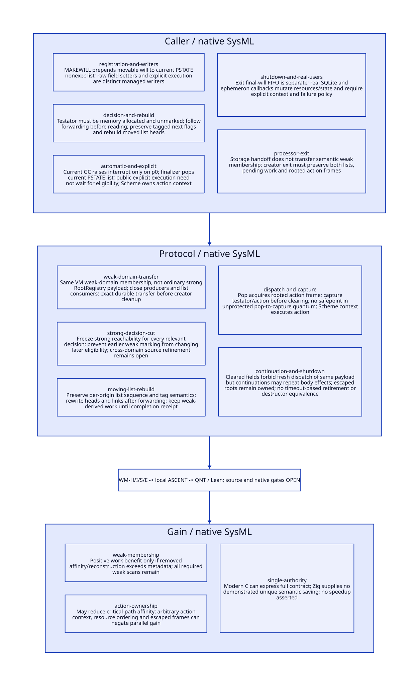

#+TITLE: Movable Will Domain Migration, Weak Decisions and Scheme Action Ownership
#+SETUPFILE: ../../modeling/org/setup.org
#+CATEGORY: toolchain
#+OPTIONS: toc:3 num:t
#+PROPERTY: header-args :eval never

* RESEARCH Modern C decision and authority :gambit:gerbil:modern_c:gc:smp:
:PROPERTIES:
:CUSTOM_ID: will-domain-migration
:AUTHORITY: WillDomainMigration
:STATUS: conditional-local-models-source-platform-open
:EVIDENCE_CLASS: source-and-local-formal-research
:END:

Gambit owns Scheme finalization, roots, continuations and GC; Gerbil's incremental
service owns compiler sessions/results. Modern C is the runtime reconstruction
path. VM-owned storage alone cannot preserve will semantics when a processor
leaves. A will is explicitly movable, not a still object. Its weak-domain
membership, GC classification, relocated list links and Scheme action execution
context require separate contracts. Ordinary strong-root registration of the
whole nonexecutable list is not a valid shortcut.

This extends [[file:vm-arena-collector-design.org][the arena collector study]] without editing its frozen receipts.
[[file:models/sysml/will-domain-migration.sysml][Native SysML]] owns caller families, protocol cuts, source/action/lemma routes,
refinement duties, benefits and seven false qualification gates.
[[file:../../modeling/tools/will-domain-migration-study.py][Python]] evaluates sysml and projects [[file:will-domain-migration-matrix.org][the matrix]], [[file:diagrams/will-domain-migration.d2][D2]] /  and [[file:../../../models/build/will_domain_parameters.qnt][parameters]].
[[file:../../modeling/ascent/will-domain-migration.rules.scm][Actual ASCENT DSL]] joins scoped/hash-bound subjects to [[file:../../../models/build/will_domain_migration.qnt][QNT]] and [[file:../../../models/build/WillDomainMigration.lean][Lean]], with AC-S
as prerequisite. [[file:../../../evidence/research/will-domain-migration/checks.json][Receipts]] distinguish local formal checks from source/native
qualification. No runtime implementation, native tests or performance tests.

* RESEARCH Registration, writers and real action users :source:
:PROPERTIES:
:CUSTOM_ID: will-real-callers
:COMPLETENESS: concrete-source-families-not-all-reflective-or-native-writers
:END:

| Path | Actual source and responsibility | Consequence |
|---+---+---|
| Register | [[file:../../../vendor/gambit/gsc/_t-c-2.scm::2668][make-will emitter]] allocates with expression side effects; [[file:../../../vendor/gambit/include/gambit.h.in::6014][MAKEWILL]] writes next/testator/action then prepends current PSTATE nonexec head | This is generated registration, not an existing VM service API |
| Representation | [[file:../../../vendor/gambit/lib/mem.c::243][Will layout]] explicitly requires movable objects; [[file:../../../vendor/gambit/include/gambit.h.in::5997][next]] carries EXECUTABLE and UNMARKED_TESTATOR flags | Raw C links and forwarding-aware heads must be rebuilt; stable native addresses cannot identify wills across GC |
| Writers | [[file:../../../vendor/gambit/include/gambit.h.in::6023][testator/action setters]], emitted by _t-c-2.scm:3788-3790; [[file:../../../vendor/gambit/lib/_nonstd.scm::1886][internal primitives]] | Internal/raw writers need mediation, exclusion or refusal; rearming a consumed will needs a new payload generation |
| Automatic notification | [[file:../../../vendor/gambit/lib/mem.c::7054][GC tail]] raises INTR_GC inside processor-id-zero branch | This path proves a p0 notification, not a notification to every processor with a ready list |
| Automatic dequeue | [[file:../../../vendor/gambit/lib/_kernel.scm::2082][gc-finalize!]] pops current ps->mem.executable_wills_; [[file:../../../vendor/gambit/lib/_kernel.scm::2153][GC handler]] invokes it before GC interrupt jobs | Source list locality and notification locality must be reconciled explicitly |
| Action | [[file:../../../vendor/gambit/lib/_kernel.scm::2106][will-execute!]] captures fields, zaps both, enables interrupts and invokes action(testator) | Scheme frame protects captured values; GC/continuation/exception semantics remain Scheme responsibilities |
| Explicit public call | [[file:../../../vendor/gambit/lib/_nonstd.scm::1892][will-execute! wrapper]] checks will type then calls internal execution | Execution may precede GC eligibility; it does not perform the gc-finalize list-pop operation |
| Exit registry | [[file:../../../vendor/gambit/lib/_kernel.scm::2118][final-will FIFO]] and [[file:../../../vendor/gambit/lib/_kernel.scm::4722][exit-cleanup]] | Separate strongly held Scheme registry and exit-job order; not the executable weak list |
| Gerbil resources | [[file:../../../../gerbil-gambit-bootstrap-audit/src/std/db/sqlite.ss::35][sqlite-open]] registers __sqlite-driver-close; prepare at 58-74 registers statement close | Real actions call sqlite3_close/finalize, foreign-release! and clear self.ptr; resource affinity/failure cannot be inferred from will eligibility |
| Ephemeron | [[file:../../../vendor/gambit/lib/srfi/124/124.scm::56][make-ephemeron-finalizer]] captures ephemeron, clears will/datum | Treating weak membership as strong graph roots can alter observable data retention |

These seams do not prove a currently executing nonzero processor loses an action.
They establish missing notification/consumer qualification for a proposed migration.
No generated _kernel.c ABI or native configuration is inferred from Scheme source
alone. The SQLite close wrappers' sequential self.ptr checks are not a proof of
concurrent idempotence, successful C resource destruction or arbitrary-thread use.

* RESEARCH A typed weak domain, not a strong root list :contract:
:PROPERTIES:
:CUSTOM_ID: will-weak-domain
:END:

#+begin_src text :eval never
WillId = (VM, weak-domain incarnation, stable logical identity)
WillPayloadGeneration = (WillId, admitted testator/action write generation)
WillDomain = {ordered nonexec membership, ordered executable membership,
              phase tickets, forwarding-aware heads/links, execution policy}
WillDomainHandoffReceipt = {source/target generations, exact membership/order,
                           GC cut, rooted pending holders, notification owner,
                           action-context policy, durable commit identity}
ActionFrameReceipt = {payload generation, captured action/testator roots,
                      execution context, dispatch state, continuation holders}
#+end_src

List membership must preserve nodes until the collector's weak processing cut,
without introducing an ordinary strong edge from each list to its action and
then to any action-captured testator during strong tracing. A generic RootRegistry
slot containing a nonexec list head and scanned as a normal Scheme root could
change the strong graph and suppress finalization. The metadata container is
stable VM-owned storage; its fields use a semantic weak-domain scanner. Explicit
Scheme references to wills, captured action arguments and the final-will FIFO
retain their actual strong-root semantics. Do not weaken those roots either.

Close new registration, internal field writes, list pops and relevant raw reads
on the source domain; complete or cancel accepted operations before freezing.
Transfer only at a no-GC-mutation cut. Destination accepts exact membership,
sequence, phase obligations and notification/context policy before source heads
lose authority. A candidate or copied head is not a committed handoff. Unknown
response uses the exact transfer identity; source/target cannot both become list
writers. Failure before commit preserves source; after commit target retains
custody. The storage/root receipt protocols remain required for underlying heaps,
pending roots and native holders; this study does not replace them.

During migration preserve each origin's existing order. MAKEWILL prepends; current
process_wills retains an existing executable prefix and appends newly promoted
members in nonexec traversal order. A shared VM dispatcher should maintain origin
subqueues unless a separately specified inter-origin order is admitted. No global
ordering guarantee or resource dependency ordering is inferred from list order.

* RESEARCH Testator decision, moving links and weak work :gc:
:PROPERTIES:
:CUSTOM_ID: will-gc-decision
:END:

[[file:../../../vendor/gambit/lib/mem.c::4997][determine_will_executability]] follows a forwarded will before reading next and
testator. It sets EXECUTABLE only if MEM_ALLOCATED(testator) and UNMARKED(testator).
An immediate value is not made executable merely because no root points to it.
[[file:../../../vendor/gambit/lib/mem.c::3990][UNMARKED]] examines movable header or still mark; a later weak mark can change the
answer. [[file:../../../vendor/gambit/lib/mem.c::4039][scan's will case]] keeps action strong and testator weak in strong phase,
sets UNMARKED_TESTATOR, and traverses both in weak phase.

The new architecture requires decisions equivalent to a qualified strong-closure
snapshot. Choose either an immutable strong classification or a decision barrier
covering all relevant domains before weak preservation can interfere. The current
process_wills first classifies its local nonexec list, then marks/rebuilds its
lists. That local order does not by itself establish a global decision barrier
across processors. If two domains share a testator, one domain's weak mark could
affect another's later UNMARKED read unless another invariant prevents it. This
is a source-level interference candidate, not a proven native counterexample or
proof that every sequential source schedule must have identical eligibility.
The proposed snapshot semantics needs an explicit compatibility/fix decision.

[[file:../../../vendor/gambit/lib/mem.c::5056][process_wills rebuild]] marks each will, stores its forwarded address through
the predecessor/head, preserves executable tagging, moves eligible nodes, and
marks pending testators. Raw source heads and next links are not reusable after
movement. Stable WillId is a proposed handle relation, not a native address.
Weak preservation can discover further graph work; drain it under the parent
collector termination contract before sweep or epoch completion. Completing the
list loop alone is insufficient. A copied list whose heads still reference
from-space is a retained counterexample, not a valid receipt.

* RESEARCH Action ownership, explicit execution and escaped frames :control:
:PROPERTIES:
:CUSTOM_ID: will-action-ownership
:END:

The automatic source path is GC p0 notification -> Scheme GC interrupt handler ->
current-PSTATE pop -> will-execute! -> action(testator). The action executes in a
Scheme context, not inside process_wills or a raw collector worker. Preserve a
qualified legacy execution lane for admitted profiles; worker-pool dispatch is
an explicit change needing dynamic environment, exception handler, thread/VM,
resource affinity and shutdown qualification. A nonzero registration gains no
automatic action-lane receipt simply because its storage became VM owned.

Pop transfers ownership to an action frame before the node leaves list custody.
Capture testator and action in qualified Scheme roots before clearing shared
fields. The unprotected pop-to-capture interval must be a proved no-safepoint
quantum or use an explicit pending-frame scanner. The model excludes GC while
an action-bearing frame has not captured/cleared; disabled interrupts in the
source are a relevant seam, not a general native no-safepoint proof. Collector
writeback must relocate frame/continuation roots as well as list heads.

Public explicit execution can run a nonexec or queued will. It captures and clears
fields but does not call the automatic dequeue operation. A queued node may later
be popped with no action remaining. An explicit call on a nonexec will leaves
that membership unless another admitted operation changes it. Do not infer a
one-way N->E->executed state machine for all source callers.

Clearing action/testator prevents a fresh call from the unchanged shared payload;
it does not provide exactly-once action effects. A continuation captured inside
the action can resume after the fields were cleared and repeat body effects.
The model deliberately permits two effects from one dispatch. Exceptions can
escape the action/drain; the shown finalizer has no local catch-and-requeue.
Do not reinsert/retry an action solely because its outcome is unknown. In-flight,
suspended and multi-shot continuation roots remain accounted until independently
proved retirement. A timeout or function return is not that proof.

Active source-bound frames and continuations can block source departure. Frames
already running in a qualified VM lane may outlive the creator after list handoff.
This distinction belongs in the action receipt, not a creator processor id field.
Late internal rearming via field setters must create a new payload generation or
be rejected by the managed profile; the finite model excludes rearming.

* RESEARCH Exit registry and shutdown :shutdown:
:PROPERTIES:
:CUSTOM_ID: will-shutdown
:END:

The final-will FIFO is a distinct Scheme global registry. make-final-will inserts
there as well as constructing a will. GC registry cleanup removes members whose
action is false. execute-final-wills! detaches all FIFO members, then executes
them; exit-cleanup runs exit jobs first and uses cleaning-up? to avoid repeating
cleanup. This is not evidence that all pending per-PSTATE automatic lists drain.
If an action escapes a detached FIFO loop, the residual list/context requires
custody; neither return nor the cleaning-up? flag proves completion.

A managed shutdown must close producers, commit remaining weak-domain ownership,
settle active GC/weak tickets, dispatch accepted actions under qualified contexts,
and account for final-FIFO, resource and escaped-continuation obligations separately.
Unknown outcomes retain custody or prevent a final drain receipt. Arbitrary Scheme
actions cannot be forcibly completed or have future continuation reachability
decided by this protocol. Unsupported profiles must remain unresolved or be refused.

* RESEARCH Actual formal chain and closure matrix :sysml:ascent:qnt:lean:
:PROPERTIES:
:CUSTOM_ID: will-proof-chain
:END:

| Need | Local subject/check | Still open |
|---+---+---|
| WM-H | 26 QNT histories, ten deliberate controls, 200 bounded runs with two strong-root choices, max 80 steps | Two wills/one shared testator, no fresh registration/rearming, full heap, weak memory or liveness proof |
| WM-I | Twelve Lean conditional lemmas for eligibility, transfer/weak guards, clearing, movement, prefix and capture protection, plus work threshold | Not a complete transition induction or Scheme/C source simulation |
| WM-S | Five native SysML source/action/lemma routes evaluated by actual ASCENT; depends on AC-S | Full writer closure, moving root maps, global decision cut, explicit call ordering and exception/continuation simulation |
| WM-E | Seven explicit false gates | Configured GC/interrupt notification, C synchronization, execution/native affinity, host registration and native acceptance |

The QNT weak domain preserves list order and rewrites abstract addresses at GC.
Nonexec membership is not a strong testator root. External strong roots and captured
action arguments affect the shared testator's strong snapshot. Deferred weak work
blocks completion. Captured continuation roots survive return and can resume action
effects. retireContinuation assumes valid external no-future-resume evidence; it
does not decide arbitrary Scheme reachability. The model has one active action frame and one retained continuation identity per
will generation. A cleared ready-node pop is fused as a no-action operation that
must not overwrite an already running explicit caller frame. General nested
frame counts and concurrent multi-shot copies need a richer holder refinement.
The finite model retains detached
identities and excludes object reuse and complete reclamation.

Controls cover exit without handoff, stale heads, accidentally strong-rooted weak
membership, lost continuation captures, invocation before clearing, duplicate
queue membership, premature weak marking, contaminated classification, lost source
list and premature completion with weak work pending. Positive histories include
automatic and explicit callers, immediate/strong testators, explicit execution of
a queued action, retained ready queues across GC, old-prefix preservation, reentrant
no-action pops, moving lists, accepted writer drain and multi-shot continuation
effects. A qualified VM-lane frame/continuation also survives creator departure
and another GC in a positive history. No native source failure is inferred from
a deliberate model mutation.

Eight local ASCENT scenarios cover current/missing/stale/wrong-scope subjects,
synthetic all-qualified inputs, a false real GC gate, missing source anchor and
missing action/lemma binding. Only synthetic-all can derive candidate. All seven
real gates remain false; inherited host attestation is not retried unchanged.

* RESEARCH Modern C migration and net benefit :benefit:migration:
:PROPERTIES:
:CUSTOM_ID: will-net-benefit
:END:

| Old authority | Proposed replacement | Retirement condition |
|---+---+---|
| MAKEWILL writes current PSTATE head | Scheme semantic registration into a typed VM weak domain | Generated registration and all internal/raw writers mediated; construction/root protection proved |
| PSTATE lists are sole weak membership | VM-owned semantic weak domain and forwarding-aware collector adapter | Exact ordered handoff, flags, strong decision cut and weak-work closure qualified |
| Current PSTATE executable pop decides availability | VM/origin ready subqueue with explicit Scheme action policy | Automatic notification and public explicit execution converge on one field/dispatch authority |
| Creator PSTATE lifetime carries pending will duty | VM domain plus rooted action/continuation receipts | Source-only writers/readers/frames settled before cleanup; unknown results retain one custodian |
| Final FIFO conflated with automatic queue | Separate final-registry/exit contract | Actual FIFO writers, detached loops and exit-job effects qualified; no blanket retirement |

Retire these responsibilities only for fully admitted domains. Keep Scheme action
semantics, field clearing, continuation support and C portability. Existing scanners
and will algorithms can supply semantic operations, but their PSTATE ownership,
publication and phase assumptions need reconstruction. Maintaining old and new
heads as independent authorities for the same members is forbidden.

| Metric | Benefit mechanism | Added work / falsification |
|---+---+---|
| Work | Remove rebinding/copy/recovery performed solely to preserve creator-local membership | VM domain metadata, ordered relocation, receipts and call admission; required GC scans remain |
| Span | Creator processor need not stay alive solely for queued actions | Qualified action lane can serialize; source-bound escaped frames may still block exit |
| Memory | Avoid duplicate domain representations and unnecessary graph copies | Pending testators/actions/continuations and unknown resource effects remain retained |
| Semantics | Explicit notification, weak classification and action ownership | Global decision semantics, caller context and shutdown need separate qualification |
| Language | One modern C ownership/collector contract shared with other runtime services | Zig does not remove weak-root, relocation, continuation or resource-affinity obligations |

For avoided creator-affinity work A and added domain/relocation/admission/retention
coordination D, work benefit requires A>D. Critical-path savings and retained bytes
are independent criteria. If no old recovery/copy work existed, this component is
a correctness/enabling refactor, not a proven work reduction. No speedup numbers
or person-day estimates substitute for source and workload evidence. This enables
safe long-lived Gerbil compiler services; it does not itself prove session purity,
incremental reuse or parallel compilation.
