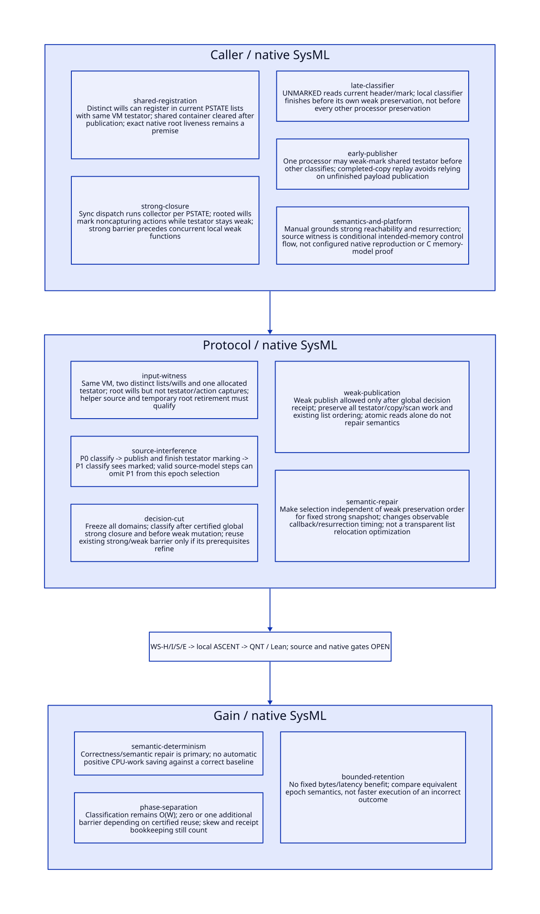

#+TITLE: Shared Testator Interference and the Global Strong Decision Cut
#+SETUPFILE: ../../modeling/org/setup.org
#+CATEGORY: toolchain
#+OPTIONS: toc:3 num:t
#+PROPERTY: header-args :eval never

* RESEARCH Decision and evidence boundary :modern_c:gambit:gc:smp:
:PROPERTIES:
:CUSTOM_ID: will-strong-cut
:AUTHORITY: WillStrongCut
:STATUS: source-control-flow-witness-native-and-memory-model-open
:EVIDENCE_CLASS: source-and-local-formal-research
:END:

The interference is permitted by the inspected multi-processor source control
flow under explicit valid-input and intended word-observation premises. It is
not merely the previous model's arbitrary corrupted-decision action. Both actual
header families admit a guarded source-model witness: P0 classifies its will,
weak-marks the shared testator and completes that marking, then P1 classifies its
will against the changed mark. Selection can differ from a schedule where both
processors classify before either preserves the testator.

This is not a configured native reproduction or a complete ISO C memory-model
proof. Exact generated roots, temporary alias retirement, configured SMP/ABI and
compiler treatment of legacy plain reads versus CAS remain unresolved. No native
crash, universal user-visible failure or completed correctness repair is claimed.
The modern C proposal chooses epoch selection against strong reachability before
weak preservation. That is an explicit semantic repair/determinization decision,
not a transparent relocation or purely performance-oriented refactor.

[[file:models/sysml/will-strong-cut.sysml][Native SysML]] owns caller/cut/source-route/refinement/benefit/gate data.
[[file:../../modeling/tools/will-strong-cut-study.py][Python orchestration]] projects [[file:will-strong-cut-matrix.org][Org matrix]], [[file:diagrams/will-strong-cut.d2][D2]] /  and [[file:../../../models/build/will_strong_parameters.qnt][parameters]], then evaluates
[[file:../../modeling/ascent/will-strong-cut.rules.scm][actual ASCENT DSL]], [[file:../../../models/build/will_strong_cut.qnt][QNT]] and [[file:../../../models/build/WillStrongCut.lean][Lean]]. [[file:../../../evidence/research/will-strong-cut/checks.json][Receipts]] distinguish source witnesses,
proposed-model checks and still-open native admission. Depends on [[file:will-domain-migration-design.org][will migration]];
its historical evidence remains unchanged. No runtime implementation or native test.

* RESEARCH Same-testator source path and admissible inputs :source:
:PROPERTIES:
:CUSTOM_ID: shared-will-inputs
:COMPLETENESS: concrete-path-with-explicit-root-and-platform-premises
:END:

Choose two distinct wills W0 and W1 in the same VM, both referring to the same
allocated testator T. Their actions are static procedures that do not capture T.
Use a leaf allocation for T so this witness does not need additional graph work.
Both will handles remain strongly rooted. The temporary shared container supplying
T during construction is cleared before the strong closure, and no caller frame,
saved register, thread closure, native borrow or action retains a strong T alias.
For the still-object variant, its external still refcount must also be zero:
[[file:../../../vendor/gambit/lib/mem.c::4210][setup_still_objs_to_scan]] seeds positive-refcount objects independently of the
Scheme strong graph. A C-created still object retaining its initial reference
would not meet this witness premise. Permanent/always-strong testators are excluded.

| Input step | Actual source support | What remains a premise |
|---+---+---|
| Execute a maker on P0 and P1 | [[file:../../../vendor/gambit/lib/_thread.scm::690][pinned run-queue routing]], [[file:../../../vendor/gambit/lib/_thread.scm::1461][internal thread-pin!]] and thread-start routing at 1495 | Two processors actually exist; internal pin use/configuration qualified; optional public processor argument at 1467 is commented out |
| Register distinct W0/W1 with shared T | [[file:../../../vendor/gambit/include/gambit.h.in::6014][MAKEWILL]] stores given testator and current PSTATE nonexec head | Same-VM T and exclusive per-will membership; no illicit cross-VM graph sharing |
| Enter the same GC operation | [[file:../../../vendor/gambit/lib/_kernel.scm::2051][Scheme gc]], [[file:../../../vendor/gambit/lib/setup.c::1182][garbage_collect]], [[file:../../../vendor/gambit/lib/setup.c::1132][on_all_processors]], [[file:../../../vendor/gambit/lib/setup.c::1028][per-PSTATE collector dispatch]] | Participants must actually service the sync operation; source dispatch is not a native scheduling receipt |
| Keep wills, release strong T inputs | [[file:../../../vendor/gambit/lib/mem.c::4039][will scanner]] traverses action but not testator in strong phase, and sets UNMARKED_TESTATOR_WILL | Actual generated strong roots match the intended Scheme state; dead temporary/register/native alias closure not established for a concrete binary |
| Reach global strong closure | [[file:../../../vendor/gambit/lib/mem.c::6843][strong phase]], [[file:../../../vendor/gambit/lib/mem.c::6667][scan termination]], [[file:../../../vendor/gambit/lib/mem.c::7016][strong/weak barrier]] | All root/work producers accounted; the parent termination and root-map obligations remain open |
| T starts unmarked | [[file:../../../vendor/gambit/lib/mem.c::3990][UNMARKED]] and the rooted-will weak-edge semantics | T is allocated and not independently strongly reachable; immediate/always-strong objects are excluded |

Sharing one T is allowed by the constructors: no uniqueness or creator-processor
ownership is imposed on its Scheme reference. Processor-local registration does
not create separate copies of T. This is a source-grounded input construction,
not a supplied executable Scheme reproducer. Such a reproducer would require the
root/processor evidence above and is outside this design-only task.

execute_sync_op_loop selects an operation through barrier_sync_op at setup.c:1068,
then each participating PSTATE calls execute_sync_op at 1099. The OP_GARBAGE_COLLECT
case passes that PSTATE to garbage_collect_pstate. The winner-id check at 1101-1105
controls result delivery, not exclusive execution of the collector by one winner.
Thus the source path includes two per-processor weak functions, rather than a
coordinator serially visiting both will lists. This confirms the concurrency seam;
it does not prove any concrete processor schedule or native root state.

* RESEARCH A source-step witness without invalid model mutations :interference:
:PROPERTIES:
:CUSTOM_ID: shared-will-witness
:END:

At the strong cut, W0 and W1 have already been reached through their explicit
roots and their action fields scanned. Their testator references remain weak.
Thus the pending-testator bit supplies a direct preservation path; this witness
does not depend on an unrooted will becoming newly copied during weak processing.

| Order | P0 | P1 | Shared T / outcome |
|---+---+---+---|
| 1 | Return from strong phase and existing barrier | Same | T not marked strongly |
| 2 | [[file:../../../vendor/gambit/lib/mem.c::5046][classify local list]]; reads T unmarked; sets W0 executable at 5026 | Delayed before local classification | W0 selected |
| 3 | [[file:../../../vendor/gambit/lib/mem.c::5083][promote W0]]; pending bit causes [[file:../../../vendor/gambit/lib/mem.c::5088][mark_array(testator)]] | Still delayed | T's header/mark changes |
| 4 | Complete leaf copy, or drain its still scan | Still delayed | No unfinished-payload premise is needed |
| 5 | May enter weak scan/idle waiting | [[file:../../../vendor/gambit/lib/mem.c::5011][follow W1 forwarding]], then read its T field and current UNMARKED | W1 still aliases same T; result now false |
| 6 | Finish weak closure | Retain W1 on nonexec list; fix its testator reference | Only W0 selected this round |

For movable T, [[file:../../../vendor/gambit/lib/mem.c::3578][mark_array CAS]] changes the old header from MOVABLE0 to FORW; the copy
is completed at 3607-3611 before the late read in this replay. W1's old T reference
still observes the forwarding header, so UNMARKED_MOVABLE is false. For still T,
[[file:../../../vendor/gambit/lib/mem.c::3640][CAS]] changes STILL_MARK from -1 to a work-list link; after its scan that mark
is still not -1, so UNMARKED_STILL is false. The two wills are distinct, so this
does not require both processors to write the same will's next field.

Conversely, if P0 and P1 both run determine_will_executability before either weak
marks T, both see it unmarked and both wills are selected. The model records both
outcomes using guarded source-seam actions. [[file:../../../evidence/research/will-strong-cut/source-movable-witness.json][Movable replay]] and [[file:../../../evidence/research/will-strong-cut/source-still-witness.json][still replay]] are
expected semantic-invariant violations of the source abstraction, with full state
output, exact model hash and replay argv. They are not repaired into positive
source-semantic acceptance. Source-mode sampling checks structural custody only.

** Why the existing synchronization does not establish the decision cut

The [[file:../../../vendor/gambit/lib/mem.c::7016][barrier at 7016]] is before all weak functions; the next unconditional barrier
is 7023 after the whole weak phase. [[file:../../../vendor/gambit/lib/mem.c::6896][Each weak function]] sets traverse_weak_refs,
calls process_wills and then mark_reachable_from_marked. Within process_wills,
classification is ordered only before that processor's subsequent marking. The
optional trace barrier at 6893 is also at entry, not between all classifications
and the first preservation. Worker-count waiting at 6738 onward occurs after a
processor has already been allowed to preserve T. It cannot undo the late read.

Atomic loads, stronger CAS ordering or a testator lock around each local
classify-and-preserve sequence alone do not fix this semantic dependency: a
perfectly ordered late load can correctly observe an earlier weak mark. A stronger
mark publication protocol is still needed for C safety, but is a separate duty.

** What source reachability does and does not establish

| Evidence level | Result |
|---+---|
| Legal input shape and source control flow | Same-VM aliasing and separate current-PSTATE registrations supported; no intervening all-classifier barrier found on the traced path |
| Guarded intended-memory model | Both movable/still races reachable with actual source-seam transitions; complete-copy-before-read witnesses retained |
| Concrete generated program | Exact roots, two-processor placement and no strong T aliases remain unqualified |
| Configured native machine | Not executed; compiler/ABI and runtime evidence absent |
| ISO C memory semantics | Open: UNMARKED uses ordinary header/mark reads, while selected CAS backends vary; SC replay is not a C11 happens-before proof |

[[file:../../../vendor/gambit/include/gambit.h.in::11014][Synchronization backends]] include __sync builtins, Win32, emulated and sequential
paths. This study does not select a backend or infer lock-free/native legality
from a macro name. It also does not label the source witness a proven memory
corruption or data-race diagnosis for a particular executable.

* RESEARCH Global decision cut and modern C alternatives :contract:
:PROPERTIES:
:CUSTOM_ID: global-will-cut
:END:

#+begin_src text :eval never
StrongClosureReceipt = {VM, epoch, exact root/work population, no strong producer debt}
WillDecisionReceipt = {VM, epoch, domain incarnation, exact nonexec membership,
                       strong-cut identity, classification results, no weak mutation}
GlobalWillDecisionCut = {frozen domain set and assignment,
                        all matching decision receipts, including empty domains}
WeakPublishPermit = {matching global cut, epoch, assigned publisher lifetime}
#+end_src

Require the domain set, not merely processor_count: future migrated VM weak
domains can outlive creators. Every domain is classified once by its assigned
owner; an empty list still acknowledges its domain. Close mutator/raw/internal
writers and explicit execution before the cut. Classifiers may follow existing
forwarding, read the strong mark state and store classification/next-tag results;
they must not allocate, invoke callbacks, preserve testators or publish new weak
work. All receipt epochs, membership generations and strong-cut identities match.

After the complete cut, weak processors preserve/rebuild lists using stored
decisions and the existing weak closure machinery. No classifier rereads current
UNMARKED to overwrite a frozen decision after preservation starts. Action dispatch
remains after collector completion in qualified Scheme contexts. The cut does
not discharge copy, scan, continuation, weak-table or action-owner responsibilities.

| Alternative | Placement | Necessary proof and cost |
|---+---+---|
| Explicit decision phase | Existing strong barrier -> classify all domains -> additional decision barrier -> weak preservation | Simple phase separation; one additional rendezvous plus participant skew/receipts |
| Reuse existing barrier | Certified global strong quiescence -> classify -> existing 7016 barrier -> preserve-only weak phase | Every return from strong scan must certify global closure/no future strong writes; existing barrier must publish all domain decisions; no additional rendezvous if proved |
| Immutable strong classification | Separate epoch strong information survives weak forwarding/marks | New metadata/identity/relocation coverage and all strong marking paths; not derivable retrospectively from a FORW bit |

The reuse candidate can place classification after garbage_collect_mark_strong_phase
returns and before 7016, or in its final nonallocating tail. Its premise is stronger
than merely observing a local empty queue. [[file:../../../vendor/gambit/lib/mem.c::3454][Both phase worker counts]] and the
[[file:../../../vendor/gambit/lib/mem.c::6738][termination protocol]] are source seams for this proof. If unpublished copy/chunk,
root or worker debt invalidates global closure, the reuse option cannot be admitted.
The finite QNT strongClose action assumes that certificate; it does not prove the
existing termination implementation. Legacy mode places the existing phase barrier
before local decisions; modern mode seals all decisions before any weak publish.

In modern C, classification and weak mutation must be separated by actual
happens-before edges: complete strong publication -> authorized classifier reads
and result writes -> release/acquire phase completion -> weak readers/mutators.
Plain will-field access requires phase exclusivity; descriptor atomics alone do
not legalize racing plain Scheme fields. No locks may be held while waiting for
participation that those locks prevent. Cohort resize/exit must preserve assigned
domain duties or settle them before the cut, not silently reduce an expected count.

* RESEARCH Semantic repair and public behavior :semantics:
:PROPERTIES:
:CUSTOM_ID: strong-cut-semantic-repair
:END:

[[file:../../../vendor/gambit/doc/gambit.txi::9289][The manual]] defines executability by strong reachability and distinguishes
always-strong objects. It describes collecting executable wills and later running
actions; [[file:../../../vendor/gambit/doc/gambit.txi::9313][resurrection]] is explicitly supported. This supports choosing a consistent
strong-cut policy. It does not itself specify a complete concurrent memory model
or a precise detection deadline for every GC. The new epoch guarantee must be
documented as part of the modern runtime contract.

For fixed allocated T and fixed strong reachability, both domains now make the
same eligible/not-eligible decision regardless of preservation scheduling. This
can make W1's callback run in a round where the legacy interleaving delayed it.
If W0 resurrects T, a later GC under the legacy outcome can keep W1 nonexecutable;
the fixed-cut outcome may already have selected both. This is observable and must
be treated as semantic repair/determinization, not claimed behavior equivalence.
No action order or successful resource destruction guarantee follows from selecting
both. The independent nonzero-processor notification/dispatch gap from the parent
study is not solved by this classifier cut.

| Change | Classification |
|---+---|
| Relocate list heads/links with identical already-chosen decisions | Representation refactor, subject to identity/order proof |
| Classify every domain before weak preservation changes mark state | Semantic repair toward explicit epoch strong-cut behavior |
| Strong-root all will lists to avoid weak complexity | Rejected: changes strong graph and finalization eligibility |
| Use atomic header loads without changing phase ownership | Memory-access work only; insufficient semantic repair |
| Run actions on arbitrary collector workers | Separate semantic change; not admitted here |

* RESEARCH Actual assurance chain and open obligations :sysml:ascent:qnt:lean:
:PROPERTIES:
:CUSTOM_ID: strong-cut-assurance
:END:

| Need | Local result/scope | Still open |
|---+---+---|
| WS-H | 19 QNT scenarios including nine controls; 400 bounded samples split across modern/source and movable/still modes; two deterministic expected semantic-violation replays | Two wills/two processor domains, one leaf shared testator; no native execution, full heap or progress theorem |
| WS-I | Twelve Lean conditional lemmas: mark-observation change, immediate/strong exclusion, complete cut, membership/order independence, stable pre-weak decision, stale epoch and copy debt | No full C source simulation or collector termination proof |
| WS-S | Five native SysML source/action/lemma routes via actual ASCENT; WM-S prerequisite | Exact roots/cohort, forwarding and semantic compatibility/replacement |
| WS-E | Seven false qualification gates | Configured SMP/ABI, plain/CAS memory model, host attestation and native acceptance |

Source witnesses use only register/strongClose/classify/publish/finish-copy-or-scan
actions with their normal guards. They need no forceSeal/loseDecision mutation.
Modern sampling requires structural, cut and semantic invariants; source sampling
requires structural custody only and explicitly retains semantic violations.
Deliberate controls separately cover partial cuts, stale epochs, missing domains,
uninitialized participants, unfinished movable/still work, changed decisions,
mismatched alias identity and publication without a cut. Source CAS/copy completion
and still queue draining remain abstract effects tied to concrete source anchors.

Eight ASCENT cases retain current/missing/stale/wrong-scope evidence, synthetic-all,
a false real GC gate, missing source anchor and missing model binding. Only the
synthetic case qualifies candidate. Inherited host attestation remains unresolved;
unchanged failing registration is not rerun. Org/D2 are native SysML projections,
and no parent receipts are rewritten to imply stronger closure.

* RESEARCH Retirement and net benefit :migration:benefit:
:PROPERTIES:
:CUSTOM_ID: strong-cut-net-benefit
:END:

Retire the inner local determine_will_executability call in the fused preserve
path only after every caller obtains matching global decision coverage. Reuse
the classifier's predicate and ordered preserve/rebuild operations; change their
phase authority. Retire live UNMARKED as a post-weak eligibility authority for
these wills. Keep separate strong/weak reachability, root scanning, copy work and
action context contracts. Old and new classifiers must not both overwrite flags.

| Metric | Potential benefit | Added cost / limit |
|---+---+---|
| Correctness | Fixed-cut selection independent of weak preservation order | Explicit observable callback/resurrection semantic choice and qualification |
| Classification work | Existing O(W) predicate walk can be moved, not duplicated | Receipt/membership bookkeeping; no asymptotic reduction |
| Synchronization | Existing strong/weak barrier may be reused | Zero or one additional rendezvous; reuse requires stronger global-closure proof |
| Retention | Some scheduling-induced delayed selection can disappear | No bound on callback timing, resurrection or action/continuation retention |
| Compiler service | Stable semantic weak domains can outlive workers | Shared service still needs independent-session and result-reuse contracts |
| Language | Modern C phase ownership handles this semantic defect directly | Zig cannot replace the missing global cut; no unique saving demonstrated |

If avoiding delayed reclassification saves R work while added membership/receipt
work is M and synchronization costs S, a work saving needs R>M+S under equivalent
chosen semantics. S includes actual critical-path skew; extra barrier count can be
zero only for admitted reuse. Earlier actions are shifted/newly selected work,
not eliminated work. Comparing a faster incorrect selection to a correct one is
not a valid optimization comparison. No fixed speedup or memory saving is claimed;
the architectural return is a falsifiable semantic guarantee and one phase authority.
