#+TITLE: Development Source and Model Catalogue
#+SETUPFILE: modeling/org/setup.org
#+CATEGORY: research

* Migration and ownership
:PROPERTIES:
:ID: 841617da-7496-5146-9f4d-223583492e05
:CUSTOM_ID: migration
:STATUS: content-preserved
:END:

The source hashes identify frozen input bytes, not the current Org file or a newly qualified runtime. Every original Markdown/D2/SVG/SysML artifact has exactly one maintained destination. Original JSON evidence remains at its historical path. Classifications can be refined by moving the Org/diagram/model owner and updating links; do not resume Markdown maintenance.

#+NAME: source-to-maintained-destination
| Frozen source | Maintained destination | Owner | Source SHA256 |
|---+---+---+---|
| [[file:../docs/experimental/zig/README.md][README.md]] | [[file:research/studies/experimental-catalog.org][experimental-catalog.org]] | research | ~25408a083fc34509e77474174f01578e4a6e8fe5633ac5b75507ce8477137e8d~ |
| [[file:../docs/experimental/zig/allocation-check-bound-cost-matrix.md][allocation-check-bound-cost-matrix.md]] | [[file:architecture/runtime/gc/studies/allocation-check-bound-cost-matrix.org][allocation-check-bound-cost-matrix.org]] | architecture/runtime/gc | ~05283cb2e1b59f42b1527a71046b93581fd14cf49f166b1b79db5dcea61beb59~ |
| [[file:../docs/experimental/zig/allocation-check-bound-design.md][allocation-check-bound-design.md]] | [[file:architecture/runtime/gc/studies/allocation-check-bound-design.org][allocation-check-bound-design.org]] | architecture/runtime/gc | ~bfddf265c2903d86d1314e7ea78ffbdfdb0e1a3f05b042eab646c2a1a4aee3e5~ |
| [[file:../docs/experimental/zig/allocation-check-bound-evidence.md][allocation-check-bound-evidence.md]] | [[file:architecture/runtime/gc/studies/allocation-check-bound-evidence.org][allocation-check-bound-evidence.org]] | architecture/runtime/gc | ~41a10cd3b859af94be887eade3c223b05b391090929dcbb58c8ad5e394ef87d6~ |
| [[file:../docs/experimental/zig/allocation-lifetimes.d2][allocation-lifetimes.d2]] | [[file:architecture/runtime/gc/diagrams/allocation-lifetimes.d2][allocation-lifetimes.d2]] | architecture/runtime/gc | ~e31d1b25bfb9d10484a89d78a0bb952332d26c45f4a2b380cc11a309c52e3d6b~ |
| [[file:../docs/experimental/zig/allocation-lifetimes.svg][allocation-lifetimes.svg]] | 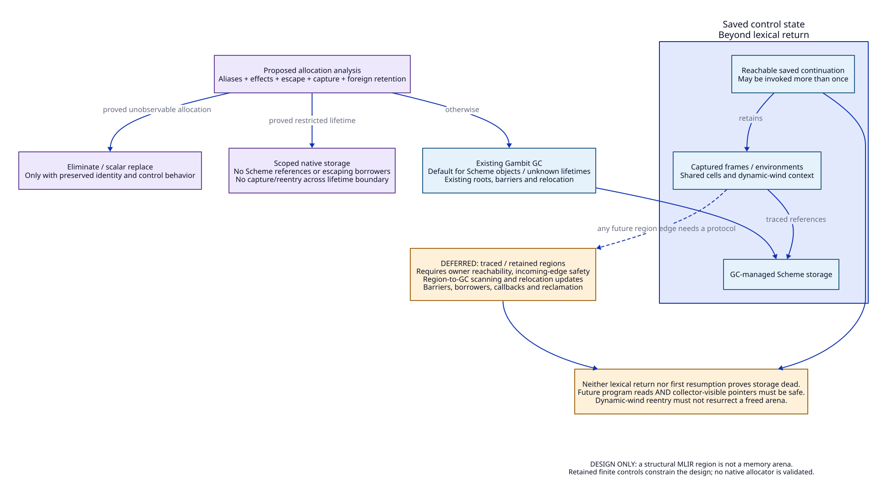 | architecture/runtime/gc | ~29b0ad1d7ab45440551e1f5af84f3379fa54fe1c8e8e99552748e09f22431ded~ |
| [[file:../docs/experimental/zig/allocation-reserve-boundary.d2][allocation-reserve-boundary.d2]] | [[file:architecture/runtime/gc/diagrams/allocation-reserve-boundary.d2][allocation-reserve-boundary.d2]] | architecture/runtime/gc | ~cbbb1f330f9be69374ab5cff82a490382160ac7a04feaa074fdee6ee29ab4e1e~ |
| [[file:../docs/experimental/zig/allocation-reserve-boundary.svg][allocation-reserve-boundary.svg]] | [[file:architecture/runtime/gc/diagrams/allocation-reserve-boundary.svg][allocation-reserve-boundary.svg]] | architecture/runtime/gc | ~78e5d433bcf31be7024561c8d544cc472690e96c4a94a2f741ab72a7f023ee6c~ |
| [[file:../docs/experimental/zig/allocation-reserve-helper-contract.md][allocation-reserve-helper-contract.md]] | [[file:architecture/runtime/gc/studies/allocation-reserve-helper-contract.org][allocation-reserve-helper-contract.org]] | architecture/runtime/gc | ~9cc2293b3b660254f120cc22367389918d8bbd83d52ee57ad6a7394e14882f30~ |
| [[file:../docs/experimental/zig/allocation-span-bounds.d2][allocation-span-bounds.d2]] | [[file:architecture/runtime/gc/diagrams/allocation-span-bounds.d2][allocation-span-bounds.d2]] | architecture/runtime/gc | ~86639bb683ad0d0035b63335975d0d32994920bace71a22035bdf4c340c281b8~ |
| [[file:../docs/experimental/zig/allocation-span-bounds.svg][allocation-span-bounds.svg]] | [[file:architecture/runtime/gc/diagrams/allocation-span-bounds.svg][allocation-span-bounds.svg]] | architecture/runtime/gc | ~49e7823ae7af08236f27eca402e58cb0ee9ba983aa0d7b55e4bc3eeb471ed74d~ |
| [[file:../docs/experimental/zig/collector-capacity-ledger.d2][collector-capacity-ledger.d2]] | [[file:architecture/runtime/gc/diagrams/collector-capacity-ledger.d2][collector-capacity-ledger.d2]] | architecture/runtime/gc | ~d13afc08c55b99ba31900a23bea58cf7ffd90daaecd62993c0357353f2f21aba~ |
| [[file:../docs/experimental/zig/collector-capacity-ledger.svg][collector-capacity-ledger.svg]] | 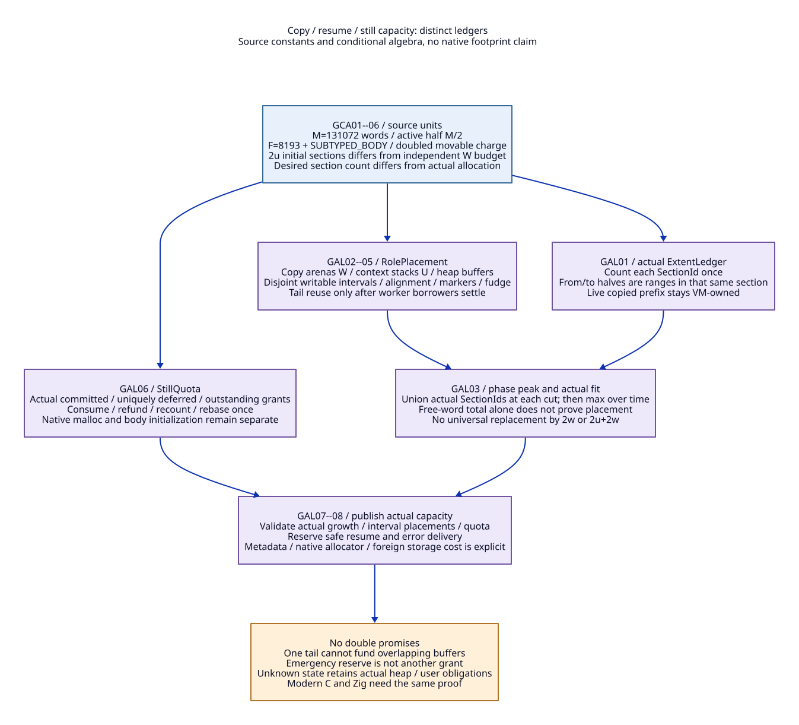 | architecture/runtime/gc | ~416938f84cc98c86030f567adeb00cb4df272f6dd345b6850060faa492039b77~ |
| [[file:../docs/experimental/zig/collector-domain-separation.d2][collector-domain-separation.d2]] | [[file:architecture/runtime/gc/diagrams/collector-domain-separation.d2][collector-domain-separation.d2]] | architecture/runtime/gc | ~493d24e41161b4ce26a31446fe52446a5ceaeb104553535344ecef8e08ea4668~ |
| [[file:../docs/experimental/zig/collector-domain-separation.svg][collector-domain-separation.svg]] | 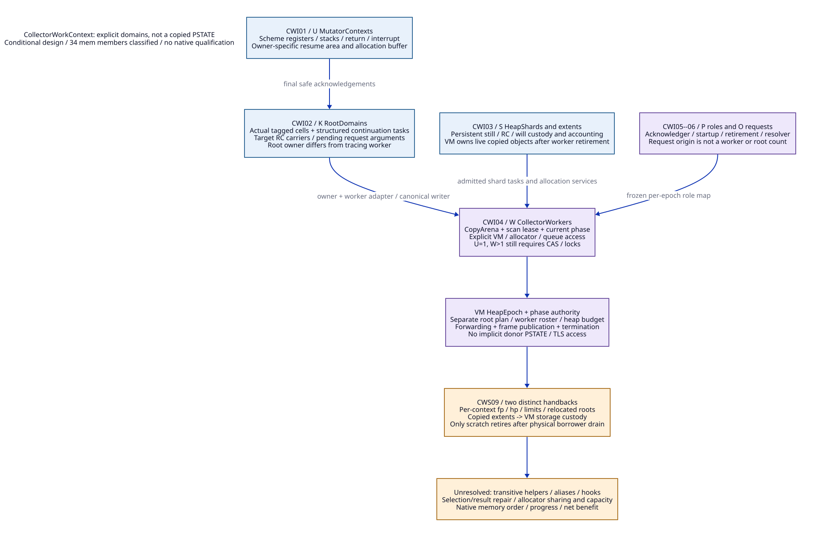 | architecture/runtime/gc | ~24e98aaba3f884b73b59a44a7d25f3158869118418fb69110f472395369a67c1~ |
| [[file:../docs/experimental/zig/collector-entry-closure.d2][collector-entry-closure.d2]] | [[file:architecture/runtime/gc/diagrams/collector-entry-closure.d2][collector-entry-closure.d2]] | architecture/runtime/gc | ~ed4df45acab648a3628b48926b86ca9b83dd50e9c89ef12e1e3c2573afcd74ed~ |
| [[file:../docs/experimental/zig/collector-entry-closure.svg][collector-entry-closure.svg]] | 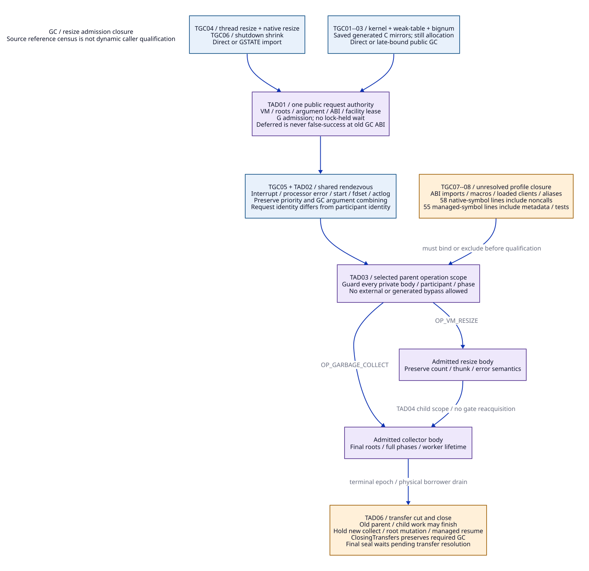 | architecture/runtime/gc | ~06faf8d6d503e1e3596940adc9940af48425c6601a3c7425e435743d6a5bf017~ |
| [[file:../docs/experimental/zig/collector-root-termination.d2][collector-root-termination.d2]] | [[file:architecture/runtime/gc/diagrams/collector-root-termination.d2][collector-root-termination.d2]] | architecture/runtime/gc | ~39574d3c5ffdbfe8548358edc4a5dba2c0497bfad4bd36859009c43ddb130696~ |
| [[file:../docs/experimental/zig/collector-root-termination.svg][collector-root-termination.svg]] | 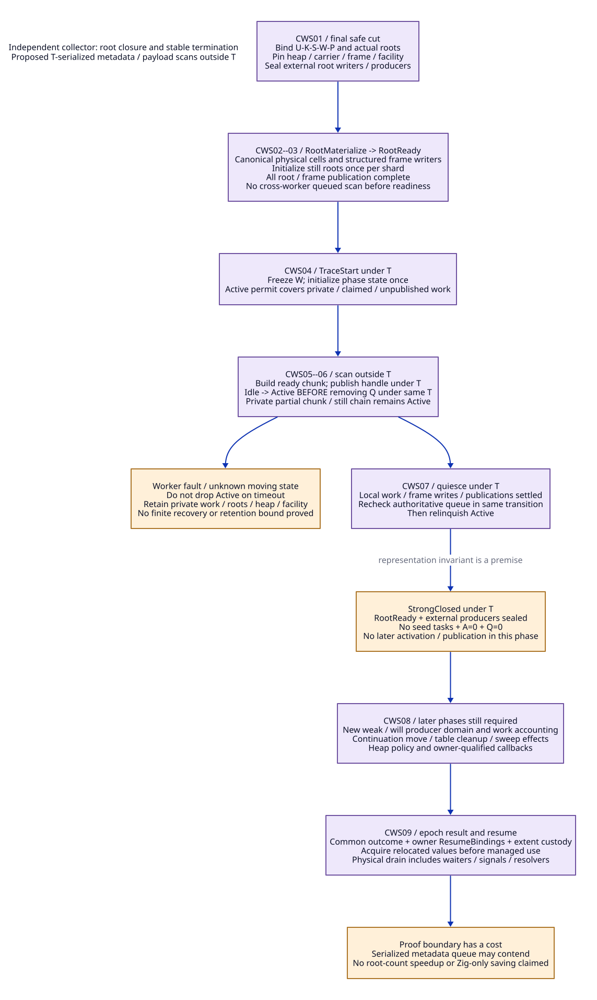 | architecture/runtime/gc | ~52808eeb5095c94110ea3b439f03f26dd332da4a73f121dc952ace8f9e7b0a38~ |
| [[file:../docs/experimental/zig/collector-work-context-cost-matrix.md][collector-work-context-cost-matrix.md]] | [[file:architecture/runtime/gc/studies/collector-work-context-cost-matrix.org][collector-work-context-cost-matrix.org]] | architecture/runtime/gc | ~c1900ac821df3354ebe419fc8549cfa51868cedbf12eb9b14488ee6e233a8a88~ |
| [[file:../docs/experimental/zig/collector-work-context-design.md][collector-work-context-design.md]] | [[file:architecture/runtime/gc/studies/collector-work-context-design.org][collector-work-context-design.org]] | architecture/runtime/gc | ~70d4edbdb42e89f2120619fb5cbd0245e3dbdb4bd1ded156f828e37911627940~ |
| [[file:../docs/experimental/zig/collector-work-context-evidence.md][collector-work-context-evidence.md]] | [[file:architecture/runtime/gc/studies/collector-work-context-evidence.org][collector-work-context-evidence.org]] | architecture/runtime/gc | ~4bc9f1220545a27a107a6d4913de5119945cb8d148f05364949672acd1f32ae8~ |
| [[file:../docs/experimental/zig/compilation-cost-and-aot-design.md][compilation-cost-and-aot-design.md]] | [[file:architecture/toolchain/studies/compilation-cost-and-aot-design.org][compilation-cost-and-aot-design.org]] | architecture/toolchain | ~9af5c8ebb37a85c11e3c680535c882ed2616aa40c18f293901bd1547a890ce70~ |
| [[file:../docs/experimental/zig/compilation-cost-evidence.md][compilation-cost-evidence.md]] | [[file:architecture/toolchain/studies/compilation-cost-evidence.org][compilation-cost-evidence.org]] | architecture/toolchain | ~ab06983dba0e6812ce939a4472bd6a3eadc03d534a0d13de62b2f3181934b498~ |
| [[file:../docs/experimental/zig/compilation-cost-paths.d2][compilation-cost-paths.d2]] | [[file:architecture/toolchain/diagrams/compilation-cost-paths.d2][compilation-cost-paths.d2]] | architecture/toolchain | ~a7a9cd589dc9b5e9a3ae5a8d3370db36f9a7f3f1796d32bf331d162d79327d13~ |
| [[file:../docs/experimental/zig/compilation-cost-paths.svg][compilation-cost-paths.svg]] | [[file:architecture/toolchain/diagrams/compilation-cost-paths.svg][compilation-cost-paths.svg]] | architecture/toolchain | ~280ccd8b10a040c4eb7a88bf9f707f1808ae4c2a9ef889761a7838753cc02091~ |
| [[file:../docs/experimental/zig/compilation-unit-artifact-contract.md][compilation-unit-artifact-contract.md]] | [[file:architecture/toolchain/studies/compilation-unit-artifact-contract.org][compilation-unit-artifact-contract.org]] | architecture/toolchain | ~f26945ab1de276686d496eb832248c9405a543d704b1a35acf76f257380df728~ |
| [[file:../docs/experimental/zig/compilation-units-and-invalidation.d2][compilation-units-and-invalidation.d2]] | [[file:architecture/toolchain/diagrams/compilation-units-and-invalidation.d2][compilation-units-and-invalidation.d2]] | architecture/toolchain | ~4bd2ffc7b273d16d360c0852cefece6da79b7198489989e882e481a7fcd60083~ |
| [[file:../docs/experimental/zig/compilation-units-and-invalidation.svg][compilation-units-and-invalidation.svg]] | [[file:architecture/toolchain/diagrams/compilation-units-and-invalidation.svg][compilation-units-and-invalidation.svg]] | architecture/toolchain | ~fc5c072ccbdb70d6dbe01b117e41b3fdd50794049fd34635060f9c0915f02858~ |
| [[file:../docs/experimental/zig/completion-admission-evidence.md][completion-admission-evidence.md]] | [[file:architecture/runtime/gc/studies/completion-admission-evidence.org][completion-admission-evidence.org]] | architecture/runtime/gc | ~3477476ee21c527bd3100e307d4ddadc9e8f5ccfeac486df39615059dafa051f~ |
| [[file:../docs/experimental/zig/continuation-minor-scan-proof.md][continuation-minor-scan-proof.md]] | [[file:architecture/runtime/control/studies/continuation-minor-scan-proof.org][continuation-minor-scan-proof.org]] | architecture/runtime/control | ~a92ff6b73c7556184b49fa287a784cf39607b99965a241e78fe9603b8246b237~ |
| [[file:../docs/experimental/zig/continuation-writer-benefit-matrix.md][continuation-writer-benefit-matrix.md]] | [[file:architecture/runtime/control/studies/continuation-writer-benefit-matrix.org][continuation-writer-benefit-matrix.org]] | architecture/runtime/control | ~7e35403e24a28c1f71cf32c5fa343c655ff160807034f7148efccbbd67a1bd4e~ |
| [[file:../docs/experimental/zig/continuation-writer-caller-matrix.md][continuation-writer-caller-matrix.md]] | [[file:architecture/runtime/control/studies/continuation-writer-caller-matrix.org][continuation-writer-caller-matrix.org]] | architecture/runtime/control | ~aaac73d3c3318e2512c2044343d7e80be8fa2917b78dd7c69d723482411b570b~ |
| [[file:../docs/experimental/zig/continuation-writer-closure-design.md][continuation-writer-closure-design.md]] | [[file:architecture/runtime/control/studies/continuation-writer-closure-design.org][continuation-writer-closure-design.org]] | architecture/runtime/control | ~0af4599be8f00c08ec71594424e2e6a4b411284ce4014a917b1cb4018c6c0468~ |
| [[file:../docs/experimental/zig/continuation-writer-evidence.md][continuation-writer-evidence.md]] | [[file:architecture/runtime/control/studies/continuation-writer-evidence.org][continuation-writer-evidence.org]] | architecture/runtime/control | ~c006abdba33bbe4889602b1d7b70ffb9ec8487250e957f22a360f0f18a38487c~ |
| [[file:../docs/experimental/zig/continuation-writer-foreign.d2][continuation-writer-foreign.d2]] | [[file:architecture/runtime/control/diagrams/continuation-writer-foreign.d2][continuation-writer-foreign.d2]] | architecture/runtime/control | ~6cf0c89ee9b867b3cf2b085b452047bd443e440786b321b8e8bada385528762a~ |
| [[file:../docs/experimental/zig/continuation-writer-foreign.svg][continuation-writer-foreign.svg]] | 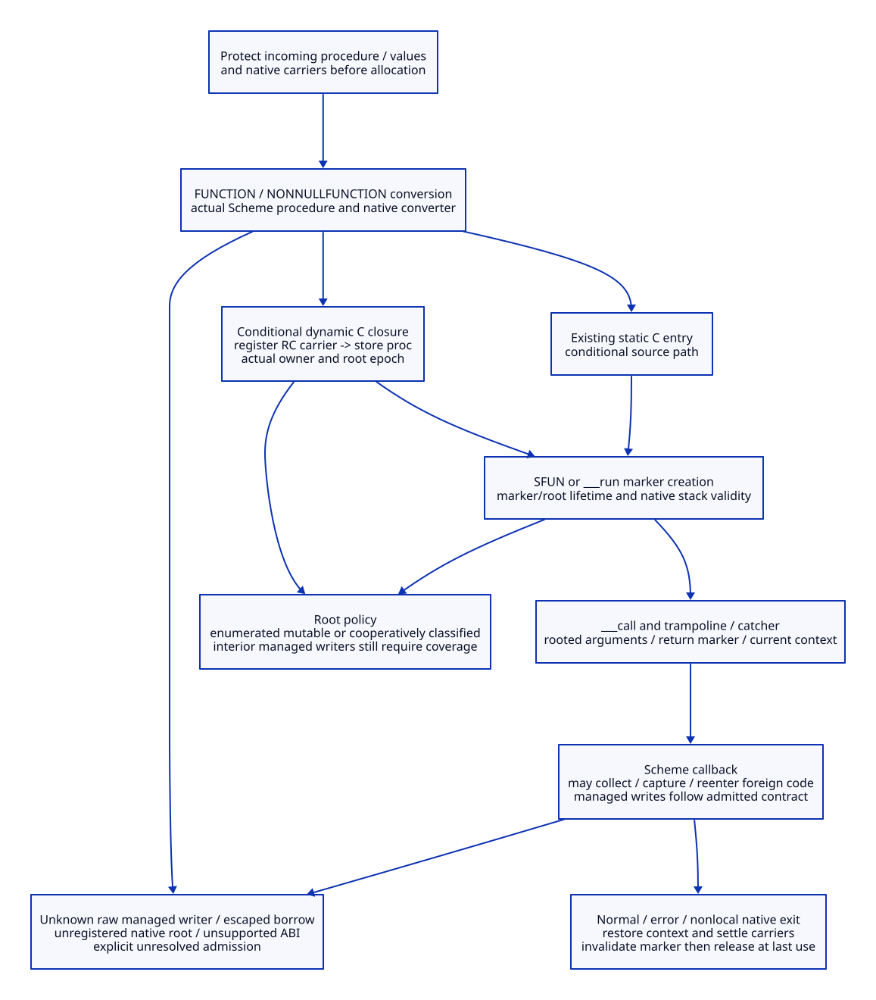 | architecture/runtime/control | ~c7f3055f9de862165788bb65e18005238a59f243b58973926918e787f1a38c41~ |
| [[file:../docs/experimental/zig/continuation-writer-graph.d2][continuation-writer-graph.d2]] | [[file:architecture/runtime/control/diagrams/continuation-writer-graph.d2][continuation-writer-graph.d2]] | architecture/runtime/control | ~571c33af0a47d08be4bf5fb38a060ccdc62a75491f63bf26faa7620005391a3d~ |
| [[file:../docs/experimental/zig/continuation-writer-graph.svg][continuation-writer-graph.svg]] | 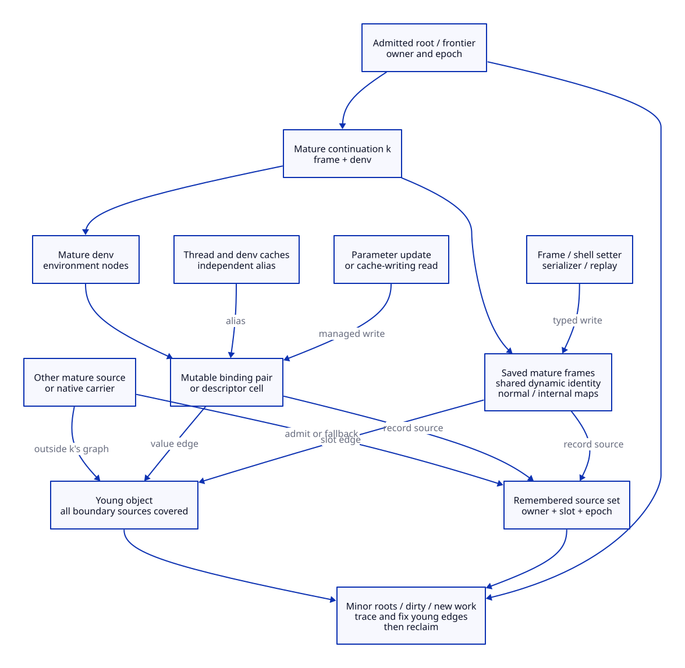 | architecture/runtime/control | ~e31f6996b36f9233c699495e9a35b2ad6a7f39012e483d05272f83f025ed972f~ |
| [[file:../docs/experimental/zig/continuation-writer-publication.d2][continuation-writer-publication.d2]] | [[file:architecture/runtime/control/diagrams/continuation-writer-publication.d2][continuation-writer-publication.d2]] | architecture/runtime/control | ~47744a5d5241b4ff27aef950d6377927ca700742fbd06157a3de83edee5a3be3~ |
| [[file:../docs/experimental/zig/continuation-writer-publication.svg][continuation-writer-publication.svg]] | 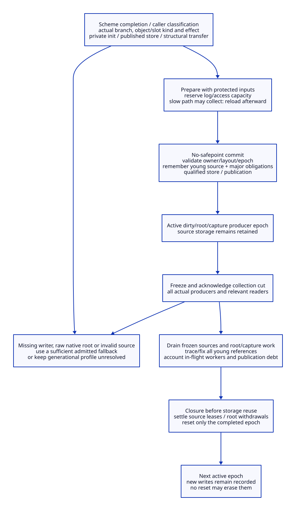 | architecture/runtime/control | ~de02ff54e3acfecbed83cc91ae15ccea787611fecd60e257e9d9f742c9cd3ca2~ |
| [[file:../docs/experimental/zig/d0-d1-control-root-handoff.d2][d0-d1-control-root-handoff.d2]] | [[file:architecture/runtime/control/diagrams/d0-d1-control-root-handoff.d2][d0-d1-control-root-handoff.d2]] | architecture/runtime/control | ~34379df7a10f6404a786f1895cc6b660a7ff327bbc7c02a8f703d020952e18c5~ |
| [[file:../docs/experimental/zig/d0-d1-control-root-handoff.svg][d0-d1-control-root-handoff.svg]] | [[file:architecture/runtime/control/diagrams/d0-d1-control-root-handoff.svg][d0-d1-control-root-handoff.svg]] | architecture/runtime/control | ~6423af7611c5a5d30d92dba6108fbea21deb941e4adc022b36166fc807c7e4e4~ |
| [[file:../docs/experimental/zig/d0-d1-cross-backend-evidence.md][d0-d1-cross-backend-evidence.md]] | [[file:architecture/runtime/control/studies/d0-d1-cross-backend-evidence.org][d0-d1-cross-backend-evidence.org]] | architecture/runtime/control | ~6d27c07dcf803ea9e931365828dc01bef35e76fff2efcd343b80282df1334a09~ |
| [[file:../docs/experimental/zig/d0-d1-cross-backend-protocol.md][d0-d1-cross-backend-protocol.md]] | [[file:architecture/runtime/control/studies/d0-d1-cross-backend-protocol.org][d0-d1-cross-backend-protocol.org]] | architecture/runtime/control | ~fc298afb7122ea6b13a2022ae16f53a449b06e06ba79e1524056080e4ba2b340~ |
| [[file:../docs/experimental/zig/d0-d1-host-exit-profiles.d2][d0-d1-host-exit-profiles.d2]] | [[file:architecture/runtime/control/diagrams/d0-d1-host-exit-profiles.d2][d0-d1-host-exit-profiles.d2]] | architecture/runtime/control | ~bbe1b3ff0979a10077fd73002c6b9334e023f005e5be8449efba7434b004c11f~ |
| [[file:../docs/experimental/zig/d0-d1-host-exit-profiles.svg][d0-d1-host-exit-profiles.svg]] | 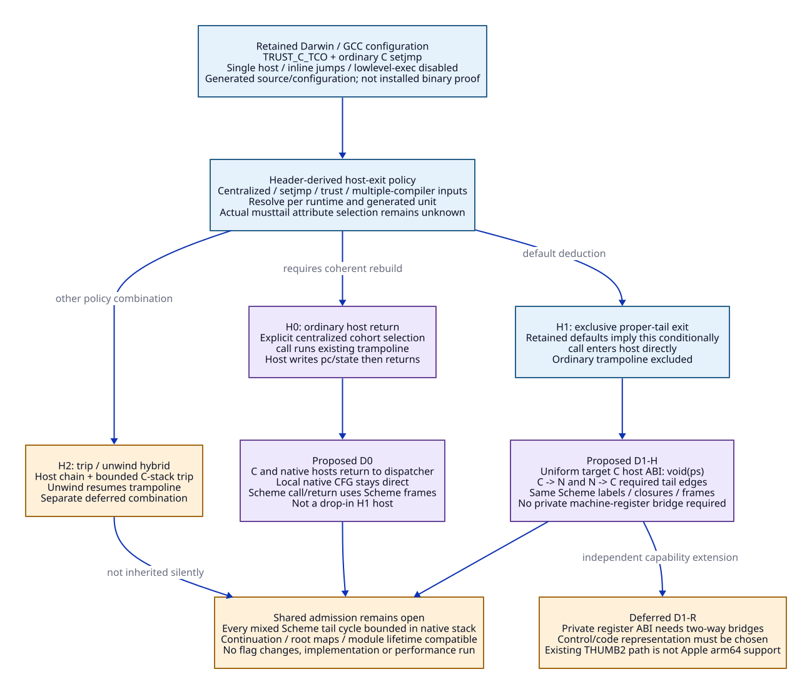 | architecture/runtime/control | ~66607e3bcc5e822d71bf653824ec32d9f7bdc84515988f50149829b79a9a53cb~ |
| [[file:../docs/experimental/zig/d1h-c-runtime-refactor.md][d1h-c-runtime-refactor.md]] | [[file:refactoring/modern-c/studies/d1h-c-runtime-refactor.org][d1h-c-runtime-refactor.org]] | refactoring/modern-c | ~12c208c189ed18a72d07e9e88ef72126039dabb28939c92ff8413473d8ca810e~ |
| [[file:../docs/experimental/zig/d1h-edge-admission.md][d1h-edge-admission.md]] | [[file:architecture/runtime/control/studies/d1h-edge-admission.org][d1h-edge-admission.org]] | architecture/runtime/control | ~d4dd58a683887a08024fc9008cf82a39c144fe45255539167deb0499c4481329~ |
| [[file:../docs/experimental/zig/d1h-host-contract.d2][d1h-host-contract.d2]] | [[file:research/diagrams/d1h-host-contract.d2][d1h-host-contract.d2]] | research | ~8ae2e36e70c58572240948b6071271f65a4874b3f1505da0834b38a675238543~ |
| [[file:../docs/experimental/zig/d1h-host-contract.svg][d1h-host-contract.svg]] | 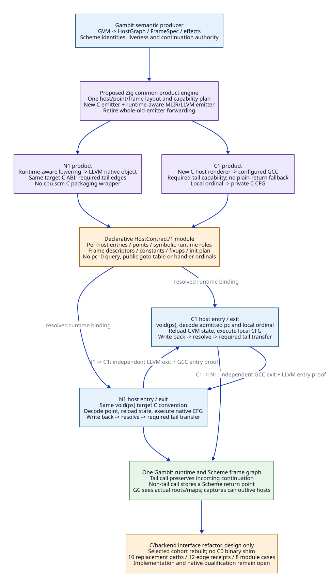 | research | ~ac9494b00ef22162e6964f23aa61c9c4ad7150fb32d3066f2ec8c9963d1353bc~ |
| [[file:../docs/experimental/zig/d1h-module-materialization.d2][d1h-module-materialization.d2]] | [[file:research/diagrams/d1h-module-materialization.d2][d1h-module-materialization.d2]] | research | ~0a48711715154d7045f63900394d5c5e498dbd0b53ac4cf7a996076d17f842c9~ |
| [[file:../docs/experimental/zig/d1h-module-materialization.svg][d1h-module-materialization.svg]] | [[file:research/diagrams/d1h-module-materialization.svg][d1h-module-materialization.svg]] | research | ~6bcca3427773a80d0d97a6c32266d8c685e680b7fb067efab317d80a5f2ff186~ |
| [[file:../docs/experimental/zig/d1h-refactor-evidence.md][d1h-refactor-evidence.md]] | [[file:architecture/runtime/control/studies/d1h-refactor-evidence.org][d1h-refactor-evidence.org]] | architecture/runtime/control | ~cdd9f3499ae2efa56a7a3eb4ad37b098bdc0fc84493303c1fbf533082fa96da9~ |
| [[file:../docs/experimental/zig/darwin-configured-input-design.md][darwin-configured-input-design.md]] | [[file:architecture/toolchain/studies/darwin-configured-input-design.org][darwin-configured-input-design.org]] | architecture/toolchain | ~623ea66b7acba495d43d2d1a76c6452b72c9bd408a95e73ea011fad4358a06de~ |
| [[file:../docs/experimental/zig/darwin-configured-input-evidence.md][darwin-configured-input-evidence.md]] | [[file:architecture/toolchain/studies/darwin-configured-input-evidence.org][darwin-configured-input-evidence.org]] | architecture/toolchain | ~20953eeca127c27ec20440698e6a072092b0b7dab3af3c6e7dc7a7d88119ad7d~ |
| [[file:../docs/experimental/zig/darwin-consumer-link-load.d2][darwin-consumer-link-load.d2]] | [[file:architecture/toolchain/diagrams/darwin-consumer-link-load.d2][darwin-consumer-link-load.d2]] | architecture/toolchain | ~6552711bb5eaab532db7eab75363d5ac56a9fec3d7e46ad31f3d857908624e1a~ |
| [[file:../docs/experimental/zig/darwin-consumer-link-load.svg][darwin-consumer-link-load.svg]] | 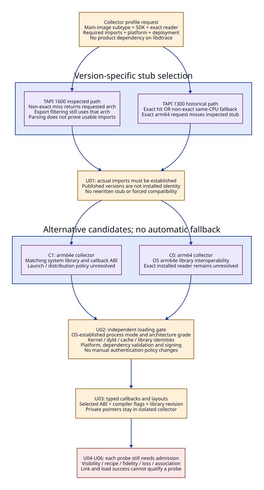 | architecture/toolchain | ~cf5ecdb189a0fd2801eac3e8cc7b4d9cf13f736dc7622139e8705711a6ce5aa2~ |
| [[file:../docs/experimental/zig/darwin-consumer-probe-admission.d2][darwin-consumer-probe-admission.d2]] | [[file:architecture/toolchain/diagrams/darwin-consumer-probe-admission.d2][darwin-consumer-probe-admission.d2]] | architecture/toolchain | ~2fb197ac95a437d34f1c73fd67fa3a3d23100e8ca3308e92d5a95f4e7511e4f8~ |
| [[file:../docs/experimental/zig/darwin-consumer-probe-admission.svg][darwin-consumer-probe-admission.svg]] | 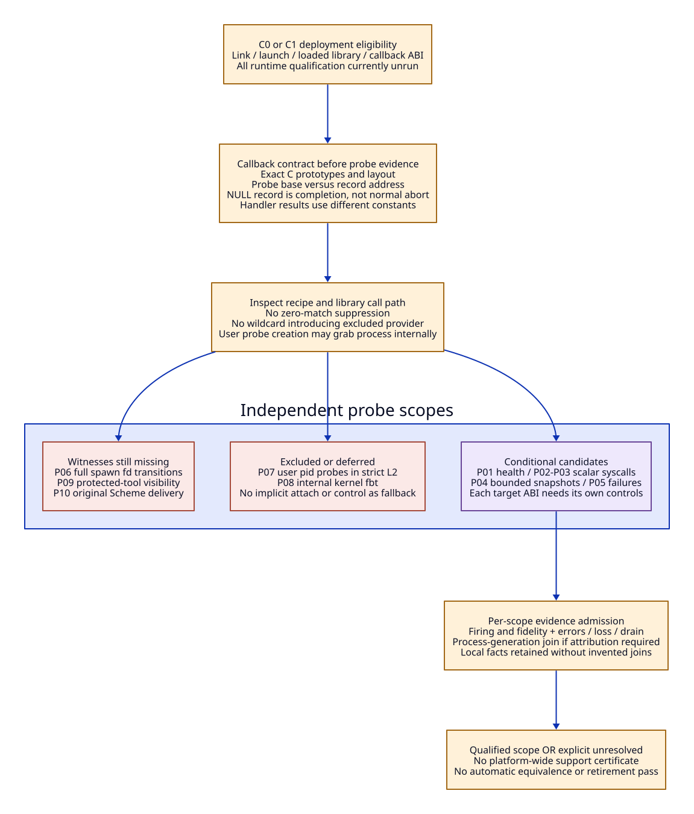 | architecture/toolchain | ~69d2c341a965f11dfe625a6eb934f80a9d595973fbf67083037d7f9436acb73f~ |
| [[file:../docs/experimental/zig/darwin-consumer-support-evidence.md][darwin-consumer-support-evidence.md]] | [[file:architecture/toolchain/studies/darwin-consumer-support-evidence.org][darwin-consumer-support-evidence.org]] | architecture/toolchain | ~4cb79d80072c4be194539e76f26d611720edde9aa10c537adffd260ea6d810b3~ |
| [[file:../docs/experimental/zig/darwin-consumer-support-matrix.md][darwin-consumer-support-matrix.md]] | [[file:architecture/toolchain/studies/darwin-consumer-support-matrix.org][darwin-consumer-support-matrix.org]] | architecture/toolchain | ~c118f554b70d83c6f47d587c10518e604536ea2790981e0a7cc3a89eb3b6dac1~ |
| [[file:../docs/experimental/zig/darwin-dtrace-abi-boundary.d2][darwin-dtrace-abi-boundary.d2]] | [[file:architecture/toolchain/diagrams/darwin-dtrace-abi-boundary.d2][darwin-dtrace-abi-boundary.d2]] | architecture/toolchain | ~dac0fcb7d298c0e97107bd5b7a6862786f362b90db6fffaa4e565670e9ad94c0~ |
| [[file:../docs/experimental/zig/darwin-dtrace-abi-boundary.svg][darwin-dtrace-abi-boundary.svg]] | 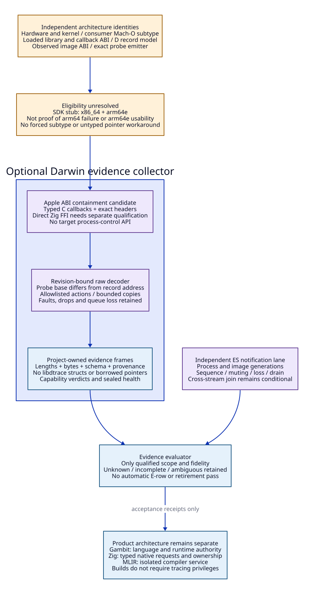 | architecture/toolchain | ~9b0ac45a582f323b0874eeed319eb9c25f2d43e266d20ababf7ddc70535c0d58~ |
| [[file:../docs/experimental/zig/darwin-dtrace-adapter-architecture.md][darwin-dtrace-adapter-architecture.md]] | [[file:architecture/toolchain/studies/darwin-dtrace-adapter-architecture.org][darwin-dtrace-adapter-architecture.org]] | architecture/toolchain | ~41bd5c370481fcb273e18d4c41a4e765c5751cce66b4d12032e79c7d24260f90~ |
| [[file:../docs/experimental/zig/darwin-dtrace-adapter-evidence.md][darwin-dtrace-adapter-evidence.md]] | [[file:architecture/toolchain/studies/darwin-dtrace-adapter-evidence.org][darwin-dtrace-adapter-evidence.org]] | architecture/toolchain | ~e15d9a33023fa1cba3a50df9c345ac909afae38a8a17a28f89afd2932750b74d~ |
| [[file:../docs/experimental/zig/darwin-dtrace-scope.d2][darwin-dtrace-scope.d2]] | [[file:architecture/toolchain/diagrams/darwin-dtrace-scope.d2][darwin-dtrace-scope.d2]] | architecture/toolchain | ~219a5fe00f77be1ab6b220f7744dc3e4073cf61049910d013597a513d737e841~ |
| [[file:../docs/experimental/zig/darwin-dtrace-scope.svg][darwin-dtrace-scope.svg]] | 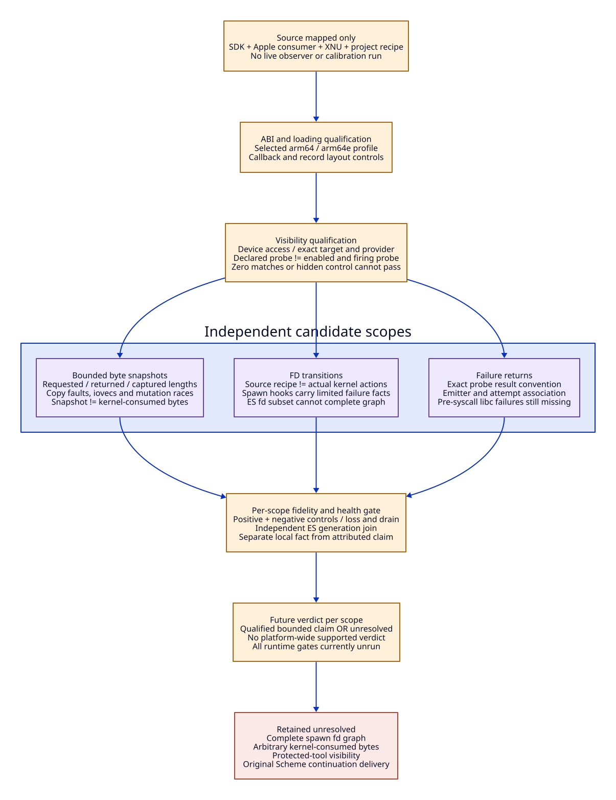 | architecture/toolchain | ~65206a763c896da077f5a28e73f09078c31933ddba8c0ac396b0c28105c6229c~ |
| [[file:../docs/experimental/zig/darwin-evidence-correlation.d2][darwin-evidence-correlation.d2]] | [[file:architecture/toolchain/diagrams/darwin-evidence-correlation.d2][darwin-evidence-correlation.d2]] | architecture/toolchain | ~50d921811108ee05002aa442149ac6f996e2813c7f93fd1d3c07617953cfb50a~ |
| [[file:../docs/experimental/zig/darwin-evidence-correlation.svg][darwin-evidence-correlation.svg]] | 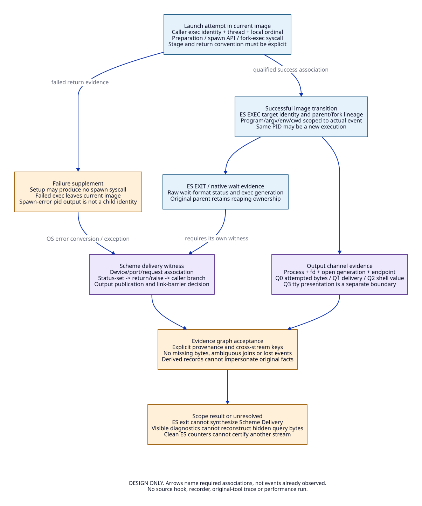 | architecture/toolchain | ~948e96a3f62a35fb09086685c4245b559558f30bd94f48de3e4de91989bde46f~ |
| [[file:../docs/experimental/zig/darwin-external-observer-design.md][darwin-external-observer-design.md]] | [[file:architecture/toolchain/studies/darwin-external-observer-design.org][darwin-external-observer-design.org]] | architecture/toolchain | ~e7d424d94e928749049dd9faea02f4dbd0a91e31de968f32c259197a59195a1b~ |
| [[file:../docs/experimental/zig/darwin-external-observer-evidence.md][darwin-external-observer-evidence.md]] | [[file:architecture/toolchain/studies/darwin-external-observer-evidence.org][darwin-external-observer-evidence.org]] | architecture/toolchain | ~5cafd4ce0a1797af8d08d923cf21d6c532ae0352fc059641d0b83f997bfbd741~ |
| [[file:../docs/experimental/zig/darwin-external-observer.d2][darwin-external-observer.d2]] | [[file:architecture/toolchain/diagrams/darwin-external-observer.d2][darwin-external-observer.d2]] | architecture/toolchain | ~ec2e92ab2beb9a052d96385a6dbaec26d1663b613377eae9315a9b2d17037803~ |
| [[file:../docs/experimental/zig/darwin-external-observer.svg][darwin-external-observer.svg]] | 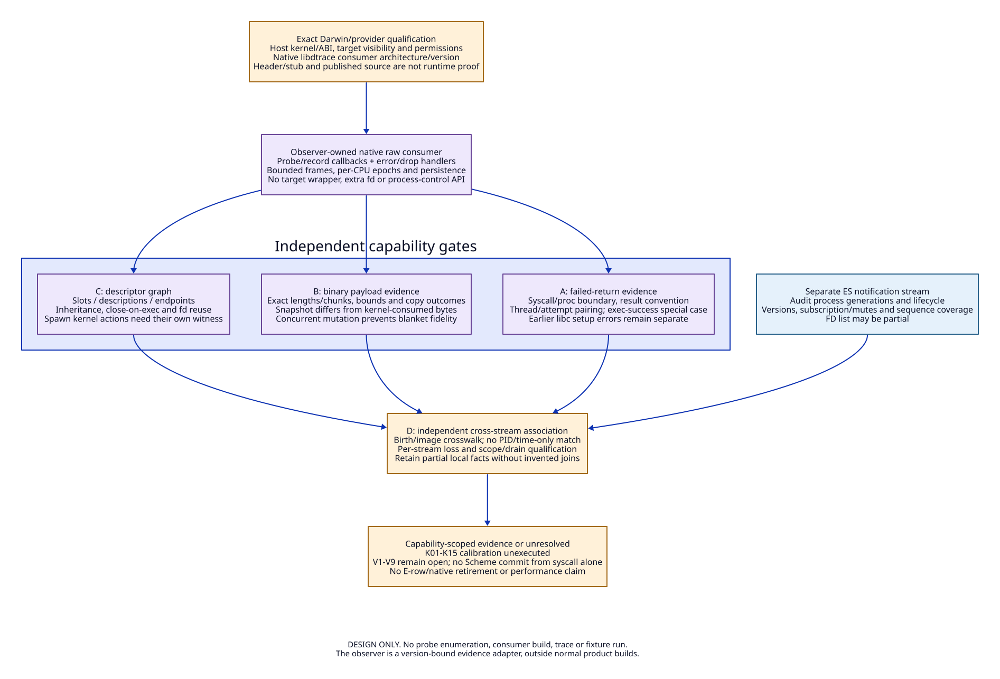 | architecture/toolchain | ~26585ab6315822bbda94f452c4488179a7a8582049bfde7999945f2fdd159afe~ |
| [[file:../docs/experimental/zig/darwin-fd-es-association.d2][darwin-fd-es-association.d2]] | [[file:architecture/toolchain/diagrams/darwin-fd-es-association.d2][darwin-fd-es-association.d2]] | architecture/toolchain | ~f307fbf07d9d4afc4aa2a534fac7e0d3af034425d5f15b9ab5b880d4666f0c36~ |
| [[file:../docs/experimental/zig/darwin-fd-es-association.svg][darwin-fd-es-association.svg]] | 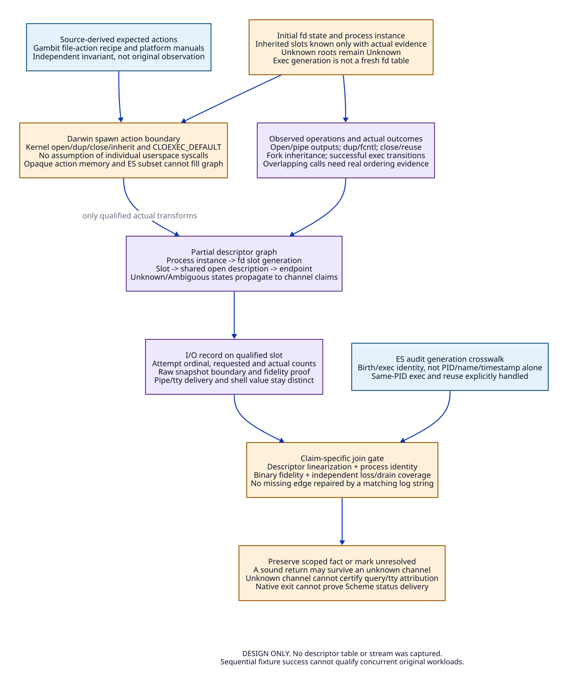 | architecture/toolchain | ~c10b97ea45b18bb41ff6d8ba79cf56be364a6a2ae8ad8c6faa2424673216d285~ |
| [[file:../docs/experimental/zig/darwin-first-compile-boundary.md][darwin-first-compile-boundary.md]] | [[file:architecture/toolchain/studies/darwin-first-compile-boundary.org][darwin-first-compile-boundary.org]] | architecture/toolchain | ~a530f8140616e2482aa588bce533a0a6b3173d027659ea8a91ed2d8e0f1261d7~ |
| [[file:../docs/experimental/zig/darwin-first-compile.d2][darwin-first-compile.d2]] | [[file:architecture/toolchain/diagrams/darwin-first-compile.d2][darwin-first-compile.d2]] | architecture/toolchain | ~a67f24b9a1a1990642b8bff271d3d45d3fe98110b9d8e1824cb3541cc148a603~ |
| [[file:../docs/experimental/zig/darwin-first-compile.svg][darwin-first-compile.svg]] | 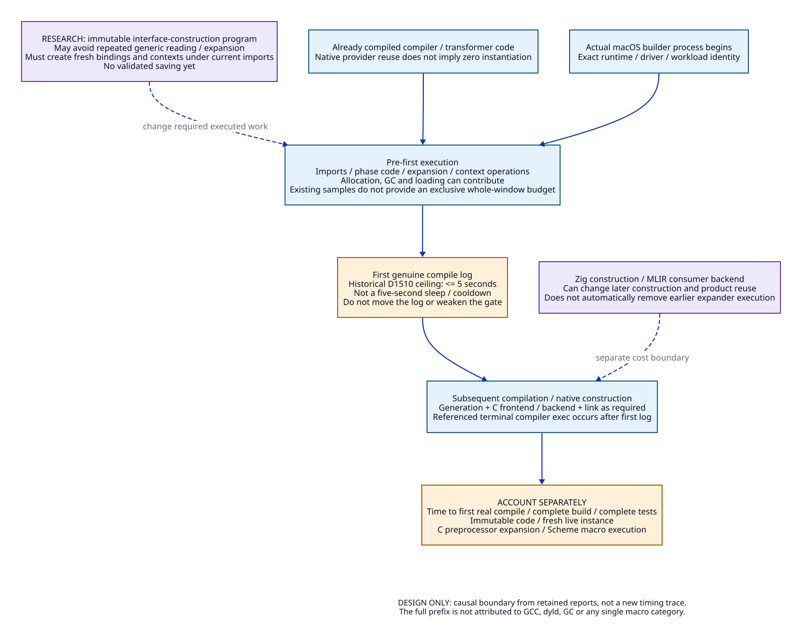 | architecture/toolchain | ~77f89eff74848becb85cf54074c591deea1c8841aff51e8939679be7d3f36ab7~ |
| [[file:../docs/experimental/zig/darwin-l1-calibration.d2][darwin-l1-calibration.d2]] | [[file:architecture/toolchain/diagrams/darwin-l1-calibration.d2][darwin-l1-calibration.d2]] | architecture/toolchain | ~d8701cca4e1028e92afd66fc3e3b4b42662bf7820c93f4eae992f0e63b79c335~ |
| [[file:../docs/experimental/zig/darwin-l1-calibration.svg][darwin-l1-calibration.svg]] | 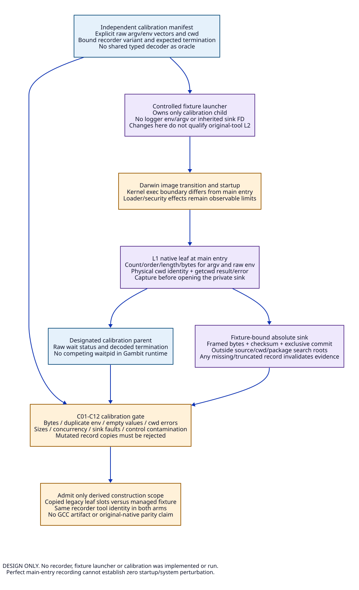 | architecture/toolchain | ~db15b3a37ead087842556ceca495bc062c6b57e224c6451f9c16335846d457da~ |
| [[file:../docs/experimental/zig/darwin-l2-observation.d2][darwin-l2-observation.d2]] | [[file:architecture/toolchain/diagrams/darwin-l2-observation.d2][darwin-l2-observation.d2]] | architecture/toolchain | ~a0383276a2b2806c0d47fe0ad91b9a8381d910dbc1d71b631b66b1235f8792a2~ |
| [[file:../docs/experimental/zig/darwin-l2-observation.svg][darwin-l2-observation.svg]] | 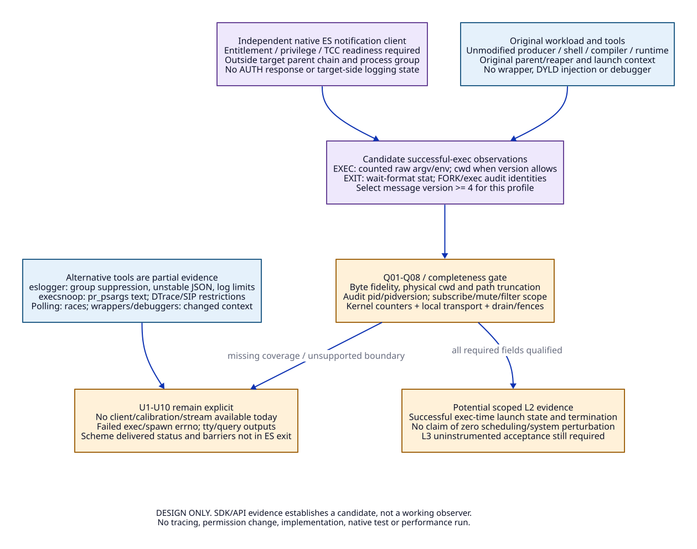 | architecture/toolchain | ~3165a2e785d65a2abc9081a5e8bea5f4efdaaf3b68e09cb9b12f9f004b0d1372~ |
| [[file:../docs/experimental/zig/darwin-local-stack-correspondence.d2][darwin-local-stack-correspondence.d2]] | [[file:architecture/toolchain/diagrams/darwin-local-stack-correspondence.d2][darwin-local-stack-correspondence.d2]] | architecture/toolchain | ~1636eb5398d3405f8d7dffa3e7a64d5c85b55f4d352af149acf1cbb672da12ab~ |
| [[file:../docs/experimental/zig/darwin-local-stack-correspondence.md][darwin-local-stack-correspondence.md]] | [[file:architecture/toolchain/studies/darwin-local-stack-correspondence.org][darwin-local-stack-correspondence.org]] | architecture/toolchain | ~aa000174fd9ebdaede19635367f89a848957b9206493c9f896fabb7731df10bf~ |
| [[file:../docs/experimental/zig/darwin-local-stack-correspondence.svg][darwin-local-stack-correspondence.svg]] | [[file:architecture/toolchain/diagrams/darwin-local-stack-correspondence.svg][darwin-local-stack-correspondence.svg]] | architecture/toolchain | ~fe4c9bb931f0b1b07fd4577b2c8368553280789b4452f467ad9632aa78d1d425~ |
| [[file:../docs/experimental/zig/darwin-observation-platform-evidence.md][darwin-observation-platform-evidence.md]] | [[file:architecture/toolchain/studies/darwin-observation-platform-evidence.org][darwin-observation-platform-evidence.org]] | architecture/toolchain | ~63557def4d2c9278819ed7a9d07ed751bda82e76064fc1b4f39aae422e8a06b8~ |
| [[file:../docs/experimental/zig/darwin-recorder-observation-design.md][darwin-recorder-observation-design.md]] | [[file:architecture/toolchain/studies/darwin-recorder-observation-design.org][darwin-recorder-observation-design.org]] | architecture/toolchain | ~ec810a2d29015ed53059112a9def7d81a4be05a7dfe8e0bdcb2b7e3306c53d99~ |
| [[file:../docs/experimental/zig/darwin-supplement-paths.d2][darwin-supplement-paths.d2]] | [[file:architecture/toolchain/diagrams/darwin-supplement-paths.d2][darwin-supplement-paths.d2]] | architecture/toolchain | ~3ad83b7539c5a640d47fc9148acfb533aaae178ff6eb909a1f0274ba9fe8c717~ |
| [[file:../docs/experimental/zig/darwin-supplement-paths.svg][darwin-supplement-paths.svg]] | 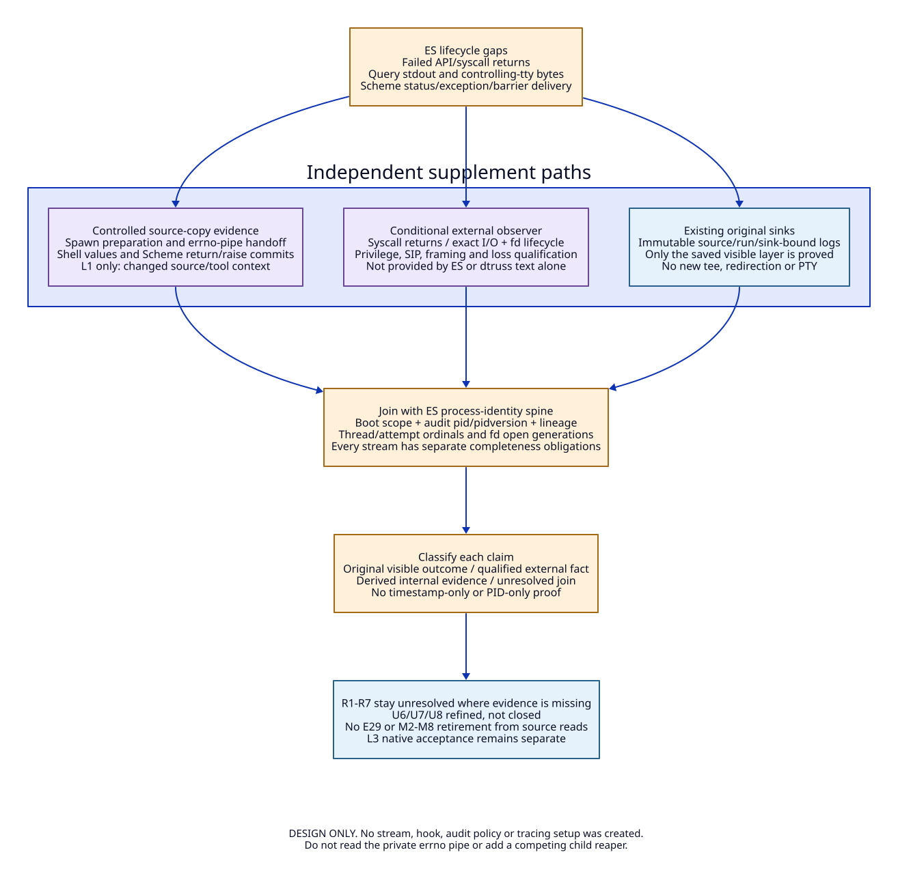 | architecture/toolchain | ~ca17311f4dcd87c7359d8031d3d8b2eb592b4ef428b6d84cf960b82a42760863~ |
| [[file:../docs/experimental/zig/darwin-supplemental-evidence-design.md][darwin-supplemental-evidence-design.md]] | [[file:architecture/toolchain/studies/darwin-supplemental-evidence-design.org][darwin-supplemental-evidence-design.org]] | architecture/toolchain | ~fb4d226bbd16a58f6acf3d6363e886a1645ccd90170efd90a6d6f6bf907f6552~ |
| [[file:../docs/experimental/zig/darwin-supplemental-evidence.md][darwin-supplemental-evidence.md]] | [[file:architecture/toolchain/studies/darwin-supplemental-evidence.org][darwin-supplemental-evidence.org]] | architecture/toolchain | ~d56631ef52730e239ab3b24f09a5536f181374f05254a17762b8eaaaf9cf0421~ |
| [[file:../docs/experimental/zig/device-release-accept-cancel.d2][device-release-accept-cancel.d2]] | [[file:architecture/runtime/ffi/diagrams/device-release-accept-cancel.d2][device-release-accept-cancel.d2]] | architecture/runtime/ffi | ~a1fdabce242ee93943b02d459579a0fe76eb114b8bb7c577f3a56c89dede2bcc~ |
| [[file:../docs/experimental/zig/device-release-accept-cancel.svg][device-release-accept-cancel.svg]] | 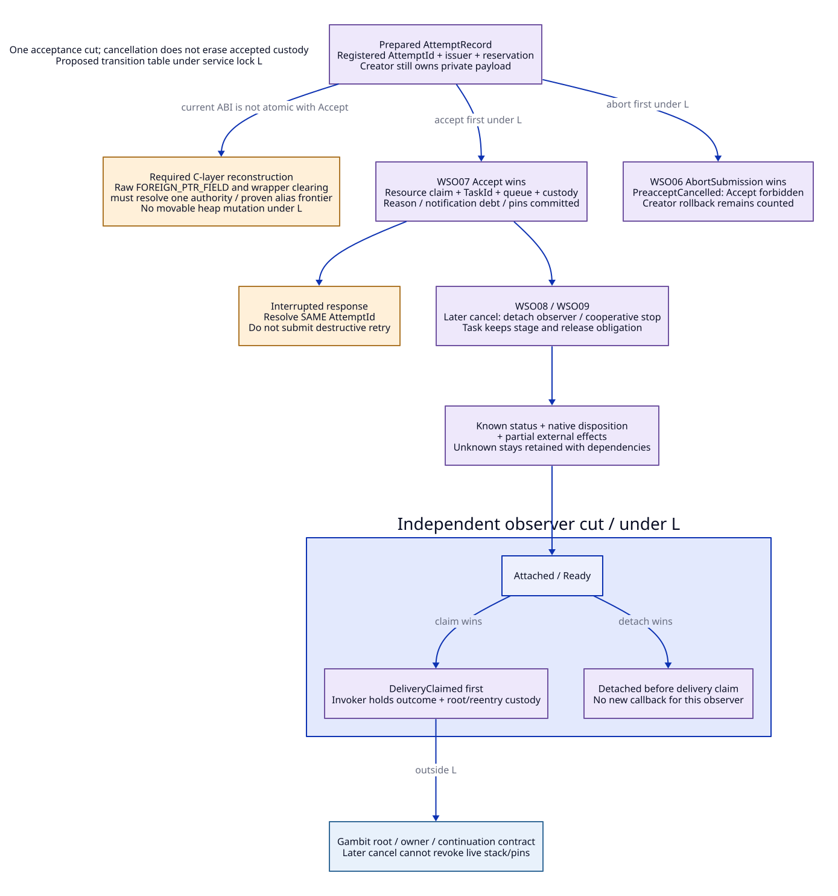 | architecture/runtime/ffi | ~292f8b14001221e89398128315de8c82fab38f726e84327a634b09608b7ff634~ |
| [[file:../docs/experimental/zig/device-release-credit-drain.d2][device-release-credit-drain.d2]] | [[file:architecture/runtime/ffi/diagrams/device-release-credit-drain.d2][device-release-credit-drain.d2]] | architecture/runtime/ffi | ~7b3b8dc3de0577a99849ec7a057bb9a8e539f541067839be266cbaf567f28ba7~ |
| [[file:../docs/experimental/zig/device-release-credit-drain.svg][device-release-credit-drain.svg]] | [[file:architecture/runtime/ffi/diagrams/device-release-credit-drain.svg][device-release-credit-drain.svg]] | architecture/runtime/ffi | ~3646a490a01f9c830e3832415f8b69c78b1a90d59750d56e359bb2b795864ec3~ |
| [[file:../docs/experimental/zig/device-release-service.d2][device-release-service.d2]] | [[file:architecture/runtime/ffi/diagrams/device-release-service.d2][device-release-service.d2]] | architecture/runtime/ffi | ~f99b5889a26f9c151e248df12d922ccae23aedfab649a906b2e89e8cd0c95d41~ |
| [[file:../docs/experimental/zig/device-release-service.svg][device-release-service.svg]] | 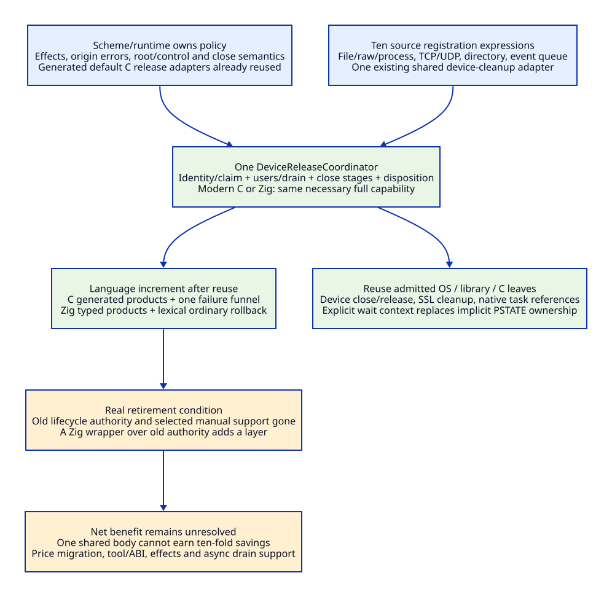 | architecture/runtime/ffi | ~6d509775af9bfec40f055fa02d052b5311d830ad502d00e297dd649cec02720d~ |
| [[file:../docs/experimental/zig/device-release-shutdown.d2][device-release-shutdown.d2]] | [[file:architecture/runtime/ffi/diagrams/device-release-shutdown.d2][device-release-shutdown.d2]] | architecture/runtime/ffi | ~bc88aee0434b108626ebd4ba1d26ed9e328318c3da225e18de710c60ae51ab26~ |
| [[file:../docs/experimental/zig/device-release-shutdown.svg][device-release-shutdown.svg]] | 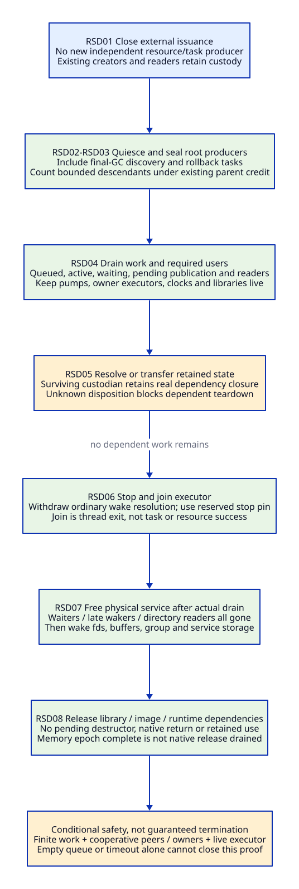 | architecture/runtime/ffi | ~5a2ddde43f432944a25170309e3c7207a2838435dbc5fe7a951cf8ee48b1c90b~ |
| [[file:../docs/experimental/zig/device-release-support-matrix.md][device-release-support-matrix.md]] | [[file:architecture/runtime/ffi/studies/device-release-support-matrix.org][device-release-support-matrix.org]] | architecture/runtime/ffi | ~0ceb5df79233cc3b6d93a08c3ff513705caa9d13b12a99a4472c3ffd9835be76~ |
| [[file:../docs/experimental/zig/device-release-sync-cost-matrix.md][device-release-sync-cost-matrix.md]] | [[file:architecture/runtime/ffi/studies/device-release-sync-cost-matrix.org][device-release-sync-cost-matrix.org]] | architecture/runtime/ffi | ~6a229cc198c6403ae7b70e4b07c816a29d19fa2855e8d5fe85b47c704c46c248~ |
| [[file:../docs/experimental/zig/device-release-sync-evidence.md][device-release-sync-evidence.md]] | [[file:architecture/runtime/ffi/studies/device-release-sync-evidence.org][device-release-sync-evidence.org]] | architecture/runtime/ffi | ~479f68c1a1063497cef6f5ded74ad15aeaf369dc6c643dc3aca3b30850cf0bb2~ |
| [[file:../docs/experimental/zig/device-release-sync-proof.md][device-release-sync-proof.md]] | [[file:architecture/runtime/ffi/studies/device-release-sync-proof.org][device-release-sync-proof.org]] | architecture/runtime/ffi | ~6740093aee3f608fcccfa247802ab59985f6c5701785e30b2fd59a26603cf1a1~ |
| [[file:../docs/experimental/zig/device-release-task-delivery.d2][device-release-task-delivery.d2]] | [[file:architecture/runtime/ffi/diagrams/device-release-task-delivery.d2][device-release-task-delivery.d2]] | architecture/runtime/ffi | ~9fc0d1632e21747f8125d012eac9a0eb79ba6200407dc6b955a05f50aa57d2a7~ |
| [[file:../docs/experimental/zig/device-release-task-delivery.svg][device-release-task-delivery.svg]] | 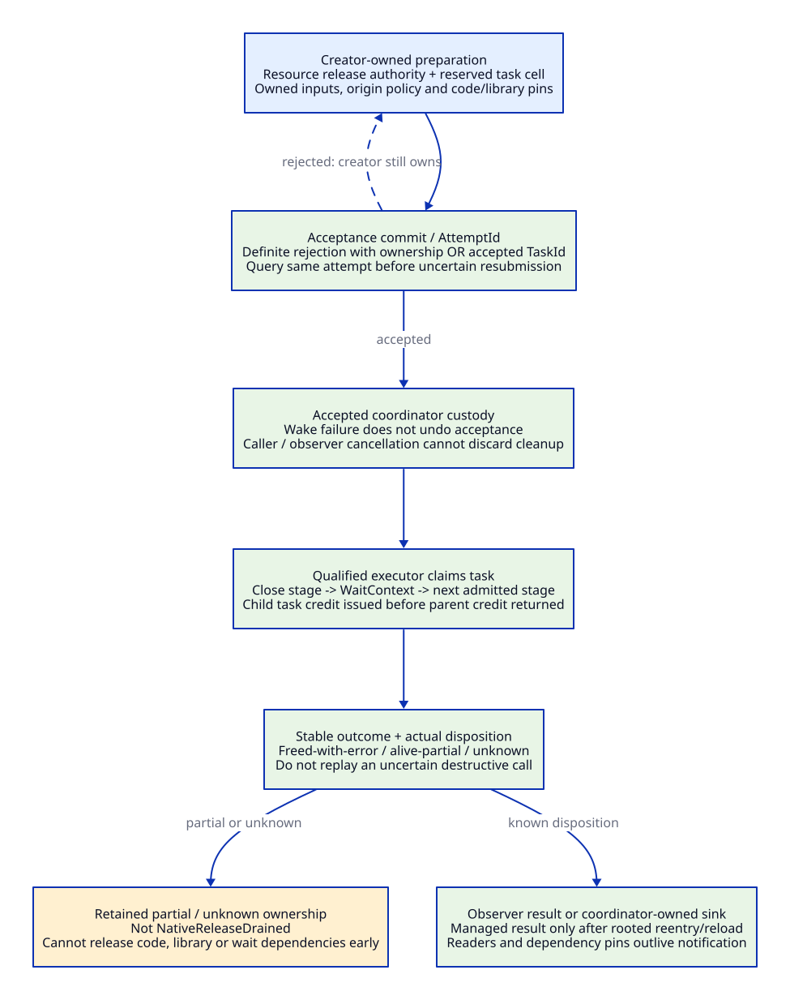 | architecture/runtime/ffi | ~a710e69dec6693dd501fe00252aa2edf0de8f08e8e74fa06a030e59a0745deff~ |
| [[file:../docs/experimental/zig/device-release-wait-context.d2][device-release-wait-context.d2]] | [[file:architecture/runtime/ffi/diagrams/device-release-wait-context.d2][device-release-wait-context.d2]] | architecture/runtime/ffi | ~406a2ee10641c74338c4c542b79f1e54111e78a0c2f70f900706ba4f90ed5503~ |
| [[file:../docs/experimental/zig/device-release-wait-context.svg][device-release-wait-context.svg]] | 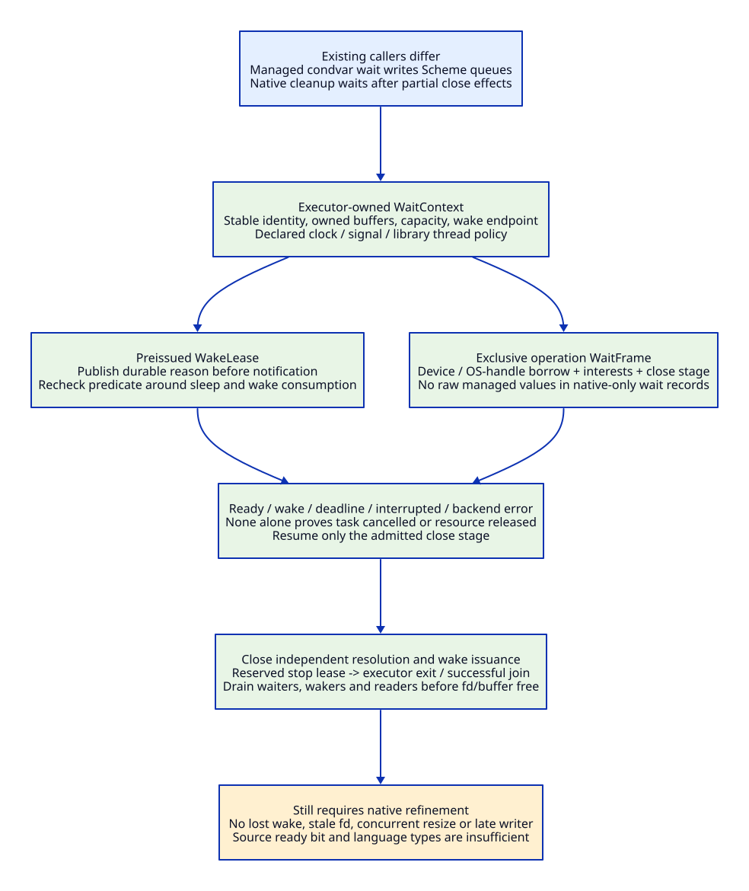 | architecture/runtime/ffi | ~b2b0aa30e78b39e365afcd51cc1ca2b4af4fdacbf4a30170cf2dbb57849e8f8a~ |
| [[file:../docs/experimental/zig/device-release-wait-contract.md][device-release-wait-contract.md]] | [[file:architecture/runtime/ffi/studies/device-release-wait-contract.org][device-release-wait-contract.org]] | architecture/runtime/ffi | ~bf37b2512fc033ef7fe5f4ad76c54cda0164f84ab278d7b86d392a662e7b575b~ |
| [[file:../docs/experimental/zig/device-release-wait-cost-matrix.md][device-release-wait-cost-matrix.md]] | [[file:architecture/runtime/ffi/studies/device-release-wait-cost-matrix.org][device-release-wait-cost-matrix.org]] | architecture/runtime/ffi | ~6117a127102889d7d1846ecc85505f9b19c24b914630dac9a4b1d2371c3a9cb2~ |
| [[file:../docs/experimental/zig/device-release-wait-evidence.md][device-release-wait-evidence.md]] | [[file:architecture/runtime/ffi/studies/device-release-wait-evidence.org][device-release-wait-evidence.org]] | architecture/runtime/ffi | ~7fbd28a0edb20fa957e1f2a833e9935e1eb582ccca2537ff91b5143f2a5d54e6~ |
| [[file:../docs/experimental/zig/device-release-wake-order.d2][device-release-wake-order.d2]] | [[file:architecture/runtime/ffi/diagrams/device-release-wake-order.d2][device-release-wake-order.d2]] | architecture/runtime/ffi | ~54ae5a8b5c31e19736c35eedb8b8756eba93353cbdf8bbc9dd56d39d2880ceaf~ |
| [[file:../docs/experimental/zig/device-release-wake-order.svg][device-release-wake-order.svg]] | [[file:architecture/runtime/ffi/diagrams/device-release-wake-order.svg][device-release-wake-order.svg]] | architecture/runtime/ffi | ~9d8442c77c74d42f839968c07849815c639b5fb941ce4f5fbe40f8dc598bd635~ |
| [[file:../docs/experimental/zig/effective-configuration-darwin-gcc.md][effective-configuration-darwin-gcc.md]] | [[file:architecture/toolchain/studies/effective-configuration-darwin-gcc.org][effective-configuration-darwin-gcc.org]] | architecture/toolchain | ~2c1bf657e64fbce4136212b61214f11293faa41d152e994afc735cbd5293444d~ |
| [[file:../docs/experimental/zig/effective-configuration-evidence.md][effective-configuration-evidence.md]] | [[file:architecture/toolchain/studies/effective-configuration-evidence.org][effective-configuration-evidence.org]] | architecture/toolchain | ~0a85e703f64014375a475380570dc36bdff44788803adf4d4c1bf6e4bf584ae7~ |
| [[file:../docs/experimental/zig/effective-configuration-model.d2][effective-configuration-model.d2]] | [[file:architecture/toolchain/diagrams/effective-configuration-model.d2][effective-configuration-model.d2]] | architecture/toolchain | ~7930c02cf98e494708c0db84674a43b1e7a21b93ba254cb90854f31094c148ad~ |
| [[file:../docs/experimental/zig/effective-configuration-model.svg][effective-configuration-model.svg]] | [[file:architecture/toolchain/diagrams/effective-configuration-model.svg][effective-configuration-model.svg]] | architecture/toolchain | ~7d34917d5f0655852daa7429c6070872653623f3284a9cd409b7531c5f9c142e~ |
| [[file:../docs/experimental/zig/engineering-boundary.d2][engineering-boundary.d2]] | [[file:research/diagrams/engineering-boundary.d2][engineering-boundary.d2]] | research | ~6e6fc9b26a047187d2868ee2f9da1a0c8c7c285fcdaca056261dc1c23fee5ed1~ |
| [[file:../docs/experimental/zig/engineering-boundary.svg][engineering-boundary.svg]] | [[file:research/diagrams/engineering-boundary.svg][engineering-boundary.svg]] | research | ~7b0c3f5db0a43c8c51054dea36163bb5929a040fc7c75c930073a10355d2cd1c~ |
| [[file:../docs/experimental/zig/equivalence-observation-evidence.md][equivalence-observation-evidence.md]] | [[file:architecture/toolchain/studies/equivalence-observation-evidence.org][equivalence-observation-evidence.org]] | architecture/toolchain | ~9e8bfb22d3d3e50c5175358b2e4979415d8c5f9429fb2dd46cfefda5a86ce06e~ |
| [[file:../docs/experimental/zig/evaluation-effects-contract.md][evaluation-effects-contract.md]] | [[file:architecture/compiler/studies/evaluation-effects-contract.org][evaluation-effects-contract.org]] | architecture/compiler | ~10851b056880d0a08ccd168506e8ee0da0eaf1a633836e98cf076d62ddcdb2a1~ |
| [[file:../docs/experimental/zig/foreign-control-containment.d2][foreign-control-containment.d2]] | [[file:architecture/runtime/ffi/diagrams/foreign-control-containment.d2][foreign-control-containment.d2]] | architecture/runtime/ffi | ~de1c34ef55ab73c4291468f95d9f6355933e571b11fec86705aa2d53b873b68d~ |
| [[file:../docs/experimental/zig/foreign-control-containment.svg][foreign-control-containment.svg]] | 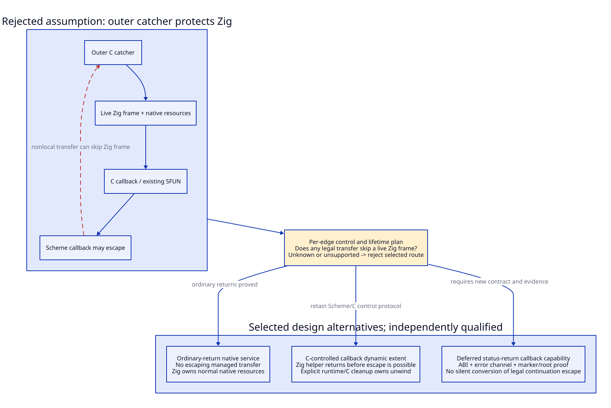 | architecture/runtime/ffi | ~bb3579f19ff4174bb51cabb4413817bc94a3af4e5dfb70a15f70dc22c083ebfc~ |
| [[file:../docs/experimental/zig/foreign-plan-contract.d2][foreign-plan-contract.d2]] | [[file:architecture/runtime/ffi/diagrams/foreign-plan-contract.d2][foreign-plan-contract.d2]] | architecture/runtime/ffi | ~11d5b253853cf7c6a972f90db5aebdd275fe567bbf25ecad8897e17dcf3ccbed~ |
| [[file:../docs/experimental/zig/foreign-plan-contract.md][foreign-plan-contract.md]] | [[file:architecture/runtime/ffi/studies/foreign-plan-contract.org][foreign-plan-contract.org]] | architecture/runtime/ffi | ~e264767ce77337aedf987604895ca44be079fd520d1354bc1b2239924d8b9b6e~ |
| [[file:../docs/experimental/zig/foreign-plan-contract.svg][foreign-plan-contract.svg]] | 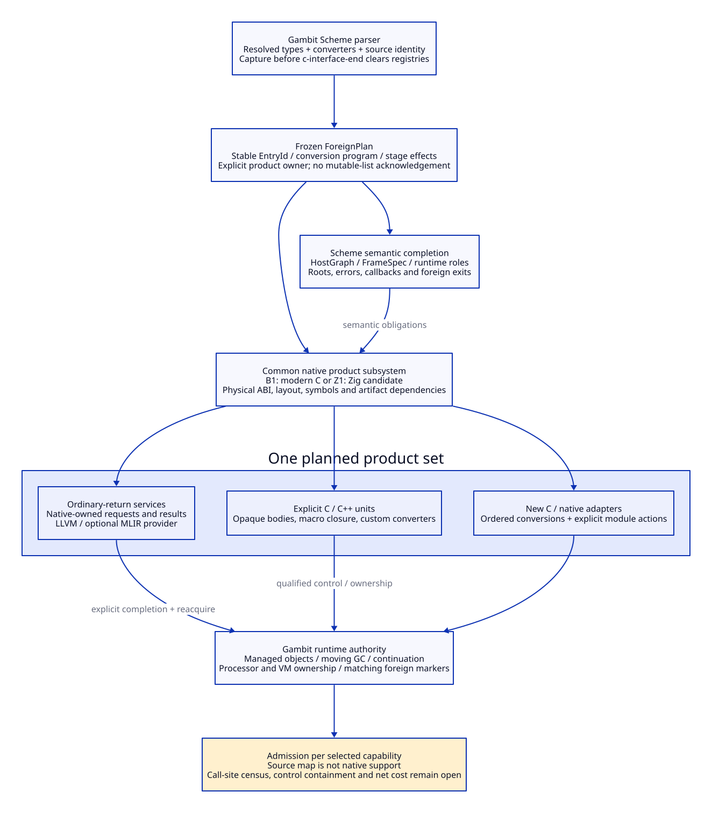 | architecture/runtime/ffi | ~f9125804a3b145ec1dde52a3f958cd41e209f320ea00470db81ce11584bd363c~ |
| [[file:../docs/experimental/zig/foreign-plan-engineering-comparison.md][foreign-plan-engineering-comparison.md]] | [[file:architecture/runtime/ffi/studies/foreign-plan-engineering-comparison.org][foreign-plan-engineering-comparison.org]] | architecture/runtime/ffi | ~5882e4852454f78b71e83869d44b3d2160aeb91ee1986e1fb7736341e6623a59~ |
| [[file:../docs/experimental/zig/foreign-plan-evidence.md][foreign-plan-evidence.md]] | [[file:architecture/runtime/ffi/studies/foreign-plan-evidence.org][foreign-plan-evidence.org]] | architecture/runtime/ffi | ~04b1866d129e8810020d8d435b75baf06eede7883a61f7a0e0a543b882e5967f~ |
| [[file:../docs/experimental/zig/foreign-release-admission.d2][foreign-release-admission.d2]] | [[file:architecture/runtime/ffi/diagrams/foreign-release-admission.d2][foreign-release-admission.d2]] | architecture/runtime/ffi | ~4f6fd3ff81c2c2357911ce66fcb92e5d95857ec87575b0cdb72fff07fb861bd2~ |
| [[file:../docs/experimental/zig/foreign-release-admission.svg][foreign-release-admission.svg]] | 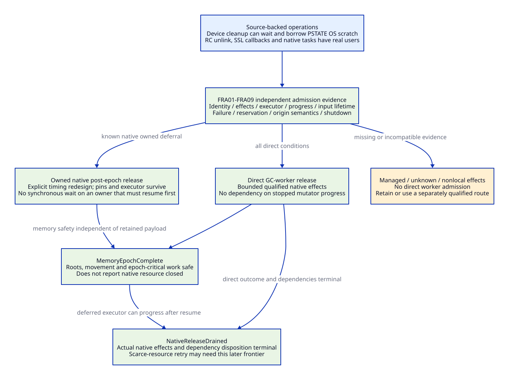 | architecture/runtime/ffi | ~26b6d40a2dcc8da177bccc40e771cf6eb5ed4ea284d6023eb58f1d19c57829ed~ |
| [[file:../docs/experimental/zig/foreign-release-lifecycle.d2][foreign-release-lifecycle.d2]] | [[file:architecture/runtime/ffi/diagrams/foreign-release-lifecycle.d2][foreign-release-lifecycle.d2]] | architecture/runtime/ffi | ~bceaad9a8e38baa74b4aaac5179a4bd2113a950a25285faf218c514d61d7ecbf~ |
| [[file:../docs/experimental/zig/foreign-release-lifecycle.svg][foreign-release-lifecycle.svg]] | 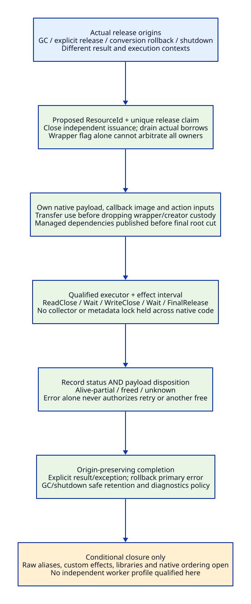 | architecture/runtime/ffi | ~c37d6f390303d2c19f52f6a27032631d6f17b0c2d6da2ae945296c082703a508~ |
| [[file:../docs/experimental/zig/foreign-release-worker-contract.md][foreign-release-worker-contract.md]] | [[file:architecture/runtime/ffi/studies/foreign-release-worker-contract.org][foreign-release-worker-contract.org]] | architecture/runtime/ffi | ~f481a6170fe1c3715864cff6c44fd809e06ba2103153f0b1b62caa6238449aca~ |
| [[file:../docs/experimental/zig/foreign-release-worker-evidence.md][foreign-release-worker-evidence.md]] | [[file:architecture/runtime/ffi/studies/foreign-release-worker-evidence.org][foreign-release-worker-evidence.org]] | architecture/runtime/ffi | ~8d90a6cfbda18c1b8b9071fafafbf6e048f2c362f155fa86ae84fe567d795e70~ |
| [[file:../docs/experimental/zig/gambit-blocking-participation.d2][gambit-blocking-participation.d2]] | [[file:research/diagrams/gambit-blocking-participation.d2][gambit-blocking-participation.d2]] | research | ~debfbaee0f91cbf4637d7ecb0d5a2444d48f32602c0dd52ed9ce2fcb73ed6990~ |
| [[file:../docs/experimental/zig/gambit-blocking-participation.svg][gambit-blocking-participation.svg]] | 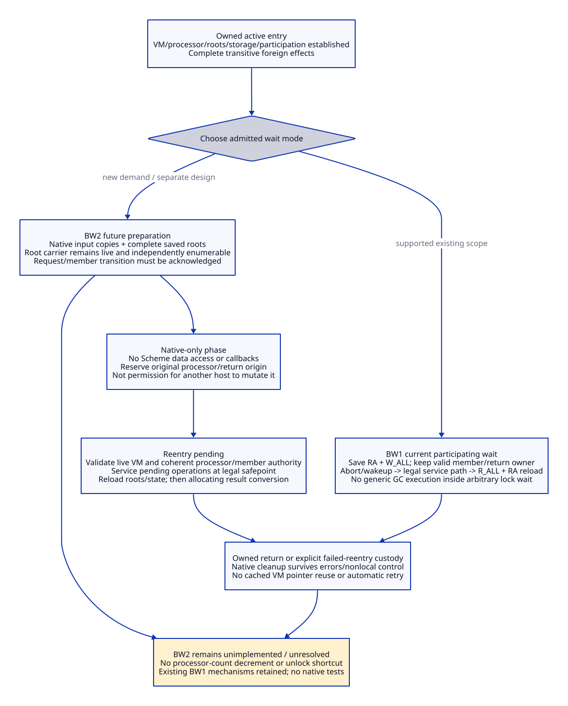 | research | ~51bd933acea431c3b4a9c86e1f00e79b984f45a8597b9c95a547ec95c13d14d6~ |
| [[file:../docs/experimental/zig/gambit-centered-backend-redesign.md][gambit-centered-backend-redesign.md]] | [[file:architecture/system/studies/gambit-centered-backend-redesign.org][gambit-centered-backend-redesign.org]] | architecture/system | ~ab8249e2e0f8f86f2354099cf8aad0e5c629134d4459f4d8fdc86aff91d7dd42~ |
| [[file:../docs/experimental/zig/gambit-centered-backends.d2][gambit-centered-backends.d2]] | [[file:architecture/system/diagrams/gambit-centered-backends.d2][gambit-centered-backends.d2]] | architecture/system | ~b8ddcb90958a20aebf89be5818ca2b9b71cb2a6b7eb438081badfcca0e17dea1~ |
| [[file:../docs/experimental/zig/gambit-centered-backends.svg][gambit-centered-backends.svg]] | [[file:architecture/system/diagrams/gambit-centered-backends.svg][gambit-centered-backends.svg]] | architecture/system | ~6bf89d888bda394351700ee11badd2cb8ab34664f736d561797f6b541e7061df~ |
| [[file:../docs/experimental/zig/gambit-modernization-contracts.d2][gambit-modernization-contracts.d2]] | [[file:architecture/system/diagrams/gambit-modernization-contracts.d2][gambit-modernization-contracts.d2]] | architecture/system | ~45c2103d94f88d21245ba40c60a9c97e191260722cbf219032f444f0cac7e543~ |
| [[file:../docs/experimental/zig/gambit-modernization-contracts.svg][gambit-modernization-contracts.svg]] | 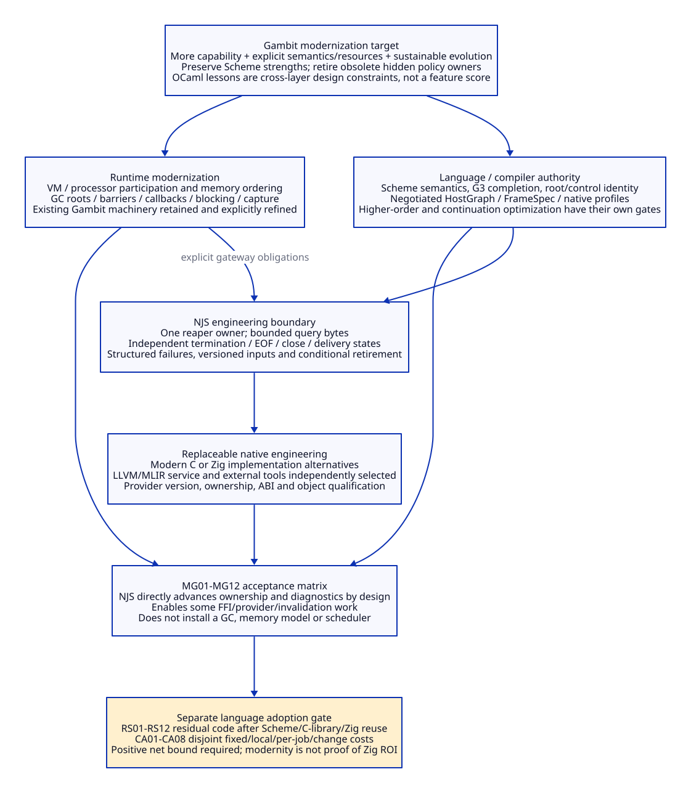 | architecture/system | ~f0cf79cd1f48d9979cf4007b80702da600390632ffb793af2ecc566973938a8f~ |
| [[file:../docs/experimental/zig/gambit-modernization-decision.d2][gambit-modernization-decision.d2]] | [[file:architecture/system/diagrams/gambit-modernization-decision.d2][gambit-modernization-decision.d2]] | architecture/system | ~879950e7a803d6bbcec96fd06b47f83206af2b60d45d97ce2c7cd1dbb726cab6~ |
| [[file:../docs/experimental/zig/gambit-modernization-decision.svg][gambit-modernization-decision.svg]] | 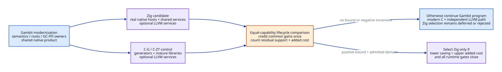 | architecture/system | ~96ade8098dc52fde60efd82f60fb6e43b04c513a50873c529541f94cbf78fd01~ |
| [[file:../docs/experimental/zig/gambit-modernization-dependencies.d2][gambit-modernization-dependencies.d2]] | [[file:architecture/system/diagrams/gambit-modernization-dependencies.d2][gambit-modernization-dependencies.d2]] | architecture/system | ~885f5949cabd9d07d26bea9aced440c84a96a2f2e34060cb0289d1eeed9c07ed~ |
| [[file:../docs/experimental/zig/gambit-modernization-dependencies.svg][gambit-modernization-dependencies.svg]] | [[file:architecture/system/diagrams/gambit-modernization-dependencies.svg][gambit-modernization-dependencies.svg]] | architecture/system | ~85b7ac64b1d3b3c8d315ae31349d11b89329cfc36b7a060af3353de4a3131787~ |
| [[file:../docs/experimental/zig/gambit-modernization-direction.md][gambit-modernization-direction.md]] | [[file:architecture/system/studies/gambit-modernization-direction.org][gambit-modernization-direction.org]] | architecture/system | ~2e0c503befe5f1a2d8313859a54399b8c9791685907ca02d3a121587f7176964~ |
| [[file:../docs/experimental/zig/gambit-modernization-foundation-evidence.md][gambit-modernization-foundation-evidence.md]] | [[file:architecture/system/studies/gambit-modernization-foundation-evidence.org][gambit-modernization-foundation-evidence.org]] | architecture/system | ~7d773cfe13138204382a711f60d9fc0d1007317b412bec9aaa7a42cf2336e6dd~ |
| [[file:../docs/experimental/zig/gambit-modernization-foundation-matrix.md][gambit-modernization-foundation-matrix.md]] | [[file:architecture/system/studies/gambit-modernization-foundation-matrix.org][gambit-modernization-foundation-matrix.org]] | architecture/system | ~1668bd3707c11c4151916cbae1d9dc3425d5af59fb9af278a63a3a52e84a74b2~ |
| [[file:../docs/experimental/zig/gambit-modernization-foundation.d2][gambit-modernization-foundation.d2]] | [[file:architecture/system/diagrams/gambit-modernization-foundation.d2][gambit-modernization-foundation.d2]] | architecture/system | ~491c2033c77be7af1237ce7363d912fdbc25fbeffe5300ff5d2c4680053c289f~ |
| [[file:../docs/experimental/zig/gambit-modernization-foundation.md][gambit-modernization-foundation.md]] | [[file:architecture/system/studies/gambit-modernization-foundation.org][gambit-modernization-foundation.org]] | architecture/system | ~b9bf6016d6fa60e2dc5acf081b10dfa271226c30420c1af9c19cfc41049dea88~ |
| [[file:../docs/experimental/zig/gambit-modernization-foundation.svg][gambit-modernization-foundation.svg]] | 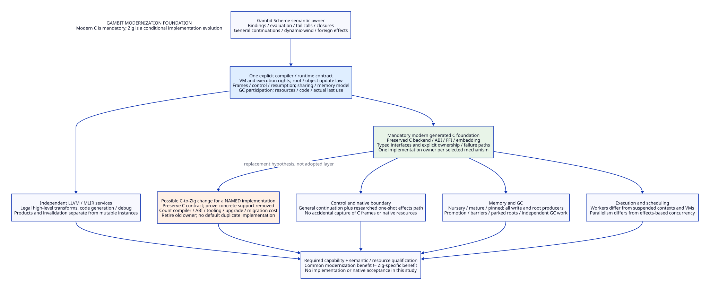 | architecture/system | ~72c1b6bc66f5566e6d2c6deee71555e6963fed803fb566cce678629cf5a77058~ |
| [[file:../docs/experimental/zig/gambit-runtime-authorities.d2][gambit-runtime-authorities.d2]] | [[file:research/diagrams/gambit-runtime-authorities.d2][gambit-runtime-authorities.d2]] | research | ~cd568e573b289a26cab1a1adf62e01723dbd69c921842ffeed606a5eaeed1be6~ |
| [[file:../docs/experimental/zig/gambit-runtime-authorities.svg][gambit-runtime-authorities.svg]] | [[file:research/diagrams/gambit-runtime-authorities.svg][gambit-runtime-authorities.svg]] | research | ~acf65995897209c3fa6022f59c145710b259b4953acd883d0b44c6ffbd74ef41~ |
| [[file:../docs/experimental/zig/gambit-runtime-migration.d2][gambit-runtime-migration.d2]] | [[file:research/diagrams/gambit-runtime-migration.d2][gambit-runtime-migration.d2]] | research | ~85188c1d9bd4131c8d9a72bcc6e56a1e677381a3fcc01e32f6edf85964f8153a~ |
| [[file:../docs/experimental/zig/gambit-runtime-migration.svg][gambit-runtime-migration.svg]] | 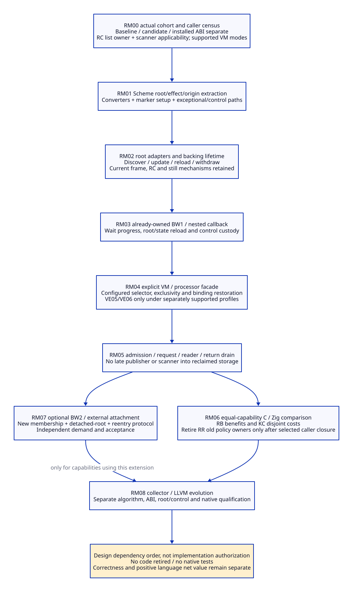 | research | ~75863accf851c09ce32cd83232c093d0701e58d68bffe3ecbdfba220ffc2f79c~ |
| [[file:../docs/experimental/zig/gc-capacity-publication.d2][gc-capacity-publication.d2]] | [[file:architecture/runtime/gc/diagrams/gc-capacity-publication.d2][gc-capacity-publication.d2]] | architecture/runtime/gc | ~e8daf5bd38d7198ed7ff4663d9f130ad414ef6b0738815df681748d2cf6cc238~ |
| [[file:../docs/experimental/zig/gc-capacity-publication.svg][gc-capacity-publication.svg]] | 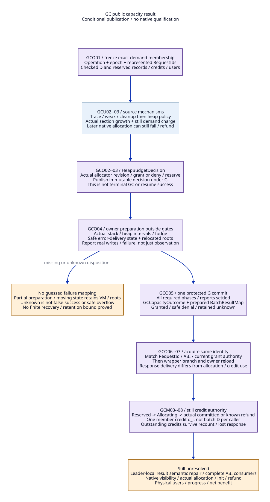 | architecture/runtime/gc | ~7ca013cf3458e500089b3076ffe6278c2d91551c095be7afca7c4cd52caf1b85~ |
| [[file:../docs/experimental/zig/gc-capacity-result-cost-matrix.md][gc-capacity-result-cost-matrix.md]] | [[file:architecture/runtime/gc/studies/gc-capacity-result-cost-matrix.org][gc-capacity-result-cost-matrix.org]] | architecture/runtime/gc | ~95d1c837fb848e1d970faae086c021c60c4fac93df5d239083883104f4ddfb92~ |
| [[file:../docs/experimental/zig/gc-capacity-result-design.md][gc-capacity-result-design.md]] | [[file:architecture/runtime/gc/studies/gc-capacity-result-design.org][gc-capacity-result-design.org]] | architecture/runtime/gc | ~b38a3cd4d4c0810900e8810efa30c228bc87af78f3c646ecb2ebae2ad82ce3ff~ |
| [[file:../docs/experimental/zig/gc-capacity-result-evidence.md][gc-capacity-result-evidence.md]] | [[file:architecture/runtime/gc/studies/gc-capacity-result-evidence.org][gc-capacity-result-evidence.org]] | architecture/runtime/gc | ~6f6752b85c095460bac9f612dc98575595c08a0f0a399f5f2ceca95531ffe459~ |
| [[file:../docs/experimental/zig/gc-current-mechanism-audit.md][gc-current-mechanism-audit.md]] | [[file:architecture/runtime/gc/studies/gc-current-mechanism-audit.org][gc-current-mechanism-audit.org]] | architecture/runtime/gc | ~d9189d910e5d3844fb08d08f4e397fab431347bdfe106ac8f0e4a781b117ed2f~ |
| [[file:../docs/experimental/zig/gc-native-benefit-boundaries.d2][gc-native-benefit-boundaries.d2]] | [[file:architecture/runtime/gc/diagrams/gc-native-benefit-boundaries.d2][gc-native-benefit-boundaries.d2]] | architecture/runtime/gc | ~8c34135da16844217fbc0eaedbcdea471aa82527fdedab1ca346a300c6992ecb~ |
| [[file:../docs/experimental/zig/gc-native-benefit-boundaries.svg][gc-native-benefit-boundaries.svg]] | 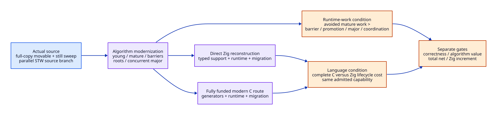 | architecture/runtime/gc | ~3a6ba3cd8ba2c3171db898d0fd40b633501b56fdf0012b85cc80aad576f06308~ |
| [[file:../docs/experimental/zig/gc-native-heap-domains.d2][gc-native-heap-domains.d2]] | [[file:architecture/runtime/gc/diagrams/gc-native-heap-domains.d2][gc-native-heap-domains.d2]] | architecture/runtime/gc | ~b81552b3f832e2a1c33d75b695cf19232dd7ac9646ee7f37a32d5101e330b7c5~ |
| [[file:../docs/experimental/zig/gc-native-heap-domains.svg][gc-native-heap-domains.svg]] | 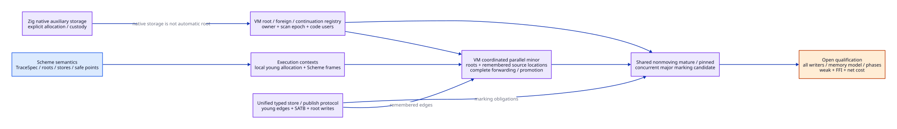 | architecture/runtime/gc | ~b163d8d0b02650e0e13b7b60e2b9476815fb9f4c5169fdeb97ff9089af34a526~ |
| [[file:../docs/experimental/zig/gc-native-phase-protocol.d2][gc-native-phase-protocol.d2]] | [[file:architecture/runtime/gc/diagrams/gc-native-phase-protocol.d2][gc-native-phase-protocol.d2]] | architecture/runtime/gc | ~3b83357ec79035c70126d1263f796a2b17bdca3a67cf1aebaac12ce20d81227e~ |
| [[file:../docs/experimental/zig/gc-native-phase-protocol.svg][gc-native-phase-protocol.svg]] | 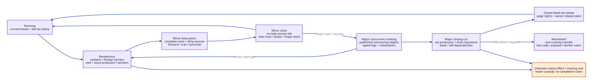 | architecture/runtime/gc | ~46c1824bdae045b11d91048b730170fac54631f5f06af1425a2d1c9280ca74d6~ |
| [[file:../docs/experimental/zig/gc-native-runtime-arguments.md][gc-native-runtime-arguments.md]] | [[file:architecture/runtime/gc/studies/gc-native-runtime-arguments.org][gc-native-runtime-arguments.org]] | architecture/runtime/gc | ~3596ba6c8d39909cad66e799dedb029af55c378d903b2f028814af399bb2593a~ |
| [[file:../docs/experimental/zig/gc-native-runtime-cost-matrix.md][gc-native-runtime-cost-matrix.md]] | [[file:architecture/runtime/gc/studies/gc-native-runtime-cost-matrix.org][gc-native-runtime-cost-matrix.org]] | architecture/runtime/gc | ~7dc2f9d10ab5cceaf2c5c5bc556e9fe058c25dd0ec773da7a3f609e8b592d05f~ |
| [[file:../docs/experimental/zig/gc-native-runtime-design.md][gc-native-runtime-design.md]] | [[file:architecture/runtime/gc/studies/gc-native-runtime-design.org][gc-native-runtime-design.org]] | architecture/runtime/gc | ~3f7a82d4a3e8073ab06c699e4d099828436227a364eb9154504946dd88193db3~ |
| [[file:../docs/experimental/zig/gc-native-runtime-evidence.md][gc-native-runtime-evidence.md]] | [[file:architecture/runtime/gc/studies/gc-native-runtime-evidence.org][gc-native-runtime-evidence.org]] | architecture/runtime/gc | ~981c5bc7293a4f1e21467f062a812a82581a7fc027071260e7d8cd65ac28acc8~ |
| [[file:../docs/experimental/zig/gc-resize-request-mapping.d2][gc-resize-request-mapping.d2]] | [[file:architecture/runtime/gc/diagrams/gc-resize-request-mapping.d2][gc-resize-request-mapping.d2]] | architecture/runtime/gc | ~5bfaf7345ffe7eed31902d91bd947aaae8d25dc8290c72be1a25606900915e37~ |
| [[file:../docs/experimental/zig/gc-resize-request-mapping.svg][gc-resize-request-mapping.svg]] | 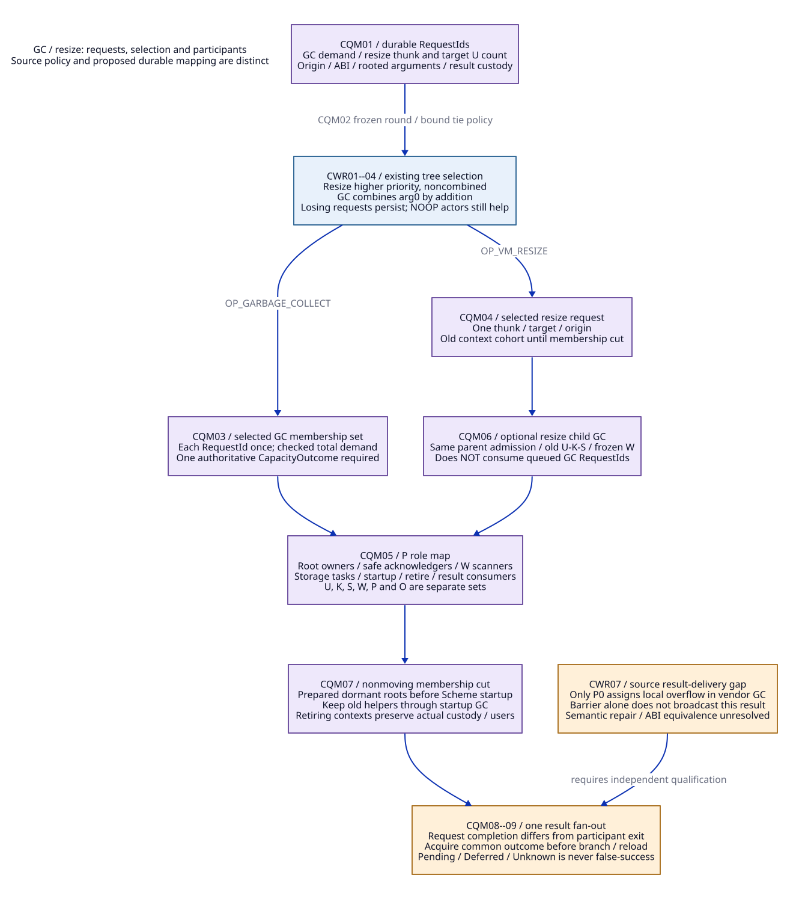 | architecture/runtime/gc | ~53071ebb7ff721da9e247225eb277dd7102c5cd3085b6b73db125e7ad1993957~ |
| [[file:../docs/experimental/zig/generated-c-contract-cost-matrix.md][generated-c-contract-cost-matrix.md]] | [[file:refactoring/modern-c/studies/generated-c-contract-cost-matrix.org][generated-c-contract-cost-matrix.org]] | refactoring/modern-c | ~45c824dd589c54c544c9ba02010f7105c5ce1c684b2ec6b2d754877afb5f3571~ |
| [[file:../docs/experimental/zig/generated-c-contract-evidence.md][generated-c-contract-evidence.md]] | [[file:refactoring/modern-c/studies/generated-c-contract-evidence.org][generated-c-contract-evidence.org]] | refactoring/modern-c | ~651ebf1a216a65b4ebe9179a8cb5a342a92243d189bc009efdaec2ed46bc2433~ |
| [[file:../docs/experimental/zig/generated-c-native-contract.md][generated-c-native-contract.md]] | [[file:refactoring/modern-c/studies/generated-c-native-contract.org][generated-c-native-contract.org]] | refactoring/modern-c | ~64cc1df8df21a6bb81f5fe7ca19d81dd12bf647201dbd07d45a9ce180b996307~ |
| [[file:../docs/experimental/zig/generated-c-native-pipeline.d2][generated-c-native-pipeline.d2]] | [[file:refactoring/modern-c/diagrams/generated-c-native-pipeline.d2][generated-c-native-pipeline.d2]] | refactoring/modern-c | ~666655a9053091ebcbc1c13c8850a7f0f721499f3f97a6f85efb1abb0f802b72~ |
| [[file:../docs/experimental/zig/generated-c-native-pipeline.svg][generated-c-native-pipeline.svg]] | [[file:refactoring/modern-c/diagrams/generated-c-native-pipeline.svg][generated-c-native-pipeline.svg]] | refactoring/modern-c | ~56ffb44ba20ebfa63f760959b8260dd3d27483361375471b8bf60df98750dec4~ |
| [[file:../docs/experimental/zig/generated-c-provider-retirement.md][generated-c-provider-retirement.md]] | [[file:refactoring/modern-c/studies/generated-c-provider-retirement.org][generated-c-provider-retirement.org]] | refactoring/modern-c | ~447ea5a3c6c7092ed87f179ca0507c9965669956961eff99e0dd57fffc085a44~ |
| [[file:../docs/experimental/zig/generated-c-retirement.d2][generated-c-retirement.d2]] | [[file:refactoring/modern-c/diagrams/generated-c-retirement.d2][generated-c-retirement.d2]] | refactoring/modern-c | ~75b4de3d57aa5669f18add768e46c449834e3fc01baface1c10395f9dd38beda~ |
| [[file:../docs/experimental/zig/generated-c-retirement.svg][generated-c-retirement.svg]] | [[file:refactoring/modern-c/diagrams/generated-c-retirement.svg][generated-c-retirement.svg]] | refactoring/modern-c | ~8e4625804321513e353573dd763779d1942b6373f8cdc4c6e78efe5dca87e25d~ |
| [[file:../docs/experimental/zig/generated-c-shared-support.d2][generated-c-shared-support.d2]] | [[file:refactoring/modern-c/diagrams/generated-c-shared-support.d2][generated-c-shared-support.d2]] | refactoring/modern-c | ~86ba9855de2bf66a023d4063504eaf53cbdd02256e5c7ea73576a8619366b7c3~ |
| [[file:../docs/experimental/zig/generated-c-shared-support.svg][generated-c-shared-support.svg]] | [[file:refactoring/modern-c/diagrams/generated-c-shared-support.svg][generated-c-shared-support.svg]] | refactoring/modern-c | ~3ef2af0fec38e85b72182278f0d62887433bff4a062c6ca17110f9e0f2cb449b~ |
| [[file:../docs/experimental/zig/gvm-anchor-preservation.d2][gvm-anchor-preservation.d2]] | [[file:architecture/compiler/diagrams/gvm-anchor-preservation.d2][gvm-anchor-preservation.d2]] | architecture/compiler | ~7a6828d16657f608fa140c572e06a8074e14c149b27579501b0f5e4497a05d2b~ |
| [[file:../docs/experimental/zig/gvm-anchor-preservation.md][gvm-anchor-preservation.md]] | [[file:architecture/compiler/studies/gvm-anchor-preservation.org][gvm-anchor-preservation.org]] | architecture/compiler | ~88cb7da7a0537472eb5469d58b19a4e8b97eec7e7de51d58ebfca88a45fca4fa~ |
| [[file:../docs/experimental/zig/gvm-anchor-preservation.svg][gvm-anchor-preservation.svg]] | [[file:architecture/compiler/diagrams/gvm-anchor-preservation.svg][gvm-anchor-preservation.svg]] | architecture/compiler | ~e6d584ad7bbd2aaaf5c2964c020f1d2bf93df07ed9b830c52c5516deacd23037~ |
| [[file:../docs/experimental/zig/gvm-control-gc-state.d2][gvm-control-gc-state.d2]] | [[file:architecture/compiler/diagrams/gvm-control-gc-state.d2][gvm-control-gc-state.d2]] | architecture/compiler | ~f54dea3bb33083a24009d9d0d77d00e9fb10e4ecb5494d53a4d32f2eb186f7c5~ |
| [[file:../docs/experimental/zig/gvm-control-gc-state.svg][gvm-control-gc-state.svg]] | 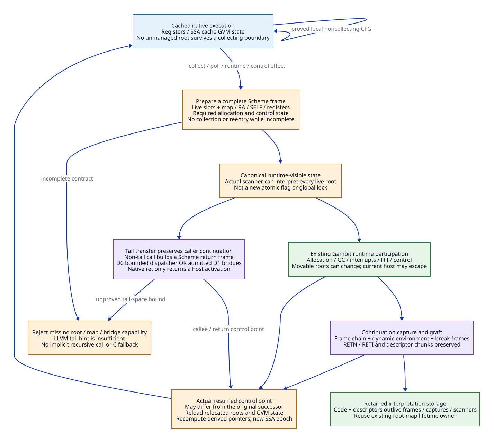 | architecture/compiler | ~ad0ee923554ba15a545e599be64891bd452a972b1ce0ded62554c0cbfe067233~ |
| [[file:../docs/experimental/zig/gvm-native-replacement-matrix.md][gvm-native-replacement-matrix.md]] | [[file:architecture/compiler/studies/gvm-native-replacement-matrix.org][gvm-native-replacement-matrix.org]] | architecture/compiler | ~408a3b8fd49d4b45301d5d3165cd0a631cc87687e6e5a9782b0842a2aa52998c~ |
| [[file:../docs/experimental/zig/gvm-shared-runtime-contract.md][gvm-shared-runtime-contract.md]] | [[file:architecture/compiler/studies/gvm-shared-runtime-contract.org][gvm-shared-runtime-contract.org]] | architecture/compiler | ~2023db8bd5ba276ae2069bdf3c0681ffda7700b9fcbb75182b53bb9e57aa34e5~ |
| [[file:../docs/experimental/zig/gvm-shared-runtime-evidence.md][gvm-shared-runtime-evidence.md]] | [[file:architecture/compiler/studies/gvm-shared-runtime-evidence.org][gvm-shared-runtime-evidence.org]] | architecture/compiler | ~21d7e5fc783b737719085ff46f220b8e2ba90f98973df6c2e9f90d5856829b85~ |
| [[file:../docs/experimental/zig/gvm-shared-runtime.d2][gvm-shared-runtime.d2]] | [[file:architecture/compiler/diagrams/gvm-shared-runtime.d2][gvm-shared-runtime.d2]] | architecture/compiler | ~50444667e9f0287afc63b8bc560bb6def6113d2afc29ea8e7bfbda07909863b4~ |
| [[file:../docs/experimental/zig/gvm-shared-runtime.svg][gvm-shared-runtime.svg]] | [[file:architecture/compiler/diagrams/gvm-shared-runtime.svg][gvm-shared-runtime.svg]] | architecture/compiler | ~353375ee8891b324870548fc624b2dcfe9c5e1fa35fe5e8c3708728e3449046a~ |
| [[file:../docs/experimental/zig/hostgraph-generation-contract.md][hostgraph-generation-contract.md]] | [[file:architecture/runtime/control/studies/hostgraph-generation-contract.org][hostgraph-generation-contract.org]] | architecture/runtime/control | ~dff7c6da1084eafad1afcbf1640f474031012dc7219731bf0e5f11c7a21755da~ |
| [[file:../docs/experimental/zig/hostgraph-generation-evidence.md][hostgraph-generation-evidence.md]] | [[file:architecture/runtime/control/studies/hostgraph-generation-evidence.org][hostgraph-generation-evidence.org]] | architecture/runtime/control | ~30c4d863b169e7e0fe9653d30bbdd30271acfd420f5aa5c2a2c8fb37ed1a0ac3~ |
| [[file:../docs/experimental/zig/hostgraph-generation-pipeline.d2][hostgraph-generation-pipeline.d2]] | [[file:architecture/runtime/control/diagrams/hostgraph-generation-pipeline.d2][hostgraph-generation-pipeline.d2]] | architecture/runtime/control | ~54e64e88517442af448f44bb56cde5634d165d263e2dd25b804700b8eccd1cb4~ |
| [[file:../docs/experimental/zig/hostgraph-generation-pipeline.svg][hostgraph-generation-pipeline.svg]] | 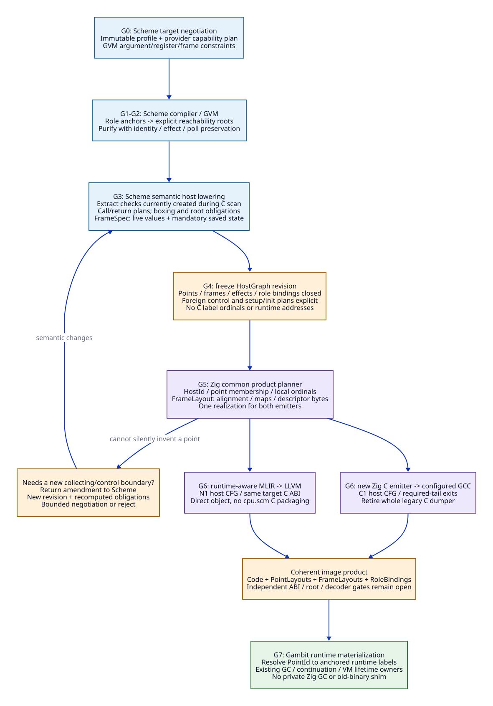 | architecture/runtime/control | ~db32f8dac3a8a514839376fb985f7c9436b34999424573fa521a7f71db287619~ |
| [[file:../docs/experimental/zig/hostgraph-retirement-order.d2][hostgraph-retirement-order.d2]] | [[file:architecture/runtime/control/diagrams/hostgraph-retirement-order.d2][hostgraph-retirement-order.d2]] | architecture/runtime/control | ~b9d25b83af58ae20dee909406d6b601d77aad6dfb8d133852606a1b8020513fa~ |
| [[file:../docs/experimental/zig/hostgraph-retirement-order.svg][hostgraph-retirement-order.svg]] | 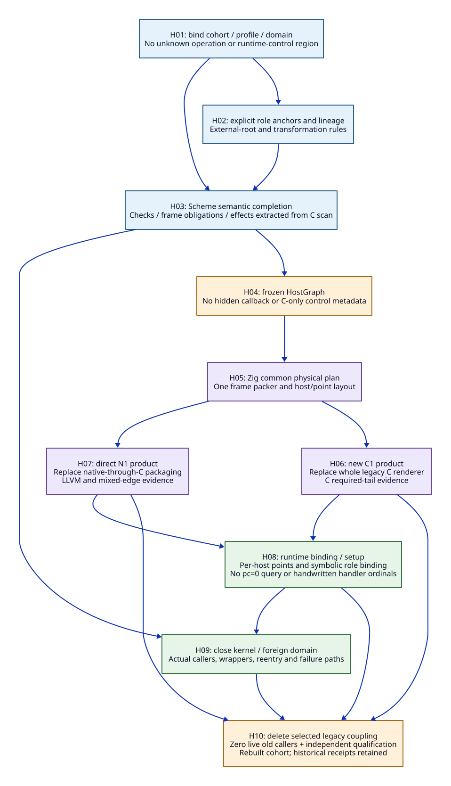 | architecture/runtime/control | ~bf723a779c779ce819531b6b7d4e6ade84b325ce3918d586801957797fc1f628~ |
| [[file:../docs/experimental/zig/hostgraph-retirement-plan.md][hostgraph-retirement-plan.md]] | [[file:architecture/runtime/control/studies/hostgraph-retirement-plan.org][hostgraph-retirement-plan.org]] | architecture/runtime/control | ~6d90232afc1ecb71b3902c209613046d1f796b29feb951f6b121b0f98f739e51~ |
| [[file:../docs/experimental/zig/independent-equivalence-evidence-plan.md][independent-equivalence-evidence-plan.md]] | [[file:architecture/toolchain/studies/independent-equivalence-evidence-plan.org][independent-equivalence-evidence-plan.org]] | architecture/toolchain | ~1c3f0b7075def522caf5aa5dfa7bc2b5908e38fda5b3f66e5d6896db5296012f~ |
| [[file:../docs/experimental/zig/independent-observation-boundaries.d2][independent-observation-boundaries.d2]] | [[file:research/diagrams/independent-observation-boundaries.d2][independent-observation-boundaries.d2]] | research | ~bd929baf07755dbfa1048d5db7997f07d596212b3c4b0e32a4cec11491be5b01~ |
| [[file:../docs/experimental/zig/independent-observation-boundaries.svg][independent-observation-boundaries.svg]] | 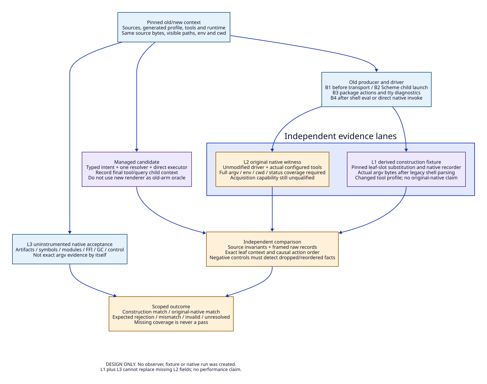 | research | ~c69846f4d821c92b476e4e564a6be4c5f4213fae0f70b9469ac0cf68d3527c01~ |
| [[file:../docs/experimental/zig/init-spec-completion.d2][init-spec-completion.d2]] | [[file:architecture/runtime/gc/diagrams/init-spec-completion.d2][init-spec-completion.d2]] | architecture/runtime/gc | ~a6a86dff6eaf4ace22696870dc8ca9c205d4f65c0569ab39fd99a6c6111da862~ |
| [[file:../docs/experimental/zig/init-spec-completion.svg][init-spec-completion.svg]] | [[file:architecture/runtime/gc/diagrams/init-spec-completion.svg][init-spec-completion.svg]] | architecture/runtime/gc | ~0ba9f63aac619877e877feca3d9690689a63170b6a3d19b8caee2afbf2ee4325~ |
| [[file:../docs/experimental/zig/init-spec-segment-layout-cost-matrix.md][init-spec-segment-layout-cost-matrix.md]] | [[file:architecture/runtime/gc/studies/init-spec-segment-layout-cost-matrix.org][init-spec-segment-layout-cost-matrix.org]] | architecture/runtime/gc | ~e19305802594fd07998f54a27f10a6c50ec513de7ec0abb6685796f30e9b96da~ |
| [[file:../docs/experimental/zig/init-spec-segment-layout-design.md][init-spec-segment-layout-design.md]] | [[file:architecture/runtime/gc/studies/init-spec-segment-layout-design.org][init-spec-segment-layout-design.org]] | architecture/runtime/gc | ~5336563235516be2f4df5048e6743f679a84f55bcafbdd0589e741255a4362a2~ |
| [[file:../docs/experimental/zig/init-spec-segment-layout-evidence.md][init-spec-segment-layout-evidence.md]] | [[file:architecture/runtime/gc/studies/init-spec-segment-layout-evidence.org][init-spec-segment-layout-evidence.org]] | architecture/runtime/gc | ~984ca2c202498e7cd69df4ab0d97718b0bb97dc435a108029dcf59d5cd214879~ |
| [[file:../docs/experimental/zig/interface-code-instance.d2][interface-code-instance.d2]] | [[file:research/diagrams/interface-code-instance.d2][interface-code-instance.d2]] | research | ~16894a9221ae0c79699f808d7a24539f8ba5c5ef46f33872cd0b79820dd832e0~ |
| [[file:../docs/experimental/zig/interface-code-instance.svg][interface-code-instance.svg]] | 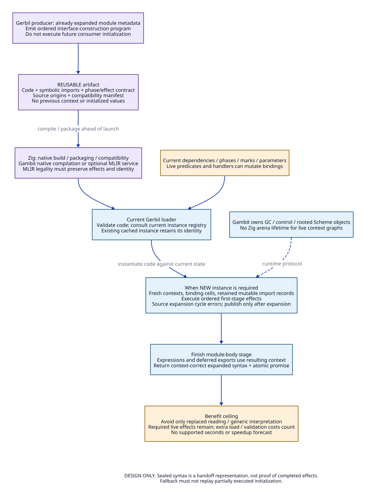 | research | ~ed8559402d31dc87132529f7cbea1df749526cf31d76aa9bd899968214ac60ab~ |
| [[file:../docs/experimental/zig/interface-construction-aot-design.md][interface-construction-aot-design.md]] | [[file:architecture/toolchain/studies/interface-construction-aot-design.org][interface-construction-aot-design.org]] | architecture/toolchain | ~02df019ed69b4af2b28d25243fd5888745fea80cb59e8a5d3ac62c4d7c3bf552~ |
| [[file:../docs/experimental/zig/interface-construction-evidence.md][interface-construction-evidence.md]] | [[file:architecture/toolchain/studies/interface-construction-evidence.org][interface-construction-evidence.org]] | architecture/toolchain | ~677fdd28946baad15035257d34c8eb896582b5ab19c21b2416c23af76cbdc9e6~ |
| [[file:../docs/experimental/zig/interface-construction-operations-and-state.md][interface-construction-operations-and-state.md]] | [[file:architecture/toolchain/studies/interface-construction-operations-and-state.org][interface-construction-operations-and-state.org]] | architecture/toolchain | ~c045941c8f4f6b9d2542f63e9ee28b7d4e033c5da67f78c56930887bf089ec04~ |
| [[file:../docs/experimental/zig/interface-instantiation-state.d2][interface-instantiation-state.d2]] | [[file:research/diagrams/interface-instantiation-state.d2][interface-instantiation-state.d2]] | research | ~9bc171443b7ab4c432a96fab14f7343f46a26ace80f366e4d8971dca5a94f219~ |
| [[file:../docs/experimental/zig/interface-instantiation-state.svg][interface-instantiation-state.svg]] | 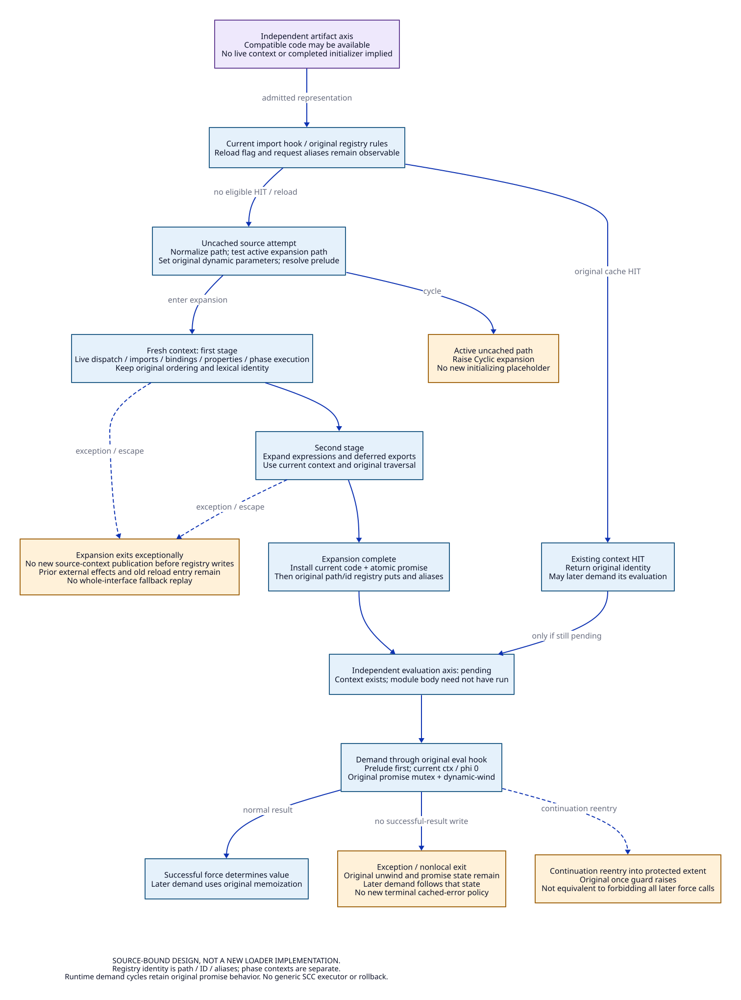 | research | ~13110851c6339054be36aaebb1001a77e66b5a8c4e8c3b69634fbfef87cda01e~ |
| [[file:../docs/experimental/zig/layered-aot-reuse.d2][layered-aot-reuse.d2]] | [[file:research/diagrams/layered-aot-reuse.d2][layered-aot-reuse.d2]] | research | ~66a661a8a99846f7b2bc0f3baf9ea99c5861094251e0142961e6194c08dee380~ |
| [[file:../docs/experimental/zig/layered-aot-reuse.svg][layered-aot-reuse.svg]] | 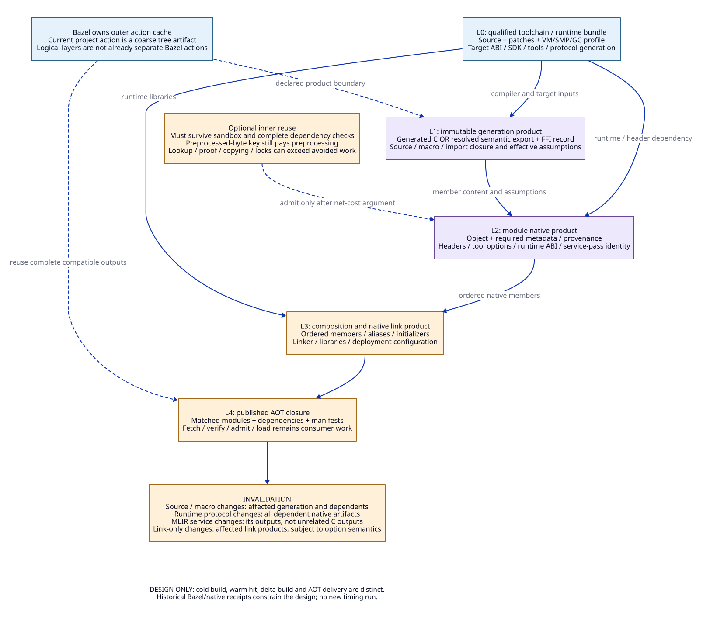 | research | ~dec1a6ed9f00e239c5b0b789c8c55b2f4026f376d649ced7e147f0fb86759336~ |
| [[file:../docs/experimental/zig/legacy-string-decoding.d2][legacy-string-decoding.d2]] | [[file:research/diagrams/legacy-string-decoding.d2][legacy-string-decoding.d2]] | research | ~a131c4cf907fe01f37e1b25b4f084902a5809352dbe857d5e3ea8155b05b9627~ |
| [[file:../docs/experimental/zig/legacy-string-decoding.svg][legacy-string-decoding.svg]] | 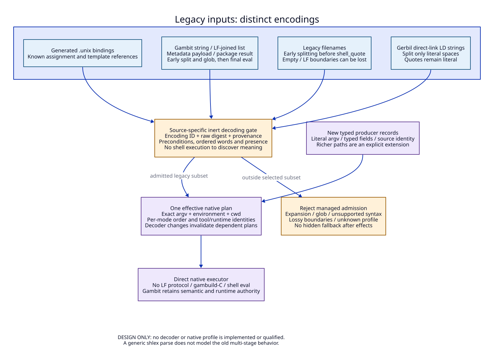 | research | ~ead2dcf6fc578dfd32302f9f6e731d1ec5ac0f2b2fd9f6e56df901c2f0fe02d3~ |
| [[file:../docs/experimental/zig/llvm-provider-decoupling.d2][llvm-provider-decoupling.d2]] | [[file:research/diagrams/llvm-provider-decoupling.d2][llvm-provider-decoupling.d2]] | research | ~f2cc8d24ae2b87dadfbea8a3e98a6df6567440b0d137b75f876b7a3f739ff4af~ |
| [[file:../docs/experimental/zig/llvm-provider-decoupling.svg][llvm-provider-decoupling.svg]] | 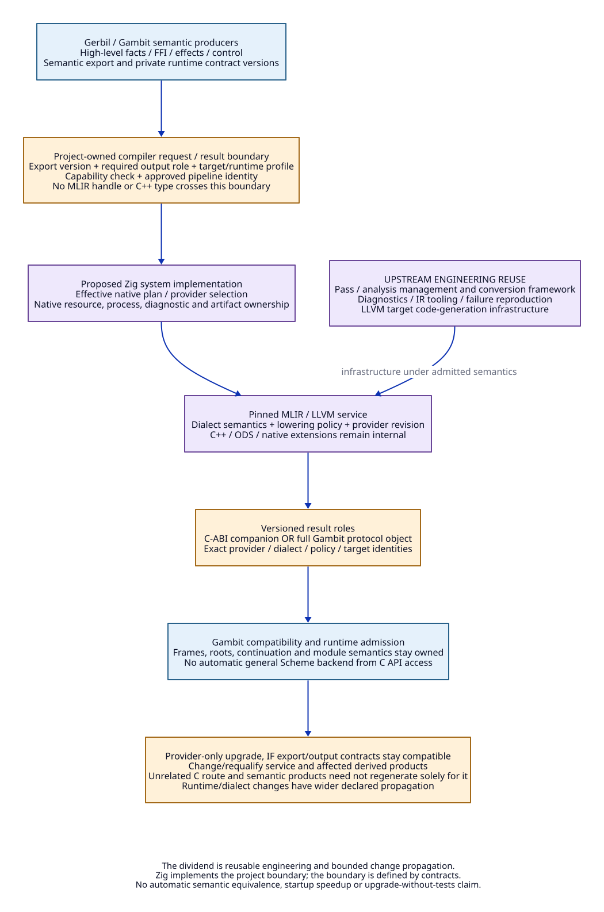 | research | ~ef737c68a208ac405882baf3a3e4e9604eae5fd2f5c22f90c3e6635f9defc891~ |
| [[file:../docs/experimental/zig/map-call-continuation-roots.d2][map-call-continuation-roots.d2]] | [[file:architecture/runtime/control/diagrams/map-call-continuation-roots.d2][map-call-continuation-roots.d2]] | architecture/runtime/control | ~a5aa8eea89fcd019cc35b151b9adb4777188c3aa93c22d5c4a4e1029e720625c~ |
| [[file:../docs/experimental/zig/map-call-continuation-roots.svg][map-call-continuation-roots.svg]] | 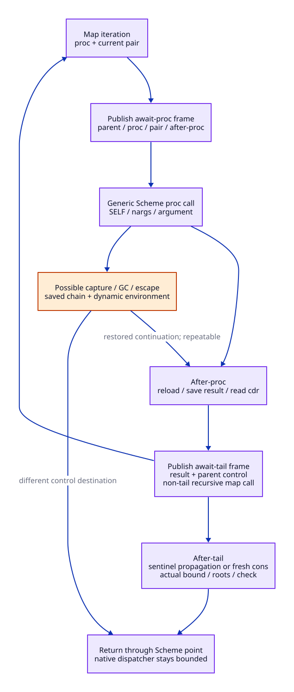 | architecture/runtime/control | ~5fb1816425e243421b314652da6172b9e711115957779b21ba84ed4fc022d59a~ |
| [[file:../docs/experimental/zig/map-continuation-gc-arguments.md][map-continuation-gc-arguments.md]] | [[file:architecture/runtime/control/studies/map-continuation-gc-arguments.org][map-continuation-gc-arguments.org]] | architecture/runtime/control | ~30fa608f4e770505e6f0f31a4d2289aacd3b58ad2ba7234eea0d853c5af61827~ |
| [[file:../docs/experimental/zig/map-continuation-gc-benefit-matrix.md][map-continuation-gc-benefit-matrix.md]] | [[file:architecture/runtime/control/studies/map-continuation-gc-benefit-matrix.org][map-continuation-gc-benefit-matrix.org]] | architecture/runtime/control | ~0b215d7c2c00f3a2d3e0cce560617e3e781c50c51bb484719af8fadcdaa1f2ff~ |
| [[file:../docs/experimental/zig/map-continuation-gc-closure.d2][map-continuation-gc-closure.d2]] | [[file:architecture/runtime/control/diagrams/map-continuation-gc-closure.d2][map-continuation-gc-closure.d2]] | architecture/runtime/control | ~0396e56eab2c58d4d5f6962a280dd201e6b168b737bfd2cb296d1a7a720274dc~ |
| [[file:../docs/experimental/zig/map-continuation-gc-closure.svg][map-continuation-gc-closure.svg]] |  | architecture/runtime/control | ~a13fc56345450e75769e3d62dca969935628f49c76319e7d03130e7f56783af4~ |
| [[file:../docs/experimental/zig/map-continuation-gc-design.md][map-continuation-gc-design.md]] | [[file:architecture/runtime/control/studies/map-continuation-gc-design.org][map-continuation-gc-design.org]] | architecture/runtime/control | ~8d25a47cb28f16686b4668f144296d7e94627d0e6a65a005e03d6efc746518ec~ |
| [[file:../docs/experimental/zig/map-continuation-gc-evidence.md][map-continuation-gc-evidence.md]] | [[file:architecture/runtime/control/studies/map-continuation-gc-evidence.org][map-continuation-gc-evidence.org]] | architecture/runtime/control | ~8c23ed008fbe266de906b2da54a1919b2f7c947c743d78d31a4e1bff2954b105~ |
| [[file:../docs/experimental/zig/map-continuation-gc-learning.md][map-continuation-gc-learning.md]] | [[file:architecture/runtime/control/studies/map-continuation-gc-learning.org][map-continuation-gc-learning.org]] | architecture/runtime/control | ~9c540db52ab2551bb892b4e14c5916d9d2d2d3db6ee61236ca06719e746a4351~ |
| [[file:../docs/experimental/zig/map-continuation-gc-lifecycle.d2][map-continuation-gc-lifecycle.d2]] | [[file:architecture/runtime/control/diagrams/map-continuation-gc-lifecycle.d2][map-continuation-gc-lifecycle.d2]] | architecture/runtime/control | ~71fef557ec85eb76ac8aa1adc0101d5f371a1b62588d4b576848b57d2c9852ca~ |
| [[file:../docs/experimental/zig/map-continuation-gc-lifecycle.svg][map-continuation-gc-lifecycle.svg]] |  | architecture/runtime/control | ~c6623c3283a06c90ca66830f7bf073eeb8ed1c52396bfb2099a6216c33ab5e3e~ |
| [[file:../docs/experimental/zig/map-continuation-gc-value.d2][map-continuation-gc-value.d2]] | [[file:architecture/runtime/control/diagrams/map-continuation-gc-value.d2][map-continuation-gc-value.d2]] | architecture/runtime/control | ~f69c964b2e05bcfa590defb1ee39b7d070e53d9944be03b103a43df18b4a7ff2~ |
| [[file:../docs/experimental/zig/map-continuation-gc-value.svg][map-continuation-gc-value.svg]] |  | architecture/runtime/control | ~cded1874443e2a9ec5448f60833d5dcdd93cc773a716830c7b8652bc87ff6cf3~ |
| [[file:../docs/experimental/zig/map-generated-c-binding.d2][map-generated-c-binding.d2]] | [[file:architecture/runtime/control/diagrams/map-generated-c-binding.d2][map-generated-c-binding.d2]] | architecture/runtime/control | ~0c6a892f4108db1e7812331f64e13e572d7cb217ebe661fb2b2b34be15d4926e~ |
| [[file:../docs/experimental/zig/map-generated-c-binding.svg][map-generated-c-binding.svg]] |  | architecture/runtime/control | ~293d425cd9497eb7aeba04ab8fda39810efb6c83bddfedf6ea95f9524deb59c4~ |
| [[file:../docs/experimental/zig/map-generated-c-design.md][map-generated-c-design.md]] | [[file:architecture/runtime/control/studies/map-generated-c-design.org][map-generated-c-design.org]] | architecture/runtime/control | ~d90e529639a45a0aa8f82700ebe8b75a3e7327b2cb816924940a6e7b755e740e~ |
| [[file:../docs/experimental/zig/map-generated-c-evidence.md][map-generated-c-evidence.md]] | [[file:architecture/runtime/control/studies/map-generated-c-evidence.org][map-generated-c-evidence.org]] | architecture/runtime/control | ~020043eb05d153d0a835cc0f980a76fcc9cd723598259fd1a765f09fb2011091~ |
| [[file:../docs/experimental/zig/map-generated-c-modernization-matrix.md][map-generated-c-modernization-matrix.md]] | [[file:architecture/runtime/control/studies/map-generated-c-modernization-matrix.org][map-generated-c-modernization-matrix.org]] | architecture/runtime/control | ~55f39c720d91ff633220d3b5025759b34b325e4f39533ea5cb1f8a01c26763b6~ |
| [[file:../docs/experimental/zig/map-generated-c-pipeline.d2][map-generated-c-pipeline.d2]] | [[file:architecture/runtime/control/diagrams/map-generated-c-pipeline.d2][map-generated-c-pipeline.d2]] | architecture/runtime/control | ~a21d393284d16f05e482a5381d1257d149051a0d6248877d1ffda3c0daec66c9~ |
| [[file:../docs/experimental/zig/map-generated-c-pipeline.svg][map-generated-c-pipeline.svg]] |  | architecture/runtime/control | ~bb4ae3125938cc7b64c75772129a55d10ed265868bf861d064b885a65b039d5f~ |
| [[file:../docs/experimental/zig/map-generated-c-points.md][map-generated-c-points.md]] | [[file:architecture/runtime/control/studies/map-generated-c-points.org][map-generated-c-points.org]] | architecture/runtime/control | ~2ede79ca45cc76e8c438d29f8570c9f0c3a79126429f9c5efd42af991a8bb1e8~ |
| [[file:../docs/experimental/zig/map-generated-c-proof-obligations.md][map-generated-c-proof-obligations.md]] | [[file:architecture/runtime/control/studies/map-generated-c-proof-obligations.org][map-generated-c-proof-obligations.org]] | architecture/runtime/control | ~0e3b95b3cf05825efb2a41cbe30f75b8d7c4ee60ea18bcf6ff01667868b1d835~ |
| [[file:../docs/experimental/zig/map-generated-c-roots.d2][map-generated-c-roots.d2]] | [[file:architecture/runtime/control/diagrams/map-generated-c-roots.d2][map-generated-c-roots.d2]] | architecture/runtime/control | ~268d2e226f3ce8e9e9b558bb2bf47a7c2e37a11348e791661ce11e1d7665e41b~ |
| [[file:../docs/experimental/zig/map-generated-c-roots.svg][map-generated-c-roots.svg]] |  | architecture/runtime/control | ~fd9b27a3b63c9fe8864659a249c96644eaad7391929e3843210a42f3e9e75d49~ |
| [[file:../docs/experimental/zig/map-modernization-economics.d2][map-modernization-economics.d2]] | [[file:architecture/runtime/control/diagrams/map-modernization-economics.d2][map-modernization-economics.d2]] | architecture/runtime/control | ~c114f5a4ab6710156054d3a2c20a64fcfda9f7e24d585cee23ace9f585104421~ |
| [[file:../docs/experimental/zig/map-modernization-economics.svg][map-modernization-economics.svg]] |  | architecture/runtime/control | ~0ecee42ef5fabef497441c7ecac157e52fe8beffbcd836d33925768c12d3ec4f~ |
| [[file:../docs/experimental/zig/map-native-pipeline.d2][map-native-pipeline.d2]] | [[file:architecture/runtime/control/diagrams/map-native-pipeline.d2][map-native-pipeline.d2]] | architecture/runtime/control | ~97e919012e1e5889600448e8dc539961653b729f47698e65941a64f3ca817ebf~ |
| [[file:../docs/experimental/zig/map-native-pipeline.svg][map-native-pipeline.svg]] |  | architecture/runtime/control | ~27329a5feb4c9c2fb38cb2e9805edb8672bf388952840296c893ae562c49fba8~ |
| [[file:../docs/experimental/zig/map-scheme-zig-arguments.md][map-scheme-zig-arguments.md]] | [[file:architecture/runtime/control/studies/map-scheme-zig-arguments.org][map-scheme-zig-arguments.org]] | architecture/runtime/control | ~b2b5795c0677a54c4db61e1bce30fbe355a623826680ebac6e148d1b938515ac~ |
| [[file:../docs/experimental/zig/map-scheme-zig-cost-matrix.md][map-scheme-zig-cost-matrix.md]] | [[file:architecture/runtime/control/studies/map-scheme-zig-cost-matrix.org][map-scheme-zig-cost-matrix.org]] | architecture/runtime/control | ~8687fc951b98a08817ccc95943726276b99fbedd8fcfffb3cd8364103f1089e8~ |
| [[file:../docs/experimental/zig/map-scheme-zig-design.md][map-scheme-zig-design.md]] | [[file:architecture/runtime/control/studies/map-scheme-zig-design.org][map-scheme-zig-design.org]] | architecture/runtime/control | ~187032378741e8e6ced508ccaf895d5c0c8832b1656c821d8b4a46dbb2d9359b~ |
| [[file:../docs/experimental/zig/map-scheme-zig-evidence.md][map-scheme-zig-evidence.md]] | [[file:architecture/runtime/control/studies/map-scheme-zig-evidence.org][map-scheme-zig-evidence.org]] | architecture/runtime/control | ~948306eb70eac6d3454ff9a53226fd1493442f2af257fd73b9ec5c80a1fbc461~ |
| [[file:../docs/experimental/zig/marker-root-window-unwind.d2][marker-root-window-unwind.d2]] | [[file:research/diagrams/marker-root-window-unwind.d2][marker-root-window-unwind.d2]] | research | ~f5cc075fdd4cd9e87e22411f0332e7b270a73b7b6767b227e9081f6f22bd43fc~ |
| [[file:../docs/experimental/zig/marker-root-window-unwind.svg][marker-root-window-unwind.svg]] |  | research | ~050a6e1a086b3c57882b959446ac0432e84f242a28ce8e9f609025e7f744947c~ |
| [[file:../docs/experimental/zig/metadata-admission.d2][metadata-admission.d2]] | [[file:research/diagrams/metadata-admission.d2][metadata-admission.d2]] | research | ~34a5d4d238919d8c618602589cc8eda0f6a909edd5cc7263235492a0631cefe0~ |
| [[file:../docs/experimental/zig/metadata-admission.svg][metadata-admission.svg]] |  | research | ~b0e28495bacf325e031ff7df38f63c80bf96001e9de0d4094fb89f0bda84447b~ |
| [[file:../docs/experimental/zig/mlir-pass-admission.md][mlir-pass-admission.md]] | [[file:architecture/compiler/studies/mlir-pass-admission.org][mlir-pass-admission.org]] | architecture/compiler | ~9e7ff6aa8351ad2d8f8dcf993d981ee76d2478274c06a87b5434df17202e91cf~ |
| [[file:../docs/experimental/zig/mlir-service-lifecycle.d2][mlir-service-lifecycle.d2]] | [[file:architecture/compiler/diagrams/mlir-service-lifecycle.d2][mlir-service-lifecycle.d2]] | architecture/compiler | ~7893bdd68b5bf9f666da5619b8c8805f2df305ca3b919638e5fbbb37b7525db5~ |
| [[file:../docs/experimental/zig/mlir-service-lifecycle.svg][mlir-service-lifecycle.svg]] |  | architecture/compiler | ~e609d1869cbc231fed2d11d241b5a7e9da1590c86011619db0abc6ec44592337~ |
| [[file:../docs/experimental/zig/modernization-architecture.sysml][modernization-architecture.sysml]] | [[file:architecture/system/models/sysml/modernization-architecture.sysml][modernization-architecture.sysml]] | architecture/system | ~362eede8d0e7e53413b186d42cc7dc52c21b59d783b196986cf652986abc0fe9~ |
| [[file:../docs/experimental/zig/modernization-capability-decision.d2][modernization-capability-decision.d2]] | [[file:architecture/system/diagrams/modernization-capability-decision.d2][modernization-capability-decision.d2]] | architecture/system | ~101879b14bd7444a6ffa2c6df3fed16f55f2b3d24b025ffbf8a2f56157cfce05~ |
| [[file:../docs/experimental/zig/modernization-capability-decision.svg][modernization-capability-decision.svg]] | [[file:architecture/system/diagrams/modernization-capability-decision.svg][modernization-capability-decision.svg]] | architecture/system | ~8402d9131a364a0b3d906769e48908fe616aad8224081d335d7d80c7218575e5~ |
| [[file:../docs/experimental/zig/modernization-leverage-boundaries.d2][modernization-leverage-boundaries.d2]] | [[file:architecture/system/diagrams/modernization-leverage-boundaries.d2][modernization-leverage-boundaries.d2]] | architecture/system | ~38b5975c49b5230253642b528ad1c4b9451dce8abef85fc3978e138d06c38a16~ |
| [[file:../docs/experimental/zig/modernization-leverage-boundaries.svg][modernization-leverage-boundaries.svg]] |  | architecture/system | ~0170da38f90183986d056d254b7865a91194c5202c397c297f2717b0bbce3b4b~ |
| [[file:../docs/experimental/zig/modernization-leverage-matrix.md][modernization-leverage-matrix.md]] | [[file:architecture/system/studies/modernization-leverage-matrix.org][modernization-leverage-matrix.org]] | architecture/system | ~122ee74f034ebb8f8614ca0e0335cbb627d53291d158e45320060e32c1bf7533~ |
| [[file:../docs/experimental/zig/modernization-quantified-benefit.md][modernization-quantified-benefit.md]] | [[file:architecture/system/studies/modernization-quantified-benefit.org][modernization-quantified-benefit.org]] | architecture/system | ~740514c6c739eebf0204ff7b9fdb3a559216db4e8770cc5e058f7690dfb1bc12~ |
| [[file:../docs/experimental/zig/modernization-runtime-domains.d2][modernization-runtime-domains.d2]] | [[file:architecture/system/diagrams/modernization-runtime-domains.d2][modernization-runtime-domains.d2]] | architecture/system | ~21f25e3810862ce1269f693c24c38418df9e5df2cf7fa32bdc62b6e3f8d6f01f~ |
| [[file:../docs/experimental/zig/modernization-runtime-domains.svg][modernization-runtime-domains.svg]] |  | architecture/system | ~04d3716e3e5088756ac81a4412a262c45a407bcf1ae5e48dda6c79ab992b919e~ |
| [[file:../docs/experimental/zig/modernization-system-architecture.md][modernization-system-architecture.md]] | [[file:architecture/system/studies/modernization-system-architecture.org][modernization-system-architecture.org]] | architecture/system | ~f134b9bffc51665af66a475053d359059df57a1ddcdd3232e9f0e9c9409a5ac0~ |
| [[file:../docs/experimental/zig/modernization-system-evidence.md][modernization-system-evidence.md]] | [[file:architecture/system/studies/modernization-system-evidence.org][modernization-system-evidence.org]] | architecture/system | ~1ddecf90105cf0fb110306932a1b41b21e89e2c4009997780dc83d56ae41df7a~ |
| [[file:../docs/experimental/zig/modernization-system-planes.d2][modernization-system-planes.d2]] | [[file:architecture/system/diagrams/modernization-system-planes.d2][modernization-system-planes.d2]] | architecture/system | ~abcb3b60709d89e82bcd04cfb78e506156089e69c43c7557d2962a895359e8c7~ |
| [[file:../docs/experimental/zig/modernization-system-planes.svg][modernization-system-planes.svg]] |  | architecture/system | ~0cbf77e6f4bbe2846f20ae5d66d05ed2eb5556a000c36b3888d0ee7ce985c6c5~ |
| [[file:../docs/experimental/zig/native-argv-equivalence-matrix.md][native-argv-equivalence-matrix.md]] | [[file:architecture/toolchain/studies/native-argv-equivalence-matrix.org][native-argv-equivalence-matrix.org]] | architecture/toolchain | ~6db2c726fb8d23ebdaa1f55fa2df51fa876590ccb46dfefe4235c4bb79592018~ |
| [[file:../docs/experimental/zig/native-callback-arguments.md][native-callback-arguments.md]] | [[file:architecture/runtime/ffi/studies/native-callback-arguments.org][native-callback-arguments.org]] | architecture/runtime/ffi | ~c581424ab78ca095358323f6d5a1211a83d1e7b7f32074cc6fb27c419a916f6e~ |
| [[file:../docs/experimental/zig/native-callback-benefit-matrix.md][native-callback-benefit-matrix.md]] | [[file:architecture/runtime/ffi/studies/native-callback-benefit-matrix.org][native-callback-benefit-matrix.org]] | architecture/runtime/ffi | ~c1b5f3c5eb585c8282bb1687fc7b324d348d6e33278674ec16ef36b4b8d75f15~ |
| [[file:../docs/experimental/zig/native-callback-callers.d2][native-callback-callers.d2]] | [[file:architecture/runtime/ffi/diagrams/native-callback-callers.d2][native-callback-callers.d2]] | architecture/runtime/ffi | ~c1bcc965f972de609948322a7a9c83773cc9ca3e98963d0b5bcccea1e6ffb895~ |
| [[file:../docs/experimental/zig/native-callback-callers.svg][native-callback-callers.svg]] |  | architecture/runtime/ffi | ~bd746800cd2ea6c87c0bd4b67a0dab2e7ff8ddc7ed2ae20c2b9af7787a3ee71d~ |
| [[file:../docs/experimental/zig/native-callback-continuation-design.md][native-callback-continuation-design.md]] | [[file:architecture/runtime/ffi/studies/native-callback-continuation-design.org][native-callback-continuation-design.org]] | architecture/runtime/ffi | ~04af04fe075eec2df82ccf0974b5984d6a09748d2add1df1d8fa708c9221da0b~ |
| [[file:../docs/experimental/zig/native-callback-custody-contract.md][native-callback-custody-contract.md]] | [[file:architecture/runtime/ffi/studies/native-callback-custody-contract.org][native-callback-custody-contract.org]] | architecture/runtime/ffi | ~aa90f70a7947028421a0b95f7cc7209fa4d371b0001cc6d035a693582bcfcd61~ |
| [[file:../docs/experimental/zig/native-callback-evidence.md][native-callback-evidence.md]] | [[file:architecture/runtime/ffi/studies/native-callback-evidence.org][native-callback-evidence.org]] | architecture/runtime/ffi | ~3599c37d7144239ad747764b9fb1c1a99e5654c8dd4e63ce97ce60fe29010719~ |
| [[file:../docs/experimental/zig/native-callback-publication.d2][native-callback-publication.d2]] | [[file:architecture/runtime/ffi/diagrams/native-callback-publication.d2][native-callback-publication.d2]] | architecture/runtime/ffi | ~567ab2a68fd830b80c9f40775e5cd170c9e4cdf5489d0ae3750dfac1b0f9df7a~ |
| [[file:../docs/experimental/zig/native-callback-publication.svg][native-callback-publication.svg]] |  | architecture/runtime/ffi | ~bbc9ebacd4ceee8487b3959e2d9d4df7cc7e304e71934779dbc49eaaaa33c5ad~ |
| [[file:../docs/experimental/zig/native-callback-value.d2][native-callback-value.d2]] | [[file:architecture/runtime/ffi/diagrams/native-callback-value.d2][native-callback-value.d2]] | architecture/runtime/ffi | ~830dee1332af4e7c067d3acf2f854ac3d6f931b9c8dc0f86e14daff8329555fb~ |
| [[file:../docs/experimental/zig/native-callback-value.svg][native-callback-value.svg]] |  | architecture/runtime/ffi | ~5f0b628db37d315a59e5efc6752a3edc222fd91859d97f2db3ee483b657c5a81~ |
| [[file:../docs/experimental/zig/native-caller-retirement-dependencies.d2][native-caller-retirement-dependencies.d2]] | [[file:refactoring/modern-c/diagrams/native-caller-retirement-dependencies.d2][native-caller-retirement-dependencies.d2]] | refactoring/modern-c | ~060c210a24ee187a914ce8d93d3b5330d141afbf6ff1d8f0d6425d00e7313fc9~ |
| [[file:../docs/experimental/zig/native-caller-retirement-dependencies.svg][native-caller-retirement-dependencies.svg]] |  | refactoring/modern-c | ~dc619eb79ac51acf70975638bef61548b56f899ad34b16a10f31557a93aa0d87~ |
| [[file:../docs/experimental/zig/native-caller-retirement-plan.md][native-caller-retirement-plan.md]] | [[file:refactoring/modern-c/studies/native-caller-retirement-plan.org][native-caller-retirement-plan.org]] | refactoring/modern-c | ~fcba4b8e53d15626283d25bd9af8c6edc57107d7744fee6e07b1a1811883a43c~ |
| [[file:../docs/experimental/zig/native-job-service-benefit-matrix.md][native-job-service-benefit-matrix.md]] | [[file:refactoring/zig/studies/native-job-service-benefit-matrix.org][native-job-service-benefit-matrix.org]] | refactoring/zig | ~7953716221b1a770db938636dd66d2fb4f7d68c51b5d41e8ff9cef6c20f68dd6~ |
| [[file:../docs/experimental/zig/native-job-service-design.md][native-job-service-design.md]] | [[file:refactoring/zig/studies/native-job-service-design.org][native-job-service-design.org]] | refactoring/zig | ~9e2a75267eb89022e399b0a16357e10ad7ef4e71b1cb559d32f5c7bc38ce6b8f~ |
| [[file:../docs/experimental/zig/native-job-service-evidence.md][native-job-service-evidence.md]] | [[file:refactoring/zig/studies/native-job-service-evidence.org][native-job-service-evidence.org]] | refactoring/zig | ~b666d01f96d8458bbcd16094b056eed08945cbffed28c138008224ebe9143eaf~ |
| [[file:../docs/experimental/zig/native-job-service-ownership.d2][native-job-service-ownership.d2]] | [[file:refactoring/zig/diagrams/native-job-service-ownership.d2][native-job-service-ownership.d2]] | refactoring/zig | ~cc207f8f9eaccafe9c2edc0a91a8ef14c765a2f021913079f67c493941c306c2~ |
| [[file:../docs/experimental/zig/native-job-service-ownership.svg][native-job-service-ownership.svg]] |  | refactoring/zig | ~1e8171946b277ca902b7cf03006457ec92905f04084fc0e5181e3923e16c9513~ |
| [[file:../docs/experimental/zig/native-job-support-portfolio.d2][native-job-support-portfolio.d2]] | [[file:refactoring/zig/diagrams/native-job-support-portfolio.d2][native-job-support-portfolio.d2]] | refactoring/zig | ~f6d9c0496c33773ae48d7acd7a3ef3aca0d1262a69e8730e37e4da2c59a0784b~ |
| [[file:../docs/experimental/zig/native-job-support-portfolio.svg][native-job-support-portfolio.svg]] |  | refactoring/zig | ~f6a1d00a264248087e816ba2ba61fd485f8c356ecf103c0fd1e015f624cd978f~ |
| [[file:../docs/experimental/zig/native-layout-provider-design.d2][native-layout-provider-design.d2]] | [[file:refactoring/modern-c/diagrams/native-layout-provider-design.d2][native-layout-provider-design.d2]] | refactoring/modern-c | ~fd25ff1f7c2ff9a2b6fe23ccd1a3905831c111394325fc6e37ded3ad8e7e7f6e~ |
| [[file:../docs/experimental/zig/native-layout-provider-design.md][native-layout-provider-design.md]] | [[file:refactoring/modern-c/studies/native-layout-provider-design.org][native-layout-provider-design.org]] | refactoring/modern-c | ~ccd80564af8e33c00122ebde42c23e5fade67d5de4629f11ca30181290a3ec4f~ |
| [[file:../docs/experimental/zig/native-layout-provider-design.svg][native-layout-provider-design.svg]] | [[file:refactoring/modern-c/diagrams/native-layout-provider-design.svg][native-layout-provider-design.svg]] | refactoring/modern-c | ~906bcc9504793809a5406b8d5d22d7b72e9bf8869f87692096b60ad4a3e4f988~ |
| [[file:../docs/experimental/zig/native-layout-provider-evidence.md][native-layout-provider-evidence.md]] | [[file:refactoring/modern-c/studies/native-layout-provider-evidence.org][native-layout-provider-evidence.org]] | refactoring/modern-c | ~b7689def8116688d39b5322b1761da56f94e70d76c21827fd242b3e5599e702f~ |
| [[file:../docs/experimental/zig/native-profile-invalidation.d2][native-profile-invalidation.d2]] | [[file:research/diagrams/native-profile-invalidation.d2][native-profile-invalidation.d2]] | research | ~a688976715fb6c325e0352f0b953ca381dd70d331d8458c3a68295ec35b41afa~ |
| [[file:../docs/experimental/zig/native-profile-invalidation.svg][native-profile-invalidation.svg]] | [[file:research/diagrams/native-profile-invalidation.svg][native-profile-invalidation.svg]] | research | ~83799233b22594b594b2f5acbed2242068cd62b740049aab9c7fb091b37376d1~ |
| [[file:../docs/experimental/zig/native-request-configuration-migration.md][native-request-configuration-migration.md]] | [[file:architecture/toolchain/studies/native-request-configuration-migration.org][native-request-configuration-migration.org]] | architecture/toolchain | ~c19e61913b8fdcd06fb2bebc74fa8d55229127598d8366d043c6d9155c4e60fc~ |
| [[file:../docs/experimental/zig/native-request-migration-evidence.md][native-request-migration-evidence.md]] | [[file:architecture/toolchain/studies/native-request-migration-evidence.org][native-request-migration-evidence.org]] | architecture/toolchain | ~5064d24e1abe5414847862daad09c7881515460f3b12d42411db42f1626d8138~ |
| [[file:../docs/experimental/zig/native-request-resolution.d2][native-request-resolution.d2]] | [[file:architecture/toolchain/diagrams/native-request-resolution.d2][native-request-resolution.d2]] | architecture/toolchain | ~a9a82e1bf84f7836763b1b44c3529fa579c9f8b8c438ac484906f975e9a44529~ |
| [[file:../docs/experimental/zig/native-request-resolution.svg][native-request-resolution.svg]] |  | architecture/toolchain | ~1b46170023005e01ecec3f8eaf12a01182d9c2270b8089ea2f143df6d6853abf~ |
| [[file:../docs/experimental/zig/native-retirement-gates.d2][native-retirement-gates.d2]] | [[file:research/diagrams/native-retirement-gates.d2][native-retirement-gates.d2]] | research | ~93ed3824522d570aebc7617ddcc422a8e358c23867ba31abff21884b8e7763ef~ |
| [[file:../docs/experimental/zig/native-retirement-gates.svg][native-retirement-gates.svg]] |  | research | ~3a4959747bb5b76756e86685ea0542b107f21d1050ad406d0c2b34bbceccf97b~ |
| [[file:../docs/experimental/zig/native-service-support-boundaries.d2][native-service-support-boundaries.d2]] | [[file:refactoring/zig/diagrams/native-service-support-boundaries.d2][native-service-support-boundaries.d2]] | refactoring/zig | ~724082a80e2bc70df26a4592b4aefe03b89aa443e617009a64abcb93ed76ce88~ |
| [[file:../docs/experimental/zig/native-service-support-boundaries.svg][native-service-support-boundaries.svg]] |  | refactoring/zig | ~e5901123c3946c170589295921718727e272659de18000b2d4f351cb554a9c9e~ |
| [[file:../docs/experimental/zig/native-service-support-costs.md][native-service-support-costs.md]] | [[file:refactoring/zig/studies/native-service-support-costs.org][native-service-support-costs.org]] | refactoring/zig | ~3ff03513c1a325c06ce24e6e0a1fc41d902f28450d8fdb79c6ecfc8ddf64ec8b~ |
| [[file:../docs/experimental/zig/native-service-support-design.md][native-service-support-design.md]] | [[file:refactoring/zig/studies/native-service-support-design.org][native-service-support-design.org]] | refactoring/zig | ~d910bd3e6fce297f613f9651f9f4a92bc1f92118e1d558a6e950c29845238ecf~ |
| [[file:../docs/experimental/zig/native-support-change-certificate.d2][native-support-change-certificate.d2]] | [[file:refactoring/zig/diagrams/native-support-change-certificate.d2][native-support-change-certificate.d2]] | refactoring/zig | ~c7ae352826c5a6f157560948a50235ef2d4fcf1aa9423cb98c886cea3400d85a~ |
| [[file:../docs/experimental/zig/native-support-change-certificate.md][native-support-change-certificate.md]] | [[file:refactoring/zig/studies/native-support-change-certificate.org][native-support-change-certificate.org]] | refactoring/zig | ~36eebf8f9f885a1cf09044366904d782d491129ceb2709f9aaff0ee773f34469~ |
| [[file:../docs/experimental/zig/native-support-change-certificate.svg][native-support-change-certificate.svg]] | [[file:refactoring/zig/diagrams/native-support-change-certificate.svg][native-support-change-certificate.svg]] | refactoring/zig | ~1cffbe8da6288cca9eb83e98b192f106016016a517feb458996ecf067030aca6~ |
| [[file:../docs/experimental/zig/native-support-reuse-and-handoff.d2][native-support-reuse-and-handoff.d2]] | [[file:refactoring/zig/diagrams/native-support-reuse-and-handoff.d2][native-support-reuse-and-handoff.d2]] | refactoring/zig | ~63f1f10ce1869f68d0492c94916120948c9ca73de4f0d7f5ba8ef2bad84f2bf0~ |
| [[file:../docs/experimental/zig/native-support-reuse-and-handoff.md][native-support-reuse-and-handoff.md]] | [[file:refactoring/zig/studies/native-support-reuse-and-handoff.org][native-support-reuse-and-handoff.org]] | refactoring/zig | ~7789de618e05d78502b204495596a69be0e65c48984b25b7179093e13a98789f~ |
| [[file:../docs/experimental/zig/native-support-reuse-and-handoff.svg][native-support-reuse-and-handoff.svg]] | [[file:refactoring/zig/diagrams/native-support-reuse-and-handoff.svg][native-support-reuse-and-handoff.svg]] | refactoring/zig | ~50cae1d41eba2381c254b75aa65b64188a15d38c7399a65b797b3eea69b6d71a~ |
| [[file:../docs/experimental/zig/native-support-reuse-evidence.md][native-support-reuse-evidence.md]] | [[file:refactoring/zig/studies/native-support-reuse-evidence.org][native-support-reuse-evidence.org]] | refactoring/zig | ~8c679c0adfb7f408264c8b59dbad7d1aa8d90af24cbde9580522f39a88bdc142~ |
| [[file:../docs/experimental/zig/njs-completion-ownership.d2][njs-completion-ownership.d2]] | [[file:refactoring/zig/diagrams/njs-completion-ownership.d2][njs-completion-ownership.d2]] | refactoring/zig | ~b5c4ab214be84918124477bd44ab64a997c165a8cab6b4b5de6fc94b1d2aa71b~ |
| [[file:../docs/experimental/zig/njs-completion-ownership.svg][njs-completion-ownership.svg]] |  | refactoring/zig | ~be72953b24a33708db3dce7b42cda86f11e4d885d5920db0192354f6f6b71fd7~ |
| [[file:../docs/experimental/zig/njs-executor-evidence.md][njs-executor-evidence.md]] | [[file:refactoring/zig/studies/njs-executor-evidence.org][njs-executor-evidence.org]] | refactoring/zig | ~1eb4411ea54cc6ca1e4e96b7e27b44c02a2ef323af8bbb057739cbbd7b64fd7e~ |
| [[file:../docs/experimental/zig/njs-executor-storage-cleanup.md][njs-executor-storage-cleanup.md]] | [[file:refactoring/zig/studies/njs-executor-storage-cleanup.org][njs-executor-storage-cleanup.org]] | refactoring/zig | ~71455364deb26956d5e3b312617a3451768b7dea78138821f8d93ab537f813ad~ |
| [[file:../docs/experimental/zig/njs-support-cost-modernization-matrix.md][njs-support-cost-modernization-matrix.md]] | [[file:refactoring/zig/studies/njs-support-cost-modernization-matrix.org][njs-support-cost-modernization-matrix.org]] | refactoring/zig | ~9be216080d6a6c23b71af159a77b147c347fe5e3b92ae72b8ab9087cef7a27d1~ |
| [[file:../docs/experimental/zig/opensysml-architecture-modeling.md][opensysml-architecture-modeling.md]] | [[file:research/studies/opensysml-architecture-modeling.org][opensysml-architecture-modeling.org]] | research | ~c82fafcaac0a51aaa25d8e142ceb12b9d3abaa60a012a2767e7433fc695837d2~ |
| [[file:../docs/experimental/zig/opensysml-modeling-evidence.md][opensysml-modeling-evidence.md]] | [[file:research/studies/opensysml-modeling-evidence.org][opensysml-modeling-evidence.org]] | research | ~b693524c9b4596018b4ec1ecf4244bc0efb6f43ebdea8f507c714232f332a991~ |
| [[file:../docs/experimental/zig/opensysml-research-views.d2][opensysml-research-views.d2]] | [[file:research/diagrams/opensysml-research-views.d2][opensysml-research-views.d2]] | research | ~601b8a4983498fd444ee6603e25e89e71683689ea828df53b7bd645819ce124c~ |
| [[file:../docs/experimental/zig/opensysml-research-views.svg][opensysml-research-views.svg]] | [[file:research/diagrams/opensysml-research-views.svg][opensysml-research-views.svg]] | research | ~8b7202ebe3558cdbc42f3f06137a406523d9922cb87e867ff9b2346254e90fb3~ |
| [[file:../docs/experimental/zig/owned-callback-participating-wait-contract.md][owned-callback-participating-wait-contract.md]] | [[file:architecture/runtime/ffi/studies/owned-callback-participating-wait-contract.org][owned-callback-participating-wait-contract.org]] | architecture/runtime/ffi | ~910607ef0ea652011b569dcbb5a410f960ddc8bd1e88faec4c6a8be7c387f4c4~ |
| [[file:../docs/experimental/zig/owned-callback-roots.d2][owned-callback-roots.d2]] | [[file:architecture/runtime/ffi/diagrams/owned-callback-roots.d2][owned-callback-roots.d2]] | architecture/runtime/ffi | ~11a7c54edb8abfd424f3d1e0508c9a3f348ee39f5d8ff102e1e157066369a2b3~ |
| [[file:../docs/experimental/zig/owned-callback-roots.svg][owned-callback-roots.svg]] |  | architecture/runtime/ffi | ~ec61d9c5877cbe1caad7ee7befd82e4e70cfab8578d2ad90bad246c2d60c8ea0~ |
| [[file:../docs/experimental/zig/owned-callback-wait-evidence.md][owned-callback-wait-evidence.md]] | [[file:architecture/runtime/ffi/studies/owned-callback-wait-evidence.org][owned-callback-wait-evidence.org]] | architecture/runtime/ffi | ~5f0618948c6c3fdd3009fa972d396b86a63d5e27e8e9c9a5caeb7c93505179eb~ |
| [[file:../docs/experimental/zig/owned-callback-wait-matrix.md][owned-callback-wait-matrix.md]] | [[file:architecture/runtime/ffi/studies/owned-callback-wait-matrix.org][owned-callback-wait-matrix.org]] | architecture/runtime/ffi | ~a2d18bdb80f773375663ef78f4b7379da52a7c0d80d6190a1063c7dd1e0d2729~ |
| [[file:../docs/experimental/zig/partial-argument-root-protocol.d2][partial-argument-root-protocol.d2]] | [[file:research/diagrams/partial-argument-root-protocol.d2][partial-argument-root-protocol.d2]] | research | ~05f0c23b0631d2327d055c7e52eabd0b15d15af12509354dcc58114df256bcaa~ |
| [[file:../docs/experimental/zig/partial-argument-root-protocol.svg][partial-argument-root-protocol.svg]] |  | research | ~5bb37a3cd4f73dda2ae70ac8470bf8e6d4851af0cf256b3d870a9d18c964a025~ |
| [[file:../docs/experimental/zig/participating-wait-service.d2][participating-wait-service.d2]] | [[file:research/diagrams/participating-wait-service.d2][participating-wait-service.d2]] | research | ~3a18421f43802e928cd2b365e6d8ee6b1cafcc67f742fc8b248bc15ea599f5e6~ |
| [[file:../docs/experimental/zig/participating-wait-service.svg][participating-wait-service.svg]] |  | research | ~35f0fa72f0ae372950c218b20b2e7b6ea4c4b09a2f0a3567c072f372000d513c~ |
| [[file:../docs/experimental/zig/planner-facade-support-cost.d2][planner-facade-support-cost.d2]] | [[file:refactoring/zig/diagrams/planner-facade-support-cost.d2][planner-facade-support-cost.d2]] | refactoring/zig | ~912f0d51fa4dc151c27bf64749b52f4587382eb822ceb7e54073ef04a71e2e74~ |
| [[file:../docs/experimental/zig/planner-facade-support-cost.md][planner-facade-support-cost.md]] | [[file:refactoring/zig/studies/planner-facade-support-cost.org][planner-facade-support-cost.org]] | refactoring/zig | ~680bdf6ddf41e70e98d17efef2aec1200062dda67c124a86c8b35dbce41ceb90~ |
| [[file:../docs/experimental/zig/planner-facade-support-cost.svg][planner-facade-support-cost.svg]] |  | refactoring/zig | ~b557b11bcff3017ce87872c4843658687a2bdb2307f0ac2e183ea2b86bf092ff~ |
| [[file:../docs/experimental/zig/planner-facade-support-evidence.md][planner-facade-support-evidence.md]] | [[file:refactoring/zig/studies/planner-facade-support-evidence.org][planner-facade-support-evidence.org]] | refactoring/zig | ~3eaf82ed7827a51c12dfec729bf66ead0465fa241382ebe4f4e3efa08921d304~ |
| [[file:../docs/experimental/zig/primitive-catalogue.md][primitive-catalogue.md]] | [[file:architecture/compiler/studies/primitive-catalogue.org][primitive-catalogue.org]] | architecture/compiler | ~d531a47656bc72da8d281586ae3aba9e66d3800d9afa543e046c4bf9549bd6f3~ |
| [[file:../docs/experimental/zig/primitive-ffi-coverage.md][primitive-ffi-coverage.md]] | [[file:architecture/compiler/studies/primitive-ffi-coverage.org][primitive-ffi-coverage.org]] | architecture/compiler | ~4eb30117e81feb38f7822319e73a4b679b193f39b9b6a0b83bce723f73b21150~ |
| [[file:../docs/experimental/zig/provider-failure-ownership.d2][provider-failure-ownership.d2]] | [[file:research/diagrams/provider-failure-ownership.d2][provider-failure-ownership.d2]] | research | ~e883b5e7a591a3639cd262da46e18082d9bc24261e8f573de20129d272788696~ |
| [[file:../docs/experimental/zig/provider-failure-ownership.svg][provider-failure-ownership.svg]] |  | research | ~4aec0be8f76138b38511656c359d523bfb2bf75fa717f5633dd642381da3c953~ |
| [[file:../docs/experimental/zig/rc-marker-caller-evidence.md][rc-marker-caller-evidence.md]] | [[file:architecture/runtime/ffi/studies/rc-marker-caller-evidence.org][rc-marker-caller-evidence.org]] | architecture/runtime/ffi | ~d18507e71caed681712914d52387bf6526273b3589bbe307eeb363d745f714c8~ |
| [[file:../docs/experimental/zig/rc-marker-maintenance-matrix.md][rc-marker-maintenance-matrix.md]] | [[file:architecture/runtime/ffi/studies/rc-marker-maintenance-matrix.org][rc-marker-maintenance-matrix.org]] | architecture/runtime/ffi | ~93029402d62fb775469c54896022ed399091fa3dc51233e285f5675b559b128f~ |
| [[file:../docs/experimental/zig/rc-marker-minimal-contract.md][rc-marker-minimal-contract.md]] | [[file:architecture/runtime/ffi/studies/rc-marker-minimal-contract.org][rc-marker-minimal-contract.org]] | architecture/runtime/ffi | ~d3f54137fc910ad55730fc71927e149b1effbf491bd6002f0eb1b72571e8aa53~ |
| [[file:../docs/experimental/zig/rc-owner-scan-handoff.d2][rc-owner-scan-handoff.d2]] | [[file:architecture/runtime/ffi/diagrams/rc-owner-scan-handoff.d2][rc-owner-scan-handoff.d2]] | architecture/runtime/ffi | ~4208ca042fb2d041aec2f1a1f5e24f6302cddf9155b388f0c33f35fdf475aa59~ |
| [[file:../docs/experimental/zig/rc-owner-scan-handoff.svg][rc-owner-scan-handoff.svg]] | [[file:architecture/runtime/ffi/diagrams/rc-owner-scan-handoff.svg][rc-owner-scan-handoff.svg]] | architecture/runtime/ffi | ~5b1fd13872997d57050fd0d3556f49972876b6aa320a08b1107214104f667501~ |
| [[file:../docs/experimental/zig/rc-payload-custody-cost-matrix.md][rc-payload-custody-cost-matrix.md]] | [[file:architecture/runtime/ffi/studies/rc-payload-custody-cost-matrix.org][rc-payload-custody-cost-matrix.org]] | architecture/runtime/ffi | ~416d4a8867adaaaecb5fbde2bc79329cbe965bbb7b97671f177672cb7280fe4f~ |
| [[file:../docs/experimental/zig/rc-payload-custody-design.md][rc-payload-custody-design.md]] | [[file:architecture/runtime/ffi/studies/rc-payload-custody-design.org][rc-payload-custody-design.org]] | architecture/runtime/ffi | ~1860b273b30b5097cb721235c7cce75411284994d2c35d0e087fcf74c5a32a6e~ |
| [[file:../docs/experimental/zig/rc-payload-custody-evidence.md][rc-payload-custody-evidence.md]] | [[file:architecture/runtime/ffi/studies/rc-payload-custody-evidence.org][rc-payload-custody-evidence.org]] | architecture/runtime/ffi | ~cad0cead7d75242a30f63ca263a608a763180b33114674567347e1cdf974258e~ |
| [[file:../docs/experimental/zig/rc-payload-handoff.d2][rc-payload-handoff.d2]] | [[file:architecture/runtime/ffi/diagrams/rc-payload-handoff.d2][rc-payload-handoff.d2]] | architecture/runtime/ffi | ~5ce919f8a5f1f6a456b7f09655e41eae08c8a3b8303d8efb9762e5e18033d6c3~ |
| [[file:../docs/experimental/zig/rc-payload-handoff.svg][rc-payload-handoff.svg]] |  | architecture/runtime/ffi | ~0105bc0f860bf291a3e6893faddf84b3bbfc4d277c4e1a6d2c8f017ef242731b~ |
| [[file:../docs/experimental/zig/rc-shutdown-dependencies.d2][rc-shutdown-dependencies.d2]] | [[file:architecture/runtime/ffi/diagrams/rc-shutdown-dependencies.d2][rc-shutdown-dependencies.d2]] | architecture/runtime/ffi | ~abfe072d55cb4bac2e945c662e54eded3ac9ad72aba9ef57a14fbca62f91d674~ |
| [[file:../docs/experimental/zig/rc-shutdown-dependencies.svg][rc-shutdown-dependencies.svg]] |  | architecture/runtime/ffi | ~3f4bddd6c2f2ad91b6571489b99112ef4305309e40668e8a3342d514b10cf20f~ |
| [[file:../docs/experimental/zig/resize-capacity-branches.d2][resize-capacity-branches.d2]] | [[file:research/diagrams/resize-capacity-branches.d2][resize-capacity-branches.d2]] | research | ~b1cd3a8f21854d6ab0f030a531fab1b66c0baab5867f2a72720dd089aba63eee~ |
| [[file:../docs/experimental/zig/resize-capacity-branches.svg][resize-capacity-branches.svg]] |  | research | ~919cfca8ee953e41da8ad180461e844b1429ff487974b8a8e2538a6d121e68e3~ |
| [[file:../docs/experimental/zig/return-frame-benefit-matrix.md][return-frame-benefit-matrix.md]] | [[file:architecture/runtime/control/studies/return-frame-benefit-matrix.org][return-frame-benefit-matrix.org]] | architecture/runtime/control | ~ea70baf1d49e22959f56879b86b26e093cfc26a55a4c364804e87d13158cac48~ |
| [[file:../docs/experimental/zig/return-frame-planner-case.d2][return-frame-planner-case.d2]] | [[file:architecture/runtime/control/diagrams/return-frame-planner-case.d2][return-frame-planner-case.d2]] | architecture/runtime/control | ~5e86f3bb955af25cafb8483d63df7243e46863f02246bc9ea9b1f1a065885694~ |
| [[file:../docs/experimental/zig/return-frame-planner-case.md][return-frame-planner-case.md]] | [[file:architecture/runtime/control/studies/return-frame-planner-case.org][return-frame-planner-case.org]] | architecture/runtime/control | ~a1aeba7e6f4c59d3fe6232c46d937097d10c2dd73f9aaad02bc04b8c8d9cebbd~ |
| [[file:../docs/experimental/zig/return-frame-planner-case.svg][return-frame-planner-case.svg]] |  | architecture/runtime/control | ~8aa4da68d7fc71edb28aa11400a3e541cbd2f8e5e41fe7f404922bb28f55dd39~ |
| [[file:../docs/experimental/zig/return-frame-planner-evidence.md][return-frame-planner-evidence.md]] | [[file:architecture/runtime/control/studies/return-frame-planner-evidence.org][return-frame-planner-evidence.org]] | architecture/runtime/control | ~8ceb04222085291bf37d34501a4e30d9a3302121b8fcc0c2df487ee8842eafd4~ |
| [[file:../docs/experimental/zig/return-frame-retirement.d2][return-frame-retirement.d2]] | [[file:architecture/runtime/control/diagrams/return-frame-retirement.d2][return-frame-retirement.d2]] | architecture/runtime/control | ~40bf20ad2340b1a76709d176cf6b472a1cf19ce7480afd61717cb890f99bef5a~ |
| [[file:../docs/experimental/zig/return-frame-retirement.svg][return-frame-retirement.svg]] |  | architecture/runtime/control | ~69e6b299ff5ef3da2e272892a8c1487f1d8010d5e882ac0631384a34fa344fbf~ |
| [[file:../docs/experimental/zig/reverse-control-custody.d2][reverse-control-custody.d2]] | [[file:research/diagrams/reverse-control-custody.d2][reverse-control-custody.d2]] | research | ~db9fee210037b2c31de259db755abb8502cbd18245da44bb5dc9dc73aaf10cb2~ |
| [[file:../docs/experimental/zig/reverse-control-custody.svg][reverse-control-custody.svg]] |  | research | ~36c470f92fb4b8c5c91604b64c8d79866d0ffd12dda8007633396d5ae22c5e39~ |
| [[file:../docs/experimental/zig/root-transfer-receipt-cost-matrix.md][root-transfer-receipt-cost-matrix.md]] | [[file:architecture/runtime/ffi/studies/root-transfer-receipt-cost-matrix.org][root-transfer-receipt-cost-matrix.org]] | architecture/runtime/ffi | ~aad613cb68c519f20e5869dc5d86d5b205fad8f60720b1ce53645095d214dce1~ |
| [[file:../docs/experimental/zig/root-transfer-receipt-custody.d2][root-transfer-receipt-custody.d2]] | [[file:architecture/runtime/ffi/diagrams/root-transfer-receipt-custody.d2][root-transfer-receipt-custody.d2]] | architecture/runtime/ffi | ~4e8c4be82ee85e6b94b0e4370bcf5eb12e31132a62d0c0e80faceae48c00be18~ |
| [[file:../docs/experimental/zig/root-transfer-receipt-custody.svg][root-transfer-receipt-custody.svg]] |  | architecture/runtime/ffi | ~754927743107c0c5add877b4b01667cbca6433e6a14cb0d2a5588b6fbdf731e8~ |
| [[file:../docs/experimental/zig/root-transfer-receipt-design.md][root-transfer-receipt-design.md]] | [[file:architecture/runtime/ffi/studies/root-transfer-receipt-design.org][root-transfer-receipt-design.org]] | architecture/runtime/ffi | ~82fc409ff4b07d3ce3f0014e2bba649c498fc56934f5c29ab05e067f4b27edbf~ |
| [[file:../docs/experimental/zig/root-transfer-receipt-evidence.md][root-transfer-receipt-evidence.md]] | [[file:architecture/runtime/ffi/studies/root-transfer-receipt-evidence.org][root-transfer-receipt-evidence.org]] | architecture/runtime/ffi | ~8a327fd1a4238ed6466bf29b09491727fc325c27af7bd4024dddb92592ea4b3d~ |
| [[file:../docs/experimental/zig/root-transfer-safepoint-order.d2][root-transfer-safepoint-order.d2]] | [[file:architecture/runtime/ffi/diagrams/root-transfer-safepoint-order.d2][root-transfer-safepoint-order.d2]] | architecture/runtime/ffi | ~e2b8fc2cb1d0763c84a8fa5322637331bd431f55d384616349512daf2f0cc7c2~ |
| [[file:../docs/experimental/zig/root-transfer-safepoint-order.svg][root-transfer-safepoint-order.svg]] | [[file:architecture/runtime/ffi/diagrams/root-transfer-safepoint-order.svg][root-transfer-safepoint-order.svg]] | architecture/runtime/ffi | ~4c3c2087dd94a724f202a6dbf19d11e39a9510ac67eada845d00557dd4361b2a~ |
| [[file:../docs/experimental/zig/runtime-helper-effect-boundary.d2][runtime-helper-effect-boundary.d2]] | [[file:architecture/runtime/execution/diagrams/runtime-helper-effect-boundary.d2][runtime-helper-effect-boundary.d2]] | architecture/runtime/execution | ~da9c28517521e0802c60c5e10a5769e8b8cfff38f2731d0c75abb278c10085ce~ |
| [[file:../docs/experimental/zig/runtime-helper-effect-boundary.svg][runtime-helper-effect-boundary.svg]] |  | architecture/runtime/execution | ~6be23ab4d074484b80cb8cbaec5be6cc628c53370e0c13cca114b58d7789ad1f~ |
| [[file:../docs/experimental/zig/runtime-modernization-cost-matrix.md][runtime-modernization-cost-matrix.md]] | [[file:architecture/runtime/execution/studies/runtime-modernization-cost-matrix.org][runtime-modernization-cost-matrix.org]] | architecture/runtime/execution | ~0a0163b8d7bb84cd0a106b50545ef74b903d568228900964bb972edfec1236b5~ |
| [[file:../docs/experimental/zig/runtime-role-entry-contracts.md][runtime-role-entry-contracts.md]] | [[file:architecture/runtime/control/studies/runtime-role-entry-contracts.org][runtime-role-entry-contracts.org]] | architecture/runtime/control | ~7fa9280ebc1648d3008837af60a55947045b0ee985661c1b9f9998b754cb59a6~ |
| [[file:../docs/experimental/zig/runtime-role-point-lineage.d2][runtime-role-point-lineage.d2]] | [[file:architecture/runtime/control/diagrams/runtime-role-point-lineage.d2][runtime-role-point-lineage.d2]] | architecture/runtime/control | ~1df5fe51f7cfe3b47c5d7a716f1a7d33565942a81bb573acdbb0a00fdd158281~ |
| [[file:../docs/experimental/zig/runtime-role-point-lineage.svg][runtime-role-point-lineage.svg]] |  | architecture/runtime/control | ~e7d8342439a8650473e113768b6be2bbb075074ef52258e734032e879ec5b13d~ |
| [[file:../docs/experimental/zig/runtime-role-state-families.d2][runtime-role-state-families.d2]] | [[file:architecture/runtime/control/diagrams/runtime-role-state-families.d2][runtime-role-state-families.d2]] | architecture/runtime/control | ~4cf37008bc1547a9f66f38f8a4398d63f32bdb5865a9471e331b197826d4bd8d~ |
| [[file:../docs/experimental/zig/runtime-role-state-families.svg][runtime-role-state-families.svg]] |  | architecture/runtime/control | ~e88df7fd5b51ee61b479d7c5e7afd16cc9f0c59299f82d887cbef810aad144de~ |
| [[file:../docs/experimental/zig/runtime-root-participation-contract.md][runtime-root-participation-contract.md]] | [[file:architecture/runtime/execution/studies/runtime-root-participation-contract.org][runtime-root-participation-contract.org]] | architecture/runtime/execution | ~7bfedfced162a3287c1b75cb064fde3e3a4110836f4ae9fb0a2396e26f7eaec7~ |
| [[file:../docs/experimental/zig/runtime-root-participation-evidence.md][runtime-root-participation-evidence.md]] | [[file:architecture/runtime/execution/studies/runtime-root-participation-evidence.org][runtime-root-participation-evidence.org]] | architecture/runtime/execution | ~6052df72eb90c8ad71805b719af318ff31a978c5c6c6c5ce4cb3f0917a89512d~ |
| [[file:../docs/experimental/zig/scan-facility-retirement.d2][scan-facility-retirement.d2]] | [[file:research/diagrams/scan-facility-retirement.d2][scan-facility-retirement.d2]] | research | ~adceab2ba04d6fe6b42427b0dca8aff2638471dc62bf18f70a897833e90c2ed4~ |
| [[file:../docs/experimental/zig/scan-facility-retirement.svg][scan-facility-retirement.svg]] |  | research | ~0bdba30ad7a1c5c3bed76ff22581dfb9e5a8e6fab28ec3cc59753d16ea1c958a~ |
| [[file:../docs/experimental/zig/scheme-function-native-pipeline.d2][scheme-function-native-pipeline.d2]] | [[file:research/diagrams/scheme-function-native-pipeline.d2][scheme-function-native-pipeline.d2]] | research | ~89678bdc96bcc97e234a77abf9f69c869f75d0d07530c2dc5259f8d51259b14d~ |
| [[file:../docs/experimental/zig/scheme-function-native-pipeline.svg][scheme-function-native-pipeline.svg]] |  | research | ~868e07954159ba4b1450ff41061a07ec815023a67ff4b293b61b80dfda168485~ |
| [[file:../docs/experimental/zig/scheme-function-zig-arguments.md][scheme-function-zig-arguments.md]] | [[file:architecture/compiler/studies/scheme-function-zig-arguments.org][scheme-function-zig-arguments.org]] | architecture/compiler | ~91ff2df12813decf1d0c525dcb134808a6270cc77551b711e27db8542e98c5b8~ |
| [[file:../docs/experimental/zig/scheme-function-zig-cost-matrix.md][scheme-function-zig-cost-matrix.md]] | [[file:architecture/compiler/studies/scheme-function-zig-cost-matrix.org][scheme-function-zig-cost-matrix.org]] | architecture/compiler | ~f2d4e3904c43864a9f36fac2e291d3b365134542a3ee7f2e2bf4a52c5ad63b63~ |
| [[file:../docs/experimental/zig/scheme-function-zig-design.md][scheme-function-zig-design.md]] | [[file:architecture/compiler/studies/scheme-function-zig-design.org][scheme-function-zig-design.org]] | architecture/compiler | ~260f7344e6b9c05fdfb8c4571297b6299f9e144a7ca4d9031a526cb507c9c22c~ |
| [[file:../docs/experimental/zig/scheme-function-zig-evidence.md][scheme-function-zig-evidence.md]] | [[file:architecture/compiler/studies/scheme-function-zig-evidence.org][scheme-function-zig-evidence.org]] | architecture/compiler | ~ef3ccfe4bdb846bebfbe06dce174bdc19086b682d020c30fa7f3668b0021c9fa~ |
| [[file:../docs/experimental/zig/scheme-native-generator-design.md][scheme-native-generator-design.md]] | [[file:refactoring/modern-c/studies/scheme-native-generator-design.org][scheme-native-generator-design.org]] | refactoring/modern-c | ~bb2c7687d05d756994661b2fc9dbefad30718d7dba24f34bc22dcb9cbd646422~ |
| [[file:../docs/experimental/zig/scheme-to-zig-architecture.md][scheme-to-zig-architecture.md]] | [[file:architecture/compiler/studies/scheme-to-zig-architecture.org][scheme-to-zig-architecture.org]] | architecture/compiler | ~a13196517eeafd8634ee6cf2813a289ed991702bceaf54ba1ecd84e0885d9b44~ |
| [[file:../docs/experimental/zig/scheme-zig-native-paths.d2][scheme-zig-native-paths.d2]] | [[file:architecture/compiler/diagrams/scheme-zig-native-paths.d2][scheme-zig-native-paths.d2]] | architecture/compiler | ~5fa8fda2afa9695fab4f0e35284b8901a2d835b81c1586593bbb333eeef4205f~ |
| [[file:../docs/experimental/zig/scheme-zig-native-paths.svg][scheme-zig-native-paths.svg]] | [[file:architecture/compiler/diagrams/scheme-zig-native-paths.svg][scheme-zig-native-paths.svg]] | architecture/compiler | ~97106edc3284ecba350a7ab69455cf1971ca1e42dcdcd272714004a7d5b545ee~ |
| [[file:../docs/experimental/zig/segment-check-accounting.d2][segment-check-accounting.d2]] | [[file:architecture/runtime/gc/diagrams/segment-check-accounting.d2][segment-check-accounting.d2]] | architecture/runtime/gc | ~c2a8a2687da06dd8ecb3e051ce255cb64cf4f73e406fe315bf25591c8aba14f2~ |
| [[file:../docs/experimental/zig/segment-check-accounting.svg][segment-check-accounting.svg]] | [[file:architecture/runtime/gc/diagrams/segment-check-accounting.svg][segment-check-accounting.svg]] | architecture/runtime/gc | ~f1ffdcb7a2745515228cfeaad1748fd08c6045c0df9dba7e6d058838d872913d~ |
| [[file:../docs/experimental/zig/segment-next-collection.d2][segment-next-collection.d2]] | [[file:architecture/runtime/gc/diagrams/segment-next-collection.d2][segment-next-collection.d2]] | architecture/runtime/gc | ~0ff35a1a2ca1e424e2262e432afbf29186bcc6b40c674be2974434738d633abd~ |
| [[file:../docs/experimental/zig/segment-next-collection.svg][segment-next-collection.svg]] |  | architecture/runtime/gc | ~176e149977a77cf2bf45e3b7ac3707a1dc6ffc249fcae40df3cb2b5e3dcb3c62~ |
| [[file:../docs/experimental/zig/semantic-admission.d2][semantic-admission.d2]] | [[file:architecture/compiler/diagrams/semantic-admission.d2][semantic-admission.d2]] | architecture/compiler | ~82c16f58f39e82f09972734525d5d71eefd2de2be6e7b664998ffa2e2433da19~ |
| [[file:../docs/experimental/zig/semantic-admission.svg][semantic-admission.svg]] | [[file:architecture/compiler/diagrams/semantic-admission.svg][semantic-admission.svg]] | architecture/compiler | ~0efa099718c13079c03687429241ea7cb07bc9c4c32a38caca4c9f4f314d0299~ |
| [[file:../docs/experimental/zig/semantic-checkpoint-protocol.d2][semantic-checkpoint-protocol.d2]] | [[file:architecture/compiler/diagrams/semantic-checkpoint-protocol.d2][semantic-checkpoint-protocol.d2]] | architecture/compiler | ~016619193691693765a409352d291c4e5717def4c2a6678cf193f89fd74994a0~ |
| [[file:../docs/experimental/zig/semantic-checkpoint-protocol.svg][semantic-checkpoint-protocol.svg]] |  | architecture/compiler | ~598a36bd0b9202b70338bebe3c4dfb3e89076dd4271cf0122c47854fd2899b54~ |
| [[file:../docs/experimental/zig/semantic-completion-evidence.md][semantic-completion-evidence.md]] | [[file:architecture/compiler/studies/semantic-completion-evidence.org][semantic-completion-evidence.org]] | architecture/compiler | ~a32c0f1ae524b07fd900019e8896f6ae9c493b9b4e338436463c17df7fe35cae~ |
| [[file:../docs/experimental/zig/semantic-completion-operations.md][semantic-completion-operations.md]] | [[file:architecture/compiler/studies/semantic-completion-operations.org][semantic-completion-operations.org]] | architecture/compiler | ~da8dff9e26abca31a2668c44238d1390258aee23a58a8b55a2a6c8c63e2de1f2~ |
| [[file:../docs/experimental/zig/semantic-pipeline.d2][semantic-pipeline.d2]] | [[file:architecture/compiler/diagrams/semantic-pipeline.d2][semantic-pipeline.d2]] | architecture/compiler | ~add6c62b444847eeeb2851e404aae8155c825abbbfbf8988ac27b23db72befab~ |
| [[file:../docs/experimental/zig/semantic-pipeline.svg][semantic-pipeline.svg]] | [[file:architecture/compiler/diagrams/semantic-pipeline.svg][semantic-pipeline.svg]] | architecture/compiler | ~178a3d3c5da78623250c6f4c7b92574c93019ae9638089ae15d15d81b8880292~ |
| [[file:../docs/experimental/zig/shared-runtime-authority.d2][shared-runtime-authority.d2]] | [[file:architecture/runtime/execution/diagrams/shared-runtime-authority.d2][shared-runtime-authority.d2]] | architecture/runtime/execution | ~869ebbf67f752d13e0156376d872ffcff249537c64f2ba7b6fca28adccb455e2~ |
| [[file:../docs/experimental/zig/shared-runtime-authority.svg][shared-runtime-authority.svg]] |  | architecture/runtime/execution | ~d1b07af2675b979872c539aab1f79313d12e7b4817250ad1a0ff81cd91958856~ |
| [[file:../docs/experimental/zig/shared-runtime-contract-design.md][shared-runtime-contract-design.md]] | [[file:architecture/runtime/execution/studies/shared-runtime-contract-design.org][shared-runtime-contract-design.org]] | architecture/runtime/execution | ~065ef77d1c5614b88eb18b6e73cf4548b80d98ed66c751597d57039a509633b2~ |
| [[file:../docs/experimental/zig/shared-runtime-contract-evidence.md][shared-runtime-contract-evidence.md]] | [[file:architecture/runtime/execution/studies/shared-runtime-contract-evidence.org][shared-runtime-contract-evidence.org]] | architecture/runtime/execution | ~017d009f0c463fd398b7781037ff63d56ac35772d594a0f09be9130b1626bc6d~ |
| [[file:../docs/experimental/zig/shared-runtime-contract.sysml][shared-runtime-contract.sysml]] | [[file:architecture/runtime/interfaces/models/sysml/shared-runtime-contract.sysml][shared-runtime-contract.sysml]] | architecture/runtime/execution | ~4e4030c2b32d519ea8336c234ab628547e597b74af3d23006f0939b2670bc81d~ |
| [[file:../docs/experimental/zig/shared-runtime-epochs.d2][shared-runtime-epochs.d2]] | [[file:architecture/runtime/execution/diagrams/shared-runtime-epochs.d2][shared-runtime-epochs.d2]] | architecture/runtime/execution | ~54c3c44a5aad77aa9d1f048768f2ad06bdac36918d13cf5bc8fb034749492871~ |
| [[file:../docs/experimental/zig/shared-runtime-epochs.svg][shared-runtime-epochs.svg]] |  | architecture/runtime/execution | ~c5b15178f4997a3f5c1e03173d0f6fc01cff39099fe68b57dcb9ea9340c5d699~ |
| [[file:../docs/experimental/zig/shared-runtime-proof-argument.md][shared-runtime-proof-argument.md]] | [[file:architecture/runtime/execution/studies/shared-runtime-proof-argument.org][shared-runtime-proof-argument.org]] | architecture/runtime/execution | ~a47ce6f078508592bee562fea60742599edd7c444c712e402d73828b7867b47a~ |
| [[file:../docs/experimental/zig/shared-runtime-proof-cuts.d2][shared-runtime-proof-cuts.d2]] | [[file:architecture/runtime/execution/diagrams/shared-runtime-proof-cuts.d2][shared-runtime-proof-cuts.d2]] | architecture/runtime/execution | ~cf44e1812534a29c5d5178af394aedd35abcd8a102d5742966dea59ff4d59ae3~ |
| [[file:../docs/experimental/zig/shared-runtime-proof-cuts.svg][shared-runtime-proof-cuts.svg]] | [[file:architecture/runtime/execution/diagrams/shared-runtime-proof-cuts.svg][shared-runtime-proof-cuts.svg]] | architecture/runtime/execution | ~83f6d9f47a153983ae9e642f7f052a6d1e67b740dd80ccad9666907a0fa258a6~ |
| [[file:../docs/experimental/zig/shared-runtime-proof-evidence.md][shared-runtime-proof-evidence.md]] | [[file:architecture/runtime/execution/studies/shared-runtime-proof-evidence.org][shared-runtime-proof-evidence.org]] | architecture/runtime/execution | ~167a83dc691f386743135b35a558ab997cadb4048b2279ec77a068a1031b5817~ |
| [[file:../docs/experimental/zig/shared-runtime-resource-users.d2][shared-runtime-resource-users.d2]] | [[file:architecture/runtime/execution/diagrams/shared-runtime-resource-users.d2][shared-runtime-resource-users.d2]] | architecture/runtime/execution | ~1f57ecbf71a121647e2a186d51f8599c56d57fc10baccace2633c96258277655~ |
| [[file:../docs/experimental/zig/shared-runtime-resource-users.svg][shared-runtime-resource-users.svg]] |  | architecture/runtime/execution | ~5475b10ef280288985632ca5f6f5b3f86c11d5a7aa28ddd9e6d9e82b4f2fac45~ |
| [[file:../docs/experimental/zig/shared-runtime-root-coverage.d2][shared-runtime-root-coverage.d2]] | [[file:architecture/runtime/execution/diagrams/shared-runtime-root-coverage.d2][shared-runtime-root-coverage.d2]] | architecture/runtime/execution | ~e1a716efc340e7452087fa00a23068d18f0ee5e4d46ab1d8739c57286e91be4c~ |
| [[file:../docs/experimental/zig/shared-runtime-root-coverage.svg][shared-runtime-root-coverage.svg]] |  | architecture/runtime/execution | ~71f5a0c5ea93558f0b20188987149cc417bd9a3b493975356e2d265778544d75~ |
| [[file:../docs/experimental/zig/shared-runtime-root-custody-design.md][shared-runtime-root-custody-design.md]] | [[file:architecture/runtime/execution/studies/shared-runtime-root-custody-design.org][shared-runtime-root-custody-design.org]] | architecture/runtime/execution | ~708b1dcb6ca1ad8a622342afd0f9f549d4e2c00db29ec6c4315dcdc4af3ae35e~ |
| [[file:../docs/experimental/zig/shared-runtime-root-custody-evidence.md][shared-runtime-root-custody-evidence.md]] | [[file:architecture/runtime/execution/studies/shared-runtime-root-custody-evidence.org][shared-runtime-root-custody-evidence.org]] | architecture/runtime/execution | ~f86d8cf2cb7c441500d90aca06c08f58be3701e2eeae60fc48fc670f0222d6b7~ |
| [[file:../docs/experimental/zig/shared-runtime-root-custody-matrix.md][shared-runtime-root-custody-matrix.md]] | [[file:architecture/runtime/execution/studies/shared-runtime-root-custody-matrix.org][shared-runtime-root-custody-matrix.org]] | architecture/runtime/execution | ~574321186b28f3cad5f16e988088e6c53b85d99ca42034fe554a573ced2c0b14~ |
| [[file:../docs/experimental/zig/shared-runtime-value-matrix.md][shared-runtime-value-matrix.md]] | [[file:architecture/runtime/execution/studies/shared-runtime-value-matrix.org][shared-runtime-value-matrix.org]] | architecture/runtime/execution | ~e5c8d4c16713cdb1069a337dcafd7fd7f31199c57c6b31586077ad8343a49d71~ |
| [[file:../docs/experimental/zig/shared-runtime-worker-assignment.d2][shared-runtime-worker-assignment.d2]] | [[file:architecture/runtime/execution/diagrams/shared-runtime-worker-assignment.d2][shared-runtime-worker-assignment.d2]] | architecture/runtime/execution | ~1b9b610315c9614c953619a71d963db1b06c2376975f36a85cfb66d4e533c551~ |
| [[file:../docs/experimental/zig/shared-runtime-worker-assignment.svg][shared-runtime-worker-assignment.svg]] |  | architecture/runtime/execution | ~007caac6f1ddd7b090907376be54b7c9eed4e3442a0e319bbf81a19d924a05a0~ |
| [[file:../docs/experimental/zig/single-source-dual-output.d2][single-source-dual-output.d2]] | [[file:architecture/toolchain/diagrams/single-source-dual-output.d2][single-source-dual-output.d2]] | architecture/toolchain | ~cb33cf7c6d6d37cc67aaf7b93834bdbbc11ffc79f02481582146fe897b7ae708~ |
| [[file:../docs/experimental/zig/single-source-dual-output.svg][single-source-dual-output.svg]] |  | architecture/toolchain | ~3cf1a8c63677b44d58afd7db5c384e4f7d95813be417e673fbb6d4e4ed34385d~ |
| [[file:../docs/experimental/zig/single-source-native-profile.md][single-source-native-profile.md]] | [[file:architecture/toolchain/studies/single-source-native-profile.org][single-source-native-profile.org]] | architecture/toolchain | ~2a5147b3c392dd620334c257542c3d6fa4d24961d65d35d1b23e8487f0dbf475~ |
| [[file:../docs/experimental/zig/single-source-profile-evidence.md][single-source-profile-evidence.md]] | [[file:architecture/toolchain/studies/single-source-profile-evidence.org][single-source-profile-evidence.org]] | architecture/toolchain | ~221b56fc36b39bbe43e4449f14ddb7cea22ff6dffe38c93d2291efef4f4fd3c8~ |
| [[file:../docs/experimental/zig/sparse-completion-metadata.d2][sparse-completion-metadata.d2]] | [[file:research/diagrams/sparse-completion-metadata.d2][sparse-completion-metadata.d2]] | research | ~5c40b3a3e0054954949e72c48344625d3fe4d17b93103994ffeaaa0b21b1b087~ |
| [[file:../docs/experimental/zig/sparse-completion-metadata.svg][sparse-completion-metadata.svg]] |  | research | ~2550ca8883a99f9ac006f0a3e344f23c8f8475dcca616d8cec6b3b9313281883~ |
| [[file:../docs/experimental/zig/still-construction-lifecycle.d2][still-construction-lifecycle.d2]] | [[file:architecture/runtime/gc/diagrams/still-construction-lifecycle.d2][still-construction-lifecycle.d2]] | architecture/runtime/gc | ~df822943e144c4ae6bccccfe0b81d1dfede2371c26e065267b40477e004a1204~ |
| [[file:../docs/experimental/zig/still-construction-lifecycle.svg][still-construction-lifecycle.svg]] |  | architecture/runtime/gc | ~2b44e595510f7e34f43555e848eddf2a8fdadf07aa90a5864291ec902990c36f~ |
| [[file:../docs/experimental/zig/still-construction-tail-cost-matrix.md][still-construction-tail-cost-matrix.md]] | [[file:architecture/runtime/gc/studies/still-construction-tail-cost-matrix.org][still-construction-tail-cost-matrix.org]] | architecture/runtime/gc | ~6090512450af0c50c8e6565c4d268d8ecc8e547cf24daec2582174b035795df2~ |
| [[file:../docs/experimental/zig/still-construction-tail-design.md][still-construction-tail-design.md]] | [[file:architecture/runtime/gc/studies/still-construction-tail-design.org][still-construction-tail-design.org]] | architecture/runtime/gc | ~84df3499442500a224ebad9cda3f6d5781a7c43b24b11962fe990d1ccdd7ec96~ |
| [[file:../docs/experimental/zig/still-construction-tail-evidence.md][still-construction-tail-evidence.md]] | [[file:architecture/runtime/gc/studies/still-construction-tail-evidence.org][still-construction-tail-evidence.org]] | architecture/runtime/gc | ~54f7336e2ee342e7ab720aa0c60bdfbd3be7656d84c0960e347b9438df4f4cd8~ |
| [[file:../docs/experimental/zig/still-credit-recount.d2][still-credit-recount.d2]] | [[file:architecture/runtime/gc/diagrams/still-credit-recount.d2][still-credit-recount.d2]] | architecture/runtime/gc | ~35ceef3a601e7ca8eb3da1e8dc73714370b7fbdd60db4418918d2f742908f4e3~ |
| [[file:../docs/experimental/zig/still-credit-recount.svg][still-credit-recount.svg]] |  | architecture/runtime/gc | ~9266a78218031cd61cf4046937510d5c8e10e505320a3ee92444e20674742869~ |
| [[file:../docs/experimental/zig/still-object-producer-closure.d2][still-object-producer-closure.d2]] | [[file:architecture/runtime/gc/diagrams/still-object-producer-closure.d2][still-object-producer-closure.d2]] | architecture/runtime/gc | ~3bd408506280b6100c4749ccd5104296fc0145693ee5859496cefc600588ad01~ |
| [[file:../docs/experimental/zig/still-object-producer-closure.svg][still-object-producer-closure.svg]] | [[file:architecture/runtime/gc/diagrams/still-object-producer-closure.svg][still-object-producer-closure.svg]] | architecture/runtime/gc | ~876a1ee3c1bb567c044fc3ac100910bb7c2273c27d3f57c24e13a159e4a1257f~ |
| [[file:../docs/experimental/zig/system-layer-before-after.d2][system-layer-before-after.d2]] | [[file:research/diagrams/system-layer-before-after.d2][system-layer-before-after.d2]] | research | ~2c89c8ca9b5ec32d4c60dbb0581e1cf54fdf9cec63ba186d2a71ec4a11e0b3c3~ |
| [[file:../docs/experimental/zig/system-layer-before-after.svg][system-layer-before-after.svg]] |  | research | ~159b529895cfeab592307b66a3f91773ba2d7d7e089ad0f22f2629404e255813~ |
| [[file:../docs/experimental/zig/target-root-adapter-cost-matrix.md][target-root-adapter-cost-matrix.md]] | [[file:architecture/runtime/ffi/studies/target-root-adapter-cost-matrix.org][target-root-adapter-cost-matrix.org]] | architecture/runtime/ffi | ~b4a38e3add29e379e06bb8af2a3985c26a4353531d8ff8ea526bdb77075e0001~ |
| [[file:../docs/experimental/zig/target-root-adapter-design.md][target-root-adapter-design.md]] | [[file:architecture/runtime/ffi/studies/target-root-adapter-design.org][target-root-adapter-design.org]] | architecture/runtime/ffi | ~ca4979aae20ced72e09c9e417b4b3face96b7c7f6332e2ab738750472176a8f9~ |
| [[file:../docs/experimental/zig/target-root-adapter-evidence.md][target-root-adapter-evidence.md]] | [[file:architecture/runtime/ffi/studies/target-root-adapter-evidence.org][target-root-adapter-evidence.org]] | architecture/runtime/ffi | ~1f3cfd564f2a36e3d48ece2c0575db41c55fd661b24a393aa0093d2ca3a68b06~ |
| [[file:../docs/experimental/zig/target-root-publication.d2][target-root-publication.d2]] | [[file:architecture/runtime/ffi/diagrams/target-root-publication.d2][target-root-publication.d2]] | architecture/runtime/ffi | ~f0d2ce755324061a7162a63fe603a99d881cde422e0d50af6485e0edfc6f29cb~ |
| [[file:../docs/experimental/zig/target-root-publication.svg][target-root-publication.svg]] |  | architecture/runtime/ffi | ~58bb34f033c8bfcc891b9321acf3504e71e468c0875e50abd9c69409d9013fbd~ |
| [[file:../docs/experimental/zig/target-root-scan-adapter.d2][target-root-scan-adapter.d2]] | [[file:architecture/runtime/ffi/diagrams/target-root-scan-adapter.d2][target-root-scan-adapter.d2]] | architecture/runtime/ffi | ~bb4ff7d1af2a10dd020ca7d2a5827ff96d3ae0aa669eab8c56bea85ea5e114e0~ |
| [[file:../docs/experimental/zig/target-root-scan-adapter.svg][target-root-scan-adapter.svg]] |  | architecture/runtime/ffi | ~af58b741bf916f8ecb49cf9f9b54868127c8ab8fa865e3e3b91a48e21192179f~ |
| [[file:../docs/experimental/zig/tcl-cancel-completion.d2][tcl-cancel-completion.d2]] | [[file:architecture/runtime/ffi/diagrams/tcl-cancel-completion.d2][tcl-cancel-completion.d2]] | architecture/runtime/ffi | ~a964587f311000a731c2a24dc29a3be75f69b75050ce7c025c3cbcf93abb4d1b~ |
| [[file:../docs/experimental/zig/tcl-cancel-completion.svg][tcl-cancel-completion.svg]] |  | architecture/runtime/ffi | ~3e794a7b905bdc83245bfab4fe25b2a78f53ead7072ed356a5e3ea577056fe6d~ |
| [[file:../docs/experimental/zig/tcl-cancel-drain.d2][tcl-cancel-drain.d2]] | [[file:architecture/runtime/ffi/diagrams/tcl-cancel-drain.d2][tcl-cancel-drain.d2]] | architecture/runtime/ffi | ~55e07450cae3ba867e296e796b86fd9e0511344b76a91db2012ef29fc80ca744~ |
| [[file:../docs/experimental/zig/tcl-cancel-drain.svg][tcl-cancel-drain.svg]] |  | architecture/runtime/ffi | ~ff8b735f6339b88102044ec09727afc67b13cb9a55a5f400ecc4fb0d7d1ed62e~ |
| [[file:../docs/experimental/zig/tcl-cancel-propagation-arguments.md][tcl-cancel-propagation-arguments.md]] | [[file:architecture/runtime/ffi/studies/tcl-cancel-propagation-arguments.org][tcl-cancel-propagation-arguments.org]] | architecture/runtime/ffi | ~4eee002c7b5a922dc348a2eefd853e70d9cea908d16fabca626b5f50da4b30b1~ |
| [[file:../docs/experimental/zig/tcl-cancel-propagation-benefit-matrix.md][tcl-cancel-propagation-benefit-matrix.md]] | [[file:architecture/runtime/ffi/studies/tcl-cancel-propagation-benefit-matrix.org][tcl-cancel-propagation-benefit-matrix.org]] | architecture/runtime/ffi | ~ecf008de361bbc4cf01271913ffd95b37f82c79c1785103c9e9161faf1a37f86~ |
| [[file:../docs/experimental/zig/tcl-cancel-propagation-design.md][tcl-cancel-propagation-design.md]] | [[file:architecture/runtime/ffi/studies/tcl-cancel-propagation-design.org][tcl-cancel-propagation-design.org]] | architecture/runtime/ffi | ~c776733d7a344d8c5f060582549908d77fef0d57080a3f3f2cf84e3a6fd0eff4~ |
| [[file:../docs/experimental/zig/tcl-cancel-propagation-evidence.md][tcl-cancel-propagation-evidence.md]] | [[file:architecture/runtime/ffi/studies/tcl-cancel-propagation-evidence.org][tcl-cancel-propagation-evidence.org]] | architecture/runtime/ffi | ~cd82b1202957d2e93a04eb9392e376073f6050e114e34cb060934626b06a0615~ |
| [[file:../docs/experimental/zig/tcl-cancel-routes.d2][tcl-cancel-routes.d2]] | [[file:architecture/runtime/ffi/diagrams/tcl-cancel-routes.d2][tcl-cancel-routes.d2]] | architecture/runtime/ffi | ~ed962536a354c776688ea6cd11d9d904e47f6d5f0d093ba29cc9e33058121a07~ |
| [[file:../docs/experimental/zig/tcl-cancel-routes.svg][tcl-cancel-routes.svg]] |  | architecture/runtime/ffi | ~5612438775cb18186c39f7023c92653642d52d139e1227bba00bef950fec27bb~ |
| [[file:../docs/experimental/zig/tcl-cancel-writer-arguments.md][tcl-cancel-writer-arguments.md]] | [[file:architecture/runtime/ffi/studies/tcl-cancel-writer-arguments.org][tcl-cancel-writer-arguments.org]] | architecture/runtime/ffi | ~c909a696146f80f9292cd7deb015d6269e96a84930299e7f069f25b1c72ac074~ |
| [[file:../docs/experimental/zig/tcl-cancel-writer-benefit-matrix.md][tcl-cancel-writer-benefit-matrix.md]] | [[file:architecture/runtime/ffi/studies/tcl-cancel-writer-benefit-matrix.org][tcl-cancel-writer-benefit-matrix.org]] | architecture/runtime/ffi | ~7b9ffa5ce3910a467d4c319d850ecc3cdf8a99830459292db85b1bb047e5f2d5~ |
| [[file:../docs/experimental/zig/tcl-cancel-writer-design.md][tcl-cancel-writer-design.md]] | [[file:architecture/runtime/ffi/studies/tcl-cancel-writer-design.org][tcl-cancel-writer-design.org]] | architecture/runtime/ffi | ~094480524d74bf06a570277cf5cf7afcc62816c0de96456e8ec149223962e318~ |
| [[file:../docs/experimental/zig/tcl-cancel-writer-evidence.md][tcl-cancel-writer-evidence.md]] | [[file:architecture/runtime/ffi/studies/tcl-cancel-writer-evidence.org][tcl-cancel-writer-evidence.org]] | architecture/runtime/ffi | ~ddd389edae309da1ab0175088c857701898081299a607a2fae3b49bf1c5b43be~ |
| [[file:../docs/experimental/zig/tcl-command-custody-arguments.md][tcl-command-custody-arguments.md]] | [[file:architecture/runtime/ffi/studies/tcl-command-custody-arguments.org][tcl-command-custody-arguments.org]] | architecture/runtime/ffi | ~428c6338f978ace1a297d2bc62bf1283816bf0e94e7d5155bb65b6deaeee30c9~ |
| [[file:../docs/experimental/zig/tcl-command-custody-benefit-matrix.md][tcl-command-custody-benefit-matrix.md]] | [[file:architecture/runtime/ffi/studies/tcl-command-custody-benefit-matrix.org][tcl-command-custody-benefit-matrix.org]] | architecture/runtime/ffi | ~2f3a8f2bd687e0b9eb3899b82b232d739420cf1aad136af801b9e1b42b2fdd09~ |
| [[file:../docs/experimental/zig/tcl-command-custody-design.md][tcl-command-custody-design.md]] | [[file:architecture/runtime/ffi/studies/tcl-command-custody-design.org][tcl-command-custody-design.org]] | architecture/runtime/ffi | ~bb3f72aeba4ccfe9cdb1684441331ea8d9eeb6454fe225636ea728cab96d4c29~ |
| [[file:../docs/experimental/zig/tcl-command-custody-evidence.md][tcl-command-custody-evidence.md]] | [[file:architecture/runtime/ffi/studies/tcl-command-custody-evidence.org][tcl-command-custody-evidence.org]] | architecture/runtime/ffi | ~91bf9c62a9cae4b12a6e5e6e43922adf7bfcf891776a3a69dee61501a2f9847c~ |
| [[file:../docs/experimental/zig/tcl-command-publication.d2][tcl-command-publication.d2]] | [[file:architecture/runtime/ffi/diagrams/tcl-command-publication.d2][tcl-command-publication.d2]] | architecture/runtime/ffi | ~30f35473ff0394ac814e3455cc8a2a11b59419a6a852cf25aa754051ba0c3499~ |
| [[file:../docs/experimental/zig/tcl-command-publication.svg][tcl-command-publication.svg]] |  | architecture/runtime/ffi | ~ecffe7375308b6cf572c0a3e8d632c87eaf114ac421061e0b31ff0c1a3b35908~ |
| [[file:../docs/experimental/zig/tcl-command-revocation.d2][tcl-command-revocation.d2]] | [[file:architecture/runtime/ffi/diagrams/tcl-command-revocation.d2][tcl-command-revocation.d2]] | architecture/runtime/ffi | ~d6ad7475aca1d1f9c99bbeb2a265c508f7dfba085507be94ef864482c5931258~ |
| [[file:../docs/experimental/zig/tcl-command-revocation.svg][tcl-command-revocation.svg]] |  | architecture/runtime/ffi | ~1ab9a758ae27593f3f9ba1998a18ea7ed1d7c23a21559e58488b31819a5ef60a~ |
| [[file:../docs/experimental/zig/tcl-command-unwind.d2][tcl-command-unwind.d2]] | [[file:architecture/runtime/ffi/diagrams/tcl-command-unwind.d2][tcl-command-unwind.d2]] | architecture/runtime/ffi | ~bf528fffe4050f5dcdcc77966f04218475825e3b1fa08e78c047a2c69264081f~ |
| [[file:../docs/experimental/zig/tcl-command-unwind.svg][tcl-command-unwind.svg]] |  | architecture/runtime/ffi | ~512ddfbfa7fe35ea500b6d16f4b92576efe11dfbb5d40c2a1cafef4e1a5cce5c~ |
| [[file:../docs/experimental/zig/tcl-control-boundary-arguments.md][tcl-control-boundary-arguments.md]] | [[file:architecture/runtime/ffi/studies/tcl-control-boundary-arguments.org][tcl-control-boundary-arguments.org]] | architecture/runtime/ffi | ~0dc4f96affca94da3a0807362f851e2a4b6983e26a6adb4804a3b740c07b7253~ |
| [[file:../docs/experimental/zig/tcl-control-boundary-benefit-matrix.md][tcl-control-boundary-benefit-matrix.md]] | [[file:architecture/runtime/ffi/studies/tcl-control-boundary-benefit-matrix.org][tcl-control-boundary-benefit-matrix.org]] | architecture/runtime/ffi | ~35b50aa1448d2893d7656d308594750a9450c819bf9b16f514382e3027a0d746~ |
| [[file:../docs/experimental/zig/tcl-control-boundary-design.md][tcl-control-boundary-design.md]] | [[file:architecture/runtime/ffi/studies/tcl-control-boundary-design.org][tcl-control-boundary-design.org]] | architecture/runtime/ffi | ~257679ca249eb15a7d424e50a75f5ab6917c73ffc5deb47d642857d28da82330~ |
| [[file:../docs/experimental/zig/tcl-control-boundary-evidence.md][tcl-control-boundary-evidence.md]] | [[file:architecture/runtime/ffi/studies/tcl-control-boundary-evidence.org][tcl-control-boundary-evidence.org]] | architecture/runtime/ffi | ~8cfb97d414a62f2bf51110656c9c2f94e16e4a831c6d67b8790b35613bf972be~ |
| [[file:../docs/experimental/zig/tcl-control-delivery.d2][tcl-control-delivery.d2]] | [[file:architecture/runtime/ffi/diagrams/tcl-control-delivery.d2][tcl-control-delivery.d2]] | architecture/runtime/ffi | ~5a017c29185d1dcaad75f4edd482d53e82c380395b3e52b704410cc8c6e58e31~ |
| [[file:../docs/experimental/zig/tcl-control-delivery.svg][tcl-control-delivery.svg]] |  | architecture/runtime/ffi | ~f7a7222e5a47b426173e29f29543f67d229b7533c483b10f5f3a43c9712c84c8~ |
| [[file:../docs/experimental/zig/tcl-control-domain.d2][tcl-control-domain.d2]] | [[file:architecture/runtime/ffi/diagrams/tcl-control-domain.d2][tcl-control-domain.d2]] | architecture/runtime/ffi | ~2262505ec92eb8e5402b012d7ebba68ae4daa3533f3d9ca6b2eae6887bd622ff~ |
| [[file:../docs/experimental/zig/tcl-control-domain.svg][tcl-control-domain.svg]] |  | architecture/runtime/ffi | ~d16e36159fc94818b7bbab25c5abdf07d45da5a27bc2726124eb58828d3861fb~ |
| [[file:../docs/experimental/zig/tcl-control-drain.d2][tcl-control-drain.d2]] | [[file:architecture/runtime/ffi/diagrams/tcl-control-drain.d2][tcl-control-drain.d2]] | architecture/runtime/ffi | ~33b75081f51dfa591330ff6f4f8c62e11f35dc9c365ac52624427632bbc23689~ |
| [[file:../docs/experimental/zig/tcl-control-drain.svg][tcl-control-drain.svg]] |  | architecture/runtime/ffi | ~af9bf01add70e5c74cbabde788fe6aa4b15dece259edd6b3d797a234b849f978~ |
| [[file:../docs/experimental/zig/tcl-coro-debt.d2][tcl-coro-debt.d2]] | [[file:architecture/runtime/ffi/diagrams/tcl-coro-debt.d2][tcl-coro-debt.d2]] | architecture/runtime/ffi | ~ed5cb7287fbdc6b880b3dd86b422509922f68c262060d4314e0e55dd9da04640~ |
| [[file:../docs/experimental/zig/tcl-coro-debt.svg][tcl-coro-debt.svg]] |  | architecture/runtime/ffi | ~c2794d94b50e46d18c2950159516371d18d8be328ccd5a9b7cffd7d048b8fd4a~ |
| [[file:../docs/experimental/zig/tcl-coro-invariants-arguments.md][tcl-coro-invariants-arguments.md]] | [[file:architecture/runtime/ffi/studies/tcl-coro-invariants-arguments.org][tcl-coro-invariants-arguments.org]] | architecture/runtime/ffi | ~28e797db983b94bc9042a6b61443470bb598f8adfeea55768f5ea4d12971f4f6~ |
| [[file:../docs/experimental/zig/tcl-coro-invariants-benefit-matrix.md][tcl-coro-invariants-benefit-matrix.md]] | [[file:architecture/runtime/ffi/studies/tcl-coro-invariants-benefit-matrix.org][tcl-coro-invariants-benefit-matrix.org]] | architecture/runtime/ffi | ~d52487bc430aab02ac499431c38583d5c5de7e97f4a2b009f146216e4adbb174~ |
| [[file:../docs/experimental/zig/tcl-coro-invariants-design.md][tcl-coro-invariants-design.md]] | [[file:architecture/runtime/ffi/studies/tcl-coro-invariants-design.org][tcl-coro-invariants-design.org]] | architecture/runtime/ffi | ~8edc8c19e71b0843dae21d7a9665dc1140169f306776d4abad0ba33f3caecc78~ |
| [[file:../docs/experimental/zig/tcl-coro-invariants-evidence.md][tcl-coro-invariants-evidence.md]] | [[file:architecture/runtime/ffi/studies/tcl-coro-invariants-evidence.org][tcl-coro-invariants-evidence.org]] | architecture/runtime/ffi | ~d381b6628f17a40837ab961a549631c39e293c6beea09d466c09232cfe2b1675~ |
| [[file:../docs/experimental/zig/tcl-coro-reuse.d2][tcl-coro-reuse.d2]] | [[file:architecture/runtime/ffi/diagrams/tcl-coro-reuse.d2][tcl-coro-reuse.d2]] | architecture/runtime/ffi | ~8348be4f18a8282577ff895d78c382e089f4dba1ef811b2ce54b6f35dea93d73~ |
| [[file:../docs/experimental/zig/tcl-coro-reuse.svg][tcl-coro-reuse.svg]] |  | architecture/runtime/ffi | ~f6ca6d2be39b58232b6a172b366886d7eb5b75370010d3a4dcf62c35c7c5b770~ |
| [[file:../docs/experimental/zig/tcl-coro-transfer.d2][tcl-coro-transfer.d2]] | [[file:architecture/runtime/ffi/diagrams/tcl-coro-transfer.d2][tcl-coro-transfer.d2]] | architecture/runtime/ffi | ~ac21a7c20f691304879b447c69b1afdda8115895c67c21b06f50ee4d6fc97939~ |
| [[file:../docs/experimental/zig/tcl-coro-transfer.svg][tcl-coro-transfer.svg]] |  | architecture/runtime/ffi | ~3f4a23b1cfced4f4f69c6a9740caa5c87449ff247ca7828e00989de81714b61f~ |
| [[file:../docs/experimental/zig/tcl-entry-cancel-arguments.md][tcl-entry-cancel-arguments.md]] | [[file:architecture/runtime/ffi/studies/tcl-entry-cancel-arguments.org][tcl-entry-cancel-arguments.org]] | architecture/runtime/ffi | ~215703224130d28feb1e13648fd5a78d4567d7a2e820a88491e6efafadd06807~ |
| [[file:../docs/experimental/zig/tcl-entry-cancel-benefit-matrix.md][tcl-entry-cancel-benefit-matrix.md]] | [[file:architecture/runtime/ffi/studies/tcl-entry-cancel-benefit-matrix.org][tcl-entry-cancel-benefit-matrix.org]] | architecture/runtime/ffi | ~e99e0e0c791e9e38c68d606d5086b12033ca24424c6116cb27f62c31d4d1c27a~ |
| [[file:../docs/experimental/zig/tcl-entry-cancel-design.md][tcl-entry-cancel-design.md]] | [[file:architecture/runtime/ffi/studies/tcl-entry-cancel-design.org][tcl-entry-cancel-design.org]] | architecture/runtime/ffi | ~43b333d96f3d56f9f9a62829ec06be029db5210d4c7a8e616f319389d0950823~ |
| [[file:../docs/experimental/zig/tcl-entry-cancel-evidence.md][tcl-entry-cancel-evidence.md]] | [[file:architecture/runtime/ffi/studies/tcl-entry-cancel-evidence.org][tcl-entry-cancel-evidence.org]] | architecture/runtime/ffi | ~b092794a1bf9b5e9c6c0c23fb84e789dc076cda38f061bc8c96a5748913bd39f~ |
| [[file:../docs/experimental/zig/tcl-gate-completion.d2][tcl-gate-completion.d2]] | [[file:architecture/runtime/ffi/diagrams/tcl-gate-completion.d2][tcl-gate-completion.d2]] | architecture/runtime/ffi | ~7875e5dd66917a2f61849730df6af3c0d9cd56084859c7a32fb1ce9f28345760~ |
| [[file:../docs/experimental/zig/tcl-gate-completion.svg][tcl-gate-completion.svg]] | [[file:architecture/runtime/ffi/diagrams/tcl-gate-completion.svg][tcl-gate-completion.svg]] | architecture/runtime/ffi | ~a5f97904339ce21a1411dff29808f75722fb16770650fded48aa7265bd003d9e~ |
| [[file:../docs/experimental/zig/tcl-gate-order.d2][tcl-gate-order.d2]] | [[file:architecture/runtime/ffi/diagrams/tcl-gate-order.d2][tcl-gate-order.d2]] | architecture/runtime/ffi | ~524d9e66ad397cffb7c3aa5dae7aa157ef1237ffe74c6140d66bcc2a6e1c0051~ |
| [[file:../docs/experimental/zig/tcl-gate-order.svg][tcl-gate-order.svg]] | [[file:architecture/runtime/ffi/diagrams/tcl-gate-order.svg][tcl-gate-order.svg]] | architecture/runtime/ffi | ~a6c89a5b93a957d3b021a1db43f066a7222ce78c3739ea0c5672386d326163bf~ |
| [[file:../docs/experimental/zig/tcl-gate-race.d2][tcl-gate-race.d2]] | [[file:architecture/runtime/ffi/diagrams/tcl-gate-race.d2][tcl-gate-race.d2]] | architecture/runtime/ffi | ~0eb0bf8e5414007ba9bc6c72614d7d5f48d7ee738c4f78fe5e19ea05dcae4ff1~ |
| [[file:../docs/experimental/zig/tcl-gate-race.svg][tcl-gate-race.svg]] |  | architecture/runtime/ffi | ~4c39cfa1e8f1d388a9fbd110c38120f78e73c06f2f241a686ecdc1f748e746c2~ |
| [[file:../docs/experimental/zig/tcl-interpreter-reuse-arguments.md][tcl-interpreter-reuse-arguments.md]] | [[file:architecture/runtime/ffi/studies/tcl-interpreter-reuse-arguments.org][tcl-interpreter-reuse-arguments.org]] | architecture/runtime/ffi | ~5f7cac67f4b965063bd82463ea4408fbbd21c5efd0bfe85280bccb5b7fefeb3e~ |
| [[file:../docs/experimental/zig/tcl-interpreter-reuse-benefit-matrix.md][tcl-interpreter-reuse-benefit-matrix.md]] | [[file:architecture/runtime/ffi/studies/tcl-interpreter-reuse-benefit-matrix.org][tcl-interpreter-reuse-benefit-matrix.org]] | architecture/runtime/ffi | ~f04522c05e16bb28d412c99daf3dbec17843c819214d8682783577471e5c9ab0~ |
| [[file:../docs/experimental/zig/tcl-interpreter-reuse-design.md][tcl-interpreter-reuse-design.md]] | [[file:architecture/runtime/ffi/studies/tcl-interpreter-reuse-design.org][tcl-interpreter-reuse-design.org]] | architecture/runtime/ffi | ~dfff190f919ead72e2fc08db5a8217816366d49a7391b56ec7007b65bb4ae80e~ |
| [[file:../docs/experimental/zig/tcl-interpreter-reuse-evidence.md][tcl-interpreter-reuse-evidence.md]] | [[file:architecture/runtime/ffi/studies/tcl-interpreter-reuse-evidence.org][tcl-interpreter-reuse-evidence.org]] | architecture/runtime/ffi | ~a7b8d303a7e4906d284b6fa22fab0a0fbad108fa34936af59799011305adbff6~ |
| [[file:../docs/experimental/zig/tcl-mixed-cancel-arguments.md][tcl-mixed-cancel-arguments.md]] | [[file:architecture/runtime/ffi/studies/tcl-mixed-cancel-arguments.org][tcl-mixed-cancel-arguments.org]] | architecture/runtime/ffi | ~2e962c511300ea6474df7f7bac39c9e4bb3cfa57760988235257f978d14f1c44~ |
| [[file:../docs/experimental/zig/tcl-mixed-cancel-benefit-matrix.md][tcl-mixed-cancel-benefit-matrix.md]] | [[file:architecture/runtime/ffi/studies/tcl-mixed-cancel-benefit-matrix.org][tcl-mixed-cancel-benefit-matrix.org]] | architecture/runtime/ffi | ~ecd0ab6d8d69576457a3fb12b989281f77c661a2f54ad07e95be3bdcb01f0394~ |
| [[file:../docs/experimental/zig/tcl-mixed-cancel-design.md][tcl-mixed-cancel-design.md]] | [[file:architecture/runtime/ffi/studies/tcl-mixed-cancel-design.org][tcl-mixed-cancel-design.org]] | architecture/runtime/ffi | ~66df26b2a368aa8bad12aaa16211c3ddb0fb63c04a883e2701e073acca693a27~ |
| [[file:../docs/experimental/zig/tcl-mixed-cancel-evidence.md][tcl-mixed-cancel-evidence.md]] | [[file:architecture/runtime/ffi/studies/tcl-mixed-cancel-evidence.org][tcl-mixed-cancel-evidence.org]] | architecture/runtime/ffi | ~1e9154bc6fc00f1a7e4d8661bde4f5295c48f2b708784bce684c85ae5d878850~ |
| [[file:../docs/experimental/zig/tcl-mixed-debt.d2][tcl-mixed-debt.d2]] | [[file:architecture/runtime/ffi/diagrams/tcl-mixed-debt.d2][tcl-mixed-debt.d2]] | architecture/runtime/ffi | ~59673dd074a061a8f54014cb038b9daf1ae064d294200a2ceb6d0a4becf2df2d~ |
| [[file:../docs/experimental/zig/tcl-mixed-debt.svg][tcl-mixed-debt.svg]] | [[file:architecture/runtime/ffi/diagrams/tcl-mixed-debt.svg][tcl-mixed-debt.svg]] | architecture/runtime/ffi | ~83beaa751085a6d67c5e597ca181e0051ed9936c4ed6b1acedfff5fe20e6889c~ |
| [[file:../docs/experimental/zig/tcl-mixed-discharge.d2][tcl-mixed-discharge.d2]] | [[file:architecture/runtime/ffi/diagrams/tcl-mixed-discharge.d2][tcl-mixed-discharge.d2]] | architecture/runtime/ffi | ~27617635f433d7b99c5320d28326139fb51b0c7d034d25b811fb9dbaacfd736d~ |
| [[file:../docs/experimental/zig/tcl-mixed-discharge.svg][tcl-mixed-discharge.svg]] |  | architecture/runtime/ffi | ~50be1c11fba136e1c72f86dd4790e0ccc5e2711205dad7f9b40a08e8a0993852~ |
| [[file:../docs/experimental/zig/tcl-mixed-state.d2][tcl-mixed-state.d2]] | [[file:architecture/runtime/ffi/diagrams/tcl-mixed-state.d2][tcl-mixed-state.d2]] | architecture/runtime/ffi | ~b1e655311e7c0ad3295f3e2a5b93cd52685faec8ae028345e865b51cd0fa306f~ |
| [[file:../docs/experimental/zig/tcl-mixed-state.svg][tcl-mixed-state.svg]] |  | architecture/runtime/ffi | ~a18a79c77edffc066825bdb1555ab55afa353eb5426921b5b76aa548961154f9~ |
| [[file:../docs/experimental/zig/tcl-next-admission.d2][tcl-next-admission.d2]] | [[file:architecture/runtime/ffi/diagrams/tcl-next-admission.d2][tcl-next-admission.d2]] | architecture/runtime/ffi | ~2560fca4f3dbd82823ac37c3257906e2cab9f480300dab29eb1732cd875622c1~ |
| [[file:../docs/experimental/zig/tcl-next-admission.svg][tcl-next-admission.svg]] |  | architecture/runtime/ffi | ~4be03cd457c14068d6401e462ce6c558f92518bc35c2bb46aface6bd4ae11e21~ |
| [[file:../docs/experimental/zig/tcl-next-consumption.d2][tcl-next-consumption.d2]] | [[file:architecture/runtime/ffi/diagrams/tcl-next-consumption.d2][tcl-next-consumption.d2]] | architecture/runtime/ffi | ~f66789e2acb4c579f5895b78bd76ce2287a87b1955e4c7c33c7df1460cbaa2e9~ |
| [[file:../docs/experimental/zig/tcl-next-consumption.svg][tcl-next-consumption.svg]] |  | architecture/runtime/ffi | ~0f03b1e01155709602d998eb621e1e9875e75b5f3e2de307873a2f8c13f1cf96~ |
| [[file:../docs/experimental/zig/tcl-next-entry.d2][tcl-next-entry.d2]] | [[file:architecture/runtime/ffi/diagrams/tcl-next-entry.d2][tcl-next-entry.d2]] | architecture/runtime/ffi | ~aa00e600bbddfa41fafc46ac219196b1ca2d58eca2f484ebe38ce55c82b15e37~ |
| [[file:../docs/experimental/zig/tcl-next-entry.svg][tcl-next-entry.svg]] |  | architecture/runtime/ffi | ~e4a0e7d751a5a81e4d41cf660677e7108674bee732e9db7b898c8cc9e9edad4e~ |
| [[file:../docs/experimental/zig/tcl-next-evaluation-arguments.md][tcl-next-evaluation-arguments.md]] | [[file:architecture/runtime/ffi/studies/tcl-next-evaluation-arguments.org][tcl-next-evaluation-arguments.org]] | architecture/runtime/ffi | ~f4def82c1a94845bb2632eede8f19d5051fe7c0b6b49d6444e4dbf74168626a7~ |
| [[file:../docs/experimental/zig/tcl-next-evaluation-benefit-matrix.md][tcl-next-evaluation-benefit-matrix.md]] | [[file:architecture/runtime/ffi/studies/tcl-next-evaluation-benefit-matrix.org][tcl-next-evaluation-benefit-matrix.org]] | architecture/runtime/ffi | ~67ec4022e9305a063fbc628ca40c4f9d662717f550a719e5e18f48474d292753~ |
| [[file:../docs/experimental/zig/tcl-next-evaluation-design.md][tcl-next-evaluation-design.md]] | [[file:architecture/runtime/ffi/studies/tcl-next-evaluation-design.org][tcl-next-evaluation-design.org]] | architecture/runtime/ffi | ~aec507b2d58b3ad42ca15b7d0e9b402a0b1ff609e9a24b4dd38709f1bf10aa53~ |
| [[file:../docs/experimental/zig/tcl-next-evaluation-evidence.md][tcl-next-evaluation-evidence.md]] | [[file:architecture/runtime/ffi/studies/tcl-next-evaluation-evidence.org][tcl-next-evaluation-evidence.org]] | architecture/runtime/ffi | ~79c2d6a33f96bc7d367c0fdb93863bc116d2d19abd27c9711c3e698bc8861d20~ |
| [[file:../docs/experimental/zig/tcl-private-admission.d2][tcl-private-admission.d2]] | [[file:architecture/runtime/ffi/diagrams/tcl-private-admission.d2][tcl-private-admission.d2]] | architecture/runtime/ffi | ~94cc32e81dda67a8fe486b23c0a5f00453ee20278d646f6d5ee4548a5f353055~ |
| [[file:../docs/experimental/zig/tcl-private-admission.svg][tcl-private-admission.svg]] |  | architecture/runtime/ffi | ~cd24f429c3d0fbe5e686a02ca1c3e9e393a686c9db96261ef75524c25c4d9387~ |
| [[file:../docs/experimental/zig/tcl-private-coro-arguments.md][tcl-private-coro-arguments.md]] | [[file:architecture/runtime/ffi/studies/tcl-private-coro-arguments.org][tcl-private-coro-arguments.org]] | architecture/runtime/ffi | ~5d8f7187e72d7aa81e220be4aa4cc045519535fc68ed5d4dd3d724143c3e435d~ |
| [[file:../docs/experimental/zig/tcl-private-coro-benefit-matrix.md][tcl-private-coro-benefit-matrix.md]] | [[file:architecture/runtime/ffi/studies/tcl-private-coro-benefit-matrix.org][tcl-private-coro-benefit-matrix.org]] | architecture/runtime/ffi | ~162b249e24a19d3e3a00924e3b8b1670b74cfc3c4cd3e0d37f280db3b5296651~ |
| [[file:../docs/experimental/zig/tcl-private-coro-design.md][tcl-private-coro-design.md]] | [[file:architecture/runtime/ffi/studies/tcl-private-coro-design.org][tcl-private-coro-design.org]] | architecture/runtime/ffi | ~ec9c54ad49ea223b54e168bf2fa17fb16ad056d1ad9f847eee367bbefc32debd~ |
| [[file:../docs/experimental/zig/tcl-private-coro-evidence.md][tcl-private-coro-evidence.md]] | [[file:architecture/runtime/ffi/studies/tcl-private-coro-evidence.org][tcl-private-coro-evidence.org]] | architecture/runtime/ffi | ~938743d3bc4f20d519b937ee3793dbacf68932c26742bb85a7de86717581133a~ |
| [[file:../docs/experimental/zig/tcl-private-depth.d2][tcl-private-depth.d2]] | [[file:architecture/runtime/ffi/diagrams/tcl-private-depth.d2][tcl-private-depth.d2]] | architecture/runtime/ffi | ~9df0e57c1da8900871de6ee93dd331d6936585c6d4a0c090a57562b44f2e073e~ |
| [[file:../docs/experimental/zig/tcl-private-depth.svg][tcl-private-depth.svg]] |  | architecture/runtime/ffi | ~4b2000bc10277bb9f5a31232761bd9b111f5c36c3da009493584fb70db4f78df~ |
| [[file:../docs/experimental/zig/tcl-private-guard.d2][tcl-private-guard.d2]] | [[file:architecture/runtime/ffi/diagrams/tcl-private-guard.d2][tcl-private-guard.d2]] | architecture/runtime/ffi | ~edd4fea5d8b24402bd2760c7c4d3c90a07b6f53db4f1aaa2fd95ffff58e4ad47~ |
| [[file:../docs/experimental/zig/tcl-private-guard.svg][tcl-private-guard.svg]] | [[file:architecture/runtime/ffi/diagrams/tcl-private-guard.svg][tcl-private-guard.svg]] | architecture/runtime/ffi | ~ad2aa2f13e3c95fd65bcbe9acdcf5628f225fa1ca175a44f79f66684064fe2e5~ |
| [[file:../docs/experimental/zig/tcl-reentry-guard.d2][tcl-reentry-guard.d2]] | [[file:architecture/runtime/ffi/diagrams/tcl-reentry-guard.d2][tcl-reentry-guard.d2]] | architecture/runtime/ffi | ~237357f8d6516d9cb590e36e87afeef8d2dd16e1265f4e41d7d3356d734caf52~ |
| [[file:../docs/experimental/zig/tcl-reentry-guard.svg][tcl-reentry-guard.svg]] |  | architecture/runtime/ffi | ~29ad4f5b6b4a3cba532a97785758f6c7452b171f413a40bfe9c25b3b90245bd3~ |
| [[file:../docs/experimental/zig/tcl-reentry-records.d2][tcl-reentry-records.d2]] | [[file:architecture/runtime/ffi/diagrams/tcl-reentry-records.d2][tcl-reentry-records.d2]] | architecture/runtime/ffi | ~dc496e099c747c46f2f07358b16aba56b77742f951b4de21b600d89505f0925a~ |
| [[file:../docs/experimental/zig/tcl-reentry-records.svg][tcl-reentry-records.svg]] | [[file:architecture/runtime/ffi/diagrams/tcl-reentry-records.svg][tcl-reentry-records.svg]] | architecture/runtime/ffi | ~a707161b40179f64dd9e33062a411eff44cc092744fbfea777190018407c705a~ |
| [[file:../docs/experimental/zig/tcl-reentry-unwind.d2][tcl-reentry-unwind.d2]] | [[file:architecture/runtime/ffi/diagrams/tcl-reentry-unwind.d2][tcl-reentry-unwind.d2]] | architecture/runtime/ffi | ~0c1c01fede1cb31e600376b6a50d93ab5753f894aa4c1de7d178ccc8cd7bdd8a~ |
| [[file:../docs/experimental/zig/tcl-reentry-unwind.svg][tcl-reentry-unwind.svg]] | [[file:architecture/runtime/ffi/diagrams/tcl-reentry-unwind.svg][tcl-reentry-unwind.svg]] | architecture/runtime/ffi | ~dabd1fc6eb2fbec0e6894bf9e00040c188541196cbe565ea13c21c34aa826d6e~ |
| [[file:../docs/experimental/zig/tcl-reuse-barrier.d2][tcl-reuse-barrier.d2]] | [[file:architecture/runtime/ffi/diagrams/tcl-reuse-barrier.d2][tcl-reuse-barrier.d2]] | architecture/runtime/ffi | ~84b770b8c7bc33ea25548bd5738a74a60e8432dbbc10e46854a5d469ea9c9802~ |
| [[file:../docs/experimental/zig/tcl-reuse-barrier.svg][tcl-reuse-barrier.svg]] |  | architecture/runtime/ffi | ~55e3ec56d4031467c808c77ac7eca32eab5880fdfe055b4c8a4ae24ab27f4663~ |
| [[file:../docs/experimental/zig/tcl-reuse-provider.d2][tcl-reuse-provider.d2]] | [[file:architecture/runtime/ffi/diagrams/tcl-reuse-provider.d2][tcl-reuse-provider.d2]] | architecture/runtime/ffi | ~a91a945051cdf002087069480c8cb5c7c8ac4b21c2819bdbd89c14604bda8fd7~ |
| [[file:../docs/experimental/zig/tcl-reuse-provider.svg][tcl-reuse-provider.svg]] |  | architecture/runtime/ffi | ~a49ada428ddced5000b46784bafe6449ca57d565bd7b521ae0f867504635f19b~ |
| [[file:../docs/experimental/zig/tcl-reuse-service-arguments.md][tcl-reuse-service-arguments.md]] | [[file:architecture/runtime/ffi/studies/tcl-reuse-service-arguments.org][tcl-reuse-service-arguments.org]] | architecture/runtime/ffi | ~41717c54a9283e2757e168814bbc9a0b73773f883db0d198ee6bb356a01139ff~ |
| [[file:../docs/experimental/zig/tcl-reuse-service-benefit-matrix.md][tcl-reuse-service-benefit-matrix.md]] | [[file:architecture/runtime/ffi/studies/tcl-reuse-service-benefit-matrix.org][tcl-reuse-service-benefit-matrix.org]] | architecture/runtime/ffi | ~632593bd7faca16b09bd5c4cad0255c9c6e3c92c5934d10e3371cca021059d43~ |
| [[file:../docs/experimental/zig/tcl-reuse-service-design.md][tcl-reuse-service-design.md]] | [[file:architecture/runtime/ffi/studies/tcl-reuse-service-design.org][tcl-reuse-service-design.org]] | architecture/runtime/ffi | ~f86dd2cf058c2fd554fcadb51594ef893c429792be0a0c4650ee24bc03d9ad43~ |
| [[file:../docs/experimental/zig/tcl-reuse-service-evidence.md][tcl-reuse-service-evidence.md]] | [[file:architecture/runtime/ffi/studies/tcl-reuse-service-evidence.org][tcl-reuse-service-evidence.org]] | architecture/runtime/ffi | ~4504ddeaa25095a6a9c6d6024cf1c13d4bdf223e19bb0f2d8d6d5a1e3818cc41~ |
| [[file:../docs/experimental/zig/tcl-reuse-try.d2][tcl-reuse-try.d2]] | [[file:architecture/runtime/ffi/diagrams/tcl-reuse-try.d2][tcl-reuse-try.d2]] | architecture/runtime/ffi | ~2306be92a7711d5c46f4c92132ea2ca8c50073b3e110faf9ad39bd57a94f6a89~ |
| [[file:../docs/experimental/zig/tcl-reuse-try.svg][tcl-reuse-try.svg]] |  | architecture/runtime/ffi | ~d94ec44f0d3261badbaa78c11888ad3185064242605040287149e95babe1c8aa~ |
| [[file:../docs/experimental/zig/tcl-service-binding.d2][tcl-service-binding.d2]] | [[file:architecture/runtime/ffi/diagrams/tcl-service-binding.d2][tcl-service-binding.d2]] | architecture/runtime/ffi | ~fdde25500a65f27d84e4d6f50d512d95f8b6f2e617bb27975a3b463f30c1335e~ |
| [[file:../docs/experimental/zig/tcl-service-binding.svg][tcl-service-binding.svg]] |  | architecture/runtime/ffi | ~d1f3a8f3c6500251941db58737f753a005a8ee3ea22f981f486d3eb97162d784~ |
| [[file:../docs/experimental/zig/tcl-service-producers.d2][tcl-service-producers.d2]] | [[file:architecture/runtime/ffi/diagrams/tcl-service-producers.d2][tcl-service-producers.d2]] | architecture/runtime/ffi | ~fca96ee6c12bb97048d10facfc5f6f58eccda35d381a527b36beaa0d30cd5d7e~ |
| [[file:../docs/experimental/zig/tcl-service-producers.svg][tcl-service-producers.svg]] |  | architecture/runtime/ffi | ~82c9d692ca444ef2e3181496f0692765133a4203c30c1a2ac8856d761fb61df0~ |
| [[file:../docs/experimental/zig/tcl-service-publication.d2][tcl-service-publication.d2]] | [[file:architecture/runtime/ffi/diagrams/tcl-service-publication.d2][tcl-service-publication.d2]] | architecture/runtime/ffi | ~8e23b0c9c12ee4c20894d162727c54290d071842a2e0dc598bbae1b3574d6edc~ |
| [[file:../docs/experimental/zig/tcl-service-publication.svg][tcl-service-publication.svg]] |  | architecture/runtime/ffi | ~e12ddc52c817dc16f1cbdd6dc19ffb729991602039eab5fae3bea24e8db16967~ |
| [[file:../docs/experimental/zig/tcl-targeted-cancel-arguments.md][tcl-targeted-cancel-arguments.md]] | [[file:architecture/runtime/ffi/studies/tcl-targeted-cancel-arguments.org][tcl-targeted-cancel-arguments.org]] | architecture/runtime/ffi | ~a36fc043b5ca4f2490612aa9eb1713aafd69c526a2cda41dc15dba48a32c25b9~ |
| [[file:../docs/experimental/zig/tcl-targeted-cancel-benefit-matrix.md][tcl-targeted-cancel-benefit-matrix.md]] | [[file:architecture/runtime/ffi/studies/tcl-targeted-cancel-benefit-matrix.org][tcl-targeted-cancel-benefit-matrix.org]] | architecture/runtime/ffi | ~9d5d047256b795d739a7aa31099f24e616d08bc0a47818d11577abddd91e20d8~ |
| [[file:../docs/experimental/zig/tcl-targeted-cancel-design.md][tcl-targeted-cancel-design.md]] | [[file:architecture/runtime/ffi/studies/tcl-targeted-cancel-design.org][tcl-targeted-cancel-design.org]] | architecture/runtime/ffi | ~551a744f9245cdf8309bd50851b76ce45a60982fe95e48476cebda60b010d0ef~ |
| [[file:../docs/experimental/zig/tcl-targeted-cancel-evidence.md][tcl-targeted-cancel-evidence.md]] | [[file:architecture/runtime/ffi/studies/tcl-targeted-cancel-evidence.org][tcl-targeted-cancel-evidence.org]] | architecture/runtime/ffi | ~9a90b7bb786156a00c603e3be57bb4b28a7712044a71e440cae4f28c0fa88e28~ |
| [[file:../docs/experimental/zig/tcl-targeted-commit.d2][tcl-targeted-commit.d2]] | [[file:architecture/runtime/ffi/diagrams/tcl-targeted-commit.d2][tcl-targeted-commit.d2]] | architecture/runtime/ffi | ~f879eba5199812cc8aa3cd88247255c328e23a3bd09a4efa4949b29146b575ca~ |
| [[file:../docs/experimental/zig/tcl-targeted-commit.svg][tcl-targeted-commit.svg]] |  | architecture/runtime/ffi | ~e199bc2a5f020af4c7a07f3549ac7ab5026edeff8fc11b3b06b525cbf642037c~ |
| [[file:../docs/experimental/zig/tcl-targeted-custody.d2][tcl-targeted-custody.d2]] | [[file:architecture/runtime/ffi/diagrams/tcl-targeted-custody.d2][tcl-targeted-custody.d2]] | architecture/runtime/ffi | ~9e1625990b8673753d2944cc41799f3529f4504a48d3723373d21d11223a8aa2~ |
| [[file:../docs/experimental/zig/tcl-targeted-custody.svg][tcl-targeted-custody.svg]] |  | architecture/runtime/ffi | ~e7eb346b14e4e88856cb24789be736846ee0479991d63379d0e51ab679a1a402~ |
| [[file:../docs/experimental/zig/tcl-targeted-token.d2][tcl-targeted-token.d2]] | [[file:architecture/runtime/ffi/diagrams/tcl-targeted-token.d2][tcl-targeted-token.d2]] | architecture/runtime/ffi | ~eeed92e15214af3583fd29b3652616d59a95e334e62fda83d69a99a5a127fc5c~ |
| [[file:../docs/experimental/zig/tcl-targeted-token.svg][tcl-targeted-token.svg]] |  | architecture/runtime/ffi | ~749595b173545b246bc7d50f7361a9a3da6a7a1763b8584b88211e6cb6938d92~ |
| [[file:../docs/experimental/zig/tcl-trace-cancel-arguments.md][tcl-trace-cancel-arguments.md]] | [[file:architecture/runtime/ffi/studies/tcl-trace-cancel-arguments.org][tcl-trace-cancel-arguments.org]] | architecture/runtime/ffi | ~590deeb9b1b3c4b3a031d43848037de6619d49f42e23296299034c244293cd54~ |
| [[file:../docs/experimental/zig/tcl-trace-cancel-benefit-matrix.md][tcl-trace-cancel-benefit-matrix.md]] | [[file:architecture/runtime/ffi/studies/tcl-trace-cancel-benefit-matrix.org][tcl-trace-cancel-benefit-matrix.org]] | architecture/runtime/ffi | ~a6cbc19ed37861e178926351647f16f94ee500a1f30bdd0d105212c7930a239a~ |
| [[file:../docs/experimental/zig/tcl-trace-cancel-design.md][tcl-trace-cancel-design.md]] | [[file:architecture/runtime/ffi/studies/tcl-trace-cancel-design.org][tcl-trace-cancel-design.org]] | architecture/runtime/ffi | ~f98e79ab5cfeef005ad74e6cf2b4b798aa3fee7d8eb03db67de919d3a0dfd4a9~ |
| [[file:../docs/experimental/zig/tcl-trace-cancel-evidence.md][tcl-trace-cancel-evidence.md]] | [[file:architecture/runtime/ffi/studies/tcl-trace-cancel-evidence.org][tcl-trace-cancel-evidence.org]] | architecture/runtime/ffi | ~c806b95746ac461f5288cdf58d105fdc6dc07792d086aff49b441459479645ad~ |
| [[file:../docs/experimental/zig/tcl-trace-guard.d2][tcl-trace-guard.d2]] | [[file:architecture/runtime/ffi/diagrams/tcl-trace-guard.d2][tcl-trace-guard.d2]] | architecture/runtime/ffi | ~a6389aac2b861b82da8b0efb2525cc944dd32a0c37125b5c5ac24566dca7c430~ |
| [[file:../docs/experimental/zig/tcl-trace-guard.svg][tcl-trace-guard.svg]] |  | architecture/runtime/ffi | ~db11b711579743d7a60d0c0e9c048b27498ab5b8ad9482d6511cb125a0f07475~ |
| [[file:../docs/experimental/zig/tcl-trace-nesting.d2][tcl-trace-nesting.d2]] | [[file:architecture/runtime/ffi/diagrams/tcl-trace-nesting.d2][tcl-trace-nesting.d2]] | architecture/runtime/ffi | ~0f3c9545a65146c247eb29cc440228b5b830c1030eea57e76419bf213f37230b~ |
| [[file:../docs/experimental/zig/tcl-trace-nesting.svg][tcl-trace-nesting.svg]] | [[file:architecture/runtime/ffi/diagrams/tcl-trace-nesting.svg][tcl-trace-nesting.svg]] | architecture/runtime/ffi | ~1dcf3dbf95c14080623d30ea96a7bd018e5f364c53a22d539084999dbabb0af5~ |
| [[file:../docs/experimental/zig/tcl-trace-reachability-arguments.md][tcl-trace-reachability-arguments.md]] | [[file:architecture/runtime/ffi/studies/tcl-trace-reachability-arguments.org][tcl-trace-reachability-arguments.org]] | architecture/runtime/ffi | ~ade1ffb0d9da951c1b29745b18c972df8e5e18b1caa2ab2fce6a47802ea6743a~ |
| [[file:../docs/experimental/zig/tcl-trace-reachability-benefit-matrix.md][tcl-trace-reachability-benefit-matrix.md]] | [[file:architecture/runtime/ffi/studies/tcl-trace-reachability-benefit-matrix.org][tcl-trace-reachability-benefit-matrix.org]] | architecture/runtime/ffi | ~08dadb6712b00f9c306018dc8227e81d95278b305d59a139436a3365bbf4dda9~ |
| [[file:../docs/experimental/zig/tcl-trace-reachability-design.md][tcl-trace-reachability-design.md]] | [[file:architecture/runtime/ffi/studies/tcl-trace-reachability-design.org][tcl-trace-reachability-design.org]] | architecture/runtime/ffi | ~3696bae76ef0e7f496df1008920cae377a7a630821d2733e5d4671a31710ed29~ |
| [[file:../docs/experimental/zig/tcl-trace-reachability-evidence.md][tcl-trace-reachability-evidence.md]] | [[file:architecture/runtime/ffi/studies/tcl-trace-reachability-evidence.org][tcl-trace-reachability-evidence.org]] | architecture/runtime/ffi | ~8ff4a3183c7e1bf20834644128af80913c091734803906411e5fd7190939b9f9~ |
| [[file:../docs/experimental/zig/tcl-trace-state.d2][tcl-trace-state.d2]] | [[file:architecture/runtime/ffi/diagrams/tcl-trace-state.d2][tcl-trace-state.d2]] | architecture/runtime/ffi | ~960510208d44a123866075d6d31bb9e1b9ae5d7e861bf332d9847bfedb62df0b~ |
| [[file:../docs/experimental/zig/tcl-trace-state.svg][tcl-trace-state.svg]] |  | architecture/runtime/ffi | ~20cacb4daeec2888909fd5103512532fbd748b527e7aeea8de43814093738768~ |
| [[file:../docs/experimental/zig/tcl-writer-payload.d2][tcl-writer-payload.d2]] | [[file:architecture/runtime/ffi/diagrams/tcl-writer-payload.d2][tcl-writer-payload.d2]] | architecture/runtime/ffi | ~8b45d25ef388e5e82c69f36c87191b132d2c4471868b9c84309f33f5cc4fe757~ |
| [[file:../docs/experimental/zig/tcl-writer-payload.svg][tcl-writer-payload.svg]] | [[file:architecture/runtime/ffi/diagrams/tcl-writer-payload.svg][tcl-writer-payload.svg]] | architecture/runtime/ffi | ~dc8619023e705b21be03a04e7e689e5a5b94a86d5172f2babb7090fd1ac44542~ |
| [[file:../docs/experimental/zig/tcl-writer-reset.d2][tcl-writer-reset.d2]] | [[file:architecture/runtime/ffi/diagrams/tcl-writer-reset.d2][tcl-writer-reset.d2]] | architecture/runtime/ffi | ~5520b6434f9c534edc85b53b33feb1c662a3b8523b577e9ee28735016772f49b~ |
| [[file:../docs/experimental/zig/tcl-writer-reset.svg][tcl-writer-reset.svg]] | [[file:architecture/runtime/ffi/diagrams/tcl-writer-reset.svg][tcl-writer-reset.svg]] | architecture/runtime/ffi | ~b56c31e12920889981a292ed33c9270da7a9ef3206d53e42232404a73f87c2eb~ |
| [[file:../docs/experimental/zig/tcl-writer-retirement.d2][tcl-writer-retirement.d2]] | [[file:architecture/runtime/ffi/diagrams/tcl-writer-retirement.d2][tcl-writer-retirement.d2]] | architecture/runtime/ffi | ~67fa4dbb2ba289203cda6791eb049cf20b647cebf30d2ab49f4978649b670c3f~ |
| [[file:../docs/experimental/zig/tcl-writer-retirement.svg][tcl-writer-retirement.svg]] |  | architecture/runtime/ffi | ~9a9936fb42dec586fa6c45fbe9690590668d518d88cec271faa4e4795fe2d39a~ |
| [[file:../docs/experimental/zig/theoretical-net-benefit.d2][theoretical-net-benefit.d2]] | [[file:research/diagrams/theoretical-net-benefit.d2][theoretical-net-benefit.d2]] | research | ~bd06e84738a3200ebf6460d2134d0454677e8bb0d6f89a9d35262bddfd50a5a3~ |
| [[file:../docs/experimental/zig/theoretical-net-benefit.md][theoretical-net-benefit.md]] | [[file:research/studies/theoretical-net-benefit.org][theoretical-net-benefit.org]] | research | ~7d958da221c56758ad05f6fc99ff2538d3472f9144375506da13c57bfa6c55e8~ |
| [[file:../docs/experimental/zig/theoretical-net-benefit.svg][theoretical-net-benefit.svg]] | [[file:research/diagrams/theoretical-net-benefit.svg][theoretical-net-benefit.svg]] | research | ~a0502352283ee3d0011e20153abdbf743c4e8ffb14dc58db1026241ab8279543~ |
| [[file:../docs/experimental/zig/worker-tail-interval.d2][worker-tail-interval.d2]] | [[file:architecture/runtime/gc/diagrams/worker-tail-interval.d2][worker-tail-interval.d2]] | architecture/runtime/gc | ~62122344a48d39f1fdbabd633c4fbc3ae2326f8801c511e2be3b9a155c6f99e5~ |
| [[file:../docs/experimental/zig/worker-tail-interval.svg][worker-tail-interval.svg]] |  | architecture/runtime/gc | ~852ef9a0dc36d311f7af99f7e9c1e910b6a548cc2939c57d5f72f01231fb707e~ |
| [[file:../docs/experimental/zig/zig-adoption-boundary.d2][zig-adoption-boundary.d2]] | [[file:refactoring/zig/diagrams/zig-adoption-boundary.d2][zig-adoption-boundary.d2]] | refactoring/zig | ~dbce19ead9de412f1e8a20417427548d60ac4a2f91374b667502d4733d91e76c~ |
| [[file:../docs/experimental/zig/zig-adoption-boundary.svg][zig-adoption-boundary.svg]] |  | refactoring/zig | ~997e5e2c8ff4be682e76252e002d56911c7bbb7cfacbeb417ef8667397959ee5~ |
| [[file:../docs/experimental/zig/zig-adoption-decision.md][zig-adoption-decision.md]] | [[file:refactoring/zig/studies/zig-adoption-decision.org][zig-adoption-decision.org]] | refactoring/zig | ~6c0b8270fd8bbdaa0ebbd64f02832ea49b40228c207a94442d0fddef16179c32~ |
| [[file:../docs/experimental/zig/zig-adoption-value-evidence.md][zig-adoption-value-evidence.md]] | [[file:refactoring/zig/studies/zig-adoption-value-evidence.org][zig-adoption-value-evidence.org]] | refactoring/zig | ~6a8de1fdb20aee9336ce813389ec5924f8081d657726fe198e808fb7e3ec5902~ |
| [[file:../docs/experimental/zig/zig-adoption-value-questions.d2][zig-adoption-value-questions.d2]] | [[file:refactoring/zig/diagrams/zig-adoption-value-questions.d2][zig-adoption-value-questions.d2]] | refactoring/zig | ~d2ef1584163faff5c28fd165b2ccb581b155190cb6364c0b6dffe53a14760d9c~ |
| [[file:../docs/experimental/zig/zig-adoption-value-questions.md][zig-adoption-value-questions.md]] | [[file:refactoring/zig/studies/zig-adoption-value-questions.org][zig-adoption-value-questions.org]] | refactoring/zig | ~8ebed72e2a143fb9083d6ba1b3ddb5deff3aebf10ce1f7e46cb0329674910bb0~ |
| [[file:../docs/experimental/zig/zig-adoption-value-questions.svg][zig-adoption-value-questions.svg]] |  | refactoring/zig | ~bce007791c763cbff31f58887416d839e280c69efa4eae9cf8a476b8f9b95995~ |
| [[file:../docs/experimental/zig/zig-gc-ffi-ownership.d2][zig-gc-ffi-ownership.d2]] | [[file:research/diagrams/zig-gc-ffi-ownership.d2][zig-gc-ffi-ownership.d2]] | research | ~85fa4dfd89ffdc0dacb41765b4d586611d23a4d528c14718ff088140d97c4e18~ |
| [[file:../docs/experimental/zig/zig-gc-ffi-ownership.svg][zig-gc-ffi-ownership.svg]] |  | research | ~4286b29204af9a5b85a193e972896a4156fd42ffcb204578a6cc8a13a9fc2599~ |
| [[file:../docs/experimental/zig/zig-high-level-semantics-design.md][zig-high-level-semantics-design.md]] | [[file:architecture/compiler/studies/zig-high-level-semantics-design.org][zig-high-level-semantics-design.org]] | architecture/compiler | ~061ff4866a7ee285c27228533673f2bb0a0bd56dbf40cc02e3e5f8c350a5199e~ |
| [[file:../docs/experimental/zig/zig-high-level-semantics-evidence.md][zig-high-level-semantics-evidence.md]] | [[file:architecture/compiler/studies/zig-high-level-semantics-evidence.org][zig-high-level-semantics-evidence.org]] | architecture/compiler | ~7d6e7e7113742ac90a3dfec1d18f7c9bc112394fe456b3cd3dcac4661e89d6fe~ |
| [[file:../docs/experimental/zig/zig-llvm-runtime-modernization.md][zig-llvm-runtime-modernization.md]] | [[file:architecture/system/studies/zig-llvm-runtime-modernization.org][zig-llvm-runtime-modernization.org]] | architecture/system | ~7fca07365916ff6b2531aed16b0174f980c7cd24f399dc585611addcea0921ac~ |
| [[file:../docs/experimental/zig/zig-mlir-feasibility.md][zig-mlir-feasibility.md]] | [[file:research/studies/zig-mlir-feasibility.org][zig-mlir-feasibility.org]] | research | ~d4e0f94536d94969f9110bfd800e3a81a0755b6b56d910b1aa15223760e20d20~ |
| [[file:../docs/experimental/zig/zig-modernization-benefit-ledger.md][zig-modernization-benefit-ledger.md]] | [[file:refactoring/zig/studies/zig-modernization-benefit-ledger.org][zig-modernization-benefit-ledger.org]] | refactoring/zig | ~fc05a7b86e9c471ceb47e8ae446dc0410c73aa177dba38ba1af1df4e1696d689~ |
| [[file:../docs/experimental/zig/zig-native-contract-design.md][zig-native-contract-design.md]] | [[file:refactoring/zig/studies/zig-native-contract-design.org][zig-native-contract-design.org]] | refactoring/zig | ~d5a8af69775241cfbd2869876924b2dc6b84ea289462048d5b8c2c19299c68d0~ |
| [[file:../docs/experimental/zig/zig-native-layer-reconstruction.md][zig-native-layer-reconstruction.md]] | [[file:refactoring/zig/studies/zig-native-layer-reconstruction.org][zig-native-layer-reconstruction.org]] | refactoring/zig | ~ba0bb1c077c09825b0bbab7143441dfcff5a4067ee40aebb205800a1c84365f1~ |
| [[file:../docs/experimental/zig/zig-native-runtime-reconstruction.d2][zig-native-runtime-reconstruction.d2]] | [[file:refactoring/zig/diagrams/zig-native-runtime-reconstruction.d2][zig-native-runtime-reconstruction.d2]] | refactoring/zig | ~29bb2a9da918d91e5b7914fc3e2e4b161558415863ee6a214fd8f9894447dec5~ |
| [[file:../docs/experimental/zig/zig-native-runtime-reconstruction.svg][zig-native-runtime-reconstruction.svg]] |  | refactoring/zig | ~95fb28417bdff1138e209e9abe9cd93507e28382759dc1bcf9e28355cb89a2e8~ |
| [[file:../docs/experimental/zig/zig-research-chains.d2][zig-research-chains.d2]] | [[file:research/diagrams/zig-research-chains.d2][zig-research-chains.d2]] | research | ~b3541d2f0405508a5d457feb153e30ce30cbea288ecd9efa5db83e2b922dd8ae~ |
| [[file:../docs/experimental/zig/zig-research-chains.md][zig-research-chains.md]] | [[file:research/studies/zig-research-chains.org][zig-research-chains.org]] | research | ~ae245a2176b5410d3d77f5acfe35534d8c7b9d3b862e80e920db4bfa95ea4d23~ |
| [[file:../docs/experimental/zig/zig-research-chains.svg][zig-research-chains.svg]] |  | research | ~f94843cf7db2775f608f21ad4fd6ee945e033a16ae7d48c6b00dae63cdefb4fb~ |
| [[file:../docs/experimental/zig/zig-runtime-modernization-evidence.md][zig-runtime-modernization-evidence.md]] | [[file:architecture/system/studies/zig-runtime-modernization-evidence.org][zig-runtime-modernization-evidence.org]] | architecture/system | ~cc3325fd6390142d45dc972b8656ecbe8ef314a0a8a9ce25241256474599f439~ |
| [[file:../docs/experimental/zig/zig-runtime-modernization.d2][zig-runtime-modernization.d2]] | [[file:architecture/system/diagrams/zig-runtime-modernization.d2][zig-runtime-modernization.d2]] | architecture/system | ~630cf936b8fe1bd4e605c4f3f62cf55323b4c0eabe625e956beb4813dd72d6be~ |
| [[file:../docs/experimental/zig/zig-runtime-modernization.svg][zig-runtime-modernization.svg]] |  | architecture/system | ~e27e874dc4777b3232a220cc16900102480b253d5af33714231653b8fa0ea033~ |
| [[file:../docs/experimental/zig/zig-system-engineering-architecture.md][zig-system-engineering-architecture.md]] | [[file:refactoring/zig/studies/zig-system-engineering-architecture.org][zig-system-engineering-architecture.org]] | refactoring/zig | ~d2c32c46aa08a45ff31b2a9af5e35c0704cbb1534e17dc2ab054eb20864af97d~ |
| [[file:../docs/experimental/zig/zig-system-engineering-sources.md][zig-system-engineering-sources.md]] | [[file:refactoring/zig/studies/zig-system-engineering-sources.org][zig-system-engineering-sources.org]] | refactoring/zig | ~eb8b792c0afa4b553feb26b6f493df0a5fdf905b066bfff193b3366dabfd68b8~ |
| [[file:../docs/experimental/zig/zig-system-layer-evidence.md][zig-system-layer-evidence.md]] | [[file:refactoring/zig/studies/zig-system-layer-evidence.org][zig-system-layer-evidence.org]] | refactoring/zig | ~6f6f704831952f8c791726a5a3cc2b6327daab68cfb53dd356d1d1e9a08be9a2~ |
| [[file:../docs/experimental/zig/zig-system-layer-value.md][zig-system-layer-value.md]] | [[file:refactoring/zig/studies/zig-system-layer-value.org][zig-system-layer-value.org]] | refactoring/zig | ~2758b354f9553e4048057e1b0b7e1ba56ee75293b030d090caa89073106020db~ |
| [[file:../docs/experimental/zig/zig-vs-modern-c-evidence.md][zig-vs-modern-c-evidence.md]] | [[file:refactoring/zig/studies/zig-vs-modern-c-evidence.org][zig-vs-modern-c-evidence.org]] | refactoring/zig | ~96d23336ce8fac246cbf188615e9e7e75ba18c03fa54e1b179704bc3d2e87912~ |
| [[file:../docs/experimental/zig/zig-vs-modern-c-net-benefit.d2][zig-vs-modern-c-net-benefit.d2]] | [[file:refactoring/zig/diagrams/zig-vs-modern-c-net-benefit.d2][zig-vs-modern-c-net-benefit.d2]] | refactoring/zig | ~a2441d74d88bcd6bc771f8fb14e4b2563236739f0fff642f751aa193d80d2dbc~ |
| [[file:../docs/experimental/zig/zig-vs-modern-c-net-benefit.md][zig-vs-modern-c-net-benefit.md]] | [[file:refactoring/zig/studies/zig-vs-modern-c-net-benefit.org][zig-vs-modern-c-net-benefit.org]] | refactoring/zig | ~a24f446ed9e38e5a9d3d3e8da76f90d4c8e3d0911061d6dd3a763da71f6e2b35~ |
| [[file:../docs/experimental/zig/zig-vs-modern-c-net-benefit.svg][zig-vs-modern-c-net-benefit.svg]] |  | refactoring/zig | ~151104692ca730481034b557bc4aa3849af8e5a3c0f18472ab707bfae0a86e61~ |
