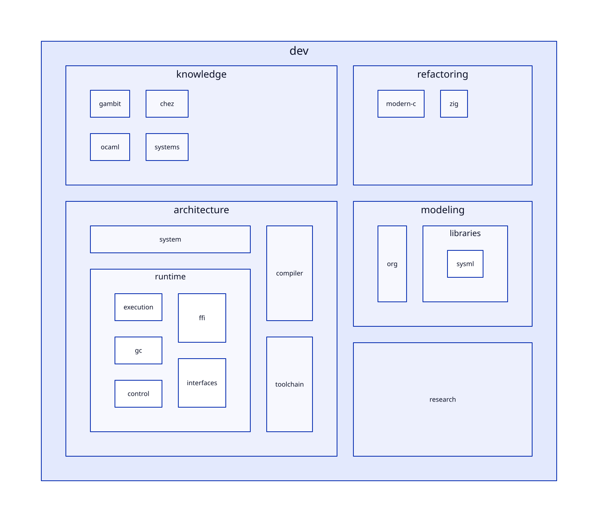

#+TITLE: Gambit Development Architecture
#+SETUPFILE: modeling/org/setup.org
#+CATEGORY: architecture

* RESEARCH Modernization program
:PROPERTIES:
:ID: 18cc4f8e-58ba-571a-b809-7935f1a7922a
:CUSTOM_ID: foundation
:OWNER: Gambit architecture
:STATUS: design-only
:EVIDENCE_CLASS: design-and-source-correspondence
:END:

Modern C is mandatory: preserve Gambit's Scheme semantics, C backend, C ABI, FFI and embedding. Zig is a conditional evolution of a named C implementation responsibility. Shared modernization benefits alone do not establish a Zig increment or require two maintained runtimes.

Start with [[file:refactoring/why-refactor.org][why structural refactoring is needed]] and the [[file:research-lanes.org][four research responsibilities]]. The source-bound [[file:refactoring/pressure-map.org][pressure and replacement matrix]] distinguishes current repair evidence from the runtime contracts that modern C must make explicit. C++ is outside this research.

The [[file:refactoring/modern-c/runtime-blueprint.org][composed modern-C runtime blueprint]] connects the eight pressures to module contracts, migration dependencies and per-route retirement. [[file:architecture/toolchain/incremental-build-design.org][Incremental and parallel build redesign]] is a first-class part of that blueprint. [[file:refactoring/modern-c/blueprint-matrix.org][The benefit matrix]] accounts eliminated work and added costs separately.

The maintained structure separates learned mechanisms, system responsibilities, implementation migration, modeling methods and research evidence. A module owns its contracts and models. Cross-module composition has explicit interfaces and separate proof obligations.

** Navigation by responsibility
#+BEGIN: sysml-view :kind organization :source organization.sysml
#+NAME: development-organization
| Layer | Purpose | Entry |
|---+---+---|
| knowledge | Mechanism learning; facts separated from Gambit inference | [[file:knowledge/index.org][Org entry]] |
| architecture | Language-independent Gambit system responsibilities | [[file:architecture/index.org][Org entry]] |
| refactoring | Implementation replacement and retirement | [[file:refactoring/index.org][Org entry]] |
| modeling | Methods, correspondence and shared vocabulary | [[file:modeling/index.org][Org entry]] |
| research | Questions, arguments, counterexamples and evidence | [[file:research/index.org][Org entry]] |
#+END:
** Organization and traceability
- [[file:organization.sysml][Canonical SysML organization and directory ownership]]
- [[file:organization.d2][Organization view source]]
- 
- [[file:architecture/runtime/interfaces/index.org][Runtime module interfaces and proof obligations]]
- [[file:modeling/correspondence.org][Exact SysML / Quint / Lean correspondence]]
- [[file:catalog.org][Frozen source to maintained Org migration catalogue]]
- [[file:research/validation.org][Actual validation and its limits]]
- [[file:traceability.json][Current document and model-source bindings]]

** Maintenance rules
1. Org owns maintained prose, arguments, decisions and requirement references; SysML owns structural organization, interface predicates and model-binding metadata. Property drawers identify owner, evidence class, status and dependencies. Named tables and cross-file anchors expose traceability; column views summarize open obligations.
2. Architecture contracts have one semantic owner. C and Zig consume that contract; neither defines a second Scheme, GC or continuation policy.
3. Each semantic category has a D2 view and SysML model, or an explicit reference to its owning category's common model. Asset directories are not new semantic categories.
4. Existing Quint and Lean source stays under repository ~models/~. Module-local ~models/quint/index.org~ and ~models/lean/index.org~ are ownership and projection indexes, not copied formal implementations. Author new formal work under its existing source owner until a separately reviewed source migration.
5. Frozen ~docs/experimental/zig/~ is provenance. Do not edit its Markdown and the maintained Org in parallel or regenerate edited Org from it. Old receipt hashes retain their historical meaning.
6. A D2 render, SysML diagnostic pass, Quint exploration, Lean proof and native acceptance are different evidence. There is no automatic cross-tool equivalence or automatic runtime admission.
7. Source blocks use ~:eval never~. Current research adds documents and formal specifications, with no runtime/build implementation, native testing or performance validation. Explicit formal source/kernel checks retain their own receipts and do not grant native acceptance; model exploration is separately scoped.
8. Keep unresolved producer coverage, weak-memory refinement, liveness and benefit obligations visible. Do not use person-days or invented architecture generation names.

** Organization model
The SysML organization model owns the hierarchy and directory placement. Org owns navigation and maintenance rules. D2 is its human-readable view. There is no separately maintained layout JSON/YAML. Evidence/hash JSON has a separate receipt purpose.

[[file:architecture/toolchain/source-chain-design.org][The real GSC delta study]] connects source rules to incremental mathematics. [[file:modeling/component-model-design.org][Component/model correspondence]] derives QNT, Lean and ASCENT references from SysML, preserving separate proof and execution scopes.

#+NAME: development-organization-model
#+INCLUDE: "organization.sysml" src sysml

** GSC dynamic reuse correctness
:PROPERTIES:
:CUSTOM_ID: development-gsc-dynamic-reuse
:END:
[[file:architecture/toolchain/correctness-design.org][Dynamic closure, stable cohorts and consumer cutoff]] refines the actual
GSC chain. [[file:architecture/toolchain/correctness-map.org][The SysML-derived matrix]] maps all 34 generation targets, the
74-action source slice, six correctness subcontracts and remaining proof gaps.

** GSC real-read and credential refinement
:PROPERTIES:
:CUSTOM_ID: development-gsc-read-credentials
:END:
[[file:architecture/toolchain/read-snapshot-design.org][Real GSC reads, credential issuers and selected-population refinement]]
connect source callers to conditional proofs and [[file:architecture/toolchain/read-snapshot-map.org][the SysML-owned matrices]].

** GSC capability and observation fidelity
:PROPERTIES:
:CUSTOM_ID: development-gsc-capability-fidelity
:END:
[[file:architecture/toolchain/capability-observation-design.org][Capability refusal and faithful C/link observations]] connect concrete caller
edges to [[file:architecture/toolchain/capability-observation-map.org][the SysML-owned matrix]] and property-specific reflection obligations.

** GSC output fidelity research
[[file:architecture/toolchain/output-fidelity-design.org][The source-backed _host generation/composition study]] adds twelve SysML-owned
fidelity/clean/failure obligations. Seven new Lean results bring the total to
38; five QNT modules are typechecked only. Exact byte/atom injection is checked;
recursive datum decoding, real clean origin and concrete safety reflection
remain open. No build implementation or native tests are claimed.

** Recursive datum proof and Scheme admission
[[file:architecture/toolchain/recursive-codec-design.org][The metadata-domain study]] adds eight SysML duties and eight Lean theorems
(46 total), including recursive mathematical wire inverse and injection. Six
QNT modules are typechecked only. Actual Scheme scalar/identity admission,
reader fidelity, consumer factorization and resource bounds remain open.
No build/runtime implementation or native tests are claimed.

** RESEARCH Actual Scheme value admission
[[file:architecture/toolchain/scheme-value-admission-design.org][The Scheme value study]] adds nine SysML duties and ten Lean statements
(56 total). Seven QNT modules typecheck only. Mutable-view stability, canonical
symbol identity and actual GC scanner participation are separate obligations.
ROOT-HANDOFF is reused by reference; actual readback and linker reflection
remain open. No build/runtime implementation or native testing is claimed.

- [[file:architecture/toolchain/scheme-value-admission-map.org][Derived source, proof and cost matrix]]
- [[file:architecture/toolchain/diagrams/scheme-value-admission.d2][D2 source]] / [[file:architecture/toolchain/diagrams/scheme-value-admission.svg][rendered graph]]

** RESEARCH Script-line capture and complete linker observations
[[file:architecture/toolchain/script-line-reflection-design.org][The script-line study]] adds ten SysML duties with bounded research status,
twelve Lean statements (68 total) and an eighth QNT module (typechecking only).
Named writers, captured aliases and input currentness have separate cuts.
Full outcome/effect reflection is conditional; actual readback and cleanup
refinement remain open. ROOT-HANDOFF is reused; no native tests are claimed.

- [[file:architecture/toolchain/script-line-reflection-map.org][Derived closure and benefit matrix]]
- [[file:architecture/toolchain/diagrams/script-line-reflection.d2][D2 source]] / [[file:architecture/toolchain/diagrams/script-line-reflection.svg][rendered graph]]

** RESEARCH Stable-view lifecycle and macOS development cost
[[file:architecture/toolchain/stable-view-design.org][Stable-view issuance/revoke/continuation entry]] and
[[file:architecture/toolchain/macos-development-design.org][macOS development architecture]] use separate owned SysML models.
Nine lifecycle transitions reference shared runtime contracts. Thirteen duties
add bounded source/history/refinement and benefit accounting; 82 standalone Lean
statements pass and ten QNT modules typecheck only. Actual issuer/provider/control/
I/O and whole-request native performance remain unqualified. No implementation
or native tests are added.

- [[file:architecture/toolchain/stable-view-map.org][Lifecycle evidence/transition matrix]] / [[file:architecture/toolchain/diagrams/stable-view.svg][D2 lifecycle]]
- [[file:architecture/toolchain/macos-development-map.org][Darwin evidence/cost matrix]] / [[file:architecture/toolchain/diagrams/macos-development.svg][D2 dependencies]]

** RESEARCH ModuleSpec and FrameSpec modernization
[[file:architecture/toolchain/native-descriptor-design.org][Source-driven modern C descriptor refactoring]] / [[file:architecture/toolchain/native-descriptor-map.org][consumer, proof and gain matrix]] / [[file:architecture/toolchain/diagrams/native-descriptor.svg][D2]]. SysML owns the relationship graph; ASCENT exposes actual code-to-contract-to-proof associations. Binding generation remains subordinate to Scheme semantics and native runtime contracts.

** RESEARCH T0 GC/SMP target foundation
[[file:refactoring/modern-c/t0-foundation-design.org][GC and same-VM SMP target redesign]] / [[file:refactoring/modern-c/t0-foundation-design.org::t0-model-ownership][target/reuse boundary]]. [[file:architecture/runtime/interfaces/frame-contract-design.org][FrameSpec]] supplies the concrete encoding/coordinate/root interface. Existing root models are reused by scoped binding; DEV does not duplicate them as new current-GC models.

[[file:architecture/runtime/interfaces/role-contract-design.org][Three-role shared contracts]] now trace execution, epoch participation and
collector custody through actual source callers, native formal references,
counterexamples, migration cuts and a net-work/space/synchronization matrix.

** RESEARCH T0 membership and grant closure
[[file:architecture/runtime/interfaces/membership-revocation-design.org][Modern-C membership, revocation and late-work design]] connects resize/root
coverage to publication/withdrawal, C ordering and existing root QNT/Lean sources.
Eight target laws remain open. [[file:architecture/runtime/interfaces/membership-revocation-design.org::#membership-benefits][The benefit matrix]] distinguishes conditional
coordination/retention savings from zero inherent reduction of mandatory tracing.

** RESEARCH T0 real producers, root writers and phase close
[[file:architecture/runtime/interfaces/publication-close-design.org][The modern-C chunk-close study]] separates accepted scan work from publisher
last-use/result custody and proposes explicit gate/queue cuts. [[file:architecture/runtime/interfaces/publication-close-callers.org][The selected
caller inventory]] is native-resolved; unknown native/FFI/generated writers remain
an admission gap. The cost matrix includes added shared-gate contention.

** RESEARCH Executable component assurance and modern-C publisher coverage
[[file:modeling/assurance-planner.org][The generic ASCENT planner]] now reasons about declared method needs, actual
artifact identities, check scope and prerequisites. [[file:architecture/runtime/interfaces/synchronous-publication-design.org][Synchronous publication]] has
its own executable QNT, checked parametric Lean and source/retirement matrix.
Source/C memory-order refinement remains separate from finite model results.

** RESEARCH Modern-C component research chain
[[file:modeling/component-assurance.org][Eight-component closure matrix]] / [[file:modeling/assurance-planner.org][SysML-to-ASCENT method and dependency inference]] /
[[file:modeling/diagrams/component-assurance.svg][native D2]]. Source/platform closure and native acceptance remain distinct.
