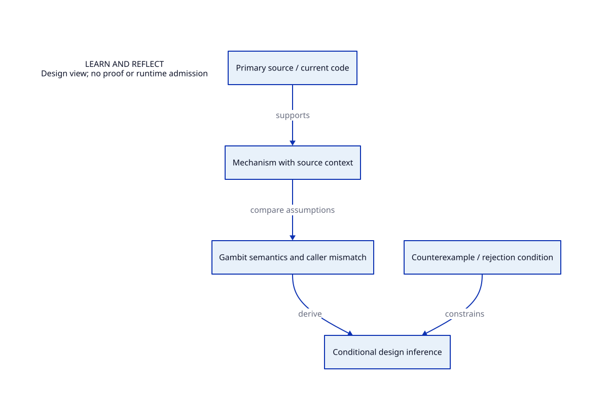

#+TITLE: Knowledge and Design Learning
#+SETUPFILE: ../modeling/org/setup.org
#+CATEGORY: knowledge

* RESEARCH Facts, mechanisms and Gambit-specific inference
:PROPERTIES:
:ID: a737e77e-e1c2-594e-840a-f7b67955d233
:CUSTOM_ID: knowledge-boundary
:OWNER: knowledge
:STATUS: design-only
:EVIDENCE_CLASS: design-and-source-correspondence
:END:

Record an upstream mechanism, its source context, the Gambit mismatch, a candidate interpretation and a falsifying case separately. A result in another runtime is not a measured Gambit benefit. This layer owns source learning; architecture owns our decision.

- [[file:gambit/index.org][Gambit papers, C/GVM strengths and current mechanism audit]]
- [[file:ocaml/index.org][OCaml multicore and effect-handler mechanisms]]
- [[file:chez/index.org][Chez generational collection and foreign participation]]
- [[file:erlang/index.org][Pinned Erlang/OTP scheduler, native lifetime and thread-progress mechanisms]]
- [[file:systems/index.org][C, Zig, LLVM and shared systems principles]]
- [[file:models/sysml/learning.sysml][Learning-to-design evidence model]]
- [[file:diagrams/learning.d2][Learning view source]]
- 
