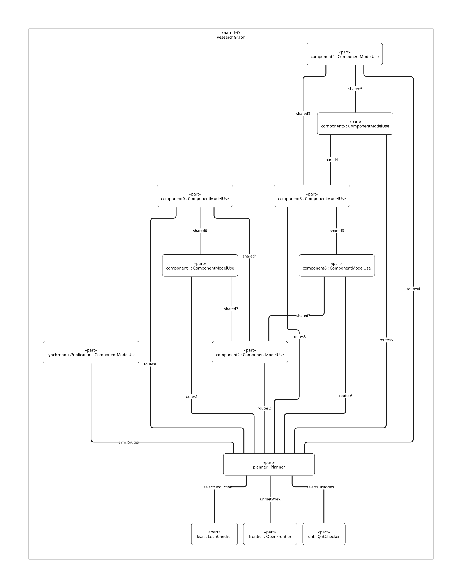
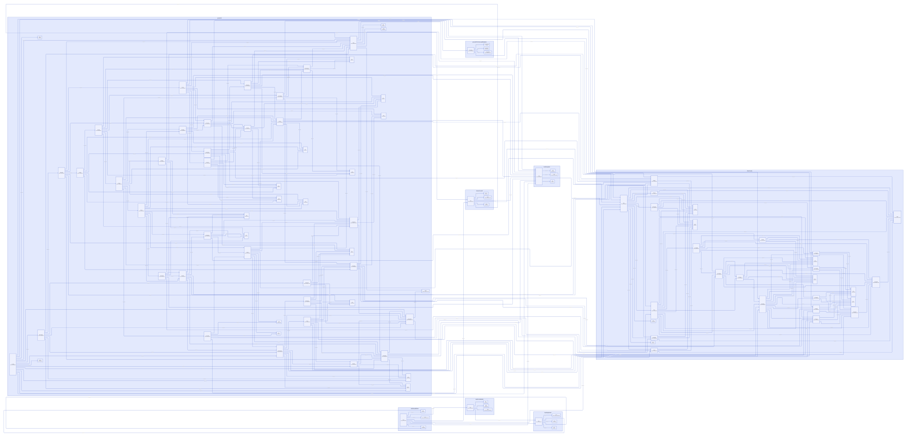

#+TITLE: Modern C Component Research Closure Matrix
#+SETUPFILE: org/setup.org
#+CATEGORY: modeling
#+PROPERTY: header-args :eval never :exports code
#+COLUMNS: %34ITEM %28STATUS %24COMPONENT

* RESEARCH Scope and authoritative ownership
:PROPERTIES:
:ID: 747f5d43-fbf4-45b7-8b14-e9c6d1690d44
:CUSTOM_ID: component-assurance
:STATUS: eight-components-routed-source-composition-open
:AUTHORITY: GambitComponentAssurance; module-owned ComponentStudy and ModelNeed
:END:

Modern C is the mandatory runtime/toolchain redesign. The seven existing
ComponentModelUse identities now have module-owned behavior projections,
component QNT histories, independently checked Lean symbol scopes, source and
platform obligations. The earlier synchronous-publication component participates
in the same graph. No existing root GC model is copied into DEV.

The native sources are [[file:../architecture/toolchain/models/sysml/component-assurance.sysml][build assurance]], [[file:../architecture/runtime/interfaces/models/sysml/component-assurance.sysml][runtime assurance]], [[file:models/sysml/component-assurance.sysml][typed inter-component dependencies/contracts]]
and [[file:models/sysml/assurance-routing.sysml][shared vocabulary/method policy]], extended by [[file:../architecture/runtime/ffi/models/sysml/host-roots-refinement.sysml][host-root source routes]], [[file:../architecture/runtime/ffi/models/sysml/retained-rc-scan.sysml][retained-domain contracts]],
[[file:../architecture/runtime/ffi/models/sysml/rc-freeze-publication.sysml][native freeze]], [[file:../architecture/runtime/gc/models/sysml/generational-admission.sysml][generational admission]], [[file:../architecture/runtime/gc/models/sysml/generational-barrier.sysml][barrier/reserve contracts]], [[file:../architecture/runtime/gc/models/sysml/promotion-residual.sysml][promotion/epoch handoff]], [[file:../architecture/runtime/gc/models/sysml/promotion-interval-handoff.sysml][physical interval/reader lifetimes]] and [[file:../architecture/runtime/gc/models/sysml/guaranteed-tail-placement.sysml][guaranteed context placement/checks]]. Together with [[file:../architecture/runtime/gc/models/sysml/rest-gc-resume-envelope.sysml][the real rest/GC/resume envelope]], they, [[file:../architecture/runtime/gc/models/sysml/structure-poll-still-envelope.sysml][the POLL/frame/still refinement]] [[file:../architecture/runtime/gc/models/sysml/still-init-safepoint.sysml][the initialization/participation contracts]] [[file:../architecture/runtime/gc/models/sysml/still-init-recovery.sysml][partial/result recovery]] and [[file:../architecture/runtime/gc/models/sysml/still-owner-retirement.sysml][owner isolation/retirement]] own 112 needs, 339 direct prerequisites
and eight shared contracts. [[file:ascent/assurance-planner.ss][ASCENT]] derives the transitive frontier; no Python
layout or method-selection authority is added.  displays the
same component/contract graph.  is
serialized directly from native-evaluated endpoint owners and needs, using
[[file:ascent/render-component-dependencies.jq][a presentation-only adapter]]. It introduces no second topology authority.
Contract edges are rely/guarantee dependencies,
not a prescribed runtime blocking-wait graph.

* Component closure and benefit matrix
#+NAME: component-closure-matrix
| Component / detailed argument | Checked QNT histories | Checked Lean slice | Shared premises for source obligation | Actual source closure / benefit boundary |
|---+---+---+---+---|
| [[file:../architecture/toolchain/component-assurance.org::#build-planner][build-planner]] | 4: no-op, leaf, macro, forged reuse | Adaptive replay, cut completeness and consumer cutoff | Output-observation history/induction | Open effect/reader/FFI census, stable image and actual 74-action refinement; may remove redundant generation after these hold |
| [[file:../architecture/toolchain/component-assurance.org::#build-scheduler][build-scheduler]] | 4: ready jobs, running cancellation, settled refund, excess budget | Budget steps/traces and full/selected bounds | Planner source closure | Open weighted global budget, parent/child ownership, physical completion and fairness; may remove duplicate pools/phase waits |
| [[file:../architecture/toolchain/component-assurance.org::#build-publisher][build-publisher]] | 4: commit, invalidation discard, cancellation discard, stale publication | Successful origin, trace reflection and cleanup debt | Planner, scheduler, roots, continuation, resource exit | Open complete output group, actual linker/script-line/exception/I/O trace; may centralize repeated validation, not required generation |
| [[file:../architecture/runtime/gc/component-assurance.org::#gc-work][gc-work]] | 4: complete, rescan, private debt, early finish | Covered producer/work conservation | Roots, continuation, synchronous publication | Open complete chunk/Tail/weak/foreign producers and C steps; worker/participant split is conditional |
| [[file:../architecture/runtime/ffi/host-roots-refinement.org][host-roots]] | 5 retained + 14 new: RC census, donor retention, preallocation, nested cleanup and binding controls | Retained frozen-root slice + 9 named conditional statements | HR-RC, HR-MARKER, HR-BOOT, HR-EXIT, HR-BIND, HR-DYNAMIC; HR-M | Existing patch already scans active nonzero RC and saves marker input; failed-donor census, scratch extent, run and complete exit/binding/closure identity remain open |
| [[file:../architecture/runtime/control/component-assurance.org::#continuation][continuation]] | 3: current/saved distinction, saved traversal, lost origin | Non-consuming origin and complete last-access census | Root source closure | Open FrameSpec coordinates, frame/denv/deserialize/FFI writers; generated descriptors cannot discard backing obligations |
| [[file:../architecture/runtime/execution/resource-exit-assurance.org::#resource-exit][resource-exit]] | 5: complete, unknown retain/resolve, stale permit, missing phases | Stable empty window and ordered phase/last use | GC, continuation and root source closure | Open actual destructor/owner/derived-task drain; additional permits/retention must earn their cost |
| [[file:../architecture/runtime/interfaces/synchronous-publication-design.org][gc-synchronous-publication]] | Earlier 15 histories retained with identical QNT bytes | Earlier nine local lemmas rechecked | Root source closure plus its local needs | Four source requirements remain open; modeled 5-to-3 G transactions are not a measured native gain |

For the seven newly integrated components, 29 deterministic QNT tests passed.
Some reuse existing behavior directly; host-roots and resource-exit introduce
explicit target boundary state. Injected omissions are design counterexamples,
not newly established native bugs. Whole-file Lean checks and exact namespace
probes establish only the named mathematical slices. No QNT-to-Lean or C-source
simulation is inferred from their coexistence.

These QNT scopes are named history suites, not complete production transition
systems. They do not export a proof that arbitrary primitive-call orders are
safe or that every post-completion event is excluded. Root/entry epochs,
producer closure and terminal-state stability require complete admission guards
and step-preservation proofs before adopting a runtime protocol. No global
invariant or liveness result is inferred from the 29 passing histories.

Current presented evidence retains 24 prior local slices under unchanged formal
source bytes and adds WB-H/I: 26 local slices in eight components. The
twenty-nine source-simulation needs and eleven environment/memory needs remain open.
Thus *zero components*
have a complete declared evidence frontier, and no runtime contract is promoted.
The old 73-obligation registry remains a separate historical projection; this
66-need research frontier does not silently reclassify it.

** Host-root refinement closure and benefit matrix
#+NAME: host-root-composed-frontier
| Slice | Present evidence | Open prerequisite / consumer impact | Net-benefit boundary |
|---+---+---+---|
| Nonzero RC | Vendor P0-only block; patch per-processor mark and successful join splice | HR-RC and HR-M: retained-donor scan census, list exclusion and handoff | P-1 active lists newly covered for P processors; required O(sum R_p) scan is not removable work |
| Marker roots | Patch SAVE1/RESTORE1; QNT relocation/clobber/late-root controls | HR-MARKER and HR-BOOT: scratch extent, preceding collective and direct run | Scratch can avoid new allocation only with noninterference proof; still marker allocation remains |
| Nested exit | Patch SFUN admission/catcher/leave; conditional stack-preservation lemmas | HR-EXIT, HR-BIND, HR-DYNAMIC: exact cleanup, binding and trampoline borrow | Share bookkeeping across three SFUN shapes plus run; preserve Scheme continuation and conversion semantics |
| Composed graph | Current 12 ASCENT cases retain 48 needs / 94 dependencies; sourceRoute exposes 12 parent/detail source mappings | Any missing retained-domain detail blocks HR-RC, HR-S and the five downstream consumers | Shared prerequisite proof can be reused across five consumers; runtime throughput unmeasured |

Fourteen new QNT histories pass; no exhaustive or native check is claimed. The
new Lean file and its imported census file compile, and all nine named scopes
are probed. Existing 29 histories and pilot receipts remain historical inputs,
not fresh reruns. [[file:../../evidence/research/host-roots-refinement/checks.json][The host-root receipt]] records the exact frontier and retained
failures. [[file:../architecture/runtime/ffi/host-roots-refinement.org::host-roots-benefit-matrix][The detailed cost matrix]] counts operations, domains and metadata,
not staffing or unsupported percentage gains.

** Retained-domain closure, benefit and added overhead
#+NAME: retained-domain-composed-frontier
| Slice | New checked evidence | Remaining gate | Conditional benefit / added work |
|---+---+---+---|
| RC-JOIN / RC-DOMAIN | Failed/unknown source branch -> ordinary GC caller census; target proxy and quarantine histories | Raw join/error transport, final writer freeze and enrollment before count change | Keep roots without a dead barrier participant; O(A+T) domain census, with T retained domains |
| RC-TRACE | Active collector versus retired domain, repeated GC epoch, missing still-setup controls | Real RC/still/work/weak adapters and complete root classes | Reuse copying/chunk algorithms; O(sum R_d + sum S_d) required scan/setup plus descendants |
| RC-COMMIT / RC-MEMORY | Lean reader/writer kernel step and trace preservation; pinned snapshot and concurrent-splice controls | Concrete exclusion, link/counter publication, lock order and progress | O(A+T) snapshot/pin metadata per GC; no extra per-slot atomic required solely for pinning; waiting for epoch drain added |
| RC-LIFETIME | Full-phase target guards, missing-accounting, early unpin and lost-ack controls | Foreign cleanup ownership, native backing last use, exact retained capacity | Preserve O(1) RC splice, current O(S_donor) still tail walk; retain O(U) unresolved records and all unresolved backing |
| Composed evidence | 15 named QNT histories; 100 positive-step samples × 50 steps; 11 Lean named scopes; 12 ASCENT scenarios | Five new source simulations plus RC-MEMORY remain OPEN | Shared architecture enables independent collectors; no native speedup, elapsed-time or Zig net-gain claim |

[[file:../architecture/runtime/ffi/retained-rc-scan.org][The source-bound argument and detailed cost matrix]] distinguish storage retention,
freeze, scan membership, worker identity and physical cleanup. [[file:../../evidence/research/retained-rc-scan/checks.json][The retained-domain receipt]]
retains previous receipts and bound failures. The sampled =safe= check applies
only to the new positive target actions; it is neither exhaustive nor a proof
of current C behavior. No old runtime path or native profile is retired/admitted.

* Shared contracts and custody
#+NAME: component-shared-contracts
| Contract | Producer -> consumer | Required handoff / failure custodian |
|---+---+---|
| INPUT-CUT | planner -> scheduler | Complete mediated read/effect closure and immutable image; planner retains incomplete cut |
| OUTPUT-GROUP | publisher -> planner | Complete C/linker/status/effect observation group; publisher retains staged/partial work |
| CREDIT-RETURN | scheduler -> publisher | Physical job completion returns credit once; unknown child retains its credit and output custody |
| ROOT-HANDOFF | roots -> GC | Frozen final values, scanner acquire and post-relocation reload; root custodian retains slots/backing |
| CONTROL-ORIGIN | continuation -> GC | Complete saved-origin/frame/lease coverage; current stack scanning is insufficient |
| CALLBACK-BORROW | roots -> continuation | Nested entry/exit, VM binding and root lifetime; nonlocal exit needs exact cleanup acknowledgement |
| RETIRE-FRONTIER | GC -> resource exit | Producer/descendant and strong/weak/cleanup completion; coordinator still drains actual target users |
| RESOURCE-DELIVERY | resource exit -> publisher | Owner-scoped I/O/handle cleanup acknowledged before success delivery |

Each contract's native record also names its scope, rely and failure custodian.
Build job tokens, GC task counts and target-user permits share algebraic ideas;
they are not the same physical counter or interchangeable identity domain.
Unknown results never discharge debt merely because a sender has stopped waiting.

* DSL controls and interpretation
#+NAME: component-control-matrix
| Input family | Required observation |
|---+---|
| current | H/I slices match; source and platform needs remain unresolved; no componentReady |
| all-scoped-control | Synthetic matching receipts for every declared need give eight evidence-ready components, never runtime authority |
| seven component omissions | Withhold one local slice per component; its source need and transitive dependents remain blocked |
| stale digest / wrong subject scope / wrong owner / wrong class / failed status | Exact need/file/check/scope matching refuses the supplied receipt |
| missing subject | A pass without the current declared artifact cannot qualify it |
| grandparent gap | A dependent local pass does not hide its prerequisite's missing prerequisite |
| cross-component cycle | Even all matching local receipts cannot close the reachable cycle |
| unknown kind / dangling need / unbound producer | Explicit diagnostic and conservative incomplete frontier |
| two methods for one kind | One passed method does not discharge the missing second method |

The preceding component receipt contains sixteen scenario inputs and five
structural-control requests. The host-root extension adds twelve scenarios:
current, all-scoped, scan-only, save-only, six source-route omissions, wrong
detail scope and stale detail digest. All
synthetic all-scoped or altered receipts are marked planner-control-only. They
exercise inference, not fabricate source proofs. Genuine local check evidence,
request bytes, namespace probes, native evaluation and initial diagnostics are
retained in [[file:../../evidence/research/component-assurance/checks.json][the scoped receipt]]. Reads remain hypotheses with no support observation
or native execution authority.

The first combined request exceeded the rule-source byte bound. A two-scenario
request also exceeded the ASCENT form-length bound. Retain both failures and
use one scenario per request under the existing limits; do not widen admission
or discard graph dependencies to make a request fit.

* Next proof work and adoption boundary
1. Refine real GSC observations/capabilities and full job population, including
   parent/child token transfer and physical output/cleanup completion.
2. Complete the six host-root source routes, crediting existing active RC and
   SAVE/RESTORE repairs; prove retained-domain coverage, scratch exclusion,
   preceding startup interval and concrete exceptional/binding access order.
3. Relate FrameSpec/origin inventories and all chunk/Tail/weak/foreign producers
   to the independently owned target models, with explicit progress premises.
4. Prove actual target users/destructor owner and derived-task drain before
   issuing reclaim or delivery credentials.
5. Replace an old path only after its source obligation and all declared
   prerequisite frontiers close. Formal local passes alone retire no path.

The benefit criterion is eliminated generation/scanning/coordination and bounded
new validation, contention, retention and pause work. No person-day estimate or
assumed native speedup decides adoption. These shared contracts establish a
modern-C redesign base; a second Zig backend still needs an independently
established incremental benefit.

* RESEARCH Generational redesign and native freeze frontier
:PROPERTIES:
:CUSTOM_ID: generational-freeze-frontier
:AUTHORITY: GambitRcFreezePublication; GambitGenerationalAdmission
:STATUS: architecture-selected-local-kernels-checked-source-open
:END:

[[file:../refactoring/modern-c/runtime-blueprint.org::#coupled-runtime-redesign][The modern-C blueprint]] selects a coherent architecture reconstruction.
[[file:../architecture/runtime/gc/modern-c-generational-design.org][The generational design]] makes its allocation, barriers, promotion,
continuation/FFI and major/minor contracts concrete; [[file:../architecture/runtime/ffi/rc-freeze-publication.org][native freeze]] separates raw
managed borrows from storage leases. Existing root models keep their owners.

#+NAME: generational-freeze-composed-matrix
| Component / need | Current local closure | Open architecture/source obligation | Benefit / new cost |
|---+---+---+---|
| host-roots: FZ-H/I | 13 target histories; seven named conditional Lean statements; positive-step sampling | Five source needs and FZ-MEMORY; actual wait graph and writer/alias census | Callback storage can survive collection without a self-wait; explicit permits, publication and reload added |
| gc-work: GEN-H/I | Nine target histories; five named Lean statements including arbitrary-graph young-boundary coverage; positive-step sampling | GC-GEN requires seven source/model premises including complete roots/control/work and freeze | Eligible minor cycles omit mature interiors; barriers, remembered scanning, promotion reserve and major work added |
| RootRegistry / BarrierLog / ReleaseCoordinator | Shared native contracts and real caller families recorded | Every generated/runtime store, native raw escape, destructor payload/owner and shutdown drain | Avoid duplicate semantic decisions and unsafe phase coupling; no automatic gain from substituting Zig |
| Full graph | 8 components, 59 needs, 130 direct edges, 8 shared contracts; 19 source routes; 13 ASCENT scenarios | 24 local slices, 25 source and 10 environment/memory needs open; zero complete components | One shared prerequisite frontier; no runtime path retired, native profile admitted or speedup measured |

Each new QNT kernel was sampled for 100 positive traces of at most 50 steps,
seed 17. This is not exhaustive exploration or liveness. Lean proofs are
conditional; standard logical axioms in the graph lemmas are recorded, with no
sorry/admitted source theorem. Source needs stay open after local math passes.
The [[file:../../evidence/research/rc-freeze-publication/checks.json][combined receipt]] retains exact bytes and the 20 unchanged predecessor slices.

The expanded DSL initially exceeded form/column limits; failed requests remain
in evidence. Native needs sharing a component are transported losslessly in
triples (16 fields); dependencies use five-edge/triple records. ASCENT expands
these to the same independent conjunctive needs/edges. Checks compare all 59
modelRequired rows, all 19 routes and all 130 native edges, then withhold each
freeze source need and corrupt exact scopes/digests. No bound was raised, source
receipt synthesized in the current scenario, or dependency removed.

* RESEARCH Barriers, remembered sets and semantic amplification
:PROPERTIES:
:CUSTOM_ID: barrier-frontier
:AUTHORITY: GambitGenerationalBarrier
:STATUS: target-kernel-checked-source-and-memory-open
:END:

[[file:../architecture/runtime/gc/generational-barrier-design.org][The source-grounded contract]] and [[file:../architecture/runtime/gc/generational-barrier-matrix.org][native-derived matrix]] amplify Scheme semantics
through proved barrier elision, mature continuation reuse and predictable native
safepoints. Typed StoreTicket, RememberedCut and CopyReservation requirements are
design schemas; validation does not satisfy their concrete-source obligations.

#+NAME: barrier-composed-closure
| Slice | Checked scope | Remaining gate / benefit boundary |
|---+---+---|
| WB-H | 26 finite named histories; 100 positive samples, seed 17, at most 80 steps | Three old slots/two cards/one native root/one copy owner; no native reachability, exhaustive/liveness or complete collector claim |
| WB-I | Fourteen named Lean statements: source-card coverage, hint fallback, no-collect target transforms, copy/credit/alias guards and elision premise | No whole QNT invariant or C simulation; source age must be current at the actual store |
| WB-WRITERS / WB-LOG | Ten real source families; durable card coverage and bounded hint/overflow policy | Every runtime/generated/FFI alias and descriptor must close; a logical denv read can write |
| WB-SNAPSHOT / WB-PROMOTE | Settled writer cut and pre-/post-forward custody; shared aliases retain one canonical copy | All participants/regions, exact physical reservation, copy/Tail/weak/major and context recovery remain open |
| WB-MEMORY | Release/acquire and reset/readiness obligations specified | Mixed generated-C/native access, atomic progress, locks and all target ABI/order facts remain open |
| Composed graph | 8 components, 66 needs, 159 direct dependencies, 24 source routes; 13 new ASCENT cases | 26 local slices, 29 source and 11 platform needs open; zero complete components, runtime admissions or measured speedups |

WB source/ordering omissions block GC-GEN. Independently omitting CO-S or
FZ-CENSUS blocks WB-WRITERS despite its synthetic local pass. Exact checks compare
all 66 required rows and 24 route records; native dependency transport retains all
159 direct edges. Subject identity groups and paired route records are lossless
transport under existing parser limits, not bundles of proof or source passes.
Only explicit control scenarios manufacture matching receipts.

[[file:../../evidence/research/generational-barrier/checks.json][The current source-bound receipt]] retains 24 predecessor slices without rerunning
their checks. The preceding freeze/generation matrix is historical scoped
evidence; it is not overwritten as a new performance or source-refinement result.

* Promotion capacity and residual epoch handoff
:PROPERTIES:
:CUSTOM_ID: promotion-residual-assurance
:AUTHORITY: GambitPromotionResidual
:STATUS: target-formal-slices-source-and-order-open
:END:
[[file:../architecture/runtime/gc/promotion-residual-design.org][The new study]] and [[file:../architecture/runtime/gc/promotion-residual-matrix.org][native-derived matrix]] add six explicit needs and twenty direct
prerequisites. The complete native graph now has 8 components, 72 needs, 179
edges, 8 shared contracts and 28 source routes. PR-BOUND/PR-MEMORY gate
WB-PROMOTE; PR-RESIDUAL/PR-FFI gate WB-SNAPSHOT. All other predecessor topology
and exact formal scopes remain retained.

#+NAME: promotion-closure-matrix
| Scope | Checked evidence | Remaining gap / cost |
|---+---+---|
| PR-H | 17 finite histories and 100 bounded positive samples, max 80 steps, initial seed 17 | No exhaustive/liveness/native reachability or complete multiepoch collector claim |
| PR-I | Ten conditional Lean statements, exact names probed | Source layout census, physical separation and whole QNT/C refinement open |
| PR-BOUND | Current heap/frame constants and real section/chunk/resume consumers | Claim-first allocator, finite publication schedule, committed intervals and all resize/restoration consumers |
| PR-RESIDUAL | Producer classes and staged bank/seed/fallback publication | Complete alias/weak closure, collector-created layouts and retained young-space leases |
| PR-FFI / PR-MEMORY | Real RC/marker/Tcl payload chains, permit and reader-drain protocol | External alias admission, exact C access/order/ABA and progress obligations |
| Full graph | 28 distinct qualified local formal slices: 26 inherited unchanged, 2 new | 32 source + 12 platform/environment/order needs open; zero complete/native components |

The full serialized request exceeded the existing source-byte bound. Its failed
input/diagnostic is retained; limits were not raised. Two ancestor-closed query
cuts preserve the complete graph: runtime owns all needs of five runtime
components (60 needs/162 edges); build owns all needs of three build components
and their exact ancestors (56 needs/123 edges). Their deduplicated union must
match all 72 native needs and 179 native edges exactly. Readiness of a partial
ancestor component in one cut is never reported as full component readiness.

[[file:ascent/component-assurance.request.scm][Runtime request]] and [[file:ascent/component-assurance-build.request.scm][build request]] are actual generated ASCENT DSL inputs.
Ten runtime scenarios and two build scenarios check scope/digest qualification,
all-receipt controls and missing capacity/residual/FFI/memory/freeze premises.
No source route, artifact existence or synthetic receipt becomes source proof.
[[file:../../evidence/research/promotion-residual/checks.json][The current receipt]] separates inherited checks, fresh diagnostics, native
metadata validation and unresolved obligations. The preceding barrier matrix
and receipt remain historical scoped evidence.

* Physical placement, tail transfer and reader retirement
:PROPERTIES:
:CUSTOM_ID: interval-handoff-assurance
:AUTHORITY: GambitPromotionIntervalHandoff
:STATUS: target-conditions-checked-source-and-platform-open
:END:
[[file:../architecture/runtime/gc/promotion-interval-handoff-design.org][The current study]] and [[file:../architecture/runtime/gc/promotion-interval-handoff-matrix.org][native-derived matrix]] add six needs and 24 direct
prerequisites. The selected composed graph has 8 components, 78 needs, 203 edges,
8 shared contracts and 32 source routes. Native Region/Tail/Retirement schemas
are requirements, not satisfied runtime instances. The semantic-reachability
proof for actual payload free remains distinct from reader drain.

#+NAME: interval-handoff-closure-matrix
| Need / scope | Established local evidence | Open source/native obligation and cost |
|---+---+---|
| IH-H | 19 named finite histories and 100 positive samples, max 80 steps, initial seed 17 | One region/two readers/one transfer; no full collector, C model, exhaustive or liveness claim |
| IH-I | Thirteen exact Lean statements; offset, ownership, pin and phase-peak conditions | No complete QNT step induction, spatial/provenance proof or actual caller simulation |
| IH-EXTENTS | Aligned backing/partial-expansion source paths and placement/refusal contract | All real object/segment placements, capacity overflow, index retirement and platform backing |
| IH-TAIL | Six direct restoration calls plus setup/growth/undo/resize consumers | Prefix/frontier/fudge completeness, exact role match and idempotent commit/read-back; existing same-PSTATE reuse already works |
| IH-READERS | Eight concrete caller families, including local, queued and dequeued users | Full native/FFI/debug/cleanup admission and last-use closure; queued tasks and unknown exits retain pins |
| IH-MEMORY | Lifecycle-lock pin admission, queue-token transfer and reader-drain protocol | Exact C accesses, lock ordering, no callback under lock, native backing/ABI and progress remain open |
| Selected whole graph | 30 qualified local formal slices, 28 inherited unchanged and 2 new | 35 source + 13 platform/environment/order needs open; zero complete/native components |

PR-BOUND depends on IH-EXTENTS/IH-TAIL; PR-RESIDUAL on IH-READERS/IH-MEMORY;
PR-MEMORY on IH-MEMORY; PR-FFI on IH-READERS. Omitting a declared premise blocks
upstream admission despite synthetic local passes. In particular a synthetic
IH-READERS pass cannot hide absent RC-LIFETIME. Wrong exact scope/digest receipts
cannot qualify IH-I/IH-H.

The enlarged runtime request exceeded the unchanged rule-source bound. Its
failed source and diagnostic are retained. Two ancestor-closed inference cuts
retain every need and prerequisite: four runtime owners, 62 needs/180 edges;
three build owners plus resource-exit, 56 needs/123 edges. Their deduplicated
union is exactly all 78 needs/203 edges. Source-route facts, which cannot qualify
proofs, use a third native-driven request containing every need and all 32 routes
without dependency or proof receipts. Exact checks compare all route fields.
This is transport partitioning, not removal of a premise or an alternative
architecture owner. Readiness of partially included ancestors is not full owner
readiness. Ten runtime, two build and one route-only case are retained.

[[file:ascent/component-assurance.request.scm][Runtime DSL]], [[file:ascent/component-assurance-build.request.scm][build DSL]] and [[file:ascent/component-assurance-routes.request.scm][source-route DSL]] are actual ASCENT inputs. Only
matching local formal checks qualify IH-H/IH-I. [[file:../../evidence/research/promotion-interval-handoff/checks.json][The source-bound receipt]] binds
native diagnostics, source identities, inherited evidence and unresolved gates.
Prior receipt/matrix sections remain historical scoped evidence.

* Guaranteed future tails, real checks and whole-round peak
:PROPERTIES:
:CUSTOM_ID: guaranteed-tail-assurance
:AUTHORITY: GambitGuaranteedTailPlacement
:STATUS: target-conditions-checked-source-refinement-open
:END:
[[file:../architecture/runtime/gc/guaranteed-tail-placement-design.org][The current placement/check study]] and [[file:../architecture/runtime/gc/guaranteed-tail-placement-matrix.org][native-derived matrix]] add six needs and
23 direct dependencies. The selected graph has 8 components, 84 needs, 226 edges,
8 shared contracts and 36 source routes. GuaranteedPlan, ResumeAssurance and
PeakEvidence are typed requirements, not satisfied native instances.

#+NAME: guaranteed-tail-closure-matrix
| Need / scope | Established local slice | Remaining gate / benefit boundary |
|---+---+---|
| GT-H | 17 named histories and 100 bounded positive samples, max 80 steps, seed 17 | One region/context with guard/rebind/peak monitor; no full collector, C, native, exhaustive or liveness claim |
| GT-I | Twelve exact conditional Lean statements | Ordered bounds, real phase coverage, spatial/native provenance and full QNT/C refinement remain open |
| GT-PLAN | Real copy/chunk/frame/resize source; frozen future-role placement | All copy writes/address formation, backing, immutable participants and preaccepted exact demand; no survivor forecast |
| GT-CHECK | Compiler debt/float materialization, CHECK_HEAP and kernel slow edges | Actual span W/P/minima, profile/code/PointId closure and guard; constants alone cannot qualify |
| GT-RESTORE | Six restore endpoints and kernel rest/exception consumers | Current rooted binding and separate stack/completion/failure roles; no stale cursor or unknown-commit entry |
| GT-PEAK | Whole-phase inequalities and retained peak counterexamples | Matched baseline and every acquisition/copy/restore/failure phase, including added backing/metadata and actual deallocation |
| Composed graph | 32 qualified local formal slices: 30 inherited unchanged and 2 new | 39 source + 13 platform/environment/order needs open; zero complete/native components |

IH-EXTENTS depends on GT-PLAN; IH-TAIL on GT-CHECK/GT-RESTORE; PR-BOUND on
GT-PEAK. The native paths transitively depend on original work, store/control,
VM binding and reader/memory contracts. A synthetic GT-RESTORE pass is still
blocked by missing HR-BIND. Wrong scope/digest receipts cannot qualify GT-I/H.

Runtime inference is an ancestor-closed 68-need/203-edge cut for four complete
owners; build/resource-exit is 56 needs/123 edges for four complete owners.
Their deduplicated union is exactly all 84 needs/226 edges. The separate native
source-route request contains all 84 needs and all 36 routes, with zero proof
receipts/readiness claims. No parser limits are raised or premises removed.
Ten runtime, two build and one route-only case are checked. Partial ancestor
readiness never becomes full component readiness.

[[file:ascent/component-assurance.request.scm][Runtime DSL]], [[file:ascent/component-assurance-build.request.scm][build DSL]] and [[file:ascent/component-assurance-routes.request.scm][route DSL]] are real generated inputs to ASCENT.
[[file:../../evidence/research/guaranteed-tail-placement/checks.json][The current receipt]] binds current source/model identities and formal diagnostics.
The preceding interval/residual matrices and receipts remain historical scopes.

* RESEARCH Rest construction, framed GC and first resumed interval
:PROPERTIES:
:CUSTOM_ID: rest-resume-assurance
:STATUS: conditional-model-checked-source-and-physical-lifetime-open
:END:

[[file:../architecture/runtime/gc/rest-gc-resume-envelope-design.org][The selected real structure chain]] adds six GC-owned needs and 22 dependency
edges, connecting completion, VM binding, continuation, lifetime and whole-phase
peak claims. Native SysML owns 90 needs, 248 direct dependencies, 40 source
routes and eight shared contracts. ASCENT's runtime cut covers 74 needs/225
edges; the build/resource-exit cut remains 56/123. Their exact union is checked.
A third route-only projection includes all 90 needs/40 routes and qualifies none.

#+NAME: rest-resume-closure-matrix
| Slice | Local evidence | Still required | Benefit boundary |
|---+---+---+---|
| RG-H | 16 named QNT histories and bounded positive simulation | Exact C step/representation/entry and full-state simulation | B/completion and failure custody, not native capacity evidence |
| RG-I | 13 named conditional Lean arithmetic statements | Pointer/container provenance, whole-step induction, complete live-phase sum | Selected carrier <=24576 words; not a whole-GC bound |
| RG-COMPLETE | Real handler and pair/vector endpoints located | Preissued physically contiguous completion grant; legal caller census | Removes unjustified independent maxima, not global reserve subtraction |
| RG-RESUME | Existing structure entry, na=-1 and first POLL traced | Root/FrameSpec/current-binding and slow-path assurance | First heap span0, stack temporary2; later frame8 and allocation separate |
| RG-LIFETIME | Section/semispace/still release endpoints located | Complete last-alias/reader and captured-continuation closure | No physical refund at carrier detachment |
| RG-PEAK | All-phase conditional comparison, omitted-source controls | Matched actual backing acquisitions including fudge/still/failure | Qg positive only when it omits an actual acquisition and every phase stays lower |
| Whole selected graph | 34 distinct local formal slices, including 32 unchanged inherited slices | 43 source-simulation and 13 platform/environment/order needs | Zero fully admitted components or retired runtime paths |

All-scoped-pass scenarios are synthetic planner controls. Removing completion,
resume, lifetime, peak or transitive HR-BIND blocks upstream GC eligibility.
Wrong scope and stale digest do not qualify local checks. Neither partial
ancestor readiness nor existing files establishes source/native acceptance.

* RESEARCH Structure slow POLL, recursive frames and still allocation
:PROPERTIES:
:CUSTOM_ID: structure-poll-still-assurance
:STATUS: scoped-models-checked-source-and-effects-closure-open
:END:

[[file:../architecture/runtime/gc/structure-poll-still-envelope-design.org][The real continuation of the structure chain]] adds six needs and24 dependencies.
The selected graph is96 needs,272 edges,44 source routes and8 shared contracts.
The runtime ancestor cut is80 needs/249 edges; build/resource-exit remains56/123.
Their exact union is checked. Source routes and shared-contract metadata are
projected without qualification in two metadata-only requests. Lossless paired receipt
transport avoids raising the unchanged ASCENT form limit; all identities,
scopes, statuses and conjunctive prerequisites remain independently checked.

#+NAME: structure-poll-still-closure
| Slice | Local evidence | Source / environment gap | Benefit and physical boundary |
|---+---+---+---|
| SP-H |18 QNT histories plus bounded positive simulation |254-frame batching, unknown-footprint and root-state source refinement | Abstract units and held upper envelope, not native peak evidence |
| SP-I |17 exact conditional Lean statements | Configured GVM/ABI, complete phase/capture/callback and physical identity premises | Frame stack8 vs heap7 already exists; no newly saved byte inferred |
| SP-POLL | Saved RETI -> stack_limit/GC -> installable interrupt -> internal return | Complete callback/exception/retry/capture budget and new binding | No finite whole-call cap from a alone |
| SP-FRAMES | Section selection, transfer post-check, captured frame and undo located | Complete actual descriptor and alias/reader closure | Pool/VM section assignment need not acquire/free backing |
| SP-STILL | Deferred/VM/GC, malloc, initialization, error/retry and sweep located | No safepoint ack until initialized; known root/result ownership and profile | charge a+6; conditional ordinary WS8 allocator request8a+63<=65599 |
| SP-PEAK | Phase maximum and transitive missing-evidence controls | Actual acquired/container sums across all participants and unknowns | Qg must omit actual acquisition; it cannot directly pay a separate still block |
| Current selected composition |36 local formal slices,34 inherited with unchanged subjects/scopes/digests |47 source-simulation plus13 platform/environment/order needs |0 complete/native components,0 retired runtime paths |

Native validation is scoped to the predecessor50 SysML files plus the new model.
A failed whole-DEV attempt found syntax errors in a concurrently edited,
unselected foundation-binding model; retained diagnostics forbid a whole-DEV
pass claim. Root runtime/model/patch bytes and the predecessor receipt remain
unchanged. Existing unrelated work was not repaired or reverted.

* RESEARCH Still initialization, request acknowledgement and root custody
:PROPERTIES:
:CUSTOM_ID: still-init-safepoint-assurance
:AUTHORITY: GambitStillInitSafepoint
:STATUS: local-kernels-checked-source-and-memory-refinement-open
:END:

[[file:../architecture/runtime/gc/still-init-safepoint-design.org][The selected source study]] traces allocation, sync-op/resize, heartbeat posting,
POLL delivery, marker/FFI and foreign cleanup. Request arrival is not participation;
completed fields are not result-root publication. A participant lease freezes
mutation until collection/withdrawal. Nested activation cleanup preserves parent
roots; unknown replies retain full storage and the original initializer owner.
Minor-GC admission additionally depends on WB-WRITERS/WB-SNAPSHOT coverage.

[[file:../architecture/runtime/gc/still-init-safepoint-matrix.org][The native-derived matrix]] binds SI-H (21 histories) and SI-I (13 exact conditional
statements). SI-GATE and SI-CUSTODY remain source obligations. The current exact
union is100 needs/288 edges/46 routes/eight shared contracts:38 local slices
(36 unchanged inherited),49 source gaps and13 platform gaps; zero complete/native
components. Two inference cuts and two qualification-free metadata cuts retain
that union. Fourteen ASCENT scenarios include omitted roots/source, stale digest,
wrong scope and paired-receipt controls. Passing mathematics is not native safety.
See [[file:../../evidence/research/still-init-safepoint/checks.json][the source-bound receipt]]. No old C runtime path is retired by this study.

* RESEARCH Partial initialization and undelivered-result recovery
:PROPERTIES:
:CUSTOM_ID: still-init-recovery-assurance
:AUTHORITY: GambitStillInitRecovery
:STATUS: target-kernels-checked-native-source-refinement-open
:END:

[[file:../architecture/runtime/gc/still-init-recovery-design.org][The actual constructor/FFI/caller study]] distinguishes reserved writes, committed
cursor, completed body without a result root, rooted completion and recipient
acceptance. Queries cannot initialize, advance directory I/O or invoke Scheme.
A frozen owner transfer preserves the exact cursor; unknown results preserve
full backing and responsibility. Raw output pointers are not atomic receipts.

[[file:../architecture/runtime/gc/still-init-recovery-matrix.org][The native-derived matrix]] binds IR-H (31 histories) and IR-I (16 exact conditional
statements, including a Progress Step/Trace kernel). IR-PROGRESS/ROOT/DELIVERY/ABORT
remain source obligations. The graph is106 needs/314 prerequisites/50 routes/eight
shared contracts:40 local slices (38 unchanged inherited),53 source gaps and13
platform gaps. Zero components have complete/native qualification. Atomic string
partial failure does not prove partial pointer-object scanning or retirement.
[[file:../../evidence/research/still-init-recovery/checks.json][The receipt]] retains negative controls and parser-bound failures separately.

* RESEARCH Stopped owners, native isolation and receipt retirement
:PROPERTIES:
:CUSTOM_ID: still-owner-retirement-assurance
:AUTHORITY: GambitStillOwnerRetirement
:STATUS: formal-kernels-checked-native-source-and-resource-closure-open
:END:

[[file:../architecture/runtime/gc/still-owner-retirement-design.org][The owner/retirement study]] distinguishes Scheme termination, native join,
operation write closure and delegated-borrower drain. Native-only staging can
remove an unknown helper's completion from the GC gate only if independent
roots and all collector resources were secured before it started. Confirmed
stop permits effect-free private batch replay, never published Scheme mutation
or repeated directory I/O. Receipt deletion retains an old-request rejection fence.

[[file:../architecture/runtime/gc/still-owner-retirement-matrix.org][The native matrix]] binds OR-H (33 histories) and OR-I (22 conditional statements,
including a drain Step/Trace kernel). OR-STOP/ISOLATE/TAKEOVER/RETIRE remain open.
The exact graph has112 needs/339 prerequisites/54 routes/eight contracts,42 local
slices (40 unchanged inherited),57 source gaps and13 platform gaps; no complete
or native-qualified component. [[file:../../evidence/research/still-owner-retirement/checks.json][The receipt]] retains source/transport controls,
matched report decoding, peak costs and unresolved failure/materialization cases.

** RESEARCH Managed heap materialization and owner-loss custody
:PROPERTIES:
:CUSTOM_ID: managed-materialization-custody
:AUTHORITY: GambitStillMaterializationCustody
:STATUS: conditional-models-native-refinement-open
:END:
[[file:../architecture/runtime/gc/still-materialization-custody-design.org][The modern C materialization study]] separates scan-valid shell enrollment,
write-lease closure, physical backing and result-root handoff. Its six needs
(MC-H/I/SHELL/WRITE/ROOT/RECOVER) are native SysML projections, evaluated by
the existing ASCENT DSL; SP-STILL depends on MC-ROOT and MC-RECOVER.
QNT checks22 named histories plus bounded positive/negative simulations. Lean
checks16 named statements including root Step/Trace preservation. These local
checks do not establish native writer closure, C atomics or allocator recovery.
Unknown-live heap writers cannot detach from a moving collector merely because
slots are valid. Stop/borrower closure permits abort and scanning without replay.
The current graph has118 needs,362 direct edges,58 source routes and8 shared
contracts;44 local model slices,61 source gaps and13 platform gaps; zero complete
or native-qualified components. Earlier study sections remain historical scopes.
The receipt and native-derived work/peak matrix are linked from the study.

** RESEARCH Heap authority closure and canonical still-domain handoff
:PROPERTIES:
:CUSTOM_ID: still-authority-handoff
:AUTHORITY: GambitStillAuthorityHandoff
:STATUS: conditional-models-native-source-refinement-open
:END:
[[file:../architecture/runtime/gc/still-authority-handoff-design.org][The modern C authority/handoff study]] separates closing grant ingress from
settling pending writers/borrowers, native stop evidence from operation closure,
and physical StillDomain custody from old PSTATE cleanup. Current resize cleans
up before it joins; target ownership must be transferred before destructive
cleanup. A canonical domain retains one chain/charge and remains enumerable by
GC after processor retirement. Unknown raw writers/allocator mutation still
block; unknown commit replies retain aliases and query the canonical decision.
SysML owns AH-H/I/CLOSE/STOP/CHAIN/ADMIT and their dependencies. Root QNT
checks34 named histories; Lean checks22 named conditional statements including
Gate Step/Trace debt/no-reopen kernels. Current projection:124 needs,389 edges,
62 source routes,8 shared contracts;46 local model slices,65 source gaps and
13 platform gaps, zero complete/native-qualified components. Earlier sections
retain their historical scopes; no runtime or raw ABI path retires here.

** RESEARCH Canonical still inventory and snapshot-consistent capacity
:PROPERTIES:
:CUSTOM_ID: still-ledger-snapshot
:AUTHORITY: GambitStillLedgerSnapshot
:STATUS: conditional-models-native-refinement-open
:END:
[[file:../architecture/runtime/gc/still-ledger-snapshot-design.org][The modern C ledger/snapshot study]] separates published/private/retired
backing from unbacked grants, phase counters and allocator request bytes. A
post-GC cut can still contain unbacked caller requests. Owner commit must share
revision/epoch admission with sweep and accounting publication. Metadata pins
are not raw payload capabilities. Unknown allocator/free results retain custody.
SysML owns LS-H/I/INVENTORY/INTENT/SNAPSHOT/RECLAIM. Root QNT checks30
histories and Lean checks16 named propositions, including a refund Step/Trace
kernel. Native projection:130 needs,415 edges,66 source routes,8 contracts;
48 local model slices,69 source gaps,13 platform gaps, zero complete/native-
qualified components. Prior sections retain historical scopes. No runtime
implementation, native test, measured saving or old-path retirement is claimed.

* RESEARCH Allocation receipts and atomic snapshot admission :modern_c:gc:
:PROPERTIES:
:CUSTOM_ID: still-receipt-admission
:AUTHORITY: GambitStillReceiptAdmission
:STATUS: conditional-extension-source-refinement-open
:END:
[[file:../architecture/runtime/gc/still-receipt-admission-design.org][The receipt/admission study]] separates raw effects, immutable outcome
publication, exactly-once logical settlement and caller delivery. One domain
gate excludes sweep/accounting mutations from owner handoff. Raw pre-publication
loss remains unknown; no wrapper can infer a malloc/free result from stop alone.
The direct Darwin executable-path malloc/free path also bypasses allocation macros.
SysML drives a separate explicit 11-need,16-edge ASCENT extension: six new needs
and five imported open source premises. Current exact receipts qualify only
RA-H/RA-I; nine source obligations remain open, zero components qualify.
QNT checks19 named histories plus100 bounded sampled histories; Lean checks10
conditional declarations. The all-scoped-positive control is synthetic.
The historical130-need/415-edge global receipt is not recomputed or superseded
by this extension. No runtime implementation, native test, measured improvement
or executed old-path retirement is claimed. Gate contention, retained liability
and metadata bounds remain admission costs; modern C is the mandatory path.

* RESEARCH Native completion, exceptional exit and receipt lifetime :modern_c:gc:
:PROPERTIES:
:CUSTOM_ID: still-completion-lifetime
:AUTHORITY: GambitStillCompletionLifetime
:STATUS: conditional-extension-source-platform-open
:END:
[[file:../architecture/runtime/gc/still-completion-lifetime-design.org][The completion/lifetime study]] refines no-escape raw-call publication,
expected versus partial gate exits, stable result/VM binding and receipt reuse.
Existing signal-mask primitives and reverse restoration are reusable, but their
void wrappers discard status. Scheme interrupt deferral is not pthread-cancel
control. Known published outcomes can be recovered after qualified stop outside
the gate; raw gaps, escaped destructors and dead-held gates refuse handoff.
ID-only handles, monotone retirement floors and raw-pin drain permit record-slot
reuse; ACK alone cannot reclaim a pinned record. Pool pages remain reserved.
SysML drives12 needs and19 edges: six new needs and six imported open source
premises. QNT29 named histories and100 bounded sampled traces plus Lean16
conditional declarations qualify NC-H/NC-I only; ten source obligations remain
open and zero components qualify. All-scoped controls are synthetic.
Historical global and predecessor receipts are preserved, not requalified.
No runtime implementation, native test, measured saving or path retirement.

* RESEARCH Native root views, participation and reentry :modern_c:gc:ffi:
:PROPERTIES:
:CUSTOM_ID: native-root-reentry
:AUTHORITY: GambitNativeRootReentry
:STATUS: conditional-extension-source-platform-open
:END:
[[file:../architecture/runtime/gc/native-root-reentry-design.org][The native root/reentry study]] freezes canonical locations and ordinary writer
permissions while allowing exclusive collector relocation writes. Phase-gated
publication transfers active acknowledgement to frozen-root duty. Reentry must
grant active participation before reload and before Tcl's first RC payload
read; callback procedure roots precede marker allocation. Activation banks and
fresh parent revisions preserve nested callbacks. Already-enlisted pending root\nscans remain owed after a return request; later round admission is arbitrated. Unknown native outcome can
coexist with a valid scan view; unknown writer/binding or a dead-held gate
cannot authorize transfer. For N contexts/K released: active ack targets N-K,
root duties N, scan work O(R); no measured speedup or peak reduction.
Native SysML:16 needs,31 edges,7 source routes,12 caller families,8 cost rows.
QNT31 histories plus100 bounded sampled traces and Lean22 conditional
declarations qualify NR-H/NR-I only. Thirteen source needs plus one native
memory-order need remain open; zero components are admitted. Five ASCENT
cases check exact digest/method/scope and lossless transport; the all-scoped
control is synthetic. Historical reports are preserved, not requalified.
No runtime implementation, native test, benchmark or runtime path retirement.

* RESEARCH Admitted root scans and whole-round reentry :modern_c:gc:ffi:
:PROPERTIES:
:CUSTOM_ID: root-scan-arbitration
:AUTHORITY: GambitRootScanArbitration
:STATUS: conditional-extension-source-order-progress-open
:END:
[[file:../architecture/runtime/gc/root-scan-arbitration-design.org][The root-scan arbitration study]] traces direct strong root calls, real local/remote
chunk claims, private copy state, idle termination and resize/exit callers.
A return ticket retains already-enlisted pending work. Pending/Owned/Ready/
Quarantined/ACK states conserve responsibility; unknown claim replies query
the same attempt. Only complete stopped checkpoints and known target acceptance
permit cooperative migration. Partial-copy ambiguity or unknown joins retain
debt. RootAck does not authorize return: weak continuation movement, cleanup,
capacity/context preparation and request-result delivery precede ResumeSeal.
Foreign cleanup waiting on an owner callback can cycle with return; qualified
collector-safe or deferred release custody is required, otherwise refuse the
released profile. Task/checkpoint pools and retained foreign/root backing are
new peak costs; no scan or whole-round peak reduction is established.
Native SysML exports18 needs,37 edges,7 source routes,10 caller families and8
cost rows. QNT27 histories/100 bounded sampled traces and Lean22 declarations
qualify RA-H/RA-I only. Fourteen source and two native-memory-order needs
remain open; zero components qualify. ASCENT has five scope/digest/transport
controls; all-scoped evidence is synthetic. No runtime implementation, native
test, benchmark or runtime path retirement; historical reports not requalified.

* RESEARCH Whole-round resume and deferred cleanup :modern_c:gc:ffi:
:PROPERTIES:
:CUSTOM_ID: resume-seal-cleanup
:AUTHORITY: GambitResumeSealCleanup
:STATUS: conditional-source-order-open
:END:
[[file:../architecture/runtime/gc/resume-seal-cleanup-design.org][The resume/cleanup study]] binds whole-round seal issuance to closed strong/weak
work, qualified cleanup handback, covered roots, known capacity, prepared
success/error context, committed result and current binding/writer/gate state.
GC sweep currently calls release_fn synchronously then frees its wrapper.
Explicit foreign-release!, conversion rollback and teardown retain distinct
semantics. Device cleanup may wait using PSTATE scratch; a standalone executor
needs explicit WaitContext. device_release may free storage even on error, so
error/effect/disposition must be distinct. A queued owner callback cannot run
before active permit, and cleanup must not wait for it. Unknown handoff or
GC-critical state refuses resume; independently isolated native outcome debt
may retain backing while GC resumes. No automatic callback/owner-death repair.
Native SysML:19 needs,38 edges,7 source routes,11 caller families,9 cost rows.
QNT31 histories/100 bounded sampled traces and Lean25 conditional declarations
qualify RS-H/RS-I only. Fifteen source and two native-memory-order needs remain
open; zero components qualify. Five ASCENT transport/scope/digest cases retain
a clearly synthetic positive control. No measured speedup or peak decrease.
No runtime implementation, native test, benchmark or path retirement.
