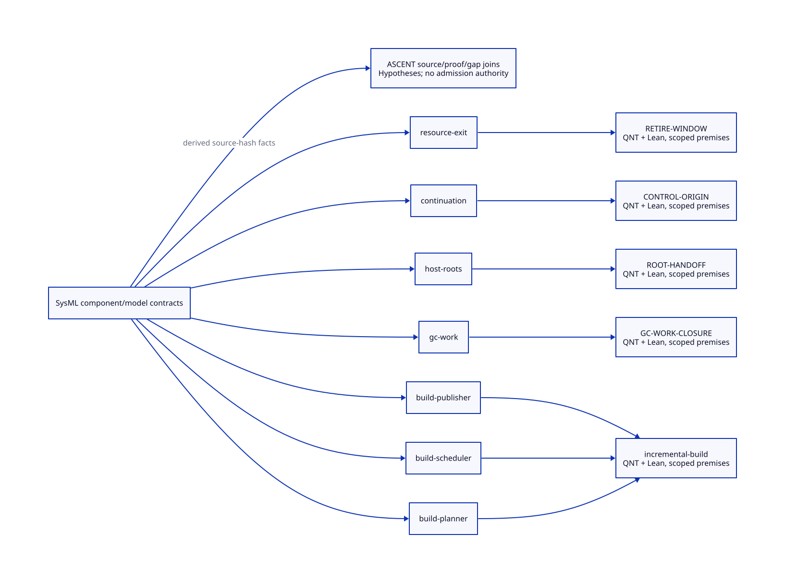

#+TITLE: SysML Component, Mathematical Model and ASCENT Contracts
#+SETUPFILE: org/setup.org
#+CATEGORY: modeling
#+OPTIONS: toc:3 num:t
#+PROPERTY: header-args :eval never

* RESEARCH One association source with explicit proof meaning
:PROPERTIES:
:ID: bc21bf41-deb6-4dda-a16f-c89518015243
:CUSTOM_ID: component-model-correspondence
:OWNER: Modeling and assurance relations
:AUTHORITY: GambitAssuranceRelations
:STATUS: correspondence-open
:EVIDENCE_CLASS: structural-association-and-conditional-formal-support
:END:

[[file:models/sysml/assurance.sysml][SysML assurance]] owns which component needs which mathematical model,
its source/symbol binding, state/event projection, premises and proof obligation.
The [[file:component-model-map.org][derived matrix]] resolves existing runtime model paths through their
unique ContractBinding IDs. It does not copy GC or continuation models into
the build subsystem. Three build components share one new QNT/Lean model set;
four runtime components reuse their existing source/symbol pairs.

 ([[file:diagrams/component-models.d2][source]]) connects components, model bindings
and the [[file:ascent/component-models.ss][derived ASCENT selector]]. Structural association is only the start
of refinement. CompositionAdmissionLaw continues to require related initial
states, step/stutter preservation, discharged assumptions and progress before
a composition claim.

** Use the right model for each question
:PROPERTIES:
:CUSTOM_ID: model-roles
:END:

#+NAME: modeling-role-boundaries
| System/question | Mathematical object | QNT role | Lean role | ASCENT role |
|---+---+---+---+---|
| Incremental invalidation/reuse | Dependency relation, input cuts, consumer projections, pure producers and cache origin | Interleavings and failures in a bounded action cohort | Arbitrary-type affected closure, conditional reuse/cutoff and no-op work algebra | Join source rules, model symbols, premises, deltas and unresolved obligations |
| Parallel build/publication | Action states, dependency readiness, credits, snapshots and staging ownership | Ready/running/staged/published/cancelled transitions; fault cohorts | Budget-step and finite-trace preservation; progress/commit refinement remains open | Associate real schedulers/callers and distinguish safety, cost and progress claims |
| GC work | Producer/task custody, copy progress and phase termination | Existing GC owner and atomic actions, bounded by its actual scope | Existing accounting/conditional contracts; full native refinement remains open | Trace missing producers and source/model identity; no automatic safety admission |
| Roots/control/FFI/exit | Slot/value handoff, raw origins, acquired effects and target lifetime | Their separate runtime bindings | Their own conditional theorems and missing premises | Cross-module dependency/evidence/gap queries under the exact source identity |

The existing native_build_driver_correspondence QNT admits an investigation
under a fixed budget; it does not model incremental correctness. Do not infer
one model's result from a similar filename, shared language or companion proof.
Likewise, the build credit algebra is not a GC termination proof merely because
both systems track outstanding work.

** Formal status and refinement gaps
:PROPERTIES:
:CUSTOM_ID: component-formal-status
:END:

[[file:../../models/build/incremental_build.qnt][The new QNT source]] has three positive initializers, four semantic/scheduling
fault cohorts and one redundant-work cohort. Typechecking establishes source
well-formedness only; no state exploration or new counterexample execution is
claimed. [[file:../../models/build/IncrementalBuild.lean][The new standalone Lean source]] now states thirty-one theorems after the capability/fidelity study
without sorry/axiom placeholders. Its local kernel check is separate from the
existing LeanPoo environment and earlier proof receipts. A failed first check
caused by a reserved identifier is retained; the identifier was corrected.

GC-WORK-CLOSURE has no separate scoped report in its existing binding. The
projection now emits that absence explicitly instead of borrowing another
binding's report or hashing an empty path. Existing reports remain historical
support with their own coverage. Receipt presence is not proof acceptance.

Missing work is explicit: complete dynamic source cuts, target/argv/env meaning,
graph/step mapping, actual multi-output commit, weighted recursive scheduling,
fairness, memory limits and the full 34-unit macro population. Runtime roots,
copy frames and continuation writers retain their own open obligations.
No QNT-to-Lean or native-source simulation theorem is asserted by matching
schema fields or passing structural validation.

** ASCENT supports questions and hypotheses, not proof promotion
:PROPERTIES:
:CUSTOM_ID: ascent-correspondence
:END:

The existing documentation projection resolves SysML component associations,
current model paths/symbols and source digests into Scheme evidence relations.
The [[file:ascent/component-models.request.scm][derived request]] uses the already installed trajectory submit interface.
Its association/artifact joins produce one hypothesis per component and factors
for component ID, QNT/Lean source, source digest and open obligation/premise.
It declares no model success, native observation or execution authorization.

A reader can query: which model is required for build-scheduler; which premises
prevent a GC-work refinement claim; which source identity a Lean theorem refers
to; and whether a requested performance claim has only safety support. The LLM
must retain a counterexample or changed-source result and revisit the relevant
obligation, rather than turn a plausible textual chain into a closed proof.

Submission stores these derived records in the selected task's existing
hypothesis journal. It does not install a second evidence database or mark them
host-attested. Subsequent Clue reads can join component-id and model factors;
registered-view incompleteness remains visible. Re-export when canonical
associations or model sources change. Historical hashes are not overwritten.

Claim and immutable hypothesis IDs bind the canonical model, model sources and
report digest bundle. A changed projection uses a new identity; it never edits
an already retained journal ID. Reads additionally
join component-id, association-source-sha256 and association-bundle-sha256 under the same hypothesis
identity/digest, so an earlier projection cannot silently answer for a changed
model. An earlier pre-correction submission is retained as an unqualified
historical hypothesis; it is not the current projection or an attested result.

#+NAME: component-model-maintenance
#+BEGIN_SRC sh :eval never
.venv/bin/python dev/modeling/tools/sync-views.py --task build-chain-model-correspondence --write
.venv/bin/gambit-smp --task build-chain-model-correspondence trajectory submit < dev/modeling/ascent/component-models.request.scm
#+END_SRC

Submit only a newly derived bundle. An unchanged retained hypothesis ID is
immutable; subsequent maintenance reuses its read/checkpoint rather than
submitting it again. The failed duplicate-ID submission is retained as evidence
of that guard, not bypassed by changing the journal implementation.

These are documentation/association operations, not a build engine, native test
or permission to execute a proposed LLM action. Current receipts are linked
from [[file:../research/validation.org][validation]].

* RESEARCH GSC correctness subcontracts and source population
:PROPERTIES:
:CUSTOM_ID: component-build-correctness
:STATUS: conditional-algebra-source-refinement-open
:END:

The [[file:../architecture/toolchain/correctness-design.org][GSC correctness design]] decomposes BF-BUILD-CUT/BF-BUILD-BUDGET
into six SysML-owned subcontracts. The QNT source retains the original ten-node
scenario, adds a 74-action static inventory and an auxiliary three-input
immutable-view protocol. These are three specifications in one bound source,
not three executed native workloads. Fifteen Lean conditional theorems include
a generic forward-simulation preservation lemma; the actual relation and
initial states for Gambit are not constructed. The [[file:../architecture/toolchain/correctness-map.org][closure matrix]] lists them.

Derived ASCENT factors include correctness-contract, correctness-status,
correctness-open-premise, generation-target-count and gsc-slice-action-count
for the three build components. All are source-bound design hypotheses.
No read, conditional theorem or join promotes native admission. The exact
source bundle changes when these contracts or formal receipts change, so the
immutable journal retains prior associations separately.

* RESEARCH Adaptive reads and population refinement
:PROPERTIES:
:CUSTOM_ID: component-adaptive-read-refinement
:STATUS: conditional-theory-source-issuers-open
:END:

[[file:../architecture/toolchain/read-snapshot-design.org][The GSC read/credential study]] adds eleven Lean theorems (26 total), including
closed adaptive trace replay, exact finite selected graph facts, readiness,
budget and relational trace safety. It does not supply actual Scheme effect
mediation, boot context, snapshot issuer or output-oracle correspondence.
The same QNT source adds necessary boundary predicates; it is typechecked,
not explored. No older runtime proof environment is requalified.

The SysML-derived ASCENT projection adds read-boundary/read-gap,
snapshot-condition/snapshot-issue-guard/snapshot-proof-gap and
refinement-step/refinement-premise/refinement-proof-gap factors. Each remains
a hypothesis under the exact current source bundle. Source change invalidates
input credentials; output inequality requires a separate observed/proved premise.

The larger projection initially exceeded the existing Scheme rule-source byte
bound. The failed submission is retained. Shared model-set factors now reside
once in contractFactor(binding,name,value) and join to each component's
existing factor relation. No parser limit or execution authority was widened;
this changes document/evidence projection storage, not the build system.

* RESEARCH Capability closure and faithful output observations
:PROPERTIES:
:CUSTOM_ID: component-capability-output-fidelity
:STATUS: actual-closure-and-observation-reflection-open
:END:
[[file:../architecture/toolchain/capability-observation-design.org][The caller/capability study]] adds five Lean results (31 total), including
caller/callback coverage composition, conditional refusal, faithful observation
reflection, factorization and a finite scalar-summary counterexample. The QNT
source gains a structured observation/qualification module (four modules total),
without modifying the original ten-node scenario or executing exploration.

SysML owns capability-gate/admission/refusal and output-observation/fidelity/
equality-refusal factors. ASCENT derives these from the shared contractFactor
relation once per model set. They remain source-bound hypotheses, not actual
effect closure, parsed native artifacts or safety admission. The earlier
26-theorem receipt and association scope remain historical and unchanged.

* RESEARCH GSC consumer observation and safety reflection
[[file:../architecture/toolchain/output-fidelity-design.org][The source-backed _host generation/composition study]] adds twelve SysML-owned
fidelity/clean/failure obligations. Seven new Lean results bring the total to
38; five QNT modules are typechecked only. Exact byte/atom injection is checked;
recursive datum decoding, real clean origin and concrete safety reflection
remain open. No build implementation or native tests are claimed.

The first fidelity projection hit ASCENT's existing form-length bound. Its
failed request is retained. A shared fidelityDuty(binding,identity,gap,failure)
fact initially carried one obligation with three public factor names.
The current projection extends that fact with a runtime-contract field and
adds fidelity-runtime-contract. associationDigest stores canonical source,
bundle and shared evidence classification once; joins preserve public factors. The binding identity is resolved from the SysML-owned formal set.
This changes evidence projection storage only; parser limits and authority
remain unchanged. The reference Rust reader source is explanatory evidence,
not a claim that its checkout matches the installed binary revision.

* RESEARCH Recursive wire and actual Scheme domain
[[file:../architecture/toolchain/recursive-codec-design.org][The metadata-domain study]] adds eight SysML duties and eight Lean theorems
(46 total), including recursive mathematical wire inverse and injection. Six
QNT modules are typechecked only. Actual Scheme scalar/identity admission,
reader fidelity, consumer factorization and resource bounds remain open.
No build/runtime implementation or native tests are claimed.

* RESEARCH Logical heap admission and runtime dependencies
[[file:../architecture/toolchain/scheme-value-admission-design.org][The Scheme value study]] adds nine SysML duties and ten Lean statements
(56 total). Seven QNT modules typecheck only. Mutable-view stability, canonical
symbol identity and actual GC scanner participation are separate obligations.
ROOT-HANDOFF is reused by reference; actual readback and linker reflection
remain open. No build/runtime implementation or native testing is claimed.

- [[file:../architecture/toolchain/scheme-value-admission-map.org][Derived source, proof and cost matrix]]
- [[file:../architecture/toolchain/diagrams/scheme-value-admission.d2][D2 source]] / [[file:../architecture/toolchain/diagrams/scheme-value-admission.svg][rendered graph]]

* RESEARCH Script-line capture and complete linker observations
[[file:../architecture/toolchain/script-line-reflection-design.org][The script-line study]] adds ten SysML duties with bounded research status,
twelve Lean statements (68 total) and an eighth QNT module (typechecking only).
Named writers, captured aliases and input currentness have separate cuts.
Full outcome/effect reflection is conditional; actual readback and cleanup
refinement remain open. ROOT-HANDOFF is reused; no native tests are claimed.

- [[file:../architecture/toolchain/script-line-reflection-map.org][Derived closure and benefit matrix]]
- [[file:../architecture/toolchain/diagrams/script-line-reflection.d2][D2 source]] / [[file:../architecture/toolchain/diagrams/script-line-reflection.svg][rendered graph]]

The current private association relation carries component identity and open
premise with its canonical binding. Joins derive their existing public factors.
The shared fidelityDuty additionally carries a SysML research-status value;
fidelity-research-status exposes bounded source/kernel/open distinctions.
This factoring preserves parser limits and grants no runtime authority.

* RESEARCH Stable-view lifecycle and macOS development cost
[[file:../architecture/toolchain/stable-view-design.org][Stable-view issuance/revoke/continuation entry]] and
[[file:../architecture/toolchain/macos-development-design.org][macOS development architecture]] use separate owned SysML models.
Nine lifecycle transitions reference shared runtime contracts. Thirteen duties
add bounded source/history/refinement and benefit accounting; 82 standalone Lean
statements pass and ten QNT modules typecheck only. Actual issuer/provider/control/
I/O and whole-request native performance remain unqualified. No implementation
or native tests are added.

- [[file:../architecture/toolchain/stable-view-map.org][Lifecycle evidence/transition matrix]] / [[file:../architecture/toolchain/diagrams/stable-view.svg][D2 lifecycle]]
- [[file:../architecture/toolchain/macos-development-map.org][Darwin evidence/cost matrix]] / [[file:../architecture/toolchain/diagrams/macos-development.svg][D2 dependencies]]

Capability-gate/admission/refusal now share one private capabilityDuty tuple
per canonical binding. Joins preserve the existing public factor names and
parser limits. Owned SysML contracts enter the source-bound association
bundle through their own anchors; historical Darwin input hashes are also
bound by the scoped report identity. This grants no native observations,
performance admission or execution authority.

** OPEN Native descriptor source-to-contract refinement
[[file:../architecture/toolchain/models/sysml/native-descriptor.sysml][GambitNativeDescriptor]] owns eight additional planned proof duties with runtime/toolchain owners and shared contract references. [[file:../architecture/toolchain/native-descriptor-map.org][Their matrix]] specifies QNT states/actions and Lean relations/laws; these are not new implemented symbols or passed proofs. The separate [[file:ascent/native-descriptor.ss][ASCENT code-contract projection]] carries source ranges/hashes, field and migration identities and duty owners through joins. Existing 17 formal sources remain unchanged; there is no automatic C ABI or GC/control refinement.

** OPEN FrameSpec inside the T0 target GC/SMP model
[[file:../architecture/runtime/interfaces/models/sysml/frame-contract.sysml][Frame interface SysML]] and the existing [[file:../architecture/runtime/models/sysml/composition.sysml][runtime composition owner]] connect ten proposed frame refinements to seven T0 redesign lanes, four existing root bindings and classified counterexamples. The fine-grained FL ASCENT adapter remains OPEN; the existing parent ND association is not a substitute. Native SysML owns model interpretation and rendering. The withdrawn Python projection is retained as historical evidence only. These are new target obligations, not new passed QNT/Lean proofs; existing root files are unchanged.

** OPEN T0 role grants and native-resolved formal references
[[file:../architecture/runtime/interfaces/role-contract-design.org][Execution/participant/collector contracts]] bind four existing registry records
through actual SysML reference parts and dependencies. The native executable
resolves IDs, QNT/Lean paths and evidence classifications. JSON field transport
and the existing ASCENT engine join these pairs to source-bound component
hypotheses; caller-verified hashes are not tool-attested proof observations.
The eight new necessary laws require separate state/step, source-memory and
progress proofs. GC-WORK-CLOSURE still has no admitted scoped validation report.

** RESEARCH Native membership duty associations
[[file:../architecture/runtime/interfaces/models/sysml/membership-revocation.sysml][GambitMembershipRevocation]] owns eight duty → source → root-binding records.
[[file:../architecture/runtime/interfaces/membership-revocation-design.org::#membership-refinement][The refinement matrix]] supplies QNT atomic-cut and Lean preservation premises.
Native evaluated strings may be transported through jq/OpenSSL into ASCENT;
that adapter may not reinterpret a requirement as a proof or support observation.

[[file:ascent/membership-revocation.ss][The thin ASCENT selector]] and [[file:ascent/membership-revocation.request.scm][bound request]] transport native-resolved
source/law/root associations. Eight duty rows reuse four root pairs, preserving
their original report classes and open premises; source hashes and the complete
32-model input bundle are carried in the scoped receipt. Regenerate after any
native model change before treating the query as current.

** RESEARCH Native caller-to-duty evidence for publication close
[[file:../architecture/runtime/interfaces/models/sysml/publication-close.sysml][GambitPublicationClose]] owns 32 selected source/caller/family/root records
and nine duty bindings. Its native-e transport joins four existing root-model
pairs; source path/line and byte identities stay distinct from actual source
simulation. [[file:../architecture/runtime/interfaces/publication-close-design.org::#publication-refinement][The owning QNT/Lean matrix]] retains all nine duties as OPEN.

[[file:ascent/publication-close.ss][The publication selector]] and [[file:ascent/publication-close.request.scm][bound request]] transport native evaluated
caller/duty records with source hashes. Thirty-two caller and nine duty rows join
four existing root pairs. These are source-bound hypotheses, not support
observations, proof results or an admitted whole-program caller graph.

** RESEARCH From association to executable assurance planning
[[file:assurance-planner.org][The generic DSL design]] separates module-owned needs/models from shared native
method policy. [[file:../architecture/runtime/interfaces/models/sysml/synchronous-publication.sysml][The synchronous-publication component]] owns its own QNT/Lean set
and typed prerequisites. ASCENT now derives missing models, required checks,
exact scoped receipt matches and unmet dependency closure; historical root pairs
are supporting contracts, not replacements for the component behavior model.

** RESEARCH Behavior and evidence frontier beyond file associations
[[file:component-assurance.org][The composed component study]] supplies module-owned invariants, executable
histories, exact Lean symbol scopes and cross-component prerequisites for all
seven existing component identities. [[file:ascent/assurance-planner.ss][The actual DSL]] separates local result
matching from transitive evidence readiness. Legacy registry rows are retained;
they are not promoted to source simulation by these checks.
