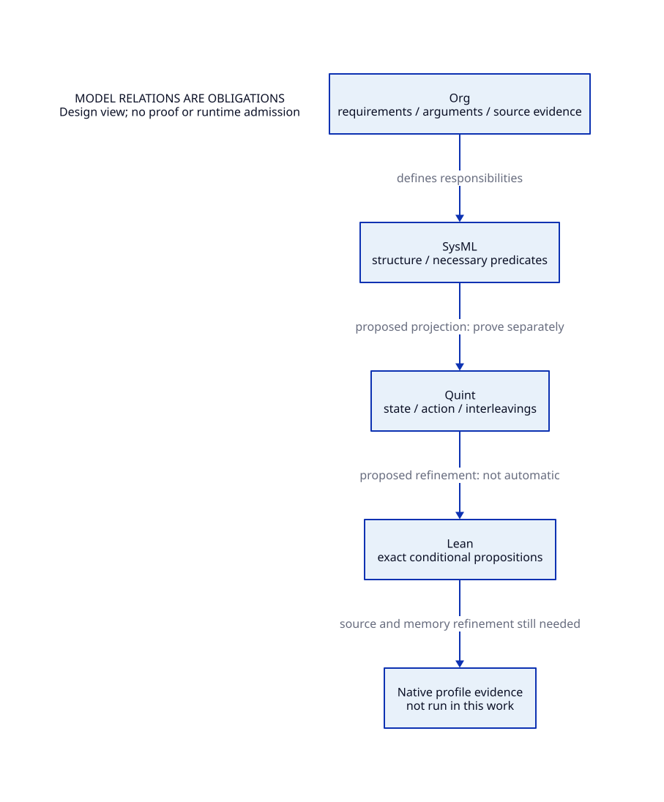

#+TITLE: Modeling Methods and Compositional Assurance
#+SETUPFILE: org/setup.org
#+CATEGORY: modeling

Start with [[file:component-model-design.org][SysML component/QNT/Lean/ASCENT correspondence]] and [[file:component-model-map.org][its derived mapping]]. Each component has explicit model purpose, source/symbol references, state/event projection and unresolved premises. Runtime bindings remain at their original owner; build components share one new formal set.

* RESEARCH Models belong to responsibilities; methods belong here
:PROPERTIES:
:ID: 7e00c706-b693-57e4-a62d-9e9f449fac98
:CUSTOM_ID: modeling-ownership
:OWNER: modeling
:STATUS: design-only
:EVIDENCE_CLASS: design-and-source-correspondence
:END:

The modeling layer defines notation, relation records and evidence admission. GC/control/FFI policy remains in architecture modules. ~QNT~ is the source-file suffix for Quint, not a second modeling language.

#+NAME: modeling-method-responsibilities
| Representation | Owns | Cannot establish by itself |
|---+---+---|
| Org | Requirements, arguments, sources, assumptions, counterexamples and decisions | Runtime correctness from prose or a green TODO state |
| D2 | Human-readable views and dependency diagrams | Execution semantics or proof |
| SysML | Structure, interfaces, identities and necessary requirement predicates | Satisfaction from strict diagnostics |
| Quint / .qnt | Explicit state/action relations, interleavings, safety and temporal assumptions | Native C atomics, full domains or fairness of the OS |
| Lean | Exact propositions, proof terms, generic invariants and refinement obligations | Source correspondence from a theorem name or omitted premise |
| Native evidence | Profile-specific ABI/GC/control and measured-work acceptance | Unbounded proof or other toolchain/profile admission |

- [[file:standards.org][Model ownership, contracts and change rules]]
- [[file:correspondence.org][Exact GC/control/FFI cross-model relations]]
- [[file:libraries/index.org][Shared libraries and unique source ownership]]
- [[file:models/sysml/assurance.sysml][Assurance relation model]]
- [[file:diagrams/assurance.d2][Assurance view source]]
- 

** Primary method references
- [[https://www.omg.org/spec/SysML/2.0/About-SysML][OMG SysML normative specification index]].
- [[https://quint.sh/docs/checking-properties][Quint property checking]]: retain scope, property and run identity for any future exploration.
- [[https://lean-lang.org/doc/reference/latest/][Lean reference]]: the kernel checks proof terms; our repository theorem source was read, not rerun here.

** SysML-derived maintained views
- [[file:organization-map.org][Organization and module artifact associations]]
- [[file:proof-obligations.org][GC/control proof obligations and dependency ledger]]
- [[file:../architecture/runtime/interfaces/gc-control-contract.org][Shared conditional argument and closure frontier]]
- [[file:tools/sync-views.py][Documentation-only derivation and drift checker]]

** Completion contract refinement
- [[file:../architecture/runtime/interfaces/gc-completion-design.org][Producer closure, late work, phase scopes and target permissions]]
- [[file:../architecture/runtime/interfaces/completion-model-map.org][SysML-derived source anchors and lifecycle]]

** RESEARCH Component assurance inference
[[file:assurance-planner.org][SysML -> ASCENT -> QNT/Lean needs, scoped receipts and unresolved prerequisites]]
uses shared native method policy with module-owned models. The executable pilot
is synchronous GC publication. Selection and formal checking remain distinct
from source refinement and native runtime acceptance.

** RESEARCH Composed component assurance
[[file:component-assurance.org][Modern-C component closure and shared-contract matrix]] / [[file:ascent/assurance-planner.ss][actual DSL]] /
[[file:diagrams/component-assurance.svg][native D2]]. The seven existing components and synchronous publication
now have explicit behavior, scoped checks and cross-component proof prerequisites.
