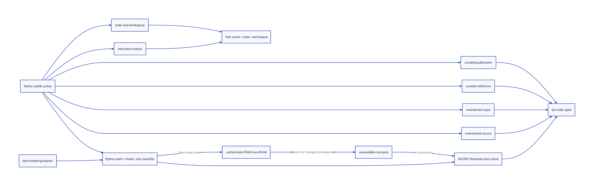

#+TITLE: Research Publication and Execution Storage
#+SETUPFILE: org/setup.org
#+CATEGORY: modeling

* POLICY Git publishes maintained knowledge, not execution directories
:PROPERTIES:
:CUSTOM_ID: publication-boundary
:AUTHORITY: models/sysml/research-storage.sysml
:DEFAULT: deny-unclassified
:END:

[[file:models/sysml/research-storage.sysml][The native SysML policy]] owns the classes, paths, exceptions and metadata
limit. [[file:../../src/gambit_smp/research_publication.py][The shared Python view generator]] receives typed parameters from the sealed OpenSysML Python API for that model; it does not parse CLI stdout. The existing Recipe
compares the runtime rule view, marked =.gitignore= section and D2 source,
then checks class consistency through [[file:../../evidence/dsl/research-publication.ss][ASCENT]]. The generated Python view is
a checked derivative, not another editable policy source. There is no parallel
layout.json or directory manifest.

#+NAME: publication-layout
| Role | Git | Owner / location | Admission |
|------+-----+------------------+-----------|
| Maintained code, SysML, QNT, Lean, ASCENT | yes | src/, models/, dev/ | Declared source roots and suffixes |
| Org, D2, deterministic review diagrams | yes | dev/, docs/ | Maintained design views, not run observations |
| Static schemas, cases, recipes | yes | tests/, evidence/dsl, scenarios, fixtures | Declared input roots or exact named input |
| Pinned primary source references | yes | evidence/research/source-references/, evidence/upstream/ | Reviewed source identity; no run-directory copy |
| Small documentary conclusions | selective | evidence/research/published/, retained/, documentary-custody/ | Reviewed selection; metadata at most 65536 bytes |
| Command/status records, extracted IR, samples | no | .cache/tasks/TASK/runs/RUN/ | Run owner; never automatic publication |
| Source snapshots, configured trees, binaries | no | .cache/ or .data/worktrees/ | Workspace/run custody |
| Leases and lifecycle journals | no | .state/ | State owner |
| Unclassified files | no | decide role first | Amend SysML explicitly; do not force-add |

An exact list preserves nine existing regression log fixtures as maintained
inputs. It does not admit new execution logs. Existing hand-maintained source
inventories and design cases have exact input declarations; arbitrary new JSON
files under docs/ or evidence/ do not inherit that permission. Pinned vendor
repositories remain Git links; their worktree contents are not outer-repository
publications.

#+CAPTION: Derived publication roles and enforcement flow

** Bounded native model bindings :sysml:sdk:audit:
:PROPERTIES:
:CUSTOM_ID: bounded-native-binding
:IMPLEMENTATION: src/gambit_smp/contract_capabilities.py::api_binding
:TESTS: tests/test_contract_capabilities.py
:END:

A published binding contains repository source hashes, unique qualified field
selectors, the native model identity and a digest of the typed projected values.
It does not duplicate model prose, diagrams or historical value snapshots.
The existing qualified OpenSysML connection reconstructs values directly from
those SysML sources. Source drift, diagnostics, duplicate selectors, missing
scalar values and typed-value digest differences deny the read. Boolean and
integer values remain distinct.

#+NAME: native-binding-read
#+begin_src python :eval never
from gambit_smp.contract_capabilities import api_binding

# root, binding and connection are supplied by the existing qualified owner.
projected = api_binding(connection, root, binding)
values = projected["expressions"]
#+end_src

#+CAPTION: Projection authority and publication boundary
| Artifact | Authority | Limit |
|----------+-----------+-------|
| SysML sources | Definitions and current field values | Source-owned review |
| Binding descriptor | Source closure, selection and projection identities | Publication metadata bound |
| Reconstructed values | Strict native SDK parse and evaluation | No cached-value fallback |
| Historical authoring identities | Trace prior payloads and changed selectors | No current-model or runtime admission |

Passing this read establishes source/projection correspondence. It does not
prove runtime semantics, QNT invariants, Lean obligations or native test success.

The [[file:diagrams/research-storage.d2][D2 source]] is generated directly from the same native SysML categories.

* CONTRACT Enforcement has distinct responsibilities
:PROPERTIES:
:CUSTOM_ID: storage-enforcement
:VERIFICATION_OWNER: native-SysML-and-ASCENT
:END:

1. SysML declares the allowed artifact classes and restrictions.
2. Python classifies canonical paths, Git modes and staged blob sizes; unknown
   roles, aliases, generated streams and snapshots fail closed.
3. ASCENT checks that the declared class agrees with the classifier and the
   class policy. Calling a command log a publication cannot grant permission.
4. The Python storage audit hook rejects generated evidence writes before
   opening their targets. Producers allocate their outputs in the task cache.
5. The Git-index check also catches ignored files added with =git add -f=.
   =.gitignore= alone is not the publication authority.

QNT and Lean receive no duplicate obligation here: path/type publication
admission is a finite rule check. They remain owners of scheduler/lifetime
state machines and algebraic/data proofs respectively. File admission cannot
prove an arbitrary JSON conclusion true, nor detect deliberately renamed
arbitrary content. Source identity and documentary meaning still require review.

#+NAME: storage-policy-commands
#+begin_src python :eval never
# From this repository's Python environment:
# Compile/validate the native authority and ASCENT scenarios:
# just research-policy MANAGED_ENGINE_PATH
# Verify generated views without rewriting them:
# just research-policy MANAGED_ENGINE_PATH
# Lightweight CI/index gate; checks the SysML hash, no native SysML dependency:
# python -m gambit_smp.research_publication
# Restrict a local pre-commit review to staged additions/modifications:
# python -m gambit_smp.research_publication --staged
#+end_src

* EVIDENCE Migration preserves observations outside Git
:PROPERTIES:
:CUSTOM_ID: execution-cache-migration
:SCOPE: local-storage-and-index
:END:

The former =evidence/research/future-frame-commit/= run tree lives at
=.cache/tasks/future-frame-commit/runs/research/=. Other uncurated historical
execution output lives under =.cache/research/legacy-evidence/=, preserving its
original relative path. New runs use the task allocator, not that legacy archive.
Maintained CI recipes and declarations live in =tests/recipes/=.

The local migration journal and original index object packs are in
=.cache/tasks/future-frame-commit/runs/storage-migration/=. They support recovery
of staged-only bytes and record index removals; they are themselves cache.
No Git history was rewritten. This change removes cache from the current index
and future commits; it does not shrink existing historical Git objects.

Archived observations retain their original bytes and hashes. Changed source
locators do not refresh old qualifications. A clean clone may lack local run
cache: its evidence status is =unavailable= until reproduced or retrieved,
never a fabricated successful receipt. Retain a small source-bound conclusion
only through an explicit reviewed publication, not by copying the whole cache.

* CONTRACT Producer and consumer follow-through
:PROPERTIES:
:CUSTOM_ID: publication-flow-follow-through
:END:

[[file:research-flow.org][The producer/consumer contract]] distinguishes 62 maintained recipe inputs from
execution results, isolates study runs and checks a source-only checkout.
Historical locators are inert text, never portable file hyperlinks or proof of
availability. The native subprocess effect boundary remains unresolved.
