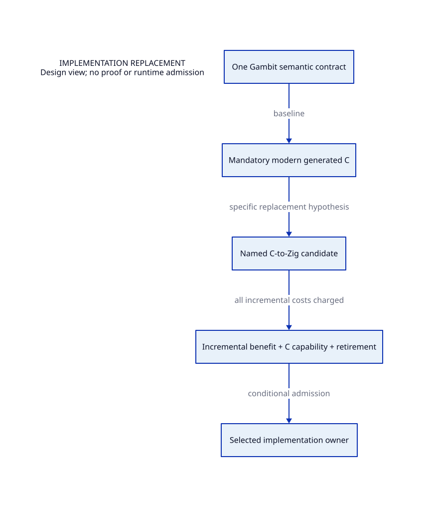

#+TITLE: Implementation Refactoring Routes
#+SETUPFILE: ../modeling/org/setup.org
#+CATEGORY: architecture

* RESEARCH One semantic contract, selected implementation ownership
:PROPERTIES:
:ID: b01d3a52-1173-5676-aa27-ae42da9d630c
:CUSTOM_ID: refactoring-routes
:OWNER: refactoring
:STATUS: design-only
:EVIDENCE_CLASS: design-and-source-correspondence
:END:

Modern C is the required baseline. A Zig candidate names an actual C responsibility, preserves C-facing capability and identifies which old implementation can retire. C and Zig comparison is a research control; permanent dual implementations are not a default design.

[[file:why-refactor.org][Why refactor]] is the entry argument: current SMP pain, structural coupling, successful repair boundaries, replacement and retirement conditions. [[file:pressure-map.org][The evidence and benefit matrix]] and [[file:diagrams/pressure.svg][architecture view]] derive from this category's SysML metadata. [[file:../research-lanes.org][Research responsibilities]] distinguish common contracts, mandatory modern C, conditional Zig and shared toolchain infrastructure. C++ is excluded.

Continue with [[file:modern-c/runtime-blueprint.org][the complete runtime/build composition]], [[file:modern-c/blueprint-matrix.org][conditional benefit and retirement matrix]] and [[file:modern-c/diagrams/migration.svg][migration prerequisites]]. Existing pressure IDs remain the shared references; composition adds no second semantic owner.

#+NAME: refactoring-admission-matrix
| Obligation | Modern C | C to Zig | Shared modeling owner |
|---+---+---+---|
| Scheme, roots, control and GC semantics | Must preserve | Must preserve | architecture/runtime and compiler |
| C backend / ABI / embedding | Mandatory | Mandatory through explicit interfaces | architecture/system |
| Common modernization work | Counts toward baseline | Cannot count again as Zig-only benefit | architecture and research |
| Replacement identity | Named old macro/emission/support paths | Same plus exact replacement and retirement | refactoring route |
| Net gain | Eliminate repeated work and implicit obligations | Additional gain after bridge, toolchain and duplicate support costs | research benefit argument |
| Failure condition | Uncovered writer/root/control exit | Same, plus no incremental gain or permanent duplicate ownership | module admission |

- [[file:modern-c/index.org][Mandatory modern generated C foundation]]
- [[file:zig/index.org][Conditional C-to-Zig evolution]]
- [[file:models/sysml/adoption.sysml][Refactoring requirements]]
- [[file:diagrams/adoption.d2][Replacement view source]]
- 
