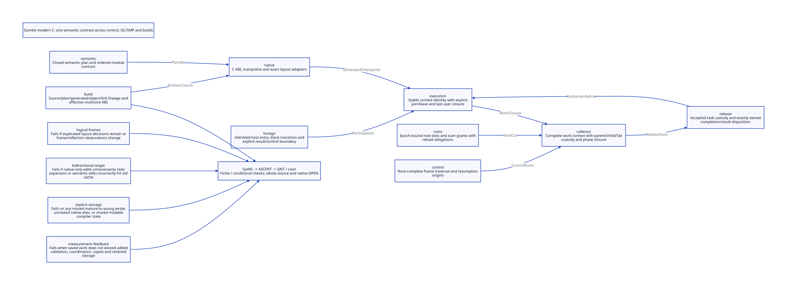

#+TITLE: Amplifying Gambit PVM Advantages Across the Modern C Architecture
#+SETUPFILE: ../../modeling/org/setup.org
#+LANGUAGE: en
#+OPTIONS: toc:3 num:nil
#+PROPERTY: header-args :eval never
#+TODO: RESEARCH DECIDED | ADOPTED RETIRED

* DECIDED Scope: one Gambit architecture, not a marker extension
:PROPERTIES:
:CUSTOM_ID: advantage-architecture
:AUTHORITY: GambitAdvantageArchitecture; GambitModernizationTarget; GambitRuntimeComposition
:STATUS: whole-architecture-design; finite-protocol-checked; source-simulation-open
:MAINLINE: Scheme semantic ownership and modern generated C
:END:

This study extends the [[file:modernization-target.org][six governing replacements]] and [[file:map-multishot-composition.org][joint map/multi-shot witness]].
It references all nine canonical module owners and nine interfaces from
[[file:../../architecture/runtime/models/sysml/composition.sysml][runtime composition]], rather than creating another component inventory.
The [[file:models/sysml/advantage-architecture.sysml][SysML source]] owns four advantage records, six decision references,
twelve cross-module contracts, twenty-three advantage/contract uses, six benefit
rows and seven open scopes. [[file:advantage-architecture-matrix.org][Org matrix]] and  are native projections.
The [[file:../../modeling/ascent/advantage-architecture.rules.scm][actual ASCENT DSL]] joins source witnesses, component endpoints,
interface, action, guard, theorem, paper and obligation identity. It cannot turn
those joins into semantic proofs. [[file:../../../evidence/research/advantage-architecture/checks.json][Check receipts]] distinguish finite protocols,
conditional Lean laws, source refinement, platform qualification and performance.

Modernization means replacing implicit semantic/layout/ownership authorities with
explicit shared contracts, and retiring their old responsibilities. It is not a
new flag profile, additional gate records or a second runtime language. The marker
[[file:../../architecture/toolchain/marker-alias-revocation-design.org][alias/revocation slice]] supplies a subordinate FFI constraint; its local passes
cannot qualify whole GC/SMP, continuation semantics or the compiler service.

* RESEARCH Paper basis and the four amplification decisions
:PROPERTIES:
:CUSTOM_ID: advantage-paper-basis
:PAPER: Feeley-Miller-LFP90
:END:

[[https://www.iro.umontreal.ca/~feeley/papers/FeeleyMillerLFP90.pdf][Feeley and Miller, A Parallel Virtual Machine for Efficient Scheme Compilation]]
§2 describes logical implementation objects and bidirectional target information;
§2.1 separates operand storage classes while retaining a heap-memory alias
exception. The abstract proposes VM measurements to inform representation and
optimization choices. We select these four ideas as architectural advantages.
Our new ownership, GC and build mechanisms below are proposals, not statements
that the paper already defines them. Historical speed comparisons do not quantify
this redesign. PVM futures are not evidence today's SMP or incremental compiler
is already correct or that one continuation may be invoked concurrently.

| Advantage | Required architectural amplification | Failure criterion |
|---+---+---|
| Logical frames | One Scheme-owned FrameSpec/PointId interpreted by every native/root/control consumer | Independent semantic layouts remain or reflective aliases change |
| Bidirectional target knowledge | SemanticProfile before completion; LayoutAbi and ToolRecipe as narrower downstream inputs | A semantic change is reused or an unrelated tool edit forces expansion |
| Explicit storage and alias boundaries | Root domains, remembered writes, context ownership and explicit FFI escape classes | An unclassified writer or raw pointer bypasses required custody/barrier |
| Measurement feedback | Work/span/bytes/space ledgers tagged with exact plan/ABI/dependency cohort | Added barriers, copies, validation or retained storage erase saved work |

The native matrix contains the complete four-by-four mapping to FrameSpec,
continuation, GC/SMP and incremental compilation. The mappings are not independent
projects: their shared contracts must compose before any old authority retires.

* DESIGN Scheme contract compiler and FrameSpec consumers
:PROPERTIES:
:CUSTOM_ID: advantage-frame-contract
:END:

Scheme completes the GVM semantic graph before mechanical C emission. The result
carries FrameSpec, PointId, ModuleSpec, EffectSpec and AllocationSpec in one sealed
cohort. FrameSpec specifies slot identity, pointer kind/liveness per successor,
return/link home, normal/internal-return saved registers, denv origin, exposed
mutation policy and source origin. PointId is semantic occurrence/role/outcome,
not a regenerated C label ordinal. ModuleSpec binds entries, globals, descriptors
and dependencies to the same frame/runtime ABI.

The source seam is real: gsc/_front.scm:331-347 begins/ends environment, parse,
virtual and target state; 397-411 constructs module procedures/descriptors;
435-449 hands them to target.dump and C-interface output. _back.scm:197-238 has
explicit target semantics options, registers, primitive info and frame constraints;
388-419 selects a target and installs process-global callbacks. Current APIs are
not independent compile sessions merely because this seam exists.

_t-c-2.scm:targ-gen-label-return* derives size, variable homes, return link and root
map; _t-c-3.scm emits physical descriptor information. The actual one-list map in
lib/gambit/list/list.scm:850-925 calls the higher-order proc, recurses, then builds
pairs. Stored _std.c return descriptors distinguish callback and recursive-return
live maps. Their common frame size does not justify a single union root mask.
Stored C is source evidence, not newly generated or matched installed code.

| Consumer | Shared FrameSpec use | What remains specific |
|---+---+---|
| Native entry/return | PointId, slot homes, module/frame ABI and tail successors | Target trampoline, register moves, C ABI and portable primitives |
| Collector/root registry | Live pointer slots and current/saved/native root origins | Epoch grants, moving updates and independent scanned storage |
| Capture | Logical live frame closure and denv identity | Stack-backed or heap-backed representation and capture timing |
| Restore/scheduler | Same captured identity, per-shot execution image, reload obligations | Target materialization, exclusive run grant and wind transitions |
| Reflection/serialization | Stable logical coordinates and declared mutable/exposed status | Observation-preserving setters and authority-aware reconstruction |
| Compiler/build/LLVM service | Cohort/schema identity and full semantic effects | Query keys, target legality, dialect lowering and tool invalidation |

This is a target of one semantic authority serving six consumer classes, not a
claim that five measured duplicate implementations or their costs have already
been removed. Existing C portability primitives remain where real target variation
requires them. Semantic inference hidden in macros is the retirement target;
merely translating those macros or adding a schema alongside them does not count.

* DESIGN Repeatable continuation and native effects
:PROPERTIES:
:CUSTOM_ID: advantage-continuation
:END:

Use the existing map witness: an initial traversal captures in its second callback;
two later invocations supply new second values and rerun the suffix. Selected
source expectations remain (10 2 30), (10 20 30), (10 200 30), five callback calls,
three successful suffix native calls and three before/after wind pairs. These are
source-derived expected observations, not executions this turn. General Scheme
map does not impose this evaluation order; the selected Gambit path matters.

Captured logical computation remains repeatable. Each shot obtains a private
execution materialization and fresh native invocation; reachable Scheme objects,
mutable lexical cells and denv identities remain shared. Do not memoize an
effectful suffix, replay a completed native release or restore an expired C catcher.
Continuation reuse is not heap rollback and does not by itself permit simultaneous
cross-processor invocation.

_kernel.scm continuation/frame readers and setters, _io.scm explode/implode-frame,
_thread.scm continuation capture/graft/wind routines and header capture/restore
macros are real consumers. Shared persistent captured storage is eligible only
where observable identity and mutation semantics permit it. Exposed mutable frames
keep a canonical representation and observation-preserving restore until alias
simulation closes. Copy-on-write is a candidate with a proof obligation, not an
assumed universal optimization. Root registration precedes marker allocation and
all other potentially collecting conversions. Current c_intf.c retains the
proc_or_false rooting TODO; raw scheme-object conversion supplies no automatic
borrow lease. Those paths cannot be declared solved by a shared descriptor.

* DESIGN Generational GC and genuine SMP as one ownership architecture
:PROPERTIES:
:CUSTOM_ID: advantage-gc-smp
:END:

Current mem.c contains copying, still allocation, parallel scan queues, barriers
and PSTATE-bound scan/allocation fields. At garbage_collect_mark phase, RC root
scanning is selected in processor-zero branch. This source does not establish a
modern generational collector or complete VM-wide nonzero-processor root coverage.
Neither copying nor multiple collector processors alone implies generational GC.

The target separates ExecutionContext, GCParticipant, CollectorWorkContext and OS
carrier. VM owns membership, heap epochs, root domains and retained native outcomes.
A participant publishes complete updateable root slots after surrendering derived
pointers/borrows. Independent workers own queued/private copy/scan responsibility.
A migrating or exiting worker cannot erase its private cursor, Tail or child work.
The current end_heap_chunk, local/global scanning and idle detection are migration
anchors, not evidence those responsibilities are already carrier-independent.

Select context-local nursery regions and a parallel stopped-mutator minor cut;
retain a separate major-policy interface. All root producers join the closed cut,
including parked native calls through a proven frozen-root adapter. Frame, denv,
pair/vector/global, reconstruction and FFI mature-to-young stores use one barrier
contract: reserve capacity before store or use a preallocated conservative dirty
fallback. Barrier code must not implicitly collect while the value is unprotected.
Overflow becomes a later checkpoint request. Promotion failure retains source
roots/reservations; forwarding visibility does not imply complete initialization.

A mature captured graph can avoid whole-graph traversal on repeated minor rounds
only if ALL incoming roots and mature-to-young writes remain covered. Its root
handle is still visited/updated, remembered regions are still scanned, and major
collection still traces mature liveness. This is a conditional work reduction,
not permission to omit mature roots. Any unmediated FFI/reflection writer uses a
sound conservative mode or blocks that optimization; supported Scheme semantics
must not be silently restricted.

Closure is membership + roots + queued/private/in-flight/derived work, not an
empty queue or idle count alone. Weak processing and foreign cleanup may produce
new work and need their own phase/producer closure. Foreign release leaves the
moving collector critical phase only after rooted custody is accepted by the
release service; callbacks, affinity, descendants and unknown users can prevent
shutdown. Never wait under a root lock for GC or for an owner callback that needs
the same phase to finish. C11 slot publication, release/acquire acknowledgements,
last-use placement and generation wrap must be refined for every actual writer.
The QNT SC abstraction is not that weak-memory proof.

* DESIGN Gambit stages and Gerbil incremental compilation service
:PROPERTIES:
:CUSTOM_ID: advantage-incremental
:END:

Gambit owns semantic correctness, target negotiation, normalized/GVM products and
mechanical native lowering. Gerbil owns dependency queries, phase readiness,
independent compilation sessions, bounded scheduling, cache validation and atomic
multi-output publication. C/native tools are downstream service inputs. This is
primarily gxi/gxc Scheme-module modernization, not Gambit Make/bootstrap tuning.

The real iter chain imports interface/list-builder/iterators into begin-syntax
macros, reexports through iter/api and std/iter, and serves string/misc plus sync/wg.
Their interface names alone do not close executable macro support. Current Gerbil
driver.ss uses with-driver-mutex for import-module and optimize!, writes Scheme
files then queues GSC jobs; std/make.ss already has bounded workers and completion
coordination. Whole-module completion and shared frontend state, rather than a
lack of worker threads alone, constrain useful parallelism.

| Input projection | Semantic plan | C/layout | Native object/link |
|---+---+---+---|
| Source/macro execution support or semantic target option | Revalidate/recompute affected semantic dependency closure | Invalidate descendants unless consumed projection is unchanged | Invalidate affected descendants |
| Physical layout/frame/runtime ABI | Reuse only if no semantic feedback crosses this cut | Recompute affected layout consumers; same cohort across module/GC/restore | Recompile/relink exact ABI consumers |
| Native compiler/tool recipe only | Reuse admitted semantic result | Reuse only with complete emitted-code input identity | Recompute affected compile/link products |
| No relevant change | Validate complete trace then reuse | Validate manifests then reuse | Validate manifests then reuse |

Keys are projected dependency records, not just a monolithic version string:
SemanticKey includes source/read/macro/eval/capability traces, declarations, lexical
identity, source origin and SemanticProfile. LayoutKey adds FrameSpec schema and
physical ABI; NativeKey adds compiler/linker/SDK/ordered argv/env/cwd and dependencies.
An observed dependency change whose consumed semantic projection is equal may cut
propagation only after output encoding and consumer safety reflection are proven.
An unknown native read, mutable alias or unstable snapshot refuses reuse.

AOT can cache interface-construction programs and frozen immutable support.
Stateful module instances, binding identities, owner-thread reader/FFI state and
mutable compiler workspaces still instantiate per admitted session. The two iter
consumers can overlap after complete transformer/support readiness and private
writer closure, without waiting for irrelevant native/runtime artifacts. Process
isolation is an available mechanism; same-VM parallel compilation additionally
requires the Gambit GC/SMP and shared-state contracts above. Neither yields a
promise that twelve cores can be saturated for every dependency graph.

On Darwin the structural aim is less repeated expansion, C generation and parser
input, with stable helper units compiled once per matching cohort and smaller
changed generated units. Modern C alone does not remove SDK/header parsing or
GCC macro cost. Helpers and descriptor data must replace actual generated macro
bodies, with source-level semantic equivalence and artifact keys. Changing Make,
compiler command or core count is insufficient. No Darwin/Linux multiplier or
five-second improvement is inferred without matched future measurements.

* DESIGN LLVM/MLIR remains a decoupled consumer
:PROPERTIES:
:CUSTOM_ID: advantage-llvm
:END:

Export high-level effects, higher-order calls and continuation obligations before
lowering destroys them. A proposed Scheme-aware MLIR dialect can consume the
sealed semantic graph, perform only transformations proven against these effects,
and lower through the same root/frame/module ABI. Arbitrary LLVM optimization
does not know Gambit's GC, multi-shot control or FFI semantics automatically.
Moving GC requires explicit statepoint/root strategy and runtime cooperation;
continuations require legal dispatcher/trampoline or equivalent control lowering.

LLVM service upgrades invalidate transformed products and all relevant derived
ABI/code consumers; pure tool changes need not invalidate a stable semantic plan.
Changed optimization semantics or target information may cross that boundary.
Modern C remains the required portable realization and comparison path. Zig is an
optional mechanical/service implementation only after additional net benefit is
established; it provides no missing collector or Scheme semantics.

* PROOF What the new composition actually establishes
:PROPERTIES:
:CUSTOM_ID: advantage-proof-boundary
:END:

[[file:models/quint/advantage_architecture.qnt][QNT]] couples two participants, two private consumers, repeatable captured
identity, module ABI, remembered mutation, root epochs, copy responsibility,
unknown native outcomes and layered cache invalidation. One cross-domain history
builds/seals, captures, stores a young edge, parks native execution, collects,
reloads/delivers, resumes and reuses the plan after a backend-tool edit while two
consumers are active. These are abstract events with predicate receipts as premises.
The model does not execute map or compute its result lists. Installed old code
cohort is independently pinned; editing a candidate build does not overwrite it.
bindModule requires absence of old runtime roots and debt in this finite slice.
A full concurrent module replacement protocol remains open. Here unknown native
outcome means the status of an already admitted root-safe activation; it never
asserts that an arbitrary raw C writer has stopped. Native borrow surrender and
frozen roots are assumed by the abstract freeze events, not derived by this model.

[[file:models/lean/AdvantageArchitecture.lean][Lean]] proves typed product step/history preservation for resume, remembered
store, guarded start and unknown native reply; separate laws cover module cohort,
cache projection, cut completeness, copy publication and symbolic cost bounds.
Captured identity preservation is by induction over arbitrarily many sequential
shots in that small immutable abstraction. It is not an unbounded proof of Gambit
continuation behavior. The Lean product omits many QNT transitions (notably actual
GC relocation and compiler publication); the full QNT-to-Lean simulation is OPEN.

ASCENT sourcewitness only establishes the exact source hash contains a named
anchor. contractok additionally requires canonical interface endpoints, owners,
action/guard/theorem alignment; useok requires the correct paper and AA-S mapping.
The current study supplies only AA-H/I receipts. Twelve whole-composition scopes
from the six governing decisions remain separate required exact path/hash/scope
receipts, plus IS-S and MAR-S. Even synthetic full AA-H/I/S/E receipts cannot
substitute local fragment scopes for them. Missing owner, wrong guard/source,
missing advantage use, missing whole scope and scope widening controls must block.

| Evidence layer | Current meaning | Still missing |
|---+---+---|
| Native SysML | Canonical references, attributes and cross-contract routing validate | Behavioral or semantic satisfaction is not implied |
| QNT | Finite histories, faulty controls and sampled invariant checks | Exhaustive arbitrary-population proof, fairness and source simulation |
| Lean | Kernel-checked conditional abstract laws and limited product induction | Full QNT transition simulation, frame/root semantic encoding and C11 refinement |
| ASCENT | Exact binding, digest/scope discipline and refusal controls | Truth of source/native receipts is not inferred from filenames or joins |
| Runtime/performance | None run or admitted by this study | Existing full native acceptance and matched consumer campaigns |

* PLAN Joint migration and real retirement
:PROPERTIES:
:CUSTOM_ID: advantage-retirement
:END:

| Gate | Joint producer/consumer migration | Retirement only after |
|---+---+---|
| Semantic contract | Scheme completion + FrameSpec/PointId/ModuleSpec + native emitter/decoder | Every collecting, tail, normal/internal return and module consumer agrees; retire old semantic inference per closed group |
| Root and context | ExecutionContext + RootRegistry + participants + native entry | Nonzero processor scan, allocation-before-root hazards and last-use closure; remove PSTATE as sole retained-storage owner |
| Control and heap | Capture/restore/setter/serializer + barrier + generational minor | Alias/identity/wind observations and every write/promotion path close; retire full mature minor traversal only in eligible profiles |
| Collector work | Queue/private copy/Tail/child accounting + phase finish + resize/exit | Complete producer closure and failure custody; old worker/carrier ownership disappears |
| Native effects | Outcome/ReleaseDrain + actual FFI/device/Tcl callers + scheduler | Nested callbacks, unknown outcomes and descendants settle; retire duplicate inline ownership/cleanup only per migrated caller group |
| Compiler service | Gambit phase API + Gerbil private sessions + query DAG and manifests | Clean/incremental consumer equivalence; retire global writer authority, whole-module-only readiness and authoritative file roundtrips |

Build is a cross-cutting migration lane: contract/schema changes invalidate exactly
its consumers at each gate. Old ABI adapters may temporarily preserve unmigrated
profiles, but must not become a permanent second semantic authority. This research
retires no runtime path by declaration. Failure to identify an actual removed
responsibility falsifies the modernization benefit, even if all local models pass.

* RESEARCH Benefit ledger without invented timings
:PROPERTIES:
:CUSTOM_ID: advantage-net-benefit
:END:

Use disjoint saved-work buckets: semantic/layout support, mature scan, eligible
captured representation, compile/expansion and nonsemantic readiness waits. Charge
shared schema/root/artifact machinery once at its true scope; do not count a helper
removal both as frame savings and build savings. Add per-store barriers, per-minor
roots/remembered/promotion/coordination, per-shot restore/wind/native effects,
per-query validation/instantiation, retained space and integration overhead.

For m minor rounds and clean mature graph size M, avoidable mature-visit work is
at most m*M relative to a baseline that really traverses that graph each round.
If the baseline avoids some visits, subtract them first. Positive return requires
those avoided visits to exceed added barrier, remembered, promotion and coordination
work; peak copy/promotion reserves and unknown native retention are separate space
constraints. No full pause-time upper bound follows from a work inequality.

For k valid backend variants sharing a semantic result with cost F, avoided repeated
frontend work is at most (k-1)*F. It yields positive return only if larger than sealing +
validation + additional instance work. Real semantic changes invalidate reuse.
For unrelated native phase U and independent consumer span B, removing an unjustified
serial gate changes U+B to max(U,B), saving min(U,B) before added coordination.
Graph dependencies and budgets still bound realized parallelism: idealized time is
at least max(W/P, criticalPath), not W/12 for every twelve-core host.

The six native benefit rows include counterconditions and evidence scope. The
scientific result now is a coherent, falsifiable modern-C target with conditional
work bounds and explicit open proofs. No observed speedup, invented person-days,
universal lock-freedom or Zig-specific incremental advantage is reported.
